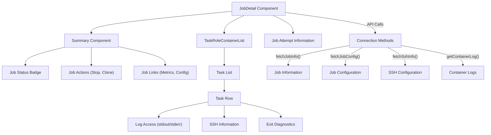
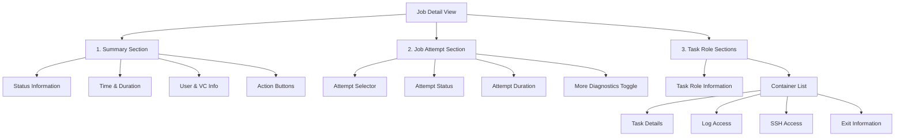
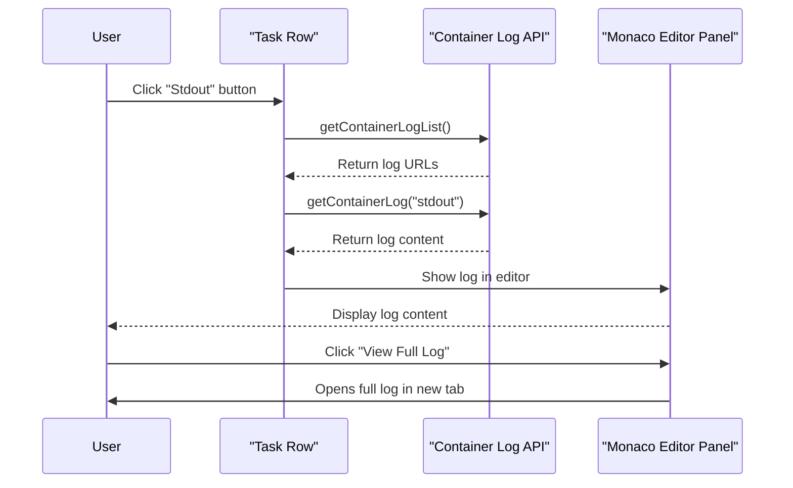
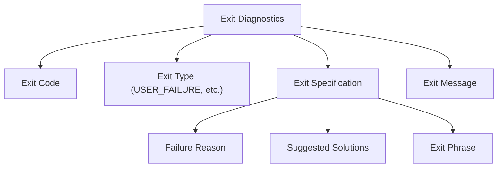
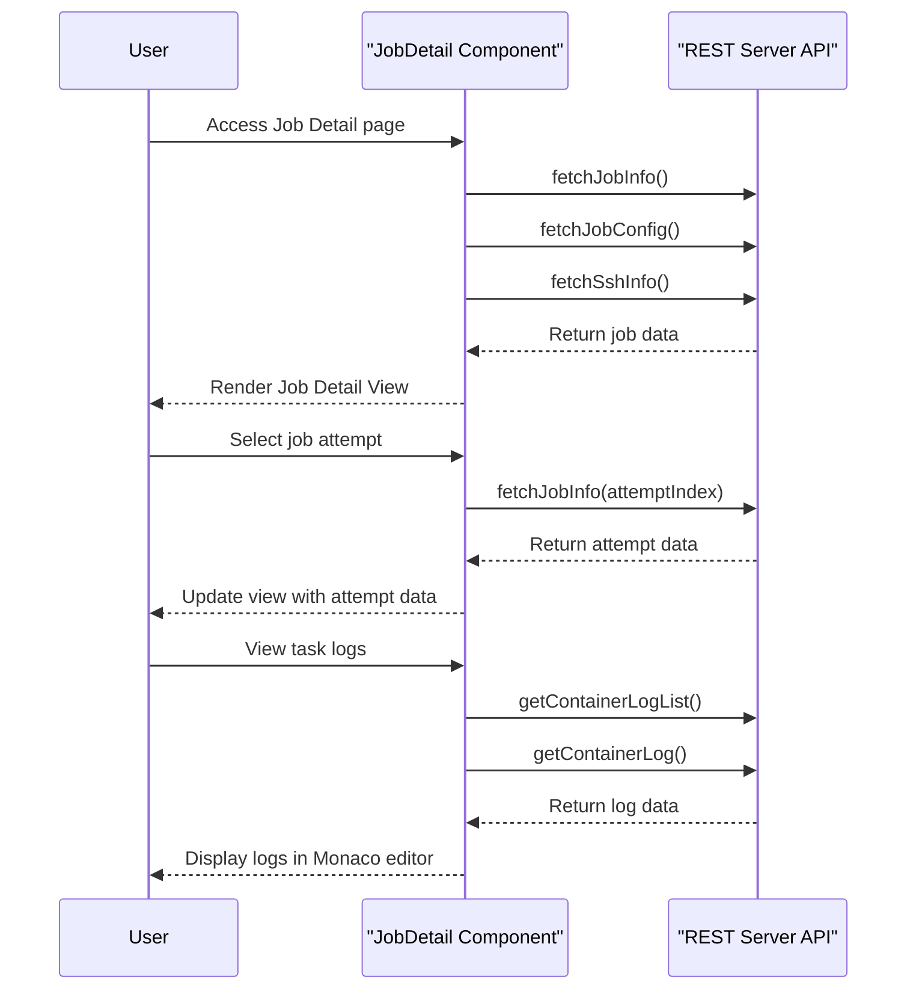

<!-- source: DeepWiki mcp.deepwiki.com · repo microsoft/pai · page 5.3 Job Detail View · fetched 2026-10-26 -->

# Job Detail View

Relevant source files

The following files were used as context for generating this wiki page:

- [src/webportal/.browserslistrc](src/webportal/.browserslistrc)
- [src/webportal/src/app/components/status-badge.jsx](src/webportal/src/app/components/status-badge.jsx)
- [src/webportal/src/app/components/tachyons.scss](src/webportal/src/app/components/tachyons.scss)
- [src/webportal/src/app/components/theme.js](src/webportal/src/app/components/theme.js)
- [src/webportal/src/app/job/job-view/fabric/job-detail.jsx](src/webportal/src/app/job/job-view/fabric/job-detail.jsx)
- [src/webportal/src/app/job/job-view/fabric/job-detail/components/summary.jsx](src/webportal/src/app/job/job-view/fabric/job-detail/components/summary.jsx)
- [src/webportal/src/app/job/job-view/fabric/job-detail/components/task-role-container-list.jsx](src/webportal/src/app/job/job-view/fabric/job-detail/components/task-role-container-list.jsx)
- [src/webportal/src/app/job/job-view/fabric/job-detail/conn.js](src/webportal/src/app/job/job-view/fabric/job-detail/conn.js)
- [src/webportal/src/app/job/job-view/fabric/job-detail/util.js](src/webportal/src/app/job/job-view/fabric/job-detail/util.js)
- [src/webportal/src/app/job/job-view/fabric/job-event.jsx](src/webportal/src/app/job/job-view/fabric/job-event.jsx)
- [src/webportal/src/app/job/job-view/fabric/job-event/conn.js](src/webportal/src/app/job/job-view/fabric/job-event/conn.js)
- [src/webportal/src/app/job/job-view/fabric/job-event/job-event-list.jsx](src/webportal/src/app/job/job-view/fabric/job-event/job-event-list.jsx)
- [src/webportal/src/app/job/job-view/fabric/job-list.jsx](src/webportal/src/app/job/job-view/fabric/job-list.jsx)
- [src/webportal/src/app/job/job-view/fabric/task-attempt/conn.js](src/webportal/src/app/job/job-view/fabric/task-attempt/conn.js)
- [src/webportal/src/app/job/job-view/fabric/task-attempt/task-attempt-list.jsx](src/webportal/src/app/job/job-view/fabric/task-attempt/task-attempt-list.jsx)

## Purpose and Scope

The Job Detail View provides a comprehensive interface for monitoring and managing individual jobs in OpenPAI. This page documents the components, features, and usage of the Job Detail View interface, allowing users to track job status, access logs, and perform management actions. For information about submitting jobs, see [Job Submission](#5.1), and for viewing the list of all jobs, see [Job List View](#5.2).

## Architecture Overview

The Job Detail View is structured as a hierarchy of React components that retrieve and display job information from the REST Server API.

Sources:
- [src/webportal/src/app/job/job-view/fabric/job-detail.jsx:49-552]()
- [src/webportal/src/app/job/job-view/fabric/job-detail/conn.js:1-211]()

## User Interface Components

The Job Detail View is composed of three main sections:

Sources:
- [src/webportal/src/app/job/job-view/fabric/job-detail.jsx:360-546]()
- [src/webportal/src/app/job/job-view/fabric/job-detail/components/summary.jsx:81-482]()

### 1. Job Summary Section

The summary section provides key information about the job and actions:

| Field | Description |
|-------|-------------|
| Job Name | Name of the job |
| Job State | Current state with visual status badge (Running, Waiting, Succeeded, Failed, Stopped) |
| Submission Time | When the job was submitted |
| User | Username of the job submitter |
| Virtual Cluster | The virtual cluster where the job is running |
| Duration | Total running time of the job |
| Retries | Number of job retry attempts |

The section also includes action buttons and links:
- View Job Config: Opens the job configuration in YAML/JSON format
- Go to Job Metrics Page: Links to Grafana dashboards for job metrics
- Go to Job Event Page: Shows job-related events
- TensorBoard Page: Available for jobs with TensorBoard enabled
- Clone/Stop buttons: Actions to clone or stop the job

Sources:
- [src/webportal/src/app/job/job-view/fabric/job-detail/components/summary.jsx:257-478]()
- [src/webportal/src/app/components/status-badge.jsx:151-168]()

### 2. Job Attempt Information

For jobs with multiple attempts (retries), this section provides:

- A dropdown to select different job attempts
- Information about the selected attempt:
  - Attempt state (with status badge)
  - Creation time and duration
  - Running start time and duration
- "View Exit Diagnostics" link for failed attempts
- "More Diagnostics" toggle for additional technical information

Sources:
- [src/webportal/src/app/job/job-view/fabric/job-detail.jsx:442-516]()

### 3. Task Role Container List

This section displays information about each task in a task role:

| Column | Description |
|--------|-------------|
| Task Index | Index number of the task |
| Task State | Current state with visual indicator |
| Task Retries | Number of retries for this task |
| IP | IP address of the container |
| Ports | Exposed ports of the container |
| Info & Logs | Buttons for accessing logs and SSH info |
| Exit Type | Type of exit for completed tasks |
| Exit Code | Exit code for completed tasks |

When "More Diagnostics" is enabled, additional columns appear:
- Running Start Time
- Running Duration
- Node Name
- Exit Diagnostics (button to show detailed diagnostics)
- Container ID

Sources:
- [src/webportal/src/app/job/job-view/fabric/job-detail/components/task-role-container-list.jsx:567-950]()
- [src/webportal/src/app/job/job-view/fabric/job-detail.jsx:526-531]()

## Key Features

### Log Access

The Task Role Container List provides multiple ways to access logs:

Log viewing options:
1. **Stdout**: Shows standard output (last 16KB)
2. **Stderr**: Shows standard error (last 16KB)
3. **Stdout+Stderr**: Shows merged output and error streams
4. **Show All Logs**: Opens a dialog with links to all log files

Sources:
- [src/webportal/src/app/job/job-view/fabric/job-detail/components/task-role-container-list.jsx:719-789]()
- [src/webportal/src/app/job/job-view/fabric/job-detail/conn.js:159-210]()

### SSH Access

For running tasks, the view provides SSH information to connect to containers:

1. Click the "SSH Info" button for a task
2. A dialog appears with connection instructions
3. Follow the provided commands to connect to the container via SSH

The SSH information adapts to the job configuration, providing different instructions for Kubernetes-based jobs versus legacy deployment mode.

Sources:
- [src/webportal/src/app/job/job-view/fabric/job-detail/components/task-role-container-list.jsx:305-405]()

### Exit Diagnostics

For failed or completed tasks, detailed diagnostics are available:

The diagnostics help users understand:
- Why a job or task failed
- What the exit code means
- Possible solutions to fix the issue
- Detailed error messages for troubleshooting

Sources:
- [src/webportal/src/app/job/job-view/fabric/job-detail/components/task-role-container-list.jsx:864-926]()
- [src/webportal/src/app/job/job-view/fabric/job-detail/components/summary.jsx:142-255]()
- [src/webportal/src/app/job/job-view/fabric/job-detail.jsx:185-245]()

## Data Flow and Interactions

The Job Detail View loads and updates data through REST API calls:

Sources:
- [src/webportal/src/app/job/job-view/fabric/job-detail.jsx:84-158]()
- [src/webportal/src/app/job/job-view/fabric/job-detail/conn.js:46-156]()

## Technical Implementation

The Job Detail View is implemented as a React component hierarchy:

- `JobDetail`: Main container component that fetches and manages job data
- `Summary`: Displays job summary information and actions
- `TaskRoleContainerList`: Displays task information for each task role
- `MonacoPanel`: Used for displaying logs and configuration

The components use auto-refresh functionality to update the display:
- Users can select refresh intervals (10s, 30s, 60s) or disable auto-refresh
- Components use a `Timer` component to trigger periodic updates

Sources:
- [src/webportal/src/app/job/job-view/fabric/job-detail.jsx:49-83]()
- [src/webportal/src/app/job/job-view/fabric/job-detail/components/summary.jsx:324-347]()
- [src/webportal/src/app/job/job-view/fabric/job-detail/components/task-role-container-list.jsx:528-534]()

## Usage Guide

### Viewing Job Status and Information

1. The Status Badge in the summary section indicates the current job state
2. Job duration, submission time, and other basic information is displayed in the summary
3. For failed jobs, look for error information and suggested solutions in the summary section
4. Use the auto-refresh dropdown to control how often the data updates

### Working with Job Attempts

1. Use the "Job Attempt Index" dropdown to select a specific job attempt
2. The latest attempt is indicated with "(latest)" in the dropdown
3. View attempt-specific information such as creation time, duration, and status
4. For failed attempts, click "View Exit Diagnostics" to see detailed error information

### Accessing Task Logs

1. In the Task Role Container List, find the task you want to view logs for
2. Use the log buttons in the "Info & Logs" column:
   - Click "Stdout" to view standard output
   - Click "Stderr" to view standard error
   - Use the dropdown menu for "Stdout+Stderr" or "Show All Logs"
3. The log viewer displays the last 16KB of logs by default
4. Click "View Full Log" to access the complete log file

### Connecting to Running Containers

1. Find a running task in the Task Role Container List
2. Click "SSH Info" to view SSH connection instructions
3. Follow the provided commands to connect to the container
4. The SSH information varies based on your job configuration and OpenPAI deployment mode

### Troubleshooting Failed Tasks

1. Check the task state and exit code in the Task Role Container List
2. For failed tasks, look at the Exit Type and Exit Code columns
3. Click "Show Exit Diagnostics" to view detailed error information
4. Check the task logs for specific error messages
5. For consistent resource conflicts, adjust the resource requirements in your job configuration

## Summary

The Job Detail View is a comprehensive interface for monitoring and managing jobs in OpenPAI. It provides detailed information about job status, tasks, logs, and exit diagnostics, enabling users to effectively track job progress and troubleshoot issues when they occur.

Sources:
- [src/webportal/src/app/job/job-view/fabric/job-detail.jsx:1-552]()
- [src/webportal/src/app/job/job-view/fabric/job-detail/components/summary.jsx:1-494]()
- [src/webportal/src/app/job/job-view/fabric/job-detail/components/task-role-container-list.jsx:1-963]()

---

