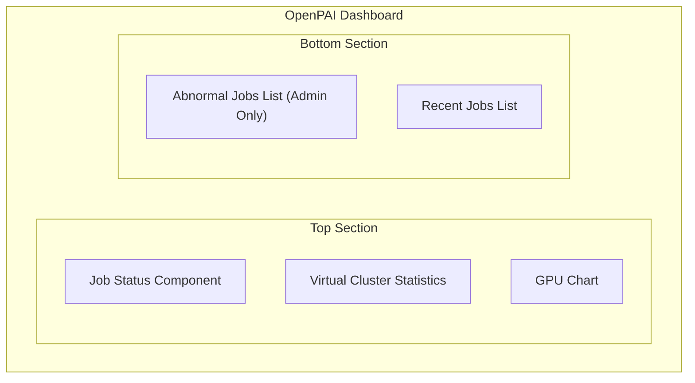
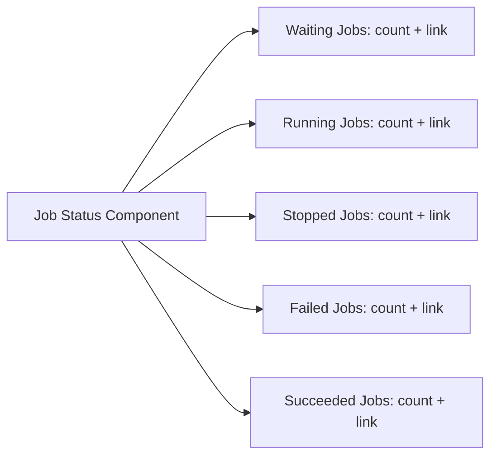
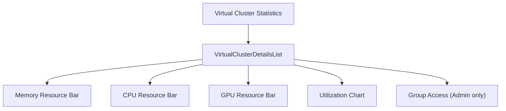
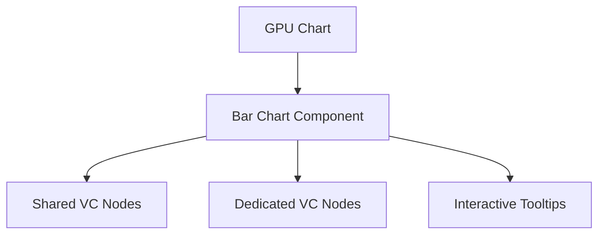
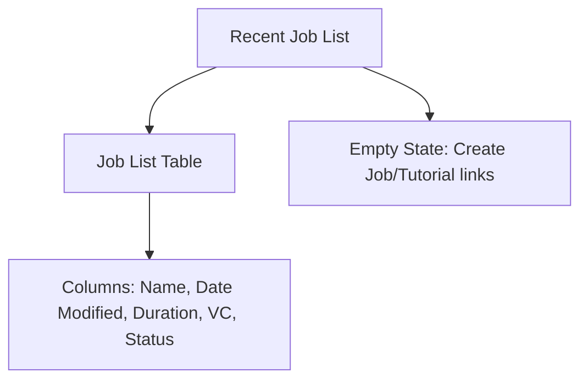
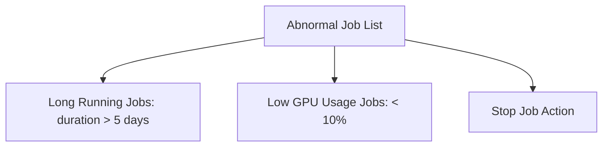
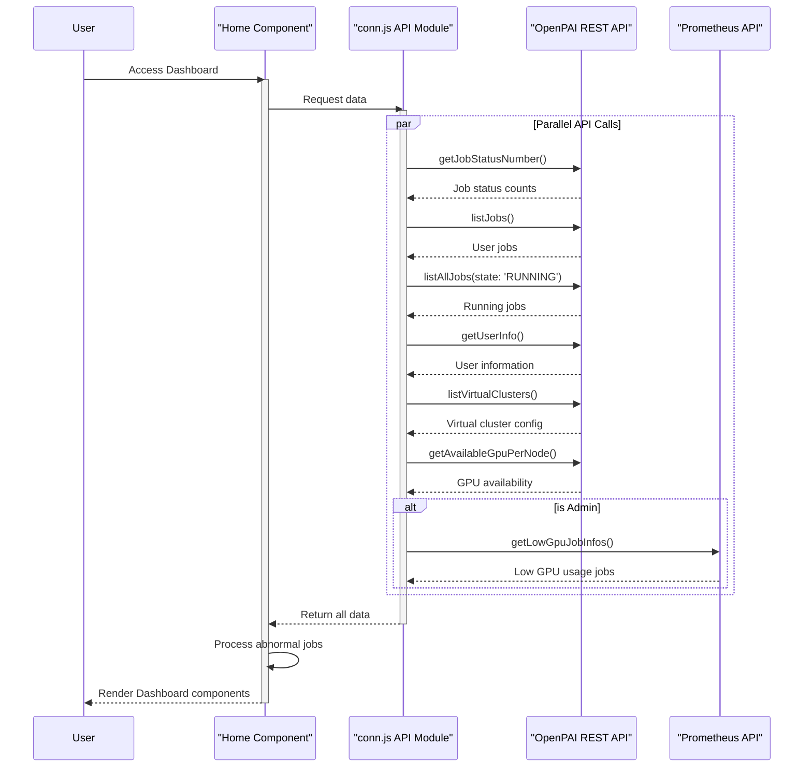
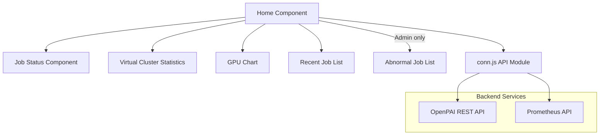
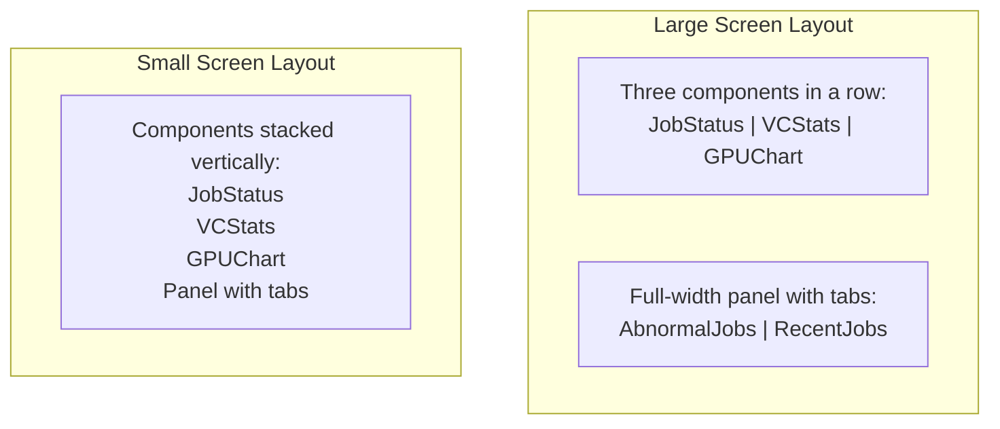

<!-- source: DeepWiki mcp.deepwiki.com · repo microsoft/pai · page 5.4 Dashboard · fetched 2026-10-26 -->

# Dashboard

Relevant source files

The following files were used as context for generating this wiki page:

- [src/webportal/src/app/components/util/job.js](src/webportal/src/app/components/util/job.js)
- [src/webportal/src/app/home/home.jsx](src/webportal/src/app/home/home.jsx)
- [src/webportal/src/app/home/home/abnormal-job-list.jsx](src/webportal/src/app/home/home/abnormal-job-list.jsx)
- [src/webportal/src/app/home/home/c3.scss](src/webportal/src/app/home/home/c3.scss)
- [src/webportal/src/app/home/home/conn.js](src/webportal/src/app/home/home/conn.js)
- [src/webportal/src/app/home/home/gpu-chart.jsx](src/webportal/src/app/home/home/gpu-chart.jsx)
- [src/webportal/src/app/home/home/header.jsx](src/webportal/src/app/home/home/header.jsx)
- [src/webportal/src/app/home/home/job-status.jsx](src/webportal/src/app/home/home/job-status.jsx)
- [src/webportal/src/app/home/home/recent-job-list.jsx](src/webportal/src/app/home/home/recent-job-list.jsx)
- [src/webportal/src/app/home/home/resource-bar.jsx](src/webportal/src/app/home/home/resource-bar.jsx)
- [src/webportal/src/app/home/home/util.js](src/webportal/src/app/home/home/util.js)
- [src/webportal/src/app/home/home/utilization-chart.jsx](src/webportal/src/app/home/home/utilization-chart.jsx)
- [src/webportal/src/app/home/home/virtual-cluster-statistics.jsx](src/webportal/src/app/home/home/virtual-cluster-statistics.jsx)
- [src/webportal/src/app/home/index/bottom.jsx](src/webportal/src/app/home/index/bottom.jsx)
- [src/webportal/src/app/home/index/jumbotron.jsx](src/webportal/src/app/home/index/jumbotron.jsx)
- [src/webportal/src/app/layout/components/navbar.jsx](src/webportal/src/app/layout/components/navbar.jsx)
- [src/webportal/src/assets/img/sign-in-background.svg](src/webportal/src/assets/img/sign-in-background.svg)

The Dashboard serves as the primary landing page for users after logging into the OpenPAI web portal. It provides an at-a-glance overview of job status, resource allocation, and system health. This page offers different information and capabilities depending on whether the user has admin privileges or not.

For information about accessing specific job details, see [Job Detail View](#5.3). For information about navigating the complete list of jobs, see [Job List View](#5.2).

## Overview

The Dashboard combines multiple visual components to give users immediate insights into:

1. Job status counts across different states
2. Virtual cluster resource allocation and utilization
3. GPU resource availability across nodes
4. Recent jobs submitted by the user
5. Abnormal jobs requiring attention (admin-only view)

These components are arranged differently based on screen size, providing a responsive experience for both desktop and mobile users.

Sources:
- [src/webportal/src/app/home/home.jsx:94-207]()

## Dashboard Components

### Job Status Component

The Job Status component provides a summary of job counts organized by their current state: Waiting, Running, Stopped, Failed, and Succeeded. Each status category includes:

- A status badge indicating the state
- The count of jobs in that state
- A "View all" button that links to the Job List page filtered by that status

For regular users, this component shows only their own jobs. For administrators, it displays counts for all jobs in the system.

Sources:
- [src/webportal/src/app/home/home/job-status.jsx:79-159]()
- [src/webportal/src/app/home/home.jsx:99-102]()
- [src/webportal/src/app/home/home.jsx:154-157]()

### Virtual Cluster Statistics

This component displays resource allocation and utilization for virtual clusters the user has access to. For each virtual cluster, it shows:

- A utilization chart showing the overall resource usage percentage
- Resource bars for Memory, CPU, and GPU utilization
- Detailed metrics of used resources vs. total resources
- For admin users, information about which user groups have access to each virtual cluster

Regular users only see virtual clusters they have permission to access, while administrators see all virtual clusters in the system.

Sources:
- [src/webportal/src/app/home/home/virtual-cluster-statistics.jsx:246-295]()
- [src/webportal/src/app/home/home.jsx:104-108]()
- [src/webportal/src/app/home/home.jsx:158-162]()

### GPU Chart

The GPU Chart visualizes GPU availability across all nodes in the cluster. It displays:

- A bar chart showing the distribution of nodes by the number of available GPUs
- Distinction between GPUs in shared virtual clusters and dedicated virtual clusters
- Interactive tooltips providing detailed information when hovering over chart elements

This component helps users understand where GPU resources are available and plan their job submissions accordingly.

Sources:
- [src/webportal/src/app/home/home/gpu-chart.jsx:45-469]()
- [src/webportal/src/app/home/home.jsx:109-114]()
- [src/webportal/src/app/home/home.jsx:163-168]()

### Recent Job List

The Recent Job List displays the user's most recently submitted jobs (up to 10), sorted by the most recently modified. Each job entry shows:

- Job name (with a link to the Job Detail page)
- Date modified
- Duration
- Virtual cluster
- Current status with a visual status badge

If the user hasn't submitted any jobs, a welcome message is displayed with links to create a job or view tutorials.

Sources:
- [src/webportal/src/app/home/home/recent-job-list.jsx:89-170]()
- [src/webportal/src/app/home/home.jsx:134-141]()
- [src/webportal/src/app/home/home.jsx:189-193]()

### Abnormal Job List (Admin Only)

Available only to administrators, this component identifies jobs that require attention:

- Long-running jobs (executing for more than 5 days)
- Jobs with low GPU utilization (less than 10%)

Each job entry includes details about the job and a "Stop" button allowing administrators to terminate problematic jobs directly from the dashboard. Long-running jobs show their duration in red, while low GPU usage jobs display their GPU usage percentage in red.

Sources:
- [src/webportal/src/app/home/home/abnormal-job-list.jsx:51-218]()
- [src/webportal/src/app/components/util/job.js:111-150]()
- [src/webportal/src/app/home/home.jsx:129-131]()
- [src/webportal/src/app/home/home.jsx:183-186]()

## Data Flow Architecture

The Dashboard operates through a clear data flow pattern, starting from API requests to rendering the final UI components:

The main component makes parallel API calls to fetch all necessary data when the Dashboard loads. After receiving the data, it processes and distributes it to each subcomponent for rendering. For administrators, additional processing is performed to identify abnormal jobs by combining long-running jobs and low GPU usage information.

Sources:
- [src/webportal/src/app/home/home.jsx:60-89]()
- [src/webportal/src/app/home/home/conn.js:38-151]()

## Component Relationship

This diagram shows how the Dashboard components interact with each other and with the backend API services:

Sources:
- [src/webportal/src/app/home/home.jsx:49-209]()

## Responsive Design

The Dashboard implements a responsive design that adapts to different screen sizes:

For large screens (width > 1400px), the components are arranged in a grid layout with the top row showing Job Status, Virtual Cluster Statistics, and GPU Chart side by side. The bottom panel spans the full width.

For small screens (width ≤ 1400px), the components stack vertically with each taking the full width of the screen.

Sources:
- [src/webportal/src/app/home/home.jsx:97-145]()
- [src/webportal/src/app/home/home.jsx:148-206]()
- [src/webportal/src/app/home/home/util.js:23-24]()

## User Experience Differences

The Dashboard provides different experiences based on the user's role:

| Feature | Regular User | Administrator |
|---------|--------------|---------------|
| Job Status | Shows only user's jobs | Shows all jobs in the system |
| Virtual Clusters | Shows only accessible clusters | Shows all virtual clusters |
| Bottom Panel | Only Recent Jobs tab | Both Recent Jobs and Abnormal Jobs tabs |
| Group Details | Not available | Can view user groups with access to each VC |
| Job Control | Cannot stop jobs from dashboard | Can stop abnormal jobs directly |

Sources:
- [src/webportal/src/app/home/home.jsx:58]()
- [src/webportal/src/app/home/home.jsx:62-66]()
- [src/webportal/src/app/home/home.jsx:117-142]()
- [src/webportal/src/app/home/home.jsx:174-202]()
- [src/webportal/src/app/home/home/virtual-cluster-statistics.jsx:45-255]()

## Implementation Details

### Abnormal Job Detection

The system identifies two types of abnormal jobs:

1. **Long-running jobs**: Jobs running for more than 5 days (defined by `MIN_ABNORMAL_JOB_DURATION_MILLISECOND` constant set to 5 days in milliseconds)
2. **Low GPU utilization jobs**: Jobs using less than 10% of their allocated GPU resources

Abnormal jobs are identified by:
1. Filtering running jobs to find those created more than 5 days ago
2. Querying Prometheus metrics with the expression `avg(avg_over_time(task_gpu_percent[10m]) < 10) by (job_name)` to identify jobs with GPU utilization below 10%
3. Merging these two lists to create a comprehensive view of potentially problematic jobs

Sources:
- [src/webportal/src/app/components/util/job.js:21-117]()
- [src/webportal/src/app/home/home/conn.js:123-144]()
- [src/webportal/src/app/components/util/job.js:119-150]()

### Resource Utilization Visualization

The Dashboard uses several visualization techniques:

1. **Utilization Chart**: A donut chart showing the percentage of resources being used, with color coding based on utilization levels:
   - Green: < 50% utilization
   - Yellow: 50-90% utilization
   - Red: > 90% utilization

2. **Resource Bars**: Horizontal bars showing memory, CPU, and GPU usage with the same color coding scheme

3. **GPU Distribution Chart**: A bar chart showing the distribution of nodes by available GPUs, with different colors for shared and dedicated virtual clusters

Sources:
- [src/webportal/src/app/home/home/utilization-chart.jsx:28-100]()
- [src/webportal/src/app/home/home/resource-bar.jsx:16-79]()
- [src/webportal/src/app/home/home/gpu-chart.jsx:105-240]()

## Tables and Data Structures

### Job List Table Columns

The job list tables (both Recent Jobs and Abnormal Jobs) use the following column structure:

| Column | Description | Special Features |
|--------|-------------|-----------------|
| Name | Job name linked to job details | Clickable link to job detail page |
| GPUs (Abnormal Jobs only) | GPU count and usage percentage | Shows usage in red if below 10% |
| Date Modified | Last modification timestamp | Formatted date and time |
| User (Abnormal Jobs only) | Job owner username | - |
| Duration | Running time of the job | Shows in red if abnormally long |
| Virtual Cluster | The VC where the job is running | - |
| Status | Current job state | Visual status badge |
| Action (Abnormal Jobs only) | Stop button for jobs | Only enabled for stoppable jobs |

Sources:
- [src/webportal/src/app/home/home/recent-job-list.jsx:89-137]()
- [src/webportal/src/app/home/home/abnormal-job-list.jsx:56-176]()

### Virtual Cluster Table Columns

The Virtual Cluster Statistics component displays the following columns:

| Column | Description | Admin-only Features |
|--------|-------------|-------------------|
| Name | Virtual cluster name | Shows "(dedicated)" label if applicable |
| Allocation | Utilization chart showing resource usage | - |
| Detail | Resource bars for Memory, CPU, and GPU | Shows used vs. (total - bad) resources |
| Granted Groups | User groups with access to the VC | Shows group names and detail button |

Sources:
- [src/webportal/src/app/home/home/virtual-cluster-statistics.jsx:46-203]()

## Conclusion

The OpenPAI Dashboard provides a comprehensive overview of the system's current state, resource utilization, and job status. Its responsive design, role-based information display, and interactive elements make it an effective tool for both regular users and administrators to monitor and manage their AI workloads.

For administrators, the Dashboard serves as a central monitoring point to identify problematic jobs and take quick action. For regular users, it offers a quick summary of their jobs and available resources, helping them plan their work efficiently.

---

