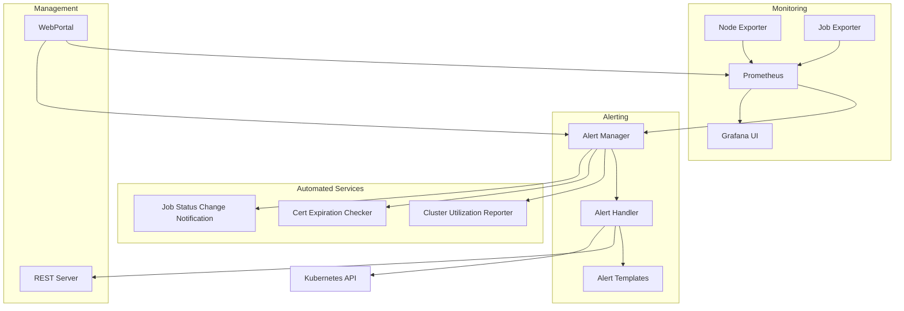
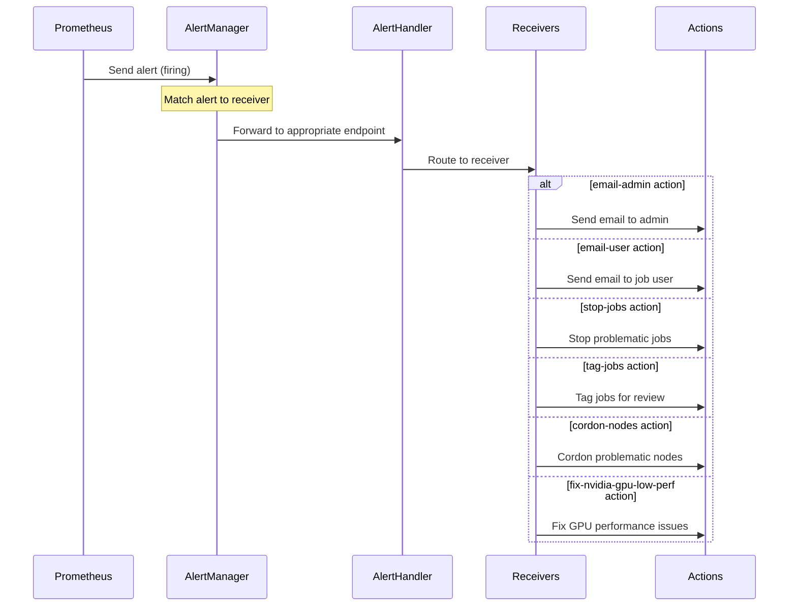
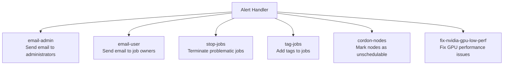
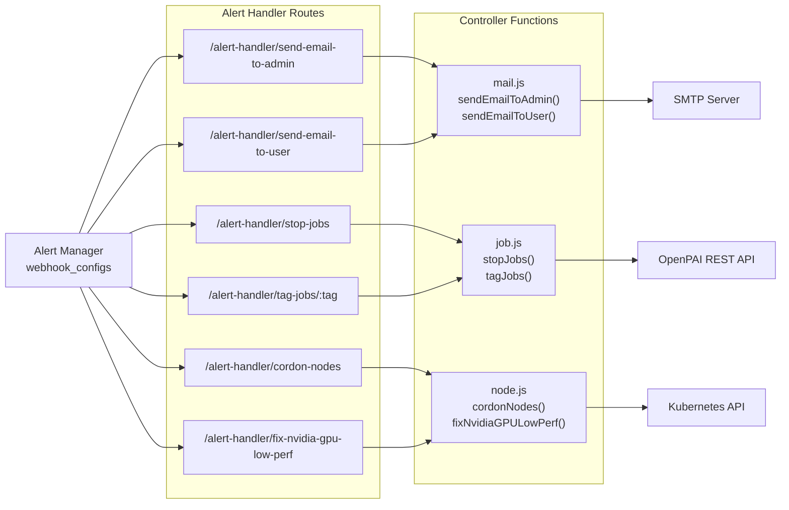

<!-- source: DeepWiki mcp.deepwiki.com · repo microsoft/pai · page 6 Monitoring and Alerting · fetched 2026-10-26 -->

# Monitoring and Alerting

<details>
<summary>Relevant source files</summary>

The following files were used as context for generating this wiki page:

- [contrib/kubespray/quick-start/services-configuration.yaml.template](contrib/kubespray/quick-start/services-configuration.yaml.template)
- [deployment/quick-start/services-configuration.yaml.template](deployment/quick-start/services-configuration.yaml.template)
- [docs/manual/cluster-admin/how-to-use-alert-system.md](docs/manual/cluster-admin/how-to-use-alert-system.md)
- [docs_zh_CN/manual/cluster-admin/how-to-use-alert-system.md](docs_zh_CN/manual/cluster-admin/how-to-use-alert-system.md)
- [examples/cluster-configuration/services-configuration.yaml](examples/cluster-configuration/services-configuration.yaml)
- [src/alert-manager/build/alert-handler.common.dockerfile](src/alert-manager/build/alert-handler.common.dockerfile)
- [src/alert-manager/build/build-pre.sh](src/alert-manager/build/build-pre.sh)
- [src/alert-manager/build/cert-expiration-checker.common.dockerfile](src/alert-manager/build/cert-expiration-checker.common.dockerfile)
- [src/alert-manager/build/cluster-utilization.common.dockerfile](src/alert-manager/build/cluster-utilization.common.dockerfile)
- [src/alert-manager/build/job-status-change-notification.common.dockerfile](src/alert-manager/build/job-status-change-notification.common.dockerfile)
- [src/alert-manager/build/nvidia-gpu-low-perf-fixer.common.dockerfile](src/alert-manager/build/nvidia-gpu-low-perf-fixer.common.dockerfile)
- [src/alert-manager/config/alert-manager.md](src/alert-manager/config/alert-manager.md)
- [src/alert-manager/config/alert-manager.yaml](src/alert-manager/config/alert-manager.yaml)
- [src/alert-manager/config/alert_manager.py](src/alert-manager/config/alert_manager.py)
- [src/alert-manager/deploy/alert-manager-configmap.yaml.template](src/alert-manager/deploy/alert-manager-configmap.yaml.template)
- [src/alert-manager/deploy/alert-manager-deployment.yaml.template](src/alert-manager/deploy/alert-manager-deployment.yaml.template)
- [src/alert-manager/deploy/rbac.yaml](src/alert-manager/deploy/rbac.yaml)
- [src/alert-manager/deploy/service.yaml](src/alert-manager/deploy/service.yaml)
- [src/alert-manager/deploy/start.sh.template](src/alert-manager/deploy/start.sh.template)
- [src/alert-manager/deploy/stop.sh](src/alert-manager/deploy/stop.sh)
- [src/alert-manager/src/alert-handler/controllers/job.js](src/alert-manager/src/alert-handler/controllers/job.js)
- [src/alert-manager/src/alert-handler/controllers/mail.js](src/alert-manager/src/alert-handler/controllers/mail.js)
- [src/alert-manager/src/alert-handler/controllers/node.js](src/alert-manager/src/alert-handler/controllers/node.js)
- [src/alert-manager/src/alert-handler/index.js](src/alert-manager/src/alert-handler/index.js)
- [src/alert-manager/src/alert-handler/package.json](src/alert-manager/src/alert-handler/package.json)
- [src/alert-manager/src/alert-handler/routes/actions.js](src/alert-manager/src/alert-handler/routes/actions.js)
- [src/alert-manager/src/alert-handler/yarn.lock](src/alert-manager/src/alert-handler/yarn.lock)
- [src/alert-manager/src/cert-expiration-checker/__init__.py](src/alert-manager/src/cert-expiration-checker/__init__.py)
- [src/alert-manager/src/cert-expiration-checker/pylintrc](src/alert-manager/src/cert-expiration-checker/pylintrc)
- [src/alert-manager/src/cert-expiration-checker/requirements.txt](src/alert-manager/src/cert-expiration-checker/requirements.txt)
- [src/alert-manager/src/cert-expiration-checker/send_alert.py](src/alert-manager/src/cert-expiration-checker/send_alert.py)
- [src/alert-manager/src/job-status-change-notification/.editorconfig](src/alert-manager/src/job-status-change-notification/.editorconfig)
- [src/alert-manager/src/job-status-change-notification/.eslintrc.js](src/alert-manager/src/job-status-change-notification/.eslintrc.js)
- [src/alert-manager/src/job-status-change-notification/controllers/alert.js](src/alert-manager/src/job-status-change-notification/controllers/alert.js)
- [src/alert-manager/src/job-status-change-notification/controllers/framework.js](src/alert-manager/src/job-status-change-notification/controllers/framework.js)
- [src/prometheus/deploy/alerting/customized.rules.template](src/prometheus/deploy/alerting/customized.rules.template)

</details>


OpenPAI includes a comprehensive monitoring and alerting system that helps cluster administrators track system health, resource utilization, and job performance. This document explains how to use and customize the monitoring and alerting features to detect issues in your cluster and take automated actions in response.

## System Architecture

The monitoring and alerting system in OpenPAI consists of several interconnected components that work together to detect issues and respond to them.

### Component Overview Diagram



Sources: [src/alert-manager/deploy/alert-manager-deployment.yaml.template](), [src/alert-manager/src/alert-handler/index.js](), [src/alert-manager/config/alert_manager.py]()

### Alert Flow Diagram



Sources: [src/alert-manager/deploy/alert-manager-configmap.yaml.template](), [src/alert-manager/src/alert-handler/routes/actions.js]()

## Alert Rules

Alert rules define the conditions that trigger alerts. OpenPAI uses Prometheus to evaluate these rules against collected metrics.

### How Alert Rules Work

An alert rule consists of:
- A name that identifies the alert
- An expression (in PromQL) that defines the condition
- A duration for which the condition must be true before firing
- Labels to categorize the alert
- Annotations with human-readable information

Example rule:
```yaml
alert: PAIJobGpuPercentLowerThan0_3For1h
expr: avg(task_gpu_percent{virtual_cluster=~"default"}) by (job_name, username) < 0.3
for: 1h
labels:
  severity: warn
annotations:
  summary: "{{$labels.job_name}} has a job gpu percent lower than 30% for 1 hour"
  description: Monitor job level gpu utilization in certain virtual clusters.
```

This rule fires when a job's average GPU utilization on the "default" virtual cluster is below 30% for more than an hour.

Sources: [docs/manual/cluster-admin/how-to-use-alert-system.md:35-53](), [examples/cluster-configuration/services-configuration.yaml:152-163]()

### Predefined Metrics

OpenPAI provides many built-in metrics that you can use in alert rules:

| Metric Name | Description | Use Case |
|-------------|-------------|----------|
| task_gpu_percent | GPU usage percent for a task | Detect low GPU utilization |
| task_cpu_percent | CPU usage percent for a task | Detect high/low CPU usage |
| node_memory_MemTotal_bytes | Total memory in bytes | Track memory resources |
| node_memory_MemAvailable_bytes | Available memory in bytes | Detect memory shortage |
| gpu_used_by_external_process_count | Count of GPU used by external processes | Detect unauthorized GPU usage |

Sources: [docs/manual/cluster-admin/how-to-use-alert-system.md:25-31]()

### Adding Custom Alert Rules

You can add custom alert rules in the `services-configuration.yml` file under the `prometheus` section:

```yaml
prometheus:
  customized-alerts: |
    groups:
    - name: customized-alerts
      rules:
      - alert: PAIJobGpuPercentLowerThan0_3For1h
        expr: avg(task_gpu_percent{virtual_cluster=~"default"}) by (job_name, username) < 0.3
        for: 1h
        labels:
          severity: warn
        annotations:
          summary: "{{$labels.job_name}} has a job gpu percent lower than 30% for 1 hour"
          description: Monitor job level gpu utilization in certain virtual clusters.
```

After modifying the configuration, you need to update the cluster and restart the Prometheus service:

```bash
./paictl.py service stop -n prometheus
./paictl.py config push -p /cluster-configuration -m service
./paictl.py service start -n prometheus
```

Sources: [docs/manual/cluster-admin/how-to-use-alert-system.md:35-67]()

## Alert Actions and Routes

When alerts are triggered, OpenPAI can take various actions in response. These actions are configured in the Alert Manager and executed by the Alert Handler.

### Available Alert Actions



Sources: [src/alert-manager/src/alert-handler/routes/actions.js](), [docs/manual/cluster-admin/how-to-use-alert-system.md:110-118]()

### Action Requirements

Each action has specific configuration requirements:

| Action | email-configs | pai-bearer-token | Dependent Labels |
|--------|---------------|------------------|------------------|
| email-admin | Required | Not Required | None |
| email-user | Required | Required | None |
| stop-jobs | Not Required | Required | job_name |
| tag-jobs | Not Required | Required | job_name |
| cordon-nodes | Not Required | Not Required | node_name |
| fix-nvidia-gpu-low-perf | Not Required | Not Required | node_name, minor_number |

Sources: [docs/manual/cluster-admin/how-to-use-alert-system.md:119-140](), [src/alert-manager/config/alert_manager.md:36-42]()

### Alert Routing

Routes determine which alerts trigger which actions. Routing is based on matching alert labels to receivers. A receiver is a group of actions.

Default configuration routes all alerts to the `email-admin` action. Custom routes can be added in `services-configuration.yml`:

```yaml
alert-manager:
  customized-routes:
    routes:
    - receiver: pai-email-admin-user-and-stop-job
      match:
        alertname: PAIJobGpuPercentLowerThan0_3For1h
  customized-receivers:
  - name: "pai-email-admin-user-and-stop-job"
    actions:
      email-admin:
      email-user:
        template: 'kill-low-efficiency-job-alert'
      stop-jobs:
      tag-jobs:
        tags:
        - 'stopped-by-alert-manager'
```

In this example, alerts with name `PAIJobGpuPercentLowerThan0_3For1h` will be routed to the `pai-email-admin-user-and-stop-job` receiver, which will:
1. Send an email to admins
2. Send an email to the job owner using the 'kill-low-efficiency-job-alert' template
3. Stop the job
4. Add a tag 'stopped-by-alert-manager' to the job

Sources: [docs/manual/cluster-admin/how-to-use-alert-system.md:141-196](), [src/alert-manager/deploy/alert-manager-configmap.yaml.template:28-144]()

## Special Features

OpenPAI's monitoring and alerting system includes several specialized features for common administrative tasks.

### Cluster GPU Utilization Report

This feature sends periodic reports about GPU utilization to administrators. The report includes:

- Cluster-level GPU utilization
- User-level GPU utilization
- Job-level GPU utilization

To enable this feature, configure:

```yaml
alert-manager:
  pai-bearer-token: 'your-application-token-for-pai-rest-server'
  cluster-utilization:
    schedule: "0 0 * * *" # daily report at UTC 00:00
```

Sources: [docs/manual/cluster-admin/how-to-use-alert-system.md:255-291](), [contrib/kubespray/quick-start/services-configuration.yaml.template:228-231]()

### Kubernetes Certificate Expiration Checker

This feature checks for expiring Kubernetes certificates and sends alerts to administrators when they are close to expiration. To configure it:

```yaml
alert-manager:
  cert-expiration-checker:
    schedule: '0 0 * * *' # daily check at UTC 00:00
    alert-residual-days: 30 # send alert if expiration is within 30 days
    cert-path: '/etc/kubernetes/ssl' # kubernetes cert path
```

Sources: [docs/manual/cluster-admin/how-to-use-alert-system.md:286-311](), [src/alert-manager/config/alert-manager.yaml:25-28]()

### Job Status Change Notification

This feature sends email notifications to users when their jobs change status. To enable:

```yaml
alert-manager:
  pai-bearer-token: 'your-application-token-for-pai-rest-server'
  job-status-change-notification:
    enable: true
```

Users can customize which status changes trigger notifications in their job configurations.

Sources: [docs/manual/cluster-admin/how-to-use-alert-system.md:313-336](), [src/alert-manager/src/job-status-change-notification/controllers/alert.js]()

## Configuration

The monitoring and alerting system is primarily configured through the `services-configuration.yml` file.

### Core Configuration Parameters

```yaml
alert-manager:
  port: 9093 # AlertManager listening port
  pai-bearer-token: 'your-application-token-for-pai-rest-server'
  alert-handler:
    port: 9095 # AlertHandler listening port
    log-level: "info"
    email-configs:
      admin-receiver: addr-of-admin-receiver@example.com
      smtp-host: smtp.office365.com
      smtp-port: 587
      smtp-from: alert-sender@example.com
      smtp-auth-username: alert-sender@example.com
      smtp-auth-password: password-for-alert-sender
  repeat-interval: '24h' # Minimum interval between repeated alert notifications
```

Sources: [examples/cluster-configuration/services-configuration.yaml:106-145](), [deployment/quick-start/services-configuration.yaml.template:74-113]()

### Email Templates

Alert emails use customizable templates. OpenPAI provides several built-in templates:

- `general-template`: Default general-purpose template
- `cluster-usage`: Template for cluster usage reports
- `kill-low-efficiency-job-alert`: Template for low efficiency job alerts
- `job-status-change`: Template for job status change notifications

You can create custom templates by adding a folder in `pai/src/alert-manager/deploy/alert-templates` with `html.ejs` and `subject.ejs` files.

Sources: [docs/manual/cluster-admin/how-to-use-alert-system.md:186-196](), [src/alert-manager/deploy/alert-manager-deployment.yaml.template:129-138]()

### Applying Configuration Changes

After modifying the alert configuration, update the cluster with:

```bash
./paictl.py service stop -n alert-manager
./paictl.py config push -p /cluster-configuration -m service
./paictl.py service start -n alert-manager
```

Sources: [docs/manual/cluster-admin/how-to-use-alert-system.md:198-206]()

## Extending the Alerting System

### Custom Alert Actions

You can add your own alert actions by:

1. Adding a new API endpoint in the Alert Handler
2. Defining dependencies for your action
3. Updating the renderer to generate the webhook configuration

Custom actions are implemented in the `alert-handler` service, which is a lightweight Express application.

Sources: [docs/manual/cluster-admin/how-to-use-alert-system.md:208-253](), [src/alert-manager/src/alert-handler/controllers/mail.js](), [src/alert-manager/src/alert-handler/controllers/node.js]()

### Alert Handler Implementation



Sources: [src/alert-manager/src/alert-handler/routes/actions.js](), [src/alert-manager/src/alert-handler/controllers/mail.js](), [src/alert-manager/src/alert-handler/controllers/job.js](), [src/alert-manager/src/alert-handler/controllers/node.js]()

---

