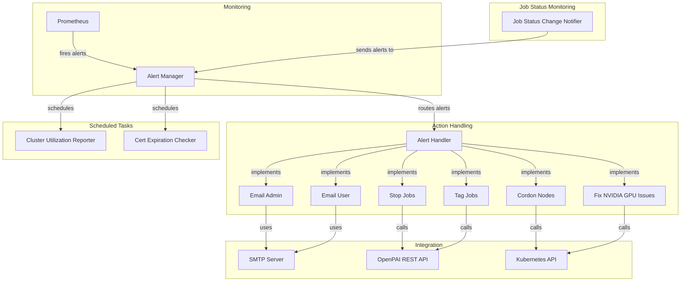
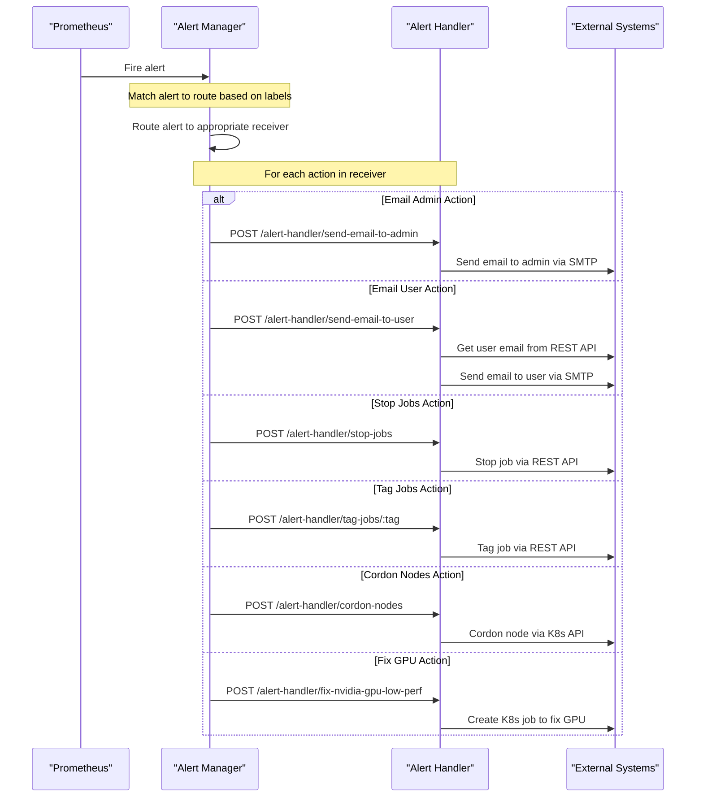
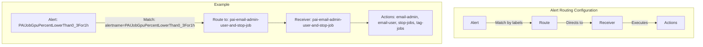

<!-- source: DeepWiki mcp.deepwiki.com · repo microsoft/pai · page 6.1 Alert Manager · fetched 2026-10-26 -->

# Alert Manager

<details>
<summary>Relevant source files</summary>

The following files were used as context for generating this wiki page:

- [contrib/kubespray/quick-start/services-configuration.yaml.template](contrib/kubespray/quick-start/services-configuration.yaml.template)
- [deployment/quick-start/services-configuration.yaml.template](deployment/quick-start/services-configuration.yaml.template)
- [docs/manual/cluster-admin/how-to-use-alert-system.md](docs/manual/cluster-admin/how-to-use-alert-system.md)
- [docs_zh_CN/manual/cluster-admin/how-to-use-alert-system.md](docs_zh_CN/manual/cluster-admin/how-to-use-alert-system.md)
- [examples/cluster-configuration/services-configuration.yaml](examples/cluster-configuration/services-configuration.yaml)
- [src/alert-manager/build/alert-handler.common.dockerfile](src/alert-manager/build/alert-handler.common.dockerfile)
- [src/alert-manager/build/build-pre.sh](src/alert-manager/build/build-pre.sh)
- [src/alert-manager/build/cert-expiration-checker.common.dockerfile](src/alert-manager/build/cert-expiration-checker.common.dockerfile)
- [src/alert-manager/build/cluster-utilization.common.dockerfile](src/alert-manager/build/cluster-utilization.common.dockerfile)
- [src/alert-manager/build/job-status-change-notification.common.dockerfile](src/alert-manager/build/job-status-change-notification.common.dockerfile)
- [src/alert-manager/build/nvidia-gpu-low-perf-fixer.common.dockerfile](src/alert-manager/build/nvidia-gpu-low-perf-fixer.common.dockerfile)
- [src/alert-manager/config/alert-manager.md](src/alert-manager/config/alert-manager.md)
- [src/alert-manager/config/alert-manager.yaml](src/alert-manager/config/alert-manager.yaml)
- [src/alert-manager/config/alert_manager.py](src/alert-manager/config/alert_manager.py)
- [src/alert-manager/deploy/alert-manager-configmap.yaml.template](src/alert-manager/deploy/alert-manager-configmap.yaml.template)
- [src/alert-manager/deploy/alert-manager-deployment.yaml.template](src/alert-manager/deploy/alert-manager-deployment.yaml.template)
- [src/alert-manager/deploy/rbac.yaml](src/alert-manager/deploy/rbac.yaml)
- [src/alert-manager/deploy/service.yaml](src/alert-manager/deploy/service.yaml)
- [src/alert-manager/deploy/start.sh.template](src/alert-manager/deploy/start.sh.template)
- [src/alert-manager/deploy/stop.sh](src/alert-manager/deploy/stop.sh)
- [src/alert-manager/src/alert-handler/controllers/job.js](src/alert-manager/src/alert-handler/controllers/job.js)
- [src/alert-manager/src/alert-handler/controllers/mail.js](src/alert-manager/src/alert-handler/controllers/mail.js)
- [src/alert-manager/src/alert-handler/controllers/node.js](src/alert-manager/src/alert-handler/controllers/node.js)
- [src/alert-manager/src/alert-handler/index.js](src/alert-manager/src/alert-handler/index.js)
- [src/alert-manager/src/alert-handler/package.json](src/alert-manager/src/alert-handler/package.json)
- [src/alert-manager/src/alert-handler/routes/actions.js](src/alert-manager/src/alert-handler/routes/actions.js)
- [src/alert-manager/src/alert-handler/yarn.lock](src/alert-manager/src/alert-handler/yarn.lock)
- [src/alert-manager/src/cert-expiration-checker/__init__.py](src/alert-manager/src/cert-expiration-checker/__init__.py)
- [src/alert-manager/src/cert-expiration-checker/pylintrc](src/alert-manager/src/cert-expiration-checker/pylintrc)
- [src/alert-manager/src/cert-expiration-checker/requirements.txt](src/alert-manager/src/cert-expiration-checker/requirements.txt)
- [src/alert-manager/src/cert-expiration-checker/send_alert.py](src/alert-manager/src/cert-expiration-checker/send_alert.py)
- [src/alert-manager/src/job-status-change-notification/.editorconfig](src/alert-manager/src/job-status-change-notification/.editorconfig)
- [src/alert-manager/src/job-status-change-notification/.eslintrc.js](src/alert-manager/src/job-status-change-notification/.eslintrc.js)
- [src/alert-manager/src/job-status-change-notification/controllers/alert.js](src/alert-manager/src/job-status-change-notification/controllers/alert.js)
- [src/alert-manager/src/job-status-change-notification/controllers/framework.js](src/alert-manager/src/job-status-change-notification/controllers/framework.js)
- [src/prometheus/deploy/alerting/customized.rules.template](src/prometheus/deploy/alerting/customized.rules.template)

</details>


The Alert Manager is a key component of the OpenPAI monitoring and alerting system. It is responsible for handling alerts generated by Prometheus, routing them to appropriate receivers, and triggering various actions in response to different alert conditions. This document explains the architecture of the Alert Manager, available alert actions, and how to configure and customize the system.

For general monitoring information, see [Monitoring and Alerting](#6).

## Architecture Overview

The Alert Manager system consists of several interconnected components that work together to detect issues, generate alerts, and take appropriate actions.



Sources: [src/alert-manager/deploy/alert-manager-deployment.yaml.template](), [src/alert-manager/deploy/alert-manager-configmap.yaml.template](), [src/alert-manager/config/alert_manager.py]()

### Components

1. **Alert Manager**: Core component that receives alerts from Prometheus and routes them to appropriate receivers
2. **Alert Handler**: Service that implements various actions in response to alerts
3. **Cluster Utilization Reporter**: Scheduled job that reports on cluster GPU utilization
4. **Certificate Expiration Checker**: Monitors and alerts on expiring Kubernetes certificates
5. **Job Status Change Notifier**: Sends notifications when job status changes

## Alert Flow

The following diagram illustrates the flow of an alert from detection to action:



Sources: [src/alert-manager/src/alert-handler/routes/actions.js](), [src/alert-manager/deploy/alert-manager-configmap.yaml.template]()

## Alert Actions

The Alert Manager supports the following actions that can be triggered in response to alerts:

| Action | Description | Dependent on Config | Required Label |
|--------|-------------|---------------------|---------------|
| `email-admin` | Send email to administrator | email-configs | - |
| `email-user` | Send email to job owner | email-configs, pai-bearer-token | - |
| `stop-jobs` | Stop OpenPAI jobs | pai-bearer-token | job_name |
| `tag-jobs` | Add tags to OpenPAI jobs | pai-bearer-token | job_name |
| `cordon-nodes` | Mark Kubernetes nodes as unschedulable | - | node_name |
| `fix-nvidia-gpu-low-perf` | Start a container to fix GPU low-performance issues | - | node_name, minor_number |

Sources: [docs/manual/cluster-admin/how-to-use-alert-system.md:117-139](), [src/alert-manager/config/alert_manager.md:33-42]()

## Configuration

The Alert Manager is configured in the `alert-manager` section of the `services-configuration.yaml` file. Below is a sample configuration:

```yaml
alert-manager:
  port: 9093  # Optional, port alert-manager listens on
  pai-bearer-token: 'your-application-token-for-pai-rest-server'
  alert-handler:
    port: 9095  # Optional, port alert-handler listens on
    log-level: "info"  # Optional
    email-configs:  # Required for email actions
      admin-receiver: addr-of-admin-receiver@example.com
      smtp-host: smtp.office365.com
      smtp-port: 587
      smtp-from: alert-sender@example.com
      smtp-auth-username: alert-sender@example.com
      smtp-auth-password: password-for-alert-sender
  cluster-utilization:  # Cluster utilization reporter
    schedule: "0 0 * * *"  # Cron schedule syntax, daily at midnight UTC
  job-status-change-notification:  # Job status change notifier
    enable: true
    log-level: "info"  # Optional
  customized-routes:  # Route configuration
    routes:
    - receiver: pai-email-admin-user-and-stop-job
      match:
        alertname: PAIJobGpuPercentLowerThan0_3For1h
  customized-receivers:  # Action receivers
  - name: "pai-email-admin-user-and-stop-job"
    actions:
      email-admin:
      email-user:
        template: 'kill-low-efficiency-job-alert'
      stop-jobs:
      tag-jobs:
        tags:
        - 'stopped-by-alert-manager'
```

Sources: [examples/cluster-configuration/services-configuration.yaml:105-145](), [contrib/kubespray/quick-start/services-configuration.yaml.template:214-257]()

### Configuration Sections

1. **pai-bearer-token**: Application token for PAI REST server, required for job operations
2. **alert-handler**: Configuration for the alert handler service
   - **email-configs**: Email settings for notifications
3. **cluster-utilization**: Configuration for cluster utilization reports
4. **job-status-change-notification**: Configuration for job status change notifications
5. **customized-routes**: Alert routing rules
6. **customized-receivers**: Receivers with associated actions

## Setting Up Alert Rules

Alert rules are defined in the `prometheus` section of the `services-configuration.yaml` file. Here's an example:

```yaml
prometheus:
  scrape_interval: 30
  customized-alerts: |
    groups:
    - name: customized-alerts
      rules:
      - alert: PAIJobGpuPercentLowerThan0_3For1h
        expr: avg(task_gpu_percent{virtual_cluster=~"default"}) by (job_name, username) < 0.3
        for: 1h
        labels:
          severity: warn
        annotations:
          summary: "{{$labels.job_name}} has a job gpu percent lower than 30% for 1 hour"
          description: Monitor job level gpu utilization in certain virtual clusters.
```

This example defines an alert that triggers when a job's GPU utilization is below 30% for more than an hour.

Sources: [examples/cluster-configuration/services-configuration.yaml:146-163](), [docs/manual/cluster-admin/how-to-use-alert-system.md:44-52]()

## Customizing Alert Routes and Receivers

Routes and receivers determine how alerts are handled. Routes match alerts to receivers based on label values, and receivers define the actions to take.



Sources: [docs/manual/cluster-admin/how-to-use-alert-system.md:69-91](), [src/alert-manager/deploy/alert-manager-configmap.yaml.template:28-64]()

### Defining Routes

Routes match alerts to receivers using label matchers:

```yaml
customized-routes:
  routes:
  - receiver: pai-email-admin-user-and-stop-job
    match:
      alertname: PAIJobGpuPercentLowerThan0_3For1h
  - receiver: pai-email-admin-and-fix-nvidia-gpu-low-perf
    match:
      alertname: NodeGpuLowPerfState
```

### Defining Receivers

Receivers specify the actions to take for matched alerts:

```yaml
customized-receivers:
- name: "pai-email-admin-user-and-stop-job"
  actions:
    email-admin:
    email-user:
      template: 'kill-low-efficiency-job-alert'
    stop-jobs:
    tag-jobs:
      tags:
      - 'stopped-by-alert-manager'
- name: "pai-email-admin-and-fix-nvidia-gpu-low-perf"
  actions:
    email-admin:
    fix-nvidia-gpu-low-perf:
```

## Email Templates

The Alert Handler provides several built-in email templates:

1. **general-template**: Default template for generic alerts
2. **kill-low-efficiency-job-alert**: Template for low GPU efficiency alerts
3. **cluster-usage**: Template for cluster usage reports
4. **job-status-change**: Template for job status change notifications

You can also add custom email templates by placing them in the `alert-templates` directory with the following files:
- `html.ejs`: Email body template
- `subject.ejs`: Email subject template

Sources: [docs/manual/cluster-admin/how-to-use-alert-system.md:181-196]()

## Additional Features

### Cluster GPU Utilization Report

The Alert Manager can send regular GPU utilization reports to administrators. To enable this feature, configure:

```yaml
alert-manager:
  pai-bearer-token: 'your-application-token-for-pai-rest-server'
  cluster-utilization:
    schedule: "0 0 * * *"  # daily report at UTC 00:00
```

Sources: [docs/manual/cluster-admin/how-to-use-alert-system.md:255-268]()

### Certificate Expiration Checker

The Alert Manager can check Kubernetes certificate expiration dates and send warnings to administrators:

```yaml
alert-manager:
  cert-expiration-checker:
    schedule: '0 0 * * *'  # daily check at UTC 00:00
    alert-residual-days: 30  # alert if expiring within 30 days
    cert-path: '/etc/kubernetes/ssl'  # path to certificates
```

Sources: [docs/manual/cluster-admin/how-to-use-alert-system.md:268-291]()

### Job Status Change Notification

The Alert Manager can notify users about job status changes:

```yaml
alert-manager:
  pai-bearer-token: 'your-application-token-for-pai-rest-server'
  job-status-change-notification:
    enable: true
```

Sources: [docs/manual/cluster-admin/how-to-use-alert-system.md:313-336]()

## Applying Configuration Changes

After modifying the configuration, you need to apply the changes with the following commands:

```bash
./paictl.py service stop -n alert-manager
./paictl.py config push -p /cluster-configuration -m service
./paictl.py service start -n alert-manager
```

These commands should be executed in the dev-box container.

Sources: [docs/manual/cluster-admin/how-to-use-alert-system.md:199-206]()

## Custom Alert Actions

If the built-in actions don't meet your needs, you can implement custom actions by:

1. Adding new API endpoints in the Alert Handler
2. Defining how to render the action to webhook configurations
3. Implementing the action logic

For details, see the full documentation on how to add custom actions.

Sources: [docs/manual/cluster-admin/how-to-use-alert-system.md:208-253]()

## Troubleshooting

- Ensure the `alert-manager` and `prometheus` services are running correctly
- Check if email settings are properly configured if email notifications aren't working
- Verify that the PAI bearer token is correct for job operations
- Check the Alert Manager logs for error messages

---

