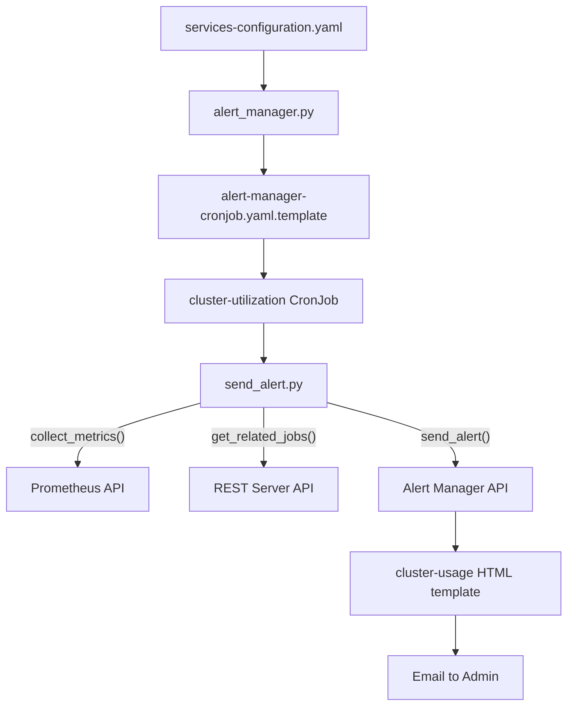
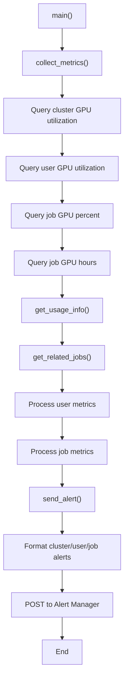

<!-- source: DeepWiki mcp.deepwiki.com · repo microsoft/pai · page 6.2 Cluster Utilization Monitoring · fetched 2026-10-26 -->

# Cluster Utilization Monitoring

<details>
<summary>Relevant source files</summary>

The following files were used as context for generating this wiki page:

- [.github/workflows/continuous-integration.yml](.github/workflows/continuous-integration.yml)
- [.github/workflows/lint.yml](.github/workflows/lint.yml)
- [contrib/kubespray/quick-start/services-configuration.yaml.template](contrib/kubespray/quick-start/services-configuration.yaml.template)
- [deployment/quick-start/services-configuration.yaml.template](deployment/quick-start/services-configuration.yaml.template)
- [docs/manual/cluster-admin/how-to-use-alert-system.md](docs/manual/cluster-admin/how-to-use-alert-system.md)
- [docs_zh_CN/manual/cluster-admin/how-to-use-alert-system.md](docs_zh_CN/manual/cluster-admin/how-to-use-alert-system.md)
- [examples/cluster-configuration/services-configuration.yaml](examples/cluster-configuration/services-configuration.yaml)
- [src/alert-manager/build/alert-handler.common.dockerfile](src/alert-manager/build/alert-handler.common.dockerfile)
- [src/alert-manager/build/build-pre.sh](src/alert-manager/build/build-pre.sh)
- [src/alert-manager/build/cert-expiration-checker.common.dockerfile](src/alert-manager/build/cert-expiration-checker.common.dockerfile)
- [src/alert-manager/build/cluster-utilization.common.dockerfile](src/alert-manager/build/cluster-utilization.common.dockerfile)
- [src/alert-manager/build/job-status-change-notification.common.dockerfile](src/alert-manager/build/job-status-change-notification.common.dockerfile)
- [src/alert-manager/build/nvidia-gpu-low-perf-fixer.common.dockerfile](src/alert-manager/build/nvidia-gpu-low-perf-fixer.common.dockerfile)
- [src/alert-manager/config/alert-manager.md](src/alert-manager/config/alert-manager.md)
- [src/alert-manager/config/alert-manager.yaml](src/alert-manager/config/alert-manager.yaml)
- [src/alert-manager/config/alert_manager.py](src/alert-manager/config/alert_manager.py)
- [src/alert-manager/deploy/alert-manager-configmap.yaml.template](src/alert-manager/deploy/alert-manager-configmap.yaml.template)
- [src/alert-manager/deploy/alert-manager-cronjob.yaml.template](src/alert-manager/deploy/alert-manager-cronjob.yaml.template)
- [src/alert-manager/deploy/alert-manager-deployment.yaml.template](src/alert-manager/deploy/alert-manager-deployment.yaml.template)
- [src/alert-manager/deploy/alert-templates/cluster-usage/html.ejs](src/alert-manager/deploy/alert-templates/cluster-usage/html.ejs)
- [src/alert-manager/deploy/service.yaml](src/alert-manager/deploy/service.yaml)
- [src/alert-manager/deploy/start.sh.template](src/alert-manager/deploy/start.sh.template)
- [src/alert-manager/deploy/stop.sh](src/alert-manager/deploy/stop.sh)
- [src/alert-manager/src/alert-handler/controllers/mail.js](src/alert-manager/src/alert-handler/controllers/mail.js)
- [src/alert-manager/src/alert-handler/index.js](src/alert-manager/src/alert-handler/index.js)
- [src/alert-manager/src/cert-expiration-checker/__init__.py](src/alert-manager/src/cert-expiration-checker/__init__.py)
- [src/alert-manager/src/cert-expiration-checker/pylintrc](src/alert-manager/src/cert-expiration-checker/pylintrc)
- [src/alert-manager/src/cert-expiration-checker/requirements.txt](src/alert-manager/src/cert-expiration-checker/requirements.txt)
- [src/alert-manager/src/cert-expiration-checker/send_alert.py](src/alert-manager/src/cert-expiration-checker/send_alert.py)
- [src/alert-manager/src/cluster-utilization/pylintrc](src/alert-manager/src/cluster-utilization/pylintrc)
- [src/alert-manager/src/cluster-utilization/send_alert.py](src/alert-manager/src/cluster-utilization/send_alert.py)
- [src/alert-manager/src/job-status-change-notification/.editorconfig](src/alert-manager/src/job-status-change-notification/.editorconfig)
- [src/alert-manager/src/job-status-change-notification/.eslintrc.js](src/alert-manager/src/job-status-change-notification/.eslintrc.js)
- [src/alert-manager/src/job-status-change-notification/controllers/alert.js](src/alert-manager/src/job-status-change-notification/controllers/alert.js)
- [src/alert-manager/src/job-status-change-notification/controllers/framework.js](src/alert-manager/src/job-status-change-notification/controllers/framework.js)
- [src/utilities/doc_checker.py](src/utilities/doc_checker.py)
- [src/utilities/gen-amtool-config.py](src/utilities/gen-amtool-config.py)
- [src/utilities/release.sh](src/utilities/release.sh)

</details>


Cluster Utilization Monitoring provides visibility into resource usage patterns in an OpenPAI cluster, particularly focusing on GPU utilization metrics. This feature generates periodic reports on GPU utilization at cluster, user, and job levels, helping administrators identify resource usage trends and inefficiencies. The system leverages Prometheus metrics and presents data in an organized, actionable format through email reports.

For information about general alerting configurations and management, see [Alert Manager](#6.1).

## Architecture

The monitoring system operates as part of the alert-manager service in OpenPAI. It runs as a Kubernetes CronJob that collects data from Prometheus and the REST API, then processes and sends this data as alerts.

**Cluster Utilization Monitoring Architecture**


Sources:
- [src/alert-manager/deploy/alert-manager-cronjob.yaml.template]()
- [src/alert-manager/src/cluster-utilization/send_alert.py]()
- [src/alert-manager/config/alert_manager.py:85-90]()

## Configuration

To enable cluster utilization monitoring, you need to configure it in the `alert-manager` section of your `services-configuration.yaml` file:

```yaml
alert-manager:
  pai-bearer-token: 'your-application-token-for-pai-rest-server'
  cluster-utilization: # cluster-utilization is a k8s CronJob which reports the GPU utilization of the cluster
    # for schedule syntax, refer to https://kubernetes.io/docs/concepts/workloads/controllers/cron-jobs/#cron-schedule-syntax
    schedule: "0 0 * * *" # daily report at UTC 00:00
```

The required configuration parameters are:

1. `pai-bearer-token`: An authentication token for the REST server API. You can generate this token from your user profile page in the web portal.
2. `cluster-utilization.schedule`: A cron expression defining when the report should be generated. The example above sets it to run daily at midnight UTC.

Email configuration must also be set up in the alert-manager to deliver the reports. For email configuration details, see [Alert Manager](#6.1).

Sources:
- [contrib/kubespray/quick-start/services-configuration.yaml.template:228-231]()
- [examples/cluster-configuration/services-configuration.yaml:119-121]()
- [docs/manual/cluster-admin/how-to-use-alert-system.md:256-269]()

## Implementation Details

**Cluster Utilization Monitoring Data Flow**


Sources:
- [src/alert-manager/src/cluster-utilization/send_alert.py:160-192]()
- [src/alert-manager/src/cluster-utilization/send_alert.py:196-262]()
- [src/alert-manager/src/cluster-utilization/send_alert.py:264-269]()

### Data Collection

The system collects data through the `send_alert.py` script, which queries Prometheus for metrics and the REST API for job information. The main metrics collected are:

| Metric | Prometheus Query | Description |
|--------|-----------------|-------------|
| Cluster GPU Utilization | `avg(avg_over_time(nvidiasmi_utilization_gpu[7d]))` | Average GPU utilization across the cluster over 7 days |
| Job GPU Percent | `avg by (job_name) (avg_over_time(task_gpu_percent[7d]))` | Average GPU utilization for each job over 7 days |
| Job GPU Hours | `sum by (job_name) (count_over_time(task_gpu_percent[7d]))` | Count of GPU hours used by each job over 7 days |
| User GPU Utilization | `(sum by (username) (sum_over_time(task_gpu_percent[7d]))) / (sum by (username) (count_over_time(task_gpu_percent[7d])*100)) * 100` | User's GPU utilization percentage over 7 days |

The script uses `collect_metrics()` to gather these metrics and `get_related_jobs()` to retrieve job details from the REST API. Job information is used to associate metrics with specific jobs and calculate additional statistics like duration and resources occupied (GPU*hours).

Sources:
- [src/alert-manager/src/cluster-utilization/send_alert.py:6-11]()
- [src/alert-manager/src/cluster-utilization/send_alert.py:59-85]()
- [src/alert-manager/src/cluster-utilization/send_alert.py:89-158]()

### Report Generation

After collecting the metrics, the system:

1. Processes the data to calculate utilization statistics
2. Formats the data as alerts with specific labels
3. Sends the alerts to the alert-manager
4. The alert-manager applies the email template and sends the report

The alerts are structured with labels that the email template uses to generate different sections of the report. Each metric type (cluster, user, job) gets its own alert with appropriate labels.

Sources:
- [src/alert-manager/src/cluster-utilization/send_alert.py:196-262]()
- [src/alert-manager/deploy/alert-manager-configmap.yaml.template:74-79]()
- [src/alert-manager/deploy/alert-templates/cluster-usage/html.ejs]()

## Report Content

The utilization report contains three main sections:

### Cluster GPU Utilization

This section displays the overall GPU utilization across the cluster, averaged over the past 7 days.

Example:
```
Cluster GPU utilization: 75.3%
```

This provides a high-level metric to assess overall cluster efficiency.

### User GPU Utilization

This section shows GPU usage broken down by user, sorted by resources occupied:

| User name | Resources occupied (GPU*hour) | GPU utilization |
|-----------|-------------------------------|----------------|
| user1     | 120.45                        | 78.5%          |
| user2     | 85.23                         | 45.2%          |
| ...       | ...                           | ...            |

This helps identify which users are consuming the most resources and how efficiently they're using them.

### Job GPU Utilization

This section presents detailed information for the top 10 jobs by resource consumption:

| Job name | Resources occupied (GPU*hour) | GPU number | GPU utilization | Job duration | Job start time | Job status |
|----------|-------------------------------|------------|----------------|--------------|---------------|------------|
| job1     | 45.67                         | 4          | 85.3%          | 11:23:45     | 2023-05-01    | SUCCEEDED  |
| job2     | 38.92                         | 2          | 42.1%          | 19:28:36     | 2023-05-02    | RUNNING    |
| ...      | ...                           | ...        | ...            | ...          | ...           | ...        |

This detailed breakdown helps identify specific jobs that might be using resources inefficiently or consuming a large portion of the cluster's resources.

Sources:
- [src/alert-manager/deploy/alert-templates/cluster-usage/html.ejs:15-26]()
- [src/alert-manager/deploy/alert-templates/cluster-usage/html.ejs:29-49]()
- [src/alert-manager/deploy/alert-templates/cluster-usage/html.ejs:52-89]()

### Alert Data Structure

The system creates and sends three types of alerts to the alert-manager:

1. **Cluster Usage Alert**: Contains the overall cluster utilization
2. **Job Usage Alerts**: One per job, containing detailed job metrics
3. **User Usage Alerts**: One per user, containing user-level metrics

Each alert contains various labels that the email template uses to generate the report. An example alert structure:

```json
{
  "labels": {
    "alertname": "usage",
    "report_type": "cluster-usage",
    "severity": "info",
    "job_name": "user1~job1",
    "resources_occupied": "45.67",
    "gpu_number": "4",
    "usage": "85.3%",
    "duration": "11:23:45",
    "start_time": "2023-05-01",
    "status": "SUCCEEDED",
    "trigger_time": "2023-05-10"
  },
  "annotations": {
    "summary": "The cluster usage has been reported, please check your email-box for details."
  },
  "generatorURL": "alert/script"
}
```

Sources:
- [src/alert-manager/src/cluster-utilization/send_alert.py:201-256]()

## Troubleshooting

If you encounter issues with the cluster utilization monitoring, check these common areas:

### Configuration Issues

- Verify that `pai-bearer-token` is correctly set and has not expired
- Ensure email configuration in the alert-manager is properly set
- Check that the cron schedule syntax is valid

### Runtime Issues

- Examine the logs of the cluster-utilization pod for errors
- Verify that Prometheus is running and collecting metrics
- Ensure the REST server is accessible from the cluster-utilization pod

### Debugging Commands

```bash
# Check the status of the CronJob
kubectl get cronjob cluster-utilization

# Check the logs of the most recent job run
kubectl logs $(kubectl get pods -l job-name=cluster-utilization-<timestamp> -o name)
```

### Common Problems

- **No jobs shown in report**: Ensure there have been jobs running in the last 7 days
- **Missing metrics**: Verify job-exporter is properly collecting GPU metrics
- **No email received**: Check SMTP configuration and alert-manager routing

Sources:
- [src/alert-manager/src/cluster-utilization/send_alert.py:196-262]()
- [src/alert-manager/deploy/alert-manager-cronjob.yaml.template]()
- [src/alert-manager/config/alert_manager.py:85-90]()
- [docs/manual/cluster-admin/how-to-use-alert-system.md:256-269]()

---

