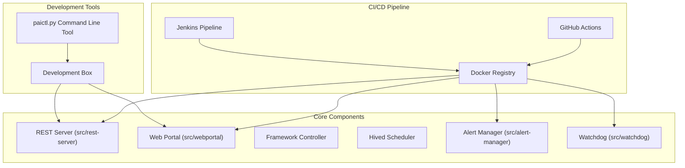
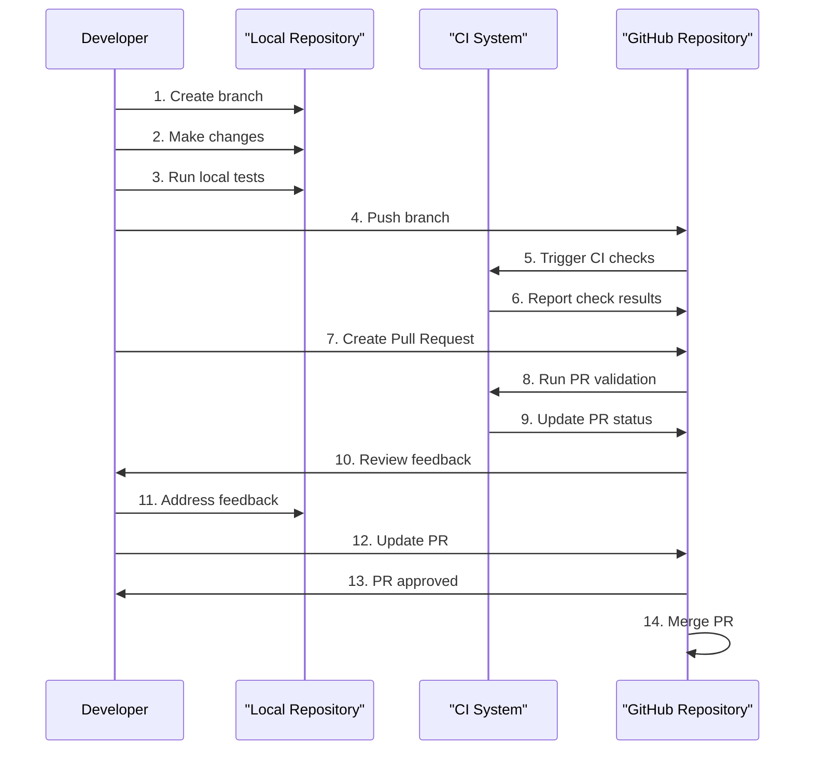
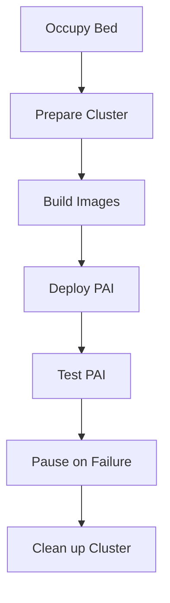
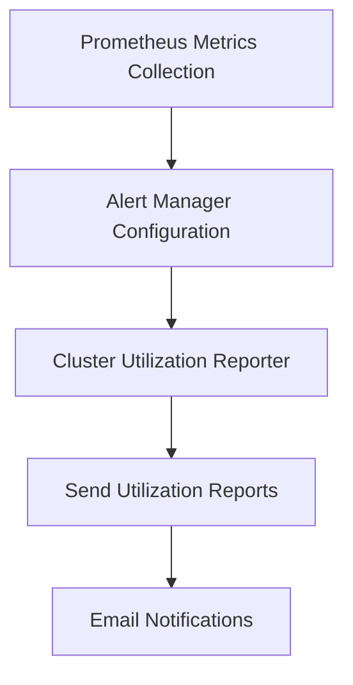

<!-- source: DeepWiki mcp.deepwiki.com · repo microsoft/pai · page 7 Developer Guide · fetched 2026-10-26 -->

# Developer Guide

<details>
<summary>Relevant source files</summary>

The following files were used as context for generating this wiki page:

- [.github/workflows/continuous-integration.yml](.github/workflows/continuous-integration.yml)
- [.github/workflows/lint.yml](.github/workflows/lint.yml)
- [Jenkinsfile](Jenkinsfile)
- [deployment/clusterCmd.py](deployment/clusterCmd.py)
- [deployment/k8sPaiLibrary/maintainlib/kubectl_install.py](deployment/k8sPaiLibrary/maintainlib/kubectl_install.py)
- [deployment/machineCmd.py](deployment/machineCmd.py)
- [deployment/utility/__init__.py](deployment/utility/__init__.py)
- [deployment/utility/sftp_copy.py](deployment/utility/sftp_copy.py)
- [deployment/utility/ssh.py](deployment/utility/ssh.py)
- [src/alert-manager/deploy/alert-manager-cronjob.yaml.template](src/alert-manager/deploy/alert-manager-cronjob.yaml.template)
- [src/alert-manager/deploy/alert-templates/cluster-usage/html.ejs](src/alert-manager/deploy/alert-templates/cluster-usage/html.ejs)
- [src/alert-manager/src/cluster-utilization/pylintrc](src/alert-manager/src/cluster-utilization/pylintrc)
- [src/alert-manager/src/cluster-utilization/send_alert.py](src/alert-manager/src/cluster-utilization/send_alert.py)
- [src/utilities/doc_checker.py](src/utilities/doc_checker.py)
- [src/utilities/gen-amtool-config.py](src/utilities/gen-amtool-config.py)
- [src/utilities/release.sh](src/utilities/release.sh)
- [tests/jenkins/config_yarn_cluster.yaml](tests/jenkins/config_yarn_cluster.yaml)
- [tests/jenkins/config_yarn_singlebox.yaml](tests/jenkins/config_yarn_singlebox.yaml)
- [tests/jenkins/stage_build.sh](tests/jenkins/stage_build.sh)
- [tests/jenkins/stage_clean.sh](tests/jenkins/stage_clean.sh)
- [tests/jenkins/stage_deploy.sh](tests/jenkins/stage_deploy.sh)
- [tests/jenkins/stage_prepare.sh](tests/jenkins/stage_prepare.sh)
- [tests/jenkins/stage_test.sh](tests/jenkins/stage_test.sh)
- [tests/jenkins/test_generate_config.sh](tests/jenkins/test_generate_config.sh)
- [tests/jenkins/test_rest_server.sh](tests/jenkins/test_rest_server.sh)

</details>


This guide is intended for developers who want to contribute to the OpenPAI project. It covers development environment setup, project structure, CI/CD pipeline, testing framework, and contribution guidelines. For information about using OpenPAI as an end-user, please refer to the [Overview](#1) page.

## Development Environment Setup

To set up a development environment for OpenPAI, you need the following prerequisites:

| Requirement | Version | Notes |
|-------------|---------|-------|
| Python | 2.7 or 3.7+ | Different components use different Python versions |
| Node.js | 10.x | Required for REST server and web portal development |
| Go | 1.13+ | Required for watchdog component |
| Docker | Latest | For building and testing service images |
| Kubernetes | 1.14+ | For local deployment testing |

### Setting Up Local Development Environment

1. Clone the repository:
   ```bash
   git clone https://github.com/microsoft/pai.git
   cd pai
   ```

2. Install dependencies for the component you're working on:
   - For REST server: `cd src/rest-server && yarn install`
   - For web portal: `cd src/webportal && yarn install`
   - For Python components: Install the specific requirements from the component's directory

3. Configure kubectl for accessing your test cluster:
   ```bash
   python paictl.py cluster k8s-set-env
   ```

## Project Structure Overview

The OpenPAI codebase is organized into several key directories:

```
pai/
├── build/           # Build scripts for OpenPAI services
├── contrib/         # Community-contributed components and tools
├── deployment/      # Deployment tools and configuration
├── docs/            # Documentation
├── src/             # Source code for all OpenPAI services
│   ├── alert-manager/        # Alert management service
│   ├── rest-server/          # RESTful API server
│   ├── webportal/            # Web UI
│   ├── watchdog/             # System monitoring component
│   └── other services...
├── tests/           # Test scripts and configurations
└── paictl.py        # PAI control script for cluster management
```

### Component Architecture

Below is a diagram showing the relationship between key components in the OpenPAI development ecosystem:



Sources: [Jenkinsfile](), [.github/workflows/continuous-integration.yml](), [deployment/clusterCmd.py]()

## Development Workflow

### Development Process Overview

The recommended workflow for developing features or fixing bugs in OpenPAI:



Sources: [.github/workflows/continuous-integration.yml](), [Jenkinsfile]()

### Making Changes

1. Create a new branch from `master` or the appropriate release branch
2. Make your changes to the relevant components
3. Run local tests to validate your changes
4. Create a pull request to the main repository

### Building Components

To build Docker images for OpenPAI services:

```bash
python build/pai_build.py build -c /path/to/cluster-configuration
```

This script reads the cluster configuration and builds the necessary Docker images for all services.

Sources: [tests/jenkins/stage_build.sh:26-29]()

## CI/CD Pipeline

OpenPAI uses two main CI/CD systems:

1. GitHub Actions - for pull request validation and unit tests
2. Jenkins - for integration testing and deployment validation

### GitHub Actions Workflow

The GitHub Actions workflows are defined in `.github/workflows/` and include:

- Continuous integration (`continuous-integration.yml`)
- Linting checks (`lint.yml`)

These workflows run various tests for different components:

| Component | Test Type | Python/Node Version |
|-----------|-----------|---------------------|
| Deployment scripts | Unit tests | Python 2.7 |
| Exporters | Unit tests | Python 3.7 |
| Watchdog | Build & Test | Go 1.13.8 |
| REST Server | Unit tests | Node 10 |
| Webportal | Build & Test | Node 8 & 10 |

Sources: [.github/workflows/continuous-integration.yml:14-164](), [.github/workflows/lint.yml:13-111]()

### Jenkins Pipeline

The Jenkins pipeline defined in `Jenkinsfile` performs end-to-end testing with the following stages:



Sources: [Jenkinsfile:52-231]()

#### Pipeline Stages

1. **Prepare Cluster**: Prepares the test environment
   ```bash
   bash -Eeuxo pipefail ${WORKSPACE}/tests/jenkins/stage_prepare.sh
   ```

2. **Build Images**: Builds Docker images for all components
   ```bash
   bash -Eeuxo pipefail ${WORKSPACE}/tests/jenkins/stage_build.sh
   ```

3. **Deploy PAI**: Deploys the OpenPAI system on a Kubernetes cluster
   ```bash
   bash -Eeuxo pipefail ${WORKSPACE}/tests/jenkins/stage_deploy.sh k8s cluster
   ```

4. **Test PAI**: Runs integration tests against the deployed system
   ```bash
   bash -Eeuxo pipefail ${WORKSPACE}/tests/jenkins/stage_test.sh k8s ${K8S_CLUSTER_URI}/rest-server
   ```

5. **Clean up Cluster**: Cleans up after tests
   ```bash
   bash -Eeuxo pipefail ${WORKSPACE}/tests/jenkins/stage_clean.sh k8s cluster
   ```

Sources: [Jenkinsfile:79-190](), [tests/jenkins/stage_prepare.sh](), [tests/jenkins/stage_build.sh](), [tests/jenkins/stage_deploy.sh](), [tests/jenkins/stage_test.sh](), [tests/jenkins/stage_clean.sh]()

## Testing Guide

### Unit Testing

Each component has its own unit tests. Run component-specific tests by navigating to the component directory:

- REST Server: `cd src/rest-server && yarn test`
- Web Portal: `cd src/webportal && yarn test`
- Job Exporter: `cd src/job-exporter/test && python -m unittest discover .`
- Watchdog: `cd src/watchdog/src && go test -cover ./pkg/watchdog`

Sources: [.github/workflows/continuous-integration.yml:111-111](), [.github/workflows/continuous-integration.yml:162-164](), [.github/workflows/continuous-integration.yml:65-65](), [.github/workflows/continuous-integration.yml:89-90]()

### Integration Testing

Integration tests in the `tests/jenkins` directory validate the entire system functionality:

1. REST Server API Test:
   ```bash
   bash ${WORKSPACE}/tests/jenkins/test_rest_server.sh k8s http://your-cluster-url/rest-server
   ```

2. Job Submission Test:
   ```bash
   bash ${WORKSPACE}/tests/jenkins/test_rest_server_js_sdk.sh k8s http://your-cluster-url/rest-server
   ```

Sources: [tests/jenkins/stage_test.sh:20-21](), [tests/jenkins/test_rest_server.sh]()

### Code Coverage

Code coverage tests are implemented for key components:

```bash
cd src/rest-server
yarn run coveralls
```

The results are reported to Coveralls.

Sources: [.github/workflows/continuous-integration.yml:132-135]()

## Documentation Standards

Documentation is critical for the project. All code changes should be accompanied by documentation updates. The project uses a documentation checker to validate markdown files:

```bash
python src/utilities/doc_checker.py [path-to-doc-or-directory]
```

This tool checks for broken links in markdown files.

Sources: [src/utilities/doc_checker.py](), [.github/workflows/lint.yml:31-32]()

## Monitoring and Alerting

### Cluster Utilization Monitoring

OpenPAI includes a cluster utilization monitoring system that collects metrics and sends alerts:



The cluster utilization monitor runs as a cron job, collecting metrics about GPU utilization, job performance, and user activity. These metrics are used to generate reports and alerts.

Sources: [src/alert-manager/src/cluster-utilization/send_alert.py](), [src/alert-manager/deploy/alert-manager-cronjob.yaml.template](), [src/alert-manager/deploy/alert-templates/cluster-usage/html.ejs]()

## Release Process

The release process for OpenPAI is managed with the `release.sh` script:

```bash
./src/utilities/release.sh
```

This script:
1. Tags the current master branch with a version number
2. Creates a corresponding release branch (e.g., `pai-1.2.y` for version `v1.2.3`)
3. Pushes both the tag and branch to the repository

Sources: [src/utilities/release.sh:21-41]()

## Utility Tools

### SSH and SFTP Utilities

OpenPAI provides utility scripts for interacting with cluster machines:

- SSH utility: `deployment/utility/ssh.py` - For executing commands across multiple machines
- SFTP utility: `deployment/utility/sftp_copy.py` - For copying files to multiple machines

These tools can filter machines based on specified criteria.

Sources: [deployment/utility/ssh.py](), [deployment/utility/sftp_copy.py]()

### Alert Manager Tools

The `gen-amtool-config.py` script generates configuration for the Prometheus AlertManager tool:

```bash
python src/utilities/gen-amtool-config.py -p /path/to/config
```

Sources: [src/utilities/gen-amtool-config.py]()

## Contribution Guidelines

### Pull Request Process

1. Create a branch with an appropriate naming convention:
   - For new features: `feature-name-of-feature`
   - For bug fixes: `fix-issue-description`

2. Ensure your code passes all lint checks and tests:
   - Python code: `pylint` with the appropriate configuration
   - JavaScript code: Use project-specific lint rules with `yarn lint`

3. Write comprehensive tests for your changes

4. Create a pull request with a clear description:
   - What problem does it solve?
   - How does it solve it?
   - Any related issues or documentation changes

5. Update documentation if your changes affect the user experience

### Code Style Guidelines

- Python: Follow PEP 8 with project-specific adjustments in pylintrc files
- JavaScript: Follow the project's ESLint configuration
- Go: Use standard Go formatting (gofmt)

Sources: [src/alert-manager/src/cluster-utilization/pylintrc]()

### Debugging Tips

1. Use the development box for debugging cluster issues:
   ```bash
   python paictl.py cluster k8s-set-env
   ```

2. Check service logs in the Kubernetes cluster:
   ```bash
   kubectl logs -n openpai <pod-name>
   ```

3. For REST server debugging, enable verbose logging by setting environment variables in the deployment configuration.

4. Monitor alerts and metrics through the Alert Manager and Prometheus interfaces.

---

