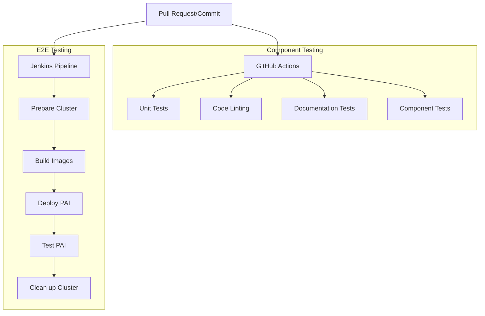
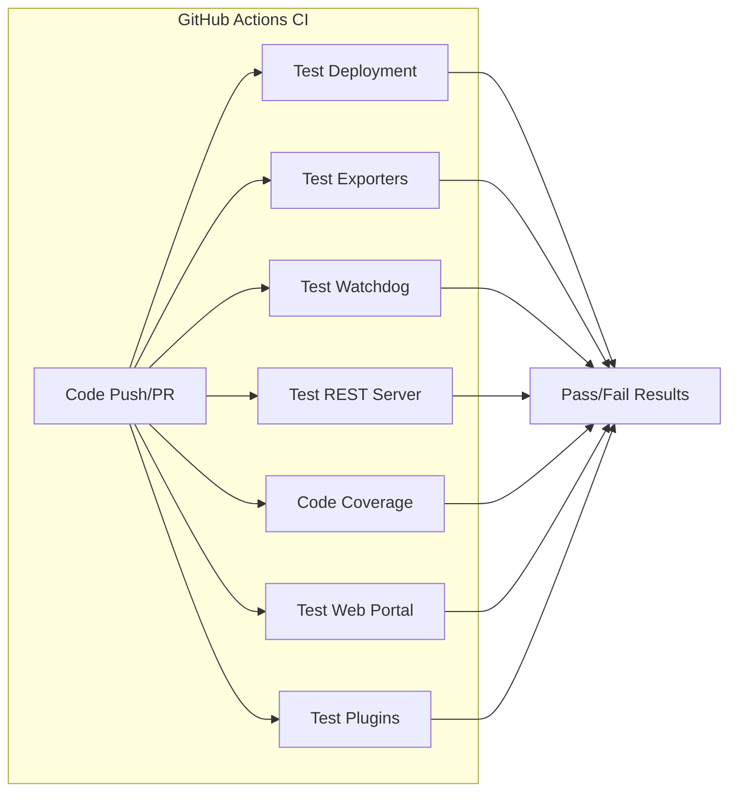
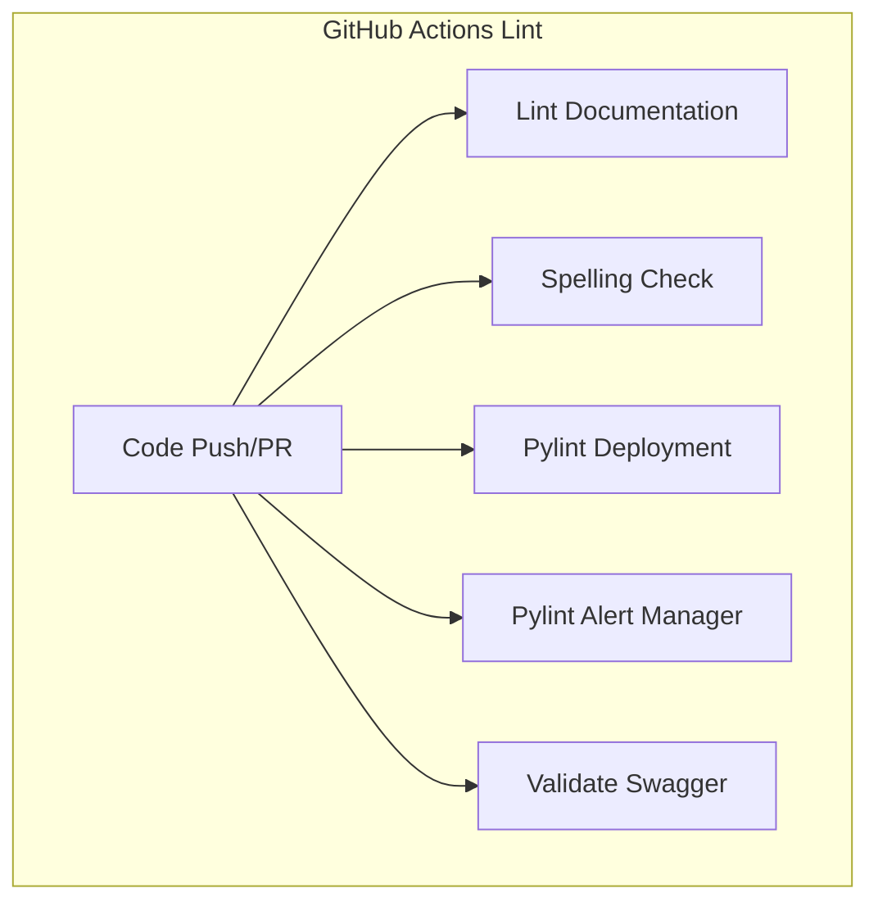
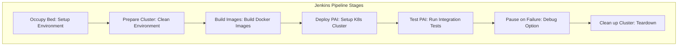
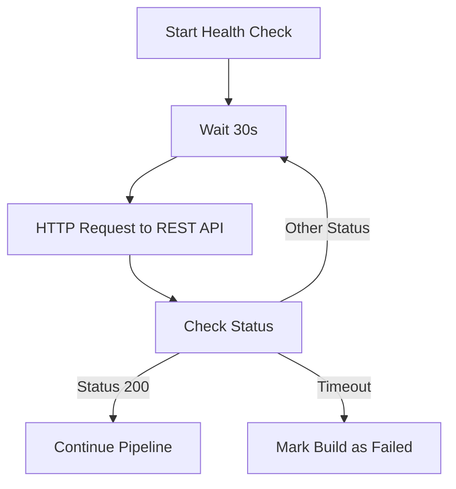
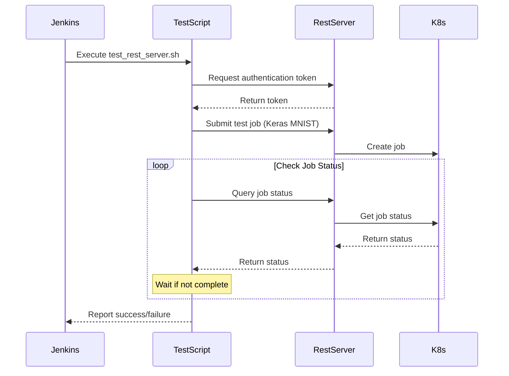
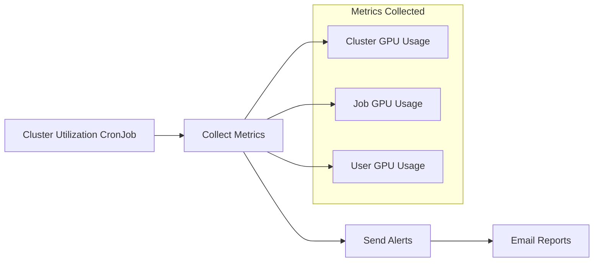
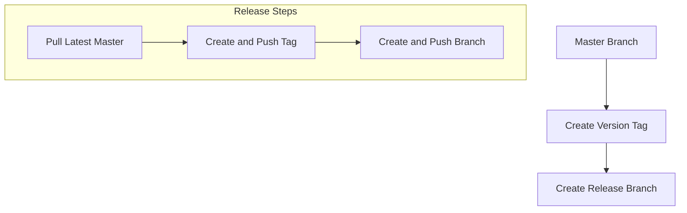

<!-- source: DeepWiki mcp.deepwiki.com · repo microsoft/pai · page 7.1 CI/CD Pipeline · fetched 2026-10-26 -->

# CI/CD Pipeline

<details>
<summary>Relevant source files</summary>

The following files were used as context for generating this wiki page:

- [.github/workflows/continuous-integration.yml](.github/workflows/continuous-integration.yml)
- [.github/workflows/lint.yml](.github/workflows/lint.yml)
- [Jenkinsfile](Jenkinsfile)
- [deployment/clusterCmd.py](deployment/clusterCmd.py)
- [deployment/k8sPaiLibrary/maintainlib/kubectl_install.py](deployment/k8sPaiLibrary/maintainlib/kubectl_install.py)
- [deployment/machineCmd.py](deployment/machineCmd.py)
- [deployment/utility/__init__.py](deployment/utility/__init__.py)
- [deployment/utility/sftp_copy.py](deployment/utility/sftp_copy.py)
- [deployment/utility/ssh.py](deployment/utility/ssh.py)
- [src/alert-manager/deploy/alert-manager-cronjob.yaml.template](src/alert-manager/deploy/alert-manager-cronjob.yaml.template)
- [src/alert-manager/deploy/alert-templates/cluster-usage/html.ejs](src/alert-manager/deploy/alert-templates/cluster-usage/html.ejs)
- [src/alert-manager/src/cluster-utilization/pylintrc](src/alert-manager/src/cluster-utilization/pylintrc)
- [src/alert-manager/src/cluster-utilization/send_alert.py](src/alert-manager/src/cluster-utilization/send_alert.py)
- [src/utilities/doc_checker.py](src/utilities/doc_checker.py)
- [src/utilities/gen-amtool-config.py](src/utilities/gen-amtool-config.py)
- [src/utilities/release.sh](src/utilities/release.sh)
- [tests/jenkins/config_yarn_cluster.yaml](tests/jenkins/config_yarn_cluster.yaml)
- [tests/jenkins/config_yarn_singlebox.yaml](tests/jenkins/config_yarn_singlebox.yaml)
- [tests/jenkins/stage_build.sh](tests/jenkins/stage_build.sh)
- [tests/jenkins/stage_clean.sh](tests/jenkins/stage_clean.sh)
- [tests/jenkins/stage_deploy.sh](tests/jenkins/stage_deploy.sh)
- [tests/jenkins/stage_prepare.sh](tests/jenkins/stage_prepare.sh)
- [tests/jenkins/stage_test.sh](tests/jenkins/stage_test.sh)
- [tests/jenkins/test_generate_config.sh](tests/jenkins/test_generate_config.sh)
- [tests/jenkins/test_rest_server.sh](tests/jenkins/test_rest_server.sh)

</details>


This document describes the Continuous Integration and Continuous Deployment (CI/CD) pipeline used in the OpenPAI project. It covers the automated testing, building, and deployment processes that ensure code quality and reliability of the platform.

## Overview

OpenPAI employs a multi-faceted CI/CD approach, utilizing both Jenkins for end-to-end deployment testing and GitHub Actions for component-level testing and validation. This combined approach ensures comprehensive coverage across different aspects of the codebase.



Sources: [Jenkinsfile](), [.github/workflows/continuous-integration.yml](), [.github/workflows/lint.yml]()

## GitHub Actions Workflow

GitHub Actions is used for fast, component-level testing that runs on every pull request and commit to main branches.

### Continuous Integration Workflow

The continuous integration workflow runs multiple jobs in parallel to test different components of the system:



Sources: [.github/workflows/continuous-integration.yml:1-165]()

The CI workflow is configured to run on:
- Push to `master` and `pai-**` branches
- Pull requests targeting these branches

Each job runs on specified Python/Node.js versions and operating systems (primarily Ubuntu 18.04 and latest). The key jobs include:

| Job | Runs On | Tests |
|-----|---------|-------|
| deployment | Python 2.7 | Cluster Object Model, template generation |
| exporters | Python 3.7 | Job exporter functionality |
| watchdog | Go 1.13.8 | Watchdog component |
| rest-server | Node.js 10 | REST API functionality |
| code-coverage | Node.js 10 | Coverage reporting for REST server |
| webportal | Node.js 8, 10 | Web portal build and tests |
| webportal-plugins | Node.js 10 | Plugin build |

### Linting Workflow

A separate workflow handles code quality checks:



Sources: [.github/workflows/lint.yml:1-112]()

This workflow ensures code quality and documentation standards are maintained across the codebase.

## Jenkins Pipeline

The Jenkins pipeline provides end-to-end testing by deploying a complete OpenPAI cluster in a test environment and running integration tests.



Sources: [Jenkinsfile:52-231](), [tests/jenkins/stage_prepare.sh](), [tests/jenkins/stage_build.sh](), [tests/jenkins/stage_deploy.sh](), [tests/jenkins/stage_test.sh](), [tests/jenkins/stage_clean.sh]()

### Jenkins Pipeline Stages in Detail

1. **Occupy Bed**:
   - Sets up environment variables
   - Generates a unique image tag based on branch name, commit hash, and build ID

2. **Prepare Cluster**:
   - Cleans up the testing environment
   - Removes unused packages
   - Stops and removes Docker containers
   - Prepares remote nodes for testing
   - Starts a Docker registry for test images

3. **Build Images**:
   - Generates configuration files for the build
   - Builds OpenPAI Docker images
   - Pushes images to the test registry

4. **Deploy PAI**:
   - Launches a dev-box container for deployment
   - Copies configuration and codebase into the container
   - Bootstraps Kubernetes on test nodes
   - Deploys OpenPAI services

5. **Test PAI**:
   - Verifies REST API accessibility
   - Submits test jobs to the cluster
   - Monitors job execution
   - Validates expected outcomes

6. **Pause on Failure**:
   - If tests fail, provides an option to keep the environment for debugging
   - Waits for manual intervention if requested

7. **Clean up Cluster**:
   - Removes PAI services
   - Cleans up Kubernetes resources
   - Removes dev-box container

Sources: [Jenkinsfile:63-190]()

### Health Check and Error Handling

The Jenkins pipeline includes robust error handling and health checking mechanisms:



Sources: [Jenkinsfile:30-50]()

The pipeline also includes notifications via Office 365 Connector and email alerts on failure:

```javascript
post {
    success {
      office365ConnectorSend(status: "Build success", webhookUrl: "${env.HOOK}")
    }
    failure {
      office365ConnectorSend(status: "Build failure", webhookUrl: "${env.HOOK}")
      step([
        $class: "Mailer",
        notifyEveryUnstableBuild: true,
        recipients: emailextrecipients([
          [$class: "CulpritsRecipientProvider"],
          [$class: "RequesterRecipientProvider"]
        ]),
        to: "paialert@microsoft.com"
      ])
    }
}
```

Sources: [Jenkinsfile:193-226]()

## Testing Strategy

### Component Level Testing

Component tests verify the functionality of individual modules:

1. **Deployment Scripts**:
   - Tests for the cluster object model
   - Template generation tests
   - Forward compatibility tests

2. **Job Exporter**:
   - Python unit tests for monitoring components

3. **Watchdog**:
   - Go tests for the watchdog module
   - Build verification

4. **REST Server**:
   - Unit tests for API endpoints
   - Code coverage reporting

5. **Web Portal**:
   - Build verification
   - Component tests

Sources: [.github/workflows/continuous-integration.yml:31-41](), [.github/workflows/continuous-integration.yml:62-66](), [.github/workflows/continuous-integration.yml:88-91](), [.github/workflows/continuous-integration.yml:108-111](), [.github/workflows/continuous-integration.yml:163-164]()

### Integration Testing

Integration tests verify the end-to-end functionality of the system:



Sources: [tests/jenkins/test_rest_server.sh:20-56](), [tests/jenkins/stage_test.sh:20-21]()

The integration test:
1. Obtains an authentication token from the REST API
2. Submits a test job (Keras TensorFlow MNIST example)
3. Monitors the job until completion
4. Verifies successful execution

## Cluster Utilization Monitoring

As part of the CI/CD process, OpenPAI includes monitoring for cluster utilization, which helps assess the performance and resource usage of the platform.



Sources: [src/alert-manager/src/cluster-utilization/send_alert.py:1-278](), [src/alert-manager/deploy/alert-manager-cronjob.yaml.template:1-49]()

The cluster utilization monitoring:
1. Runs as a scheduled Kubernetes CronJob
2. Collects metrics on cluster, job, and user GPU utilization
3. Sends alerts with detailed reports
4. Formats data in HTML for email reporting

## Release Process

The release process involves tagging and branching to create stable release versions:



Sources: [src/utilities/release.sh:1-42]()

The release script:
1. Pulls the latest master branch
2. Creates and pushes a version tag (e.g., v1.2.3)
3. Creates and pushes a corresponding branch (e.g., pai-1.2.y)

## Conclusion

The CI/CD pipeline in OpenPAI provides comprehensive testing and deployment automation, ensuring code quality and system reliability. By combining GitHub Actions for component testing and Jenkins for end-to-end validation, the pipeline offers both speed and thoroughness.

The pipeline supports:
- Fast feedback on code changes
- Comprehensive testing across multiple components
- Automated deployment for integration testing
- Performance and utilization monitoring
- Structured release management

This multi-layered approach helps maintain the stability and reliability of the OpenPAI platform while allowing for continuous improvement and feature development.

---

