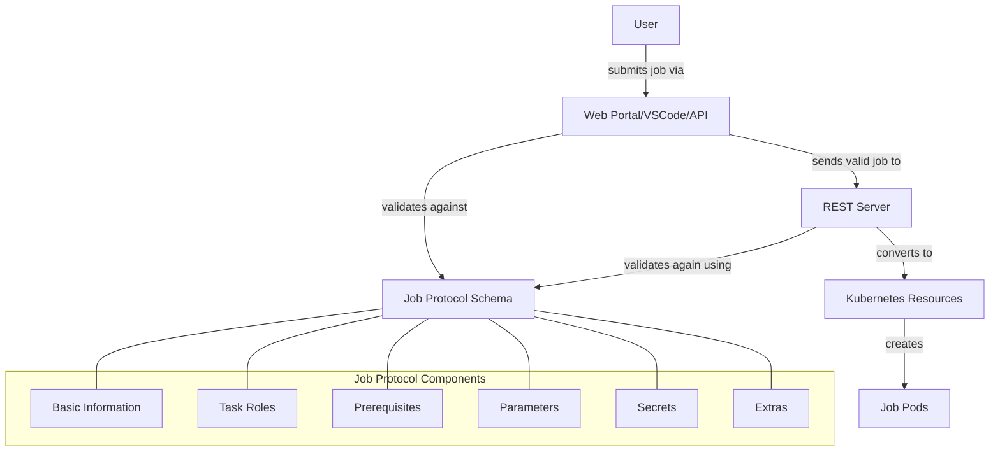
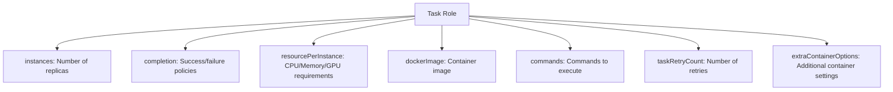
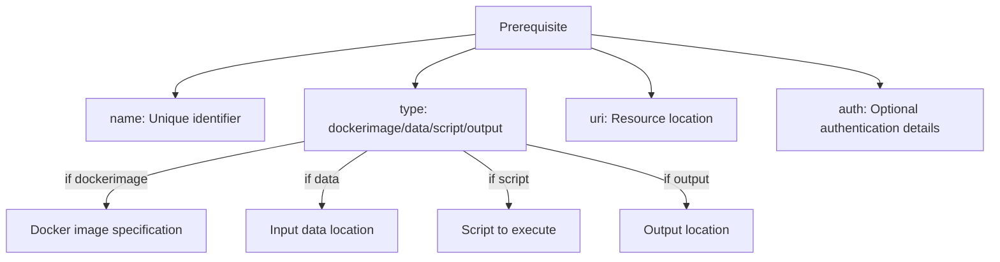
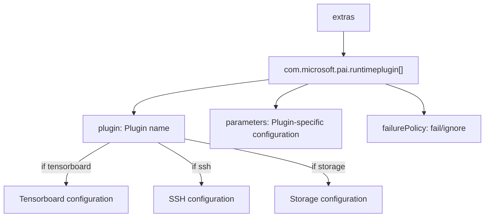
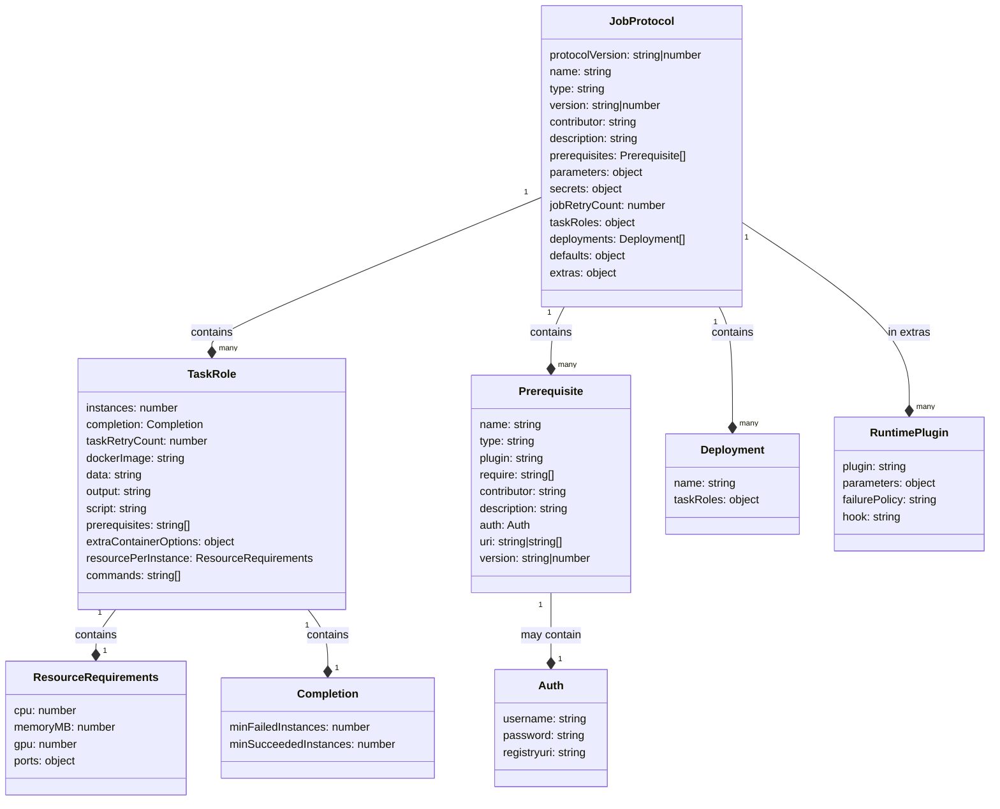
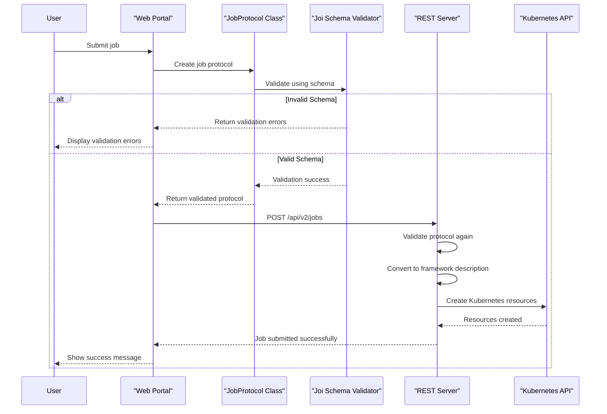
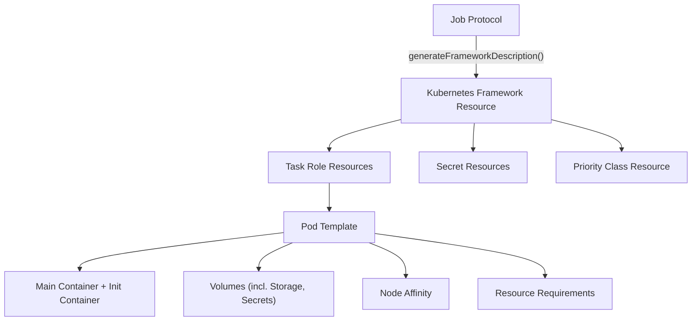
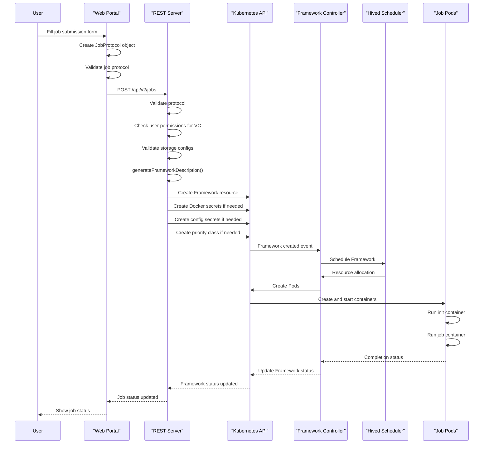
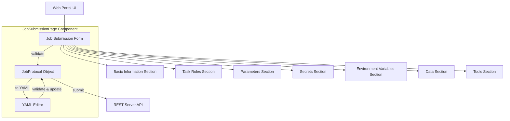

<!-- source: DeepWiki mcp.deepwiki.com · repo microsoft/pai · page 7.2 Job Protocol Schema · fetched 2026-10-26 -->

# Job Protocol Schema

<details>
<summary>Relevant source files</summary>

The following files were used as context for generating this wiki page:

- [src/database-controller/src/write-merger/app.js](src/database-controller/src/write-merger/app.js)
- [src/rest-server/config/rest-server.md](src/rest-server/config/rest-server.md)
- [src/rest-server/config/rest-server.yaml](src/rest-server/config/rest-server.yaml)
- [src/rest-server/config/rest_server.py](src/rest-server/config/rest_server.py)
- [src/rest-server/deploy/rest-server.yaml.template](src/rest-server/deploy/rest-server.yaml.template)
- [src/rest-server/docs/swagger.yaml](src/rest-server/docs/swagger.yaml)
- [src/rest-server/package.json](src/rest-server/package.json)
- [src/rest-server/src/config/express.js](src/rest-server/src/config/express.js)
- [src/rest-server/src/config/launcher.js](src/rest-server/src/config/launcher.js)
- [src/rest-server/src/config/schedule-port.js](src/rest-server/src/config/schedule-port.js)
- [src/rest-server/src/controllers/internal/tail-log.js](src/rest-server/src/controllers/internal/tail-log.js)
- [src/rest-server/src/controllers/v2/cluster.js](src/rest-server/src/controllers/v2/cluster.js)
- [src/rest-server/src/controllers/v2/job.js](src/rest-server/src/controllers/v2/job.js)
- [src/rest-server/src/controllers/v2/task.js](src/rest-server/src/controllers/v2/task.js)
- [src/rest-server/src/models/v2/job/index.js](src/rest-server/src/models/v2/job/index.js)
- [src/rest-server/src/models/v2/job/k8s.js](src/rest-server/src/models/v2/job/k8s.js)
- [src/rest-server/src/models/v2/job/log.js](src/rest-server/src/models/v2/job/log.js)
- [src/rest-server/src/models/v2/task.js](src/rest-server/src/models/v2/task.js)
- [src/rest-server/src/models/v2/utils/frameworkConverter.js](src/rest-server/src/models/v2/utils/frameworkConverter.js)
- [src/rest-server/src/models/v2/utils/name.js](src/rest-server/src/models/v2/utils/name.js)
- [src/rest-server/src/routes/internal/index.js](src/rest-server/src/routes/internal/index.js)
- [src/rest-server/src/routes/internal/tail-log.js](src/rest-server/src/routes/internal/tail-log.js)
- [src/rest-server/src/routes/v2/cluster.js](src/rest-server/src/routes/v2/cluster.js)
- [src/rest-server/src/routes/v2/job.js](src/rest-server/src/routes/v2/job.js)
- [src/rest-server/src/utils/error.d.ts](src/rest-server/src/utils/error.d.ts)
- [src/rest-server/test/setup.js](src/rest-server/test/setup.js)
- [src/rest-server/yarn.lock](src/rest-server/yarn.lock)
- [src/webportal/src/app/job-submission/components/basic-section.jsx](src/webportal/src/app/job-submission/components/basic-section.jsx)
- [src/webportal/src/app/job-submission/components/context.jsx](src/webportal/src/app/job-submission/components/context.jsx)
- [src/webportal/src/app/job-submission/components/controls/tooltip-icon.jsx](src/webportal/src/app/job-submission/components/controls/tooltip-icon.jsx)
- [src/webportal/src/app/job-submission/components/customized-components.jsx](src/webportal/src/app/job-submission/components/customized-components.jsx)
- [src/webportal/src/app/job-submission/components/docker-section.jsx](src/webportal/src/app/job-submission/components/docker-section.jsx)
- [src/webportal/src/app/job-submission/components/form-text-field.jsx](src/webportal/src/app/job-submission/components/form-text-field.jsx)
- [src/webportal/src/app/job-submission/components/job-information.jsx](src/webportal/src/app/job-submission/components/job-information.jsx)
- [src/webportal/src/app/job-submission/components/sidebar/sidebar-card.jsx](src/webportal/src/app/job-submission/components/sidebar/sidebar-card.jsx)
- [src/webportal/src/app/job-submission/components/submission-section.jsx](src/webportal/src/app/job-submission/components/submission-section.jsx)
- [src/webportal/src/app/job-submission/components/tab-form-content.jsx](src/webportal/src/app/job-submission/components/tab-form-content.jsx)
- [src/webportal/src/app/job-submission/components/task-role/completion-policy.jsx](src/webportal/src/app/job-submission/components/task-role/completion-policy.jsx)
- [src/webportal/src/app/job-submission/job-submission-page.jsx](src/webportal/src/app/job-submission/job-submission-page.jsx)
- [src/webportal/src/app/job-submission/job-submission.jsx](src/webportal/src/app/job-submission/job-submission.jsx)
- [src/webportal/src/app/job-submission/models/completion.js](src/webportal/src/app/job-submission/models/completion.js)
- [src/webportal/src/app/job-submission/models/docker-info.js](src/webportal/src/app/job-submission/models/docker-info.js)
- [src/webportal/src/app/job-submission/models/job-protocol.js](src/webportal/src/app/job-submission/models/job-protocol.js)
- [src/webportal/src/app/job-submission/models/job-task-role.js](src/webportal/src/app/job-submission/models/job-task-role.js)
- [src/webportal/src/app/job-submission/models/protocol-schema.js](src/webportal/src/app/job-submission/models/protocol-schema.js)
- [src/webportal/src/app/job-submission/utils/conn.js](src/webportal/src/app/job-submission/utils/conn.js)
- [src/webportal/src/app/job-submission/utils/constants.js](src/webportal/src/app/job-submission/utils/constants.js)
- [src/webportal/src/app/job-submission/utils/task-roles-manager.js](src/webportal/src/app/job-submission/utils/task-roles-manager.js)
- [src/webportal/src/app/job-submission/utils/utils.js](src/webportal/src/app/job-submission/utils/utils.js)
- [tests/jenkins/test_rest_server_js_sdk.sh](tests/jenkins/test_rest_server_js_sdk.sh)

</details>


The Job Protocol Schema defines the structure and format of job submissions in OpenPAI. It serves as a contract between clients (Web Portal, VSCode Extension, API clients) and the REST server, ensuring that job submissions contain all necessary information in the correct format. This document explains the schema's structure, components, validation process, and how it integrates with other parts of the OpenPAI system.

For information about job lifecycle, see [Job Lifecycle](#3.2).

## Schema Overview

The Job Protocol Schema defines the expected structure of a job submission in YAML or JSON format. It is used both for validating incoming job requests and for generating the appropriate Kubernetes resources.



Sources: 
- [src/webportal/src/app/job-submission/models/protocol-schema.js:1-190](src/webportal/src/app/job-submission/models/protocol-schema.js:1-190)
- [src/webportal/src/app/job-submission/models/job-protocol.js:1-110](src/webportal/src/app/job-submission/models/job-protocol.js:1-110)

## Core Schema Components

The job protocol schema consists of several key components, as defined in `jobProtocolSchema`:

### 1. Basic Information

These fields provide general information about the job:

- `protocolVersion`: Version of the protocol (currently 2)
- `name`: Name of the job
- `type`: Always "job" for job submissions
- `version`: Version of the job
- `contributor`: Job creator
- `description`: Job description

### 2. Task Roles

The task roles define the different components of the job, each potentially with different resource requirements and commands. Each task role can have multiple instances.



Sources:
- [src/webportal/src/app/job-submission/models/protocol-schema.js:29-67](src/webportal/src/app/job-submission/models/protocol-schema.js:29-67)
- [src/webportal/src/app/job-submission/models/job-task-role.js:38-143](src/webportal/src/app/job-submission/models/job-task-role.js:38-143)

### 3. Prerequisites

Prerequisites define the external resources needed by the job, such as:

- Docker images
- Data
- Scripts
- Output locations

Each prerequisite has:
- `name`: Unique identifier
- `type`: One of "data", "script", "dockerimage", or "output"
- `uri`: Location of the resource
- Optional authentication information



Sources:
- [src/webportal/src/app/job-submission/models/protocol-schema.js:74-98](src/webportal/src/app/job-submission/models/protocol-schema.js:74-98)

### 4. Parameters and Secrets

Parameters allow for configurable values that can be referenced in commands:
- `parameters`: Key-value pairs for job configuration
- `secrets`: Sensitive key-value pairs that are handled securely

### 5. Deployments

Deployments define how task roles are deployed, including:
- Pre-commands: Commands to run before the main task
- Post-commands: Commands to run after the main task

Sources:
- [src/webportal/src/app/job-submission/models/protocol-schema.js:101-118](src/webportal/src/app/job-submission/models/protocol-schema.js:101-118)

### 6. Extras

The extras section contains platform-specific extensions, primarily runtime plugins:



Sources:
- [src/webportal/src/app/job-submission/models/protocol-schema.js:120-156](src/webportal/src/app/job-submission/models/protocol-schema.js:120-156)
- [src/webportal/src/app/job-submission/utils/constants.js:171-173](src/webportal/src/app/job-submission/utils/constants.js:171-173)

## Complete Schema Structure

The complete job protocol schema structure is defined as follows:



Sources:
- [src/webportal/src/app/job-submission/models/protocol-schema.js:160-190](src/webportal/src/app/job-submission/models/protocol-schema.js:160-190)

## Schema Validation Process

The job protocol validation process ensures that job submissions conform to the expected schema:



Sources:
- [src/webportal/src/app/job-submission/models/job-protocol.js:65-125](src/webportal/src/app/job-submission/models/job-protocol.js:65-125)
- [src/rest-server/src/routes/v2/job.js:32-38](src/rest-server/src/routes/v2/job.js:32-38)
- [src/rest-server/src/controllers/v2/job.js:177-206](src/rest-server/src/controllers/v2/job.js:177-206)

## Conversion to Kubernetes Resources

The REST server converts the validated job protocol into Kubernetes resources:



During this conversion:
1. The job protocol is validated
2. User access to the requested virtual cluster is checked
3. Storage configurations are validated
4. Docker image authentication is handled
5. A Kubernetes Framework resource is generated with all necessary pod definitions
6. Additional resources like secrets and priority classes are created as needed

Sources:
- [src/rest-server/src/models/v2/job/k8s.js:679-805](src/rest-server/src/models/v2/job/k8s.js:679-805)
- [src/rest-server/src/models/v2/job/k8s.js:351-677](src/rest-server/src/models/v2/job/k8s.js:351-677)

## Job Submission Flow

The complete job submission flow from the user interface to Kubernetes execution:



Sources:
- [src/webportal/src/app/job-submission/components/submission-section.jsx:95-140](src/webportal/src/app/job-submission/components/submission-section.jsx:95-140)
- [src/webportal/src/app/job-submission/utils/conn.js:44-46](src/webportal/src/app/job-submission/utils/conn.js:44-46)
- [src/rest-server/src/controllers/v2/job.js:185-206](src/rest-server/src/controllers/v2/job.js:185-206)
- [src/rest-server/src/models/v2/job/k8s.js:1027-1149](src/rest-server/src/models/v2/job/k8s.js:1027-1149)

## Schema Handling in REST Server

The REST server processes job submissions through several key steps:

1. **Route handling**: The `/api/v2/jobs` route accepts POST requests for job submissions
2. **Middleware processing**: The `protocol.submit` middleware validates the job protocol
3. **Controller action**: The `controller.update` function processes the validated job
4. **Job model conversion**: The `job.put` function converts the protocol to Kubernetes resources

The REST server also has multiple endpoints for managing jobs:

| Endpoint | Method | Description |
|----------|--------|-------------|
| `/api/v2/jobs` | GET | List jobs with filtering options |
| `/api/v2/jobs` | POST | Submit a new job |
| `/api/v2/jobs/:frameworkName` | GET | Get details of a specific job |
| `/api/v2/jobs/:frameworkName/executionType` | PUT | Start or stop a job |
| `/api/v2/jobs/:frameworkName/config` | GET | Get the job configuration |
| `/api/v2/jobs/:frameworkName/ssh` | GET | Get SSH information for a job |
| `/api/v2/jobs/:frameworkName/tag` | PUT/DELETE | Add or remove a tag from a job |

Sources:
- [src/rest-server/src/routes/v2/job.js:32-105](src/rest-server/src/routes/v2/job.js:32-105)
- [src/rest-server/src/controllers/v2/job.js:177-206](src/rest-server/src/controllers/v2/job.js:177-206)

## Environment Variables in the Job Protocol

The job protocol supports referencing environment variables that are available to the job at runtime. These variables provide information about the job, task roles, and resources:

| Environment Variable | Description |
|---------------------|-------------|
| `PAI_JOB_NAME` | Job name as specified in the config |
| `PAI_USER_NAME` | User who submitted the job |
| `PAI_DEFAULT_FS_URI` | Default file system URI in PAI |
| `PAI_TASK_ROLE_COUNT` | Total number of task roles |
| `PAI_TASK_ROLE_LIST` | Comma-separated list of all task role names |
| `PAI_TASK_ROLE_TASK_COUNT_$taskRole` | Number of tasks in a specific task role |
| `PAI_HOST_IP_$taskRole_$taskIndex` | Host IP for a specific task |
| `PAI_PORT_LIST_$taskRole_$taskIndex_$portType` | Port list for a specific task |
| `PAI_RESOURCE_$taskRole` | Resource requirements in "gpuNumber,cpuNumber,memMB,shmMB" format |
| `PAI_CURRENT_TASK_ROLE_NAME` | Name of the current task role |
| `PAI_CURRENT_TASK_ROLE_CURRENT_TASK_INDEX` | Index of the current task in the task role |

Sources:
- [src/webportal/src/app/job-submission/utils/constants.js:31-85](src/webportal/src/app/job-submission/utils/constants.js:31-85)
- [src/rest-server/src/models/v2/job/k8s.js:397-509](src/rest-server/src/models/v2/job/k8s.js:397-509)

## Runtime Plugins

OpenPAI supports runtime plugins to extend job functionality. These are specified in the `extras` field under `com.microsoft.pai.runtimeplugin`:

| Plugin | Purpose | Key Parameters |
|--------|---------|----------------|
| `ssh` | Enables SSH access to job containers | `jobssh`: Boolean to enable/disable |
| `tensorboard` | Sets up TensorBoard for visualization | `port`: Port to expose TensorBoard, `logdir`: Log directory |
| `teamwise_storage` | Configures storage for the job | `storageConfigNames`: Array of storage configurations to mount |

Example of a runtime plugin configuration in the job protocol:

```json
"extras": {
  "com.microsoft.pai.runtimeplugin": [
    {
      "plugin": "ssh",
      "parameters": {
        "jobssh": true
      }
    },
    {
      "plugin": "teamwise_storage",
      "parameters": {
        "storageConfigNames": ["nfs", "azure"]
      }
    }
  ]
}
```

Sources:
- [src/webportal/src/app/job-submission/models/protocol-schema.js:120-156](src/webportal/src/app/job-submission/models/protocol-schema.js:120-156)
- [src/webportal/src/app/job-submission/utils/constants.js:171-173](src/webportal/src/app/job-submission/utils/constants.js:171-173)
- [src/webportal/src/app/job-submission/job-submission-page.jsx:221-259](src/webportal/src/app/job-submission/job-submission-page.jsx:221-259)

## Integration with Web Portal

The Web Portal provides a user interface for creating and submitting jobs:



Key components:
1. `JobSubmissionPage`: Main component for job submission
2. `JobProtocol`: Class for handling job protocol validation and submission
3. `Submission-section`: Component for submitting the job
4. Various sidebar components for editing different aspects of the job

The Web Portal UI validates the job protocol using the same schema as the REST server, ensuring consistency in validation.

Sources:
- [src/webportal/src/app/job-submission/job-submission-page.jsx:73-396](src/webportal/src/app/job-submission/job-submission-page.jsx:73-396)
- [src/webportal/src/app/job-submission/components/submission-section.jsx:65-365](src/webportal/src/app/job-submission/components/submission-section.jsx:65-365)
- [src/webportal/src/app/job-submission/job-submission.jsx:1-78](src/webportal/src/app/job-submission/job-submission.jsx:1-78)

## Example Job Protocol

A simplified example of a job protocol for a PyTorch training job:

```yaml
protocolVersion: 2
name: pytorch_example
type: job
jobRetryCount: 0
prerequisites:
  - name: pytorch_image
    type: dockerimage
    uri: openpai/standard:python_3.6-pytorch_1.4.0-gpu
taskRoles:
  train:
    instances: 1
    completion:
      minSucceededInstances: 1
    dockerImage: pytorch_image
    resourcePerInstance:
      cpu: 4
      memoryMB: 8192
      gpu: 1
    commands:
      - pip install -r requirements.txt
      - python train.py --epochs 10
parameters:
  data_dir: /mnt/data
  epochs: 10
extras:
  com.microsoft.pai.runtimeplugin:
    - plugin: ssh
      parameters:
        jobssh: true
    - plugin: teamwise_storage
      parameters:
        storageConfigNames:
          - nfs-data
```

## Conclusion

The Job Protocol Schema is a central component in OpenPAI that defines the structure of job submissions. It serves as a bridge between the user interface and the underlying Kubernetes execution environment. Understanding the schema is essential for creating, debugging, and automating job submissions in OpenPAI.

The schema validation occurs at multiple levels in the system: in the Web Portal before submission, in the REST server after receiving the submission, and during conversion to Kubernetes resources. This multi-layered validation ensures that only valid job configurations are processed, providing clear error messages when validation fails.

The job protocol's structure is designed to be flexible, allowing for various job configurations from simple single-task jobs to complex distributed training with multiple task roles and custom runtime plugins.