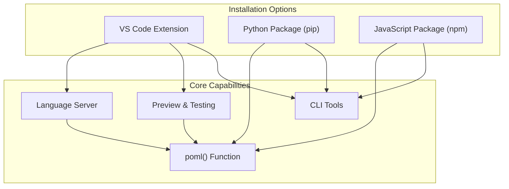
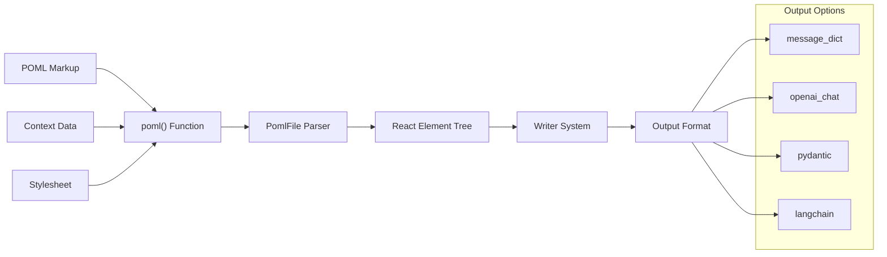

<!-- source: DeepWiki mcp.deepwiki.com · repo microsoft/poml · page 2 Getting Started · fetched 2026-10-26 -->

# Getting Started

<details>
<summary>Relevant source files</summary>

The following files were used as context for generating this wiki page:

- [.github/workflows/test-after-publish.yml](.github/workflows/test-after-publish.yml)
- [CITATION.cff](CITATION.cff)
- [README.md](README.md)
- [docs/index.md](docs/index.md)
- [docs/vscode/index.md](docs/vscode/index.md)
- [examples/401_js_hello_world.mjs](examples/401_js_hello_world.mjs)
- [examples/402_py_hello_world.py](examples/402_py_hello_world.py)
- [packages/poml-build/package.json](packages/poml-build/package.json)
- [python/poml/__init__.py](python/poml/__init__.py)
- [python/poml/api.py](python/poml/api.py)
- [python/tests/test_basic.py](python/tests/test_basic.py)
- [python/tests/test_poml_formats.py](python/tests/test_poml_formats.py)

</details>


This page provides a quick start guide for installing and using POML (Prompt Orchestration Markup Language) across different development environments. It covers basic installation, fundamental usage patterns, and your first examples using the Python SDK, JavaScript SDK, and VS Code extension.

For detailed language reference and syntax, see [Language Reference](#4). For comprehensive SDK documentation, see [Python API](#5.1) and [JavaScript/TypeScript API](#5.2). For VS Code extension features, see [VS Code Extension](#5.4).

## Installation Overview

POML provides multiple installation options depending on your development environment and preferred workflow:



Sources: [README.md:47-77](), [docs/vscode/index.md:13-29](), [packages/poml-build/package.json:70-72]()

## VS Code Extension

### Installation

Install the POML extension from the [Visual Studio Code Marketplace](https://marketplace.visualstudio.com/items?itemName=poml-team.poml) or manually install a `.vsix` file from the [GitHub releases page](https://github.com/microsoft/poml/releases).

### Configuration

Configure your language model provider before testing prompts:

1. Open VS Code Settings and search for "POML"
2. Set your model provider (OpenAI, Azure, Google, Anthropic)
3. Configure API key and endpoint URL
4. Alternatively, add settings directly to `settings.json`

Without proper configuration, the preview and testing features will not function.

Sources: [README.md:55-61](), [docs/vscode/index.md:17-29]()

## Python SDK

### Installation

```bash
pip install poml
```

For development or nightly builds:
```bash
pip install --upgrade --pre --index-url https://test.pypi.org/simple/ --extra-index-url https://pypi.org/simple/ poml
```

### Basic Usage

The primary entry point is the `poml()` function in [python/poml/api.py:422-515]():

```python
from poml import poml

# Basic markup processing
result = poml("<p>Hello, World!</p>")
# Returns: [{"speaker": "human", "content": "Hello, World!"}]

# With context variables
result = poml(
    "<p>Hello {{name}}!</p>", 
    context={"name": "Alice"}
)

# Different output formats
openai_format = poml("template.poml", format="openai_chat")
pydantic_format = poml("template.poml", format="pydantic")
```

The `poml()` function supports multiple output formats via the `format` parameter: `"raw"`, `"message_dict"`, `"dict"`, `"openai_chat"`, `"langchain"`, `"pydantic"`.

Sources: [python/poml/api.py:422-515](), [examples/402_py_hello_world.py:1-12](), [README.md:69-76]()

## JavaScript SDK

### Installation

```bash
npm install pomljs
```

### Basic Usage

```javascript
import { poml } from 'pomljs';

// Basic processing
const output = await poml('<p>hello world</p>');
console.log(output); // "hello world"

// With context
const result = await poml(
    '<p>Hello {{name}}!</p>',
    { context: { name: 'Bob' } }
);
```

### CLI Usage

The JavaScript package includes a CLI tool accessible via `npx`:

```bash
# Process a POML file
npx poml -f example.poml

# With context file
npx poml -f template.poml --context-file data.json

# Output to file
npx poml -f input.poml -o output.json
```

Sources: [examples/401_js_hello_world.mjs:1-12](), [packages/poml-build/package.json:70-72](), [README.md:63-67]()

## First POML Example

Create a file named `example.poml`:

```xml
<poml>
  <role>You are a patient teacher explaining concepts to a 10-year-old.</role>
  <task>Explain the concept of photosynthesis using the provided image as a reference.</task>

  

  <output-format>
    Keep the explanation simple, engaging, and under 100 words.
    Start with "Hey there, future scientist!".
  </output-format>
</poml>
```

This example demonstrates core POML components:
- `<role>` - Defines the AI assistant's persona
- `<task>` - Specifies the objective  
- `` - Includes multimedia content
- `<output-format>` - Constrains response format

Sources: [README.md:29-45]()

## Processing Pipeline

The POML processing flow converts markup through several stages:



The `poml()` function in [python/poml/api.py:422]() and the equivalent JavaScript function handle this entire pipeline, accepting markup content, optional context data, and styling configuration.

Sources: [python/poml/api.py:422-515]()

## Development Workflow

### Tracing and Debugging

Enable tracing to debug prompt processing:

```python
from poml import set_trace, poml, trace_artifact

# Enable tracing with local files
trace_dir = set_trace(True, trace_dir="./traces")

# Process markup
result = poml("<p>Debug this</p>")

# Add custom artifacts
trace_artifact("analysis.txt", "Custom debugging info")
```

The `set_trace()` function supports multiple backends: `"local"`, `"weave"`, `"agentops"`, `"mlflow"`.

### CLI Tools

Both Python and JavaScript provide CLI interfaces:

```bash
# Python CLI
poml-cli -f template.poml --context-file data.json

# JavaScript CLI  
npx poml -f template.poml --context-file data.json
```

Sources: [python/poml/api.py:37-109](), [python/tests/test_basic.py:84-162]()

## Testing Examples

The repository includes test examples demonstrating basic functionality:

| Language | Example File | Purpose |
|----------|-------------|---------|
| Python | [examples/402_py_hello_world.py]() | Minimal sanity check |
| JavaScript | [examples/401_js_hello_world.mjs]() | Basic processing test |

Both examples process `<p>hello world</p>` and verify expected output format.

### Running Tests

Test the nightly packages:

```bash
# Test Python package
pip install --pre poml
python examples/402_py_hello_world.py

# Test JavaScript package  
npm install pomljs@nightly
node examples/401_js_hello_world.mjs
```

Sources: [examples/402_py_hello_world.py:1-12](), [examples/401_js_hello_world.mjs:1-12](), [.github/workflows/test-after-publish.yml:30-55]()

## Next Steps

After completing this quick start:

1. **Explore Examples**: Review additional examples in the `examples/` directory
2. **Learn POML Syntax**: Study the [Language Reference](#4) for comprehensive component documentation
3. **SDK Integration**: Deep dive into [Python API](#5.1) or [JavaScript API](#5.2) based on your platform
4. **VS Code Features**: Explore [Language Server Features](#5.4.1) and [Preview and Testing](#5.4.2)
5. **Framework Integration**: Connect with [Framework Integrations](#5.3) like LangChain or MLflow

For immediate help, join the [Discord community](https://discord.gg/FhMCqWzAn6) or refer to the [documentation](https://microsoft.github.io/poml).

Sources: [README.md:79-87](), [docs/index.md:17-23]()

---

