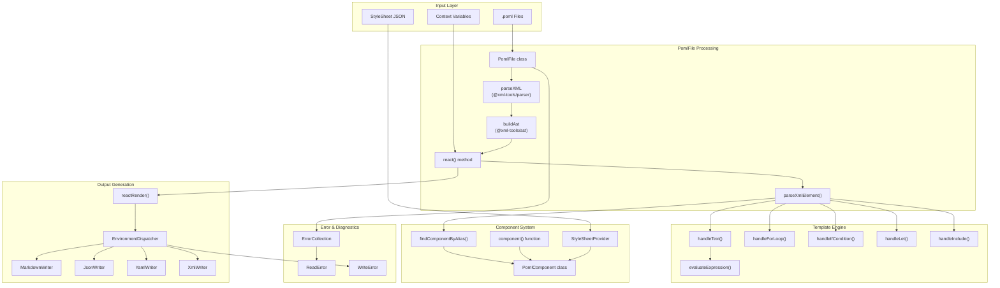
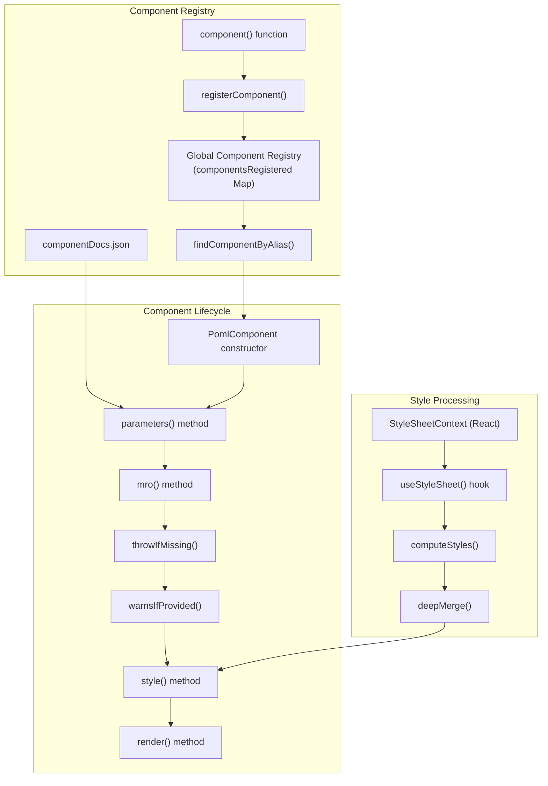
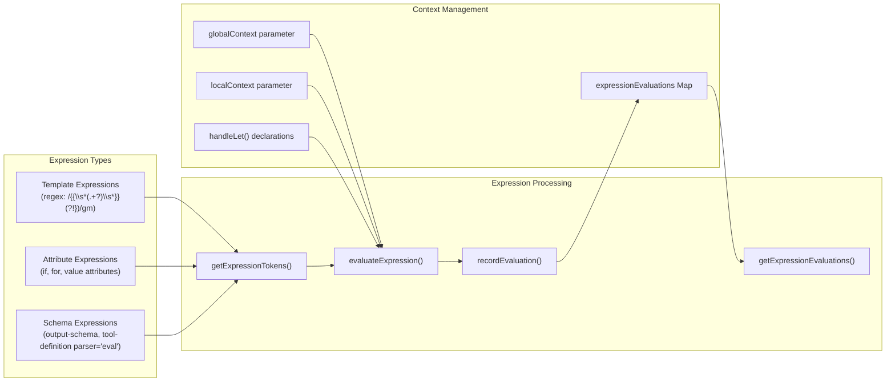
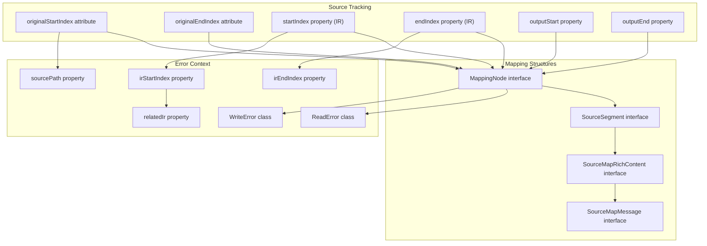
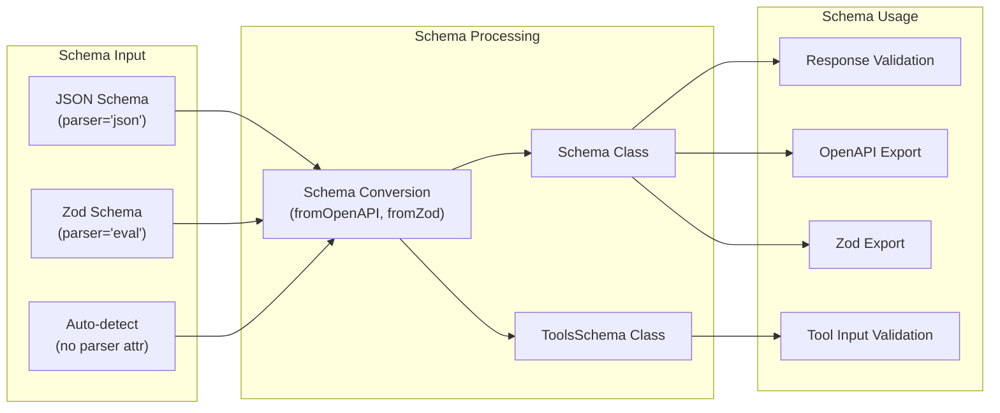

<!-- source: DeepWiki mcp.deepwiki.com · repo microsoft/poml · page 3 Core Architecture · fetched 2026-10-26 -->

# Core Architecture

Relevant source files

The following files were used as context for generating this wiki page:

- [docs/language/meta.md](docs/language/meta.md)
- [docs/vscode/features.md](docs/vscode/features.md)
- [packages/poml/base.tsx](packages/poml/base.tsx)
- [packages/poml/file.tsx](packages/poml/file.tsx)
- [packages/poml/index.ts](packages/poml/index.ts)
- [packages/poml/tests/base.test.tsx](packages/poml/tests/base.test.tsx)
- [packages/poml/tests/file.test.tsx](packages/poml/tests/file.test.tsx)
- [packages/poml/tests/index.test.tsx](packages/poml/tests/index.test.tsx)
- [packages/poml/tests/trace.test.tsx](packages/poml/tests/trace.test.tsx)
- [packages/poml/tests/writer.test.tsx](packages/poml/tests/writer.test.tsx)
- [packages/poml/util/index.ts](packages/poml/util/index.ts)
- [packages/poml/util/trace.ts](packages/poml/util/trace.ts)
- [packages/poml/writer.ts](packages/poml/writer.ts)

This document provides a comprehensive technical overview of POML's core architecture, focusing on the fundamental processing pipeline, component system, and writer architecture that powers the entire framework. It covers the key classes, data flows, and architectural patterns used throughout the system.

For information about specific language features and syntax, see [Language Reference](#4). For details on the development tooling and IDE integration, see [VS Code Extension](#5.3).

## System Overview

POML's architecture is built around a multi-stage processing pipeline that transforms markup files through several intermediate representations before producing final output. The system is designed with clear separation of concerns and extensible component patterns.

**Sources:** [packages/poml/file.tsx:56-1469](), [packages/poml/base.tsx:1-863](), [packages/poml/writer.ts:1-596](), [packages/poml/index.ts:1-277]()

## Processing Pipeline

The POML processing pipeline transforms input files through several well-defined stages, each with specific responsibilities and clear interfaces between them.

```mermaid
graph LR
    subgraph "Stage 1: XML Parsing"
        input_text["Raw .poml Text"]
        readXml["readXml()"]
        parseXML_func["parseXML()"]
        buildAst_func["buildAst()"]
        xml_document["XMLDocument"]
    end
    
    subgraph "Stage 2: Template Processing"
        react_method["react() method"]
        parseXmlElement_func["parseXmlElement()"]
        handleText_func["handleText()"]
        handleForLoop_func["handleForLoop()"]
        handleIfCondition_func["handleIfCondition()"]
        handleLet_func["handleLet()"]
        handleInclude_func["handleInclude()"]
        evaluateExpression_func["evaluateExpression()"]
    end
    
    subgraph "Stage 3: Component System"
        findComponentByAlias_func["findComponentByAlias()"]
        PomlComponent_render["PomlComponent.render()"]
        component_style["component.style()"]
        React_createElement["React.createElement()"]
    end
    
    subgraph "Stage 4: IR Generation"
        reactRender_func["reactRender()"]
        renderToString["renderToString()"]
        ir_string["IR String"]
    end
    
    subgraph "Stage 5: Output Writing"
        EnvironmentDispatcher_write["EnvironmentDispatcher.write()"]
        writeElementTree["writeElementTree()"]
        buildSourceMap_func["buildSourceMap()"]
        final_output["Final Output"]
    end
    
    input_text --> readXml
    readXml --> parseXML_func
    parseXML_func --> buildAst_func
    buildAst_func --> xml_document
    
    xml_document --> react_method
    react_method --> parseXmlElement_func
    parseXmlElement_func --> handleText_func
    parseXmlElement_func --> handleForLoop_func
    parseXmlElement_func --> handleIfCondition_func
    parseXmlElement_func --> handleLet_func
    parseXmlElement_func --> handleInclude_func
    handleText_func --> evaluateExpression_func
    
    parseXmlElement_func --> findComponentByAlias_func
    findComponentByAlias_func --> PomlComponent_render
    PomlComponent_render --> component_style
    component_style --> React_createElement
    
    React_createElement --> reactRender_func
    reactRender_func --> renderToString
    renderToString --> ir_string
    
    ir_string --> EnvironmentDispatcher_write
    EnvironmentDispatcher_write --> writeElementTree
    writeElementTree --> buildSourceMap_func
    buildSourceMap_func --> final_output
```

**Sources:** [packages/poml/file.tsx:135-188](), [packages/poml/file.tsx:258-279](), [packages/poml/file.tsx:1023-1330](), [packages/poml/util/reactRender.ts:1-50](), [packages/poml/writer.ts:573-596]()

## Component Architecture

The component system provides a flexible, extensible architecture for defining reusable POML elements with standardized behavior patterns.

### PomlComponent Structure

| Property | Type | Description |
|----------|------|-------------|
| `officialName` | `string` | Canonical component name |
| `componentFunc` | `React.ComponentType` | React component implementation |
| `spec` | `ComponentSpec \| undefined` | Component specification from registry |
| `options.aliases` | `string[]` | Alternative names for component lookup |
| `options.requiredProps` | `string[]` | Props that must be provided |
| `options.unwantedProps` | `string[]` | Props that generate warnings |
| `options.applyStyleSheet` | `boolean` | Whether to apply global stylesheet |
| `options.asynchorous` | `boolean` | Whether component supports async operations |

The `PomlComponent` class is created using the `component()` function which registers components in a global registry and provides a standardized interface for component behavior.

### Component Registration and Lookup

**Sources:** [packages/poml/base.tsx:639-852](), [packages/poml/base.tsx:520-638](), [packages/poml/base.tsx:694-749](), [packages/poml/util/index.ts:4-37]()

## Writer System Architecture

The writer system provides a pluggable architecture for converting intermediate representation to various output formats with comprehensive source mapping support.

```mermaid
graph TD
    subgraph "Writer Base Classes"
        Writer_class["Writer<WriterOptions>"]
        EnvironmentDispatcher_class["EnvironmentDispatcher"]
    end
    
    subgraph "Format-Specific Writers"
        MarkdownWriter_class["MarkdownWriter"]
        JsonWriter_class["JsonWriter"]
        YamlWriter_class["YamlWriter"]
        XmlWriter_class["XmlWriter"]
        HtmlWriter_class["HtmlWriter"]
        CsvWriter_class["CsvWriter"]
        FreeWriter_class["FreeWriter"]
        MultiMediaWriter_class["MultiMediaWriter"]
    end
    
    subgraph "Writer Core Methods"
        writeElementTree_method["writeElementTree()"]
        buildSourceMap_method["buildSourceMap()"]
        truncateText_method["truncateText()"]
        assignSpeakers_method["assignSpeakers()"]
        generateWriterResult_method["generateWriterResult()"]
    end
    
    subgraph "Output Types"
        RichContent_type["RichContent"]
        Message_array["Message[]"]
        SourceMapRichContent_array["SourceMapRichContent[]"]
        SourceMapMessage_array["SourceMapMessage[]"]
    end
    
    Writer_class --> EnvironmentDispatcher_class
    EnvironmentDispatcher_class --> MarkdownWriter_class
    EnvironmentDispatcher_class --> JsonWriter_class
    EnvironmentDispatcher_class --> YamlWriter_class
    EnvironmentDispatcher_class --> XmlWriter_class
    EnvironmentDispatcher_class --> HtmlWriter_class
    EnvironmentDispatcher_class --> CsvWriter_class
    EnvironmentDispatcher_class --> FreeWriter_class
    EnvironmentDispatcher_class --> MultiMediaWriter_class
    
    Writer_class --> writeElementTree_method
    Writer_class --> buildSourceMap_method
    Writer_class --> truncateText_method
    Writer_class --> assignSpeakers_method
    Writer_class --> generateWriterResult_method
    
    buildSourceMap_method --> RichContent_type
    buildSourceMap_method --> Message_array
    buildSourceMap_method --> SourceMapRichContent_array
    buildSourceMap_method --> SourceMapMessage_array
```

### Writer Processing Pipeline

The writer system processes IR through multiple stages to produce final output with comprehensive source mapping.

| Stage | Method | Description |
|-------|--------|-------------|
| **IR Parsing** | `generateWriterResult()` | Parse IR using cheerio, add startIndex/endIndex to nodes |
| **Element Tree Processing** | `writeElementTree()` | Recursively process IR elements, delegate to format writers |
| **Content Generation** | Format-specific `writeElementTree()` | Generate textual output in target format (Markdown, JSON, etc.) |
| **Multimedia Processing** | `buildSourceMap()` | Handle multimedia content positioning and special characters |
| **Speaker Assignment** | `assignSpeakers()` | Assign speaker roles based on `speaker` attributes |
| **Source Map Generation** | `buildSourceMap()` | Create detailed mappings between input, IR, and output positions |

**Sources:** [packages/poml/writer.ts:70-250](), [packages/poml/writer.ts:573-596](), [packages/poml/writer.ts:425-567]()

## Template Engine

The template engine is embedded within the `PomlFile` class and provides powerful templating capabilities including variable substitution, loops, conditionals, and includes.

### Template Features

| Feature | Syntax | Implementation |
|---------|--------|---------------|
| **Variable Substitution** | `{{variable}}` | `handleText()`, `evaluateExpression()` |
| **For Loops** | `for="item in list"` | `handleForLoop()` |
| **Conditionals** | `if="condition"` | `handleIfCondition()` |
| **Variable Declaration** | `<let name="var" value="expression"/>` | `handleLet()` |
| **File Includes** | `<include src="file.poml"/>` | `handleInclude()` |
| **Context Merging** | `<context>{...}</context>` | `deepMerge()` in `react()` |

### Expression Evaluation System

The template engine includes a sophisticated expression evaluation system that tracks all expressions for debugging and IDE support.

**Sources:** [packages/poml/file.tsx:311-409](), [packages/poml/file.tsx:987-1014](), [packages/poml/file.tsx:416-421](), [packages/poml/file.tsx:411-414]()

## Error Handling and Diagnostics

POML provides comprehensive error handling with detailed source location tracking and categorized error reporting.

### Error Collection System

| Class | Purpose | Key Methods |
|-------|---------|-------------|
| `ErrorCollection` | Singleton error accumulator | `add()`, `clear()`, `list()`, `empty()`, `first()`, `last()` |
| `ReadError` | Parse and processing errors | `fromProps()`, constructor with source location |
| `WriteError` | Output generation errors | Constructor with IR context and source mapping |
| `SystemError` | Internal system errors | Standard Error subclass |
| `PomlError` | Base error class | Constructor with severity levels |

The error system maintains detailed source location tracking with `startIndex`, `endIndex`, and `sourcePath` properties for precise error reporting in development tools.

### Source Mapping and Debugging

The system maintains detailed mappings between original source, intermediate representation, and final output to enable precise error reporting and debugging support.

**Sources:** [packages/poml/base.tsx:283-315](), [packages/poml/writer.ts:31-69](), [packages/poml/writer.ts:425-567](), [packages/poml/base.tsx:68-84]()

## Meta Elements and Runtime Configuration

POML supports several meta elements that configure processing behavior and define schemas for structured output.

### Meta Element Processing

| Element | Purpose | Handler Method |
|---------|---------|----------------|
| `<output-schema>` | Response schema definition | `handleOutputSchema()` |
| `<tool-definition>` | Tool schema definition | `handleToolDefinition()` |
| `<runtime>` | Runtime parameters | `handleRuntime()` |
| `<meta>` | Version and component control | `handleMeta()` |

### Schema Processing System

The system supports both JSON Schema and Zod schema definitions with automatic detection and conversion.

**Sources:** [packages/poml/file.tsx:720-847](), [packages/poml/file.tsx:849-903](), [packages/poml/file.tsx:905-961]()

---

