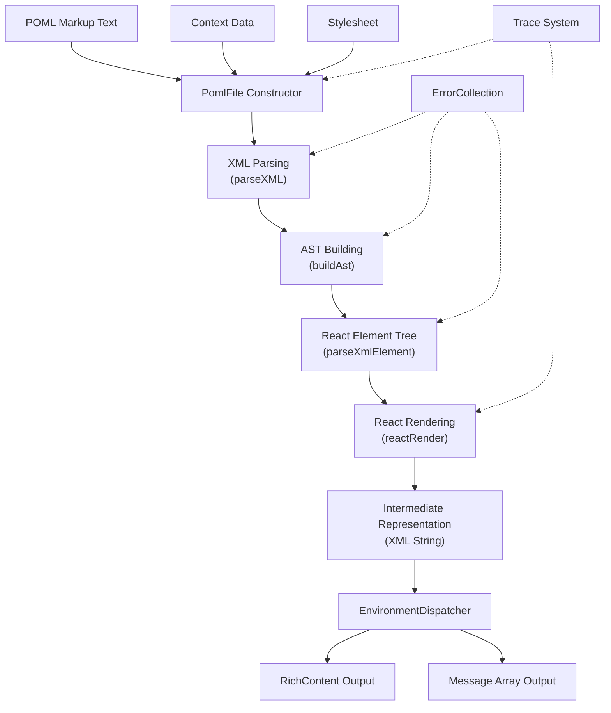
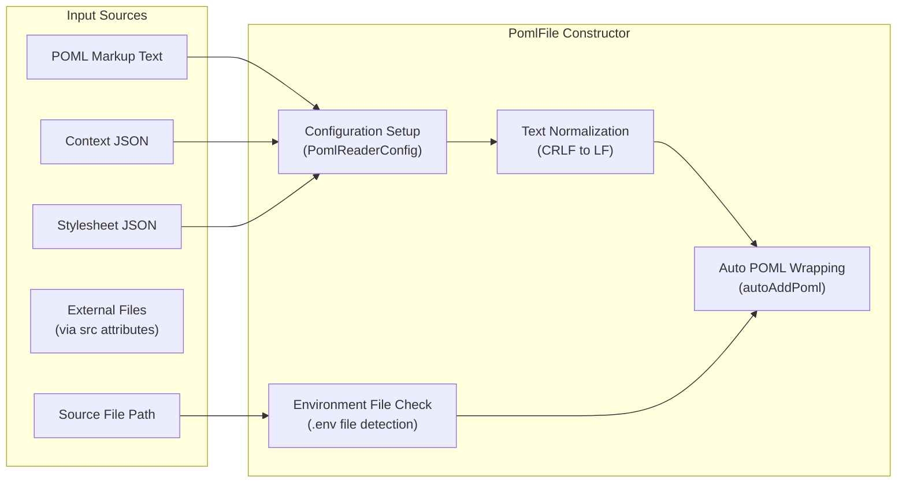
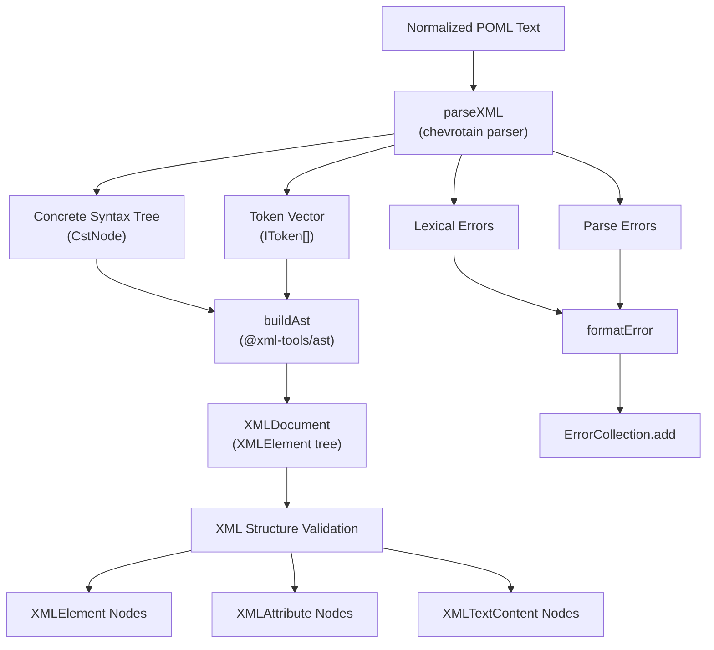
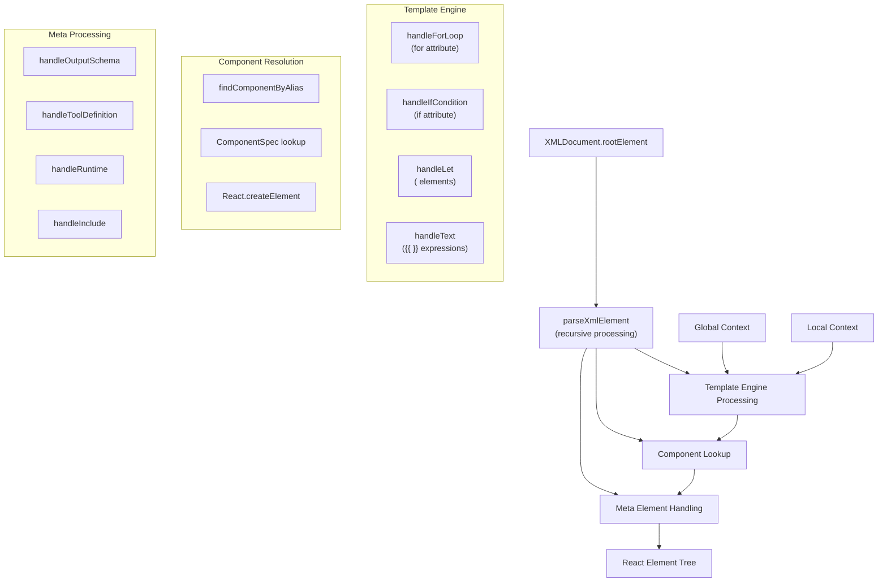
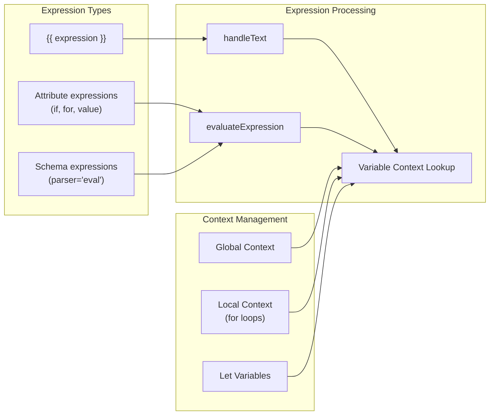
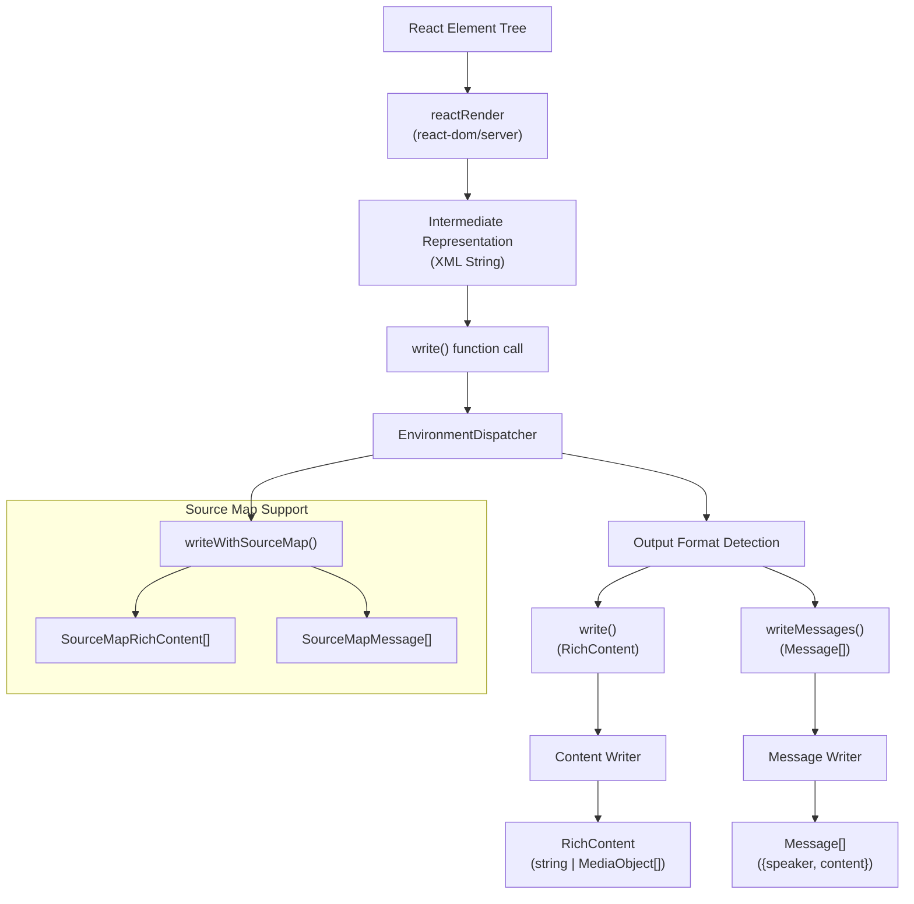
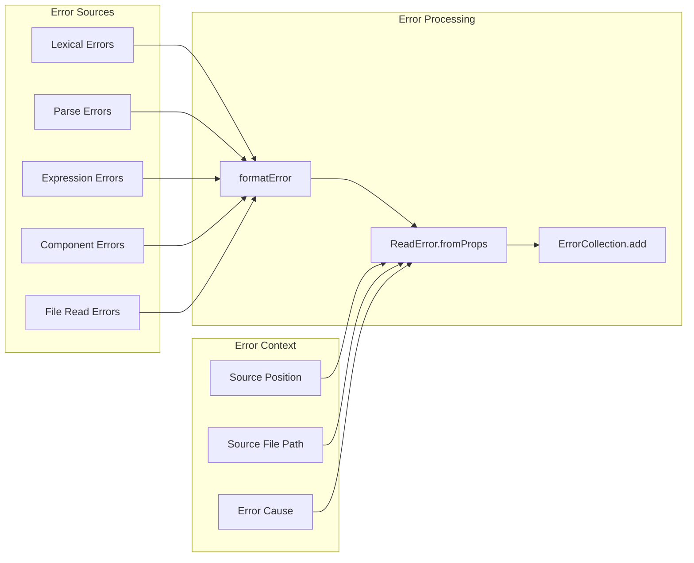
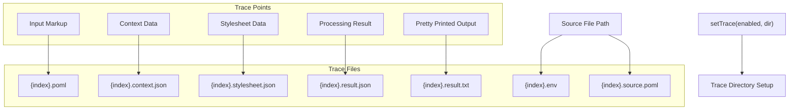

<!-- source: DeepWiki mcp.deepwiki.com · repo microsoft/poml · page 3.1 Processing Pipeline · fetched 2026-10-26 -->

# Processing Pipeline

Relevant source files

The following files were used as context for generating this wiki page:

- [docs/language/meta.md](docs/language/meta.md)
- [docs/vscode/features.md](docs/vscode/features.md)
- [packages/poml/file.tsx](packages/poml/file.tsx)
- [packages/poml/index.ts](packages/poml/index.ts)
- [packages/poml/tests/file.test.tsx](packages/poml/tests/file.test.tsx)
- [packages/poml/tests/trace.test.tsx](packages/poml/tests/trace.test.tsx)
- [packages/poml/util/index.ts](packages/poml/util/index.ts)
- [packages/poml/util/trace.ts](packages/poml/util/trace.ts)

This document details the POML document processing pipeline, which transforms POML markup text into various output formats through a multi-stage parsing and rendering process. The pipeline handles XML parsing, React element tree generation, template expression evaluation, and output formatting.

For information about the component system that provides the building blocks used during processing, see [Component System](#3.2). For details about file format specifications, see [File Format and Parsing](#3.3). For output format generation, see [Writer System and Output Formats](#3.4).

## Pipeline Overview

The POML processing pipeline transforms input markup through several distinct stages, each handling specific aspects of document processing and validation.

Sources: [packages/poml/file.tsx:96-133](), [packages/poml/index.ts:26-46](), [packages/poml/writer.ts]()

## Input Processing Stage

The processing pipeline begins with multiple input sources that are combined and validated before parsing.

Sources: [packages/poml/file.tsx:71-133](), [packages/poml/file.tsx:27-37]()

### PomlFile Configuration

The `PomlFile` constructor accepts a `PomlReaderOptions` interface that controls processing behavior:

| Option | Type | Default | Description |
|--------|------|---------|-------------|
| `trim` | boolean | `true` | Whether to trim whitespace from text content |
| `autoAddPoml` | boolean | `true` | Automatically wrap content in `<poml>` tags if needed |
| `crlfToLf` | boolean | `true` | Convert Windows line endings to Unix format |

Sources: [packages/poml/file.tsx:27-37]()

### Auto-POML Wrapping Logic

The pipeline automatically detects and wraps content that lacks proper POML root elements:

- **Free Text**: Content without XML structure gets wrapped in `<poml syntax="text" whiteSpace="pre">`
- **Valid XML with Multiple Roots**: Content with valid XML but multiple root elements gets wrapped in `<poml syntax="markdown">`
- **Existing POML**: Content already starting with `<poml` is processed as-is

Sources: [packages/poml/file.tsx:98-113]()

## XML Parsing and AST Building

The core parsing stage transforms POML markup into a structured Abstract Syntax Tree using XML parsing libraries.

Sources: [packages/poml/file.tsx:135-188](), [packages/xml-tools/parser](), [packages/xml-tools/ast]()

### Error Handling During Parsing

The parsing stage collects and formats errors from multiple sources:

- **Lexical Errors**: Invalid characters, malformed tokens
- **Parse Errors**: Syntax violations, unclosed tags, invalid nesting
- **AST Building Errors**: Structural issues in the parsed tree

All errors are converted to `ReadError` objects with position information and added to the global `ErrorCollection`.

Sources: [packages/poml/file.tsx:139-188](), [packages/poml/base.ts]()

## React Element Tree Generation

The parsed XML AST is transformed into a React element tree through recursive processing of XML elements.

Sources: [packages/poml/file.tsx:1023-1149](), [packages/poml/file.tsx:257-279](), [packages/poml/base.ts]()

### Template Expression Evaluation

The pipeline supports dynamic content through JavaScript expression evaluation:

Sources: [packages/poml/file.tsx:934-1014](), [packages/poml/file.tsx:987-1014](), [packages/poml/file.tsx:444-475]()

### Component Registration and Lookup

Components are resolved through a registration system that supports aliases and namespacing:

| Component Type | Examples | Resolution Method |
|---------------|----------|------------------|
| Core Components | `
`, `<paragraph>` | `findComponentByAlias` |
| Namespaced | `<Markup.Paragraph>` | Namespace prefix resolution |
| Disabled Components | Via `<meta components="-table">` | `disabledComponents` set |

Sources: [packages/poml/base.ts](), [packages/poml/file.tsx:1095-1149]()

## Output Generation Stage

The React element tree is rendered to an intermediate representation, then transformed into final output formats.

Sources: [packages/poml/index.ts:26-46](), [packages/poml/index.ts:94-101](), [packages/poml/writer.ts](), [packages/poml/util/reactRender.ts]()

### Output Format Types

The pipeline supports multiple output formats through the `write()` function:

| Format | Function Signature | Return Type | Usage |
|--------|-------------------|-------------|-------|
| Rich Content | `write(ir, {speaker: false})` | `RichContent` | General content output |
| Speaker Messages | `write(ir, {speaker: true})` | `Message[]` | Chat/conversation format |
| Source Mapped | `writeWithSourceMap(ir, options)` | `SourceMapRichContent[]` \| `SourceMapMessage[]` | Debug/editor integration |

Sources: [packages/poml/index.ts:87-117](), [packages/poml/base.ts]()

## Supporting Systems

The processing pipeline includes several supporting systems that enhance functionality and debugging capabilities.

### Error Collection System

Sources: [packages/poml/file.tsx:423-437](), [packages/poml/base.ts]()

### Tracing System

The pipeline includes comprehensive tracing for debugging and development:

Sources: [packages/poml/util/trace.ts](), [packages/poml/index.ts:157-159](), [packages/poml/index.ts:247-254]()

### Language Server Integration

The processing pipeline provides specialized methods for IDE integration:

| Method | Purpose | Return Type |
|--------|---------|-------------|
| `getHoverToken(offset)` | Hover information | `PomlToken \| undefined` |
| `getCompletions(offset)` | Auto-completion | `PomlToken[]` |
| `getExpressionTokens()` | Expression debugging | `PomlToken[]` |
| `getExpressionEvaluations(range)` | Expression results | `any[]` |

Sources: [packages/poml/file.tsx:281-421](), [packages/poml/file.tsx:39-46]()

The pipeline maintains position information throughout processing to support precise error reporting and IDE features like hover tooltips and auto-completion.

---

