<!-- source: DeepWiki mcp.deepwiki.com · repo microsoft/poml · page 3.2 Component System · fetched 2026-10-26 -->

# Component System

<details>
<summary>Relevant source files</summary>

The following files were used as context for generating this wiki page:

- [bump-version.js](bump-version.js)
- [docs/language/components.md](docs/language/components.md)
- [packages/poml-vscode/lsp/parseComments.ts](packages/poml-vscode/lsp/parseComments.ts)
- [packages/poml/assets/componentDocs.json](packages/poml/assets/componentDocs.json)
- [packages/poml/components/tree.tsx](packages/poml/components/tree.tsx)
- [packages/poml/essentials.tsx](packages/poml/essentials.tsx)
- [packages/poml/tests/essentials.test.tsx](packages/poml/tests/essentials.test.tsx)
- [python/poml/_tags.py](python/poml/_tags.py)

</details>


POML's component system provides a unified architecture for defining reusable markup components that work across both TypeScript/JavaScript and Python environments. Components are defined once in TypeScript with React and automatically generate Python bindings, documentation, and type hints through an automated documentation parsing system.

The system organizes components into four categories: Basic Components (text formatting and structure), Intentions (semantic prompt components like `Role` and `Task`), Data Displays (tables, documents, multimedia), and Utilities (tool interactions and message handling).

For information about the processing pipeline that transforms POML files into component trees, see [Processing Pipeline](#3.1). For details about the POML file format and parsing, see [File Format and Parsing](#3.3).

## Cross-Language Component System

### Component Definition Architecture

POML components are defined once in TypeScript and automatically generate Python equivalents through a documentation parsing and code generation system.

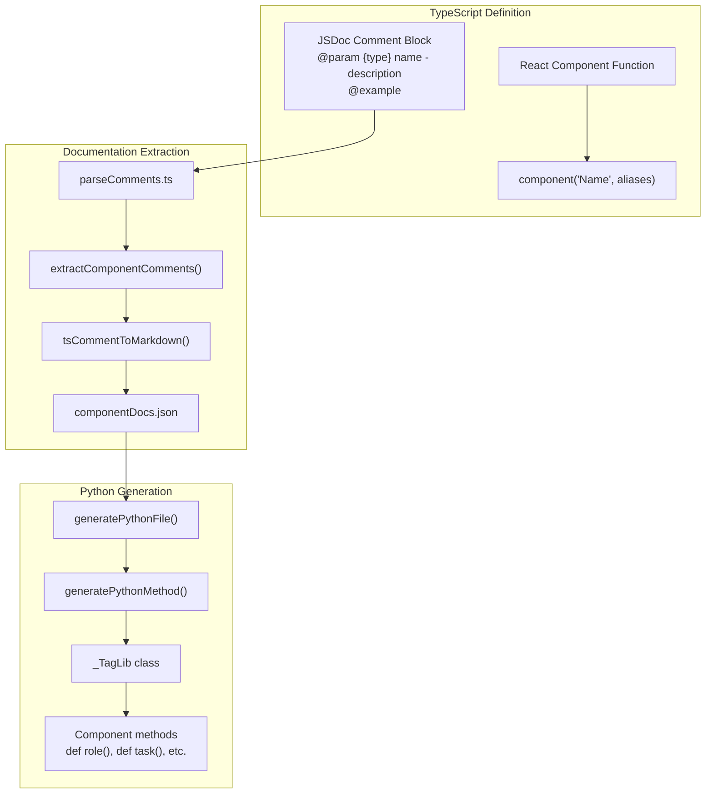

### Component Registration and Categories

Components are automatically categorized during the documentation parsing process into four main categories:

| Category | Components | Purpose |
|----------|------------|---------|
| Basic Components | `Text`, `Paragraph`, `Bold`, `List`, etc. | Text formatting and document structure |
| Intentions | `Role`, `Task`, `OutputFormat`, `Hint` | Semantic prompt engineering components |
| Data Displays | `Document`, `Table`, `Image`, `Conversation` | External data integration and display |
| Utilities | `ToolRequest`, `ToolResponse`, `SystemMessage` | Tool interactions and message handling |

The categorization logic in `scanComponentDocs()` automatically sorts components based on their file location:

```typescript
// From parseComments.ts
if (filePath.endsWith('essentials.tsx') || filePath.endsWith('utils.tsx')) {
  basicComponents.push(...names.filter(name => name !== 'Image' && name !== 'Object' && !name.startsWith('Tool')));
  dataDisplays.push(...names.filter(name => name === 'Image' || name === 'Object'));
  utilities.push(...names.filter(name => name.startsWith('Tool')));
} else if (filePath.endsWith('instructions.tsx')) {
  intentions.push(...names);
}
```

**Sources:** [packages/poml-vscode/lsp/parseComments.ts:142-165](), [packages/poml-vscode/lsp/parseComments.ts:284-310]()

## Component Registration and Definition

### The component() Function

Components are defined using the `component()` function which serves as both a decorator and registration mechanism:

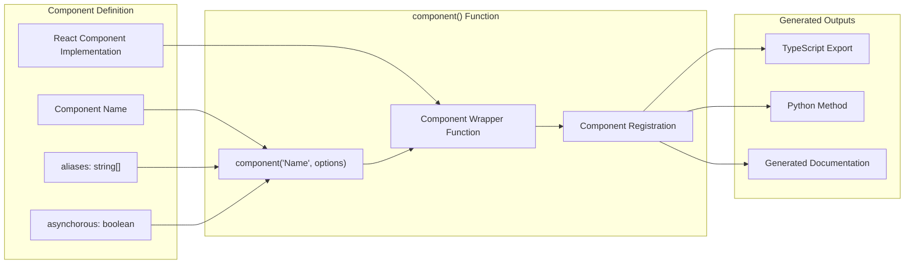

Essential components like `Text`, `Paragraph`, and `Image` are defined with the pattern:

```typescript
export const Text = component('Text', ['div', 'poml'])((props: React.PropsWithChildren<PropsSyntaxAny>) => {
  // Component implementation
});

export const Image = component('Image', { aliases: ['img'], asynchorous: true })((props: ImageProps) => {
  // Async component implementation  
});
```

**Sources:** [packages/poml/essentials.tsx:173-190](), [packages/poml/essentials.tsx:650-688]()

### Component Documentation System

Component parameters and documentation are extracted from JSDoc comments and used to generate both Python type hints and user documentation:

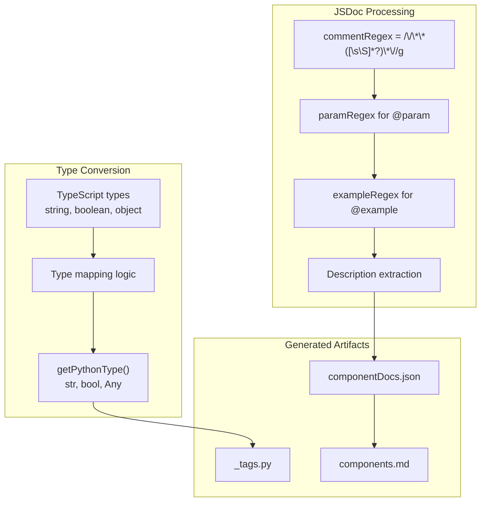

The type conversion system maps TypeScript types to appropriate Python types:

| TypeScript Type | Python Type | Notes |
|----------------|-------------|--------|
| `string` | `str` | Direct mapping |
| `boolean` | `bool` | Direct mapping |
| `number` | `int` or `float` | Heuristic based on parameter name |
| `object` | `Any` | Generic object type |
| `Buffer` | `bytes` | Binary data handling |
| `RegExp` | `str` | Python uses string patterns |

**Sources:** [packages/poml-vscode/lsp/parseComments.ts:35-107](), [packages/poml-vscode/lsp/parseComments.ts:194-226]()

## Presentation System and Syntax Contexts

### Syntax Context Computation

POML components support multiple presentation modes through the `computeSyntaxContext()` function, which determines how content should be rendered based on syntax specifications:

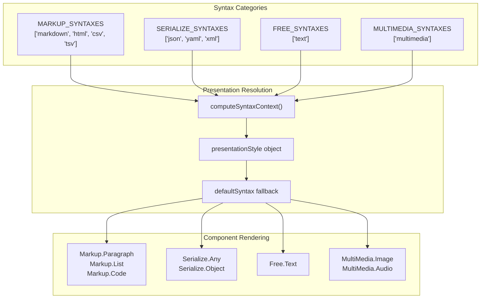

### AnyOrFree Component Pattern

Components use the `AnyOrFree` helper to delegate rendering based on computed presentation context:

```typescript
// Essential components follow this pattern
if (presentation === 'markup') {
  return <Markup.Paragraph markupLang={syntax} {...others}>{children}</Markup.Paragraph>;
} else {
  return <AnyOrFree syntax={syntax} presentation={presentation} asAny={true} name={name} type={type} {...others}>
    {children}
  </AnyOrFree>;
}
```

**Sources:** [packages/poml/essentials.tsx:34-94](), [packages/poml/essentials.tsx:97-120]()

### Python Component Implementation

Python components are generated as methods on the `_TagLib` class, with each component method eventually calling the abstract `tag()` method:

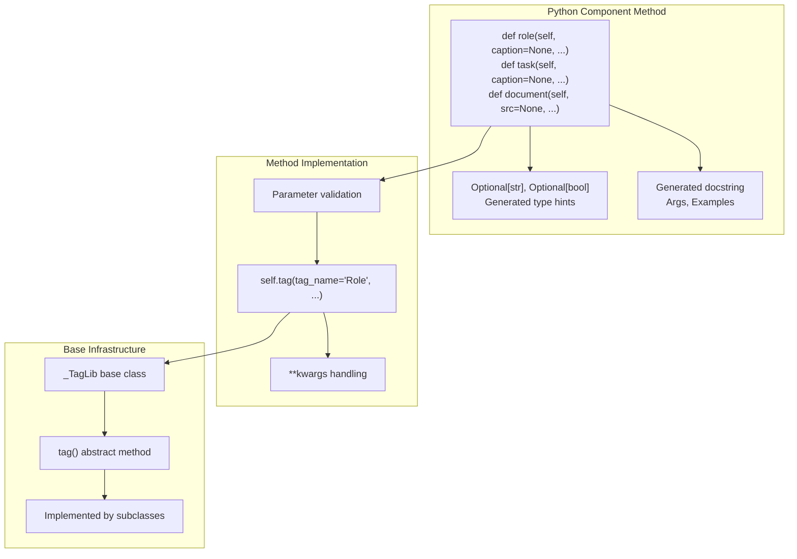

Example generated Python method structure:

```python
def role(self, caption: Optional[str] = None, **kwargs: Any):
    """Specifies the role you want the language model to assume when responding.
    
    Args:
        caption (Optional[str]): The title or label for the role paragraph. Default is `Role`.
    """
    return self.tag(tag_name="Role", caption=caption, **kwargs)
```

**Sources:** [python/poml/_tags.py:8-14](), [packages/poml-vscode/lsp/parseComments.ts:228-282]()

## Writer System Integration

### Writer Architecture

The writer system converts IR to various output formats through a polymorphic writer architecture:

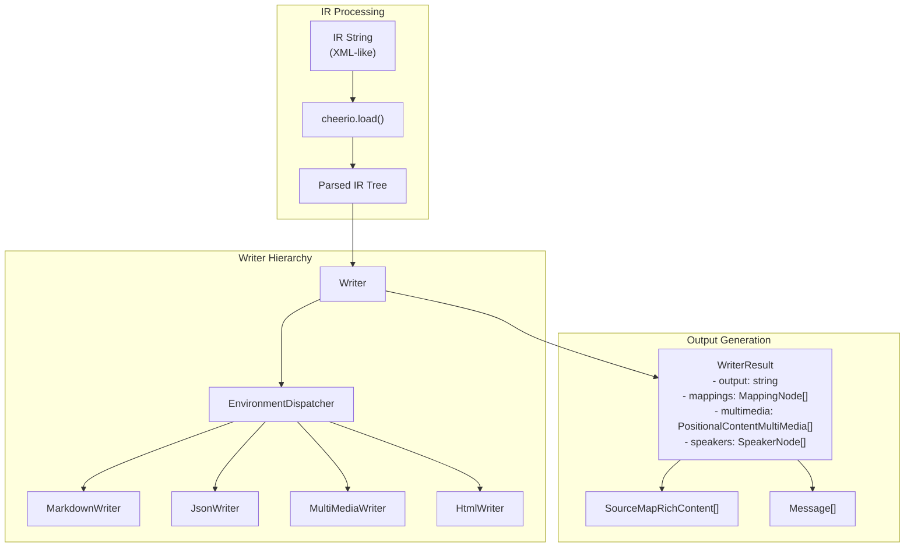

The `EnvironmentDispatcher` routes to specific writers based on presentation attributes in the IR:

```typescript
// Environment-based routing
if (element.attr('presentation') === 'markup') {
  return new MarkdownWriter(this.ir, options).writeElementTree(element, $);
} else if (element.attr('presentation') === 'serialize') {
  return new JsonWriter(this.ir, options).writeElementTree(element, $);
}
```

**Sources:** [packages/poml/writer.ts:598-652](), [packages/poml/writer.ts:70-96]()

### Source Mapping and Multimedia Handling

Writers maintain detailed source mapping information and handle multimedia content positioning:

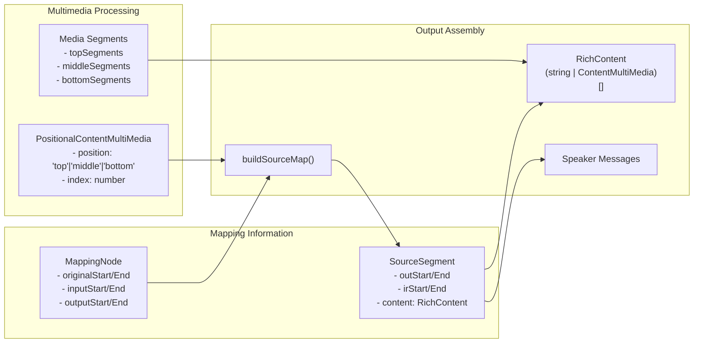

The system preserves precise mappings between source code positions and output content, enabling accurate error reporting and debugging.

**Sources:** [packages/poml/writer.ts:455-567](), [packages/poml/writer.ts:31-58]()

## Component Implementation Examples

### Essential Components Pattern

Essential components like `Text`, `Paragraph`, and formatting components follow a consistent implementation pattern using syntax context resolution:

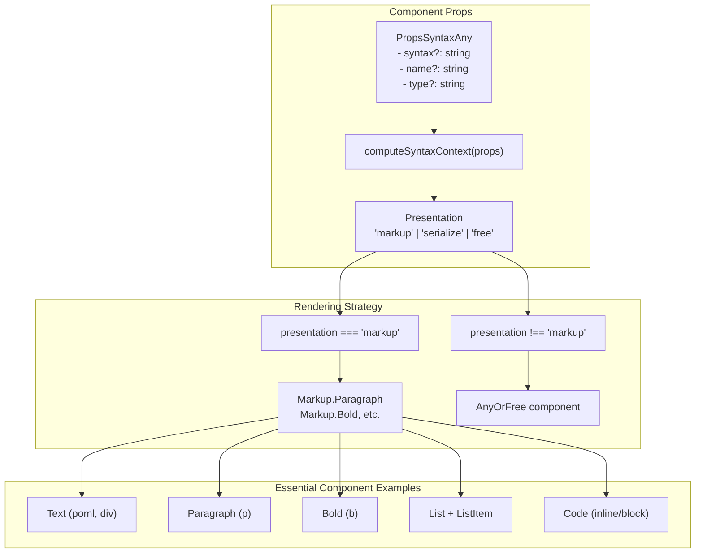

### Tree Component Architecture

The `Tree` component demonstrates complex data transformation across multiple presentation formats:

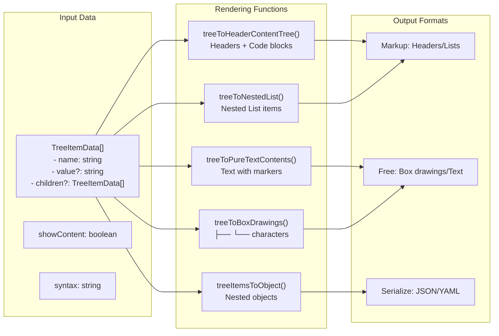

The Tree component showcases how complex components can provide different visualizations of the same data based on presentation context.

**Sources:** [packages/poml/essentials.tsx:207-225](), [packages/poml/components/tree.tsx:203-232]()

### Multimedia Components

Image and Audio components demonstrate asynchronous processing and format-specific rendering:

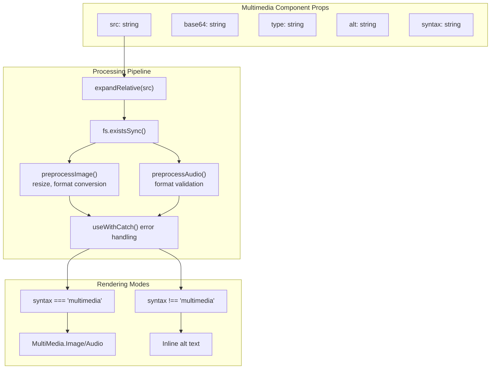

**Sources:** [packages/poml/essentials.tsx:650-688](), [packages/poml/essentials.tsx:719-742]()

## Error Handling and Validation

### Error Collection System

POML uses a centralized error collection system that accumulates errors during component processing:

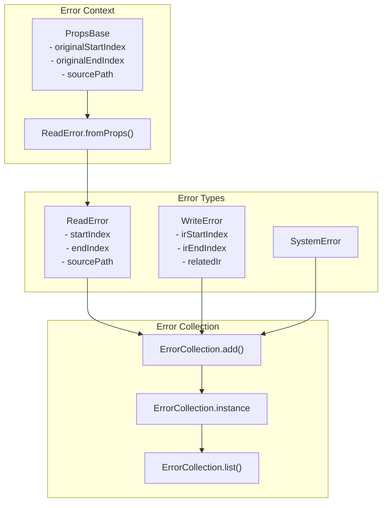

Components can report errors during validation, processing, or rendering while preserving source location information for debugging.

**Sources:** [packages/poml/base.tsx:285-306](), [packages/poml/base.tsx:328-365]()

### Truncation and Optimization

The writer system includes sophisticated truncation capabilities for managing content length:

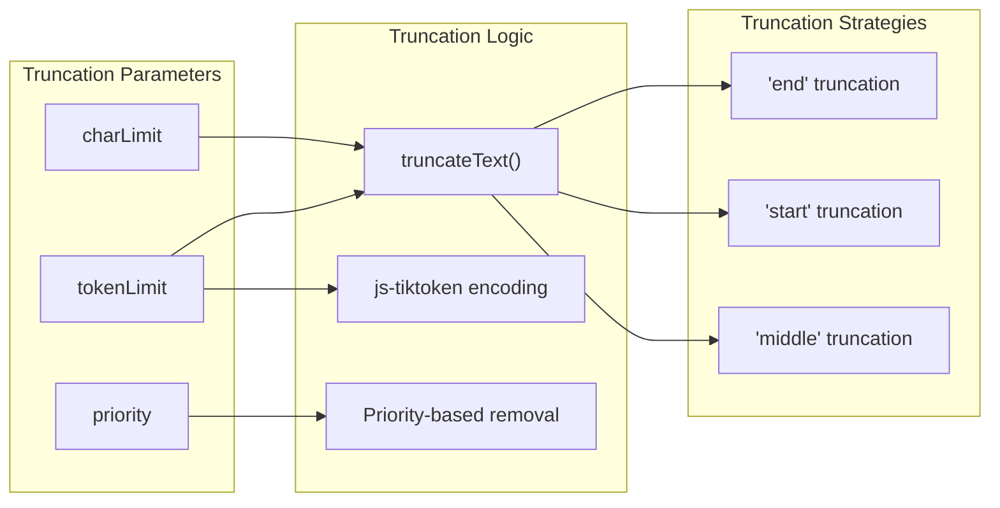

Components can specify content limits and priorities, allowing the system to intelligently manage content size while preserving important information.

**Sources:** [packages/poml/writer.ts:90-157](), [packages/poml/writer.ts:793-843]()

# Component System

This document covers POML's component system architecture, including component registration, lifecycle management, validation, and the writer system that converts components to various output formats. The component system bridges React-based component development with POML's markup language features, providing type validation, stylesheet application, and format-specific rendering.

For information about the processing pipeline that transforms POML files into component trees, see [Processing Pipeline](#3.1). For details about the POML file format and parsing, see [File Format and Parsing](#3.3).

---

