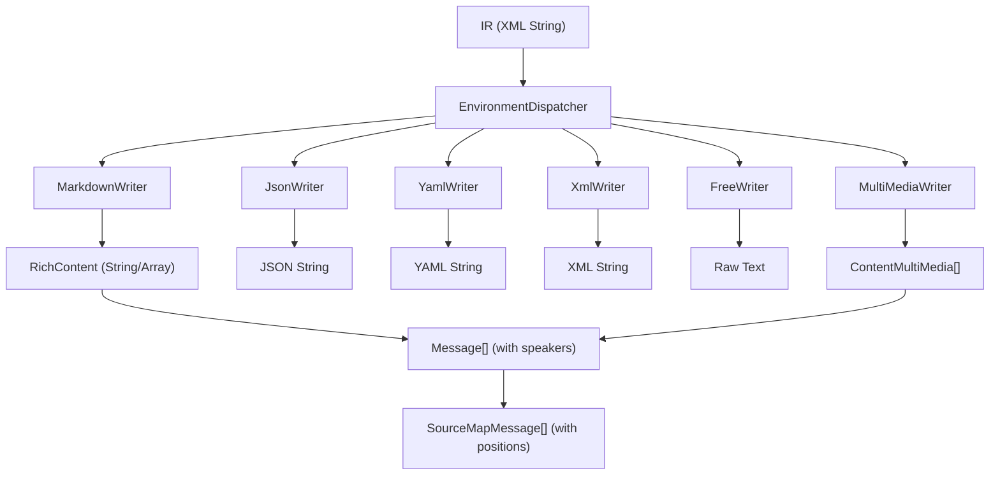
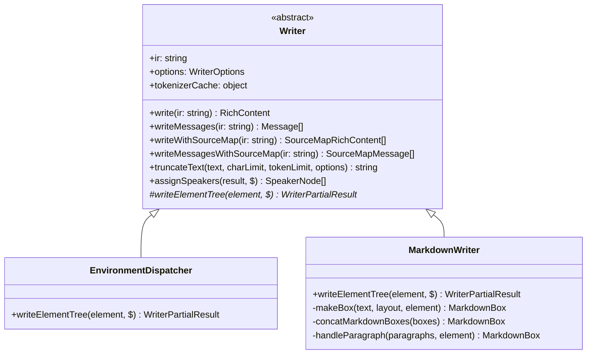
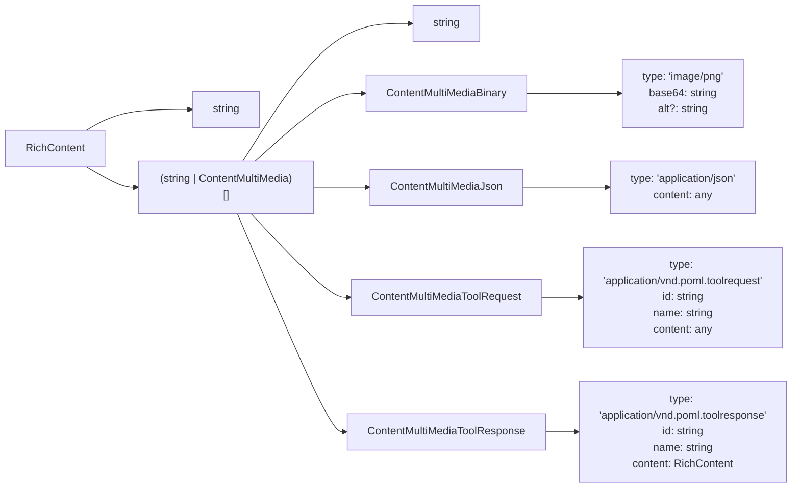
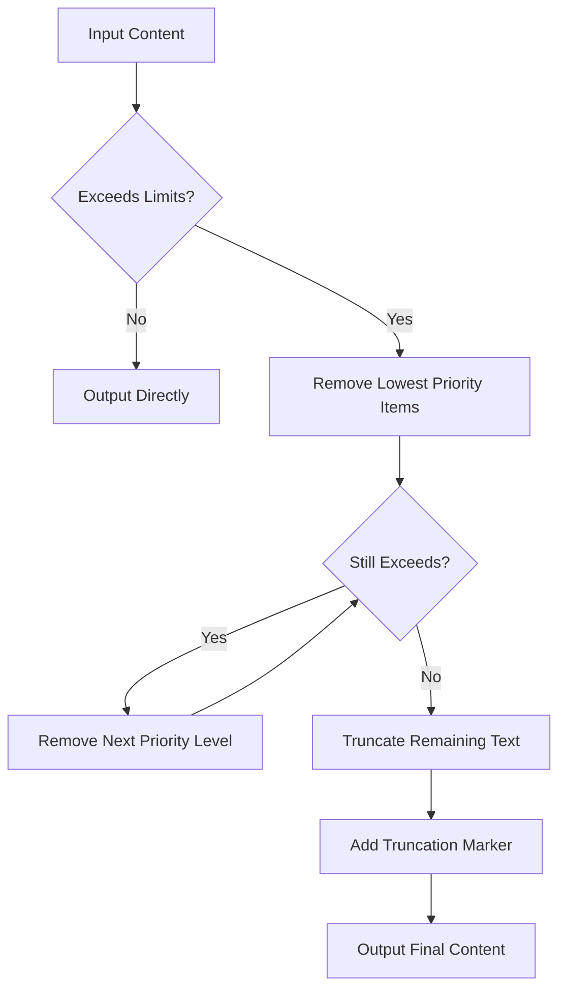

<!-- source: DeepWiki mcp.deepwiki.com · repo microsoft/poml · page 3.4 Writer System and Output Formats · fetched 2026-10-26 -->

# Writer System and Output Formats

<details>
<summary>Relevant source files</summary>

The following files were used as context for generating this wiki page:

- [packages/poml/base.tsx](packages/poml/base.tsx)
- [packages/poml/tests/base.test.tsx](packages/poml/tests/base.test.tsx)
- [packages/poml/tests/index.test.tsx](packages/poml/tests/index.test.tsx)
- [packages/poml/tests/writer.test.tsx](packages/poml/tests/writer.test.tsx)
- [packages/poml/writer.ts](packages/poml/writer.ts)

</details>


The Writer System is responsible for transforming POML's intermediate representation (IR) into various output formats. This system takes the parsed and processed IR XML and converts it into human-readable text, structured message arrays, multimedia content, or serialized data formats. The writer system handles content truncation, speaker assignment, source mapping, and multimedia positioning during the transformation process.

For information about how POML documents are parsed and converted into IR, see [File Format and Parsing](#3.3). For details about the components that generate the IR, see [Component System](#3.2).

## Architecture Overview

The writer system follows a hierarchical design with a base `Writer` class and specialized writers for different output formats. The `EnvironmentDispatcher` serves as the entry point, routing to appropriate writers based on the `presentation` attribute in the IR.



**Sources:** [packages/poml/writer.ts:564-612]()

## Core Writer Classes

### Base Writer Class

The `Writer<WriterOptions>` abstract class provides the foundation for all output format transformations. It manages the IR processing lifecycle, token counting, truncation, and source mapping.



**Sources:** [packages/poml/writer.ts:70-562](), [packages/poml/writer.ts:564-612](), [packages/poml/writer.ts:645-657]()

### Environment Dispatcher

The `EnvironmentDispatcher` analyzes the `presentation` attribute of environment elements and routes to the appropriate specialized writer:

| Presentation Type | Writer Class | Output Format |
|------------------|--------------|---------------|
| `markup` | `MarkdownWriter`, `HtmlWriter`, `CsvWriter`, `TsvWriter` | Formatted text |
| `serialize` | `JsonWriter`, `YamlWriter`, `XmlWriter` | Structured data |
| `free` | `FreeWriter` | Raw text |
| `multimedia` | `MultiMediaWriter` | Media objects |

**Sources:** [packages/poml/writer.ts:576-606]()

## Output Format Types

### RichContent Type System

The writer system produces several types of content representations:



**Sources:** [packages/poml/base.tsx:21-66]()

### Message-Based Output

When using speaker-aware output, content is organized into `Message` objects:

```typescript
interface Message {
  speaker: Speaker;  // 'system' | 'human' | 'ai' | 'tool'
  content: RichContent;
}
```

The writer automatically assigns speakers based on `speaker` attributes in the IR and applies default speaker logic when none is specified.

**Sources:** [packages/poml/base.tsx:63-66](), [packages/poml/writer.ts:260-353]()

## Content Processing Features

### Truncation and Priority System

The writer system implements sophisticated content truncation based on character limits, token limits, and priority values:



Truncation options include:
- `truncateDirection`: `'start'`, `'middle'`, or `'end'`
- `truncateMarker`: Custom truncation indicator (default: `' (...truncated)'`)
- `tokenEncodingModel`: Model for token counting (default: `'gpt-4o'`)

**Sources:** [packages/poml/writer.ts:90-152](), [packages/poml/writer.ts:753-799]()

### Source Mapping

Source mapping preserves the relationship between output content and the original source positions. This enables features like error reporting, debugging, and editor integration:

```typescript
interface SourceMapRichContent {
  startIndex: number;     // Position in original source
  endIndex: number;
  irStartIndex: number;   // Position in IR
  irEndIndex: number;
  content: RichContent;
}
```

**Sources:** [packages/poml/base.tsx:68-74](), [packages/poml/writer.ts:425-533]()

## Specialized Writers

### MarkdownWriter

The `MarkdownWriter` converts IR elements into Markdown syntax using a box model approach. Each element becomes a `MarkdownBox` with text content and spacing rules:

```typescript
interface MarkdownBox {
  text: string;
  before: string;    // Preceding whitespace
  after: string;     // Following whitespace  
  mappings: MappingNode[];
  multimedia: PositionalContentMultiMedia[];
  priority?: number;
}
```

The writer handles:
- Block vs inline element spacing
- List formatting with various bullet styles
- Table generation with configurable options
- Code block formatting with syntax highlighting
- Header level management

**Sources:** [packages/poml/writer.ts:621-628](), [packages/poml/writer.ts:664-698]()

### Serialization Writers

The serialization writers (`JsonWriter`, `YamlWriter`, `XmlWriter`) convert IR elements containing structured data into their respective formats:

- **JsonWriter**: Produces formatted JSON with 2-space indentation
- **YamlWriter**: Outputs YAML using the `js-yaml` library  
- **XmlWriter**: Generates XML with proper escaping and structure

**Sources:** [packages/poml/tests/writer.test.tsx:371-398]()

### MultiMediaWriter

The `MultiMediaWriter` extracts multimedia content and tool interactions from the IR, producing arrays of `ContentMultiMedia` objects. It handles:

- Image data with base64 encoding
- Tool requests with parameters
- Tool responses with nested content
- Mixed multimedia content positioning

**Sources:** [packages/poml/tests/writer.test.tsx:431-673]()

## Usage Examples

### Basic Content Writing

```javascript
// Simple content transformation
const writer = new MarkdownWriter();
const ir = '<p>Hello <b>world</b></p>';
const result = writer.write(ir); // "Hello **world**"
```

### Speaker-Based Messages

```javascript
// Convert to speaker messages
const ir = '<poml><p speaker="human">Question</p><p speaker="ai">Answer</p></poml>';
const messages = writer.writeMessages(ir);
// Result: [
//   { speaker: 'human', content: 'Question' },
//   { speaker: 'ai', content: 'Answer' }
// ]
```

### Source Map Generation

```javascript
// Include source mapping for debugging
const segments = writer.writeWithSourceMap(ir);
// Each segment includes original source positions
```

**Sources:** [packages/poml/tests/index.test.tsx:18-22](), [packages/poml/tests/index.test.tsx:183-190](), [packages/poml/tests/writer.test.tsx:63-71]()

---

