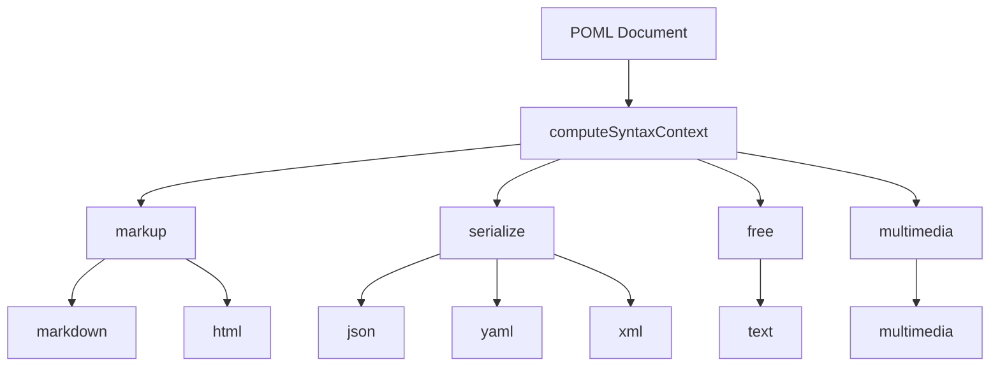
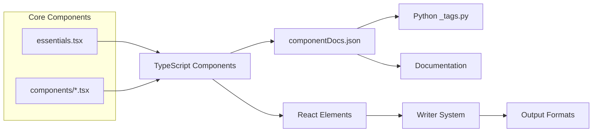
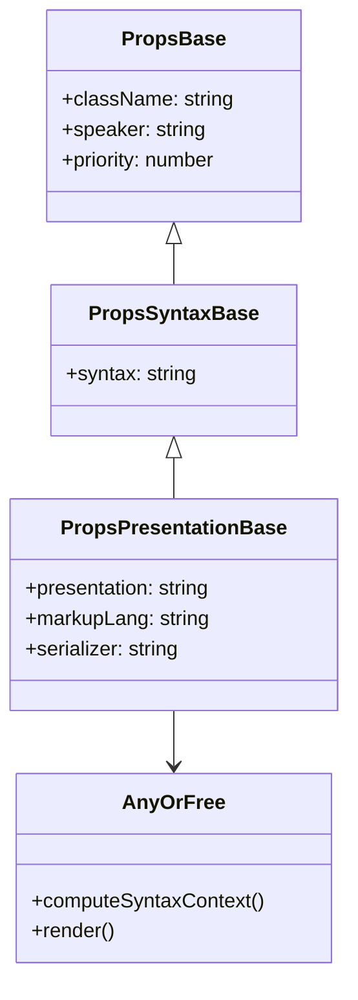
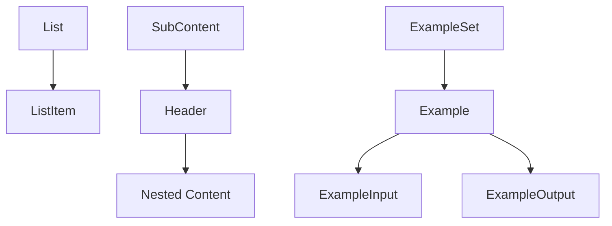
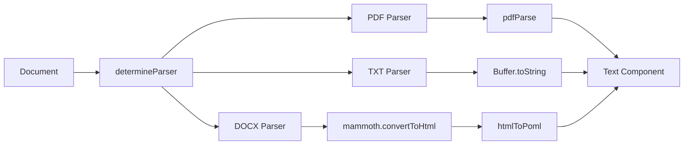
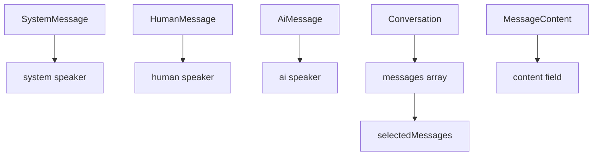
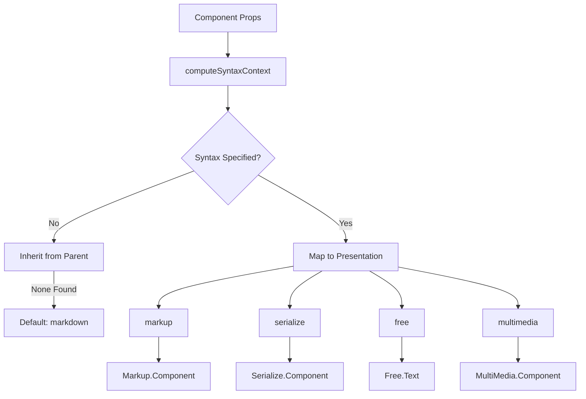
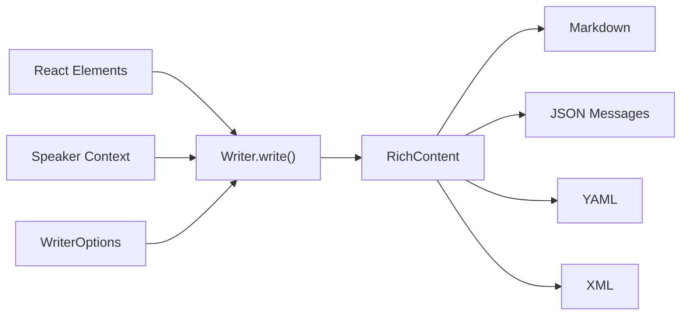

<!-- source: DeepWiki mcp.deepwiki.com · repo microsoft/poml · page 4 Language Reference · fetched 2026-10-26 -->

# Language Reference

<details>
<summary>Relevant source files</summary>

The following files were used as context for generating this wiki page:

- [docs/language/components.md](docs/language/components.md)
- [examples/104_financial_analysis.poml](examples/104_financial_analysis.poml)
- [packages/poml/assets/componentDocs.json](packages/poml/assets/componentDocs.json)
- [packages/poml/components/document.tsx](packages/poml/components/document.tsx)
- [packages/poml/components/tree.tsx](packages/poml/components/tree.tsx)
- [packages/poml/essentials.tsx](packages/poml/essentials.tsx)
- [packages/poml/tests/assets/sampleWebpage.html](packages/poml/tests/assets/sampleWebpage.html)
- [packages/poml/tests/components.test.tsx](packages/poml/tests/components.test.tsx)
- [packages/poml/tests/essentials.test.tsx](packages/poml/tests/essentials.test.tsx)
- [packages/poml/tests/util.test.tsx](packages/poml/tests/util.test.tsx)
- [packages/poml/util/image.ts](packages/poml/util/image.ts)
- [python/poml/_tags.py](python/poml/_tags.py)

</details>


This document provides a complete reference for the POML (Prompt Orchestration Markup Language) syntax, components, and features. POML is an XML-like markup language designed for creating structured prompts for language models, with support for multiple output formats including Markdown, JSON, YAML, and rich multimedia content.

For implementation details and internal architecture, see [Core Architecture](#3). For integration with specific platforms and tools, see [Integrations](#5). For practical usage examples, see [Examples and Use Cases](#4.5).

## Language Overview

POML combines XML-like syntax with React-style component composition to create a powerful prompt authoring system. Components can render to different output formats based on context, supporting both human-readable markup and structured data serialization.

### Syntax Fundamentals

POML documents use XML syntax with JSX-style template expressions:

```xml
<poml>
  <role>You are a helpful assistant.</role>
  <task>Analyze the following data: {{dataVariable}}</task>
  <examples>
    <example>
      <input>What is 2+2?</input>
      <output>4</output>
    </example>
  </examples>
</poml>
```

**Core Syntax Modes**



Sources: [packages/poml/essentials.tsx:26-93]()

## Component System Architecture

POML's component system bridges multiple programming languages through a shared component registry and auto-generation system.

### Component Implementation Flow



The system uses TypeScript as the source of truth, with [packages/poml/essentials.tsx]() defining core components and specialized components in [packages/poml/components/]() directory. Documentation is extracted to [packages/poml/assets/componentDocs.json:1-4000]() and used to generate Python bindings at [python/poml/_tags.py:1-50]().

Sources: [packages/poml/essentials.tsx:1-829](), [python/poml/_tags.py:1-50](), [packages/poml/assets/componentDocs.json:1-100]()

### Component Base Classes



Sources: [packages/poml/essentials.tsx:20-25](), [packages/poml/essentials.tsx:97-120]()

## Core Component Categories

### Text and Formatting Components

Basic text manipulation and styling components form the foundation of POML documents.

| Component | Element | Purpose | Key Props |
|-----------|---------|---------|-----------|
| `Text` | `<poml>`, `<text>` | Root wrapper for content | `syntax`, `speaker` |
| `Paragraph` | `<p>` | Standalone text section | `blankLine` |
| `Header` | `<h>` | Section headings | Auto-computed level |
| `Bold` | `<b>` | Bold text emphasis | None |
| `Italic` | `<i>` | Italic text emphasis | None |
| `Code` | `<code>` | Code snippets | `inline`, `lang` |

### Structural Components

Components for organizing content into lists, sections, and hierarchical structures.



Sources: [packages/poml/essentials.tsx:529-587](), [docs/language/components.md:211-273]()

### Data and Media Components

Specialized components for external data integration and multimedia content.

**Document Processing Pipeline**



| Component | Purpose | Key Features |
|-----------|---------|--------------|
| `Document` | PDF/DOCX/TXT files | Parser auto-detection, page selection |
| `Table` | Tabular data | CSV/Excel import, column selection |
| `Image` | Image content | Base64 encoding, resizing |
| `Tree` | Hierarchical data | Multiple output formats |
| `Folder` | Directory structure | File filtering, content inclusion |

Sources: [packages/poml/components/document.tsx:196-287](), [packages/poml/components/tree.tsx:192-368]()

### Conversation and Message Components

Components for structuring conversations and chat-like interactions.



Sources: [packages/poml/essentials.tsx:533-628](), [python/poml/_tags.py:533-628]()

### Instruction and Example Components

Purpose-built components for creating structured prompts with roles, tasks, and examples.

| Component | XML Tag | Default Caption | Purpose |
|-----------|---------|-----------------|---------|
| `Role` | `<role>` | "Role" | Define AI persona |
| `Task` | `<task>` | "Task" | Specify objectives |
| `OutputFormat` | `<output-format>` | "Output Format" | Desired response format |
| `StepwiseInstructions` | `<stepwise-instructions>` | "Stepwise Instructions" | Step-by-step guidance |
| `Hint` | `<hint>` | "Hint" | Additional guidance |

Sources: [python/poml/_tags.py:55-257](), [packages/poml/assets/componentDocs.json:61-373]()

## Processing and Output Modes

### Syntax Context Resolution

POML components adapt their output based on syntax context, determined by the `computeSyntaxContext` function:



Sources: [packages/poml/essentials.tsx:34-94]()

### Writer System Integration

The processed React elements are converted to final output through the Writer system:



Sources: [packages/poml/essentials.tsx:173-190]()

## Template Variables and Dynamic Content

POML supports JSX-style template expressions for dynamic content generation:

```xml
<poml>
  <let name="country" value="France" />
  <input>What is the capital of {{country}}?</input>
  <output>The capital of {{country}} is {{capital}}.</output>
</poml>
```

For detailed information on templating features and control flow, see [Templating and Scripting](#4.3).

## Configuration and Meta Elements

POML documents can include configuration elements for runtime behavior:

- Schema definitions for structured outputs
- Tool declarations for function calling
- Stylesheets for component styling
- Runtime configuration options

For complete details on meta elements, see [Meta Elements and Configuration](#4.4).

## Next Steps

- **Basic Components**: See [Core Components](#4.1) for detailed reference on text, formatting, and structural components
- **Data Integration**: See [Data Components](#4.2) for working with external files, tables, and multimedia
- **Dynamic Content**: See [Templating and Scripting](#4.3) for variables, control flow, and dynamic generation  
- **Advanced Features**: See [Meta Elements and Configuration](#4.4) for schemas, tools, and configuration
- **Practical Examples**: See [Examples and Use Cases](#4.5) for real-world usage patterns

Sources: [packages/poml/essentials.tsx:1-829](), [python/poml/_tags.py:1-2500](), [packages/poml/assets/componentDocs.json:1-4000](), [docs/language/components.md:1-1000]()

---

