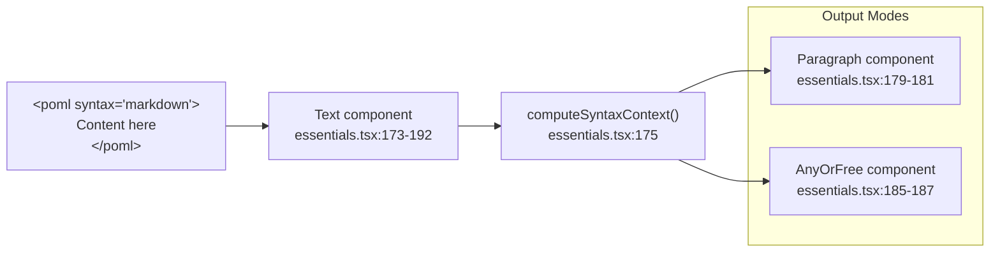
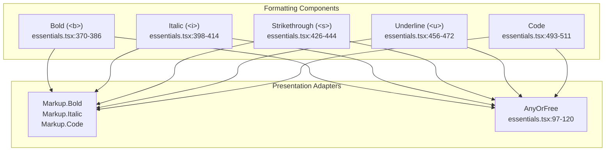
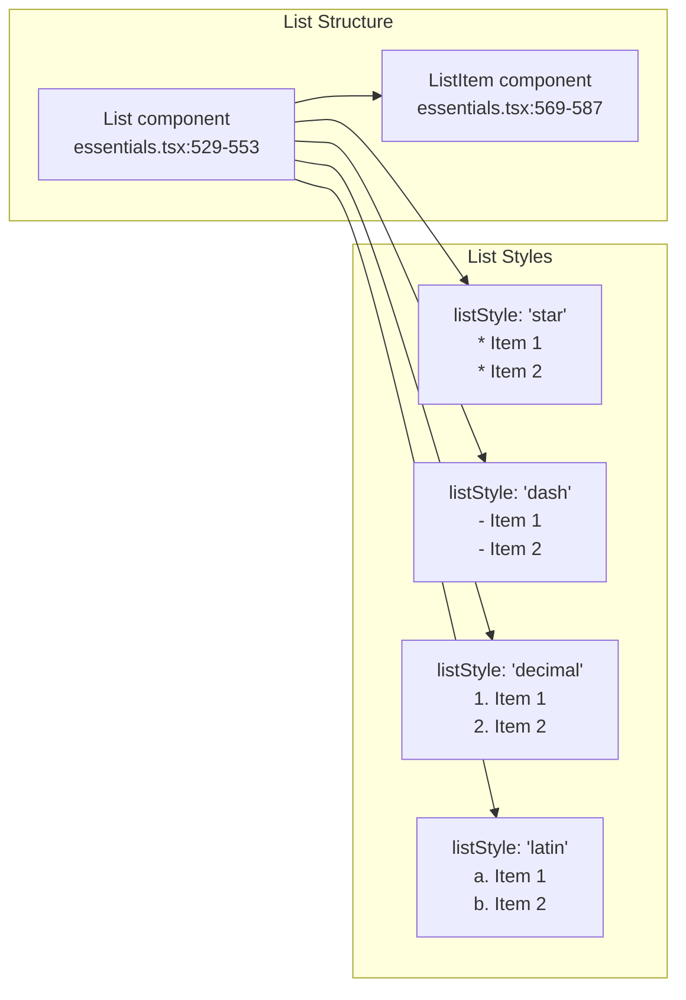
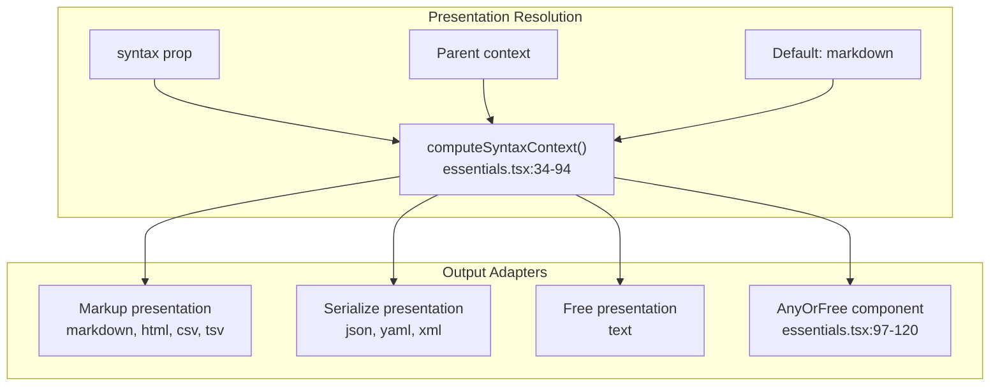
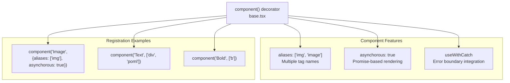

<!-- source: DeepWiki mcp.deepwiki.com · repo microsoft/poml · page 4.1 Core Components · fetched 2026-10-26 -->

# Core Components

<details>
<summary>Relevant source files</summary>

The following files were used as context for generating this wiki page:

- [docs/language/components.md](docs/language/components.md)
- [packages/poml/assets/componentDocs.json](packages/poml/assets/componentDocs.json)
- [packages/poml/components/tree.tsx](packages/poml/components/tree.tsx)
- [packages/poml/essentials.tsx](packages/poml/essentials.tsx)
- [packages/poml/tests/essentials.test.tsx](packages/poml/tests/essentials.test.tsx)
- [python/poml/_tags.py](python/poml/_tags.py)

</details>


This document covers the basic POML components that form the foundation of the language. These are the essential building blocks for creating structured text content, including paragraphs, headers, lists, and text formatting elements.

For data and multimedia components like Document, Image, Table, and Tree, see [Data Components](#4.2). For templating features and dynamic content, see [Templating and Scripting](#4.3). For prompt-specific components like Role and Task, see [Meta Elements and Configuration](#4.4).

## Component Architecture Overview

POML's core component system is built on React components that can render to multiple presentation formats. Each component adapts its output based on the current syntax context (`markdown`, `html`, `json`, `yaml`, `xml`, `text`, or `multimedia`).

```mermaid
graph TB
    subgraph "Core Component Architecture"
        ComponentBase["component() decorator<br/>packages/poml/base.tsx"]
        PropsSyntaxBase["PropsSyntaxBase interface<br/>packages/poml/essentials.tsx:20-22"]
        ComputeSyntaxContext["computeSyntaxContext()<br/>packages/poml/essentials.tsx:34-98"]
    end
    
    subgraph "Presentation Modes"
        Markup["Markup Presentation<br/>markdown, html, csv, tsv"]
        Serialize["Serialize Presentation<br/>json, yaml, xml"]
        Free["Free Presentation<br/>text"]
    end
    
    subgraph "Core Text Components"
        Text["Text/Poml<br/>packages/poml/essentials.tsx:173-192"]
        Paragraph["Paragraph<br/>packages/poml/essentials.tsx:207-225"]
        Header["Header<br/>packages/poml/essentials.tsx:305-323"]
        Inline["Inline/Span<br/>packages/poml/essentials.tsx:251-267"]
    end
    
    subgraph "Formatting Components"
        Bold["Bold<br/>packages/poml/essentials.tsx:370-386"]
        Italic["Italic<br/>packages/poml/essentials.tsx:398-414"]
        Code["Code<br/>packages/poml/essentials.tsx:493-511"]
    end
    
    subgraph "List Components"
        List["List<br/>packages/poml/essentials.tsx:529-553"]
        ListItem["ListItem<br/>packages/poml/essentials.tsx:569-587"]
    end
    
    ComponentBase --> PropsSyntaxBase
    PropsSyntaxBase --> ComputeSyntaxContext
    ComputeSyntaxContext --> Markup
    ComputeSyntaxContext --> Serialize
    ComputeSyntaxContext --> Free
    
    Text --> ComputeSyntaxContext
    Paragraph --> ComputeSyntaxContext
    Header --> ComputeSyntaxContext
    Inline --> ComputeSyntaxContext
    Bold --> ComputeSyntaxContext
    Italic --> ComputeSyntaxContext
    Code --> ComputeSyntaxContext
    List --> ComputeSyntaxContext
    ListItem --> ComputeSyntaxContext
```



Sources: [packages/poml/essentials.tsx:20-587](), [packages/poml/base.tsx]()

## Text and Structural Components

### Text Component (`<text>`, `<poml>`)

The `Text` component is the root wrapper for content in POML. It automatically determines the appropriate presentation mode and serves as the default container when no explicit root element is provided.

| Property | Type | Description |
|----------|------|-------------|
| `syntax` | `'markdown'\|'html'\|'json'\|'yaml'\|'xml'\|'text'` | Output format |
| `speaker` | `'human'\|'ai'\|'system'` | Message speaker |
| `name` | `string` | Name for serialization |
| `type` | `string` | Type for serialization |
| `whiteSpace` | `'pre'\|'filter'\|'trim'` | Whitespace handling mode |
| `charLimit` | `number` | Character limit for truncation |
| `tokenLimit` | `number` | Token limit for truncation |
| `priority` | `number` | Priority for global truncation |



Example usage:
```xml
<poml syntax="markdown">
  <p>This is the main content.</p>
  <h>Section Title</h>
  <p>More content here.</p>
</poml>
```

Sources: [packages/poml/essentials.tsx:173-192](), [packages/poml/essentials.tsx:34-98]()

### Paragraph Component (`<p>`)

The `Paragraph` component creates standalone sections with appropriate spacing. In markup syntaxes, it adds blank lines before and after content.

| Property | Type | Description |
|----------|------|-------------|
| `blankLine` | `boolean` | Add extra blank line spacing |
| `syntax` | `string` | Output format |
| `speaker` | `'human'\|'ai'\|'system'` | Message speaker |

```xml
<p>This is a paragraph with proper spacing.</p>
<p blankLine="true">This paragraph has extra blank lines.</p>
```

Sources: [packages/poml/essentials.tsx:207-225]()

### Header Component (`<h>`)

The `Header` component renders headings with automatic level computation based on nesting context. Use with `SubContent` for hierarchical structure.

| Property | Type | Description |
|----------|------|-------------|
| `syntax` | `string` | Output format |
| `blankLine` | `boolean` | Add extra spacing |

```xml
<h>Main Section</h>
<section>
  <h>Subsection</h>  <!-- Automatically becomes h2 -->
  <p>Content under subsection</p>
</section>
```

Sources: [packages/poml/essentials.tsx:305-323](), [packages/poml/essentials.tsx:340-358]()

### Inline and Structural Helpers

| Component | Purpose | Properties | Example |
|-----------|---------|------------|---------|
| `Inline` (`<span>`) | Inline content wrapper | `syntax`, `speaker`, `whiteSpace` | `<span>inline text</span>` |
| `SubContent` (`<section>`) | Nested content with adjusted header levels | `syntax`, `blankLine` | `<section><h>Nested header</h></section>` |
| `Newline` (`<br>`) | Explicit line breaks | `newLineCount` | `<br newLineCount="2" />` |

### CaptionedParagraph Component (`<cp>`)

The `CaptionedParagraph` component creates a paragraph with a customizable caption title, useful for creating labeled sections.

| Property | Type | Description |
|----------|------|-------------|
| `caption` | `string` | The title or label for the paragraph (required) |
| `captionStyle` | `'header'\|'bold'\|'plain'\|'hidden'` | Caption display style |
| `captionEnding` | `'colon'\|'newline'\|'colon-newline'\|'none'` | Caption ending format |

```xml
<cp caption="Constraints">
  <list>
    <item>Do not exceed 1000 tokens.</item>
    <item>Please use simple words.</item>
  </list>
</cp>
```

Sources: [packages/poml/essentials.tsx:251-267](), [packages/poml/essentials.tsx:340-358](), [packages/poml/essentials.tsx:282-290](), [python/poml/_tags.py:755-828]()

## Formatting Components

POML provides standard text formatting components that work across different presentation modes:



### Text Formatting Components

POML provides standard text formatting components that adapt their output based on the current presentation mode:

| Component | Tags | Purpose | Example |
|-----------|------|---------|---------|
| `Bold` | `<b>` | Bold emphasis | `<b>Important</b>` |
| `Italic` | `<i>` | Italic emphasis | `<i>emphasis</i>` |
| `Strikethrough` | `<s>`, `<strike>` | Crossed-out text | `<s>removed</s>` |
| `Underline` | `<u>` | Underlined text | `<u>underlined</u>` |

### Code Component

The `Code` component supports both inline and block code with language specification:

| Property | Type | Description |
|----------|------|-------------|
| `inline` | `boolean` | Render inline (default `true`) |
| `lang` | `string` | Programming language for syntax highlighting |
| `whiteSpace` | `'pre'\|'filter'\|'trim'` | Whitespace handling |

```xml
<code inline="true">const x = 42;</code>
<code lang="javascript" inline="false">
function hello() {
  console.log("Hello, world!");
}
</code>
```

Sources: [packages/poml/essentials.tsx:370-472](), [packages/poml/essentials.tsx:493-511]()

## List Components

The list system consists of `List` containers and `ListItem` elements with configurable styling:



### List Properties

| Property | Type | Description |
|----------|------|-------------|
| `listStyle` | `'star'\|'dash'\|'plus'\|'decimal'\|'latin'` | Marker style (default `dash`) |
| `blankLine` | `boolean` | Add spacing between items |

```xml
<list listStyle="decimal">
  <item>First item</item>
  <item blankLine="true">Item with extra spacing</item>
  <item>
    Nested content:
    <list listStyle="star">
      <item>Sub-item A</item>
      <item>Sub-item B</item>
    </list>
  </item>
</list>
```

Sources: [packages/poml/essentials.tsx:529-553](), [packages/poml/essentials.tsx:569-587]()

## Common Properties

All core components share a set of common properties inherited from `PropsSyntaxBase`:

| Property | Type | Description |
|----------|------|-------------|
| `syntax` | `'markdown'\|'html'\|'json'\|'yaml'\|'xml'\|'text'` | Output format |
| `className` | `string` | CSS class for styling |
| `speaker` | `'human'\|'ai'\|'system'` | Message speaker context |
| `writerOptions` | `object` | Format-specific writer options |
| `whiteSpace` | `'pre'\|'filter'\|'trim'` | Whitespace handling |
| `charLimit` | `number` | Character limit for truncation |
| `tokenLimit` | `number` | Token limit for truncation |
| `priority` | `number` | Priority for global truncation |

## Presentation Mode Behavior

Core components automatically adapt their output based on the presentation context:



- **Markup modes** (`markdown`, `html`) render structured content with appropriate formatting
- **Serialize modes** (`json`, `yaml`, `xml`) output structured data representations
- **Free mode** (`text`) renders plain text without formatting
- Components fall back to inherited context when no syntax is specified

Sources: [packages/poml/essentials.tsx:20-120]()

## Component Registration System

All core components are registered using the `component()` decorator which provides:

- Automatic presentation mode detection
- Error handling via `useWithCatch`
- Asynchronous rendering support for media components
- Multiple alias support (e.g., `img` for `Image`)



Sources: [packages/poml/base.tsx](), [packages/poml/essentials.tsx:687](), [packages/poml/essentials.tsx:164](), [packages/poml/essentials.tsx:388]()

---

