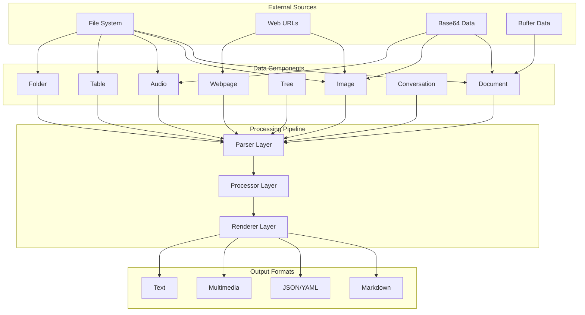
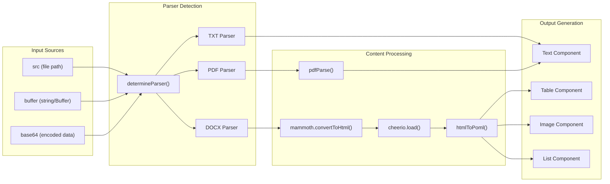
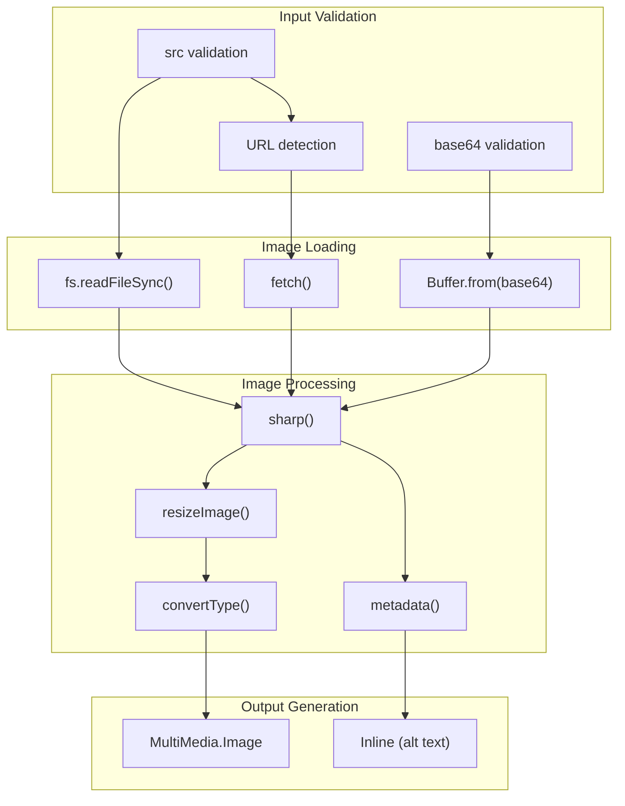
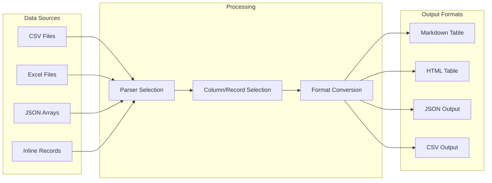
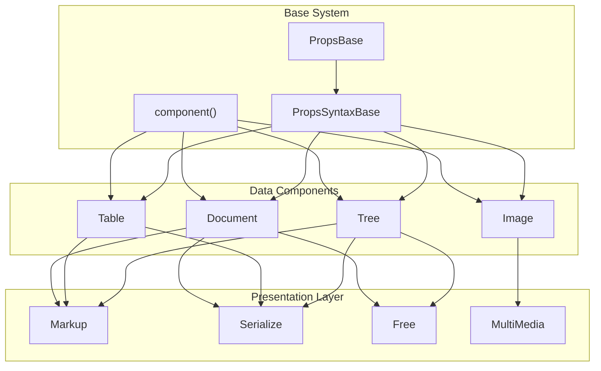

<!-- source: DeepWiki mcp.deepwiki.com · repo microsoft/poml · page 4.2 Data Components · fetched 2026-10-26 -->

# Data Components

<details>
<summary>Relevant source files</summary>

The following files were used as context for generating this wiki page:

- [docs/language/components.md](docs/language/components.md)
- [examples/104_financial_analysis.poml](examples/104_financial_analysis.poml)
- [packages/poml/assets/componentDocs.json](packages/poml/assets/componentDocs.json)
- [packages/poml/components/document.tsx](packages/poml/components/document.tsx)
- [packages/poml/components/tree.tsx](packages/poml/components/tree.tsx)
- [packages/poml/essentials.tsx](packages/poml/essentials.tsx)
- [packages/poml/tests/assets/sampleWebpage.html](packages/poml/tests/assets/sampleWebpage.html)
- [packages/poml/tests/components.test.tsx](packages/poml/tests/components.test.tsx)
- [packages/poml/tests/essentials.test.tsx](packages/poml/tests/essentials.test.tsx)
- [packages/poml/tests/util.test.tsx](packages/poml/tests/util.test.tsx)
- [packages/poml/util/image.ts](packages/poml/util/image.ts)
- [python/poml/_tags.py](python/poml/_tags.py)

</details>


This document covers POML components designed for handling external data sources and multimedia content. Data components enable prompts to incorporate file contents, structured data, images, audio, web content, and other external resources into language model interactions.

For basic text formatting and content structuring, see [Core Components](#4.1). For template variables and dynamic content generation, see [Templating and Scripting](#4.3).

## Overview

Data components provide standardized interfaces for incorporating external content into POML documents. They handle file I/O, parsing, format conversion, and rendering across different output syntaxes (markdown, JSON, XML, etc.).

### Component Categories

POML data components fall into several categories:

| Category | Components | Purpose |
|----------|------------|---------|
| Document Processing | `Document` | Handle PDF, DOCX, TXT files |
| Multimedia | `Image`, `Audio` | Embed images and audio content |
| Structured Data | `Table`, `Tree`, `Folder`, `DataObject` | Display tabular and hierarchical data |
| Communication | `Conversation`, `MessageContent`, `ToolRequest`, `ToolResponse` | Handle chat and tool interactions |
| Web Content | `Webpage` | Process HTML content |

### Data Component Architecture



Sources: [packages/poml/essentials.tsx:1-829](), [packages/poml/components/document.tsx:1-287](), [packages/poml/components/tree.tsx:1-369]()

## Document Components

### Document Component

The `Document` component processes external documents including PDF, DOCX, and TXT files. It automatically detects file types and converts content to POML-compatible formats.

```xml
<Document src="report.pdf" multimedia="false" selectedPages="0:3" />
<Document buffer="Hello world" parser="txt" />
<Document base64="..." parser="docx" />
```

#### Document Processing Pipeline



Sources: [packages/poml/components/document.tsx:196-287](), [packages/poml/components/document.tsx:47-62](), [packages/poml/components/document.tsx:175-184]()

#### Key Features

- **Automatic Format Detection**: Infers parser from file extension via `determineParser()` [packages/poml/components/document.tsx:207-218]()
- **PDF Page Selection**: Supports page ranges using `selectedPages` parameter [packages/poml/components/document.tsx:47-56]()
- **Multimedia Handling**: Controls whether embedded images are displayed or converted to alt text [packages/poml/components/document.tsx:145-167]()
- **Buffer Caching**: Implements file content caching via `BufferCollection` [packages/poml/components/document.tsx:24-35]()

## Multimedia Components

### Image Component

The `Image` component handles image display with support for local files, URLs, and base64 data. It provides image processing capabilities including resizing and format conversion.

```xml
<Image src="chart.png" alt="Sales Chart" maxWidth="800" />
<Image base64="iVBORw0KGgoAAAANSUhEUgAA..." type="png" />
<Image src="https://example.com/image.jpg" resize="0.5" />
```

#### Image Processing Flow



Sources: [packages/poml/essentials.tsx:650-687](), [packages/poml/util/image.ts:169-185](), [packages/poml/util/image.ts:45-83]()

### Audio Component

The `Audio` component embeds audio files with support for various formats and automatic MIME type detection.

```xml
<Audio src="recording.mp3" />
<Audio base64="..." type="audio/wav" />
```

Sources: [packages/poml/essentials.tsx:719-742]()

## Structured Data Components

### Table Component

The `Table` component displays tabular data from files or inline records with flexible column selection and formatting options.

```xml
<Table src="data.csv" maxRecords="100" syntax="markdown" />
<Table records="{{people}}" selectedColumns="['name', 'age']" />
```

#### Table Data Flow



Sources: [python/poml/_tags.py:631-686]()

### Tree Component

The `Tree` component renders hierarchical data structures in various formats including markdown lists, JSON objects, and text representations.

```xml
<Tree items="{{treeData}}" syntax="markdown" showContent="true" />
```

#### Tree Rendering Strategies

The `Tree` component implements different rendering strategies based on output format:

- **Markup Syntaxes**: Uses nested `List` and `Header` components [packages/poml/components/tree.tsx:46-93]()
- **Text Format**: Generates box-drawing characters via `treeToBoxDrawings()` [packages/poml/components/tree.tsx:144-175]()
- **Serialize Formats**: Converts to nested objects via `treeItemsToObject()` [packages/poml/components/tree.tsx:178-189]()

Sources: [packages/poml/components/tree.tsx:203-232]()

### Folder Component

The `Folder` component displays directory structures as trees with optional file content inclusion and filtering.

```xml
<Folder src="./project" filter=".*\.py$" maxDepth="3" showContent="true" />
```

The component uses `readDirectoryToTreeItems()` to recursively traverse directories and applies filtering logic [packages/poml/components/tree.tsx:234-308]().

Sources: [packages/poml/components/tree.tsx:337-368]()

## Communication Components

### Conversation Component

The `Conversation` component displays chat-style interactions with support for message selection and speaker identification.

```xml
<Conversation messages="{{chatHistory}}" selectedMessages="-6:" />
```

### Tool Components

POML provides specialized components for AI tool interactions:

#### ToolRequest Component

Represents AI-generated tool calls with structured parameters:

```xml
<ToolRequest id="call-123" name="search" parameters="{{searchParams}}" />
```

#### ToolResponse Component

Displays tool execution results with rich content support:

```xml
<ToolResponse id="call-123" name="search">
  <Paragraph>Found 3 results:</Paragraph>
  <List>
    <ListItem>Result 1</ListItem>
  </List>
</ToolResponse>
```

The `ToolResponse` component automatically wraps content in multimedia presentation mode while preserving syntax context for child elements [packages/poml/essentials.tsx:805-828]().

Sources: [packages/poml/essentials.tsx:762-781](), [packages/poml/essentials.tsx:805-828]()

## Implementation Architecture

### Component Base Classes

Data components inherit from the base component system and implement common patterns:



Sources: [packages/poml/essentials.tsx:20-94](), [packages/poml/base.ts]()

### Syntax Context Resolution

Data components use `computeSyntaxContext()` to determine appropriate rendering based on the `syntax` parameter and inherited presentation context [packages/poml/essentials.tsx:34-94]().

### Asynchronous Processing

Components handling external resources are marked with `asynchorous: true` in their component definitions, enabling proper async/await handling during rendering [packages/poml/essentials.tsx:650](), [packages/poml/components/document.tsx:266]().

Sources: [packages/poml/essentials.tsx:34-94](), [packages/poml/essentials.tsx:650](), [packages/poml/components/document.tsx:266]()

---

