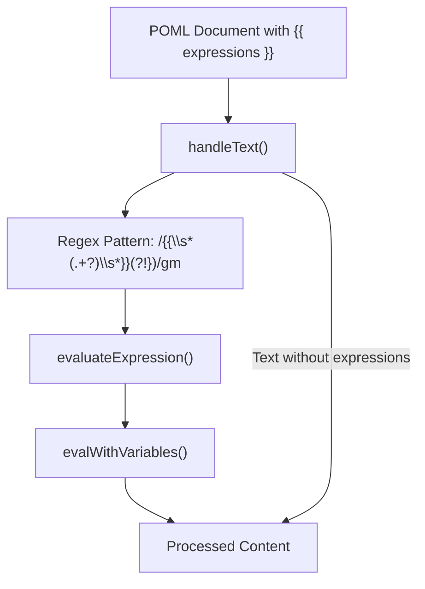
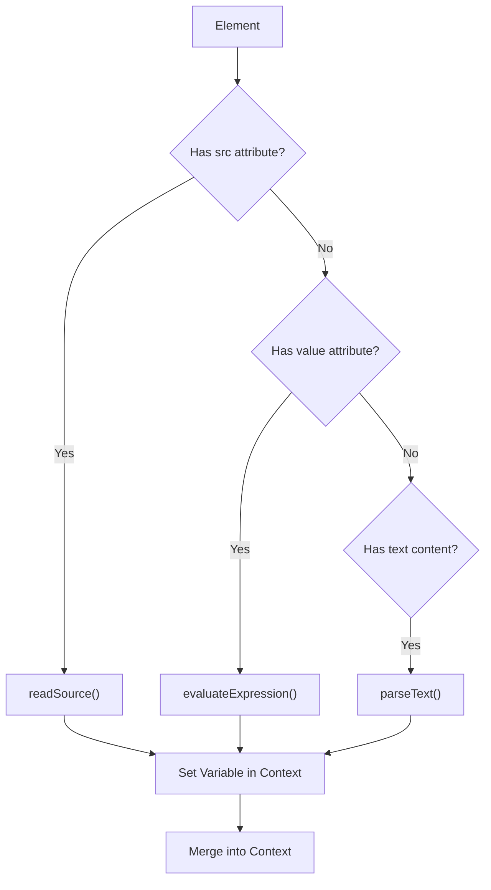
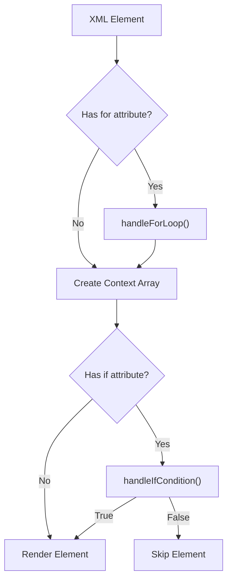
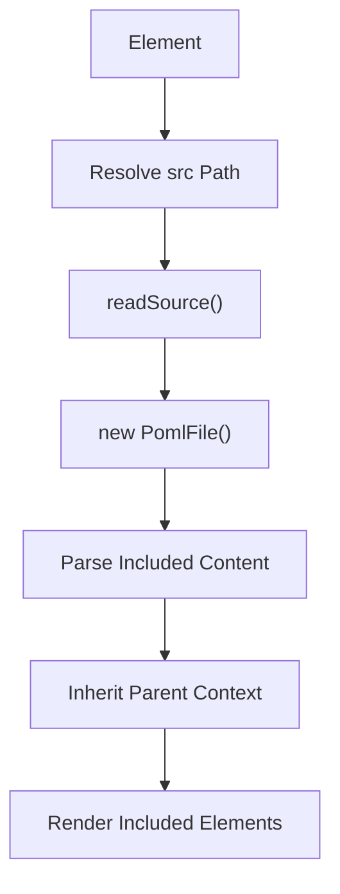
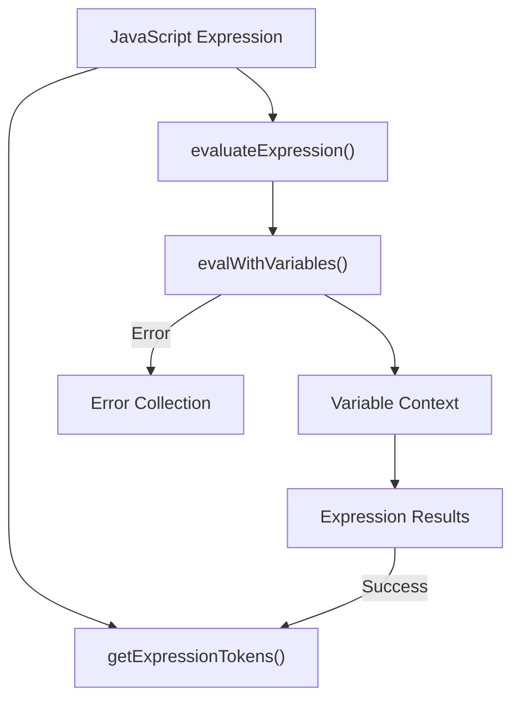
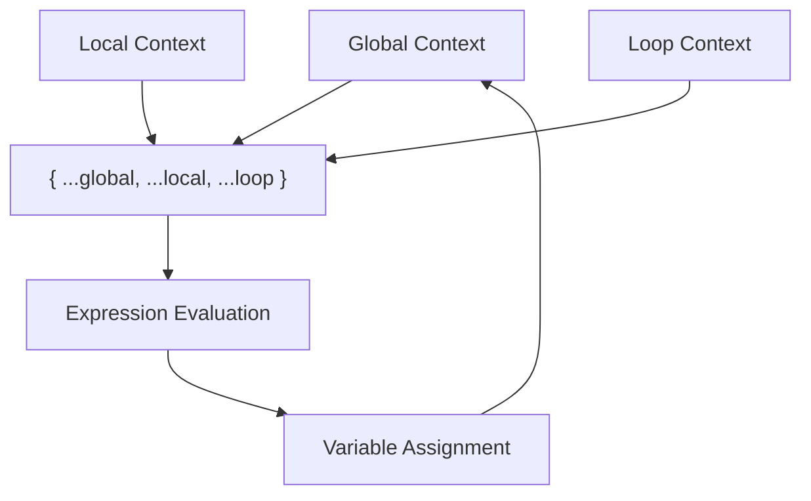
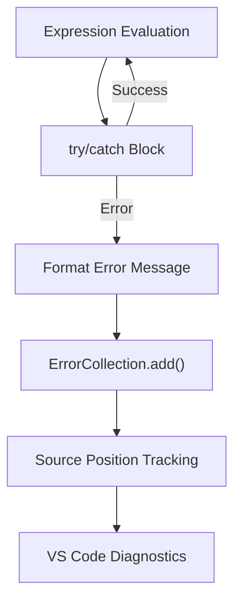

<!-- source: DeepWiki mcp.deepwiki.com · repo microsoft/poml · page 4.3 Templating and Scripting · fetched 2026-10-26 -->

# Templating and Scripting

<details>
<summary>Relevant source files</summary>

The following files were used as context for generating this wiki page:

- [docs/language/meta.md](docs/language/meta.md)
- [docs/vscode/features.md](docs/vscode/features.md)
- [packages/poml/file.tsx](packages/poml/file.tsx)
- [packages/poml/tests/file.test.tsx](packages/poml/tests/file.test.tsx)

</details>


This document covers POML's templating and scripting capabilities, including template expressions, control flow, variable definitions, and dynamic content generation. These features enable dynamic prompts that can adapt based on data, conditions, and external files.

For basic POML components and syntax, see [Core Components](#4.1). For meta elements like schema definitions that use expression evaluation, see [Meta Elements and Configuration](#4.4). For debugging template expressions in VS Code, see [VS Code Extension](#5.4).

## Template Expressions

POML supports JavaScript template expressions using the `{{ }}` syntax. These expressions are evaluated at render time and can access context variables, perform calculations, and generate dynamic content.

### Basic Syntax

Template expressions use double curly braces and can contain any valid JavaScript expression:

```xml
<p>Hello, {{ name }}!</p>
<p>The result is {{ 2 + 3 * 4 }}</p>
<p>Today is {{ new Date().toDateString() }}</p>
```

### Expression Evaluation in Different Contexts

Template expressions can appear in:
- Element text content
- Attribute values  
- JSON content within elements
- Schema definitions and tool definitions (when using `parser="eval"`)

```xml
<p speaker="{{ userType }}">Message: {{ message }}</p>
<div className="{{ isImportant ? 'highlight' : 'normal' }}">{{ content }}</div>
```

**Template Expression Processing Flow**



Sources: [packages/poml/file.tsx:934-972](), [packages/poml/file.tsx:987-1014]()

## Variable Definitions with `<let>`

The `<let>` element defines variables that can be used throughout the document. Variables are scoped to their containing element and all child elements.

### Variable Definition Modes

#### Inline Value Assignment

```xml
<let name="greeting" value="'Hello, world!'" />
<let name="count" value="42" />
<let name="items" value="[1, 2, 3]" />
<let name="config" value="{name: 'Alice', age: 30}" />
```

#### JSON Content Assignment

```xml
<let name="person">
{
  "name": "Alice",
  "age": 30,
  "skills": ["JavaScript", "Python"]
}
</let>
```

#### External File Loading

```xml
<let name="data" src="data.json" />
<let name="config" src="config.yaml" type="yaml" />
<let src="globals.json" />  <!-- Merges object properties into context -->
```

**Variable Definition Processing**



Sources: [packages/poml/file.tsx:501-601](), [packages/poml/tests/file.test.tsx:203-316]()

## Control Flow

POML provides control flow through `for` loops and `if` conditions implemented as XML attributes.

### For Loops

The `for` attribute enables iteration over arrays and objects:

```xml
<p for="item in items">Item: {{ item }}</p>
<div for="person in people">
  <p>Name: {{ person.name }}</p>
  <p>Age: {{ person.age }}</p>
</div>
```

#### Loop Variables

For loops automatically provide a `loop` object with iteration metadata:

```xml
<p for="item in ['a', 'b', 'c']">
  {{ loop.index }}: {{ item }} 
  {{ loop.first ? '(first)' : '' }}
  {{ loop.last ? '(last)' : '' }}
</p>
```

The `loop` object contains:
- `loop.index` - Current iteration index (0-based)
- `loop.length` - Total number of items
- `loop.first` - Boolean indicating first iteration
- `loop.last` - Boolean indicating last iteration

### Conditional Rendering

The `if` attribute controls whether elements are rendered:

```xml
<p if="showGreeting">Hello!</p>
<div if="user.isAdmin">Admin controls</div>
<p if="items.length > 0">Found {{ items.length }} items</p>
```

### Combined Control Flow

For loops and conditions can be combined:

```xml
<p for="item in items" if="item.visible">
  {{ item.name }}
</p>
```

**Control Flow Processing**



Sources: [packages/poml/file.tsx:444-475](), [packages/poml/file.tsx:477-499](), [packages/poml/tests/file.test.tsx:174-201]()

## File Inclusion

The `<include>` element enables modular prompt composition by including external POML files:

```xml
<include src="common/header.poml" />
<include src="templates/user-prompt.poml" />
```

### Include with Control Flow

Include elements support the same control flow as other elements:

```xml
<include src="item-template.poml" for="item in items" />
<include src="admin-section.poml" if="user.isAdmin" />
```

### Include Processing

Included files are processed in their own context but inherit the parent document's variable scope. The included content is parsed as POML and integrated into the parent document's element tree.

**File Inclusion Flow**



Sources: [packages/poml/file.tsx:619-678](), [packages/poml/tests/file.test.tsx:404-428]()

## Expression Evaluation System

POML's expression evaluation system powers template expressions, control flow conditions, and schema definitions.

### Evaluation Engine

The core evaluation uses the `evalWithVariables` function to execute JavaScript expressions in a controlled context:

```xml
<let name="data" value="[1, 2, 3].map(x => x * 2)" />
<p if="data.length > 0">{{ data.join(', ') }}</p>
```

### Expression Token Collection

The system tracks all expressions for IDE features like hover tooltips and debugging:

```xml
<p>{{ userName }}</p>  <!-- Expression token collected -->
<div for="i in range">{{ i }}</div>  <!-- Multiple tokens for loop -->
```

### Special Expression Contexts

#### Schema Expressions

Schema and tool definitions support expression evaluation with access to the `z` (Zod) variable:

```xml
<output-schema parser="eval">
  z.object({
    name: z.string(),
    count: z.number().max(maxValue)
  })
</output-schema>
```

#### Attribute Expressions

Control flow attributes are automatically treated as expressions:

```xml
<p for="item in getItems()" if="isVisible(item)">{{ item }}</p>
```

**Expression Evaluation Architecture**



Sources: [packages/poml/file.tsx:311-409](), [packages/poml/file.tsx:987-1014](), [packages/poml/tests/file.test.tsx:319-402]()

## Context and Scope

POML manages variable context through a hierarchical scope system that supports global and local variables.

### Context Hierarchy

Variables flow through three context levels:
1. **Global Context** - Available to entire document
2. **Local Context** - Available to current element and children  
3. **Loop Context** - Available within for loop iterations

### Context Merging

The system merges contexts with local variables taking precedence:

```xml
<let name="global" value="'global value'" />
<div for="item in items">
  <let name="local" value="'local value'" />
  <p>{{ global }} - {{ local }} - {{ item }}</p>
</div>
```

### Built-in Context Variables

POML provides several built-in context variables:
- `loop` object in for loops
- `z` (Zod) variable in schema expressions
- External file content through `<let>` elements

**Context Management Flow**



Sources: [packages/poml/file.tsx:1023-1176](), [packages/poml/tests/file.test.tsx:310-316]()

## Error Handling and Debugging

The templating system provides comprehensive error handling and debugging capabilities.

### Expression Evaluation Errors

Failed expressions are caught and reported with precise location information:

```xml
<p>{{ nonexistentVariable.property }}</p>  <!-- Reports undefined access -->
<p>{{ invalidSyntax( }}</p>  <!-- Reports syntax error -->
```

### Error Collection System

All templating errors are collected in the `ErrorCollection` system with source position tracking for IDE integration.

### Expression History Tracking

For debugging, the system tracks evaluation history for each expression location, enabling features like hover tooltips that show evaluation results.

**Error Handling Flow**



Sources: [packages/poml/file.tsx:1005-1013](), [packages/poml/file.tsx:423-437](), [packages/poml/tests/file.test.tsx:348-401]()

---

