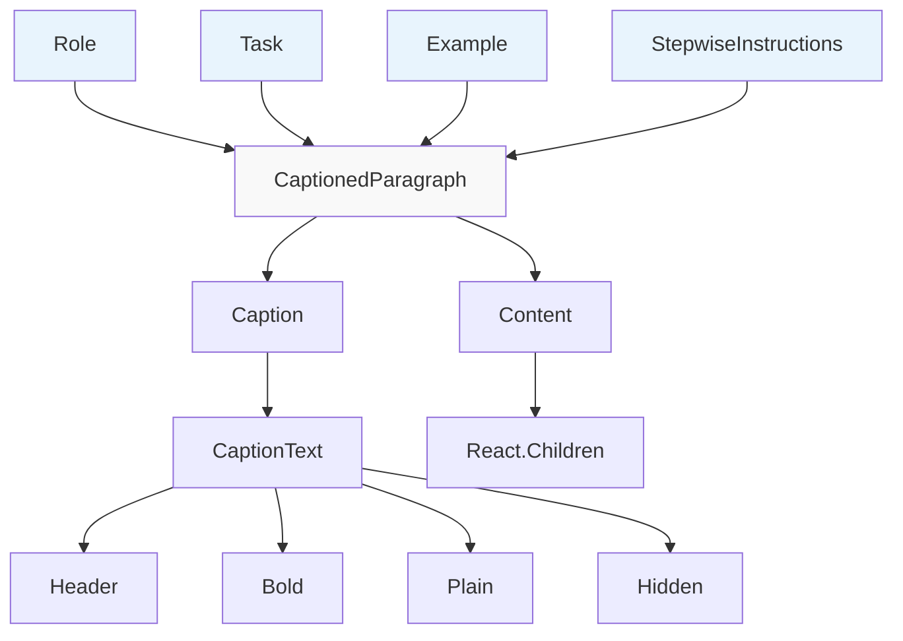
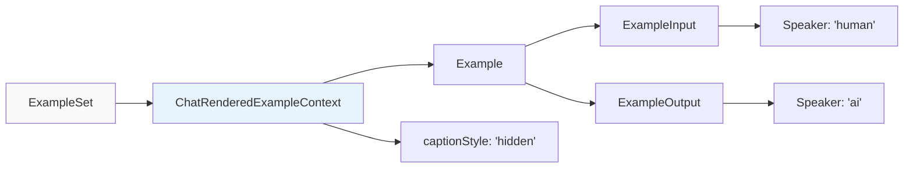
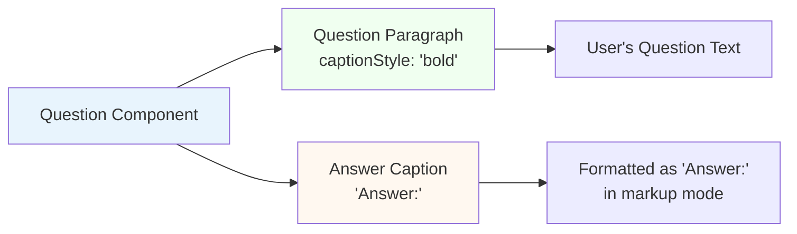

<!-- source: DeepWiki mcp.deepwiki.com · repo microsoft/poml · page 4.4 Meta Elements and Configuration · fetched 2026-10-26 -->

# Prompt Engineering Components

<details>
<summary>Relevant source files</summary>

The following files were used as context for generating this wiki page:

- [docs/language/meta.md](docs/language/meta.md)
- [docs/vscode/features.md](docs/vscode/features.md)
- [packages/poml/file.tsx](packages/poml/file.tsx)
- [packages/poml/tests/file.test.tsx](packages/poml/tests/file.test.tsx)
- [packages/poml/tests/meta.test.tsx](packages/poml/tests/meta.test.tsx)
- [packages/poml/version.ts](packages/poml/version.ts)
- [pyproject.toml](pyproject.toml)
- [python/poml/_version.py](python/poml/_version.py)

</details>


This document covers POML's specialized components designed for structured prompt engineering. These components provide semantic structure for common prompt engineering patterns like role definitions, task specifications, examples, and instructions. They help create well-organized, maintainable prompts that follow established best practices.

For basic structural components like text and lists, see [Core Components](#4.1). For complex data handling components, see [Advanced Components](#4.2).

## Component Architecture

POML's prompt engineering components are built around the concept of captioned paragraphs that provide semantic meaning to different sections of a prompt. These components automatically adapt their rendering based on the output format (markup vs. serialized) while maintaining consistent semantic structure.

### Core Component Structure



Sources: [packages/poml/components/instructions.tsx:1-550](), [packages/poml/components/utils.tsx:188-227]()

### Chat Context System

The prompt engineering components include a sophisticated chat context system for rendering examples in conversational format:



Sources: [packages/poml/components/instructions.tsx:247-301](), [packages/poml/components/instructions.tsx:407-433](), [packages/poml/components/instructions.tsx:462-488]()

## Role and Task Components

### Role Component

The `Role` component specifies the persona or perspective the language model should adopt. It uses a customizable captioned paragraph structure with default caption "Role".

```xml
<role>You are a data scientist with expertise in machine learning.</role>
```

**Key Features:**
- Default caption: "Role"
- Default `captionSerialized`: "role" 
- Supports all `CaptionedParagraph` styling options
- Renders as header-style caption in markup formats

**Implementation Details:**
- Implemented in [packages/poml/components/instructions.tsx:31-40]()
- Extends `CustomizableCaptionParagraphProps`
- Uses `CaptionedParagraph` with role-specific defaults

### Task Component  

The `Task` component defines the specific action or directive for the language model to perform. It supports both simple statements and structured lists of steps.

```xml
<task>
  Analyze the provided data and generate insights.
  <list>
    <item>Calculate summary statistics</item>
    <item>Identify trends and patterns</item>
    <item>Provide actionable recommendations</item>
  </list>
</task>
```

**Implementation Details:**
- Implemented in [packages/poml/components/instructions.tsx:76-85]()
- Default caption: "Task"
- Supports nested content including lists and other components

Sources: [packages/poml/components/instructions.tsx:31-85](), [gallery/ask.poml:2-27](), [gallery/edit.poml:2-37]()

## Instructional Components

### StepwiseInstructions Component

The `StepwiseInstructions` component provides detailed step-by-step guidance for complex tasks:

```xml
<stepwise-instructions>
  <list>
    <item>Parse the user's request and identify key requirements</item>
    <item>Search relevant knowledge base for information</item>
    <item>Synthesize findings into a coherent response</item>
  </list>
</stepwise-instructions>
```

### OutputFormat Component

The `OutputFormat` component specifies the expected structure and format of the model's response:

```xml
<output-format>
  Respond with valid JSON containing:
  - "summary": brief overview
  - "details": array of key findings
  - "confidence": numerical score 0-1
</output-format>
```

### Hint Component

The `Hint` component provides contextual guidance with a bold caption style by default:

```xml
<hint>Remember to consider edge cases and provide fallback responses.</hint>
```

**Key Features:**
- Default `captionStyle`: "bold" (differs from other components)
- Useful for providing contextual guidance anywhere in prompts
- Concise, focused advice

Sources: [packages/poml/components/instructions.tsx:110-203](), [examples/expects/201_orders_qa.txt:86]()

## Example System

POML's example system provides sophisticated handling of input/output examples with support for both individual examples and example sets.

### Example Component Hierarchy

```mermaid
graph TD
    ExampleSet["`ExampleSet
    <examples>`"] --> ChatContext["`ChatRenderedExampleContext
    chat: boolean`"]
    
    ChatContext --> Example["`Example
    <example>`"]
    
    Example --> ExampleInput["`ExampleInput
    <input>`"]
    Example --> ExampleOutput["`ExampleOutput
    <output>`"]
    
    ExampleInput --> HumanSpeaker["`speaker: 'human'
    captionStyle: 'hidden'`"]
    ExampleOutput --> AISpeaker["`speaker: 'ai'
    captionStyle: 'hidden'`"]
    
    ExampleSet --> Introducer["`Optional Introducer
    'Here are some examples:'`"]
    
    style ExampleSet fill:#e8f4fd
    style Example fill:#f0f8ff
    style ExampleInput fill:#f0fff0
    style ExampleOutput fill:#fff8f0
```



### ExampleSet Component

The `ExampleSet` component groups multiple examples under a single caption with consistent chat formatting:

```xml
<examples chat="true" introducer="Here are some examples:">
  <example>
    <input>What is the capital of France?</input>
    <output>The capital of France is Paris.</output>
  </example>
  <example>
    <input>What is the capital of Germany?</input>
    <output>The capital of Germany is Berlin.</output>
  </example>
</examples>
```

**Key Features:**
- `chat` prop controls conversational formatting (default: true for markup)
- Optional `introducer` text
- Provides context for child `Example` components via React Context

### Individual Example Components

**Example Component:**
- Default `captionStyle`: "hidden" 
- Inherits chat context from parent `ExampleSet` or sets its own
- Supports both chat and non-chat rendering modes

**ExampleInput Component:**
- Default speaker: "human" in chat context
- Default caption: "Input"
- Hidden caption style in chat mode, bold otherwise

**ExampleOutput Component:**
- Default speaker: "ai" in chat context  
- Default caption: "Output"
- Hidden caption style in chat mode, bold otherwise

Sources: [packages/poml/components/instructions.tsx:284-488](), [gallery/ask.poml:31-44]()

## Question Component

The `Question` component creates a question followed by an answer prompt, commonly used at the end of prompts:

```xml
<qa questionCaption="Question" answerCaption="Answer">
  What insights can you derive from this data?
</qa>
```

**Component Structure:**


**Implementation Details:**
- Combines question and answer prompt in single component
- `questionCaption` and `answerCaption` props for customization
- Answer caption only renders in markup presentation mode
- Default `captionStyle`: "bold"

Sources: [packages/poml/components/instructions.tsx:517-549](), [examples/expects/201_orders_qa.txt:42-44]()

## Practical Usage Examples

### Complete Prompt Structure

Here's how these components work together in a complete prompt from the gallery:

```xml
<poml>
  <role>You are a senior engineer with deep experience building production-grade AI agents.</role>
  
  <task>Your task is code edit: fixing bugs, adding features and introducing refactors.</task>
  
  <stepwise-instructions caption="PROCEDURE (MUST follow strictly)">
    <list listStyle="decimal">
      <item>
        <bold>Clarify Scope</bold>
        <list listStyle="dash">
          <item>Restate the objective; if unclear, ask one concise question.</item>
        </list>
      </item>
      <item>
        <bold>Make minimal, contained changes</bold>
        <list listStyle="dash">
          <item>Produce edited output.</item>
          <item>No logging, TODOs, tests unless explicitly requested.</item>
        </list>
      </item>
    </list>
  </stepwise-instructions>
  
  <cp caption="USER REQUEST">
    <div whiteSpace="pre">{{ prompt }}</div>
  </cp>
</poml>
```

### Component Customization

All prompt engineering components support extensive customization through their caption properties:

| Property | Values | Default | Purpose |
|----------|--------|---------|---------|
| `captionStyle` | `header`, `bold`, `plain`, `hidden` | `header` (most), `bold` (Hint) | Visual styling of caption |
| `captionTextTransform` | `upper`, `lower`, `capitalize`, `none` | `none` | Text transformation |
| `captionEnding` | `colon`, `newline`, `colon-newline`, `none` | `colon` for bold/plain | Caption termination |
| `captionSerialized` | string | component-specific | Serialized output name |

Sources: [gallery/edit.poml:1-54](), [gallery/ask.poml:1-44](), [packages/poml/components/utils.tsx:15-21]()

---

