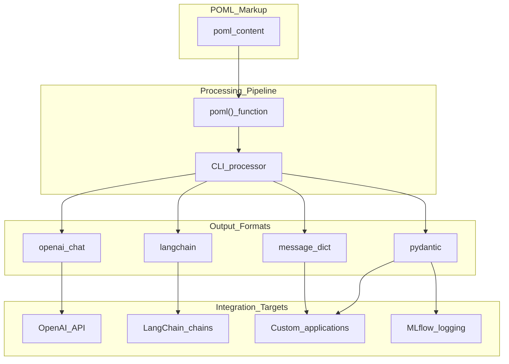
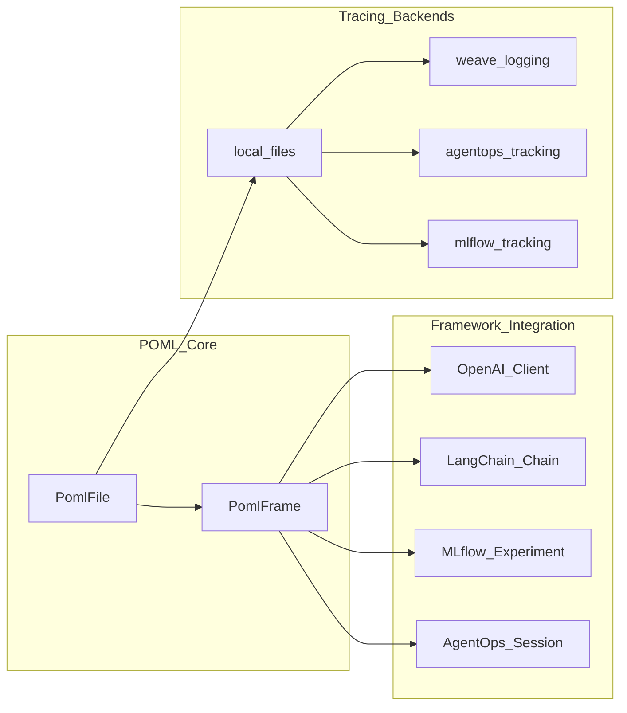

<!-- source: DeepWiki mcp.deepwiki.com · repo microsoft/poml · page 4.5 Examples and Use Cases · fetched 2026-10-26 -->

# Examples and Use Cases

<details>
<summary>Relevant source files</summary>

The following files were used as context for generating this wiki page:

- [CITATION.cff](CITATION.cff)
- [README.md](README.md)
- [docs/index.md](docs/index.md)
- [docs/vscode/index.md](docs/vscode/index.md)
- [python/poml/__init__.py](python/poml/__init__.py)
- [python/poml/api.py](python/poml/api.py)
- [python/tests/test_basic.py](python/tests/test_basic.py)
- [python/tests/test_poml_formats.py](python/tests/test_poml_formats.py)

</details>


This page provides practical examples demonstrating common POML patterns and use cases across different scenarios. The examples show both POML markup and expected outputs in various formats to help you understand how to structure prompts effectively.

For basic syntax and component details, see [Core Components](#4.1) and [Data Components](#4.2). For templating features, see [Templating and Scripting](#4.3). For integration guidance, see [Integrations](#5).

## Basic Prompt Patterns

### Simple Question-Answer Prompt

The most basic POML pattern structures a single interaction with clear role and task definition:

```xml
<poml>
  <role>You are a helpful programming tutor.</role>
  <task>Explain the concept clearly with examples.</task>
  <p>What is the difference between a list and a tuple in Python?</p>
</poml>
```

This renders to a single human message containing the role, task, and question formatted together.

**Sources:** [README.md:31-43](), [python/tests/test_basic.py:11-12]()

### Multi-Section Prompt with Structure

More complex prompts benefit from clear sectioning and structured content:

```xml
<poml>
  <role>You are an expert data scientist.</role>
  
  <task caption="Data Analysis Task">
    Analyze the provided dataset and identify key patterns.
  </task>
  
  <context caption="Dataset Information">
    <p>The dataset contains customer purchase records from 2023.</p>
    <p>Fields: customer_id, product_category, purchase_amount, date</p>
  </context>
  
  <instructions>
    <header>Analysis Requirements</header>
    <list>
      <item>Identify top-performing product categories</item>
      <item>Find seasonal trends in purchase patterns</item>
      <item>Calculate customer lifetime value segments</item>
    </list>
  </instructions>
  
  <output-format>
    Provide results in JSON format with summary statistics and visualizations.
  </output-format>
</poml>
```

**Sources:** [python/tests/test_basic.py:15-36]()

## Multi-Modal Content Examples

### Image Analysis with Context

POML excels at combining text and visual content for comprehensive prompts:

```xml
<poml>
  <role>You are a medical imaging specialist.</role>
  
  <task>Analyze the provided X-ray image and provide a detailed assessment.</task>
  
  
  
  <context caption="Patient Information">
    <p>Patient: 45-year-old male</p>
    <p>Symptoms: Persistent cough, shortness of breath</p>
    <p>Duration: 3 weeks</p>
  </context>
  
  <output-format>
    Structure your response with:
    1. Overall assessment
    2. Specific findings
    3. Recommended follow-up
  </output-format>
</poml>
```

When processed with `format="openai_chat"`, this creates a message with both text and base64-encoded image data suitable for vision models.

**Sources:** [python/tests/test_poml_formats.py:51-62](), [README.md:29-45]()

### Document Processing

POML can embed and process various document types:

```xml
<poml>
  <role>You are a legal document analyst.</role>
  
  <task>Summarize the key points from the provided contract.</task>
  
  <document src="contract.pdf" parser="pdf" max-length="5000">
    Contract document content will be extracted here
  </document>
  
  <instructions>
    Focus on:
    - Key terms and conditions
    - Financial obligations
    - Termination clauses
    - Risk factors
  </instructions>
</poml>
```

**Sources:** [python/tests/test_basic.py:39-52]()

## Tool Integration Patterns

### Simple Tool Usage

POML supports structured tool calling for enhanced LLM capabilities:

```xml
<poml>
  <tool-definition name="web_search" description="Search the web for current information">
    {
      "type": "object",
      "properties": {
        "query": {"type": "string", "description": "Search query"},
        "num_results": {"type": "integer", "default": 5}
      },
      "required": ["query"]
    }
  </tool-definition>
  
  <role>You are a research assistant with access to web search.</role>
  
  <task>Find the latest information about renewable energy trends in 2024.</task>
  
  <p>Use the search tool to gather current data and provide a comprehensive summary.</p>
</poml>
```

**Sources:** [python/tests/test_poml_formats.py:194-226]()

### Complex Tool Interaction Flow

For multi-step tool interactions, POML can represent complete conversation flows:

```xml
<poml>
  <tool-definition name="calculator" description="Perform mathematical calculations">
    {"type": "object", "properties": {"expression": {"type": "string"}}}
  </tool-definition>
  
  <human-msg>Calculate the compound interest for $1000 at 5% annually for 3 years</human-msg>
  
  <ai-msg>I'll calculate the compound interest for you using the formula A = P(1 + r)^t</ai-msg>
  
  <tool-request id="calc_1" name="calculator" parameters='{"expression": "1000 * (1 + 0.05)^3"}' />
  
  <tool-response id="calc_1" name="calculator">1157.625</tool-response>
  
  <ai-msg>The final amount after 3 years would be $1,157.63, meaning you earned $157.63 in compound interest.</ai-msg>
</poml>
```

**Sources:** [python/tests/test_poml_formats.py:286-317]()

## Output Format Examples

### Structured Data with Schema

POML can enforce structured outputs using JSON schemas:

```xml
<poml>
  <output-schema>
    {
      "type": "object",
      "properties": {
        "summary": {"type": "string"},
        "sentiment": {"type": "string", "enum": ["positive", "negative", "neutral"]},
        "confidence": {"type": "number", "minimum": 0, "maximum": 1},
        "key_topics": {"type": "array", "items": {"type": "string"}}
      },
      "required": ["summary", "sentiment", "confidence"]
    }
  </output-schema>
  
  <role>You are a text analysis expert.</role>
  
  <task>Analyze the sentiment and key topics of the provided text.</task>
  
  <p>The new product launch exceeded all expectations with overwhelmingly positive customer feedback.</p>
</poml>
```

**Sources:** [python/tests/test_poml_formats.py:159-178]()

### Runtime Configuration

Control model behavior with runtime parameters:

```xml
<poml>
  <runtime 
    temperature="0.3" 
    max-tokens="500" 
    top-p="0.9"
    frequency-penalty="0.1"
  />
  
  <role>You are a precise technical writer.</role>
  
  <task>Write a concise explanation of how neural networks work.</task>
  
  <constraints>
    - Use simple language
    - Include key concepts only
    - Maximum 3 paragraphs
  </constraints>
</poml>
```

**Sources:** [python/tests/test_poml_formats.py:182-190]()

## Templating and Dynamic Content

### Context-Driven Templates

POML's templating engine enables dynamic content generation:

```xml
<poml>
  <let name="user_role" value="{{ context.role || 'student' }}" />
  <let name="difficulty" value="{{ context.difficulty || 'beginner' }}" />
  
  <role>You are a {{ user_role }} tutor specialized in {{ context.subject }}.</role>
  
  <task>
    Explain {{ context.topic }} at a {{ difficulty }} level.
    
    Include mathematical formulations and detailed examples.
    
    Focus on intuitive explanations with simple examples.
    
  </task>
  
  <context caption="Learning Context">
    <p>Subject: {{ context.subject }}</p>
    <p>Previous knowledge: {{ context.background || 'none specified' }}</p>
  </context>
  
  
  <examples>
    
    <example caption="Example {{ loop.index }}">{{ example }}</example>
    
  </examples>
  
</poml>
```

**Sources:** [docs/index.md:12](), [python/poml/api.py:422-515]()

## Integration Pattern Examples

The following diagram shows common integration patterns across different output formats:



**Sources:** [python/poml/api.py:227-328](), [python/tests/test_poml_formats.py:123-255]()

### Python Integration Examples

Different output formats serve specific integration needs:

```python
# Basic usage - returns message array
messages = poml("<p>Hello {{name}}</p>", context={"name": "World"})
# Result: [{"speaker": "human", "content": "Hello World"}]

# OpenAI API integration
openai_format = poml("prompt.poml", format="openai_chat")
response = openai.chat.completions.create(
    model="gpt-4",
    **openai_format
)

# LangChain integration
langchain_format = poml("prompt.poml", format="langchain")
chain = ChatPromptTemplate.from_messages(langchain_format["messages"])

# Pydantic objects for type safety
result = poml("prompt.poml", format="pydantic")
for message in result.messages:
    print(f"{message.speaker}: {message.content}")
```

**Sources:** [python/poml/api.py:490-515](), [python/tests/test_poml_formats.py:24-49]()

### Framework-Specific Patterns

The following diagram illustrates how POML integrates with different ML frameworks:



**Sources:** [python/poml/api.py:37-109](), [python/poml/api.py:689-742]()

### Tracing and Monitoring

POML provides comprehensive tracing capabilities for production monitoring:

```python
import poml

# Enable local tracing with multiple backends
trace_dir = poml.set_trace(["local", "weave", "mlflow"], trace_dir="./traces")

# Process prompts with automatic logging
result = poml("analysis_prompt.poml", context=analysis_data)

# Add custom artifacts
poml.trace_artifact("model_response.json", response_data)

# Retrieve trace history
traces = poml.get_trace()
```

**Sources:** [python/poml/api.py:37-109](), [python/tests/test_basic.py:84-135]()

## Advanced Use Cases

### Multi-Modal RAG Pipeline

Combining document retrieval with visual analysis:

```xml
<poml>
  <role>You are an expert research analyst with access to documents and images.</role>
  
  <task>Analyze the quarterly report and charts to provide investment recommendations.</task>
  
  <document src="q4_report.pdf" parser="pdf" max-length="3000" />
  
  
  
  
  <context caption="Analysis Parameters">
    <p>Investment horizon: {{ context.timeline }}</p>
    <p>Risk tolerance: {{ context.risk_profile }}</p>
    <p>Focus sectors: {{ context.sectors | join(', ') }}</p>
  </context>
  
  <output-schema>
    {
      "type": "object",
      "properties": {
        "recommendation": {"type": "string", "enum": ["buy", "hold", "sell"]},
        "confidence": {"type": "number"},
        "reasoning": {"type": "string"},
        "risk_factors": {"type": "array", "items": {"type": "string"}},
        "price_target": {"type": "number"}
      },
      "required": ["recommendation", "confidence", "reasoning"]
    }
  </output-schema>
</poml>
```

### Interactive Debugging Session

POML can structure complex debugging conversations:

```xml
<poml>
  <system-msg>You are an expert Python debugger. Help analyze and fix code issues step by step.</system-msg>
  
  <human-msg>I'm getting a KeyError in my data processing script.</human-msg>
  
  <code language="python">
def process_data(records):
    results = []
    for record in records:
        # Error occurs here
        value = record['total_amount']  
        results.append(value * 1.1)
    return results
  </code>
  
  <ai-msg>I can see the issue. Let me help you debug this step by step. The KeyError suggests the 'total_amount' key doesn't exist in some records.</ai-msg>
  
  <tool-request id="debug_1" name="code_analyzer" parameters='{"code": "record.keys()", "context": "Check available keys"}' />
  
  <tool-response id="debug_1" name="code_analyzer">Available keys in record: ['amount', 'tax', 'discount', 'customer_id']</tool-response>
  
  <ai-msg>The issue is clear now. The key is 'amount', not 'total_amount'. Here's the fix:</ai-msg>
  
  <code language="python">
def process_data(records):
    results = []
    for record in records:
        # Fixed: use correct key name
        value = record.get('amount', 0)  # Also added default value
        results.append(value * 1.1)
    return results
  </code>
</poml>
```

**Sources:** [python/tests/test_poml_formats.py:79-120]()

This comprehensive set of examples demonstrates POML's flexibility across different domains, from simple prompts to complex multi-modal workflows with tool integration and structured outputs.

---

