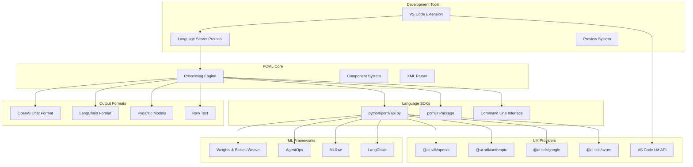
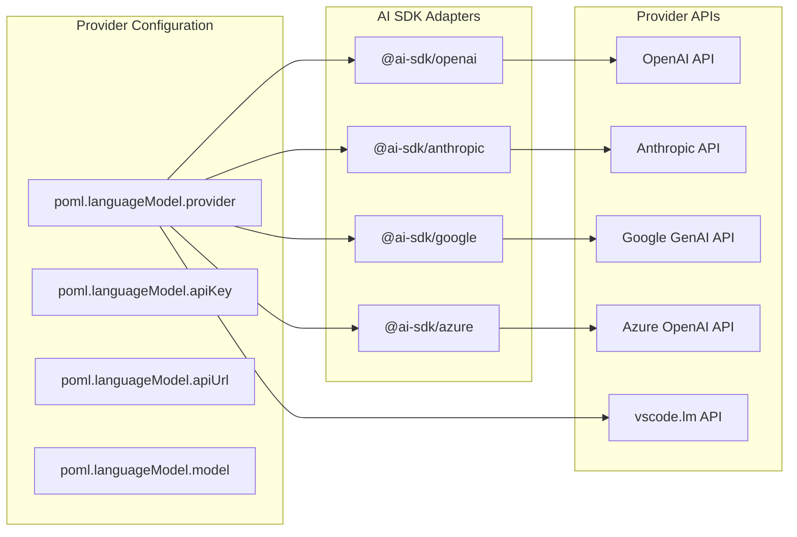
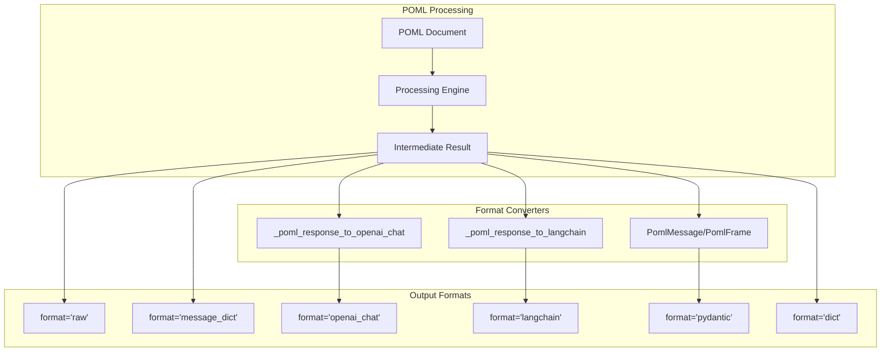
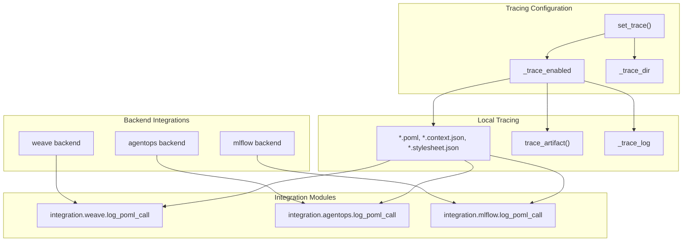
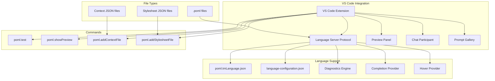

<!-- source: DeepWiki mcp.deepwiki.com · repo microsoft/poml · page 5 Integrations · fetched 2026-10-26 -->

# Integrations

Relevant source files

The following files were used as context for generating this wiki page:

- [package-lock.json](package-lock.json)
- [package.json](package.json)
- [python/poml/__init__.py](python/poml/__init__.py)
- [python/poml/api.py](python/poml/api.py)
- [python/tests/test_basic.py](python/tests/test_basic.py)
- [python/tests/test_poml_formats.py](python/tests/test_poml_formats.py)

This document provides an overview of how POML integrates with various tools, frameworks, and development environments. POML is designed as an interoperable system that can work with multiple language model providers, ML frameworks, development tools, and output formats.

For detailed information about specific integration types, see the sub-pages: [Python API](#5.1), [JavaScript/TypeScript API](#5.2), [Framework Integrations](#5.3), [VS Code Extension](#5.4), and [Command Line Interface](#5.5).

## Integration Architecture

POML's integration architecture is built around a core processing engine that can interface with multiple systems through well-defined APIs and protocols.

Sources: [package.json:450-485](), [python/poml/api.py:33-34](), [python/poml/api.py:689-742]()

## Language Model Provider Integration

POML integrates with multiple language model providers through a unified configuration system and standardized API adapters.

The provider configuration supports both single API keys and provider-specific configurations:

| Provider | Configuration Key | Default Model |
|----------|------------------|---------------|
| `openai` | Single string or `{"openai": "sk-..."}` | `gpt-4o` |
| `anthropic` | Single string or `{"anthropic": "sk-ant-..."}` | Model specified in config |
| `google` | Single string or `{"google": "..."}` | Model specified in config |
| `microsoft` | Single string or `{"microsoft": "..."}` | Azure deployment name |
| `vscode` | Uses VS Code's built-in authentication | GitHub Copilot models |

Sources: [package.json:245-327](), [package.json:450-485]()

## Output Format Integration

POML supports multiple output formats to integrate with different frameworks and use cases through the `format` parameter.

Each format serves specific integration needs:

- **`raw`**: Plain text output for simple use cases
- **`message_dict`**: Legacy format returning just messages array
- **`dict`**: Complete structure with messages, schema, tools, and runtime
- **`openai_chat`**: OpenAI Chat Completion API format with tool support
- **`langchain`**: LangChain message format with structured data
- **`pydantic`**: Strongly-typed `PomlFrame` objects

Sources: [python/poml/api.py:228-329](), [python/poml/api.py:352-412](), [python/poml/api.py:422-687]()

## Tracing and Observability Integration

POML provides comprehensive tracing capabilities that integrate with multiple observability platforms.

The tracing system supports multiple backends that can be enabled simultaneously:

| Backend | Purpose | Requirements |
|---------|---------|--------------|
| `local` | Save trace files to disk | Always enabled when any backend is used |
| `weave` | Log to Weights & Biases Weave | Requires local tracing |
| `agentops` | Log to AgentOps platform | Requires local tracing |
| `mlflow` | Log to MLflow tracking | Requires local tracing |

Sources: [python/poml/api.py:37-109](), [python/poml/api.py:689-742](), [python/poml/api.py:122-180]()

## Development Environment Integration

POML integrates with development environments through multiple interfaces, with VS Code being the primary IDE integration.

Sources: [package.json:41-70](), [package.json:71-174](), [package.json:176-183]()

## Cross-Platform SDK Integration

POML provides consistent APIs across multiple programming languages and runtime environments.

```mermaid
graph TB
    subgraph "Python SDK"
        PythonAPI["python/poml/api.py"]
        PythonCLI["python/poml/cli.py"]
        PythonPrompt["python/poml/prompt.py"]
        PythonIntegration["python/poml/integration/"]
    end
    
    subgraph "JavaScript/TypeScript SDK"
        JSPackage["pomljs npm package"]
        NodeCLI["Node.js CLI"]
        ReactComponents["React Components"]
        BrowserSupport["Browser Support"]
    end
    
    subgraph "Shared Features"
        ComponentAPI["Identical Component APIs"]
        FormatSupport["Same Output Formats"]
        ProviderSupport["Same LM Providers"]
        TracingSupport["Compatible Tracing"]
    end
    
    subgraph "Platform-Specific"
        PythonTypes["Pydantic Models"]
        PythonFrameworks["ML Framework Integration"]
        JSTypes["TypeScript Types"]
        VSCodeFeatures["VS Code Extension Features"]
    end
    
    PythonAPI --> ComponentAPI
    JSPackage --> ComponentAPI
    
    PythonAPI --> FormatSupport
    JSPackage --> FormatSupport
    
    PythonAPI --> ProviderSupport
    JSPackage --> ProviderSupport
    
    PythonAPI --> TracingSupport
    JSPackage --> TracingSupport
    
    PythonAPI --> PythonTypes
    PythonAPI --> PythonFrameworks
    JSPackage --> JSTypes
    JSPackage --> VSCodeFeatures
```

Sources: [python/poml/api.py:1-760](), [package.json:1-493](), [python/poml/__init__.py:1-5]()

---

