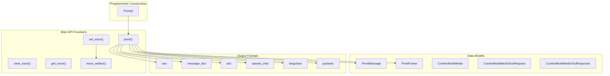
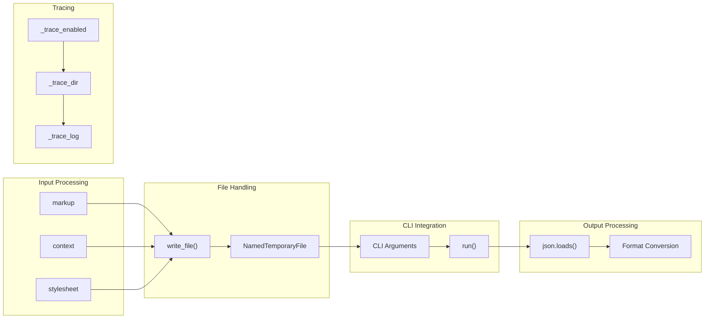
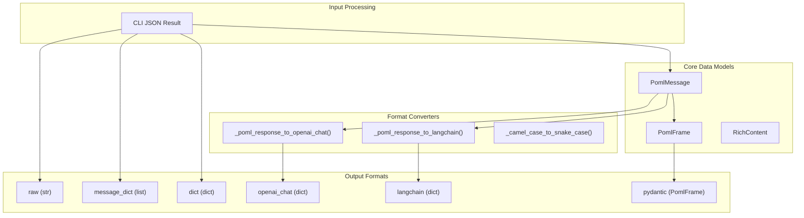
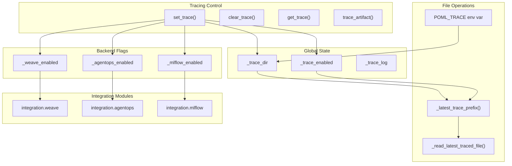
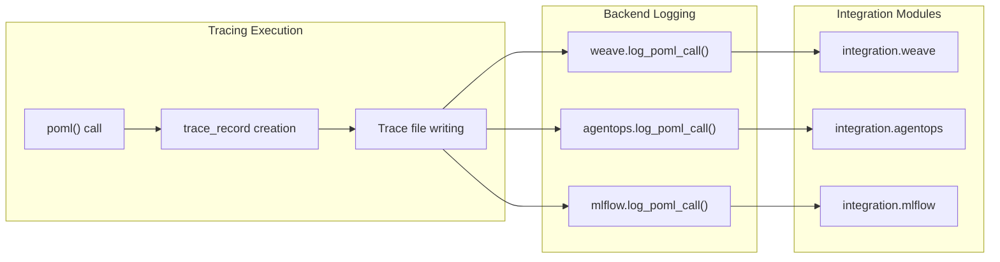

<!-- source: DeepWiki mcp.deepwiki.com · repo microsoft/poml · page 5.1 Python API · fetched 2026-10-26 -->

# Python API

<details>
<summary>Relevant source files</summary>

The following files were used as context for generating this wiki page:

- [packages/poml/tests/meta.test.tsx](packages/poml/tests/meta.test.tsx)
- [packages/poml/version.ts](packages/poml/version.ts)
- [pyproject.toml](pyproject.toml)
- [python/poml/__init__.py](python/poml/__init__.py)
- [python/poml/_version.py](python/poml/_version.py)
- [python/poml/api.py](python/poml/api.py)
- [python/tests/test_basic.py](python/tests/test_basic.py)
- [python/tests/test_poml_formats.py](python/tests/test_poml_formats.py)

</details>


The Python API provides a comprehensive interface for processing POML (Prompt Orchestration Markup Language) documents programmatically. This API supports markup processing, tracing, multiple output formats, and integration with popular ML frameworks.

For JavaScript/TypeScript integration, see [JavaScript/TypeScript API](#5.2). For command-line usage, see [Command Line Interface](#5.5). For framework-specific integrations, see [Framework Integrations](#5.3).

## Installation

The POML Python package is distributed via PyPI and includes bundled Node.js dependencies for cross-platform compatibility.

```bash
pip install poml
```

For development with additional integrations:

```bash
pip install poml[agent]  # Includes langchain, mlflow, agentops, weave
```

The package requires Python 3.9+ and includes a bundled Node.js CLI for processing POML markup.

Sources: [pyproject.toml:1-41]()

## Core API Overview

The Python API centers around the `poml()` function for processing markup and supporting utilities for tracing and programmatic prompt construction.

### Core API Components



Sources: [python/poml/api.py:16-24](), [python/poml/__init__.py:1-4]()

## The `poml()` Function

The `poml()` function is the primary entry point for processing POML markup. It accepts markup content, context data, and styling options, returning results in various formats optimized for different use cases.

### Function Signature and Parameters

```python
def poml(
    markup: str | Path,
    context: dict | str | Path | None = None,
    stylesheet: dict | str | Path | None = None,
    chat: bool = True,
    output_file: str | Path | None = None,
    format: OutputFormat = "message_dict",
    encoding: str | None = None,
    extra_args: Optional[List[str]] = None,
) -> list | dict | str | PomlFrame
```

### Processing Pipeline



### Basic Usage Examples

```python
# Simple markup processing
result = poml("<p>Hello {{name}}!</p>", context={"name": "World"})
# Returns: [{"speaker": "human", "content": "Hello World!"}]

# Load from file with context
result = poml("template.poml", context="context.json")

# Custom output format
messages = poml("chat.poml", format="openai_chat")
```

Sources: [python/poml/api.py:422-515](), [python/poml/api.py:516-756](), [python/tests/test_basic.py:11-12]()

## Output Formats

The Python API supports multiple output formats to integrate with different ML frameworks and use cases.

### Format Types and Data Models



### Format Specifications

| Format | Return Type | Use Case | Features |
|--------|-------------|----------|-----------|
| `raw` | `str` | Direct CLI output | Raw JSON string from processor |
| `message_dict` | `list` | Legacy compatibility | Messages array only |
| `dict` | `dict` | Full metadata access | Messages, schema, tools, runtime |
| `openai_chat` | `dict` | OpenAI API integration | Chat completion format, snake_case runtime |
| `langchain` | `dict` | LangChain integration | LangChain message format |
| `pydantic` | `PomlFrame` | Type safety | Strongly typed Pydantic models |

### OpenAI Chat Format Conversion

The `openai_chat` format performs several transformations:

- Speaker mapping: `human` → `user`, `ai` → `assistant`
- Tool call extraction into `tool_calls` array
- Runtime parameter conversion to `snake_case`
- Multi-modal content handling for images

```python
# Example with tools and schema
result = poml(markup_with_tools, format="openai_chat")
# Returns: {
#   "messages": [...],
#   "tools": [...],
#   "response_format": {"type": "json_schema", ...},
#   "temperature": 0.5,
#   "max_tokens": 150
# }
```

Sources: [python/poml/api.py:228-329](), [python/poml/api.py:352-412](), [python/poml/api.py:415-419](), [python/tests/test_poml_formats.py:79-103]()

## Tracing System

The tracing system provides comprehensive logging and debugging capabilities with support for multiple backend integrations.

### Tracing Architecture



### Tracing Configuration

```python
# Enable basic tracing
trace_dir = set_trace(True, trace_dir="./traces")

# Enable multiple backends
set_trace(["local", "weave", "agentops"], trace_dir="./traces")

# Backend-specific tracing
set_trace("mlflow")  # Also enables local tracing

# Environment variable auto-enabling
# export POML_TRACE=/path/to/traces
```

### Trace File Structure

When tracing is enabled, files are written to the trace directory with timestamped prefixes:

- `{timestamp}/{index}.{filename}.poml` - Original markup
- `{timestamp}/{index}.{filename}.context.json` - Context data
- `{timestamp}/{index}.{filename}.stylesheet.json` - Stylesheet data
- `{timestamp}/{index}.{filename}.{suffix}` - Custom artifacts via `trace_artifact()`

Sources: [python/poml/api.py:37-109](), [python/poml/api.py:122-180](), [python/tests/test_basic.py:84-127]()

## Programmatic Prompt Construction

The `Prompt` class enables programmatic POML construction using Python context managers and method chaining.

### Prompt Class Usage

```python
from poml import Prompt

with Prompt() as p:
    with p.task(caption="My Task"):
        p.text("This is a task description.")
        with p.paragraph():
            with p.header():
                p.text("Subheading")
            p.text("This is a paragraph.")
    
    # Generate XML representation
    xml_output = p.dump_xml()
    
    # Render to messages
    result = p.render()
```

### Prompt Reusability

The `Prompt` class supports reuse across multiple context blocks, enabling incremental prompt construction:

```python
prompt = Prompt()

# First usage
with prompt:
    with prompt.role():
        prompt.text("You are helpful.")

# Append more content later
with prompt:
    with prompt.task(caption="Additional"):
        prompt.text("More instructions.")
```

Sources: [python/tests/test_basic.py:15-36](), [python/tests/test_basic.py:54-82]()

## Integration Backends

The Python API supports integration with popular ML monitoring and logging platforms through optional backend modules.

### Available Backends

| Backend | Module | Requirements | Purpose |
|---------|---------|-------------|---------|
| `weave` | `integration.weave` | Weights & Biases Weave | Experiment tracking |
| `agentops` | `integration.agentops` | AgentOps SDK | Agent monitoring |
| `mlflow` | `integration.mlflow` | MLflow | ML lifecycle management |
| `local` | Built-in | None | File-based tracing |

### Backend Integration Flow



All backend integrations require local tracing to be enabled and use the traced file artifacts for logging.

Sources: [python/poml/api.py:689-742](), [pyproject.toml:29-40]()

## Data Models

The Python API defines several Pydantic models for type-safe handling of POML content and metadata.

### Core Message Models

```python
class PomlMessage(BaseModel):
    speaker: Speaker  # "human" | "ai" | "system" | "tool"
    content: RichContent

class PomlFrame(BaseModel):
    messages: List[PomlMessage]
    output_schema: Optional[Dict[str, Any]] = None
    tools: Optional[List[Dict[str, Any]]] = None
    runtime: Optional[Dict[str, Any]] = None
```

### Multi-Modal Content Models

```python
class ContentMultiMedia(BaseModel):
    type: str  # MIME type: image/png, image/jpeg, etc.
    base64: str
    alt: Optional[str] = None

class ContentMultiMediaToolRequest(BaseModel):
    type: Literal["application/vnd.poml.toolrequest"]
    id: str
    name: str
    content: Any  # Tool parameters

class ContentMultiMediaToolResponse(BaseModel):
    type: Literal["application/vnd.poml.toolresponse"]
    id: str
    name: str
    content: Union[str, List[Union[str, ContentMultiMedia]]]
```

### Rich Content Type Union

```python
RichContent = Union[
    str, 
    List[Union[
        str, 
        ContentMultiMedia, 
        ContentMultiMediaToolRequest, 
        ContentMultiMediaToolResponse
    ]]
]
```

These models support the full range of POML features including text, images, tool calls, and structured responses across all output formats.

Sources: [python/poml/api.py:189-226](), [python/tests/test_poml_formats.py:36-49]()

---

