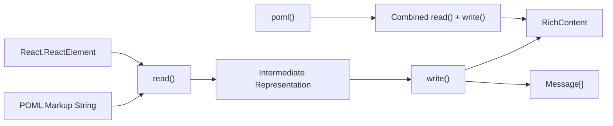
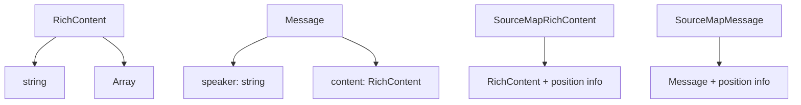
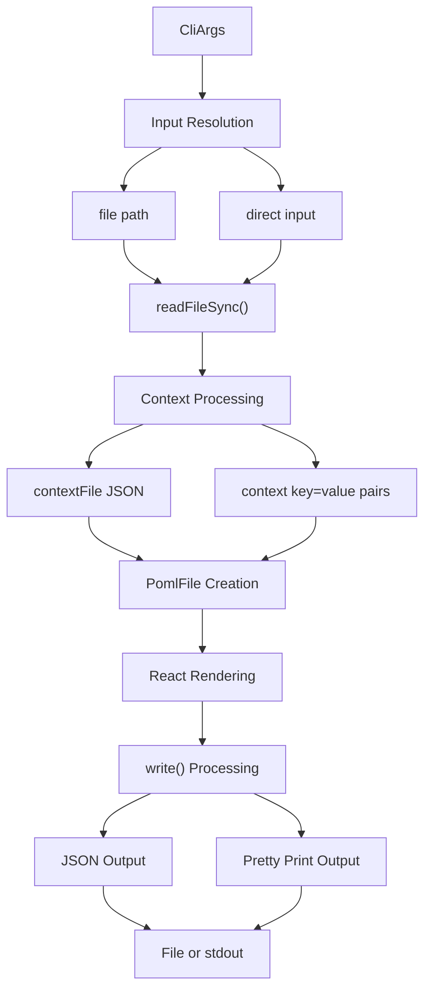
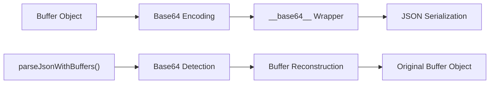

<!-- source: DeepWiki mcp.deepwiki.com · repo microsoft/poml · page 5.2 JavaScript/TypeScript API · fetched 2026-10-26 -->

# JavaScript/TypeScript API

<details>
<summary>Relevant source files</summary>

The following files were used as context for generating this wiki page:

- [.github/workflows/test-after-publish.yml](.github/workflows/test-after-publish.yml)
- [examples/401_js_hello_world.mjs](examples/401_js_hello_world.mjs)
- [examples/402_py_hello_world.py](examples/402_py_hello_world.py)
- [packages/poml-build/package.json](packages/poml-build/package.json)
- [packages/poml/index.ts](packages/poml/index.ts)
- [packages/poml/tests/trace.test.tsx](packages/poml/tests/trace.test.tsx)
- [packages/poml/util/index.ts](packages/poml/util/index.ts)
- [packages/poml/util/trace.ts](packages/poml/util/trace.ts)

</details>


This page covers the JavaScript/TypeScript SDK for POML, including the `pomljs` npm package, core API functions, type definitions, and command-line interface. The SDK provides both Node.js and browser support for parsing POML documents and generating structured outputs.

For Python API documentation, see [Python API](#5.1). For VS Code extension features, see [VS Code Extension](#5.4). For CLI usage outside of programmatic contexts, see [Command Line Interface](#5.5).

## Package Overview

The JavaScript/TypeScript SDK is distributed as the `pomljs` npm package, which provides both CommonJS and ES module support with full TypeScript definitions.

### Installation

```bash
npm install pomljs
```

The package supports Node.js 18+ and provides multiple export formats for compatibility across different environments.

**Package Structure:**
- **Module formats**: ESM (`dist/index.js`) and CommonJS (`dist/index.cjs`)
- **TypeScript support**: Full type definitions (`dist/index.d.ts`)
- **CLI binary**: `poml` command available after installation

Sources: [packages/poml-build/package.json:1-73]()

### Core Exports

The main package exports include processing functions, type definitions, and utilities:

```typescript
import { 
  read, write, poml,           // Core processing functions
  writeWithSourceMap,          // Source map variants
  RichContent, Message,        // Type definitions
  setTrace, clearTrace,        // Debugging utilities
  parseJsonWithBuffers         // JSON parsing with Buffer support
} from 'pomljs';
```

Sources: [packages/poml/index.ts:23-24](), [packages/poml/index.ts:276]()

## Core API Functions

The POML JavaScript API provides a three-layer processing architecture: parsing, intermediate representation generation, and output formatting.

### Processing Pipeline



**POML Processing Pipeline**

The API follows a clear separation between parsing (`read`) and output generation (`write`), with a convenience function (`poml`) for common use cases.

Sources: [packages/poml/index.ts:26-46](), [packages/poml/index.ts:94-101](), [packages/poml/index.ts:119-127]()

### read() Function

The `read` function converts POML markup or React elements into an intermediate representation string.

```typescript
async function read(
  element: React.ReactElement | string,
  options?: PomlReaderOptions,
  context?: { [key: string]: any },
  stylesheet?: { [key: string]: any },
  sourcePath?: string
): Promise<string>
```

**Key Parameters:**
- **element**: POML markup string or pre-parsed React element
- **options**: Parsing configuration (e.g., `trim` setting)
- **context**: Template variables for dynamic content
- **stylesheet**: Style definitions for component rendering
- **sourcePath**: File path for error reporting and includes

The function internally creates a `PomlFile` instance when given a string input and renders it through the React rendering pipeline.

Sources: [packages/poml/index.ts:26-46]()

### write() Function

The `write` function transforms intermediate representation into structured output formats.

```typescript
// Non-speaker mode (default)
function write(ir: string, options?: WriteOptionsNoSpeakerMode): RichContent;

// Speaker mode
function write(ir: string, options: WriteOptionsSpeakerMode): Message[];
```

**Output Modes:**
- **Default mode**: Returns `RichContent` (string or mixed content array)
- **Speaker mode**: Returns `Message[]` array with speaker attribution

The function uses the `EnvironmentDispatcher` class internally to handle output generation.

Sources: [packages/poml/index.ts:87-101]()

### poml() Function

The `poml` function provides a simplified interface combining `read` and `write` operations.

```typescript
async function poml(element: React.ReactElement | string): Promise<RichContent>
```

This function automatically:
- Clears the error collection
- Processes the input through `read()` and `write()`
- Throws the first error if any occurred during processing

Sources: [packages/poml/index.ts:119-127]()

### Source Map Variants

Source map functions provide position tracking for debugging and editor integration:

```typescript
function writeWithSourceMap(ir: string, options?: WriteOptions): 
  SourceMapRichContent[] | SourceMapMessage[]
```

These variants return the same content as their non-source-map counterparts but include position information mapping output elements back to input locations.

Sources: [packages/poml/index.ts:103-117]()

## Type Definitions

The API defines several key types for handling POML content and metadata.

### Content Types



**POML Type Hierarchy**

**Core Types:**
- **RichContent**: Either a plain string or array containing strings and media objects
- **Message**: Speaker-attributed content with `speaker` and `content` fields
- **SourceMapRichContent/SourceMapMessage**: Position-aware variants for debugging

Sources: [packages/poml/index.ts:23-24](), [packages/poml/base.ts]()

### Processing Options

```typescript
interface WriteOptions {
  speaker?: boolean;
}

interface PomlReaderOptions {
  trim?: boolean;
  // Additional parsing options
}
```

The options control parsing behavior and output format selection.

Sources: [packages/poml/index.ts:75-85]()

## Command Line Interface

The SDK includes a programmatic command-line interface through the `commandLine` function.

### CLI Function Signature

```typescript
async function commandLine(args: CliArgs): Promise<void>

interface CliArgs {
  input?: string;           // Direct POML markup
  file?: string;           // File path to read
  output?: string;         // Output file path
  context?: string[];      // Context variables (key=value)
  contextFile?: string;    // JSON file with context
  stylesheet?: string;     // Inline stylesheet JSON
  stylesheetFile?: string; // Stylesheet file path
  trim?: boolean;         // Trim whitespace
  speakerMode?: boolean;  // Enable speaker mode
  prettyPrint?: boolean;  // Human-readable output
  strict?: boolean;       // Strict error handling
  cwd?: string;          // Working directory
  traceDir?: string;     // Debug trace directory
}
```

Sources: [packages/poml/index.ts:129-143](), [packages/poml/index.ts:152-255]()

### CLI Processing Flow



**CLI Processing Pipeline**

The CLI function handles file I/O, context parsing, and output formatting while providing comprehensive error handling and tracing support.

Sources: [packages/poml/index.ts:152-255]()

## Tracing and Debugging

The SDK provides comprehensive tracing capabilities for debugging POML processing.

### Trace API

```typescript
// Enable/disable tracing
function setTrace(enabled: boolean = true, dir?: string): string | undefined;
function clearTrace(): void;
function isTracing(): boolean;

// Manual trace dumps
function dumpTrace(
  markup: string,
  context?: any,
  stylesheet?: any,
  result?: any,
  sourcePath?: string,
  prettyResult?: string
): void;

// JSON parsing with Buffer support
function parseJsonWithBuffers(text: string): any;
```

### Trace Output Structure

When tracing is enabled, the system generates numbered trace files:

- **`NNNN.poml`**: Processed markup content
- **`NNNN.context.json`**: Context variables with Buffer serialization
- **`NNNN.stylesheet.json`**: Stylesheet definitions
- **`NNNN.result.json`**: Processing results
- **`NNNN.result.txt`**: Human-readable output
- **`NNNN.env`**: Environment information including source paths

The tracing system handles Buffer serialization using base64 encoding and provides automatic index assignment to avoid conflicts.

Sources: [packages/poml/util/trace.ts:36-54](), [packages/poml/util/trace.ts:100-139](), [packages/poml/index.ts:276]()

### Buffer Handling

The trace system includes special handling for Buffer objects in context data:



**Buffer Serialization in Traces**

This allows binary data like images and documents to be preserved in trace files for debugging.

Sources: [packages/poml/util/trace.ts:4-31](), [packages/poml/tests/trace.test.tsx:27-32]()

## Environment Support

The JavaScript SDK supports multiple runtime environments with appropriate feature detection.

### Node.js vs Browser

The package is designed to work in both Node.js and browser environments:

- **Node.js**: Full file system access, CLI support, complete feature set
- **Browser**: Core parsing and rendering capabilities, limited I/O operations

### Module Format Support

The build system produces multiple output formats:

- **ES Modules**: Modern bundlers and Node.js with `type: "module"`
- **CommonJS**: Traditional Node.js applications
- **TypeScript**: Full type definitions for development

The package uses conditional exports to provide the appropriate format for each environment.

Sources: [packages/poml-build/package.json:9-15](), [packages/poml-build/package.json:34-36]()

### Example Usage

**Basic Processing:**
```javascript
import { poml } from 'pomljs';

const result = await poml('<p>Hello, world!</p>');
console.log(result); // "Hello, world!"
```

**With Context and Options:**
```javascript
import { read, write } from 'pomljs';

const ir = await read(
  '<p>Hello, {{name}}!</p>', 
  { trim: true },
  { name: 'POML' }
);
const messages = write(ir, { speaker: true });
console.log(messages); // [{ speaker: "human", content: "Hello, POML!" }]
```

Sources: [examples/401_js_hello_world.mjs:1-12]()

---

