<!-- source: DeepWiki mcp.deepwiki.com · repo microsoft/poml · page 5.3 Framework Integrations · fetched 2026-10-26 -->

# Framework Integrations

<details>
<summary>Relevant source files</summary>

The following files were used as context for generating this wiki page:

- [.github/workflows/shared-test-integration.yml](.github/workflows/shared-test-integration.yml)
- [docs/python/reference/integration.md](docs/python/reference/integration.md)
- [python/poml/__init__.py](python/poml/__init__.py)
- [python/poml/api.py](python/poml/api.py)
- [python/poml/integration/pydantic.py](python/poml/integration/pydantic.py)
- [python/tests/integration/openai_pydantic.py](python/tests/integration/openai_pydantic.py)
- [python/tests/test_basic.py](python/tests/test_basic.py)
- [python/tests/test_poml_formats.py](python/tests/test_poml_formats.py)

</details>


This document covers POML's integration capabilities with external ML/AI frameworks, tracing systems, and output format conversions. These integrations enable POML to work seamlessly within existing AI development workflows and provide observability into prompt execution.

For information about the core Python API and programmatic POML usage, see [Python API](5.1). For VS Code extension integrations and development tooling, see [VS Code Extension](5.4).

## Integration Architecture Overview

POML provides integrations across three main categories: tracing backends, output format conversion, and schema utilities:

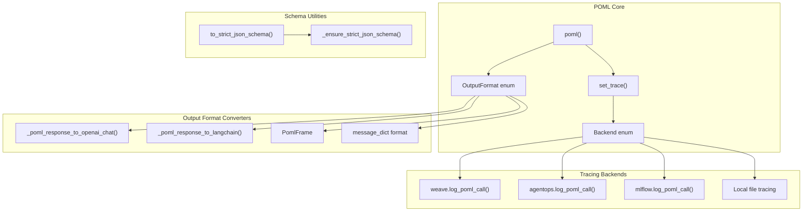

Sources: [python/poml/api.py:33-34](), [python/poml/api.py:37-109](), [python/poml/api.py:228-412](), [python/poml/integration/pydantic.py:16-59]()

## Output Format Conversions

POML supports multiple output formats to integrate with different AI frameworks. The `poml()` function accepts a `format` parameter that determines the structure of the returned data.

### Format Conversion Pipeline

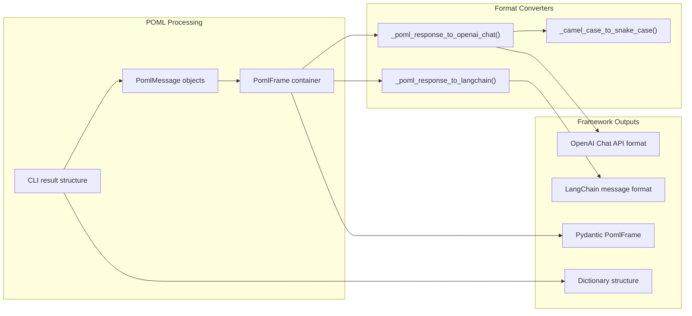

### Supported Output Formats

| Format | Return Type | Purpose | Key Features |
|--------|-------------|---------|--------------|
| `"message_dict"` | `list` | Legacy format, returns messages only | Backward compatibility |
| `"dict"` | `dict` | Full CLI structure | Messages, schema, tools, runtime |
| `"openai_chat"` | `dict` | OpenAI Chat Completion API | Tool calls, response format, snake_case params |
| `"langchain"` | `dict` | LangChain message format | Structured content, metadata preserved |
| `"pydantic"` | `PomlFrame` | Typed Pydantic objects | Type safety, validation |
| `"raw"` | `str` | Raw processor output | Debugging, custom processing |

### OpenAI Chat Format Integration

The OpenAI format converter transforms POML output into OpenAI Chat Completion API structure:

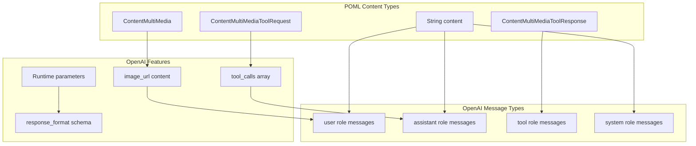

### LangChain Format Integration

The LangChain converter maintains compatibility with LangChain's message structure while preserving POML metadata:

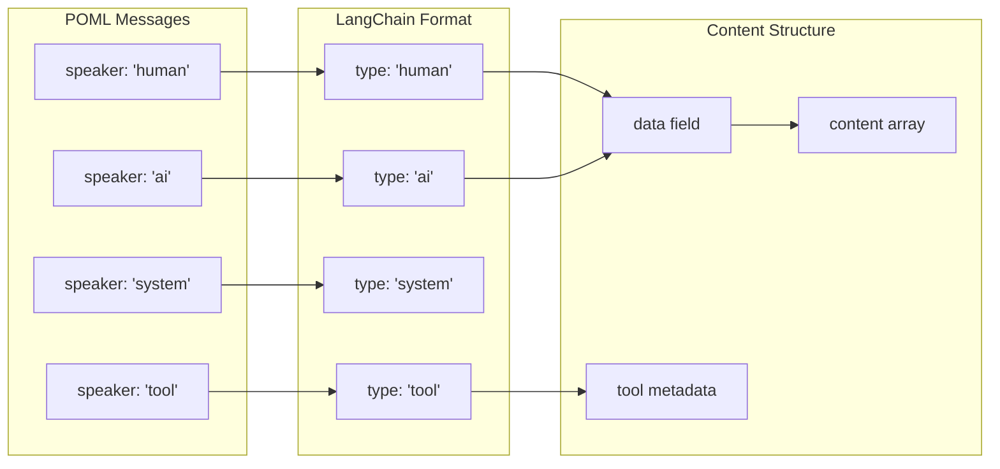

Sources: [python/poml/api.py:228-412](), [python/poml/api.py:415-419](), [python/poml/api.py:647-687](), [python/tests/test_poml_formats.py:79-343]()

## Schema Conversion and Validation

### Pydantic Integration

The `poml.integration.pydantic` module provides utilities for converting Pydantic models to OpenAI-compatible strict JSON schemas:

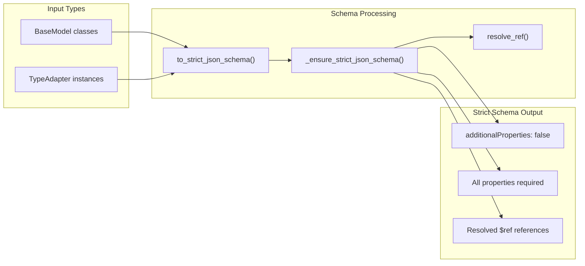

#### Key Functions

| Function | Purpose | Location |
|----------|---------|----------|
| `to_strict_json_schema()` | Convert Pydantic models to OpenAI strict schemas | [python/poml/integration/pydantic.py:16-59]() |
| `_ensure_strict_json_schema()` | Mutate schema to conform to strict requirements | [python/poml/integration/pydantic.py:79-167]() |
| `resolve_ref()` | Resolve `$ref` references in schemas | [python/poml/integration/pydantic.py:170-181]() |
| `is_basemodel_type()` | Type guard for BaseModel classes | [python/poml/integration/pydantic.py:184-187]() |

#### Schema Strictness Features

The integration automatically applies OpenAI's strict schema requirements:
- Sets `additionalProperties: false` on all object types
- Makes all properties required by default
- Resolves `$ref` references when combined with other properties
- Handles nested models, enums, and unions correctly
- Supports both Pydantic v1 and v2

Sources: [python/poml/integration/pydantic.py:1-212](), [python/tests/integration/openai_pydantic.py:60-276]()

## Tracing and Observability Integrations

POML includes a comprehensive tracing system that supports multiple backend integrations for observability and debugging. Tracing is configured via the `set_trace()` function and automatically captures POML execution details.

### Tracing System Architecture

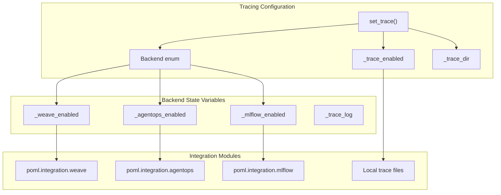

### Backend Configuration

The `set_trace()` function accepts multiple backend configurations:

| Backend | Purpose | Requirements | Environment Variables |
|---------|---------|--------------|---------------------|
| `"local"` | File-based tracing | None | `POML_TRACE` (optional) |
| `"weave"` | Weights & Biases Weave | Local tracing enabled | `WANDB_API_KEY` |
| `"agentops"` | AgentOps session tracking | Local tracing enabled | `AGENTOPS_API_KEY` |
| `"mlflow"` | MLflow experiment tracking | Local tracing enabled | `MLFLOW_TRACKING_URI` |

```python
# Enable multiple backends
poml.set_trace(["local", "weave", "mlflow"], trace_dir="./traces")

# Enable single backend
poml.set_trace("agentops")

# Enable with environment variable
os.environ["POML_TRACE"] = "./traces"
# Local tracing auto-enabled
```

### Trace Data Capture

When tracing is enabled, POML automatically captures execution artifacts:

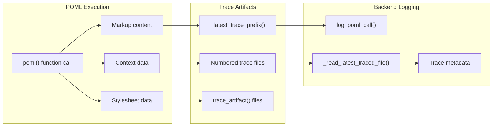

### Integration Implementation Details

#### MLflow Integration

The MLflow integration logs POML executions as MLflow operations:

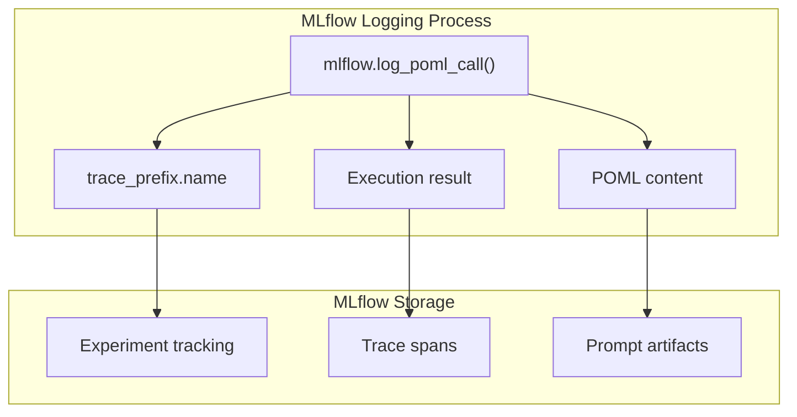

#### Weave Integration

The Weave integration provides advanced LLM experiment tracking:

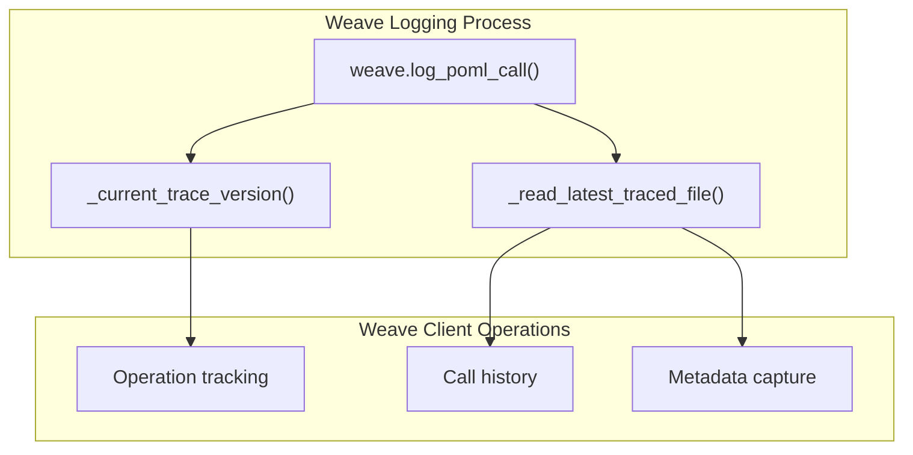

#### AgentOps Integration

The AgentOps integration captures session-based agent interactions:

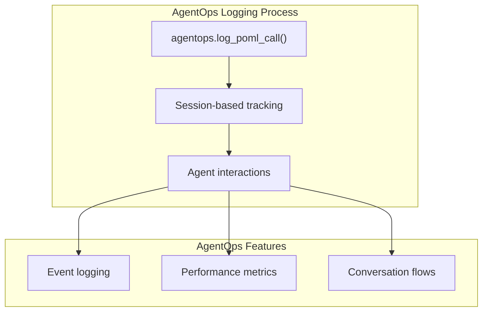

### Trace Utility Functions

| Function | Purpose | Location |
|----------|---------|----------|
| `set_trace()` | Configure tracing backends and directory | [python/poml/api.py:37-109]() |
| `clear_trace()` | Clear collected trace log | [python/poml/api.py:112-114]() |
| `get_trace()` | Return copy of trace log | [python/poml/api.py:117-119]() |
| `trace_artifact()` | Write additional artifact files | [python/poml/api.py:169-179]() |
| `_latest_trace_prefix()` | Get most recent trace file prefix | [python/poml/api.py:130-154]() |
| `_read_latest_traced_file()` | Read traced file with suffix | [python/poml/api.py:157-166]() |

Sources: [python/poml/api.py:26-760](), [python/tests/test_basic.py:84-162](), [.github/workflows/shared-test-integration.yml:58-63]()

## Local File Tracing System

POML includes a built-in local file tracing system that captures detailed execution artifacts for debugging and analysis:

### Trace File Management

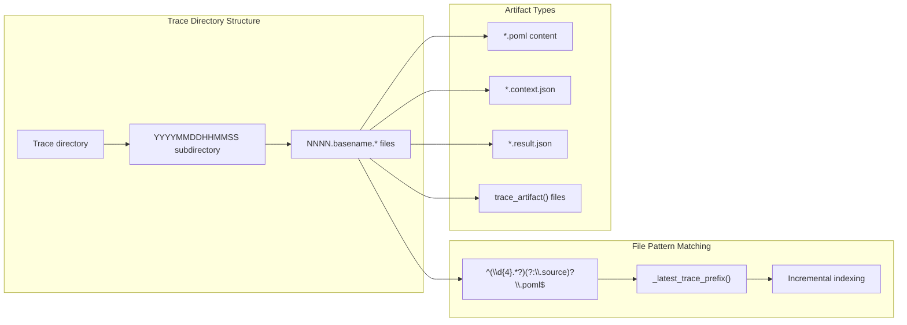

### Trace File Generation

Each `poml()` execution with tracing enabled generates multiple artifacts:

| File Pattern | Content | Purpose |
|--------------|---------|---------|
| `NNNN.basename.poml` | Executed POML markup | Source content |
| `NNNN.basename.context.json` | Context variables | Input data |
| `NNNN.basename.result.json` | Raw execution result | Output data |
| `NNNN.basename.source.poml` | Symlink to original file | Source reference |
| Custom `trace_artifact()` files | User-defined content | Additional artifacts |

### Automatic Trace Activation

Local tracing can be automatically enabled via environment variable:

```python
# Set environment variable
os.environ["POML_TRACE"] = "/path/to/traces"

# Tracing auto-enabled on import
import poml
result = poml.poml("<p>Hello</p>")  # Automatically traced
```

Sources: [python/poml/api.py:758-760](), [python/poml/api.py:130-179](), [python/tests/test_basic.py:95-162]()

## Integration Testing Infrastructure

POML maintains comprehensive integration tests across multiple platforms and frameworks:

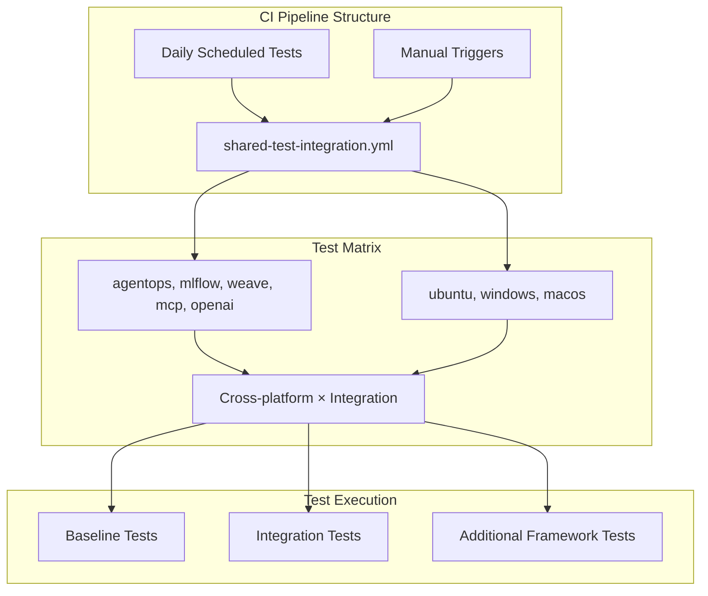

### Test Categories

| Test Type | Purpose | Examples |
|-----------|---------|----------|
| Baseline Tests | Verify framework functionality without POML | `agentops_baseline.py`, `mlflow_baseline.py` |
| Integration Tests | Test POML + framework integration | `agentops_poml.py`, `weave_poml.py` |
| Specialized Tests | Framework-specific advanced features | `openai_response_format.py`, `mlflow_poml_langchain.py` |

Sources: [.github/workflows/shared-test-integration.yml:1-144](), [.github/workflows/test-integration.yml:1-32]()

## Environment Configuration

All integrations support configuration through environment variables for API keys and service endpoints:

| Integration | Environment Variables | Purpose |
|-------------|---------------------|---------|
| AgentOps | `AGENTOPS_API_KEY` | API authentication |
| OpenAI | `OPENAI_API_KEY`, `OPENAI_API_BASE` | API access configuration |
| Weave | `WANDB_API_KEY` | Weights & Biases authentication |
| MLflow | `MLFLOW_TRACKING_URI` | Tracking server endpoint |
| POML Tracing | `POML_TRACE` | Built-in trace directory |

The integration test pipeline automatically configures these environments and validates functionality across different operating systems and framework versions.

Sources: [.github/workflows/shared-test-integration.yml:75-102](), [packages/poml/util/trace.ts:132-134]()

---

