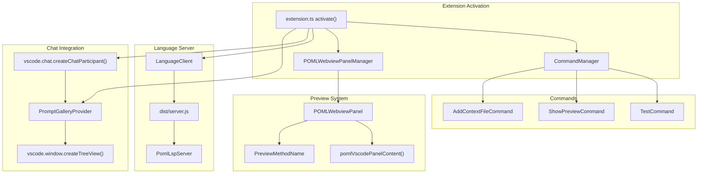
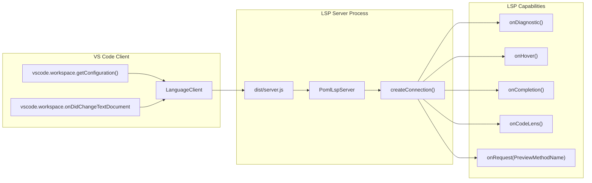
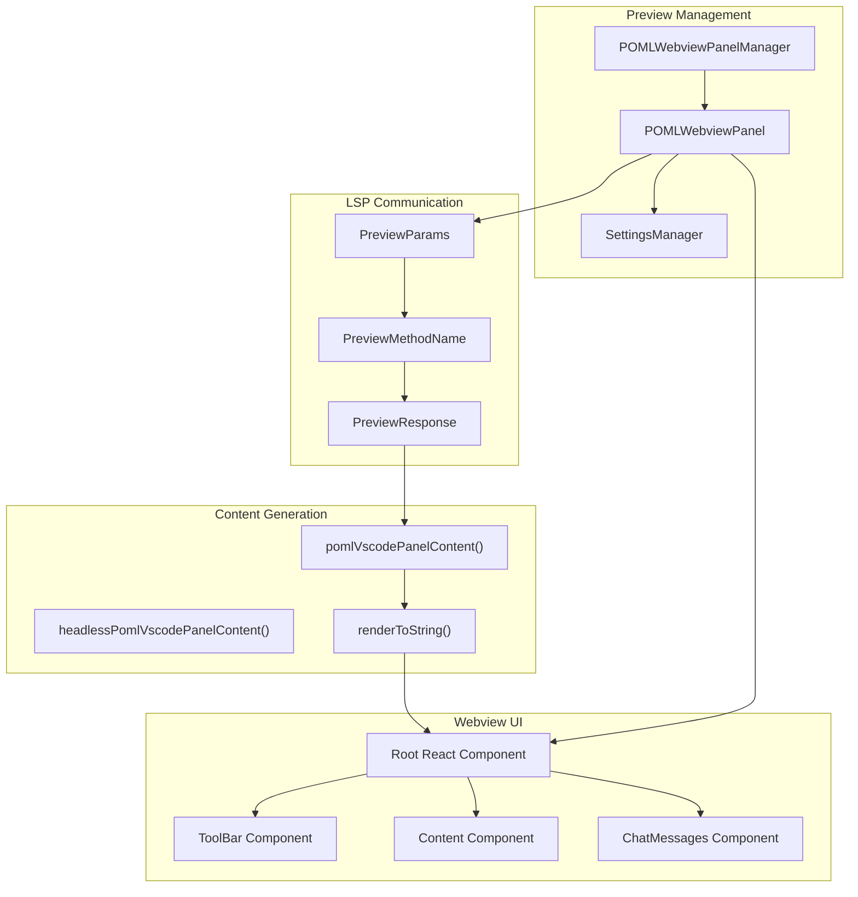
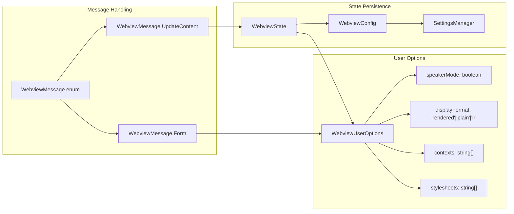
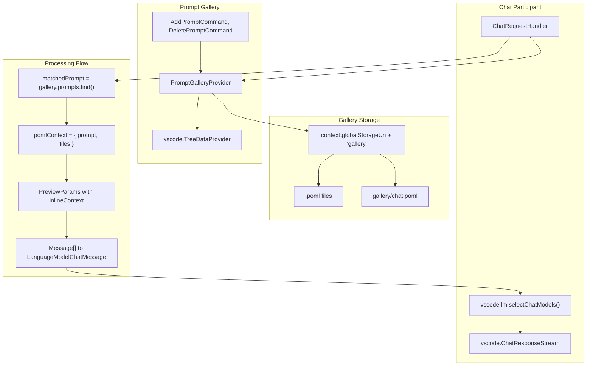
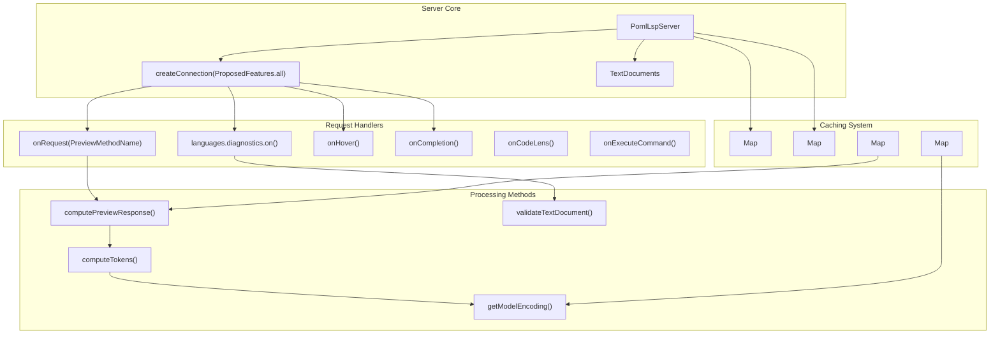

<!-- source: DeepWiki mcp.deepwiki.com · repo microsoft/poml · page 5.4 VS Code Extension · fetched 2026-10-26 -->

# VS Code Extension

Relevant source files

The following files were used as context for generating this wiki page:

- [gallery/chat.poml](gallery/chat.poml)
- [package-lock.json](package-lock.json)
- [package.json](package.json)
- [packages/poml-vscode/chat/participant.ts](packages/poml-vscode/chat/participant.ts)
- [packages/poml-vscode/command/index.ts](packages/poml-vscode/command/index.ts)
- [packages/poml-vscode/extension.ts](packages/poml-vscode/extension.ts)
- [packages/poml-vscode/lsp/server.ts](packages/poml-vscode/lsp/server.ts)
- [packages/poml-vscode/panel/content.tsx](packages/poml-vscode/panel/content.tsx)
- [packages/poml-vscode/panel/panel.ts](packages/poml-vscode/panel/panel.ts)
- [packages/poml-vscode/panel/types.ts](packages/poml-vscode/panel/types.ts)
- [packages/poml-vscode/tests/lsp.test.ts](packages/poml-vscode/tests/lsp.test.ts)

The VS Code extension provides comprehensive development support for POML files, including syntax highlighting, language server features, real-time preview, and integration with VS Code's chat system. This document covers the extension's architecture, key components, and integration points.

For information about the underlying language server protocol features, see [Language Server Features](#5.4.1). For details about preview and testing capabilities, see [Preview and Testing](#5.4.2). For chat participant and prompt gallery functionality, see [Prompt Gallery and Chat](#5.4.3).

## Architecture Overview

The extension follows a multi-component architecture with clear separation between language services, preview functionality, and user interface components.

Sources: [packages/poml-vscode/extension.ts:24-63](), [packages/poml-vscode/lsp/server.ts:77-117](), [packages/poml-vscode/panel/manager.ts](), [packages/poml-vscode/chat/participant.ts:7-78]()

## Package Configuration

The extension is configured through comprehensive VS Code contribution points defined in the package manifest:

| Contribution Point | Key Elements | Purpose |
|-------------------|--------------|---------|
| `languages` | `poml` language ID, `.poml` extension | File type registration |
| `grammars` | `poml.tmLanguage.json`, `source.poml` scope | Syntax highlighting |
| `commands` | 14 commands including `poml.test`, `poml.showPreview` | User actions |
| `chatParticipants` | `poml.runner` participant | Chat integration |
| `views` | `pomlPromptGallery` in `poml` activity bar | Prompt management |
| `configuration` | Language model settings, API keys | Extension preferences |

The extension activates on webview panel creation (`onWebviewPanel:poml.preview`) and chat participant usage (`onChatParticipant:poml.runner`).

Sources: [package.json:15-21](), [package.json:41-63](), [package.json:71-174](), [package.json:176-182](), [package.json:240-369]()

## Language Server Integration

The extension implements a full Language Server Protocol (LSP) integration through the `PomlLspServer` class and VS Code's `LanguageClient`.

The server provides comprehensive language support including real-time diagnostics with caching, hover documentation using `formatComponentDocumentation()`, and completion suggestions for POML components and attributes.

Sources: [packages/poml-vscode/extension.ts:73-115](), [packages/poml-vscode/lsp/server.ts:95-171](), [packages/poml-vscode/lsp/server.ts:539-573]()

## Preview System Architecture

The preview system enables real-time rendering of POML files through a webview-based architecture with bidirectional communication.

The system supports multiple display formats (`rendered`, `plain`, `ir`), speaker mode for chat-like interfaces, and dynamic context/stylesheet management through the webview toolbar.

Sources: [packages/poml-vscode/panel/panel.ts:29-580](), [packages/poml-vscode/panel/content.tsx:388-394](), [packages/poml-vscode/panel/types.ts:51-74]()

## User Options and State Management

The preview system maintains user preferences and state through a structured approach:

User option changes trigger `onDidUserOptionsChange()` which sends a new preview request to the LSP server and updates the webview content without full reload.

Sources: [packages/poml-vscode/panel/types.ts:44-49](), [packages/poml-vscode/panel/types.ts:81](), [packages/poml-vscode/panel/panel.ts:552-579]()

## Chat Integration System

The extension integrates with VS Code's chat system through a dedicated chat participant and prompt gallery:

The chat participant supports prompt selection via `/promptname` syntax and automatically processes file references from the chat context.

Sources: [packages/poml-vscode/chat/participant.ts:7-78](), [packages/poml-vscode/chat/gallery.ts](), [gallery/chat.poml:1-6]()

## Command System

The extension provides a comprehensive command system through the `CommandManager` and individual command classes:

| Command Class | Command ID | Function |
|---------------|------------|----------|
| `TestCommand` | `poml.test` | Test prompt with chat models |
| `TestNonChatCommand` | `poml.testNonChat` | Test with text completion models |
| `ShowPreviewCommand` | `poml.showPreview` | Open preview panel |
| `ShowPreviewToSideCommand` | `poml.showPreviewToSide` | Open preview in side panel |
| `AddContextFileCommand` | `poml.addContextFile` | Add context JSON file |
| `AddStylesheetFileCommand` | `poml.addStylesheetFile` | Add stylesheet JSON file |

Each command implements the `Command` interface with `execute()` method and is registered through the `CommandManager.register()` system.

Sources: [packages/poml-vscode/command/index.ts:1-11](), [packages/poml-vscode/util/commandManager.ts](), [packages/poml-vscode/extension.ts:34-48]()

## LSP Server Implementation Details

The `PomlLspServer` class implements the core language server functionality with sophisticated caching and performance optimization:

The server includes throttling with dynamic adjustment, comprehensive error handling with source mapping, and telemetry reporting through `TelemetryServer` and `DelayedTelemetryReporter`.

Sources: [packages/poml-vscode/lsp/server.ts:77-117](), [packages/poml-vscode/lsp/server.ts:368-487](), [packages/poml-vscode/lsp/server.ts:488-537]()

## Configuration and Settings

The extension supports extensive configuration through VS Code settings with the `poml` namespace:

| Setting Category | Key Settings | Purpose |
|------------------|--------------|---------|
| Language Model | `poml.languageModel.provider` | Provider selection (vscode, openai, anthropic, etc.) |
| | `poml.languageModel.model` | Model name or deployment name |
| | `poml.languageModel.apiKey` | API authentication (string or object) |
| | `poml.languageModel.apiUrl` | Custom API endpoints |
| Preview Behavior | `poml.scrollPreviewWithEditor` | Sync preview scrolling |
| | `poml.markEditorSelection` | Highlight selection in preview |
| Development | `poml.trace` | LSP server tracing |
| | `poml.telemetry.connection` | Telemetry connection string |

The `SettingsManager` class handles configuration loading, caching, and change detection for optimal performance.

Sources: [package.json:244-367](), [packages/poml-vscode/settings.ts]()

---

