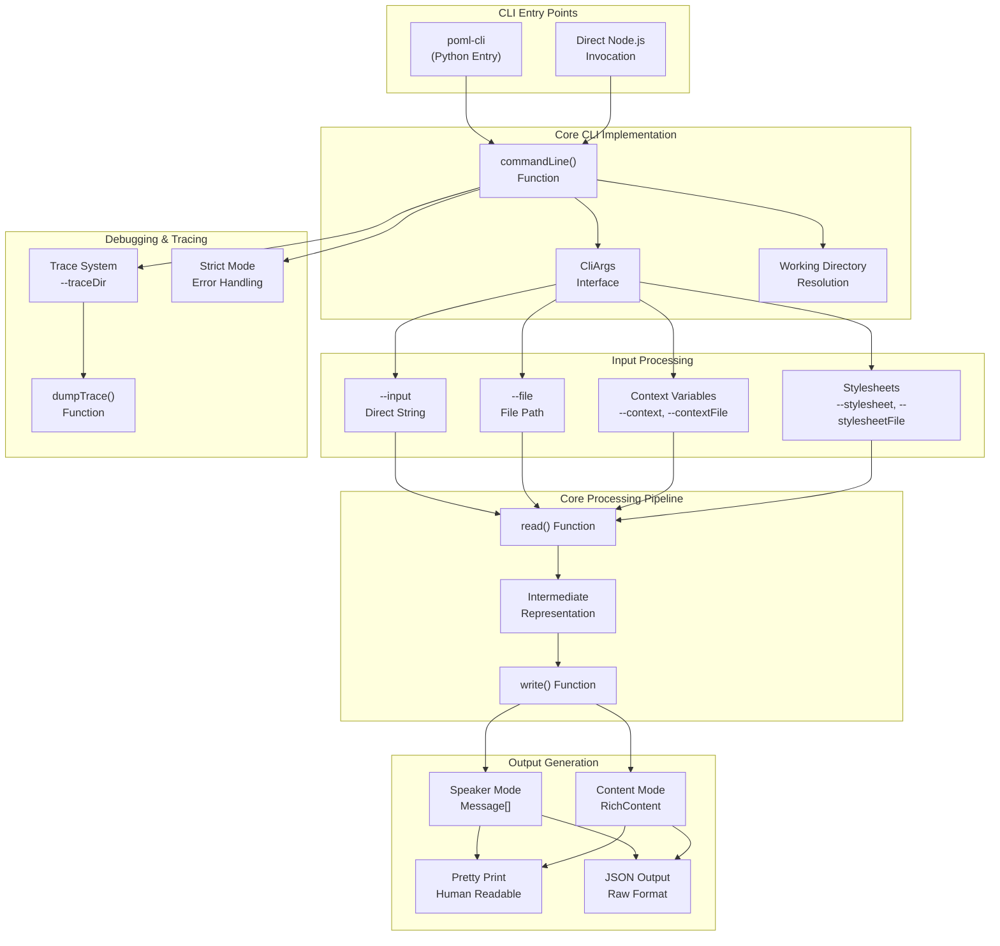
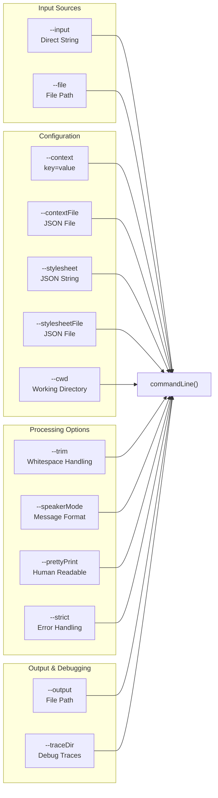
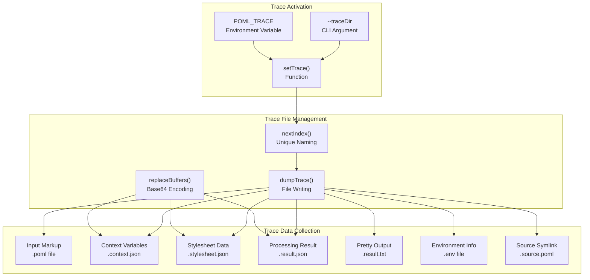

<!-- source: DeepWiki mcp.deepwiki.com · repo microsoft/poml · page 5.5 Command Line Interface · fetched 2026-10-26 -->

# Command Line Interface

<details>
<summary>Relevant source files</summary>

The following files were used as context for generating this wiki page:

- [packages/poml/index.ts](packages/poml/index.ts)
- [packages/poml/tests/meta.test.tsx](packages/poml/tests/meta.test.tsx)
- [packages/poml/tests/trace.test.tsx](packages/poml/tests/trace.test.tsx)
- [packages/poml/util/index.ts](packages/poml/util/index.ts)
- [packages/poml/util/trace.ts](packages/poml/util/trace.ts)
- [packages/poml/version.ts](packages/poml/version.ts)
- [pyproject.toml](pyproject.toml)
- [python/poml/_version.py](python/poml/_version.py)

</details>


The Command Line Interface (CLI) provides a direct way to process POML files and strings from the command line, offering full access to POML's rendering capabilities without requiring programmatic integration. This interface supports both standalone usage and integration into build pipelines and automation scripts.

For information about programmatic usage of POML, see [Python API](#5.1). For VS Code integration features, see [VS Code Extension](#5.3).

## Overview and Architecture

The POML CLI is built around the core `commandLine` function and provides both TypeScript/Node.js and Python entry points. The CLI processes POML markup through the same pipeline used by programmatic APIs, supporting all core features including context variables, stylesheets, and multiple output formats.



**Sources:** [packages/poml/index.ts:94-196](), [pyproject.toml:43-44]()

## Installation and Basic Usage

### Python CLI

The Python CLI is installed automatically when installing the POML Python package:

```bash
pip install poml
```

The CLI is available as the `poml-cli` command:

```bash
poml-cli --input "<p>Hello, World!</p>" --prettyPrint
```

### Node.js CLI

For direct Node.js usage, the CLI can be invoked programmatically through the `commandLine` function:

```javascript
import { commandLine } from 'poml';
await commandLine({ input: '<p>Hello, World!</p>', prettyPrint: true });
```

**Sources:** [pyproject.toml:43-44](), [packages/poml/index.ts:110]()

## Command Line Arguments

The CLI accepts arguments defined by the `CliArgs` interface, providing comprehensive control over POML processing:

| Argument | Type | Description |
|----------|------|-------------|
| `--input` | string | Direct POML markup string input |
| `--file` | string | Path to POML file to process |
| `--output` | string | Output file path (stdout if omitted) |
| `--context` | string[] | Context variables as key=value pairs |
| `--contextFile` | string | JSON file containing context variables |
| `--stylesheet` | string | Inline stylesheet JSON |
| `--stylesheetFile` | string | JSON file containing stylesheet |
| `--trim` | boolean | Enable trimming in read options |
| `--speakerMode` | boolean | Output as speaker messages (default: true) |
| `--prettyPrint` | boolean | Human-readable output format |
| `--strict` | boolean | Strict error handling (default: true) |
| `--cwd` | string | Working directory for relative paths |
| `--traceDir` | string | Directory for debug trace output |



**Sources:** [packages/poml/index.ts:94-108](), [packages/poml/index.ts:129-139]()

## Input and Output Processing

The CLI supports two mutually exclusive input modes and flexible output formatting:

### Input Processing

The CLI validates that exactly one input source is provided:

- **Direct input**: Use `--input` for inline POML markup
- **File input**: Use `--file` for POML file paths

File paths are resolved relative to the working directory specified by `--cwd` or the current process directory.

**Sources:** [packages/poml/index.ts:127-139]()

### Output Modes

The CLI supports two primary output modes controlled by the `speakerMode` parameter:

| Mode | Default | Output Type | Description |
|------|---------|-------------|-------------|
| Speaker Mode | true | `Message[]` | Array of speaker messages with role/content pairs |
| Content Mode | false | `RichContent` | Raw content without speaker structure |

Both modes support pretty-printing for human-readable output:

- **Pretty print enabled**: Formatted text output with speaker separators
- **Pretty print disabled**: Raw JSON serialization

**Sources:** [packages/poml/index.ts:168-174](), [packages/poml/index.ts:198-215]()

## Context Variables and Stylesheets

### Context Variables

Context variables provide dynamic content injection into POML templates:

```bash
# Inline context variables
poml-cli --file template.poml --context name=Alice --context age=30

# Context from JSON file
poml-cli --file template.poml --contextFile context.json
```

Context parsing supports key=value pairs with validation for proper formatting.

### Stylesheets

Stylesheets control component rendering behavior:

```bash
# Inline stylesheet
poml-cli --file doc.poml --stylesheet '{"theme": "dark"}'

# Stylesheet from file
poml-cli --file doc.poml --stylesheetFile styles.json
```

Both context and stylesheet files support the `parseJsonWithBuffers` format for binary data handling.

**Sources:** [packages/poml/index.ts:141-163](), [packages/poml/util/trace.ts:22-29]()

## Debugging and Tracing

The CLI includes comprehensive tracing capabilities for debugging POML processing:

### Trace System Architecture



### Trace File Structure

When tracing is enabled, the CLI generates numbered trace files:

- `NNNN.main.poml` - Processed POML markup
- `NNNN.main.context.json` - Context variables with Base64-encoded buffers
- `NNNN.main.stylesheet.json` - Stylesheet configuration
- `NNNN.main.result.json` - Raw processing results
- `NNNN.main.result.txt` - Human-readable output
- `NNNN.main.env` - Environment information including source paths
- `NNNN.main.source.poml` - Symlink to original source file

**Sources:** [packages/poml/util/trace.ts:84-116](), [packages/poml/index.ts:175-182]()

## Error Handling

The CLI implements a comprehensive error handling system through the `ErrorCollection` class:

### Strict Mode

By default, the CLI operates in strict mode where any errors terminate processing:

```bash
# Strict mode (default)
poml-cli --file invalid.poml --strict

# Non-strict mode (warnings only)
poml-cli --file invalid.poml --strict=false
```

In non-strict mode, errors are collected but processing continues, with warnings written to stderr.

### Error Collection System

The `ErrorCollection` class accumulates errors during processing, allowing the CLI to:

1. Clear error state before processing
2. Collect multiple errors during execution
3. Check for error conditions after processing
4. Throw the first critical error in strict mode

**Sources:** [packages/poml/index.ts:165](), [packages/poml/index.ts:184-188]()

## Integration Patterns

### Build Pipeline Integration

The CLI is designed for integration into automated build systems:

```bash
# Process multiple files
for file in templates/*.poml; do
    poml-cli --file "$file" --output "dist/$(basename "$file" .poml).json"
done

# With context from CI environment
poml-cli --file deploy.poml --context "version=$BUILD_VERSION" --context "env=$DEPLOY_ENV"
```

### Python Wrapper Integration

The Python CLI wrapper provides seamless integration with Python-based workflows while leveraging the full TypeScript implementation through the bundled Node.js runtime.

**Sources:** [pyproject.toml:29-41](), [pyproject.toml:43-44]()

---

