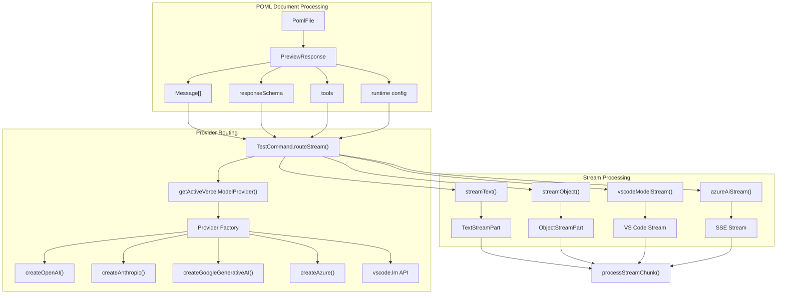
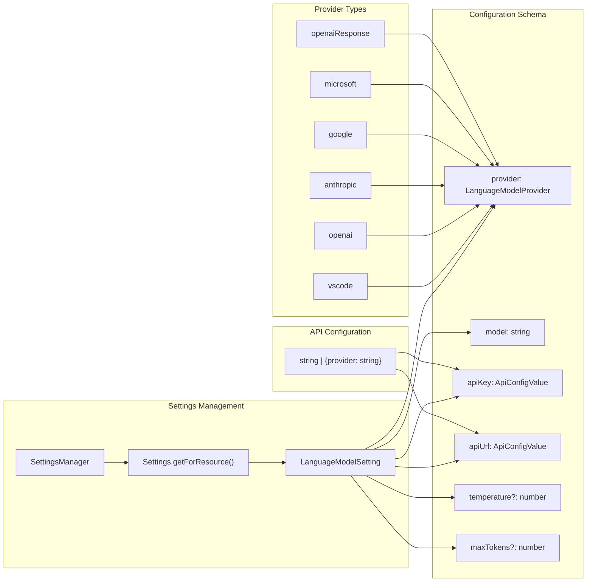
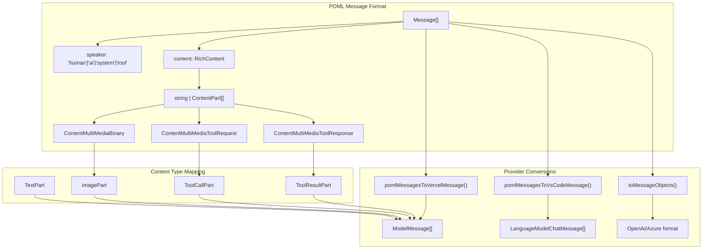
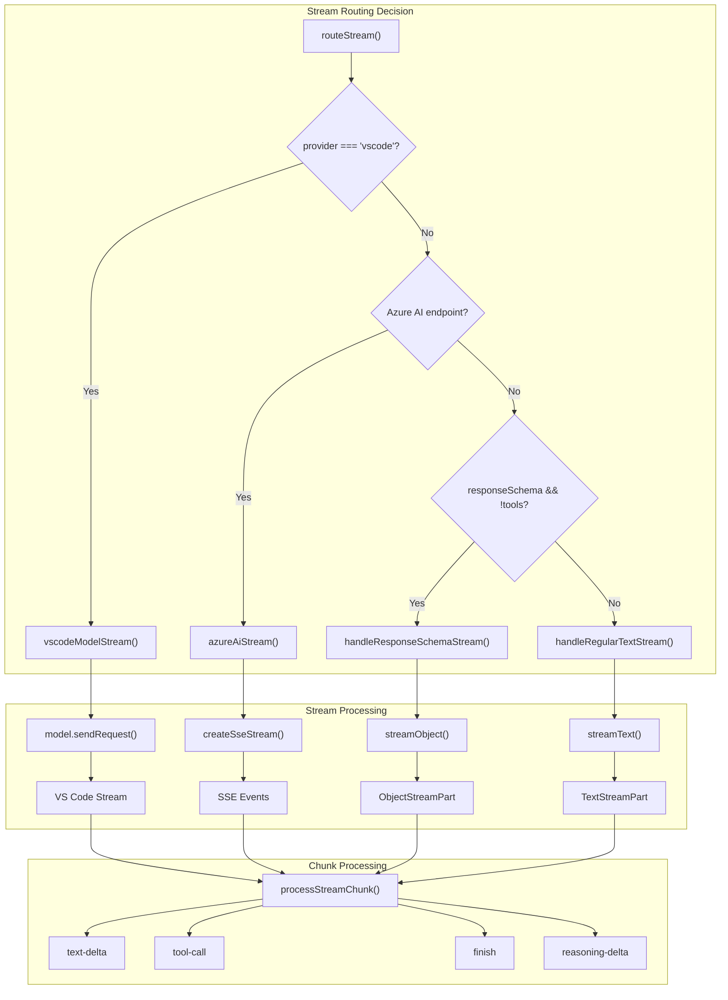
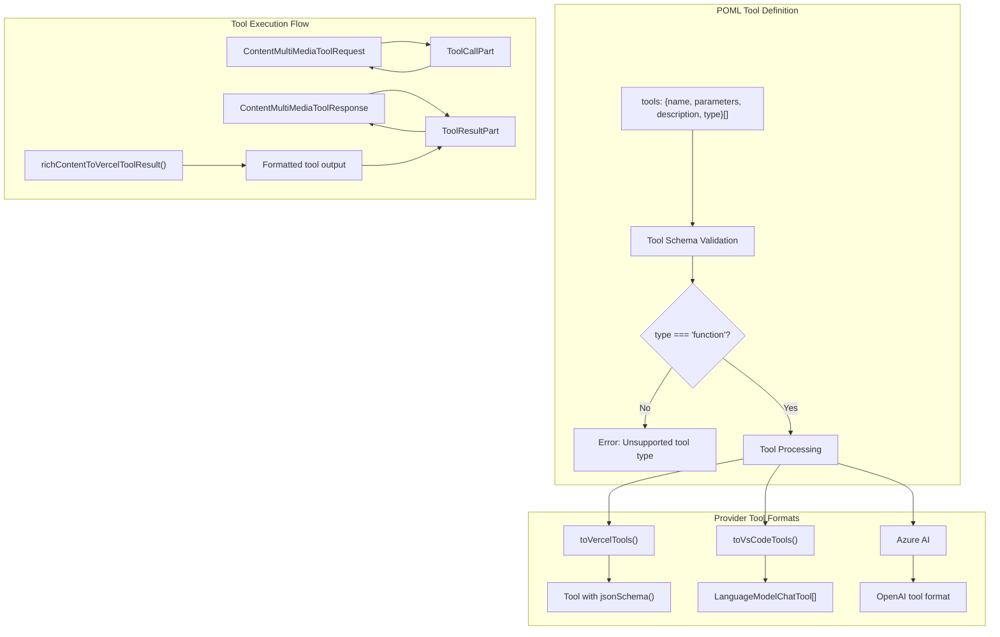
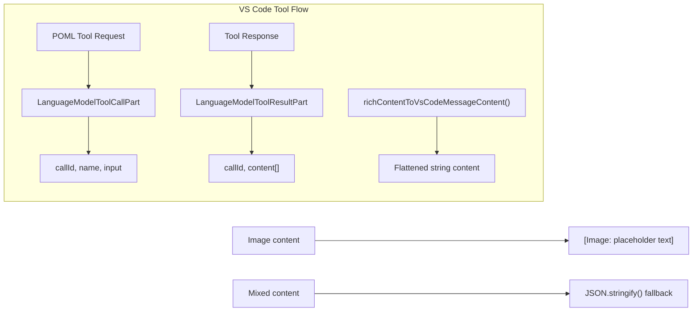
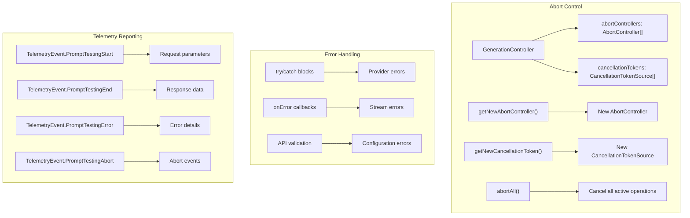

<!-- source: DeepWiki mcp.deepwiki.com · repo microsoft/poml · page 6 Language Model Integration · fetched 2026-10-26 -->

# Language Model Integration

Relevant source files

The following files were used as context for generating this wiki page:

- [docs/vscode/configuration.md](docs/vscode/configuration.md)
- [examples/110_code_review.poml](examples/110_code_review.poml)
- [examples/assets/110_sample_code.py](examples/assets/110_sample_code.py)
- [examples/expects/110_code_review.txt](examples/expects/110_code_review.txt)
- [packages/poml-vscode/command/testCommand.ts](packages/poml-vscode/command/testCommand.ts)
- [packages/poml-vscode/settings.ts](packages/poml-vscode/settings.ts)

This document covers how POML integrates with various language model providers to execute prompts and handle responses. It explains the provider routing system, message format conversion, streaming capabilities, and tool integration.

For information about configuring language model settings in VS Code, see [Provider Configuration](#6.1). For details about defining response schemas and tools within POML documents, see [Response Schemas and Tools](#6.2).

## Architecture Overview

POML's language model integration is built around a flexible provider system that supports multiple AI services through a unified interface. The system handles provider routing, message format conversion, streaming responses, and tool calling.

### Provider Integration Architecture

Sources: [packages/poml-vscode/command/testCommand.ts:259-273](), [packages/poml-vscode/command/testCommand.ts:526-591]()

## Provider Configuration System

The language model integration supports multiple providers with flexible configuration options. Settings can be specified globally or overridden at runtime within POML documents.

### Provider Settings Structure

Sources: [packages/poml-vscode/settings.ts:4-16](), [packages/poml-vscode/settings.ts:62-70]()

### Provider-Specific Configuration

| Provider | Factory Function | Purpose |
|----------|------------------|---------|
| `vscode` | `vscode.lm.selectChatModels()` | GitHub Copilot integration |
| `openai` | `createOpenAI().chat` | OpenAI API |
| `openaiResponse` | `createOpenAI().responses` | OpenAI with response format |
| `anthropic` | `createAnthropic()` | Anthropic Claude |
| `google` | `createGoogleGenerativeAI()` | Google Gemini |
| `microsoft` | `createAzure()` | Azure OpenAI |

Sources: [packages/poml-vscode/command/testCommand.ts:550-580]()

## Message Format Conversion

The system converts POML messages to provider-specific formats, handling rich content types including text, images, tool calls, and tool results.

### Message Conversion Pipeline

Sources: [packages/poml-vscode/command/testCommand.ts:622-673](), [packages/poml-vscode/command/testCommand.ts:717-756]()

### Speaker Role Mapping

The system maps POML speaker types to provider-specific roles:

| POML Speaker | Vercel AI | VS Code API | OpenAI/Azure |
|--------------|-----------|-------------|--------------|
| `human` | `user` | `User` | `user` |
| `ai` | `assistant` | `Assistant` | `assistant` |
| `system` | `system` | `User` | `system` |
| `tool` | `tool` | `User` | `tool` |

Sources: [packages/poml-vscode/command/testCommand.ts:623-628](), [packages/poml-vscode/command/testCommand.ts:723-741]()

## Stream Processing and Response Handling

The system provides real-time streaming of language model responses with different handling strategies based on response type and provider capabilities.

### Stream Routing Logic

Sources: [packages/poml-vscode/command/testCommand.ts:259-273](), [packages/poml-vscode/command/testCommand.ts:372-400]()

### Response Chunk Types

The system handles various stream chunk types with specific formatting:

| Chunk Type | Processing | Output Format |
|------------|------------|---------------|
| `text-delta` | Direct output | Raw text |
| `tool-call` | Format tool info | `Tool call (id) name Input: {...}` |
| `reasoning-delta` | O1 model reasoning | Raw reasoning text |
| `finish` | Usage statistics | `[Usage: input=N, output=N, total=N]` |
| `abort` | Cancellation | `[Aborted]` |

Sources: [packages/poml-vscode/command/testCommand.ts:372-417]()

## Tool Integration

The system supports tool calling through provider-specific implementations, converting POML tool definitions to the appropriate format for each provider.

### Tool Conversion Architecture

Sources: [packages/poml-vscode/command/testCommand.ts:675-692](), [packages/poml-vscode/command/testCommand.ts:821-837]()

### VS Code Tool Integration

The VS Code provider has specific handling for tool calls and results:

Sources: [packages/poml-vscode/command/testCommand.ts:799-819](), [packages/poml-vscode/command/testCommand.ts:762-819]()

## Error Handling and Monitoring

The system provides comprehensive error handling, abort controls, and telemetry reporting for language model interactions.

### Generation Control System

Sources: [packages/poml-vscode/command/testCommand.ts:41-80](), [packages/poml-vscode/command/testCommand.ts:184-236]()

### Provider Validation

The system performs comprehensive validation before executing requests:

| Validation Type | Check | Error Message |
|-----------------|-------|---------------|
| Provider set | `!setting.provider` | "Language model provider is not configured" |
| Model set | `!setting.model` | "Language model is not configured" |
| API key | `!apiKey && provider !== 'vscode'` | "API key is not configured" |
| VS Code API | `!vscode.lm?.selectChatModels` | "VS Code language model API is not available" |

Sources: [packages/poml-vscode/command/testCommand.ts:138-152](), [packages/poml-vscode/command/testCommand.ts:420-422]()

---

