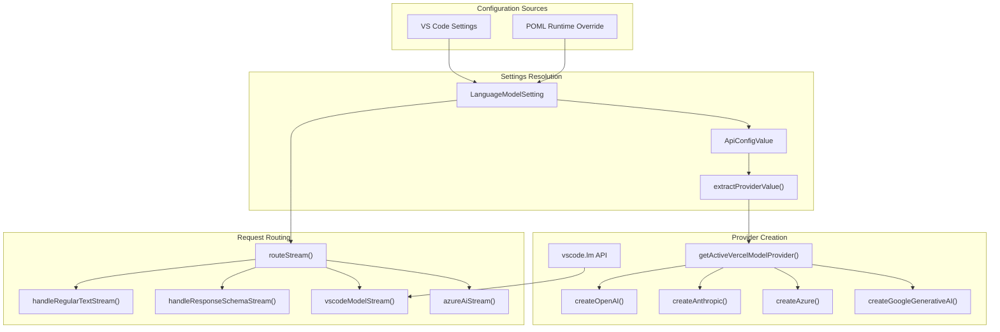
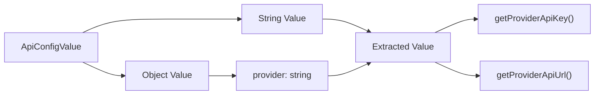
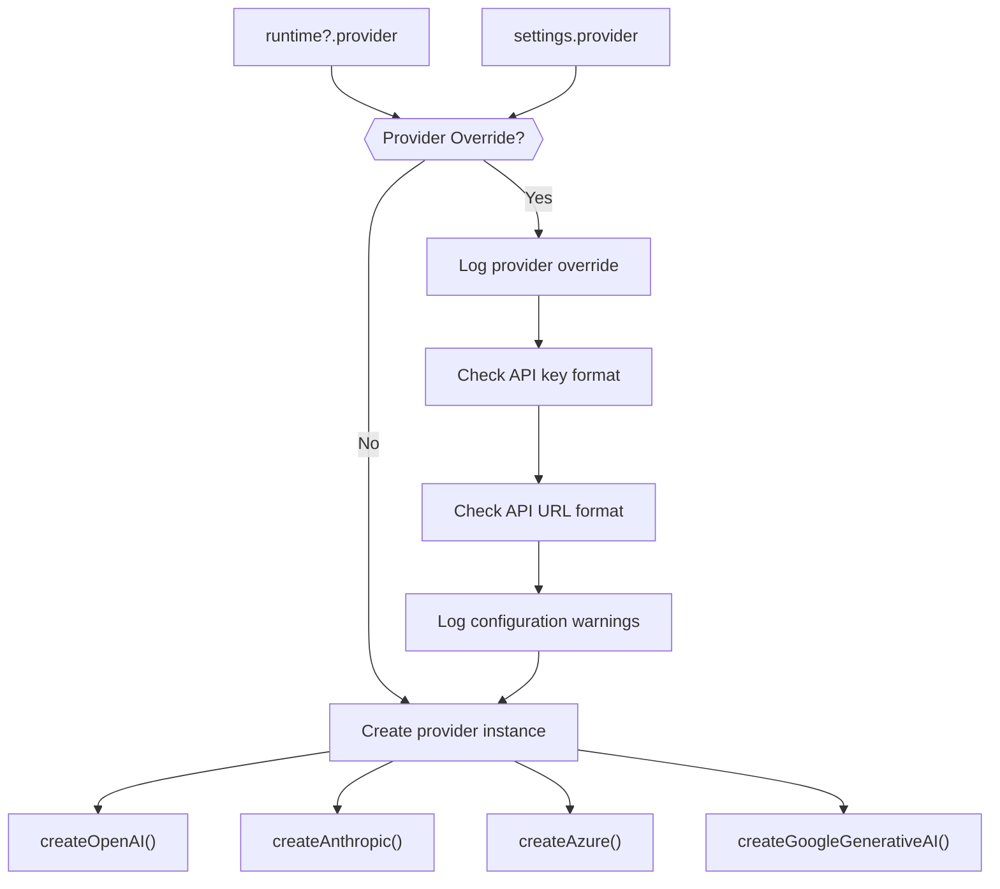
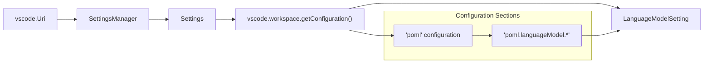

<!-- source: DeepWiki mcp.deepwiki.com · repo microsoft/poml · page 6.1 Provider Configuration · fetched 2026-10-26 -->

# Provider Configuration

<details>
<summary>Relevant source files</summary>

The following files were used as context for generating this wiki page:

- [docs/vscode/configuration.md](docs/vscode/configuration.md)
- [examples/110_code_review.poml](examples/110_code_review.poml)
- [examples/assets/110_sample_code.py](examples/assets/110_sample_code.py)
- [examples/expects/110_code_review.txt](examples/expects/110_code_review.txt)
- [packages/poml-vscode/command/testCommand.ts](packages/poml-vscode/command/testCommand.ts)
- [packages/poml-vscode/settings.ts](packages/poml-vscode/settings.ts)

</details>


This document covers how to configure language model providers in POML for integration with various language model services. Provider configuration controls which language model service POML uses when testing prompts and generating responses.

For information about using the configured providers in POML documents, see [Response Schemas and Tools](#6.2). For general VS Code extension configuration, see [VS Code Extension](#5.4).

## Configuration System Overview

POML supports multiple language model providers through a flexible configuration system that allows both global settings and runtime overrides. The system handles API keys, URLs, and provider-specific parameters through a unified interface.



Sources: [packages/poml-vscode/command/testCommand.ts:1-916](), [packages/poml-vscode/settings.ts:1-183]()

## Supported Providers

POML supports the following language model providers, defined in the `LanguageModelProvider` type:

| Provider | Description | API Integration |
|----------|-------------|-----------------|
| `vscode` | VS Code Language Model API (GitHub Copilot) | Uses `vscode.lm.selectChatModels()` |
| `openai` | OpenAI GPT models | Vercel AI SDK with `createOpenAI()` |
| `openaiResponse` | OpenAI with response format support | Vercel AI SDK responses API |
| `microsoft` | Azure OpenAI Service | Vercel AI SDK with `createAzure()` |
| `anthropic` | Anthropic Claude models | Vercel AI SDK with `createAnthropic()` |
| `google` | Google Gemini models | Vercel AI SDK with `createGoogleGenerativeAI()` |

The provider configuration is defined in the `LanguageModelSetting` interface:

```typescript
export interface LanguageModelSetting {
  provider: LanguageModelProvider;
  model: string;
  temperature?: number;
  apiKey?: ApiConfigValue;
  apiUrl?: ApiConfigValue;
  apiVersion?: string;
  maxTokens?: number;
}
```

Sources: [packages/poml-vscode/settings.ts:4-16](), [packages/poml-vscode/command/testCommand.ts:550-580]()

## Configuration Formats

### Basic String Configuration

For simple setups with a single provider, API keys and URLs can be configured as plain strings:

```json
{
  "poml.languageModel.provider": "openai",
  "poml.languageModel.apiKey": "sk-your-api-key-here",
  "poml.languageModel.apiUrl": "https://api.openai.com/v1/"
}
```

### Provider-Specific Object Configuration

For multi-provider setups, the `ApiConfigValue` type supports object-based configuration where each provider has its own settings:

```json
{
  "poml.languageModel.apiKey": {
    "openai": "sk-your-openai-key",
    "anthropic": "sk-ant-your-anthropic-key",
    "google": "your-google-key"
  },
  "poml.languageModel.apiUrl": {
    "openai": "https://api.openai.com/v1/",
    "microsoft": "https://your-resource.openai.azure.com/openai"
  }
}
```

The `extractProviderValue()` method handles resolution between string and object configurations:



Sources: [packages/poml-vscode/settings.ts:6](), [packages/poml-vscode/command/testCommand.ts:844-868]()

## Runtime Provider Overrides

POML documents can override the configured provider at runtime using the `runtime` section. The system handles provider overrides with appropriate warnings when configuration mismatches occur.

The `getActiveVercelModelProvider()` method implements the override logic:

1. Check for runtime provider override
2. Extract provider-specific API key and URL
3. Log warnings for configuration mismatches
4. Create the appropriate provider instance



Sources: [packages/poml-vscode/command/testCommand.ts:526-580](), [packages/poml-vscode/command/testCommand.ts:858-868]()

## Provider-Specific Implementations

### VS Code Language Model API

When `provider` is set to `vscode`, POML uses the VS Code Language Model API, typically for GitHub Copilot integration:

```typescript
const modelSelector = {
  vendor: 'copilot',
  family: prompt.runtime?.model || settings.model,
};
const models = await vscode.lm.selectChatModels(modelSelector);
```

This provider ignores `apiKey` and `apiUrl` settings and uses VS Code's built-in authentication.

Sources: [packages/poml-vscode/command/testCommand.ts:419-456]()

### Azure AI Models

For Azure AI Studio models using the `.models.ai.azure.com` endpoint, POML uses a specialized streaming implementation with the Azure REST client:

```typescript
const client = ModelClient(apiUrl, new AzureKeyCredential(apiKey));
const response = await client
  .path('/chat/completions')
  .post({
    body: {
      messages: this.toMessageObjects(prompt, 'openai'),
      stream: true,
      ...args,
    },
  })
  .asNodeStream();
```

Sources: [packages/poml-vscode/command/testCommand.ts:458-524]()

### Vercel AI SDK Providers

Most providers use the Vercel AI SDK with provider-specific creation functions. The `vercelRequestParameters()` method handles common parameters like temperature and token limits:

```typescript
const parameters = {
  model: this.getActiveVercelModel(settings, runtime),
  maxRetries: 0,
  temperature: settings.temperature,
  maxOutputTokens: settings.maxTokens,
  ...runtimeWithoutModelProvider, // Runtime can override parameters
};
```

Sources: [packages/poml-vscode/command/testCommand.ts:275-286](), [packages/poml-vscode/command/testCommand.ts:582-591]()

## Settings Management

The `Settings` class and `SettingsManager` handle configuration loading and caching. Settings are loaded per-resource and cached for performance:



The settings are accessed in test commands via:

```typescript
const setting = this.getLanguageModelSettings(uri);
```

Sources: [packages/poml-vscode/settings.ts:26-109](), [packages/poml-vscode/settings.ts:114-125](), [packages/poml-vscode/command/testCommand.ts:839-842]()

---

