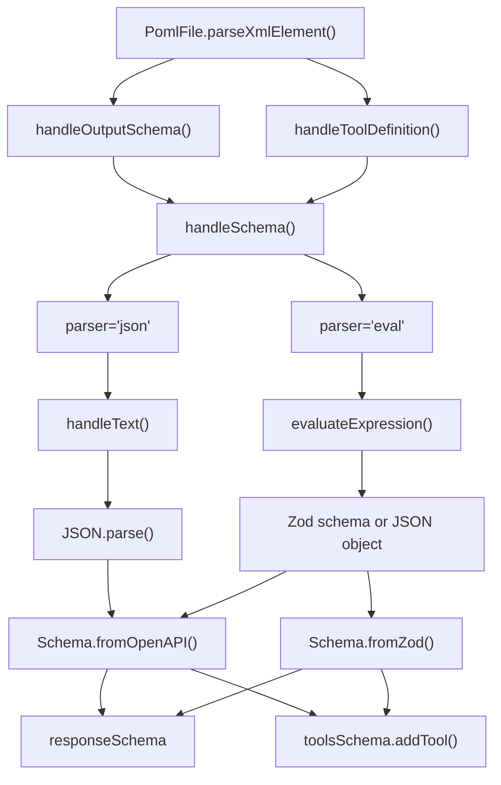
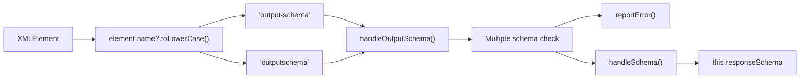
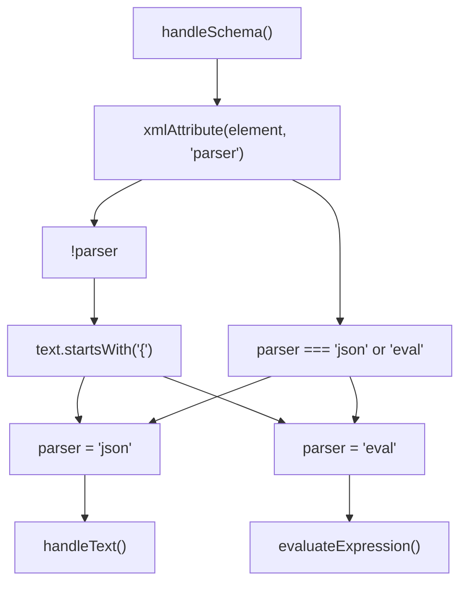
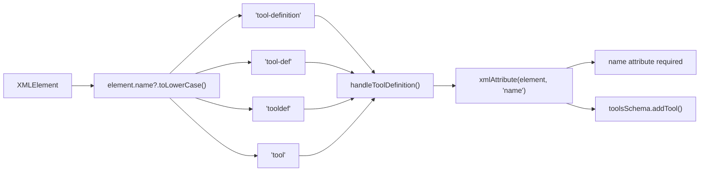
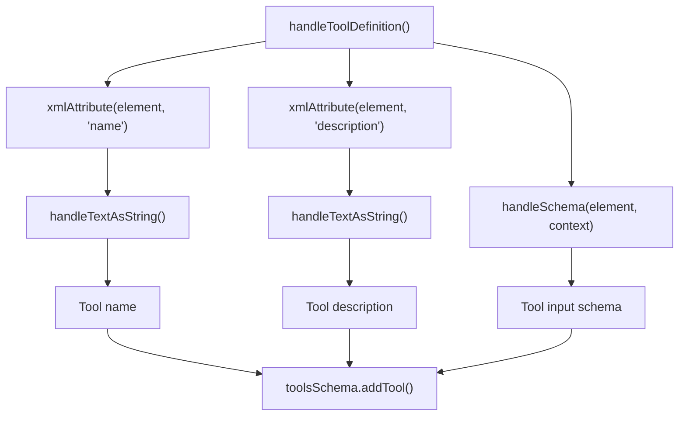
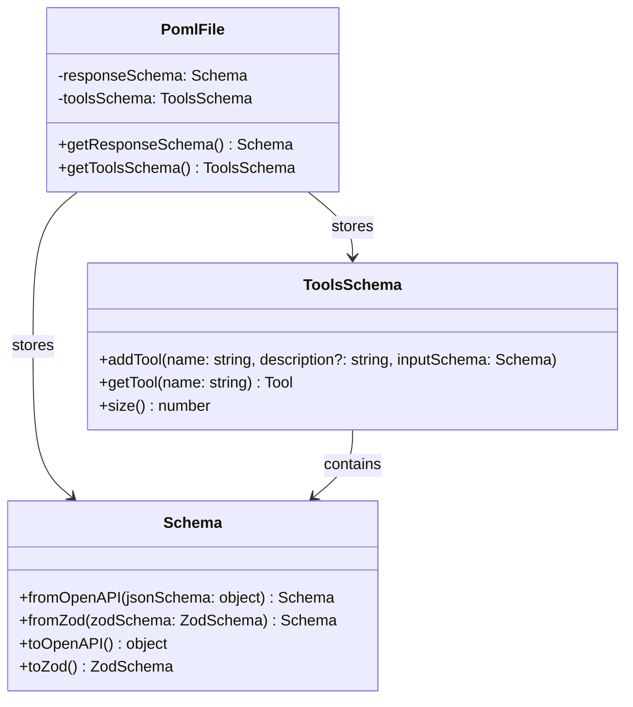
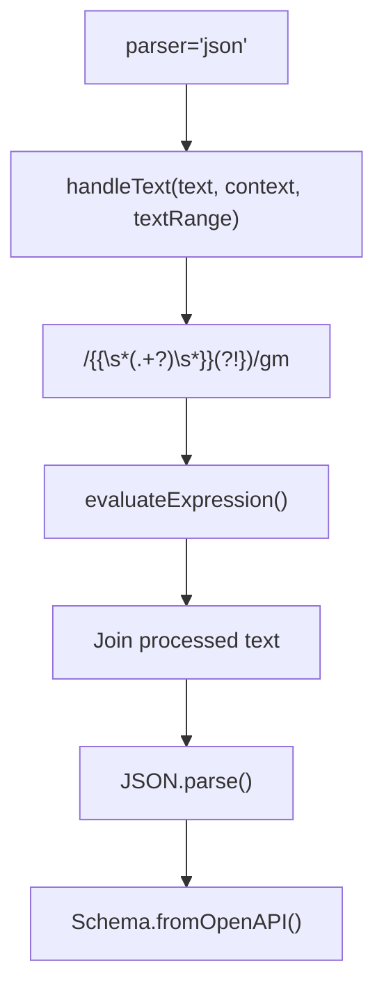
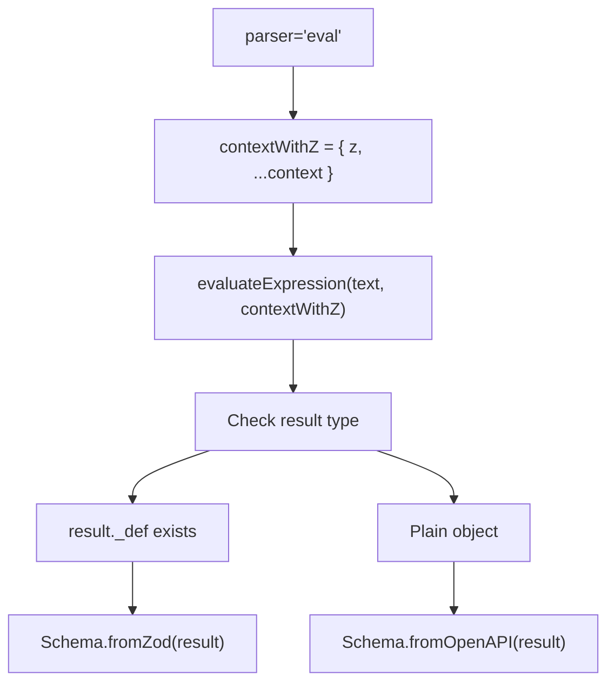
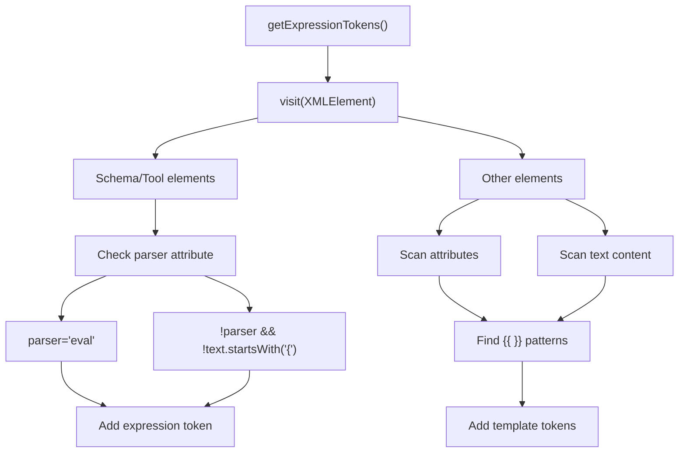
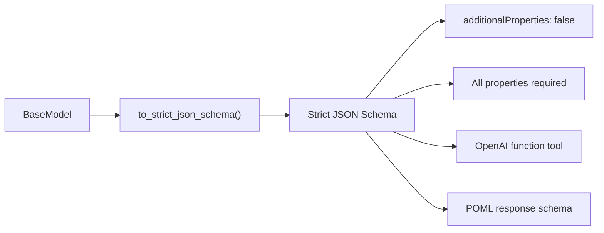

<!-- source: DeepWiki mcp.deepwiki.com · repo microsoft/poml · page 6.2 Response Schemas and Tools · fetched 2026-10-26 -->

# Response Schemas and Tools

Relevant source files

The following files were used as context for generating this wiki page:

- [.github/workflows/shared-test-integration.yml](.github/workflows/shared-test-integration.yml)
- [docs/language/meta.md](docs/language/meta.md)
- [docs/python/reference/integration.md](docs/python/reference/integration.md)
- [docs/vscode/features.md](docs/vscode/features.md)
- [packages/poml/file.tsx](packages/poml/file.tsx)
- [packages/poml/tests/file.test.tsx](packages/poml/tests/file.test.tsx)
- [python/poml/integration/pydantic.py](python/poml/integration/pydantic.py)
- [python/tests/integration/openai_pydantic.py](python/tests/integration/openai_pydantic.py)

This document covers POML's response schema and tool definition systems, which enable structured data generation and function calling with language models. Response schemas define the expected structure of AI-generated responses, while tool definitions specify external functions that AI models can invoke during conversation.

For general meta element concepts and version control, see [Meta Elements and Configuration](#4.4). For language model provider configuration, see [Provider Configuration](#6.1).

## System Architecture

The response schema and tool system processes XML elements during POML document parsing to extract structured definitions that are later passed to language model APIs.

**Sources:** [packages/poml/file.tsx:744-803](), [packages/poml/file.tsx:680-742](), [packages/poml/file.tsx:762-803]()

## Response Schema Processing

Response schemas are defined using `<output-schema>` or `<outputschema>` elements and processed by the `PomlFile` class during document parsing.

### Schema Element Recognition

**Sources:** [packages/poml/file.tsx:744-760](), [packages/poml/file.tsx:1041-1042]()

### Parser Mode Detection

The system supports two parsing modes with automatic detection when the `parser` attribute is omitted:

| Parser Mode | Detection Logic | Processing Method |
|-------------|----------------|-------------------|
| `json` | Content starts with `{` | Template expression processing + JSON.parse |
| `eval` | Default fallback | JavaScript evaluation with Zod context |

**Sources:** [packages/poml/file.tsx:694-706](), [packages/poml/file.tsx:708-737]()

## Tool Definition Processing

Tool definitions use `<tool-definition>`, `<tool-def>`, `<tooldef>`, or `<tool>` elements to register functions that AI models can invoke.

### Tool Element Recognition

**Sources:** [packages/poml/file.tsx:762-803](), [packages/poml/file.tsx:1042-1047]()

### Tool Schema Processing

Tools require a `name` attribute and optionally accept a `description`. The tool's input schema is processed using the same `handleSchema()` method as response schemas:

**Sources:** [packages/poml/file.tsx:773-801]()

## Schema Object Model

The system uses `Schema` and `ToolsSchema` classes to manage schema definitions internally.

### Schema Class Interface

**Sources:** [packages/poml/file.tsx:67-68](), [packages/poml/file.tsx:234-240]()

## Expression Evaluation System

Both response schemas and tool definitions support template expressions and JavaScript evaluation for dynamic schema generation.

### Template Expression Processing

For JSON mode schemas, template expressions are processed before JSON parsing:

**Sources:** [packages/poml/file.tsx:710-718](), [packages/poml/file.tsx:934-972]()

### Expression Evaluation Context

For evaluation mode schemas, JavaScript expressions are executed with enhanced context:

**Sources:** [packages/poml/file.tsx:719-737](), [packages/poml/file.tsx:987-1014]()

## Expression Token Tracking

The system tracks expression tokens for debugging and editor integration through the `getExpressionTokens()` method.

### Expression Token Collection

**Sources:** [packages/poml/file.tsx:311-409](), [packages/poml/file.tsx:324-344]()

## Integration Patterns

### Python Pydantic Integration

The system integrates with Python Pydantic models through the `to_strict_json_schema()` function:

**Sources:** [python/poml/integration/pydantic.py:16-59](), [python/tests/integration/openai_pydantic.py:60-130]()

### Runtime Parameter Integration

Runtime parameters defined in `<runtime>` elements complement schema definitions by configuring model behavior:

| Parameter Category | Examples | Conversion |
|-------------------|----------|------------|
| Model Selection | `model`, `provider` | String values |
| Generation Control | `temperature`, `maxTokens` | Number conversion |
| Structured Output | Works with response schemas | Boolean/JSON conversion |

**Sources:** [packages/poml/file.tsx:805-862](), [docs/language/meta.md:330-372]()

---

