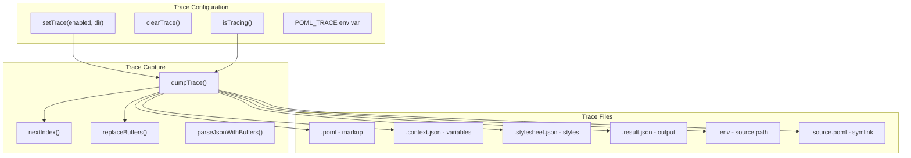
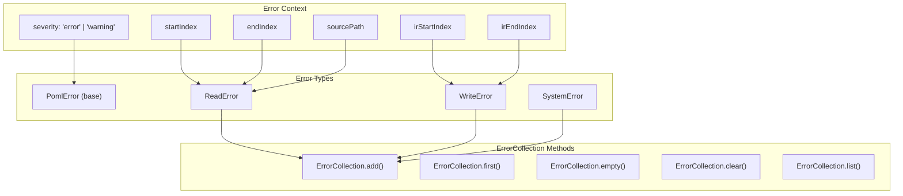
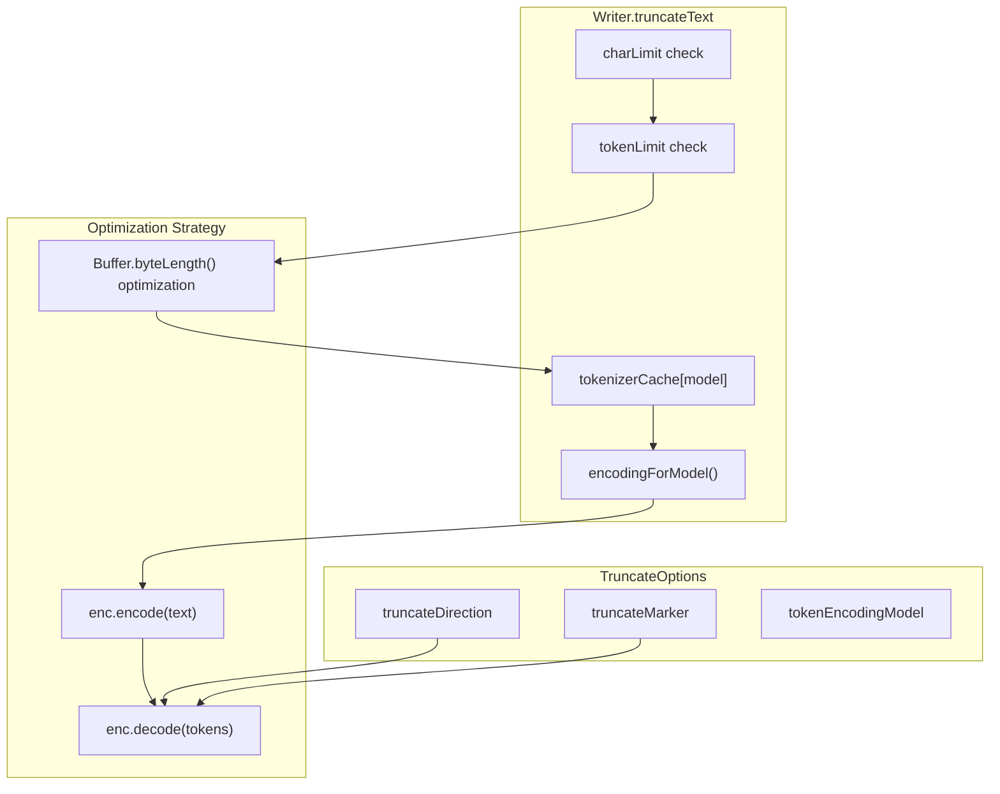
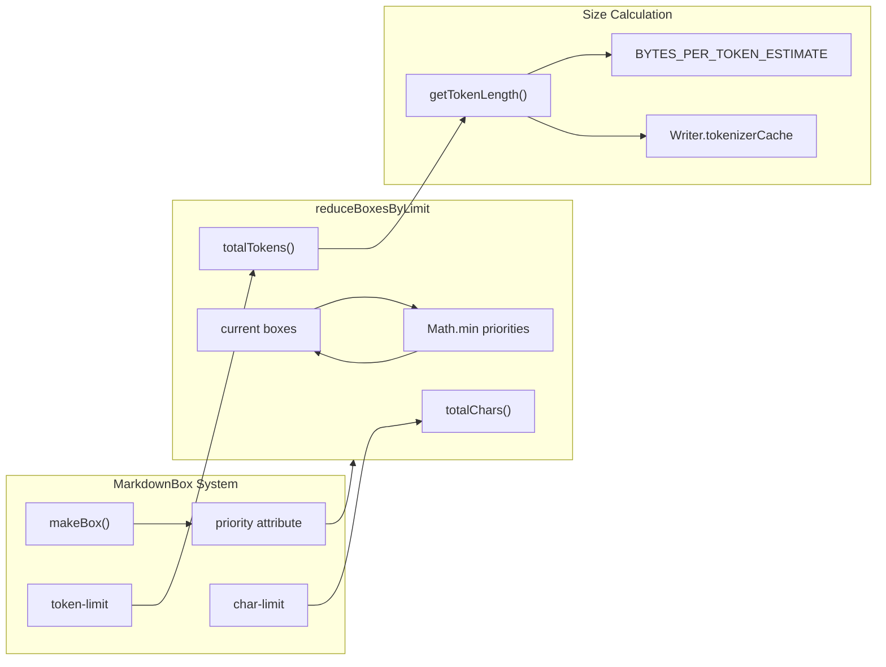
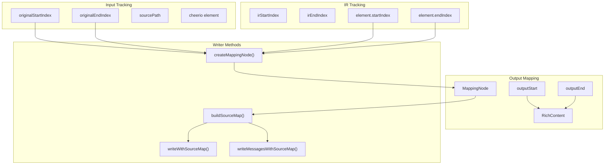
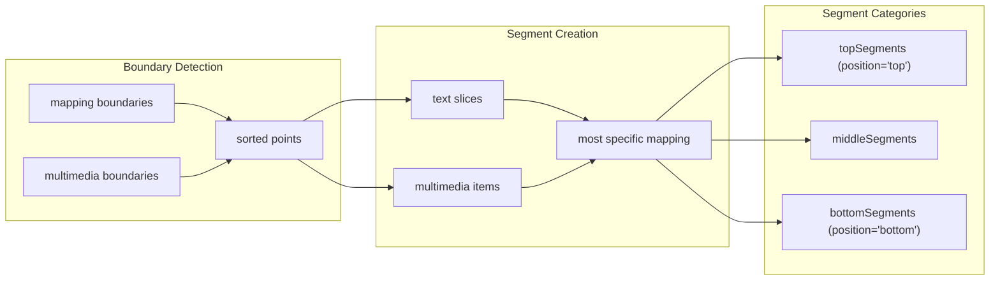
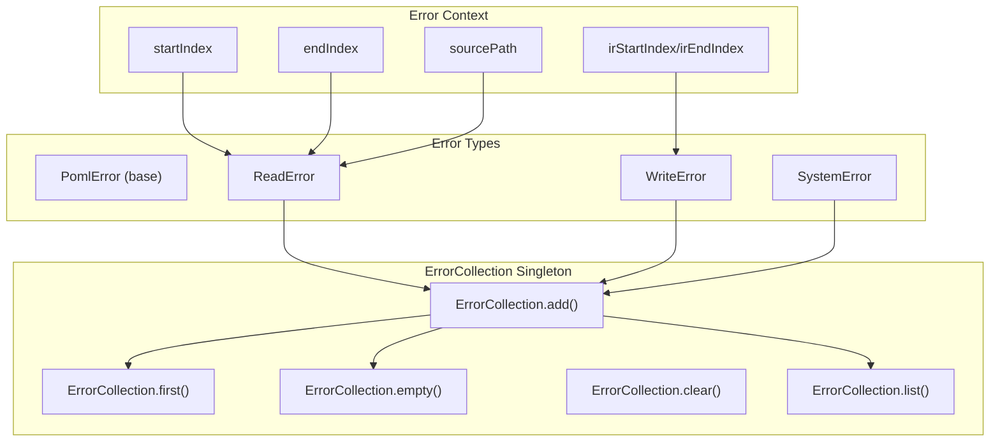
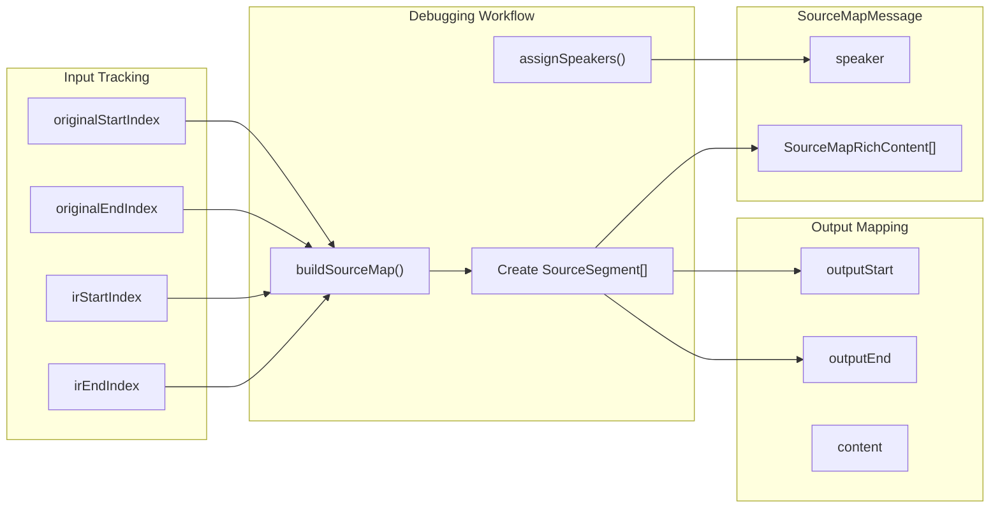
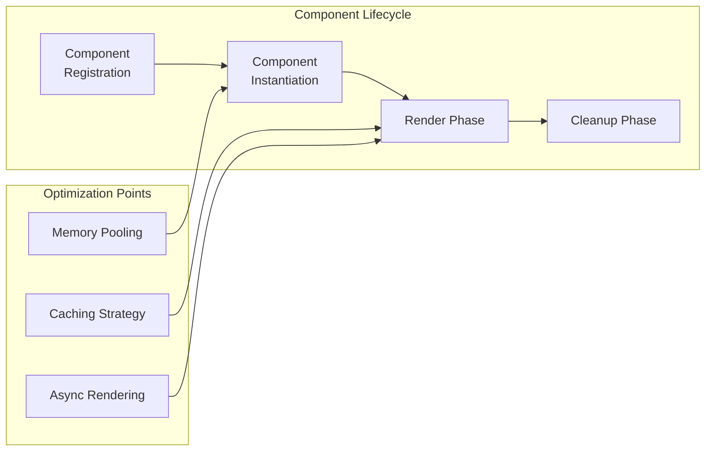
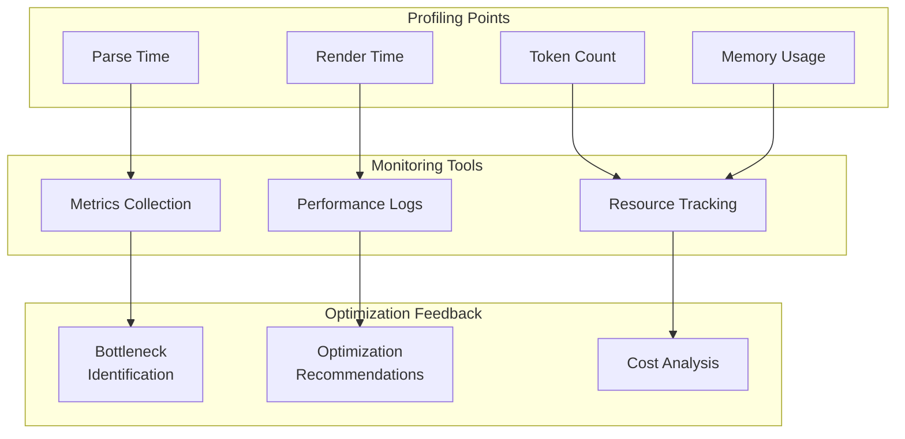

<!-- source: DeepWiki mcp.deepwiki.com · repo microsoft/poml · page 7 Advanced Topics · fetched 2026-10-26 -->

# Advanced Topics

<details>
<summary>Relevant source files</summary>

The following files were used as context for generating this wiki page:

- [packages/poml/base.tsx](packages/poml/base.tsx)
- [packages/poml/index.ts](packages/poml/index.ts)
- [packages/poml/tests/base.test.tsx](packages/poml/tests/base.test.tsx)
- [packages/poml/tests/index.test.tsx](packages/poml/tests/index.test.tsx)
- [packages/poml/tests/trace.test.tsx](packages/poml/tests/trace.test.tsx)
- [packages/poml/tests/writer.test.tsx](packages/poml/tests/writer.test.tsx)
- [packages/poml/util/index.ts](packages/poml/util/index.ts)
- [packages/poml/util/trace.ts](packages/poml/util/trace.ts)
- [packages/poml/writer.ts](packages/poml/writer.ts)

</details>


This page covers advanced POML features including debugging capabilities, optimization strategies, error handling systems, and source mapping. These features enable sophisticated prompt engineering workflows and production deployment scenarios.

The material builds upon [Core Architecture](#3) and [Language Reference](#4). For specific integration patterns, see [Integrations](#5). For development information, see [Development and Contributing](#8).

## Tracing and Debugging

POML provides comprehensive tracing capabilities for debugging prompt processing and tracking execution flow. The tracing system captures input markup, context data, execution results, and source mappings.

### Trace System Architecture

#### Trace System Implementation



### Trace File Management

The `nextIndex` function ensures atomic trace file creation:

| File Type | Purpose | Example |
|-----------|---------|---------|
| `0001.main.poml` | Input markup | Original POML content |
| `0001.main.context.json` | Context variables | Template data with base64 buffers |
| `0001.main.stylesheet.json` | Stylesheet config | CSS-like styling rules |
| `0001.main.result.json` | Processing output | Messages, schema, tools, runtime |
| `0001.main.env` | Environment info | `SOURCE_PATH=/path/to/file.poml` |
| `0001.main.source.poml` | Source symlink | Links to original file |

### Buffer Serialization

The tracing system handles binary data through base64 encoding:

```typescript
// Buffer replacement pattern from trace.ts
function replaceBuffers(value: any): any {
  if (Buffer.isBuffer(value)) {
    return { __base64__: value.toString('base64') };
  }
  // ... recursive handling for objects and arrays
}
```

### CLI Integration

The `commandLine` function integrates tracing when `--trace-dir` is specified:

```typescript
// From index.ts commandLine function
if (args.traceDir) {
  setTrace(true, args.traceDir);
}
// ... processing happens
if (isTracing()) {
  dumpTrace(input, context, stylesheet, result, sourcePath, prettyOutput);
}
```

**Sources:** [packages/poml/util/trace.ts:36-144](), [packages/poml/tests/trace.test.tsx:16-109](), [packages/poml/index.ts:157-254]()

## Error Handling and Validation

POML implements a sophisticated error handling system with specialized error types, source position tracking, and graceful degradation strategies.

### ErrorCollection Singleton

#### Error Management System



### Error Recovery Patterns

#### Component Error Boundaries

The `useWithCatch` hook provides async error handling for React components:

```typescript
// Pattern from base.tsx
export const useWithCatch = <T,>(promise: Promise<T>, props: PropsBase) => {
  const catchedPromise = promise.catch((err: any) => {
    if (err instanceof PomlError) {
      ErrorCollection.add(err);
    } else {
      ErrorCollection.add(
        ReadError.fromProps(
          err && err.message ? err.message : 'Unknown error...',
          props,
          { cause: err }
        )
      );
    }
  });
  return React.use(catchedPromise);
};
```

#### Writer Error Handling

The `Writer.raiseError` method provides contextual error information:

| Error Property | Source | Purpose |
|---------------|---------|---------|
| `originalStartIndex` | Element attribute | Original source position |
| `originalEndIndex` | Element attribute | Original source end |
| `sourcePath` | Element context | File path for debugging |
| `irStartIndex` | Element processing | IR position start |
| `irEndIndex` | Element processing | IR position end |
| `relatedIr` | Writer state | Full IR context |

### Validation Strategies

The component system validates props through multiple stages:

1. **Required Props Check**: `throwIfMissing` validates required properties
2. **Type Validation**: `preprocessProps` converts and validates data types  
3. **Speaker Validation**: Ensures valid speaker values (`human`, `ai`, `system`, `tool`)
4. **Attribute Validation**: Component-specific validation rules

**Sources:** [packages/poml/base.tsx:320-472](), [packages/poml/writer.ts:201-229](), [packages/poml/tests/index.test.tsx:445-520]()

## Token Counting and Optimization

POML provides sophisticated content truncation and token management capabilities through the Writer system. The implementation supports both character-based and token-based limits with priority-driven content removal.

### Writer Truncation System

#### Truncation Implementation



### Priority-Based Content Removal

The `MarkdownWriter.reduceBoxesByLimit` method implements sophisticated content prioritization:

| Priority Level | Removal Order | Implementation |
|---------------|---------------|----------------|
| `undefined` | Removed first | Default priority 0 |
| `priority="1"` | Low priority | Removed before higher priorities |
| `priority="2"` | Medium priority | Preserved longer |
| `priority="3"` | High priority | Preserved longest |

#### Priority Removal Algorithm



### Performance Optimizations

The tokenizer system includes several performance optimizations:

1. **Tokenizer Caching**: Reuses `Tiktoken` instances via `tokenizerCache`
2. **Byte Count Estimation**: Skips tokenization when `byteCount <= tokenLimit`
3. **Conservative Estimation**: Uses `BYTES_PER_TOKEN_ESTIMATE = 4` for quick checks

**Sources:** [packages/poml/writer.ts:90-152](), [packages/poml/writer.ts:753-842](), [packages/poml/tests/index.test.tsx:59-160](), [packages/poml/tests/writer.test.tsx:289-368]()

## Source Maps and Position Tracking

POML maintains detailed source position information throughout the processing pipeline, enabling precise error reporting and debugging capabilities.

### Source Mapping Architecture

#### Position Tracking System



### Source Map Data Structures

| Interface | Properties | Purpose |
|-----------|-----------|---------|
| `MappingNode` | `originalStart`, `originalEnd`, `inputStart`, `inputEnd`, `outputStart`, `outputEnd` | Maps IR positions to output positions |
| `SourceMapRichContent` | `startIndex`, `endIndex`, `irStartIndex`, `irEndIndex`, `content` | Single content segment with source info |
| `SourceMapMessage` | `speaker`, `content: SourceMapRichContent[]` | Message with detailed source mapping |

### Boundary Detection Algorithm

The `buildSourceMap` method creates precise content segments:

```typescript
// Boundary collection from writer.ts
const boundaries = new Set<number>();
result.mappings.forEach((m) => {
  boundaries.add(m.outputStart);
  boundaries.add(m.outputEnd + 1);
});
result.multimedia.forEach((m) => {
  boundaries.add(m.index);
  boundaries.add(m.index + 1);
});
```

#### Source Segment Creation



### Speaker Assignment Integration

The source mapping system integrates with speaker assignment through `assignSpeakers`:

1. **Speaker Inheritance**: Child elements inherit parent speaker unless overridden
2. **Default Behavior**: System speaker becomes human when human speaker appears
3. **Segment Mapping**: Speaker boundaries align with source map segments
4. **Range Optimization**: Non-whitespace segments determine message source ranges

**Sources:** [packages/poml/writer.ts:154-167](), [packages/poml/writer.ts:425-533](), [packages/poml/writer.ts:362-417](), [packages/poml/tests/writer.test.tsx:63-287]()

## Error Handling and Debugging

POML implements a comprehensive error handling system with specialized error types, source mapping for debugging, and graceful error recovery mechanisms.

### Error Collection System

The `ErrorCollection` singleton manages all errors during processing:



### Error Types and Context

| Error Type | Properties | Use Case |
|-----------|-----------|----------|
| `ReadError` | `startIndex`, `endIndex`, `sourcePath` | Parse-time validation errors |
| `WriteError` | `irStartIndex`, `irEndIndex`, `relatedIr` | Runtime rendering errors |
| `SystemError` | Standard `Error` properties | Internal system failures |

### Source Mapping for Debugging

The `writeWithSourceMap` and `writeMessagesWithSourceMap` methods provide detailed mapping between input and output for debugging:



### Error Recovery Patterns

The system implements several error recovery strategies:

#### Component Error Boundaries

The `PomlComponent.render` method wraps component execution with error handling:

```typescript
// From PomlComponent.render
try {
  this.throwIfMissing(props);
  if (this.options.applyStyleSheet) {
    props = this.style(props);
  }
  props = this.preprocessProps(props);
  return this.componentFunc(props);
} catch (e) {
  if (e instanceof PomlError) {
    ErrorCollection.add(e);
  } else {
    ErrorCollection.add(
      ReadError.fromProps(`Error in component render of ${this.officialName}: ${e}`, props)
    );
  }
  return null;
}
```

#### Writer Error Handling

The `Writer.raiseError` method provides contextual error information:

```typescript
// Writer error handling pattern
protected raiseError(message: string, element: cheerio.Cheerio<any>): WriterPartialResult {
  ErrorCollection.add(
    new WriteError(
      message,
      parseAttrAsInt('original-start-index'),
      parseAttrAsInt('original-end-index'),
      element[0].sourcePath,
      element[0].startIndex,
      element[0].endIndex,
      this.ir
    )
  );
  return emptyOutput;
}
```

**Sources:** [packages/poml/base.tsx:328-365](), [packages/poml/base.tsx:842-880](), [packages/poml/writer.ts:214-244](), [packages/poml/tests/index.test.tsx:427-501]()

## Advanced Component Patterns

### Custom Component Development

POML's component system supports sophisticated patterns for building reusable, configurable components.

### Performance-Critical Component Design

When developing components that process large amounts of data or complex structures, consider these patterns:

- **Lazy rendering**: Components that defer expensive operations until actually needed
- **Memoization**: Caching computed results to avoid redundant processing  
- **Stream processing**: Handling large datasets without loading everything into memory
- **Resource cleanup**: Proper disposal of resources like file handles or network connections

### Component Composition Strategies

Advanced component composition involves understanding the component lifecycle and optimization opportunities:



**Sources:** [packages/poml/util/image.ts:27-45](), [media/style.css:243-385]()

## Debugging and Profiling

### VS Code Extension Debugging

The VS Code extension provides comprehensive debugging capabilities through its preview and testing system:

- **Live preview**: Real-time rendering updates as you edit POML files
- **Interactive toolbar**: Quick access to testing and debugging commands
- **Token counting**: Immediate feedback on token usage and costs
- **Error highlighting**: Syntax and semantic error detection

### Performance Profiling

For performance-critical applications, POML provides several profiling hooks:



**Sources:** [packages/poml-vscode/tests/preview.test.ts:11-24](), [media/style.css:48-385]()

## Production Deployment Considerations

### Scaling Strategies

When deploying POML in production environments, consider:

- **Caching layers**: Component output caching to reduce processing overhead
- **Resource limits**: Memory and CPU constraints for large document processing  
- **Error boundaries**: Isolation of component failures to prevent cascade failures
- **Monitoring integration**: Performance metrics and error tracking

### Security Considerations

- **Input validation**: Strict validation of POML markup and template inputs
- **Resource limits**: Prevention of resource exhaustion attacks
- **Sandboxing**: Isolation of component execution environments

**Sources:** [packages/poml/util/tokenCounterImage.ts:68-77](), [packages/poml-vscode/tests/extension.test.ts:1-11]()

---

