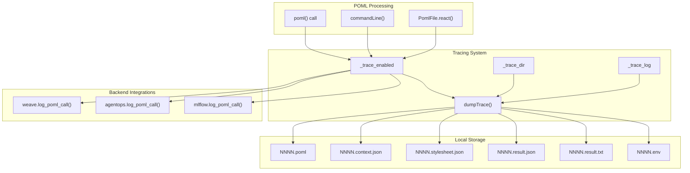
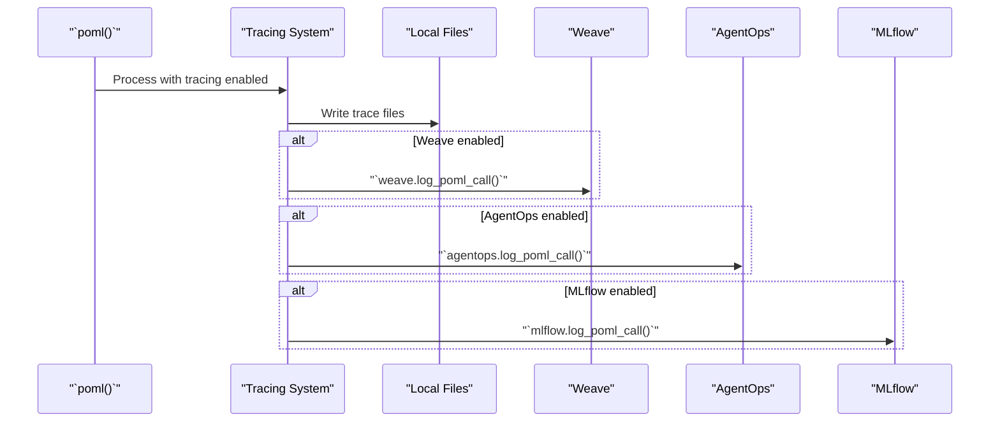

<!-- source: DeepWiki mcp.deepwiki.com · repo microsoft/poml · page 7.1 Tracing and Debugging · fetched 2026-10-26 -->

# Tracing and Debugging

<details>
<summary>Relevant source files</summary>

The following files were used as context for generating this wiki page:

- [packages/poml/index.ts](packages/poml/index.ts)
- [packages/poml/tests/trace.test.tsx](packages/poml/tests/trace.test.tsx)
- [packages/poml/util/index.ts](packages/poml/util/index.ts)
- [packages/poml/util/trace.ts](packages/poml/util/trace.ts)
- [python/poml/__init__.py](python/poml/__init__.py)
- [python/poml/api.py](python/poml/api.py)
- [python/tests/test_basic.py](python/tests/test_basic.py)
- [python/tests/test_poml_formats.py](python/tests/test_poml_formats.py)

</details>


This page covers POML's built-in tracing and debugging capabilities, which capture detailed execution information for prompt processing and enable integration with ML experiment tracking platforms. For general error handling and validation features, see [Error Handling and Validation](#7.2). For source position tracking used by editors, see [Source Maps and Position Tracking](#7.4).

## Overview

POML provides a comprehensive tracing system that captures the complete execution context of prompt processing, including input files, context data, stylesheets, and outputs. This enables reproducible debugging, experiment tracking, and integration with popular ML platforms.

### Tracing Architecture



Sources: [python/poml/api.py:26-31](), [packages/poml/util/trace.ts:33-63](), [packages/poml/index.ts:152-255]()

## Enabling Tracing

### Python API

Use `set_trace()` to enable tracing with various backend options:

| Backend | Description | Requirements |
|---------|-------------|--------------|
| `local` | Save trace files to disk | None |
| `weave` | Log to Weights & Biases Weave | Requires `weave` package |
| `agentops` | Log to AgentOps | Requires `agentops` package |
| `mlflow` | Log to MLflow | Requires `mlflow` package |

```python
# Enable local tracing only
set_trace(True)

# Enable with specific directory
trace_dir = set_trace(True, trace_dir="/path/to/traces")

# Enable multiple backends
set_trace(["local", "weave", "mlflow"])

# Auto-enable via environment variable
os.environ["POML_TRACE"] = "/path/to/traces"
```

### TypeScript/JavaScript API

```typescript
import { setTrace, clearTrace, dumpTrace } from 'poml';

// Enable tracing with directory
setTrace(true, '/path/to/traces');

// Check if tracing is active
if (isTracing()) {
  // Tracing is enabled
}

// Disable tracing
clearTrace();
```

### CLI Integration

The CLI automatically enables tracing when the `--traceDir` argument is provided:

```bash
poml -f template.poml --traceDir ./traces
```

Sources: [python/poml/api.py:37-109](), [packages/poml/util/trace.ts:36-63](), [packages/poml/index.ts:157-159]()

## Trace File Structure

### File Naming Scheme

Trace files use a systematic naming convention with zero-padded indices:

```mermaid
graph LR
    A["`nextIndex()`"] --> B["`NNNN.basename`"]
    B --> C["`0001.template`"]
    B --> D["`0002.prompt`"]
    B --> E["`0003.context`"]
    
    subgraph "File Extensions"
        F["`.poml` - Processed markup"]
        G["`.context.json` - Context data"]
        H["`.stylesheet.json` - Style config"]
        I["`.result.json` - Full output"]
        J["`.result.txt` - Pretty printed"]
        K["`.env` - Environment info"]
        L["`.source.poml` - Source symlink"]
    end
    
    C --> F
    C --> G
    C --> H
    C --> I
    C --> J
    C --> K
    C --> L
```

### Example Trace Directory

```
traces/
├── 20241201120000123456/     # Timestamp directory
│   ├── 0001.template.poml    # Processed POML markup
│   ├── 0001.template.context.json
│   ├── 0001.template.stylesheet.json
│   ├── 0001.template.result.json
│   ├── 0001.template.result.txt
│   ├── 0001.template.env     # SOURCE_PATH=...
│   ├── 0001.template.source.poml  # Symlink to original
│   └── 0001.template.custom.txt   # Custom artifacts
```

Sources: [packages/poml/util/trace.ts:65-98](), [python/poml/api.py:130-179]()

## Trace File Contents

### Core Files

| File Type | Contents | Format |
|-----------|----------|---------|
| `.poml` | Processed POML markup with resolved includes | Text |
| `.context.json` | Context variables and data | JSON with Buffer encoding |
| `.stylesheet.json` | Stylesheet configuration | JSON |
| `.result.json` | Complete output structure | JSON with Buffer encoding |
| `.result.txt` | Human-readable output | Text |
| `.env` | Environment variables like `SOURCE_PATH` | Key=Value |

### Buffer Encoding

Binary data (images, documents) is preserved using base64 encoding:

```json
{
  "image": {
    "__base64__": "iVBORw0KGgoAAAANSUhEUgAAAAEAAAABCAQAAAC1HAwCAAAAC0lEQVR42mNkYAAAAAYAAjCB0C8AAAAASUVORK5CYII="
  }
}
```

This encoding is handled automatically by `parseJsonWithBuffers()` and `replaceBuffers()`.

Sources: [packages/poml/util/trace.ts:8-31](), [python/poml/api.py:182-187]()

## Backend Integrations

### Integration Flow



### Backend Requirements

All external backends require local tracing to be enabled first. The integrations read from local trace files to send data to external platforms:

```python
# This will fail - external backends need local tracing
set_trace(["weave"])  # RuntimeError

# Correct approach
set_trace(["local", "weave"])  # Works
```

Each backend integration reads trace files using `_read_latest_traced_file()` and sends structured data to the respective platform.

Sources: [python/poml/api.py:689-742](), [python/poml/api.py:157-167]()

## Debugging with Traces

### Reproducing Executions

Trace files contain everything needed to reproduce a POML execution:

```python
# Read traced execution
markup = Path("traces/run/0001.template.poml").read_text()
context = json.loads(Path("traces/run/0001.template.context.json").read_text())
stylesheet = json.loads(Path("traces/run/0001.template.stylesheet.json").read_text())

# Reproduce the execution
result = poml(markup, context=context, stylesheet=stylesheet)
```

### Custom Artifacts

Add custom debugging artifacts using `trace_artifact()`:

```python
set_trace(True, trace_dir="./debug")
result = poml("<p>{{prompt}}</p>", context={"prompt": "Debug me"})

# Add custom debugging info
trace_artifact("debug.txt", "Custom debug information")
trace_artifact("state.json", json.dumps({"step": 1, "status": "complete"}))
```

### Environment Variables

The `.env` file preserves important environment context:

```
SOURCE_PATH=/path/to/original/template.poml
```

This enables include resolution when re-executing traced files.

Sources: [python/poml/api.py:169-179](), [packages/poml/tests/trace.test.tsx:48-67]()

## API Reference

### Python Functions

| Function | Purpose | Returns |
|----------|---------|---------|
| `set_trace(enabled, trace_dir)` | Enable/configure tracing | Trace directory path |
| `clear_trace()` | Clear in-memory trace log | None |
| `get_trace()` | Get collected trace records | List of trace records |
| `trace_artifact(suffix, contents)` | Add custom trace file | File path |

### TypeScript Functions

| Function | Purpose | Returns |
|----------|---------|---------|
| `setTrace(enabled, dir)` | Enable tracing with directory | Directory path |
| `clearTrace()` | Disable tracing | None |
| `isTracing()` | Check if tracing is active | Boolean |
| `dumpTrace(markup, context, ...)` | Write trace files | None |
| `parseJsonWithBuffers(text)` | Parse JSON with Buffer restoration | Parsed object |

### Environment Variables

| Variable | Effect |
|----------|--------|
| `POML_TRACE` | Auto-enable tracing with specified directory |

Sources: [python/poml/api.py:16-24](), [packages/poml/util/trace.ts:1-144](), [packages/poml/index.ts:276]()

---

