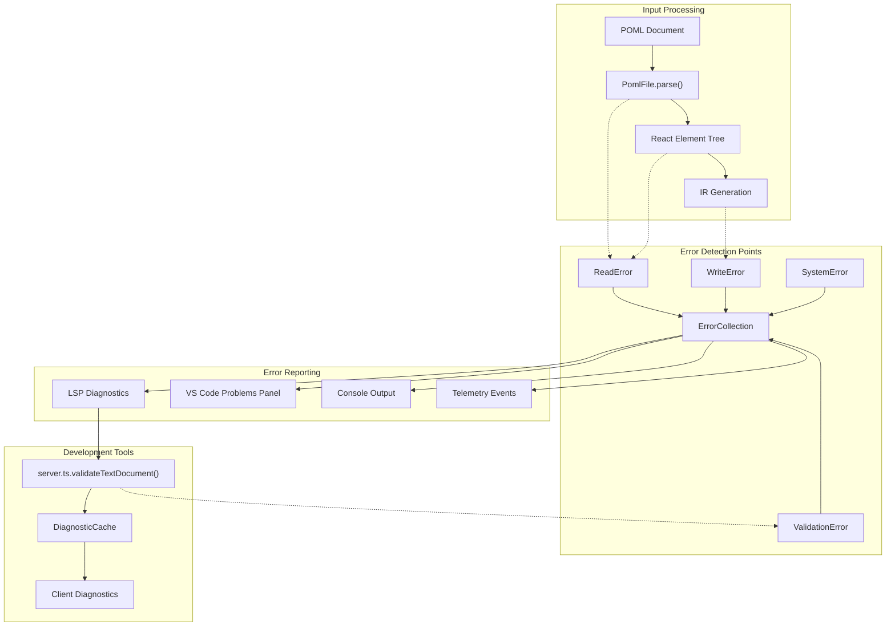
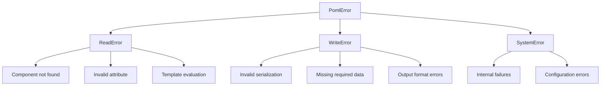
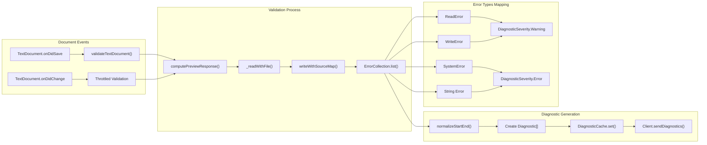
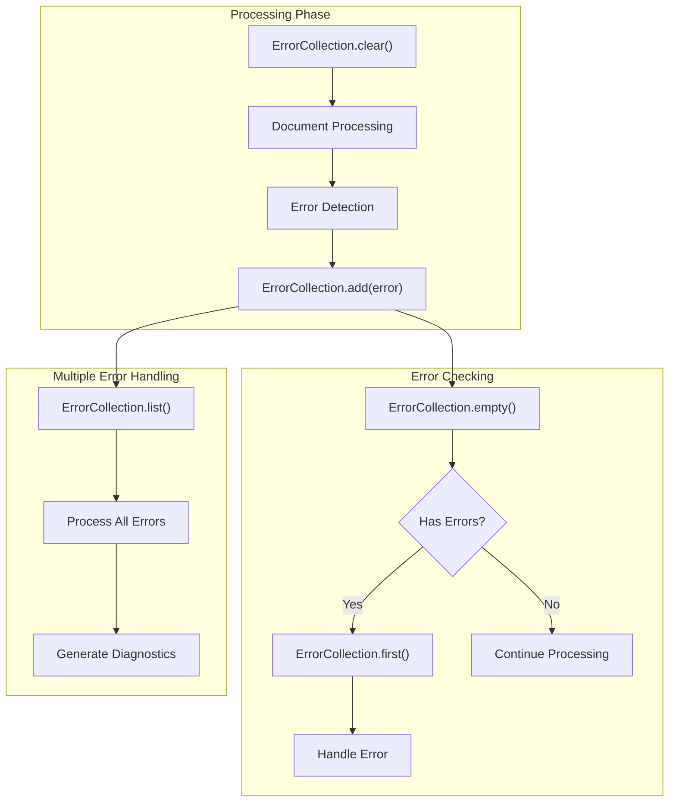
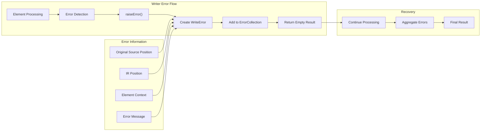

<!-- source: DeepWiki mcp.deepwiki.com · repo microsoft/poml · page 7.2 Error Handling and Validation · fetched 2026-10-26 -->

# Error Handling and Validation

<details>
<summary>Relevant source files</summary>

The following files were used as context for generating this wiki page:

- [packages/poml-vscode/lsp/server.ts](packages/poml-vscode/lsp/server.ts)
- [packages/poml-vscode/panel/content.tsx](packages/poml-vscode/panel/content.tsx)
- [packages/poml-vscode/panel/panel.ts](packages/poml-vscode/panel/panel.ts)
- [packages/poml-vscode/panel/types.ts](packages/poml-vscode/panel/types.ts)
- [packages/poml/base.tsx](packages/poml/base.tsx)
- [packages/poml/tests/base.test.tsx](packages/poml/tests/base.test.tsx)
- [packages/poml/tests/index.test.tsx](packages/poml/tests/index.test.tsx)
- [packages/poml/tests/writer.test.tsx](packages/poml/tests/writer.test.tsx)
- [packages/poml/writer.ts](packages/poml/writer.ts)

</details>


This document covers POML's comprehensive error handling and validation system, including error types, collection mechanisms, diagnostic reporting, and integration with development tools. The system provides both compile-time validation through the language server and runtime error handling during document processing.

For information about tracing and debugging execution flows, see [Tracing and Debugging](#7.1). For source position tracking details, see [Source Maps and Position Tracking](#7.4).

## Error System Architecture

POML implements a multi-layered error handling system that captures errors at different stages of document processing and provides detailed diagnostic information for development tools.

### Error Flow Architecture



Sources: [packages/poml/base.tsx:256-357](), [packages/poml-vscode/lsp/server.ts:575-728]()

### Error Class Hierarchy



Sources: [packages/poml/base.tsx:264-314]()

## Error Types and Classes

### Base Error Classes

POML defines a hierarchy of error classes that inherit from `PomlError`, each designed for specific error scenarios:

| Error Class | Purpose | Source Information | Context |
|-------------|---------|-------------------|---------|
| `ReadError` | Parse and component resolution errors | `startIndex`, `endIndex`, `sourcePath` | Template evaluation, component lookup |
| `WriteError` | Output generation errors | `startIndex`, `endIndex`, `irStartIndex`, `irEndIndex` | Writer system, serialization |
| `SystemError` | Internal system failures | Basic error info | Configuration, unexpected conditions |

#### ReadError Implementation

`ReadError` captures errors during the parsing and component resolution phase, providing precise source location information:

```typescript
// From packages/poml/base.tsx:283-298
export class ReadError extends PomlError {
  constructor(
    message: string,
    public startIndex?: number,
    public endIndex?: number,
    public sourcePath?: string,
    options?: PomlErrorOptions,
  ) {
    super(message, options);
    this.name = 'ReadError';
  }

  public static fromProps(message: string, props: PropsBase, options?: PomlErrorOptions) {
    return new ReadError(message, props.originalStartIndex, props.originalEndIndex, props.sourcePath, options);
  }
}
```

Sources: [packages/poml/base.tsx:283-298]()

#### WriteError with IR Context

`WriteError` extends error information to include both original source positions and intermediate representation (IR) positions:

```typescript
// From packages/poml/base.tsx:300-314
export class WriteError extends PomlError {
  constructor(
    message: string,
    public startIndex?: number,
    public endIndex?: number,
    public sourcePath?: string,
    public irStartIndex?: number,
    public irEndIndex?: number,
    public relatedIr?: string,
    options?: PomlErrorOptions,
  )
}
```

Sources: [packages/poml/base.tsx:300-314]()

## Validation Pipeline

### Language Server Validation Flow



Sources: [packages/poml-vscode/lsp/server.ts:575-728](), [packages/poml-vscode/lsp/server.ts:183-191]()

### Diagnostic Cache Implementation

The language server implements caching to avoid redundant validation of unchanged documents:

```typescript
// From packages/poml-vscode/lsp/server.ts:71-75
interface DiagnosticCache {
  key: string;
  fileContent: string;
  diagnostics: Diagnostic[];
}

// From packages/poml-vscode/lsp/server.ts:541-573
private async onDiagnostic(params: DocumentDiagnosticParams): Promise<UnchangedDocumentDiagnosticReport | FullDocumentDiagnosticReport> {
  const key = params.textDocument.uri.toString();
  const document = this.documents.get(params.textDocument.uri);
  const cache = this.diagnosticCache.get(key) ?? { key, fileContent: undefined, diagnostics: [] };
  
  if (cache.fileContent === document?.getText()) {
    return { kind: DocumentDiagnosticReportKind.Unchanged, resultId: hash };
  } else {
    const result = document !== undefined ? await this.validateTextDocument(document) : [];
    // ... process and return diagnostics
  }
}
```

Sources: [packages/poml-vscode/lsp/server.ts:71-75](), [packages/poml-vscode/lsp/server.ts:541-573]()

## ErrorCollection Singleton

### Collection and Management

The `ErrorCollection` class provides a global singleton for collecting errors during document processing:

```typescript
// From packages/poml/base.tsx:320-357
export class ErrorCollection {
  private errors: PomlError[] = [];
  private static _instance: ErrorCollection;

  public static add(error: PomlError) {
    this.instance.errors.push(error);
  }

  public static first() {
    return this.instance.errors[0];
  }

  public static list() {
    return this.instance.errors;
  }

  public static empty() {
    return this.instance.errors.length === 0;
  }

  public static clear() {
    this.instance.errors = [];
  }
}
```

### Error Collection Usage Pattern



Sources: [packages/poml/base.tsx:320-357](), [packages/poml/tests/index.test.tsx:447-462]()

## Language Server Diagnostics

### Diagnostic Severity Mapping

The language server maps POML error types to LSP diagnostic severities:

| POML Error Type | LSP Severity | Source | Usage |
|----------------|--------------|---------|--------|
| `ReadError` | `Warning` | Component resolution, template evaluation | Non-fatal parsing issues |
| `WriteError` | `Warning` | Output generation | Serialization problems |
| `SystemError` | `Error` | Internal failures | System-level problems |
| String errors | `Error` | Unknown error types | Fallback for untyped errors |

### Multi-File Diagnostics

The language server supports diagnostics across multiple files when errors originate from included context or stylesheet files:

```typescript
// From packages/poml-vscode/lsp/server.ts:610-625
for (const e of errors) {
  const src = (e as any).sourcePath ? pathToFileURL((e as any).sourcePath).toString() : textDocument.uri.toString();
  let targetText = text;
  let doc = textDocument;
  if (src !== textDocument.uri.toString()) {
    const cached = this.documents.get(src as any);
    if (cached) {
      targetText = cached.getText();
      doc = cached;
    } else {
      try {
        targetText = await readFile((e as any).sourcePath, 'utf-8');
      } catch {
        targetText = '';
      }
      doc = TextDocument.create(src, 'poml', 0, targetText);
    }
  }
}
```

Sources: [packages/poml-vscode/lsp/server.ts:610-629]()

### Related Information for WriteError

`WriteError` diagnostics include related information linking the original source to the intermediate representation:

```typescript
// From packages/poml-vscode/lsp/server.ts:672-683
if (this.hasDiagnosticRelatedInformationCapability) {
  diagnostic.relatedInformation = [
    {
      location: {
        uri: textDocument.uri,
        range: diagnostic.range,
      },
      message: e.relatedIr?.slice(e.startIndex ?? 0, e.endIndex !== undefined ? e.endIndex + 1 : text.length) ?? '',
    },
  ];
}
```

Sources: [packages/poml-vscode/lsp/server.ts:672-683]()

## Writer System Error Handling

### Error Raising in Writers

The base `Writer` class provides a standardized error raising mechanism:

```typescript
// From packages/poml/writer.ts:201-229
protected raiseError(message: string, element: cheerio.Cheerio<any>): WriterPartialResult {
  const parseAttrAsInt = (attrName: string): number | undefined => {
    const attrValue = element.attr(attrName);
    return attrValue !== undefined && !isNaN(parseInt(attrValue, 10)) ? parseInt(attrValue, 10) : undefined;
  };

  ErrorCollection.add(
    new WriteError(
      message,
      parseAttrAsInt('original-start-index'),
      parseAttrAsInt('original-end-index'),
      element[0].sourcePath,
      element[0].startIndex,
      element[0].endIndex,
      this.ir,
    ),
  );
  return { output: '', multimedia: [], mappings: [] };
}
```

### Error Recovery Strategy

Writers implement graceful error recovery by returning empty results while preserving error information:



Sources: [packages/poml/writer.ts:201-229]()

## Expression Evaluation Errors

### Code Lens Error Handling

The language server provides code lens functionality for evaluating template expressions with comprehensive error handling:

```typescript
// From packages/poml-vscode/lsp/server.ts:260-326
private async onExecuteCommand(params: ExecuteCommandParams): Promise<any> {
  // ... parameter validation
  
  ErrorCollection.clear();
  const file = new PomlFile(text, undefined, fileURLToPath(uri));
  file.react(context);

  if (!ErrorCollection.empty()) {
    const err = ErrorCollection.first()?.toString() ?? 'Unknown error';
    const message: EvaluationMessage = {
      type: 'error',
      message: `${new Date().toLocaleString()} Error during evaluation: ${expression} => ${err}`,
    };
    this.connection.sendNotification(EvaluationNotification, message);
  }

  const evaluations = file.getExpressionEvaluations({ start: rangeStart, end: rangeEnd });
  // ... process evaluations
}
```

Sources: [packages/poml-vscode/lsp/server.ts:260-326]()

## Testing Error Scenarios

### Error Collection Testing

The test suite extensively validates error collection and reporting:

```typescript
// From packages/poml/tests/index.test.tsx:447-462
test('load', async () => {
  const fn = async () => {
    ErrorCollection.clear();
    await read('<p><paragrapy/><paragraph/></p>');
    if (!ErrorCollection.empty()) {
      throw ErrorCollection.first();
    }
  };
  await expect(fn).rejects.toThrow(ReadError);
  try {
    await fn();
  } catch (e: any) {
    expect(e.message).toBe('Component paragrapy not found. Do you mean: paragraph?');
    expect(e.startIndex).toBe(4);
    expect(e.endIndex).toBe(12);
  }
});
```

### WriteError Testing with Source Maps

Tests validate that `WriteError` includes both original source positions and IR positions:

```typescript
// From packages/poml/tests/index.test.tsx:500-520
test('write', async () => {
  const original = '<p speaker="human"><obj syntax="json"/></p>';
  const fn = async () => {
    ErrorCollection.clear();
    write(await read(original));
    if (!ErrorCollection.empty()) {
      throw ErrorCollection.first();
    }
  };
  await expect(fn).rejects.toThrow(WriteError);
  try {
    await fn();
  } catch (e: any) {
    expect(e.message).toMatch(/^No data attribute in obj:/g);
    const ir = e.relatedIr.slice(e.irStartIndex, e.irEndIndex + 1);
    const originalSlice = original.slice(e.startIndex, e.endIndex + 1);
    expect(ir).toMatch(/^<obj serializer="json"/g);
    expect(originalSlice).toBe('<obj syntax="json"/>');
  }
});
```

Sources: [packages/poml/tests/index.test.tsx:447-462](), [packages/poml/tests/index.test.tsx:500-520]()

## Telemetry and Error Reporting

### Error Telemetry Integration

The language server integrates error reporting with telemetry for monitoring and debugging:

```typescript
// From packages/poml-vscode/lsp/server.ts:557-564
if (result.length > 0) {
  this.diagnosticsReporter.reportTelemetry(TelemetryEvent.Diagnostics, {
    rawText: document?.getText(),
    uri: params.textDocument.uri.toString(),
    diagnostics: JSON.stringify(result),
  });
}
```

The system also captures uncaught exceptions during processing:

```typescript
// From packages/poml-vscode/lsp/server.ts:420-421, 462-463
} catch (e) {
  this.telemetryReporter.reportTelemetryError(TelemetryEvent.ReadUncaughtException, e);
  // ... and later ...
  this.telemetryReporter.reportTelemetryError(TelemetryEvent.WriteUncaughtException, e);
}
```

Sources: [packages/poml-vscode/lsp/server.ts:557-564](), [packages/poml-vscode/lsp/server.ts:419-428](), [packages/poml-vscode/lsp/server.ts:461-470]()

---

