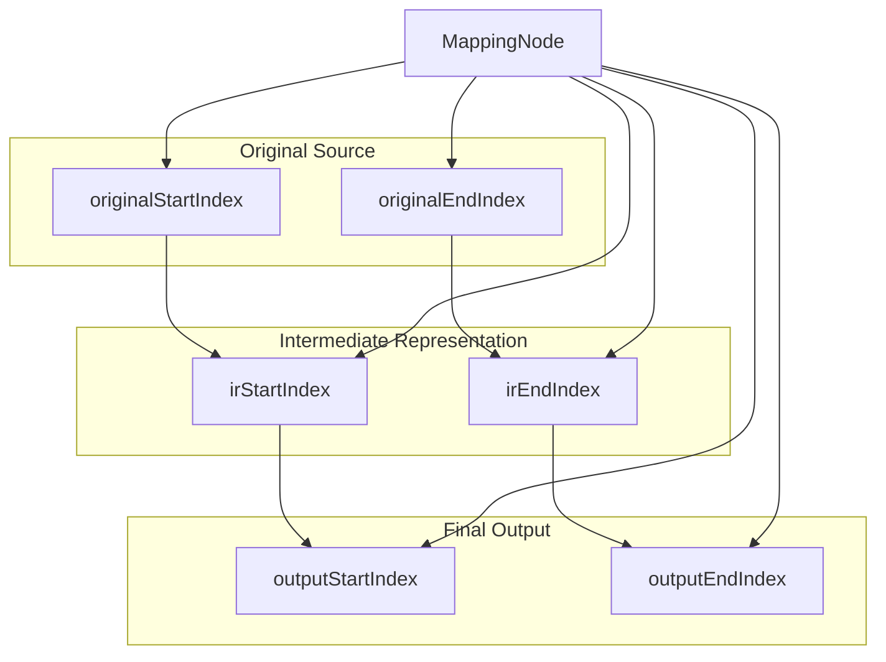
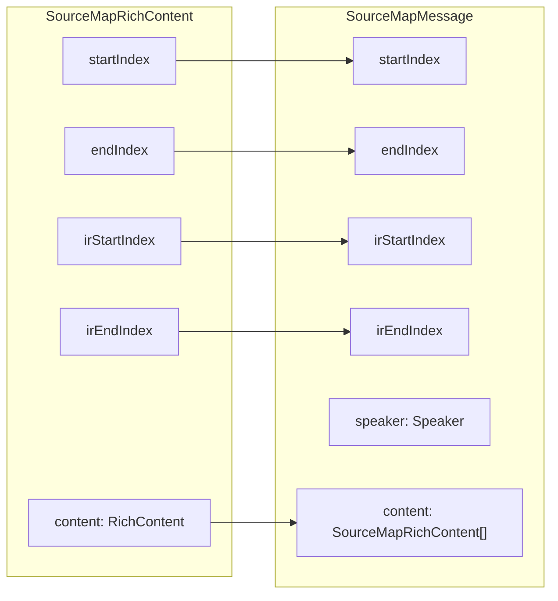
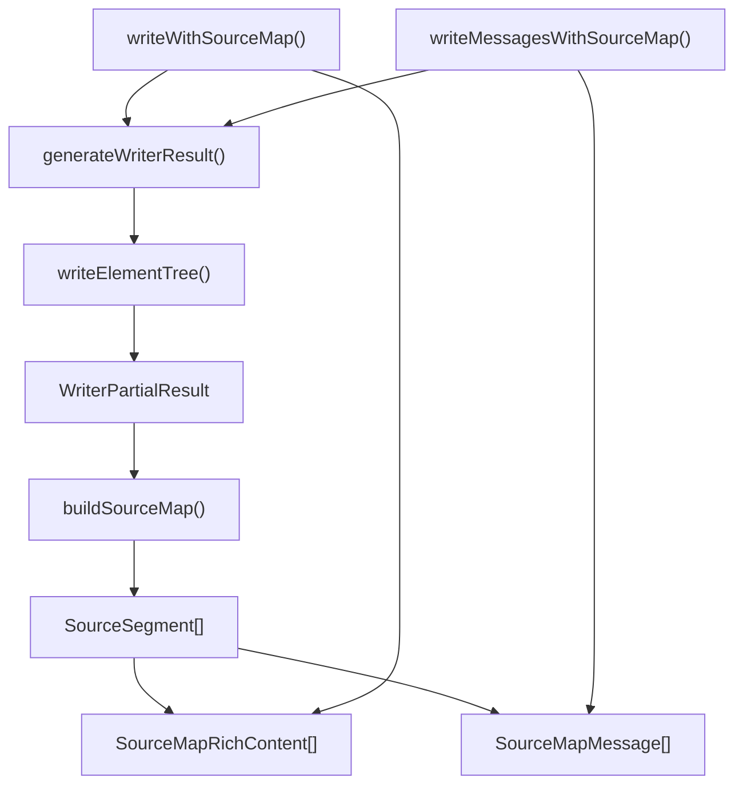
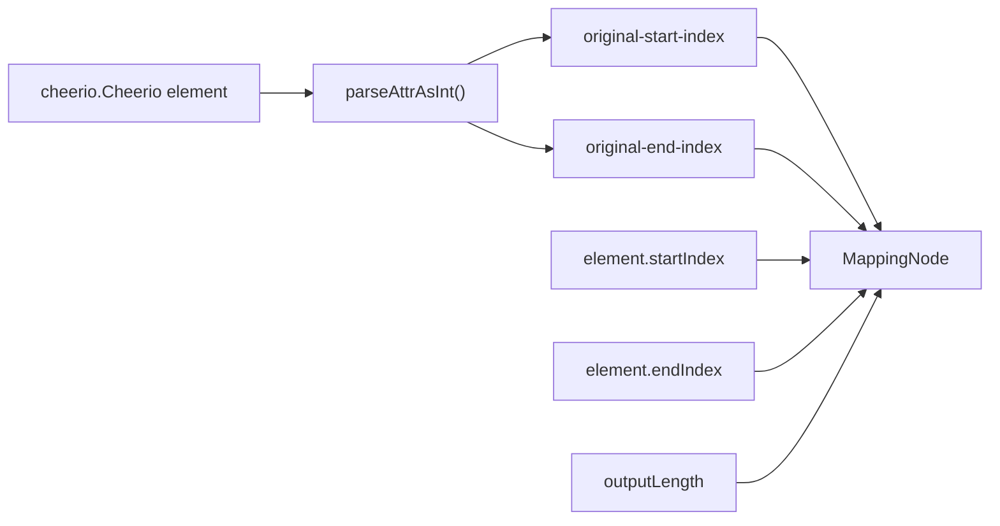
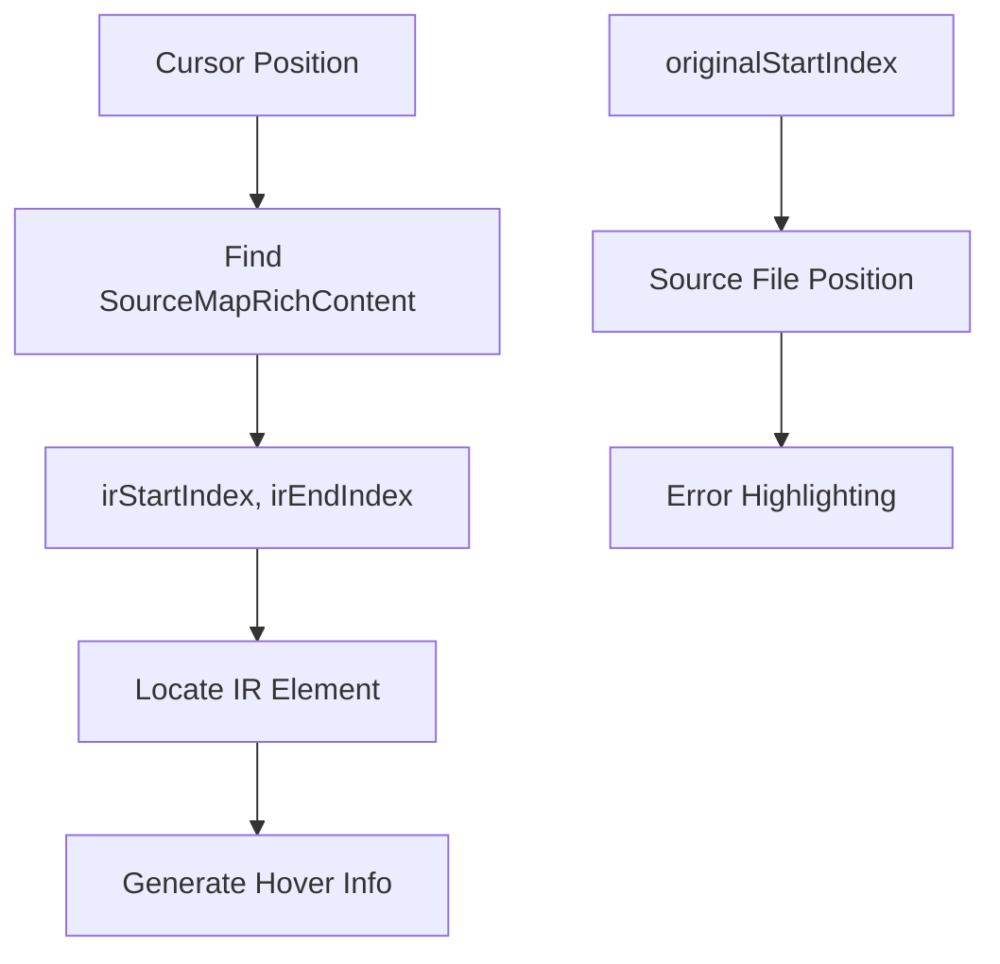
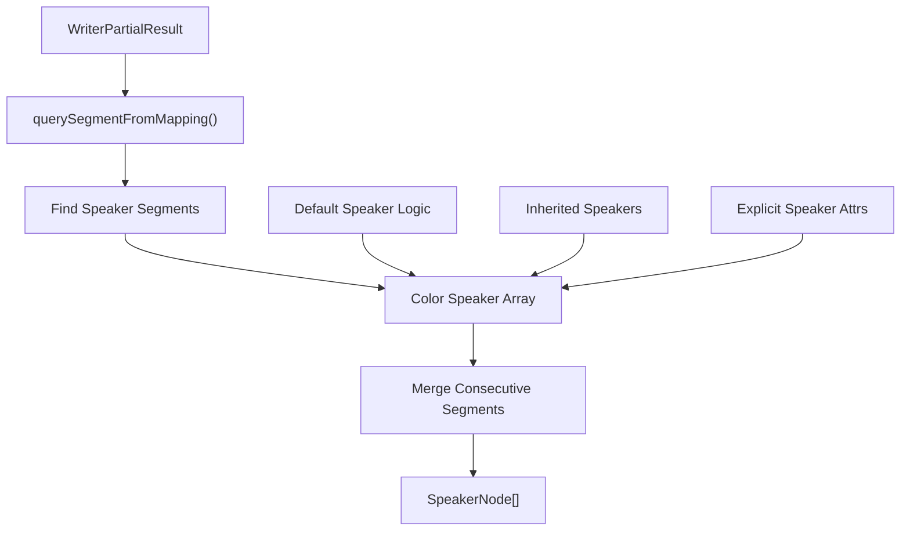

<!-- source: DeepWiki mcp.deepwiki.com · repo microsoft/poml · page 7.4 Source Maps and Position Tracking · fetched 2026-10-26 -->

# Source Maps and Position Tracking

Relevant source files

The following files were used as context for generating this wiki page:

- [packages/poml/base.tsx](packages/poml/base.tsx)
- [packages/poml/tests/base.test.tsx](packages/poml/tests/base.test.tsx)
- [packages/poml/tests/index.test.tsx](packages/poml/tests/index.test.tsx)
- [packages/poml/tests/writer.test.tsx](packages/poml/tests/writer.test.tsx)
- [packages/poml/writer.ts](packages/poml/writer.ts)

Source maps and position tracking in POML maintain precise mapping between original source code positions, intermediate representation (IR) positions, and final output positions. This system enables accurate error reporting, editor integration features like hover information and diagnostics, and debugging capabilities.

For information about error handling and validation that uses source maps, see [Error Handling and Validation](#7.2). For details about language server features that rely on position tracking, see [Language Server Features](#5.4.1).

## Architecture Overview

The source mapping system operates across three coordinate spaces: the original POML source code, the intermediate representation (IR), and the final output. Position tracking maintains bidirectional mappings between these spaces throughout the document processing pipeline.

Sources: [packages/poml/writer.ts:31-38](), [packages/poml/base.tsx:68-83]()

## Core Data Structures

### Mapping Nodes

The `MappingNode` interface tracks position relationships across all three coordinate spaces:

| Field | Description | Coordinate Space |
|-------|-------------|------------------|
| `originalStart` | Start index in source code | Original POML |
| `originalEnd` | End index in source code | Original POML |
| `inputStart` | Start index in IR | Intermediate |
| `inputEnd` | End index in IR | Intermediate |
| `outputStart` | Start index in output | Final Output |
| `outputEnd` | End index in output | Final Output |

### Source Map Interfaces

Sources: [packages/poml/base.tsx:68-83](), [packages/poml/writer.ts:31-50]()

## Source Map Generation Process

### Writer Integration

The source mapping process is integrated into the writer system through specialized methods that track position information during output generation:

### Segment Building Algorithm

The `buildSourceMap` method creates discrete segments by analyzing boundary points in the output:

1. **Boundary Collection**: Gathers all mapping boundaries and multimedia positions
2. **Segment Creation**: Splits output on boundaries to ensure each segment maps to a single source range  
3. **Mapping Assignment**: Assigns the most specific mapping that covers each segment
4. **Multimedia Handling**: Processes multimedia items based on their position attributes (`top`, `bottom`, `here`)

Sources: [packages/poml/writer.ts:425-533](), [packages/poml/writer.ts:539-557]()

## Position Tracking Through Processing Pipeline

### Element Tree Processing

Position tracking begins during element tree processing where `createMappingNode` captures original source positions:

### Mapping Transformations

The writer system applies transformations to mappings during processing:

- **Indentation**: `indentMappings()` adjusts output positions when content is indented
- **Multimedia**: `indentMultiMedia()` updates multimedia positions during concatenation
- **Concatenation**: Position adjustments when combining multiple content segments

Sources: [packages/poml/writer.ts:154-199](), [packages/poml/writer.ts:178-186]()

## Editor Integration Features

### Hover Information

Source maps enable precise hover information by mapping cursor positions back to IR elements:

### Diagnostics and Error Reporting

The error reporting system uses source maps to provide accurate location information:

- `ReadError` uses `originalStartIndex` and `originalEndIndex` for source location
- `WriteError` includes both original positions and IR positions for comprehensive debugging
- Error collection maintains source path information for multi-file scenarios

Sources: [packages/poml/base.tsx:283-314](), [packages/poml/writer.ts:201-229]()

## Message Boundary Detection

### Speaker Assignment

The `assignSpeakers` method uses mapping information to determine speaker boundaries in the output:

### Message Reconstruction

Speaker messages are reconstructed by filtering source segments within speaker boundaries and computing overall source ranges from non-whitespace segments to avoid expanding spans due to padding.

Sources: [packages/poml/writer.ts:260-353](), [packages/poml/writer.ts:378-417]()

## Testing and Validation

The source mapping system includes comprehensive tests that validate:

- Simple content mapping between source and output positions
- Speaker message boundary detection
- Multimedia content position tracking  
- Complex nested content scenarios
- Mapping consistency between direct writes and source map reconstruction

Key test patterns demonstrate mapping accuracy for various content types including text, formatting, multimedia, and tool interactions.

Sources: [packages/poml/tests/index.test.tsx:521-646](), [packages/poml/tests/writer.test.tsx:63-112]()

---

