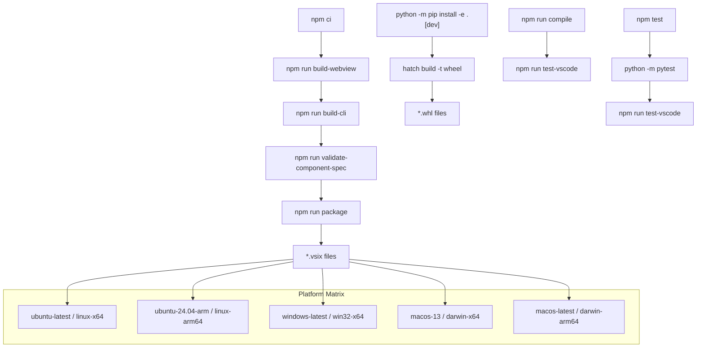
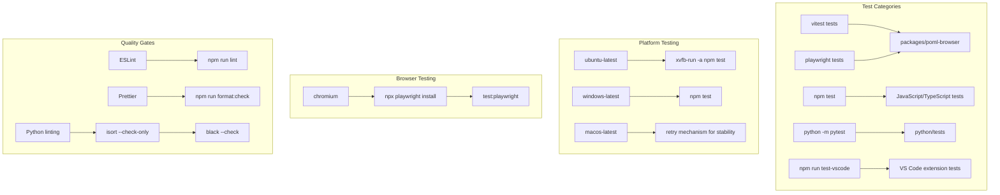
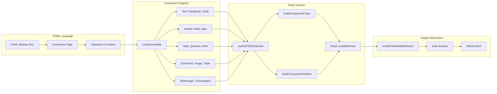
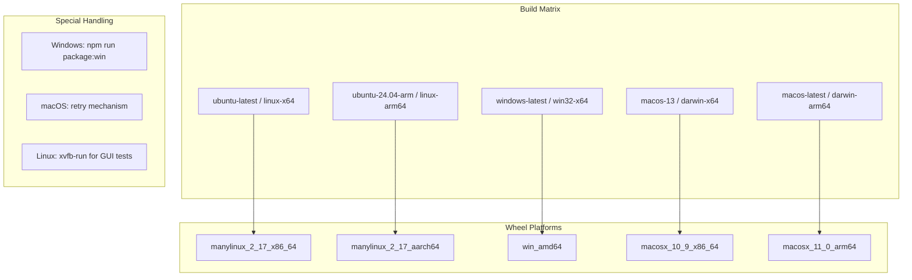

<!-- source: DeepWiki mcp.deepwiki.com · repo microsoft/poml · page 8 Development and Contributing · fetched 2026-10-26 -->

# Development and Contributing

<details>
<summary>Relevant source files</summary>

The following files were used as context for generating this wiki page:

- [.github/workflows/publish.yml](.github/workflows/publish.yml)
- [.github/workflows/test.yml](.github/workflows/test.yml)
- [packages/poml-browser/common/pomlHelper.tsx](packages/poml-browser/common/pomlHelper.tsx)

</details>


This document provides a comprehensive guide for developers who want to contribute to or extend the POML (Prompt Orchestration Markup Language) system. It covers the development environment setup, build processes, testing infrastructure, and contribution workflows.

For detailed information about specific aspects of development, see:
- Building and testing procedures: [Building and Testing](#8.1)
- Internal architecture details: [Architecture for Contributors](#8.2) 
- Release processes and packaging: [Release and Distribution](#8.3)
- Documentation generation and maintenance: [Documentation System](#8.4)

## Development Environment Overview

The POML project is a multi-language, multi-platform system supporting TypeScript/JavaScript, Python, and VS Code extension development. The codebase uses a monorepo structure with coordinated builds across multiple package managers and target platforms.

### Core Technologies

| Technology | Purpose | Version Requirements |
|------------|---------|---------------------|
| Node.js | Primary build system and JavaScript runtime | 22.x |
| Python | SDK and CLI tools | 3.11+ |
| TypeScript | Core language for most components | Latest |
| React | Component rendering system | 18+ |
| VS Code Extension API | Editor integration | Latest |

### Repository Structure

The project follows a monorepo pattern with these key areas:

- **Core packages**: `packages/poml-build`, `packages/poml-browser`
- **Language SDKs**: Python package in `python/`, JavaScript/TypeScript in `packages/`
- **VS Code extension**: Root-level extension files
- **Documentation**: `docs/` directory with MkDocs configuration
- **CI/CD**: `.github/workflows/` with comprehensive automation

Sources: [.github/workflows/test.yml:1-198](), [.github/workflows/publish.yml:1-138]()

## Build System Architecture

The build system orchestrates compilation, packaging, and testing across multiple languages and platforms through a coordinated workflow.

### Build Pipeline Overview



### Build Targets and Outputs

The build system produces multiple artifacts:

| Artifact Type | Build Command | Output Location | Target Platforms |
|---------------|---------------|-----------------|------------------|
| VS Code Extension | `npm run package` | `*.vsix` | 5 platform-specific builds |
| Python Wheels | `hatch build -t wheel` | `dist/*.whl` | Platform-specific wheels |
| NPM Package | `npm pack` | `packages/poml-build/pomljs-*.tgz` | Universal |
| Browser Bundle | `npm run build:test` | `packages/poml-browser/dist/` | Web platforms |

Sources: [.github/workflows/test.yml:107-121](), [.github/workflows/publish.yml:40-50]()

## Testing Infrastructure

The testing system includes unit tests, integration tests, browser tests, and VS Code extension tests across multiple platforms.

### Testing Architecture



### Test Execution Strategy

The CI system uses different approaches based on platform requirements:

- **Linux**: Uses `xvfb-run -a` for headless GUI testing
- **macOS**: Implements retry mechanism for test stability 
- **Windows**: Direct test execution without virtualization
- **Browser tests**: Playwright with Chromium for cross-browser compatibility

Sources: [.github/workflows/test.yml:51-76](), [.github/workflows/test.yml:117-131](), [.github/workflows/test.yml:133-154]()

## Component Integration System

The POML system uses a sophisticated component mapping system to bridge React components with the POML language specification.

### Component Mapping Architecture



The `ComponentMap` in `pomlHelper.tsx` maintains the registry of available components, while functions like `cardToPOMLElement` handle the conversion from card models to React elements.

Sources: [packages/poml-browser/common/pomlHelper.tsx:61-108](), [packages/poml-browser/common/pomlHelper.tsx:113-125]()

## Development Workflow

### Setting Up Development Environment

1. **Install dependencies**:
   ```bash
   npm ci
   python -m pip install -e .[dev]
   ```

2. **Build core components**:
   ```bash
   npm run build-webview
   npm run build-cli
   ```

3. **Validate setup**:
   ```bash
   npm run validate-component-spec
   ```

### Code Quality Standards

The project enforces strict code quality through automated tooling:

| Tool | Purpose | Configuration |
|------|---------|---------------|
| ESLint | JavaScript/TypeScript linting | Standard configuration |
| Prettier | Code formatting | Automated formatting |
| isort | Python import sorting | PEP 8 compliance |
| black | Python code formatting | Standard black formatting |

### Testing During Development

Run the full test suite to validate changes:

```bash
# JavaScript/TypeScript tests
npm test

# Python tests  
python -m pytest -v python/tests

# VS Code extension tests
npm run compile && npm run test-vscode

# Browser-specific tests
cd packages/poml-browser
npm run test:vitest -- --run
npm run test:playwright
```

Sources: [.github/workflows/test.yml:147-153](), [.github/workflows/test.yml:116-121]()

## Multi-Platform Considerations

### Platform-Specific Build Matrix

The CI system builds and tests across a comprehensive platform matrix:



### Platform-Specific Behaviors

- **Windows builds**: Use specialized packaging command `npm run package:win`
- **macOS builds**: Include retry logic for test stability
- **Linux builds**: Require `xvfb-run` for headless GUI testing
- **ARM64 builds**: Use dedicated ARM64 runners for native compilation

Sources: [.github/workflows/test.yml:81-92](), [.github/workflows/publish.yml:11-26]()

## Contribution Guidelines

### Code Organization Principles

The codebase follows these organizational principles:

1. **Language-specific SDKs**: Maintain API parity between Python and JavaScript implementations
2. **Component-driven architecture**: All POML elements map to React components
3. **Cross-platform compatibility**: All features must work across supported platforms
4. **Comprehensive testing**: Unit tests, integration tests, and platform-specific tests required

### Pull Request Process

1. **Development**: Create feature branch and implement changes
2. **Testing**: Ensure all tests pass locally across platforms
3. **Code quality**: Run linting and formatting tools
4. **Documentation**: Update relevant documentation
5. **CI validation**: All GitHub Actions workflows must pass

### Error Handling Standards

The system uses `ErrorCollection` for centralized error management and provides detailed error reporting through the tracing system. Contributors should follow established patterns for error handling and reporting.

Sources: [packages/poml-browser/common/pomlHelper.tsx:206-233]()

---

