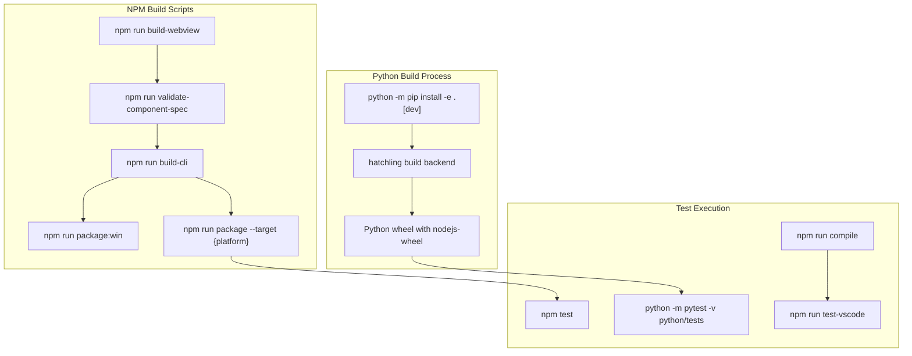
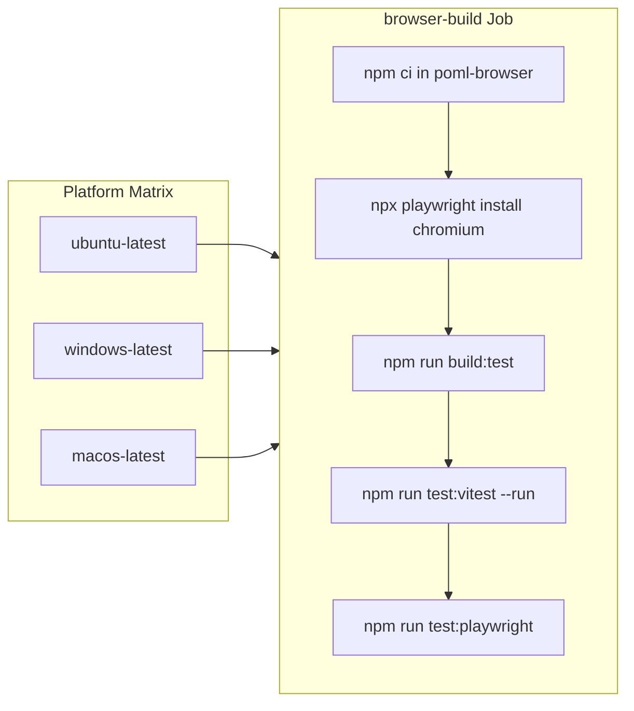
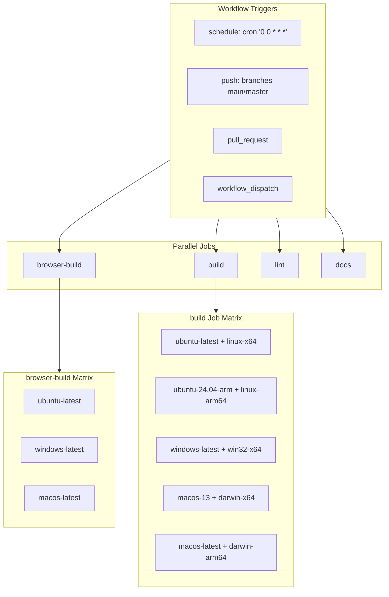
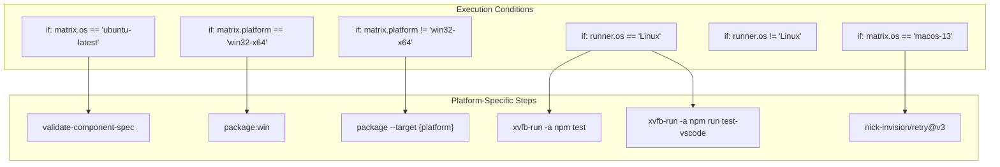
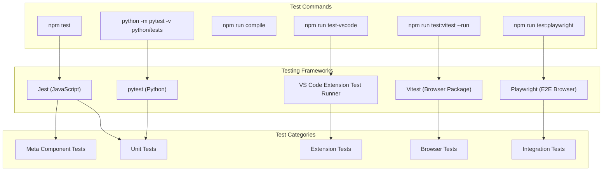
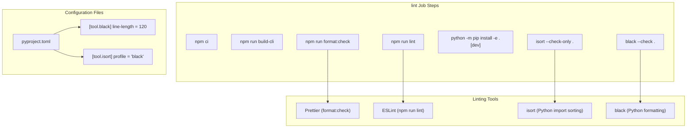
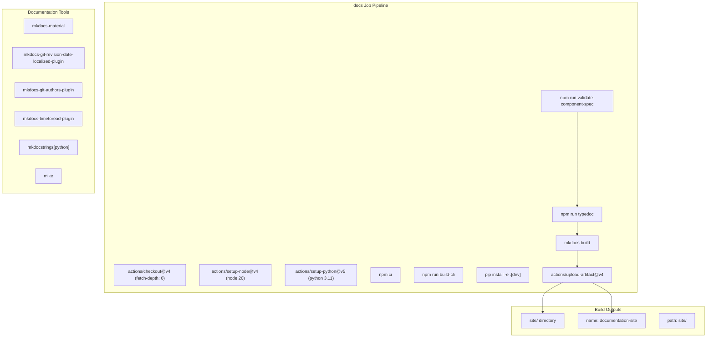

<!-- source: DeepWiki mcp.deepwiki.com · repo microsoft/poml · page 8.1 Building and Testing · fetched 2026-10-26 -->

# Building and Testing

Relevant source files

The following files were used as context for generating this wiki page:

- [.github/workflows/test.yml](.github/workflows/test.yml)
- [packages/poml-browser/common/pomlHelper.tsx](packages/poml-browser/common/pomlHelper.tsx)
- [packages/poml/tests/meta.test.tsx](packages/poml/tests/meta.test.tsx)
- [packages/poml/version.ts](packages/poml/version.ts)
- [pyproject.toml](pyproject.toml)
- [python/poml/_version.py](python/poml/_version.py)

This document covers the build system architecture, CI/CD pipelines, testing infrastructure, and development workflow for the POML project. It focuses on the technical aspects of how the multi-language ecosystem (TypeScript/JavaScript and Python) is built, tested, and packaged across multiple platforms.

The build system coordinates between TypeScript compilation, Python packaging using `hatchling`, VS Code extension bundling with `webpack`, and browser package testing with `vitest` and `playwright`. The CI/CD pipeline runs four main job types: `browser-build`, `build`, `lint`, and `docs`.

## Build System Architecture

### Build Command Structure
The POML project uses a multi-stage build system with specific NPM scripts that coordinate TypeScript compilation, Python packaging via `hatchling`, and VS Code extension bundling.

**Primary Build Commands:**

### Python Package Configuration
The Python package uses `hatchling` as the build backend with specific inclusion rules for Node.js dependencies:

| Configuration | Value | Purpose |
|--------------|-------|---------|
| `build-backend` | `hatchling.build` | Build system |
| `packages` | `["python/poml"]` | Source package location |
| `force-include` | `"python/poml/node_modules" = "/poml/node_modules"` | Bundle Node.js dependencies |
| `scripts.poml-cli` | `"poml.cli:entrypoint"` | CLI entry point |

Sources: [.github/workflows/test.yml:108-115](), [pyproject.toml:42-61]()

### Browser Package Testing
The `packages/poml-browser` package has its own dedicated build and test workflow using modern testing tools:

**Browser Build Pipeline:**

**Environment-Specific Execution:**
- **macOS**: Uses `nick-invision/retry@v3` with 3 max attempts and 20-minute timeout
- **Linux**: Uses `xvfb-run -a npm run test:playwright` for headless testing
- **Windows**: Direct execution without display virtualization

Sources: [.github/workflows/test.yml:15-76]()

## CI/CD Pipeline

### GitHub Actions Workflow Jobs
The CI/CD system runs four parallel jobs on GitHub Actions with specific responsibilities:

**Workflow Job Structure:**

### Build Job Platform Matrix
The main `build` job uses a comprehensive platform matrix with specific OS and platform combinations:

| OS | Platform | Node.js | Python | Special Handling |
|----|----------|---------|--------|------------------|
| `ubuntu-latest` | `linux-x64` | 22.x | 3.11 | `xvfb-run` for tests |
| `ubuntu-24.04-arm` | `linux-arm64` | 22.x | 3.11 | ARM64 compilation |
| `windows-latest` | `win32-x64` | 22.x | 3.11 | `npm run package:win` |
| `macos-13` | `darwin-x64` | 22.x | 3.11 | Retry logic |
| `macos-latest` | `darwin-arm64` | 22.x | 3.11 | Standard execution |

Sources: [.github/workflows/test.yml:3-12](), [.github/workflows/test.yml:78-115]()

### Platform-Specific Execution Logic

**Conditional Step Execution:**

**Retry Configuration for macOS-13:**
- `max_attempts: 3`
- `timeout_minutes: 10` 
- `command: npm run compile && npm run test-vscode`

Sources: [.github/workflows/test.yml:111-131]()

## Testing Infrastructure

### Test Framework Integration
The testing system uses multiple specialized test runners for different components of the system:

**Test Runner Mapping:**

### Meta Component Testing
The `meta.test.tsx` file demonstrates version validation and component registration testing:

**Test Cases:**
- `version check pass`: Tests `minVersion="0.0.1"` and `maxVersion="999.0.0"` constraints
- `version check fail`: Validates `ReadError` on version `"9.9.9"` constraint failure  
- `disable component`: Tests `<meta components="-table"/>` functionality
- `re-enable component`: Tests `<meta components="+table"/>` functionality
- `disable alias only`: Tests component alias disabling with `components="-hi"`

The meta tests use `ErrorCollection.clear()` and `ErrorCollection.first()` for error handling validation.

Sources: [.github/workflows/test.yml:117-131](), [packages/poml/tests/meta.test.tsx:6-60]()

### Linting and Code Quality
The `lint` job runs comprehensive code quality checks across both TypeScript and Python codebases:

**Linting Pipeline:**

**Python Linting Configuration:**
- `black`: Line length 120, target Python 3.12, excludes `python/poml/_tags.py`
- `isort`: Black profile, known first party `["poml"]`, excludes auto-generated files

Sources: [.github/workflows/test.yml:133-154](), [pyproject.toml:63-84]()

## Version Management

Version synchronization across the multi-language ecosystem is maintained through coordinated version files:

| Component | Version File | Current Version |
|-----------|-------------|-----------------|
| TypeScript/JS | `packages/poml/version.ts` | `0.0.9` |
| Python | `python/poml/_version.py` | `0.0.9` |
| NPM Package | `packages/poml-build/package.json` | `0.0.9` |

The version checking system includes runtime validation through meta components that can enforce minimum and maximum version constraints.

Sources: [packages/poml/version.ts:1](), [python/poml/_version.py:1](), [packages/poml-build/package.json:3](), [packages/poml/tests/meta.test.tsx:8-22]()

## Documentation Build Pipeline

### Documentation Job Workflow
The `docs` job runs on `pull_request` events and `push` to `main` branch, building comprehensive documentation:

**Documentation Build Steps:**

**MkDocs Dependencies:**
The documentation system uses specialized MkDocs plugins defined in `pyproject.toml`:
- `mkdocs-material`: Material Design theme
- `mkdocs-git-revision-date-localized-plugin`: Git-based date tracking
- `mkdocs-git-authors-plugin`: Author attribution from Git
- `mkdocs-timetoread-plugin`: Reading time estimation
- `mkdocstrings[python]`: Python API documentation extraction

Sources: [.github/workflows/test.yml:155-198](), [pyproject.toml:21-27]()

## Development Workflow Integration

The build system integrates with the development workflow through watch modes, incremental compilation, and hot-reloading capabilities in the VS Code extension.

### Local Development Commands

| Command | Purpose | Files Affected |
|---------|---------|----------------|
| `npm run build-webview` | Build VS Code webview assets | Extension media files |
| `npm run build-cli` | Build CLI executables | CLI distribution files |  
| `npm run compile` | TypeScript compilation | JavaScript outputs |
| `npm run lint` | Code quality checks | All source files |
| `npm run package` | Platform-specific packaging | Distribution packages |

The development workflow supports live preview through the `POMLWebviewPanel` system, which includes throttled updates, source mapping, and real-time content regeneration when POML files change.

Sources: [.github/workflows/test.yml:44-47](), [packages/poml-vscode/panel/panel.ts:246-277](), [packages/poml-vscode/panel/panel.ts:446-492]()

---

