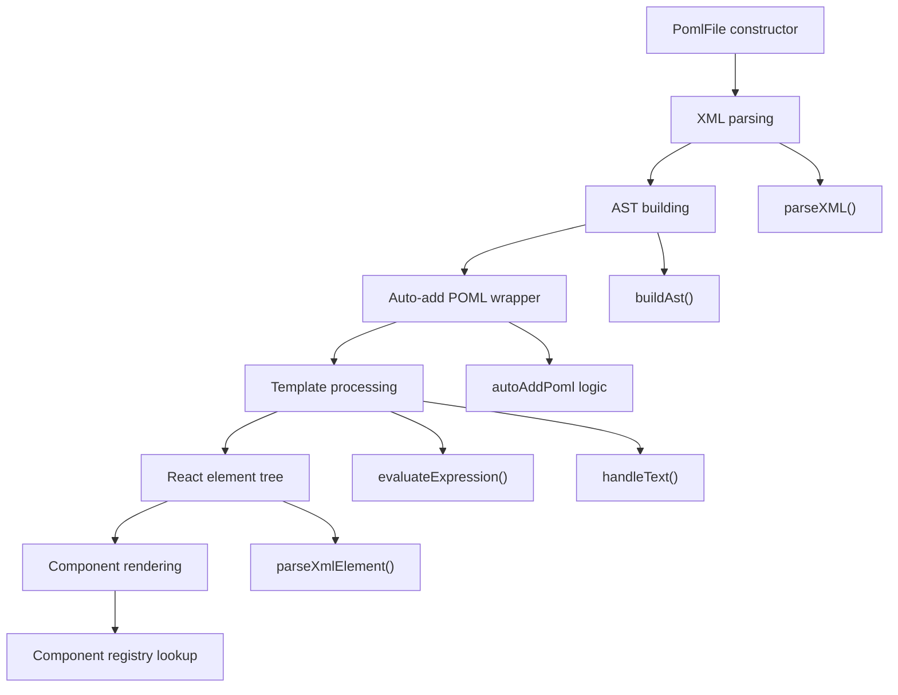
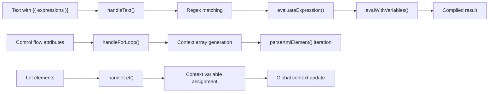
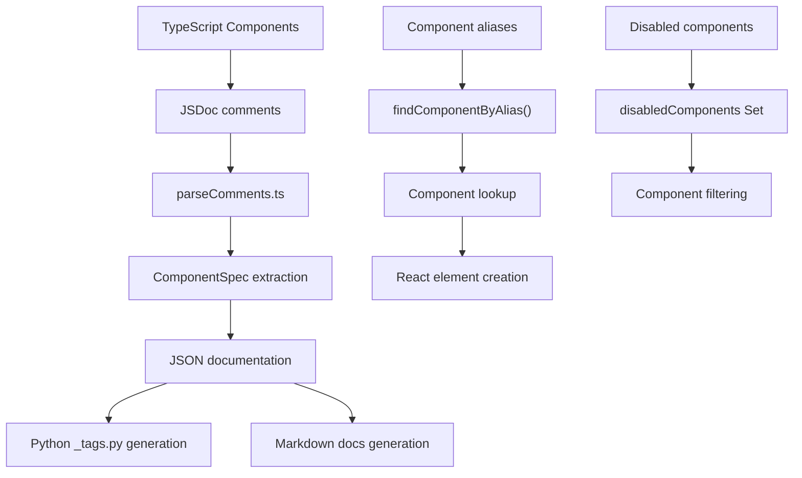
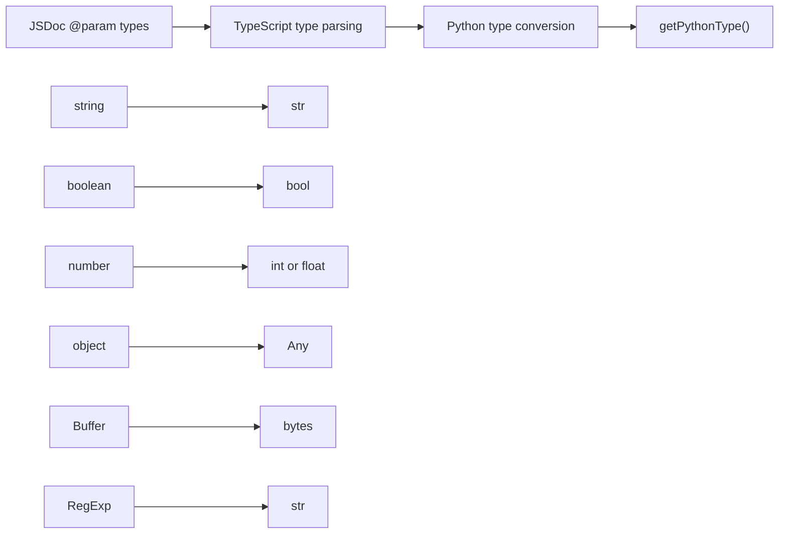
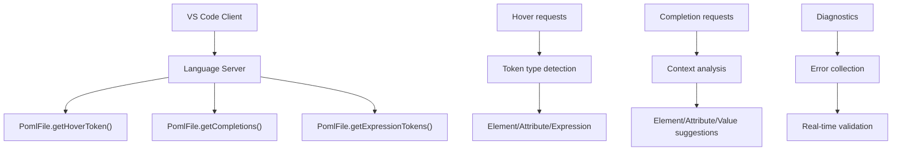
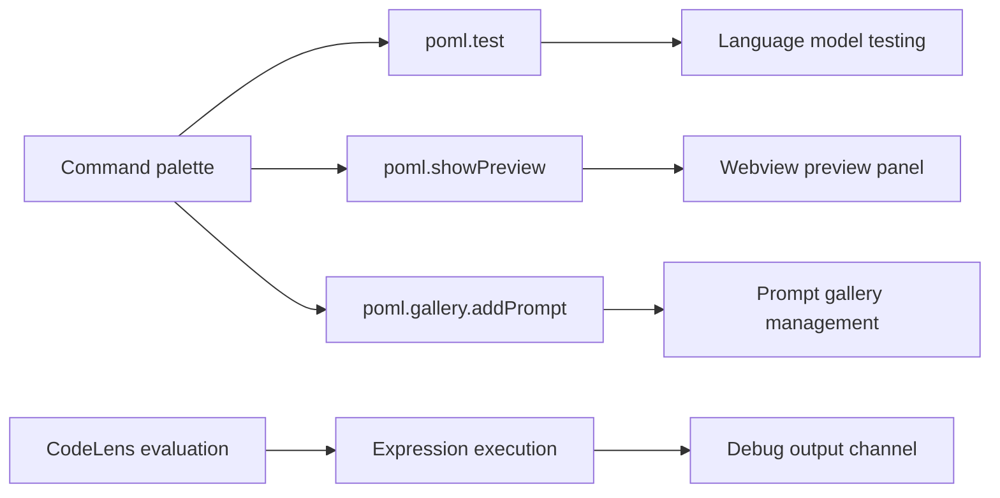
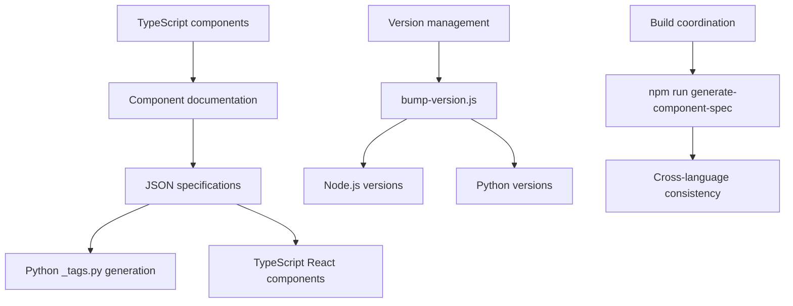
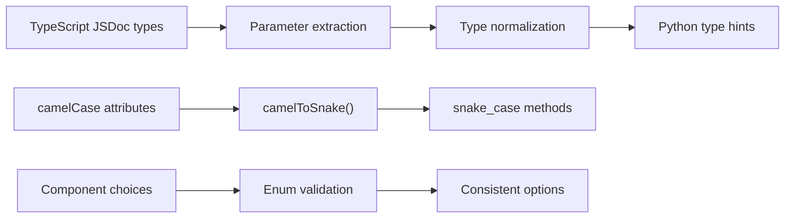
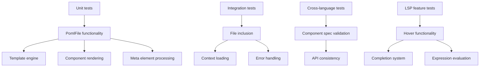
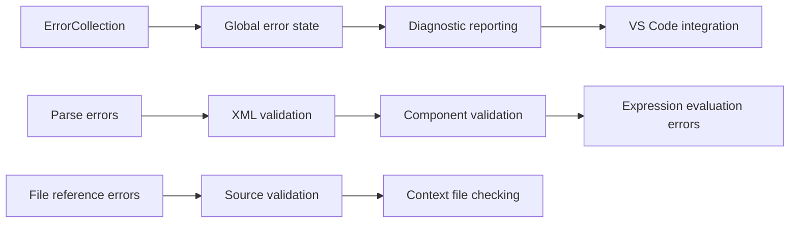

<!-- source: DeepWiki mcp.deepwiki.com · repo microsoft/poml · page 8.2 Architecture for Contributors · fetched 2026-10-26 -->

# Architecture for Contributors

Relevant source files

The following files were used as context for generating this wiki page:

- [bump-version.js](bump-version.js)
- [docs/language/meta.md](docs/language/meta.md)
- [docs/vscode/features.md](docs/vscode/features.md)
- [packages/poml-vscode/lsp/parseComments.ts](packages/poml-vscode/lsp/parseComments.ts)
- [packages/poml/file.tsx](packages/poml/file.tsx)
- [packages/poml/tests/file.test.tsx](packages/poml/tests/file.test.tsx)

This document provides an internal architecture guide for developers contributing to the POML codebase. It covers the core processing engine, component system, VS Code extension, multi-language SDK coordination, and build infrastructure.

For information about using POML as an end user, see [Core Architecture](#3). For building and testing procedures, see [Building and Testing](#8.1). For release processes, see [Release and Distribution](#8.3).

## Core Document Processing Architecture

The POML document processing pipeline centers around the `PomlFile` class, which handles parsing, template evaluation, and React element generation.

### PomlFile Processing Pipeline

**PomlFile Core Processing Flow**

The `PomlFile` class in [packages/poml/file.tsx:56-133]() handles the complete document processing lifecycle:

1. **Constructor phase**: Takes raw POML text and parsing options
2. **XML parsing**: Uses `@xml-tools/parser` to create CST and AST
3. **Auto-wrapper logic**: Automatically wraps non-POML content in `<poml>` elements
4. **Template evaluation**: Processes `{{ }}` expressions using `evaluateExpression()`
5. **React conversion**: Transforms XML elements to React elements via `parseXmlElement()`

Sources: [packages/poml/file.tsx:71-133](), [packages/poml/file.tsx:135-188]()

### Template Engine Architecture

**Template Processing Components**

The template engine supports multiple expression types:

- **Text templates**: `{{ expression }}` syntax processed by `handleText()` [packages/poml/file.tsx:934-972]()
- **Control flow**: `for` and `if` attributes handled by `handleForLoop()` and `handleIfCondition()` [packages/poml/file.tsx:444-499]()
- **Variable definitions**: `<let>` elements processed by `handleLet()` [packages/poml/file.tsx:501-601]()
- **Meta elements**: Schema and tool definitions with `parser="eval"` [packages/poml/file.tsx:680-803]()

Sources: [packages/poml/file.tsx:934-1014](), [packages/poml/file.tsx:444-601]()

## Component System Architecture

The component system bridges TypeScript React components with multi-language SDKs through documentation-driven code generation.

### Component Registration and Discovery

**Component Documentation Pipeline**

The component system uses TypeScript JSDoc comments as the source of truth for component specifications. The `parseComments.ts` script [packages/poml-vscode/lsp/parseComments.ts:1-327]() extracts component documentation and generates:

1. **JSON specifications**: Component metadata stored in `componentDocs.json`
2. **Python bindings**: Auto-generated `_tags.py` with snake_case method names [packages/poml-vscode/lsp/parseComments.ts:284-310]()
3. **Markdown documentation**: Human-readable component reference [packages/poml-vscode/lsp/parseComments.ts:167-185]()

Sources: [packages/poml-vscode/lsp/parseComments.ts:35-117](), [packages/poml-vscode/lsp/parseComments.ts:284-327]()

### Component Type System

**Cross-Language Type Mapping**

The type system converts TypeScript component parameter types to Python equivalents using `getPythonType()` [packages/poml-vscode/lsp/parseComments.ts:194-226](). The conversion includes heuristics for number types based on parameter names (e.g., parameters with "max", "count", or "Index" become `int` rather than `float`).

Sources: [packages/poml-vscode/lsp/parseComments.ts:194-226](), [packages/poml-vscode/lsp/parseComments.ts:228-282]()

## VS Code Extension Architecture

The VS Code extension provides language server features, preview capabilities, and testing integration through multiple interconnected systems.

### Language Server Integration

**LSP Feature Implementation**

The Language Server Protocol features are implemented directly in the `PomlFile` class:

- **Hover support**: `getHoverToken()` identifies elements, attributes, and expressions at cursor position [packages/poml/file.tsx:281-287]()
- **Auto-completion**: `getCompletions()` provides context-aware suggestions [packages/poml/file.tsx:289-309]()
- **Expression tracking**: `getExpressionTokens()` finds all template expressions for evaluation [packages/poml/file.tsx:311-409]()

Sources: [packages/poml/file.tsx:281-309](), [packages/poml/file.tsx:311-414]()

### Extension Command System

**VS Code Command Integration**

The extension exposes multiple commands for different workflows as documented in [docs/vscode/features.md:166-184](). Key command categories include:

- **Testing commands**: `poml.test`, `poml.testNonChat`, `poml.testRerun`, `poml.testAbort`
- **Preview commands**: `poml.showPreview`, `poml.showPreviewToSide`, `poml.showLockedPreviewToSide`
- **Gallery commands**: `poml.gallery.addPrompt`, `poml.gallery.deletePrompt`, `poml.gallery.editPrompt`
- **File management**: `poml.addContextFile`, `poml.addStylesheetFile`

Sources: [docs/vscode/features.md:166-184]()

## Multi-Language SDK Coordination

The POML system maintains synchronized APIs across TypeScript and Python through shared component specifications and coordinated build processes.

### SDK Synchronization Pipeline

**Version and API Synchronization**

The build system ensures API consistency through:

1. **Shared specifications**: Component documentation in JSON format drives both TypeScript and Python APIs
2. **Synchronized versioning**: `bump-version.js` coordinates version updates across package.json, pyproject.toml, and version files [bump-version.js:94-152]()
3. **Automated generation**: `parseComments.ts` generates Python method signatures from TypeScript JSDoc [packages/poml-vscode/lsp/parseComments.ts:228-282]()

Sources: [bump-version.js:6-92](), [packages/poml-vscode/lsp/parseComments.ts:312-327]()

### Cross-Language Type Consistency

**Naming Convention Coordination**

The system maintains consistent naming across languages:

- **TypeScript**: camelCase component attributes and React props
- **Python**: snake_case method names generated by `camelToSnake()` [packages/poml-vscode/lsp/parseComments.ts:187-192]()
- **Component lookup**: Both languages use the same component aliases and names

Sources: [packages/poml-vscode/lsp/parseComments.ts:187-192](), [packages/poml-vscode/lsp/parseComments.ts:234-251]()

## Testing and Quality Architecture

The testing system validates functionality across multiple dimensions: unit tests, integration tests, and cross-language consistency.

### Test Categories and Coverage

**Test Structure and Organization**

The test suite in [packages/poml/tests/file.test.tsx]() covers:

- **Core parsing**: XML parsing, AST building, auto-wrapper logic [packages/poml/tests/file.test.tsx:6-48]()
- **Template engine**: For loops, conditionals, variable assignments [packages/poml/tests/file.test.tsx:173-317]()
- **Meta elements**: Schema processing, tool definitions, runtime parameters [packages/poml/tests/file.test.tsx:568-851]()
- **LSP features**: Hover, completion, expression tracking [packages/poml/tests/file.test.tsx:452-566]()

Sources: [packages/poml/tests/file.test.tsx:6-138](), [packages/poml/tests/file.test.tsx:173-402](), [packages/poml/tests/file.test.tsx:452-566]()

### Error Handling and Validation

**Error Management System**

Error handling is centralized through the `ErrorCollection` class, which accumulates errors during processing and provides them to diagnostic systems. Key error types include:

- **XML parsing errors**: Malformed markup, unclosed tags [packages/poml/file.tsx:139-169]()
- **Component errors**: Unknown components, invalid attributes [packages/poml/file.tsx:1095-1099]()
- **Expression errors**: Template evaluation failures [packages/poml/file.tsx:1005-1013]()
- **File reference errors**: Missing includes, invalid context files [packages/poml/file.tsx:524-530]()

Sources: [packages/poml/file.tsx:139-169](), [packages/poml/file.tsx:1005-1013](), [packages/poml/tests/file.test.tsx:36-48]()

---

