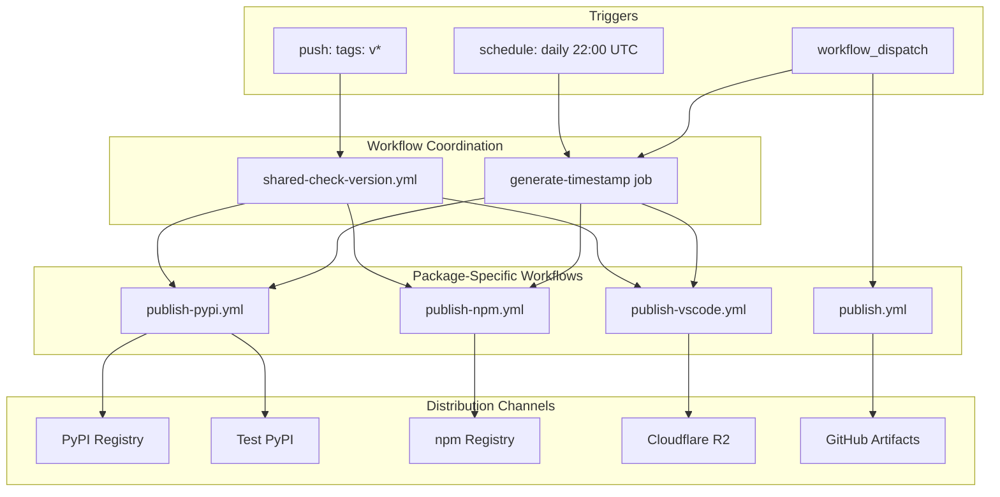
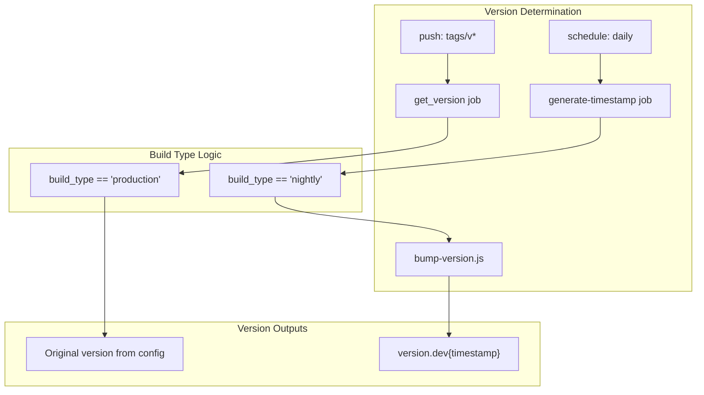
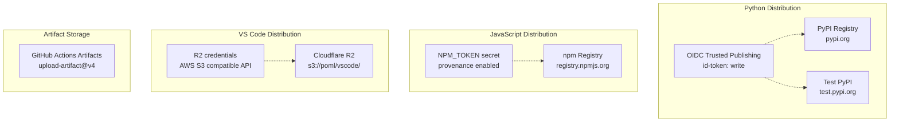

<!-- source: DeepWiki mcp.deepwiki.com · repo microsoft/poml · page 8.3 Release and Distribution · fetched 2026-10-26 -->

# Release and Distribution

<details>
<summary>Relevant source files</summary>

The following files were used as context for generating this wiki page:

- [.github/workflows/publish-npm.yml](.github/workflows/publish-npm.yml)
- [.github/workflows/publish-pypi.yml](.github/workflows/publish-pypi.yml)
- [.github/workflows/publish-vscode.yml](.github/workflows/publish-vscode.yml)
- [.github/workflows/publish.yml](.github/workflows/publish.yml)
- [docs/media/vscode-manual-install.png](docs/media/vscode-manual-install.png)

</details>


This document covers POML's comprehensive release and distribution system, which handles multi-platform packaging and publication to multiple package registries. The system uses dedicated GitHub Actions workflows for each package type, supporting both production releases and nightly builds.

For information about local development builds and testing, see [Building and Testing](#7.1). For details about the codebase architecture, see [Architecture for Contributors](#7.2).

## Release Pipeline Overview

POML uses specialized GitHub Actions workflows for each distribution channel, with support for both production releases (triggered by version tags) and nightly builds (scheduled daily).

**Release Pipeline Architecture**


Sources: [.github/workflows/publish-pypi.yml:1-11](), [.github/workflows/publish-npm.yml:1-11](), [.github/workflows/publish-vscode.yml:1-11](), [.github/workflows/publish.yml:1-5]()

## Multi-Platform Build Matrix

POML supports five distinct platform targets, each with specific build configurations used across VS Code extension and Python wheel builds:

| Platform | OS Runner | VS Code Target | Python Wheel Platform |
|----------|-----------|----------------|----------------------|
| Linux x64 | `ubuntu-latest` | `linux-x64` | `manylinux_2_17_x86_64` |
| Linux ARM64 | `ubuntu-24.04-arm` | `linux-arm64` | `manylinux_2_17_aarch64` |
| Windows x64 | `windows-latest` | `win32-x64` | `win_amd64` |
| macOS x64 | `macos-13` | `darwin-x64` | `macosx_10_9_x86_64` |
| macOS ARM64 | `macos-latest` | `darwin-arm64` | `macosx_11_0_arm64` |

**Build Matrix Workflow Mapping**

```mermaid
graph TB
    subgraph "Platform Matrix"
        UBUNTU_LATEST["ubuntu-latest"]
        UBUNTU_ARM["ubuntu-24.04-arm"] 
        WINDOWS["windows-latest"]
        MACOS_13["macos-13"]
        MACOS_LATEST["macos-latest"]
    end
    
    subgraph "Build Outputs"
        VSIX_LINUX_X64["poml-linux-x64-{version}.vsix"]
        VSIX_LINUX_ARM64["poml-linux-arm64-{version}.vsix"]
        VSIX_WIN32["poml-win32-x64-{version}.vsix"]
        VSIX_DARWIN_X64["poml-darwin-x64-{version}.vsix"]
        VSIX_DARWIN_ARM64["poml-darwin-arm64-{version}.vsix"]
        
        WHEEL_MANYLINUX_X64["poml-{version}-py3-none-manylinux_2_17_x86_64.whl"]
        WHEEL_MANYLINUX_ARM64["poml-{version}-py3-none-manylinux_2_17_aarch64.whl"]
        WHEEL_WIN["poml-{version}-py3-none-win_amd64.whl"]
        WHEEL_MACOS_X64["poml-{version}-py3-none-macosx_10_9_x86_64.whl"]
        WHEEL_MACOS_ARM64["poml-{version}-py3-none-macosx_11_0_arm64.whl"]
        
        NPM_UNIVERSAL["pomljs-{version}.tgz"]
    end
    
    UBUNTU_LATEST --> VSIX_LINUX_X64
    UBUNTU_ARM --> VSIX_LINUX_ARM64
    WINDOWS --> VSIX_WIN32
    MACOS_13 --> VSIX_DARWIN_X64
    MACOS_LATEST --> VSIX_DARWIN_ARM64
    
    UBUNTU_LATEST --> WHEEL_MANYLINUX_X64
    UBUNTU_ARM --> WHEEL_MANYLINUX_ARM64
    WINDOWS --> WHEEL_WIN
    MACOS_13 --> WHEEL_MACOS_X64
    MACOS_LATEST --> WHEEL_MACOS_ARM64
    
    UBUNTU_LATEST --> NPM_UNIVERSAL
```


The npm package is universal and built only on `ubuntu-latest`, while VS Code extensions and Python wheels are built for each platform to ensure native compatibility.

Sources: [.github/workflows/publish-pypi.yml:47-58](), [.github/workflows/publish-vscode.yml:47-58](), [.github/workflows/publish.yml:8-25]()

## Version Management and Build Types

POML supports two distinct build types with different versioning strategies:

### Production Builds
- **Trigger**: Git tags matching `v*` pattern (e.g., `v1.0.0`, `v1.2.3`)
- **Version Source**: Uses existing version from `pyproject.toml` and `package.json`
- **Distribution**: Published to production registries (PyPI, npm, VS Code Marketplace)
- **Validation**: Includes version checking via `shared-check-version.yml`

### Nightly Builds  
- **Trigger**: Scheduled daily at 22:00 UTC or manual `workflow_dispatch`
- **Version Generation**: Timestamp-based development versions using `bump-version.js`
- **Distribution**: Test PyPI for Python, npm with `nightly` tag, Cloudflare R2 for VS Code extensions
- **Format**: Base version + timestamp (e.g., `1.0.0.dev202412101455`)

**Version Coordination Workflow**


Sources: [.github/workflows/publish-pypi.yml:22-41](), [.github/workflows/publish-pypi.yml:91-102](), [.github/workflows/publish-npm.yml:58-69]()

## Package Formats and Build Process

### Python Wheels (`publish-pypi.yml`)

Python wheels are built using the `hatch build -t wheel` command and published to PyPI or Test PyPI based on build type:

- **Production**: Published to PyPI using `twine upload --non-interactive dist/*.whl`
- **Nightly**: Published to Test PyPI using `twine upload --non-interactive --repository testpypi dist/*.whl`
- **Authentication**: Uses trusted publishing with OIDC tokens
- **Post-publication**: Includes installation verification with retry logic

The wheel renaming process ensures platform-specific filenames match the target platform tags.

Sources: [.github/workflows/publish-pypi.yml:104-164](), [.github/workflows/publish-pypi.yml:112-147]()

### npm Packages (`publish-npm.yml`)

The npm package is built from `packages/poml-build` and published with different tags:

- **Production**: Published with default tag using `npm publish --provenance --access public`
- **Nightly**: Published with `nightly` tag using `npm publish --provenance --access public --tag nightly`
- **Build Process**: `npm run build-webview`, `npm run build-cli`, then `npm pack`
- **Verification**: Post-publication verification using `npm view pomljs@{version}`

Sources: [.github/workflows/publish-npm.yml:79-118]()

### VS Code Extensions (`publish-vscode.yml`)

VS Code extensions are packaged using platform-specific `vsce package --target {platform}` commands:

- **Windows**: Uses dedicated `npm run package:win` script
- **Other Platforms**: Uses `npm run package -- --target {platform}`
- **Nightly Distribution**: Uploaded to Cloudflare R2 using AWS S3 CLI with platform-specific and latest aliases
- **File Naming**: `poml-{platform}-{version}.vsix` and `poml-{platform}-latest.vsix` for nightly builds

Sources: [.github/workflows/publish-vscode.yml:96-153]()

## Distribution Channels and Authentication

Each package type uses different authentication mechanisms and distribution strategies:

**Distribution Architecture**


### Python Package Distribution

**Production Distribution**: 
- Uses PyPI trusted publishing with OIDC tokens (`id-token: write` permission)
- Publishes to `pypi.org` using `twine upload --non-interactive`
- Includes post-publication verification with 5-attempt retry logic

**Nightly Distribution**:
- Publishes to Test PyPI (`test.pypi.org`) 
- Uses same OIDC authentication mechanism
- Verification installs from Test PyPI with `--extra-index-url https://pypi.org/simple/`

Sources: [.github/workflows/publish-pypi.yml:62-63](), [.github/workflows/publish-pypi.yml:156-206]()

### npm Package Distribution

**Production Distribution**:
- Publishes to default npm registry with `--provenance` flag
- Uses `NODE_AUTH_TOKEN` environment variable for authentication
- Single universal package built on `ubuntu-latest`

**Nightly Distribution**:
- Publishes with `--tag nightly` to separate nightly versions from stable
- Same authentication and provenance settings as production

Sources: [.github/workflows/publish-npm.yml:41-48](), [.github/workflows/publish-npm.yml:92-118]()

### VS Code Extension Distribution

Currently, VS Code extensions are distributed via Cloudflare R2 storage for nightly builds:

**R2 Upload Process**:
- Uses AWS S3-compatible API with Cloudflare R2 endpoints
- Uploads both versioned and "latest" aliases for each platform
- Authentication via `CLOUDFLARE_R2_ACCESS_KEY_ID` and `CLOUDFLARE_R2_SECRET_ACCESS_KEY`
- Storage path: `s3://poml/vscode/{filename}.vsix`

**Upload Commands**:
```bash
aws s3 cp poml-{platform}-{version}.vsix s3://poml/vscode/ --endpoint-url $CLOUDFLARE_R2_ENDPOINT
aws s3 cp poml-{platform}-latest.vsix s3://poml/vscode/ --endpoint-url $CLOUDFLARE_R2_ENDPOINT
```

Sources: [.github/workflows/publish-vscode.yml:139-152]()

## Build Automation and Triggers

### GitHub Actions Workflow

The build workflow uses manual triggering (`workflow_dispatch`) and includes:
- **Node.js Version**: 22.x with npm caching
- **Python Version**: 3.11
- **Build Steps**: `npm ci`, webview build, CLI build, platform-specific packaging
- **Artifact Management**: Individual uploads for each platform/package type with compression disabled

Sources: [.github/workflows/publish.yml:1-6](), [.github/workflows/publish.yml:31-40]()

### Azure DevOps Pipeline

The publication pipeline requires manual triggering with:
- **Required Variables**: `RUN_ID` (GitHub Actions run identifier)
- **Authentication Tokens**: `VSCE_PAT`, `PYPI_TOKEN`, `NPM_TOKEN`, `GITHUB_PAT`
- **GitHub Integration**: REST API calls to download artifacts from specific GitHub Actions runs

The pipeline includes comprehensive error handling and validation to ensure successful publication across all channels.

Sources: [azure-pipelines.yml:1-14](), [azure-pipelines.yml:32-73](), [.env.azure-pipelines:1-11]()

---

