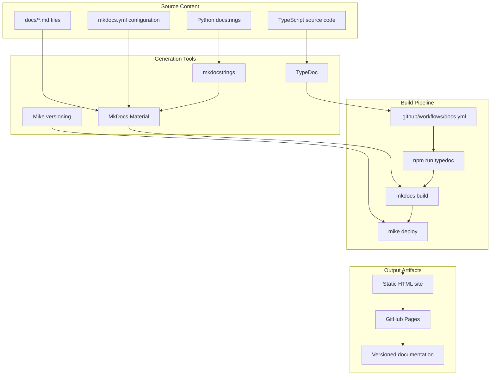
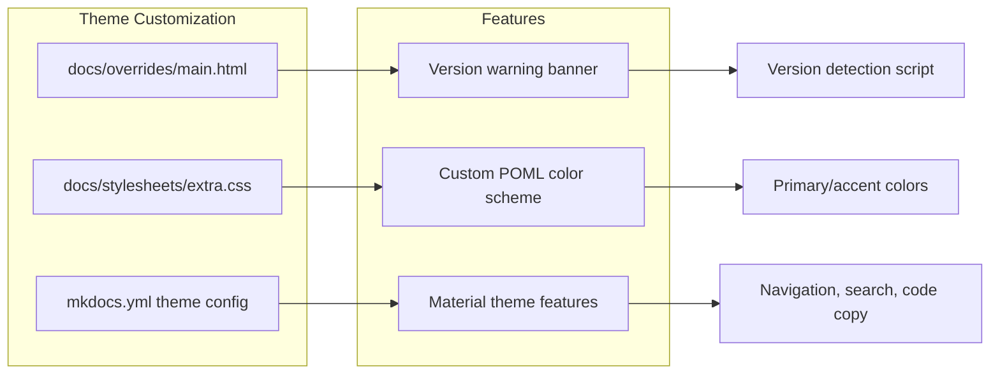
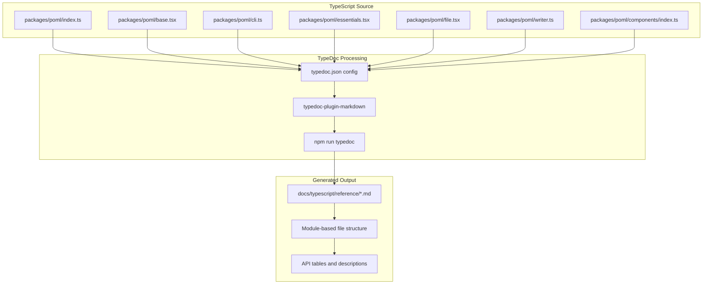
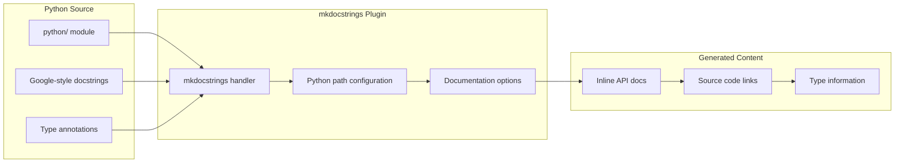
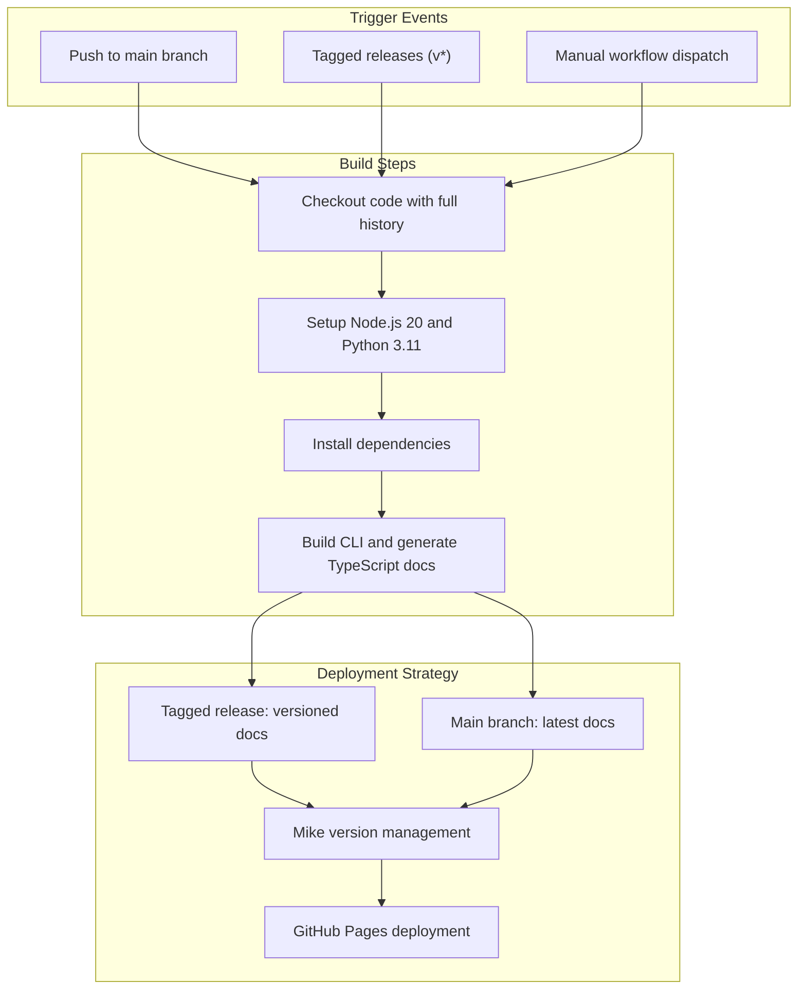
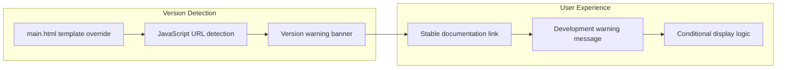
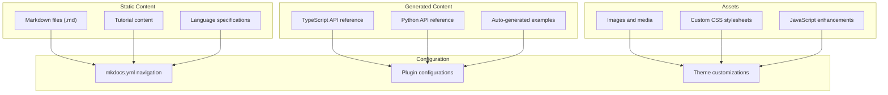

<!-- source: DeepWiki mcp.deepwiki.com · repo microsoft/poml · page 8.4 Documentation System · fetched 2026-10-26 -->

# Documentation System

<details>
<summary>Relevant source files</summary>

The following files were used as context for generating this wiki page:

- [.github/workflows/docs.yml](.github/workflows/docs.yml)
- [docs/overrides/main.html](docs/overrides/main.html)
- [docs/python/index.md](docs/python/index.md)
- [docs/stylesheets/extra.css](docs/stylesheets/extra.css)
- [docs/typescript/index.md](docs/typescript/index.md)
- [mkdocs.yml](mkdocs.yml)
- [typedoc.json](typedoc.json)

</details>


This document describes how the POML project's documentation is generated, maintained, and deployed. The documentation system automatically builds and publishes comprehensive technical documentation from multiple sources including hand-written guides, auto-generated API references, and code examples.

For information about using the documentation as a developer or contributor, see [Building and Testing](#8.1). For details about the overall development workflow, see [Development and Contributing](#8).

## Documentation Architecture

The POML documentation system is built around a multi-source architecture that combines static content with auto-generated API documentation across multiple programming languages.



Sources: [mkdocs.yml:1-136](), [.github/workflows/docs.yml:1-78](), [typedoc.json:1-32]()

## Static Site Generation

The documentation uses MkDocs with the Material theme for static site generation. The primary configuration is defined in `mkdocs.yml`.

### MkDocs Configuration

The site is configured with the following key components:

| Component | Purpose | Configuration Location |
|-----------|---------|----------------------|
| Site metadata | Basic site information and repository links | [mkdocs.yml:1-5]() |
| Material theme | UI theme with navigation features | [mkdocs.yml:13-40]() |
| Plugins | Search, git integration, API docs | [mkdocs.yml:45-63]() |
| Markdown extensions | Code highlighting, diagrams, content features | [mkdocs.yml:64-80]() |
| Navigation structure | Site hierarchy and page organization | [mkdocs.yml:81-131]() |

### Theme Customization

The documentation uses custom styling and template overrides:



The custom color scheme defines POML branding colors:
- Primary color: `#C43B99` (purple)
- Accent color: `#FFD15D` (yellow)

Sources: [docs/stylesheets/extra.css:1-25](), [docs/overrides/main.html:1-27](), [mkdocs.yml:26-40]()

## API Documentation Generation

The system generates API documentation for both TypeScript and Python codebases using different tools and approaches.

### TypeScript API Documentation

TypeScript API documentation is generated using TypeDoc with markdown output:



Key TypeDoc configuration options:
- Entry points: [typedoc.json:2-10]()
- Output format: Markdown with module-based file strategy
- Excludes: Private and internal members
- Plugin: `typedoc-plugin-markdown` for MkDocs compatibility

### Python API Documentation

Python API documentation uses `mkdocstrings` to generate docs from docstrings:



The mkdocstrings configuration includes:
- Python paths: `[python]`
- Docstring style: Google format
- Features: Source links, type headings, symbol navigation

Sources: [typedoc.json:1-32](), [mkdocs.yml:52-62](), [.github/workflows/docs.yml:50-51]()

## Deployment and Versioning

Documentation deployment is automated through GitHub Actions and uses Mike for version management.

### GitHub Actions Workflow

The deployment workflow (`docs.yml`) handles:



### Version Management with Mike

The documentation uses Mike for version management:

- **Tagged releases**: Deploy as versioned documentation (e.g., `v1.0.0`) and update `stable` alias
- **Main branch**: Deploy as `latest` documentation
- **Default version**: `stable` is set as the default version

Version detection logic:
```bash
if [[ "${{ github.ref }}" == refs/tags/v* ]]; then
    # Tagged release - deploy as versioned docs
    VERSION="${{ steps.version.outputs.VERSION }}"
    mike deploy --push --update-aliases $VERSION stable
elif [[ "${{ github.ref }}" == "refs/heads/main" ]]; then
    # Main branch - deploy as latest docs
    mike deploy --push latest
fi
```

### Version Warning System

The documentation includes a client-side warning system for development versions:



The warning appears when users access `poml/latest/` URLs and directs them to the stable documentation.

Sources: [.github/workflows/docs.yml:65-77](), [docs/overrides/main.html:14-25]()

## Content Organization

The documentation is organized into a hierarchical structure that covers different aspects of the POML system:

### Navigation Structure

| Section | Purpose | Source Location |
|---------|---------|----------------|
| Getting Started | Installation and quick start | `docs/index.md`, `docs/tutorial/` |
| Language Spec | POML syntax and components | `docs/language/` |
| Platform Guides | VS Code, Python, TypeScript | `docs/vscode/`, `docs/python/`, `docs/typescript/` |
| Deep Dive | Internal specifications | `docs/deep-dive/` |
| References | Auto-generated API docs | Generated by TypeDoc and mkdocstrings |

### Content Types

The documentation system handles multiple content types:



### Markdown Extensions

The system uses several markdown extensions for enhanced content:

- **Syntax highlighting**: `pymdownx.highlight` with line numbers
- **Mermaid diagrams**: Custom fence for diagram rendering
- **Code snippets**: `pymdownx.snippets` for reusable content
- **Admonitions**: Warning and info boxes
- **Tabbed content**: `pymdownx.tabbed` for organized information

Sources: [mkdocs.yml:81-131](), [mkdocs.yml:64-80]()

## Maintenance and Updates

The documentation system is designed for minimal maintenance overhead through automation:

### Automatic Updates

- **API documentation**: Regenerated on every build from source code
- **Git metadata**: Last updated dates and author information via plugins
- **Version deployment**: Automated through GitHub Actions
- **Dependency management**: Regular updates via Dependabot

### Content Validation

The build process includes validation steps:
- Markdown link checking
- API reference generation validation
- Theme and plugin compatibility testing
- Cross-platform build verification

Sources: [.github/workflows/docs.yml:1-78](), [mkdocs.yml:47-51]()