# Page: Overview

# Overview

<details>
<summary>Relevant source files</summary>

The following files were used as context for generating this wiki page:

- [CITATION.cff](CITATION.cff)
- [README.md](README.md)
- [docs/index.md](docs/index.md)
- [docs/vscode/index.md](docs/vscode/index.md)
- [package-lock.json](package-lock.json)
- [package.json](package.json)

</details>


## Purpose and Scope

This document provides an architectural overview of POML (Prompt Orchestration Markup Language), a comprehensive system for structured prompt engineering with Large Language Models. POML addresses common challenges in prompt development through a markup language with HTML-like syntax, integrated development tools, and multi-language SDK support.

For specific implementation details of individual components, see [Core Architecture](#3). For getting started with POML usage, see [Getting Started](#2). For language model provider configuration, see [Provider Configuration](#6.1).

## System Architecture

POML consists of four main subsystems: the VS Code extension ecosystem, core processing engine, multi-language SDKs, and build/distribution infrastructure.

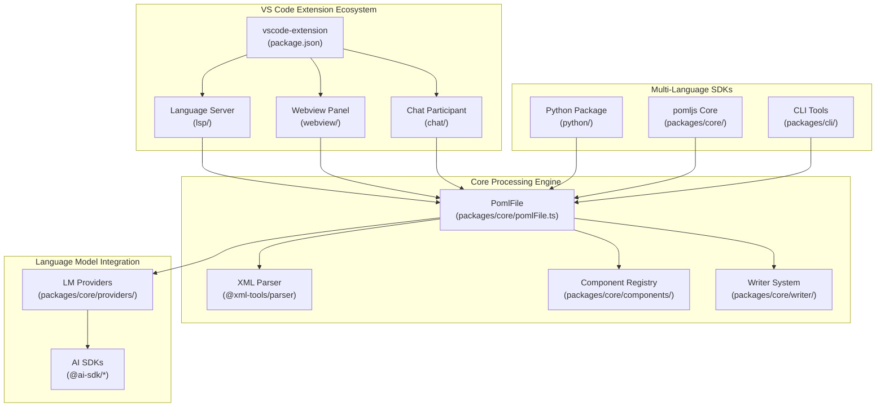

**Sources:** [package.json:1-493](), [README.md:1-131](), [docs/index.md:1-38]()

## Core Processing Pipeline

The POML processing engine transforms markup documents through a multi-stage pipeline, handling XML parsing, component rendering, and output generation.

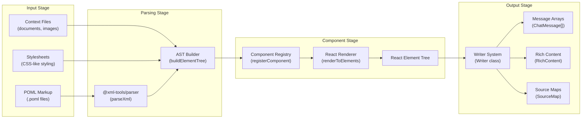

**Sources:** [package.json:458-461](), [package.json:473-476]()

## VS Code Extension Architecture

The VS Code extension serves as the primary development interface, integrating language server capabilities, preview functionality, and direct language model testing.

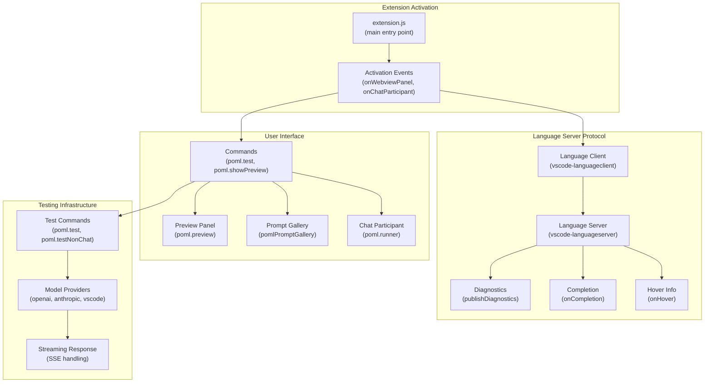

**Sources:** [package.json:18-24](), [package.json:71-174](), [package.json:176-183](), [package.json:245-369]()

## Language Model Provider Integration

POML integrates with multiple language model providers through a unified interface, supporting both streaming and structured outputs.

| Provider | Configuration Key | SDK Package | API Support |
|----------|------------------|-------------|-------------|
| OpenAI | `openai` | `@ai-sdk/openai` | Chat Completion, Response API |
| Anthropic | `anthropic` | `@ai-sdk/anthropic` | Messages API |
| Google | `google` | `@ai-sdk/google` | Gemini API |
| Azure OpenAI | `microsoft` | `@ai-sdk/azure` | Chat Completion |
| VS Code LM | `vscode` | VS Code LM API | Copilot Integration |

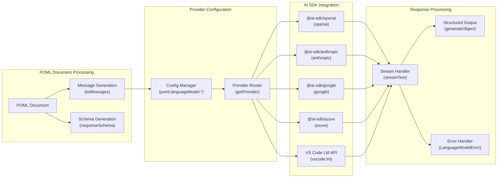

**Sources:** [package.json:245-328](), [package.json:450-461]()

## Multi-Language SDK Architecture

POML provides synchronized APIs across Python and JavaScript/TypeScript environments, with shared component definitions and identical processing logic.

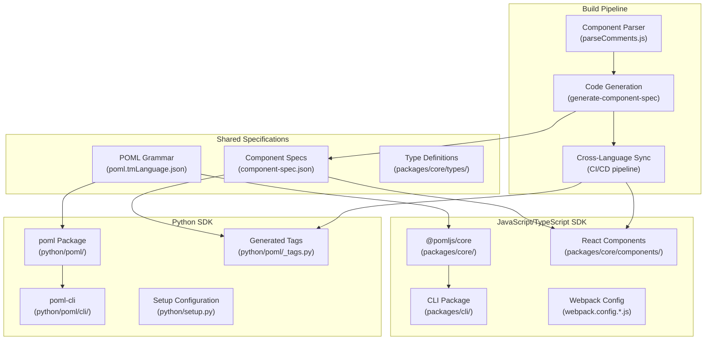

**Sources:** [package.json:378-379](), [package.json:41-63](), [package.json:371-394]()

## Build and Distribution System

The project uses a sophisticated multi-platform build system with GitHub Actions for continuous integration and deployment across VS Code Marketplace, PyPI, and NPM.

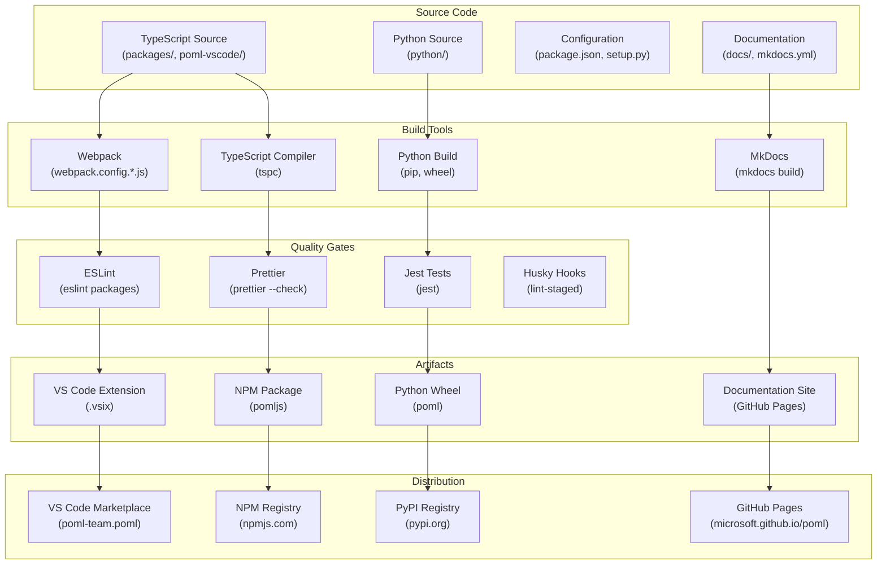

**Sources:** [package.json:371-394](), [package.json:396-407](), [package.json:408-493]()

---

# Page: Getting Started

# Getting Started

<details>
<summary>Relevant source files</summary>

The following files were used as context for generating this wiki page:

- [.github/workflows/test-after-publish.yml](.github/workflows/test-after-publish.yml)
- [CITATION.cff](CITATION.cff)
- [README.md](README.md)
- [docs/index.md](docs/index.md)
- [docs/vscode/index.md](docs/vscode/index.md)
- [examples/401_js_hello_world.mjs](examples/401_js_hello_world.mjs)
- [examples/402_py_hello_world.py](examples/402_py_hello_world.py)
- [packages/poml-build/package.json](packages/poml-build/package.json)
- [python/poml/__init__.py](python/poml/__init__.py)
- [python/poml/api.py](python/poml/api.py)
- [python/tests/test_basic.py](python/tests/test_basic.py)
- [python/tests/test_poml_formats.py](python/tests/test_poml_formats.py)

</details>


This page provides a quick start guide for installing and using POML (Prompt Orchestration Markup Language) across different development environments. It covers basic installation, fundamental usage patterns, and your first examples using the Python SDK, JavaScript SDK, and VS Code extension.

For detailed language reference and syntax, see [Language Reference](#4). For comprehensive SDK documentation, see [Python API](#5.1) and [JavaScript/TypeScript API](#5.2). For VS Code extension features, see [VS Code Extension](#5.4).

## Installation Overview

POML provides multiple installation options depending on your development environment and preferred workflow:

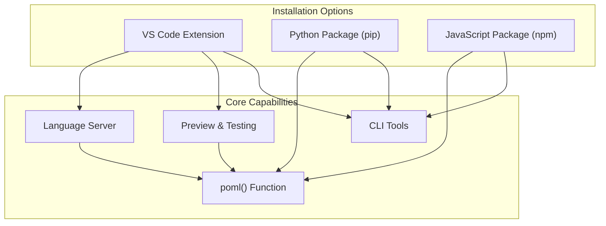

Sources: [README.md:47-77](), [docs/vscode/index.md:13-29](), [packages/poml-build/package.json:70-72]()

## VS Code Extension

### Installation

Install the POML extension from the [Visual Studio Code Marketplace](https://marketplace.visualstudio.com/items?itemName=poml-team.poml) or manually install a `.vsix` file from the [GitHub releases page](https://github.com/microsoft/poml/releases).

### Configuration

Configure your language model provider before testing prompts:

1. Open VS Code Settings and search for "POML"
2. Set your model provider (OpenAI, Azure, Google, Anthropic)
3. Configure API key and endpoint URL
4. Alternatively, add settings directly to `settings.json`

Without proper configuration, the preview and testing features will not function.

Sources: [README.md:55-61](), [docs/vscode/index.md:17-29]()

## Python SDK

### Installation

```bash
pip install poml
```

For development or nightly builds:
```bash
pip install --upgrade --pre --index-url https://test.pypi.org/simple/ --extra-index-url https://pypi.org/simple/ poml
```

### Basic Usage

The primary entry point is the `poml()` function in [python/poml/api.py:422-515]():

```python
from poml import poml

# Basic markup processing
result = poml("<p>Hello, World!</p>")
# Returns: [{"speaker": "human", "content": "Hello, World!"}]

# With context variables
result = poml(
    "<p>Hello {{name}}!</p>", 
    context={"name": "Alice"}
)

# Different output formats
openai_format = poml("template.poml", format="openai_chat")
pydantic_format = poml("template.poml", format="pydantic")
```

The `poml()` function supports multiple output formats via the `format` parameter: `"raw"`, `"message_dict"`, `"dict"`, `"openai_chat"`, `"langchain"`, `"pydantic"`.

Sources: [python/poml/api.py:422-515](), [examples/402_py_hello_world.py:1-12](), [README.md:69-76]()

## JavaScript SDK

### Installation

```bash
npm install pomljs
```

### Basic Usage

```javascript
import { poml } from 'pomljs';

// Basic processing
const output = await poml('<p>hello world</p>');
console.log(output); // "hello world"

// With context
const result = await poml(
    '<p>Hello {{name}}!</p>',
    { context: { name: 'Bob' } }
);
```

### CLI Usage

The JavaScript package includes a CLI tool accessible via `npx`:

```bash
# Process a POML file
npx poml -f example.poml

# With context file
npx poml -f template.poml --context-file data.json

# Output to file
npx poml -f input.poml -o output.json
```

Sources: [examples/401_js_hello_world.mjs:1-12](), [packages/poml-build/package.json:70-72](), [README.md:63-67]()

## First POML Example

Create a file named `example.poml`:

```xml
<poml>
  <role>You are a patient teacher explaining concepts to a 10-year-old.</role>
  <task>Explain the concept of photosynthesis using the provided image as a reference.</task>

  

  <output-format>
    Keep the explanation simple, engaging, and under 100 words.
    Start with "Hey there, future scientist!".
  </output-format>
</poml>
```

This example demonstrates core POML components:
- `<role>` - Defines the AI assistant's persona
- `<task>` - Specifies the objective  
- `` - Includes multimedia content
- `<output-format>` - Constrains response format

Sources: [README.md:29-45]()

## Processing Pipeline

The POML processing flow converts markup through several stages:

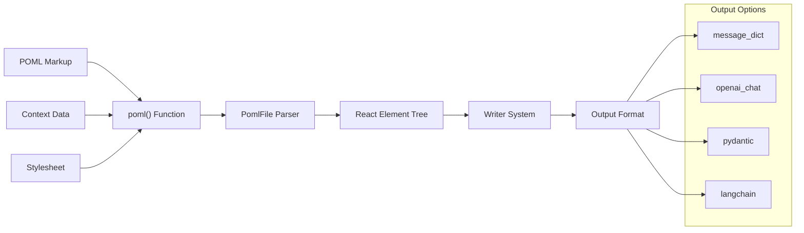

The `poml()` function in [python/poml/api.py:422]() and the equivalent JavaScript function handle this entire pipeline, accepting markup content, optional context data, and styling configuration.

Sources: [python/poml/api.py:422-515]()

## Development Workflow

### Tracing and Debugging

Enable tracing to debug prompt processing:

```python
from poml import set_trace, poml, trace_artifact

# Enable tracing with local files
trace_dir = set_trace(True, trace_dir="./traces")

# Process markup
result = poml("<p>Debug this</p>")

# Add custom artifacts
trace_artifact("analysis.txt", "Custom debugging info")
```

The `set_trace()` function supports multiple backends: `"local"`, `"weave"`, `"agentops"`, `"mlflow"`.

### CLI Tools

Both Python and JavaScript provide CLI interfaces:

```bash
# Python CLI
poml-cli -f template.poml --context-file data.json

# JavaScript CLI  
npx poml -f template.poml --context-file data.json
```

Sources: [python/poml/api.py:37-109](), [python/tests/test_basic.py:84-162]()

## Testing Examples

The repository includes test examples demonstrating basic functionality:

| Language | Example File | Purpose |
|----------|-------------|---------|
| Python | [examples/402_py_hello_world.py]() | Minimal sanity check |
| JavaScript | [examples/401_js_hello_world.mjs]() | Basic processing test |

Both examples process `<p>hello world</p>` and verify expected output format.

### Running Tests

Test the nightly packages:

```bash
# Test Python package
pip install --pre poml
python examples/402_py_hello_world.py

# Test JavaScript package  
npm install pomljs@nightly
node examples/401_js_hello_world.mjs
```

Sources: [examples/402_py_hello_world.py:1-12](), [examples/401_js_hello_world.mjs:1-12](), [.github/workflows/test-after-publish.yml:30-55]()

## Next Steps

After completing this quick start:

1. **Explore Examples**: Review additional examples in the `examples/` directory
2. **Learn POML Syntax**: Study the [Language Reference](#4) for comprehensive component documentation
3. **SDK Integration**: Deep dive into [Python API](#5.1) or [JavaScript API](#5.2) based on your platform
4. **VS Code Features**: Explore [Language Server Features](#5.4.1) and [Preview and Testing](#5.4.2)
5. **Framework Integration**: Connect with [Framework Integrations](#5.3) like LangChain or MLflow

For immediate help, join the [Discord community](https://discord.gg/FhMCqWzAn6) or refer to the [documentation](https://microsoft.github.io/poml).

Sources: [README.md:79-87](), [docs/index.md:17-23]()

---

# Page: Core Architecture

# Core Architecture

<details>
<summary>Relevant source files</summary>

The following files were used as context for generating this wiki page:

- [docs/language/meta.md](docs/language/meta.md)
- [docs/vscode/features.md](docs/vscode/features.md)
- [packages/poml/base.tsx](packages/poml/base.tsx)
- [packages/poml/file.tsx](packages/poml/file.tsx)
- [packages/poml/index.ts](packages/poml/index.ts)
- [packages/poml/tests/base.test.tsx](packages/poml/tests/base.test.tsx)
- [packages/poml/tests/file.test.tsx](packages/poml/tests/file.test.tsx)
- [packages/poml/tests/index.test.tsx](packages/poml/tests/index.test.tsx)
- [packages/poml/tests/trace.test.tsx](packages/poml/tests/trace.test.tsx)
- [packages/poml/tests/writer.test.tsx](packages/poml/tests/writer.test.tsx)
- [packages/poml/util/index.ts](packages/poml/util/index.ts)
- [packages/poml/util/trace.ts](packages/poml/util/trace.ts)
- [packages/poml/writer.ts](packages/poml/writer.ts)

</details>


This document provides a comprehensive technical overview of POML's core architecture, focusing on the fundamental processing pipeline, component system, and writer architecture that powers the entire framework. It covers the key classes, data flows, and architectural patterns used throughout the system.

For information about specific language features and syntax, see [Language Reference](#4). For details on the development tooling and IDE integration, see [VS Code Extension](#5.3).

## System Overview

POML's architecture is built around a multi-stage processing pipeline that transforms markup files through several intermediate representations before producing final output. The system is designed with clear separation of concerns and extensible component patterns.

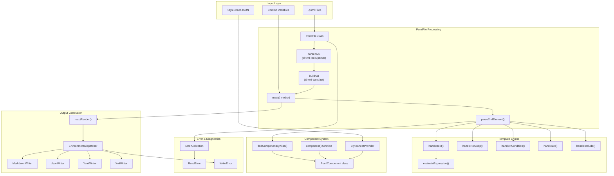

**Sources:** [packages/poml/file.tsx:56-1469](), [packages/poml/base.tsx:1-863](), [packages/poml/writer.ts:1-596](), [packages/poml/index.ts:1-277]()

## Processing Pipeline

The POML processing pipeline transforms input files through several well-defined stages, each with specific responsibilities and clear interfaces between them.

```mermaid
graph LR
    subgraph "Stage 1: XML Parsing"
        input_text["Raw .poml Text"]
        readXml["readXml()"]
        parseXML_func["parseXML()"]
        buildAst_func["buildAst()"]
        xml_document["XMLDocument"]
    end
    
    subgraph "Stage 2: Template Processing"
        react_method["react() method"]
        parseXmlElement_func["parseXmlElement()"]
        handleText_func["handleText()"]
        handleForLoop_func["handleForLoop()"]
        handleIfCondition_func["handleIfCondition()"]
        handleLet_func["handleLet()"]
        handleInclude_func["handleInclude()"]
        evaluateExpression_func["evaluateExpression()"]
    end
    
    subgraph "Stage 3: Component System"
        findComponentByAlias_func["findComponentByAlias()"]
        PomlComponent_render["PomlComponent.render()"]
        component_style["component.style()"]
        React_createElement["React.createElement()"]
    end
    
    subgraph "Stage 4: IR Generation"
        reactRender_func["reactRender()"]
        renderToString["renderToString()"]
        ir_string["IR String"]
    end
    
    subgraph "Stage 5: Output Writing"
        EnvironmentDispatcher_write["EnvironmentDispatcher.write()"]
        writeElementTree["writeElementTree()"]
        buildSourceMap_func["buildSourceMap()"]
        final_output["Final Output"]
    end
    
    input_text --> readXml
    readXml --> parseXML_func
    parseXML_func --> buildAst_func
    buildAst_func --> xml_document
    
    xml_document --> react_method
    react_method --> parseXmlElement_func
    parseXmlElement_func --> handleText_func
    parseXmlElement_func --> handleForLoop_func
    parseXmlElement_func --> handleIfCondition_func
    parseXmlElement_func --> handleLet_func
    parseXmlElement_func --> handleInclude_func
    handleText_func --> evaluateExpression_func
    
    parseXmlElement_func --> findComponentByAlias_func
    findComponentByAlias_func --> PomlComponent_render
    PomlComponent_render --> component_style
    component_style --> React_createElement
    
    React_createElement --> reactRender_func
    reactRender_func --> renderToString
    renderToString --> ir_string
    
    ir_string --> EnvironmentDispatcher_write
    EnvironmentDispatcher_write --> writeElementTree
    writeElementTree --> buildSourceMap_func
    buildSourceMap_func --> final_output
```

**Sources:** [packages/poml/file.tsx:135-188](), [packages/poml/file.tsx:258-279](), [packages/poml/file.tsx:1023-1330](), [packages/poml/util/reactRender.ts:1-50](), [packages/poml/writer.ts:573-596]()

## Component Architecture

The component system provides a flexible, extensible architecture for defining reusable POML elements with standardized behavior patterns.

### PomlComponent Structure

| Property | Type | Description |
|----------|------|-------------|
| `officialName` | `string` | Canonical component name |
| `componentFunc` | `React.ComponentType` | React component implementation |
| `spec` | `ComponentSpec \| undefined` | Component specification from registry |
| `options.aliases` | `string[]` | Alternative names for component lookup |
| `options.requiredProps` | `string[]` | Props that must be provided |
| `options.unwantedProps` | `string[]` | Props that generate warnings |
| `options.applyStyleSheet` | `boolean` | Whether to apply global stylesheet |
| `options.asynchorous` | `boolean` | Whether component supports async operations |

The `PomlComponent` class is created using the `component()` function which registers components in a global registry and provides a standardized interface for component behavior.

### Component Registration and Lookup

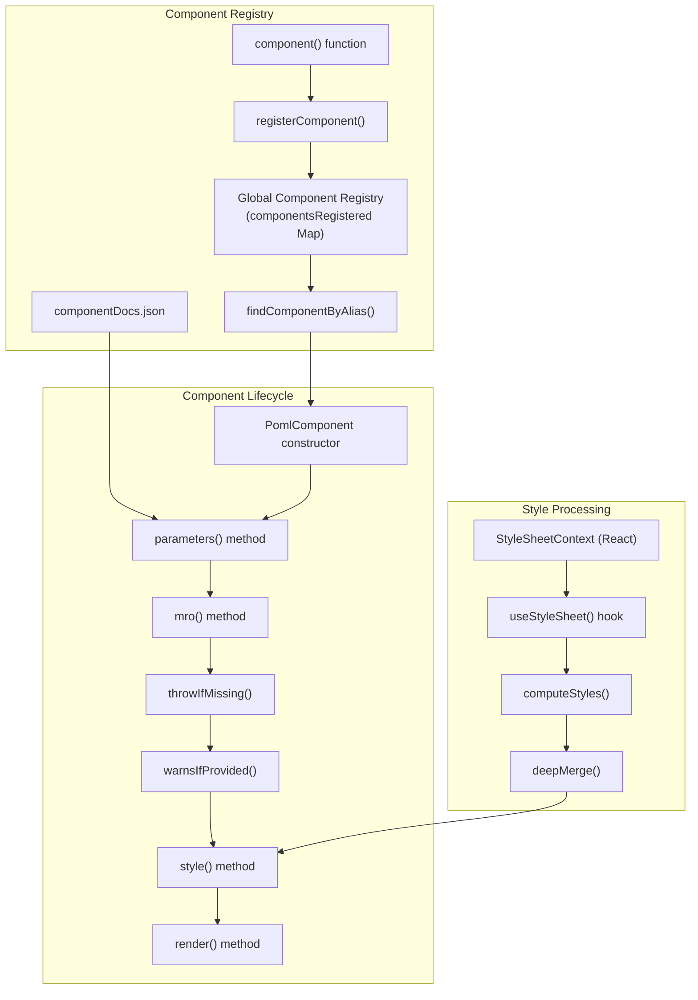

**Sources:** [packages/poml/base.tsx:639-852](), [packages/poml/base.tsx:520-638](), [packages/poml/base.tsx:694-749](), [packages/poml/util/index.ts:4-37]()

## Writer System Architecture

The writer system provides a pluggable architecture for converting intermediate representation to various output formats with comprehensive source mapping support.

```mermaid
graph TD
    subgraph "Writer Base Classes"
        Writer_class["Writer<WriterOptions>"]
        EnvironmentDispatcher_class["EnvironmentDispatcher"]
    end
    
    subgraph "Format-Specific Writers"
        MarkdownWriter_class["MarkdownWriter"]
        JsonWriter_class["JsonWriter"]
        YamlWriter_class["YamlWriter"]
        XmlWriter_class["XmlWriter"]
        HtmlWriter_class["HtmlWriter"]
        CsvWriter_class["CsvWriter"]
        FreeWriter_class["FreeWriter"]
        MultiMediaWriter_class["MultiMediaWriter"]
    end
    
    subgraph "Writer Core Methods"
        writeElementTree_method["writeElementTree()"]
        buildSourceMap_method["buildSourceMap()"]
        truncateText_method["truncateText()"]
        assignSpeakers_method["assignSpeakers()"]
        generateWriterResult_method["generateWriterResult()"]
    end
    
    subgraph "Output Types"
        RichContent_type["RichContent"]
        Message_array["Message[]"]
        SourceMapRichContent_array["SourceMapRichContent[]"]
        SourceMapMessage_array["SourceMapMessage[]"]
    end
    
    Writer_class --> EnvironmentDispatcher_class
    EnvironmentDispatcher_class --> MarkdownWriter_class
    EnvironmentDispatcher_class --> JsonWriter_class
    EnvironmentDispatcher_class --> YamlWriter_class
    EnvironmentDispatcher_class --> XmlWriter_class
    EnvironmentDispatcher_class --> HtmlWriter_class
    EnvironmentDispatcher_class --> CsvWriter_class
    EnvironmentDispatcher_class --> FreeWriter_class
    EnvironmentDispatcher_class --> MultiMediaWriter_class
    
    Writer_class --> writeElementTree_method
    Writer_class --> buildSourceMap_method
    Writer_class --> truncateText_method
    Writer_class --> assignSpeakers_method
    Writer_class --> generateWriterResult_method
    
    buildSourceMap_method --> RichContent_type
    buildSourceMap_method --> Message_array
    buildSourceMap_method --> SourceMapRichContent_array
    buildSourceMap_method --> SourceMapMessage_array
```

### Writer Processing Pipeline

The writer system processes IR through multiple stages to produce final output with comprehensive source mapping.

| Stage | Method | Description |
|-------|--------|-------------|
| **IR Parsing** | `generateWriterResult()` | Parse IR using cheerio, add startIndex/endIndex to nodes |
| **Element Tree Processing** | `writeElementTree()` | Recursively process IR elements, delegate to format writers |
| **Content Generation** | Format-specific `writeElementTree()` | Generate textual output in target format (Markdown, JSON, etc.) |
| **Multimedia Processing** | `buildSourceMap()` | Handle multimedia content positioning and special characters |
| **Speaker Assignment** | `assignSpeakers()` | Assign speaker roles based on `speaker` attributes |
| **Source Map Generation** | `buildSourceMap()` | Create detailed mappings between input, IR, and output positions |

**Sources:** [packages/poml/writer.ts:70-250](), [packages/poml/writer.ts:573-596](), [packages/poml/writer.ts:425-567]()

## Template Engine

The template engine is embedded within the `PomlFile` class and provides powerful templating capabilities including variable substitution, loops, conditionals, and includes.

### Template Features

| Feature | Syntax | Implementation |
|---------|--------|---------------|
| **Variable Substitution** | `{{variable}}` | `handleText()`, `evaluateExpression()` |
| **For Loops** | `for="item in list"` | `handleForLoop()` |
| **Conditionals** | `if="condition"` | `handleIfCondition()` |
| **Variable Declaration** | `<let name="var" value="expression"/>` | `handleLet()` |
| **File Includes** | `<include src="file.poml"/>` | `handleInclude()` |
| **Context Merging** | `<context>{...}</context>` | `deepMerge()` in `react()` |

### Expression Evaluation System

The template engine includes a sophisticated expression evaluation system that tracks all expressions for debugging and IDE support.

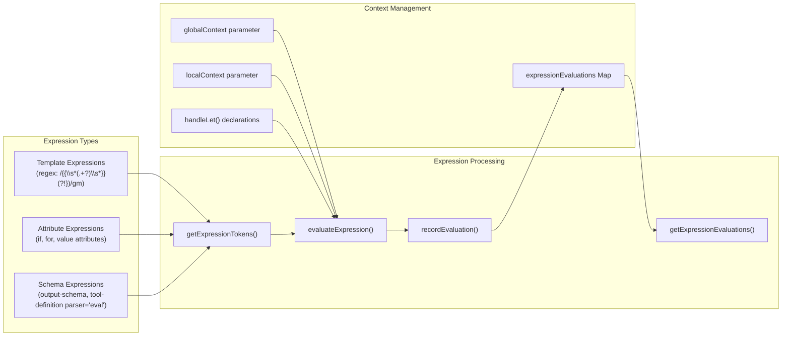

**Sources:** [packages/poml/file.tsx:311-409](), [packages/poml/file.tsx:987-1014](), [packages/poml/file.tsx:416-421](), [packages/poml/file.tsx:411-414]()

## Error Handling and Diagnostics

POML provides comprehensive error handling with detailed source location tracking and categorized error reporting.

### Error Collection System

| Class | Purpose | Key Methods |
|-------|---------|-------------|
| `ErrorCollection` | Singleton error accumulator | `add()`, `clear()`, `list()`, `empty()`, `first()`, `last()` |
| `ReadError` | Parse and processing errors | `fromProps()`, constructor with source location |
| `WriteError` | Output generation errors | Constructor with IR context and source mapping |
| `SystemError` | Internal system errors | Standard Error subclass |
| `PomlError` | Base error class | Constructor with severity levels |

The error system maintains detailed source location tracking with `startIndex`, `endIndex`, and `sourcePath` properties for precise error reporting in development tools.

### Source Mapping and Debugging

The system maintains detailed mappings between original source, intermediate representation, and final output to enable precise error reporting and debugging support.

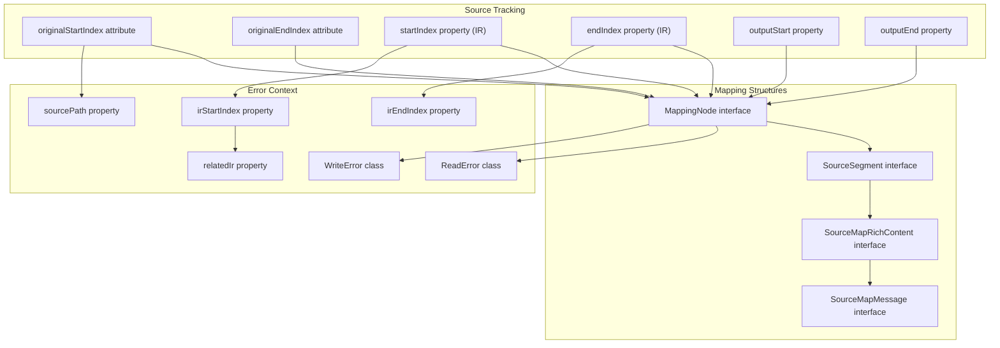

**Sources:** [packages/poml/base.tsx:283-315](), [packages/poml/writer.ts:31-69](), [packages/poml/writer.ts:425-567](), [packages/poml/base.tsx:68-84]()

## Meta Elements and Runtime Configuration

POML supports several meta elements that configure processing behavior and define schemas for structured output.

### Meta Element Processing

| Element | Purpose | Handler Method |
|---------|---------|----------------|
| `<output-schema>` | Response schema definition | `handleOutputSchema()` |
| `<tool-definition>` | Tool schema definition | `handleToolDefinition()` |
| `<runtime>` | Runtime parameters | `handleRuntime()` |
| `<meta>` | Version and component control | `handleMeta()` |

### Schema Processing System

The system supports both JSON Schema and Zod schema definitions with automatic detection and conversion.

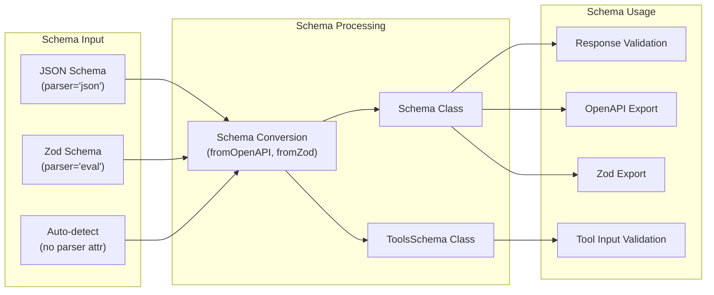

**Sources:** [packages/poml/file.tsx:720-847](), [packages/poml/file.tsx:849-903](), [packages/poml/file.tsx:905-961]()

---

# Page: Processing Pipeline

# Processing Pipeline

<details>
<summary>Relevant source files</summary>

The following files were used as context for generating this wiki page:

- [docs/language/meta.md](docs/language/meta.md)
- [docs/vscode/features.md](docs/vscode/features.md)
- [packages/poml/file.tsx](packages/poml/file.tsx)
- [packages/poml/index.ts](packages/poml/index.ts)
- [packages/poml/tests/file.test.tsx](packages/poml/tests/file.test.tsx)
- [packages/poml/tests/trace.test.tsx](packages/poml/tests/trace.test.tsx)
- [packages/poml/util/index.ts](packages/poml/util/index.ts)
- [packages/poml/util/trace.ts](packages/poml/util/trace.ts)

</details>


This document details the POML document processing pipeline, which transforms POML markup text into various output formats through a multi-stage parsing and rendering process. The pipeline handles XML parsing, React element tree generation, template expression evaluation, and output formatting.

For information about the component system that provides the building blocks used during processing, see [Component System](#3.2). For details about file format specifications, see [File Format and Parsing](#3.3). For output format generation, see [Writer System and Output Formats](#3.4).

## Pipeline Overview

The POML processing pipeline transforms input markup through several distinct stages, each handling specific aspects of document processing and validation.

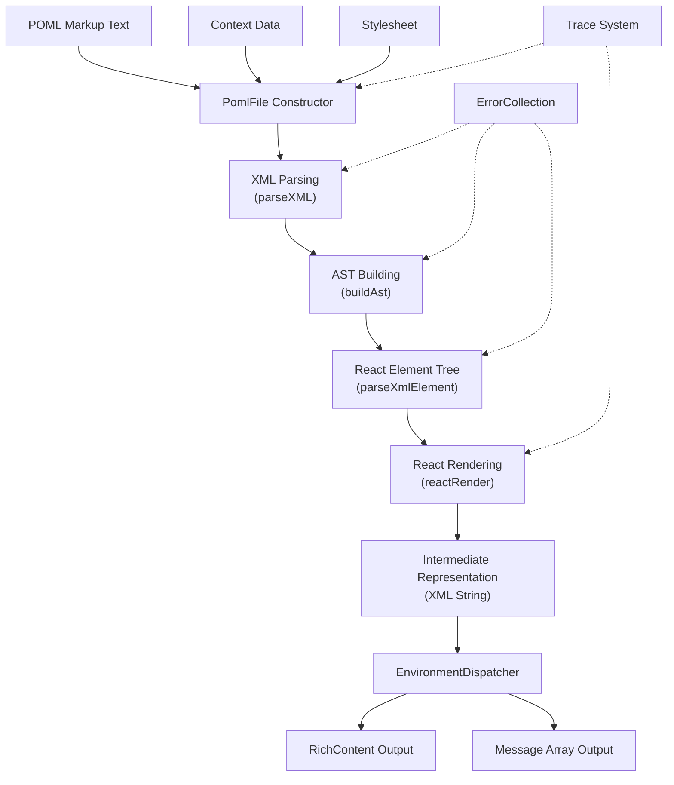

Sources: [packages/poml/file.tsx:96-133](), [packages/poml/index.ts:26-46](), [packages/poml/writer.ts]()

## Input Processing Stage

The processing pipeline begins with multiple input sources that are combined and validated before parsing.

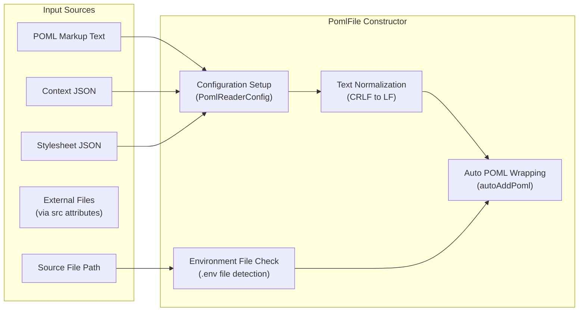

Sources: [packages/poml/file.tsx:71-133](), [packages/poml/file.tsx:27-37]()

### PomlFile Configuration

The `PomlFile` constructor accepts a `PomlReaderOptions` interface that controls processing behavior:

| Option | Type | Default | Description |
|--------|------|---------|-------------|
| `trim` | boolean | `true` | Whether to trim whitespace from text content |
| `autoAddPoml` | boolean | `true` | Automatically wrap content in `<poml>` tags if needed |
| `crlfToLf` | boolean | `true` | Convert Windows line endings to Unix format |

Sources: [packages/poml/file.tsx:27-37]()

### Auto-POML Wrapping Logic

The pipeline automatically detects and wraps content that lacks proper POML root elements:

- **Free Text**: Content without XML structure gets wrapped in `<poml syntax="text" whiteSpace="pre">`
- **Valid XML with Multiple Roots**: Content with valid XML but multiple root elements gets wrapped in `<poml syntax="markdown">`
- **Existing POML**: Content already starting with `<poml` is processed as-is

Sources: [packages/poml/file.tsx:98-113]()

## XML Parsing and AST Building

The core parsing stage transforms POML markup into a structured Abstract Syntax Tree using XML parsing libraries.

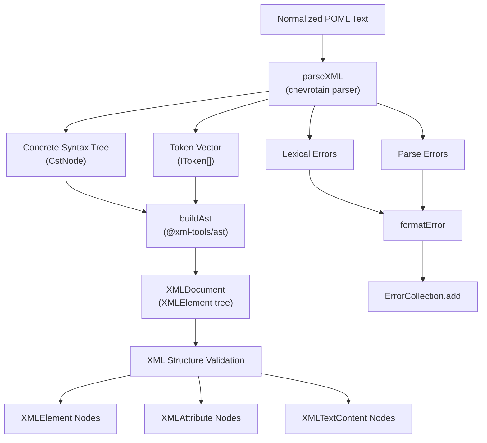

Sources: [packages/poml/file.tsx:135-188](), [packages/xml-tools/parser](), [packages/xml-tools/ast]()

### Error Handling During Parsing

The parsing stage collects and formats errors from multiple sources:

- **Lexical Errors**: Invalid characters, malformed tokens
- **Parse Errors**: Syntax violations, unclosed tags, invalid nesting
- **AST Building Errors**: Structural issues in the parsed tree

All errors are converted to `ReadError` objects with position information and added to the global `ErrorCollection`.

Sources: [packages/poml/file.tsx:139-188](), [packages/poml/base.ts]()

## React Element Tree Generation

The parsed XML AST is transformed into a React element tree through recursive processing of XML elements.

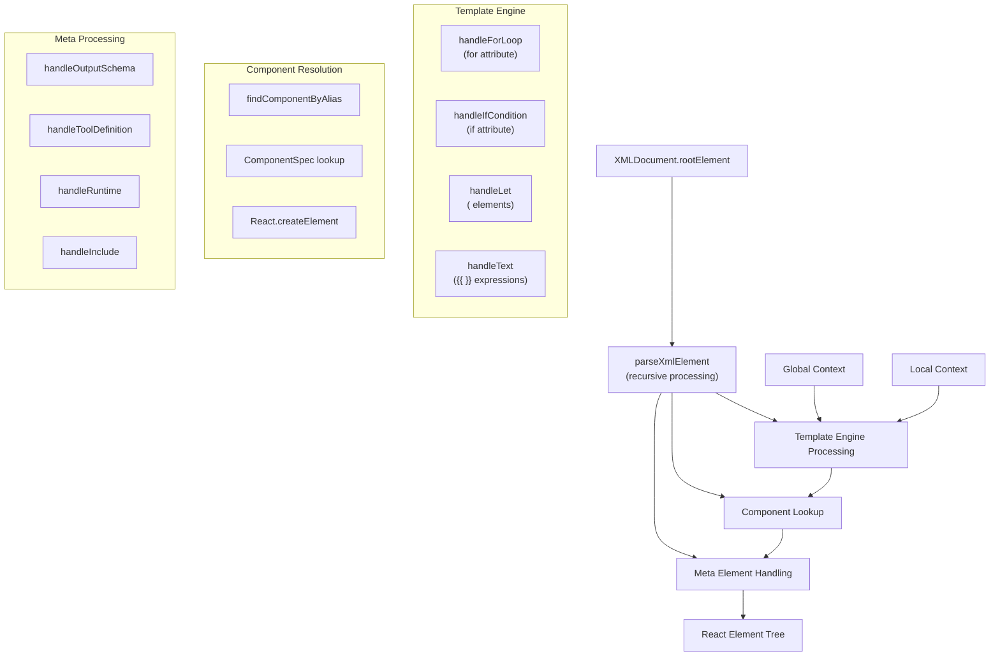

Sources: [packages/poml/file.tsx:1023-1149](), [packages/poml/file.tsx:257-279](), [packages/poml/base.ts]()

### Template Expression Evaluation

The pipeline supports dynamic content through JavaScript expression evaluation:

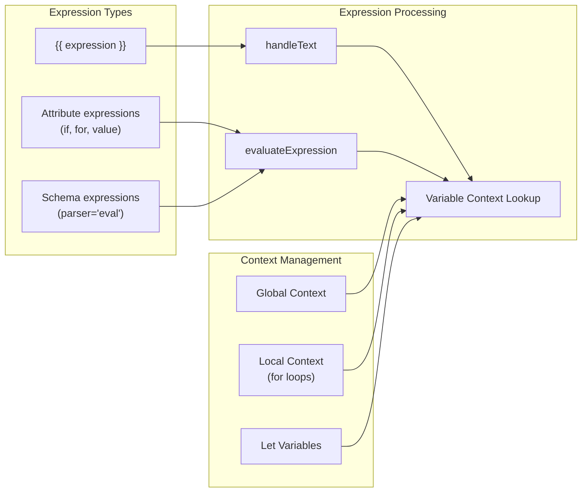

Sources: [packages/poml/file.tsx:934-1014](), [packages/poml/file.tsx:987-1014](), [packages/poml/file.tsx:444-475]()

### Component Registration and Lookup

Components are resolved through a registration system that supports aliases and namespacing:

| Component Type | Examples | Resolution Method |
|---------------|----------|------------------|
| Core Components | `<p>`, `<paragraph>` | `findComponentByAlias` |
| Namespaced | `<Markup.Paragraph>` | Namespace prefix resolution |
| Disabled Components | Via `<meta components="-table">` | `disabledComponents` set |

Sources: [packages/poml/base.ts](), [packages/poml/file.tsx:1095-1149]()

## Output Generation Stage

The React element tree is rendered to an intermediate representation, then transformed into final output formats.

```mermaid
flowchart TD
    ReactTree["React Element Tree"] --> ReactRender["reactRender<br/>(react-dom/server)"]
    
    ReactRender --> IR["Intermediate Representation<br/>(XML String)"]
    
    IR --> WriteDispatch["write() function call"]
    WriteDispatch --> EnvDispatcher["EnvironmentDispatcher"]
    
    EnvDispatcher --> FormatDetection["Output Format Detection"]
    
    FormatDetection --> RichContentPath["write()<br/>(RichContent)"]
    FormatDetection --> MessagePath["writeMessages()<br/>(Message[])"]
    
    RichContentPath --> ContentWriter["Content Writer"]
    MessagePath --> MessageWriter["Message Writer"]
    
    ContentWriter --> RichContent["RichContent<br/>(string | MediaObject[])"]
    MessageWriter --> Messages["Message[]<br/>({speaker, content})"]
    
    subgraph "Source Map Support"
        SourceMapWriter["writeWithSourceMap()"]
        SourceMapRich["SourceMapRichContent[]"]
        SourceMapMsg["SourceMapMessage[]"]
    end
    
    EnvDispatcher --> SourceMapWriter
    SourceMapWriter --> SourceMapRich
    SourceMapWriter --> SourceMapMsg
```

Sources: [packages/poml/index.ts:26-46](), [packages/poml/index.ts:94-101](), [packages/poml/writer.ts](), [packages/poml/util/reactRender.ts]()

### Output Format Types

The pipeline supports multiple output formats through the `write()` function:

| Format | Function Signature | Return Type | Usage |
|--------|-------------------|-------------|-------|
| Rich Content | `write(ir, {speaker: false})` | `RichContent` | General content output |
| Speaker Messages | `write(ir, {speaker: true})` | `Message[]` | Chat/conversation format |
| Source Mapped | `writeWithSourceMap(ir, options)` | `SourceMapRichContent[]` \| `SourceMapMessage[]` | Debug/editor integration |

Sources: [packages/poml/index.ts:87-117](), [packages/poml/base.ts]()

## Supporting Systems

The processing pipeline includes several supporting systems that enhance functionality and debugging capabilities.

### Error Collection System

```mermaid
flowchart LR
    subgraph "Error Sources"
        LexError["Lexical Errors"]
        ParseError["Parse Errors"] 
        EvalError["Expression Errors"]
        ComponentError["Component Errors"]
        FileError["File Read Errors"]
    end
    
    subgraph "Error Processing"
        FormatError["formatError"]
        ReadError["ReadError.fromProps"]
        ErrorCollection["ErrorCollection.add"]
    end
    
    subgraph "Error Context"
        SourcePos["Source Position"]
        SourcePath["Source File Path"]
        ErrorCause["Error Cause"]
    end
    
    LexError --> FormatError
    ParseError --> FormatError
    EvalError --> FormatError
    ComponentError --> FormatError
    FileError --> FormatError
    
    FormatError --> ReadError
    ReadError --> ErrorCollection
    
    SourcePos --> ReadError
    SourcePath --> ReadError
    ErrorCause --> ReadError
```

Sources: [packages/poml/file.tsx:423-437](), [packages/poml/base.ts]()

### Tracing System

The pipeline includes comprehensive tracing for debugging and development:

```mermaid
flowchart TD
    TraceSetup["setTrace(enabled, dir)"] --> TraceDir["Trace Directory Setup"]
    
    subgraph "Trace Points"
        InputTrace["Input Markup"]
        ContextTrace["Context Data"] 
        StylesheetTrace["Stylesheet Data"]
        ResultTrace["Processing Result"]
        PrettyTrace["Pretty Printed Output"]
    end
    
    subgraph "Trace Files"
        MarkupFile["{index}.poml"]
        ContextFile["{index}.context.json"]
        StylesheetFile["{index}.stylesheet.json"] 
        ResultFile["{index}.result.json"]
        PrettyFile["{index}.result.txt"]
        EnvFile["{index}.env"]
        SourceLink["{index}.source.poml"]
    end
    
    InputTrace --> MarkupFile
    ContextTrace --> ContextFile
    StylesheetTrace --> StylesheetFile
    ResultTrace --> ResultFile
    PrettyTrace --> PrettyFile
    
    SourcePath["Source File Path"] --> EnvFile
    SourcePath --> SourceLink
```

Sources: [packages/poml/util/trace.ts](), [packages/poml/index.ts:157-159](), [packages/poml/index.ts:247-254]()

### Language Server Integration

The processing pipeline provides specialized methods for IDE integration:

| Method | Purpose | Return Type |
|--------|---------|-------------|
| `getHoverToken(offset)` | Hover information | `PomlToken \| undefined` |
| `getCompletions(offset)` | Auto-completion | `PomlToken[]` |
| `getExpressionTokens()` | Expression debugging | `PomlToken[]` |
| `getExpressionEvaluations(range)` | Expression results | `any[]` |

Sources: [packages/poml/file.tsx:281-421](), [packages/poml/file.tsx:39-46]()

The pipeline maintains position information throughout processing to support precise error reporting and IDE features like hover tooltips and auto-completion.

---

# Page: Component System

# Component System

<details>
<summary>Relevant source files</summary>

The following files were used as context for generating this wiki page:

- [bump-version.js](bump-version.js)
- [docs/language/components.md](docs/language/components.md)
- [packages/poml-vscode/lsp/parseComments.ts](packages/poml-vscode/lsp/parseComments.ts)
- [packages/poml/assets/componentDocs.json](packages/poml/assets/componentDocs.json)
- [packages/poml/components/tree.tsx](packages/poml/components/tree.tsx)
- [packages/poml/essentials.tsx](packages/poml/essentials.tsx)
- [packages/poml/tests/essentials.test.tsx](packages/poml/tests/essentials.test.tsx)
- [python/poml/_tags.py](python/poml/_tags.py)

</details>


POML's component system provides a unified architecture for defining reusable markup components that work across both TypeScript/JavaScript and Python environments. Components are defined once in TypeScript with React and automatically generate Python bindings, documentation, and type hints through an automated documentation parsing system.

The system organizes components into four categories: Basic Components (text formatting and structure), Intentions (semantic prompt components like `Role` and `Task`), Data Displays (tables, documents, multimedia), and Utilities (tool interactions and message handling).

For information about the processing pipeline that transforms POML files into component trees, see [Processing Pipeline](#3.1). For details about the POML file format and parsing, see [File Format and Parsing](#3.3).

## Cross-Language Component System

### Component Definition Architecture

POML components are defined once in TypeScript and automatically generate Python equivalents through a documentation parsing and code generation system.

```mermaid
graph TD
    subgraph "TypeScript Definition"
        TsComponent["React Component Function"]
        ComponentDecorator["component('Name', aliases)"]
        JsDocComment["JSDoc Comment Block<br/>@param {type} name - description<br/>@example"]
    end
    
    subgraph "Documentation Extraction"
        ParseComments["parseComments.ts"]
        ExtractComponentComments["extractComponentComments()"]
        TsCommentToMarkdown["tsCommentToMarkdown()"]
        ComponentDocs["componentDocs.json"]
    end
    
    subgraph "Python Generation"
        GeneratePythonFile["generatePythonFile()"]
        GeneratePythonMethod["generatePythonMethod()"]
        TagsLib["_TagLib class"]
        PythonMethods["Component methods<br/>def role(), def task(), etc."]
    end
    
    TsComponent --> ComponentDecorator
    JsDocComment --> ParseComments
    ParseComments --> ExtractComponentComments
    ExtractComponentComments --> TsCommentToMarkdown
    TsCommentToMarkdown --> ComponentDocs
    ComponentDocs --> GeneratePythonFile
    GeneratePythonFile --> GeneratePythonMethod
    GeneratePythonMethod --> TagsLib
    TagsLib --> PythonMethods
```

### Component Registration and Categories

Components are automatically categorized during the documentation parsing process into four main categories:

| Category | Components | Purpose |
|----------|------------|---------|
| Basic Components | `Text`, `Paragraph`, `Bold`, `List`, etc. | Text formatting and document structure |
| Intentions | `Role`, `Task`, `OutputFormat`, `Hint` | Semantic prompt engineering components |
| Data Displays | `Document`, `Table`, `Image`, `Conversation` | External data integration and display |
| Utilities | `ToolRequest`, `ToolResponse`, `SystemMessage` | Tool interactions and message handling |

The categorization logic in `scanComponentDocs()` automatically sorts components based on their file location:

```typescript
// From parseComments.ts
if (filePath.endsWith('essentials.tsx') || filePath.endsWith('utils.tsx')) {
  basicComponents.push(...names.filter(name => name !== 'Image' && name !== 'Object' && !name.startsWith('Tool')));
  dataDisplays.push(...names.filter(name => name === 'Image' || name === 'Object'));
  utilities.push(...names.filter(name => name.startsWith('Tool')));
} else if (filePath.endsWith('instructions.tsx')) {
  intentions.push(...names);
}
```

**Sources:** [packages/poml-vscode/lsp/parseComments.ts:142-165](), [packages/poml-vscode/lsp/parseComments.ts:284-310]()

## Component Registration and Definition

### The component() Function

Components are defined using the `component()` function which serves as both a decorator and registration mechanism:

```mermaid
graph LR
    subgraph "Component Definition"
        ComponentName["Component Name"]
        Aliases["aliases: string[]"]
        AsyncOption["asynchorous: boolean"]
        ReactImpl["React Component Implementation"]
    end
    
    subgraph "component() Function"
        ComponentCall["component('Name', options)"]
        ComponentWrapper["Component Wrapper Function"]
        ComponentRegistration["Component Registration"]
    end
    
    subgraph "Generated Outputs"
        TsExport["TypeScript Export"]
        PythonMethod["Python Method"]
        Documentation["Generated Documentation"]
    end
    
    ComponentName --> ComponentCall
    Aliases --> ComponentCall
    AsyncOption --> ComponentCall
    ReactImpl --> ComponentWrapper
    ComponentCall --> ComponentWrapper
    ComponentWrapper --> ComponentRegistration
    ComponentRegistration --> TsExport
    ComponentRegistration --> PythonMethod
    ComponentRegistration --> Documentation
```

Essential components like `Text`, `Paragraph`, and `Image` are defined with the pattern:

```typescript
export const Text = component('Text', ['div', 'poml'])((props: React.PropsWithChildren<PropsSyntaxAny>) => {
  // Component implementation
});

export const Image = component('Image', { aliases: ['img'], asynchorous: true })((props: ImageProps) => {
  // Async component implementation  
});
```

**Sources:** [packages/poml/essentials.tsx:173-190](), [packages/poml/essentials.tsx:650-688]()

### Component Documentation System

Component parameters and documentation are extracted from JSDoc comments and used to generate both Python type hints and user documentation:

```mermaid
graph TD
    subgraph "JSDoc Processing"
        JsDocRegex["commentRegex = /\/\*\*([\s\S]*?)\*\//g"]
        ParamRegex["paramRegex for @param"]
        ExampleRegex["exampleRegex for @example"]
        DescriptionMatch["Description extraction"]
    end
    
    subgraph "Type Conversion"
        TsTypes["TypeScript types<br/>string, boolean, object"]
        PythonTypes["getPythonType()<br/>str, bool, Any"]
        TypeMapping["Type mapping logic"]
    end
    
    subgraph "Generated Artifacts"
        ComponentDocsJson["componentDocs.json"]
        PythonTagsFile["_tags.py"]
        MarkdownDocs["components.md"]
    end
    
    JsDocRegex --> ParamRegex
    ParamRegex --> ExampleRegex
    ExampleRegex --> DescriptionMatch
    
    TsTypes --> TypeMapping
    TypeMapping --> PythonTypes
    
    DescriptionMatch --> ComponentDocsJson
    PythonTypes --> PythonTagsFile
    ComponentDocsJson --> MarkdownDocs
```

The type conversion system maps TypeScript types to appropriate Python types:

| TypeScript Type | Python Type | Notes |
|----------------|-------------|--------|
| `string` | `str` | Direct mapping |
| `boolean` | `bool` | Direct mapping |
| `number` | `int` or `float` | Heuristic based on parameter name |
| `object` | `Any` | Generic object type |
| `Buffer` | `bytes` | Binary data handling |
| `RegExp` | `str` | Python uses string patterns |

**Sources:** [packages/poml-vscode/lsp/parseComments.ts:35-107](), [packages/poml-vscode/lsp/parseComments.ts:194-226]()

## Presentation System and Syntax Contexts

### Syntax Context Computation

POML components support multiple presentation modes through the `computeSyntaxContext()` function, which determines how content should be rendered based on syntax specifications:

```mermaid
graph TD
    subgraph "Syntax Categories"
        MarkupSyntaxes["MARKUP_SYNTAXES<br/>['markdown', 'html', 'csv', 'tsv']"]
        SerializeSyntaxes["SERIALIZE_SYNTAXES<br/>['json', 'yaml', 'xml']"]
        FreeSyntaxes["FREE_SYNTAXES<br/>['text']"]
        MultiMediaSyntaxes["MULTIMEDIA_SYNTAXES<br/>['multimedia']"]
    end
    
    subgraph "Presentation Resolution"
        ComputeSyntaxContext["computeSyntaxContext()"]
        PresentationStyle["presentationStyle object"]
        DefaultSyntax["defaultSyntax fallback"]
    end
    
    subgraph "Component Rendering"
        MarkupComponents["Markup.Paragraph<br/>Markup.List<br/>Markup.Code"]
        SerializeComponents["Serialize.Any<br/>Serialize.Object"]
        FreeComponents["Free.Text"]
        MultiMediaComponents["MultiMedia.Image<br/>MultiMedia.Audio"]
    end
    
    MarkupSyntaxes --> ComputeSyntaxContext
    SerializeSyntaxes --> ComputeSyntaxContext
    FreeSyntaxes --> ComputeSyntaxContext
    MultiMediaSyntaxes --> ComputeSyntaxContext
    
    ComputeSyntaxContext --> PresentationStyle
    PresentationStyle --> DefaultSyntax
    
    DefaultSyntax --> MarkupComponents
    DefaultSyntax --> SerializeComponents
    DefaultSyntax --> FreeComponents
    DefaultSyntax --> MultiMediaComponents
```

### AnyOrFree Component Pattern

Components use the `AnyOrFree` helper to delegate rendering based on computed presentation context:

```typescript
// Essential components follow this pattern
if (presentation === 'markup') {
  return <Markup.Paragraph markupLang={syntax} {...others}>{children}</Markup.Paragraph>;
} else {
  return <AnyOrFree syntax={syntax} presentation={presentation} asAny={true} name={name} type={type} {...others}>
    {children}
  </AnyOrFree>;
}
```

**Sources:** [packages/poml/essentials.tsx:34-94](), [packages/poml/essentials.tsx:97-120]()

### Python Component Implementation

Python components are generated as methods on the `_TagLib` class, with each component method eventually calling the abstract `tag()` method:

```mermaid
graph TD
    subgraph "Python Component Method"
        ComponentMethod["def role(self, caption=None, ...)<br/>def task(self, caption=None, ...)<br/>def document(self, src=None, ...)"]
        TypeHints["Optional[str], Optional[bool]<br/>Generated type hints"]
        Docstring["Generated docstring<br/>Args, Examples"]
    end
    
    subgraph "Method Implementation"
        ParameterValidation["Parameter validation"]
        TagCall["self.tag(tag_name='Role', ...)"]
        KwargsHandling["**kwargs handling"]
    end
    
    subgraph "Base Infrastructure"
        TagLibClass["_TagLib base class"]
        AbstractTag["tag() abstract method"]
        SubclassImplementation["Implemented by subclasses"]
    end
    
    ComponentMethod --> TypeHints
    ComponentMethod --> Docstring
    ComponentMethod --> ParameterValidation
    ParameterValidation --> TagCall
    TagCall --> KwargsHandling
    
    TagCall --> TagLibClass
    TagLibClass --> AbstractTag
    AbstractTag --> SubclassImplementation
```

Example generated Python method structure:

```python
def role(self, caption: Optional[str] = None, **kwargs: Any):
    """Specifies the role you want the language model to assume when responding.
    
    Args:
        caption (Optional[str]): The title or label for the role paragraph. Default is `Role`.
    """
    return self.tag(tag_name="Role", caption=caption, **kwargs)
```

**Sources:** [python/poml/_tags.py:8-14](), [packages/poml-vscode/lsp/parseComments.ts:228-282]()

## Writer System Integration

### Writer Architecture

The writer system converts IR to various output formats through a polymorphic writer architecture:

```mermaid
graph TD
    subgraph "IR Processing"
        IRString["IR String<br/>(XML-like)"]
        CheerioLoad["cheerio.load()"]
        ParsedIR["Parsed IR Tree"]
    end
    
    subgraph "Writer Hierarchy"
        BaseWriter["Writer<WriterOptions>"]
        EnvironmentDispatcher["EnvironmentDispatcher"]
        MarkdownWriter["MarkdownWriter"]
        JsonWriter["JsonWriter"]
        MultiMediaWriter["MultiMediaWriter"]
        HtmlWriter["HtmlWriter"]
    end
    
    subgraph "Output Generation"
        WriterResult["WriterResult<br/>- output: string<br/>- mappings: MappingNode[]<br/>- multimedia: PositionalContentMultiMedia[]<br/>- speakers: SpeakerNode[]"]
        SourceMapContent["SourceMapRichContent[]"]
        Messages["Message[]"]
    end
    
    IRString --> CheerioLoad
    CheerioLoad --> ParsedIR
    
    BaseWriter --> EnvironmentDispatcher
    EnvironmentDispatcher --> MarkdownWriter
    EnvironmentDispatcher --> JsonWriter
    EnvironmentDispatcher --> MultiMediaWriter
    EnvironmentDispatcher --> HtmlWriter
    
    ParsedIR --> BaseWriter
    BaseWriter --> WriterResult
    WriterResult --> SourceMapContent
    WriterResult --> Messages
```

The `EnvironmentDispatcher` routes to specific writers based on presentation attributes in the IR:

```typescript
// Environment-based routing
if (element.attr('presentation') === 'markup') {
  return new MarkdownWriter(this.ir, options).writeElementTree(element, $);
} else if (element.attr('presentation') === 'serialize') {
  return new JsonWriter(this.ir, options).writeElementTree(element, $);
}
```

**Sources:** [packages/poml/writer.ts:598-652](), [packages/poml/writer.ts:70-96]()

### Source Mapping and Multimedia Handling

Writers maintain detailed source mapping information and handle multimedia content positioning:

```mermaid
graph LR
    subgraph "Mapping Information"
        MappingNode["MappingNode<br/>- originalStart/End<br/>- inputStart/End<br/>- outputStart/End"]
        SourceSegment["SourceSegment<br/>- outStart/End<br/>- irStart/End<br/>- content: RichContent"]
    end
    
    subgraph "Multimedia Processing"
        PositionalContent["PositionalContentMultiMedia<br/>- position: 'top'|'middle'|'bottom'<br/>- index: number"]
        MediaSegments["Media Segments<br/>- topSegments<br/>- middleSegments<br/>- bottomSegments"]
    end
    
    subgraph "Output Assembly"
        BuildSourceMap["buildSourceMap()"]
        RichContent["RichContent<br/>(string | ContentMultiMedia)[]"]
        SpeakerMessages["Speaker Messages"]
    end
    
    MappingNode --> BuildSourceMap
    PositionalContent --> BuildSourceMap
    BuildSourceMap --> SourceSegment
    SourceSegment --> RichContent
    SourceSegment --> SpeakerMessages
    
    MediaSegments --> RichContent
```

The system preserves precise mappings between source code positions and output content, enabling accurate error reporting and debugging.

**Sources:** [packages/poml/writer.ts:455-567](), [packages/poml/writer.ts:31-58]()

## Component Implementation Examples

### Essential Components Pattern

Essential components like `Text`, `Paragraph`, and formatting components follow a consistent implementation pattern using syntax context resolution:

```mermaid
graph TD
    subgraph "Component Props"
        PropsSyntaxAny["PropsSyntaxAny<br/>- syntax?: string<br/>- name?: string<br/>- type?: string"]
        SyntaxValidation["computeSyntaxContext(props)"]
        PresentationResult["Presentation<br/>'markup' | 'serialize' | 'free'"]
    end
    
    subgraph "Rendering Strategy"
        MarkupPath["presentation === 'markup'"]
        SerializePath["presentation !== 'markup'"]
        MarkupComponent["Markup.Paragraph<br/>Markup.Bold, etc."]
        AnyOrFreeComponent["AnyOrFree component"]
    end
    
    subgraph "Essential Component Examples"
        Text["Text (poml, div)"]
        Paragraph["Paragraph (p)"]
        Bold["Bold (b)"]
        List["List + ListItem"]
        Code["Code (inline/block)"]
    end
    
    PropsSyntaxAny --> SyntaxValidation
    SyntaxValidation --> PresentationResult
    PresentationResult --> MarkupPath
    PresentationResult --> SerializePath
    MarkupPath --> MarkupComponent
    SerializePath --> AnyOrFreeComponent
    
    MarkupComponent --> Text
    MarkupComponent --> Paragraph
    MarkupComponent --> Bold
    MarkupComponent --> List
    MarkupComponent --> Code
```

### Tree Component Architecture

The `Tree` component demonstrates complex data transformation across multiple presentation formats:

```mermaid
graph LR
    subgraph "Input Data"
        TreeItemData["TreeItemData[]<br/>- name: string<br/>- value?: string<br/>- children?: TreeItemData[]"]
        ShowContent["showContent: boolean"]
        Syntax["syntax: string"]
    end
    
    subgraph "Rendering Functions"
        TreeToHeaderContentTree["treeToHeaderContentTree()<br/>Headers + Code blocks"]
        TreeToNestedList["treeToNestedList()<br/>Nested List items"]
        TreeToPureTextContents["treeToPureTextContents()<br/>Text with markers"]
        TreeToBoxDrawings["treeToBoxDrawings()<br/>├── └── characters"]
        TreeItemsToObject["treeItemsToObject()<br/>Nested objects"]
    end
    
    subgraph "Output Formats"
        MarkupOutput["Markup: Headers/Lists"]
        FreeOutput["Free: Box drawings/Text"]
        SerializeOutput["Serialize: JSON/YAML"]
    end
    
    TreeItemData --> TreeToHeaderContentTree
    TreeItemData --> TreeToNestedList
    TreeItemData --> TreeToPureTextContents
    TreeItemData --> TreeToBoxDrawings
    TreeItemData --> TreeItemsToObject
    
    TreeToHeaderContentTree --> MarkupOutput
    TreeToNestedList --> MarkupOutput
    TreeToPureTextContents --> FreeOutput
    TreeToBoxDrawings --> FreeOutput
    TreeItemsToObject --> SerializeOutput
```

The Tree component showcases how complex components can provide different visualizations of the same data based on presentation context.

**Sources:** [packages/poml/essentials.tsx:207-225](), [packages/poml/components/tree.tsx:203-232]()

### Multimedia Components

Image and Audio components demonstrate asynchronous processing and format-specific rendering:

```mermaid
graph TD
    subgraph "Multimedia Component Props"
        MediaSrc["src: string"]
        MediaBase64["base64: string"]
        MediaType["type: string"]
        MediaAlt["alt: string"]
        MediaSyntax["syntax: string"]
    end
    
    subgraph "Processing Pipeline"
        ExpandRelative["expandRelative(src)"]
        FileExists["fs.existsSync()"]
        PreprocessImage["preprocessImage()<br/>resize, format conversion"]
        PreprocessAudio["preprocessAudio()<br/>format validation"]
        UseWithCatch["useWithCatch() error handling"]
    end
    
    subgraph "Rendering Modes"
        MultimediaMode["syntax === 'multimedia'"]
        TextMode["syntax !== 'multimedia'"]
        MultiMediaComponent["MultiMedia.Image/Audio"]
        InlineComponent["Inline alt text"]
    end
    
    MediaSrc --> ExpandRelative
    ExpandRelative --> FileExists
    FileExists --> PreprocessImage
    FileExists --> PreprocessAudio
    PreprocessImage --> UseWithCatch
    PreprocessAudio --> UseWithCatch
    
    UseWithCatch --> MultimediaMode
    UseWithCatch --> TextMode
    MultimediaMode --> MultiMediaComponent
    TextMode --> InlineComponent
```

**Sources:** [packages/poml/essentials.tsx:650-688](), [packages/poml/essentials.tsx:719-742]()

## Error Handling and Validation

### Error Collection System

POML uses a centralized error collection system that accumulates errors during component processing:

```mermaid
graph TD
    subgraph "Error Types"
        ReadError["ReadError<br/>- startIndex<br/>- endIndex<br/>- sourcePath"]
        WriteError["WriteError<br/>- irStartIndex<br/>- irEndIndex<br/>- relatedIr"]
        SystemError["SystemError"]
    end
    
    subgraph "Error Collection"
        ErrorCollection["ErrorCollection.instance"]
        AddError["ErrorCollection.add()"]
        ListErrors["ErrorCollection.list()"]
    end
    
    subgraph "Error Context"
        PropsBase["PropsBase<br/>- originalStartIndex<br/>- originalEndIndex<br/>- sourcePath"]
        FromProps["ReadError.fromProps()"]
    end
    
    ReadError --> AddError
    WriteError --> AddError
    SystemError --> AddError
    AddError --> ErrorCollection
    ErrorCollection --> ListErrors
    
    PropsBase --> FromProps
    FromProps --> ReadError
```

Components can report errors during validation, processing, or rendering while preserving source location information for debugging.

**Sources:** [packages/poml/base.tsx:285-306](), [packages/poml/base.tsx:328-365]()

### Truncation and Optimization

The writer system includes sophisticated truncation capabilities for managing content length:

```mermaid
graph LR
    subgraph "Truncation Parameters"
        CharLimit["charLimit"]
        TokenLimit["tokenLimit"]
        Priority["priority"]
    end
    
    subgraph "Truncation Logic"
        TruncateText["truncateText()"]
        TokenEncoding["js-tiktoken encoding"]
        PriorityBasedRemoval["Priority-based removal"]
    end
    
    subgraph "Truncation Strategies"
        TruncateEnd["'end' truncation"]
        TruncateStart["'start' truncation"]
        TruncateMiddle["'middle' truncation"]
    end
    
    CharLimit --> TruncateText
    TokenLimit --> TruncateText
    TokenLimit --> TokenEncoding
    Priority --> PriorityBasedRemoval
    
    TruncateText --> TruncateEnd
    TruncateText --> TruncateStart
    TruncateText --> TruncateMiddle
```

Components can specify content limits and priorities, allowing the system to intelligently manage content size while preserving important information.

**Sources:** [packages/poml/writer.ts:90-157](), [packages/poml/writer.ts:793-843]()

# Component System

This document covers POML's component system architecture, including component registration, lifecycle management, validation, and the writer system that converts components to various output formats. The component system bridges React-based component development with POML's markup language features, providing type validation, stylesheet application, and format-specific rendering.

For information about the processing pipeline that transforms POML files into component trees, see [Processing Pipeline](#3.1). For details about the POML file format and parsing, see [File Format and Parsing](#3.3).

---

# Page: File Format and Parsing

# File Format and Parsing

<details>
<summary>Relevant source files</summary>

The following files were used as context for generating this wiki page:

- [docs/language/meta.md](docs/language/meta.md)
- [docs/vscode/features.md](docs/vscode/features.md)
- [eslint.config.js](eslint.config.js)
- [packages/poml/file.tsx](packages/poml/file.tsx)
- [packages/poml/tests/file.test.tsx](packages/poml/tests/file.test.tsx)
- [packages/poml/util/xmlContentAssist.js](packages/poml/util/xmlContentAssist.js)

</details>


This page covers the POML file format specification, XML parsing mechanics, and document structure validation. It explains how POML documents are parsed from text into internal representations that can be processed by the core system.

For information about how parsed documents flow through the processing pipeline, see [Processing Pipeline](#3.1). For details about individual POML components and their behavior, see [Component System](#3.2). For output generation from parsed documents, see [Writer System and Output Formats](#3.4).

## POML File Format Specification

POML documents are XML-based markup files with a `.poml` extension. The format supports both strict XML structure and flexible auto-wrapping for simpler use cases.

### Basic Document Structure

```xml
<poml>
  <meta minVersion="1.0.0" />
  <let name="variable" value="'Hello'" />
  <p>{{ variable }}, world!</p>
</poml>
```

### File Extensions and Detection

POML files use the `.poml` extension. The parser can also handle `.source.poml` files and looks for corresponding `.env` files for source path resolution:

```
document.poml
document.env  # Contains SOURCE_PATH=actual/path/to/source.poml
```

**POML Document Structure**
```mermaid
graph TD
    FileSystem["File System (.poml)"] --> PomlFile["PomlFile Constructor"]
    PomlFile --> EnvCheck["Environment File Check (.env)"]
    EnvCheck --> XMLParse["XML Parsing (parseXML)"]
    XMLParse --> AutoWrap["Auto-wrapping Detection"]
    AutoWrap --> AST["AST Building (buildAst)"]
    AST --> TokenVector["Token Vector Generation"]
    TokenVector --> ReactElement["React Element Tree"]
    
    EnvCheck --> SourcePath["Source Path Resolution"]
    SourcePath --> XMLParse
```

Sources: [packages/poml/file.tsx:71-133]()

## XML Parsing Pipeline

The `PomlFile` class orchestrates XML parsing using the `@xml-tools/parser` library. The parsing process generates both a Concrete Syntax Tree (CST) and Abstract Syntax Tree (AST).

### Parser Configuration

The `PomlReaderOptions` interface defines parsing behavior:

| Option | Type | Default | Description |
|--------|------|---------|-------------|
| `trim` | boolean | `true` | Remove whitespace from text content |
| `autoAddPoml` | boolean | `true` | Auto-wrap content in `<poml>` tags |
| `crlfToLf` | boolean | `true` | Convert Windows line endings |

### Parsing Process

**XML Parsing Flow**
```mermaid
graph LR
    TextInput["Raw Text Input"] --> CRLFConvert["CRLF to LF Conversion"]
    CRLFConvert --> parseXML["parseXML()"]
    parseXML --> CST["Concrete Syntax Tree"]
    parseXML --> TokenVector["Token Vector"]
    parseXML --> LexErrors["Lexical Errors"]
    parseXML --> ParseErrors["Parse Errors"]
    
    CST --> buildAst["buildAst()"]
    TokenVector --> buildAst
    buildAst --> XMLDocument["XMLDocument AST"]
    
    LexErrors --> ErrorCollection["ErrorCollection.add()"]
    ParseErrors --> ErrorCollection
```

Sources: [packages/poml/file.tsx:135-188]()

### Error Handling

The parser collects and reports various error types:

- **Lexical errors**: Invalid tokens, malformed syntax
- **Parse errors**: Structural XML issues, unclosed tags  
- **AST building errors**: Semantic validation failures

All errors are formatted with position information using the `formatError` method and added to the global `ErrorCollection`.

Sources: [packages/poml/file.tsx:139-149](), [packages/poml/file.tsx:152-169](), [packages/poml/file.tsx:423-437]()

## Auto-wrapping Behavior

POML supports automatic wrapping of content that isn't explicitly wrapped in a `<poml>` root element. This feature makes simple prompts easier to write.

### Auto-wrapping Logic

The auto-wrapping system analyzes the parsed content to determine if wrapping is needed:

```typescript
// Detects if content needs <poml> wrapper
if (this.config.autoAddPoml && text.slice(5).toLowerCase() !== '<poml') {
  if (!ast || !ast.rootElement) {
    // Invalid XML - treat as free text
    addPoml = '<poml syntax="text" whiteSpace="pre">';
  } else if (/* multiple root elements or content outside root */) {
    // Valid XML but needs wrapping
    addPoml = '<poml syntax="markdown">';
  }
}
```

### Wrapping Scenarios

| Input Type | Wrapper Applied | Resulting Syntax |
|------------|----------------|------------------|
| Free text | `<poml syntax="text" whiteSpace="pre">` | Preserves formatting |
| Multiple XML roots | `<poml syntax="markdown">` | Markdown processing |
| Invalid XML | `<poml syntax="text" whiteSpace="pre">` | Text fallback |
| Valid single XML | No wrapper | Native POML |

**Auto-wrapping Decision Tree**
```mermaid
graph TD
    Input["Text Input"] --> StartsWithPoml{"Starts with '<poml'?"}
    StartsWithPoml -->|Yes| NoWrap["No Auto-wrapping"]
    StartsWithPoml -->|No| ParseCheck["Parse as XML"]
    
    ParseCheck --> ValidXML{"Valid XML?"}
    ValidXML -->|No| TextWrapper["<poml syntax='text' whiteSpace='pre'>"]
    ValidXML -->|Yes| SingleRoot{"Single Root Element?"}
    
    SingleRoot -->|Yes| ContentCheck["Check Content Outside Root"]
    SingleRoot -->|No| MarkdownWrapper["<poml syntax='markdown'>"]
    
    ContentCheck --> HasOutside{"Content Outside Root?"}
    HasOutside -->|Yes| MarkdownWrapper
    HasOutside -->|No| NoWrap
```

Sources: [packages/poml/file.tsx:98-133](), [packages/poml/file.tsx:190-203]()

## Document Structure and Validation

POML documents follow XML structure with specific semantic rules. The `PomlFile` class validates document structure during parsing.

### Root Element Access

The `xmlRootElement()` method provides access to the document's root element with validation:

```typescript
public xmlRootElement(): XMLElement | undefined {
  if (!this.ast || !this.ast.rootElement) {
    this.reportError('Root element is invalid.', documentRange);
    return undefined;
  }
  return this.ast.rootElement;
}
```

### Meta Element Processing

POML supports several meta-like elements that don't appear in final output:

| Element | Purpose | Handler Method |
|---------|---------|----------------|
| `<meta>` | Version control, component management | `handleMeta()` |
| `<output-schema>` | Response schema definition | `handleOutputSchema()` |
| `<tool-definition>` | Tool registration | `handleToolDefinition()` |
| `<runtime>` | Runtime parameters | `handleRuntime()` |
| `<let>` | Variable definitions | `handleLet()` |
| `<include>` | File inclusion | `handleInclude()` |

**Meta Element Processing Flow**
```mermaid
graph TD
    XMLElement["XMLElement"] --> TagCheck["Check Tag Name"]
    TagCheck --> IsMeta{"Is Meta Element?"}
    
    IsMeta -->|meta| handleMeta["handleMeta()"]
    IsMeta -->|output-schema| handleOutputSchema["handleOutputSchema()"]
    IsMeta -->|tool-definition| handleToolDefinition["handleToolDefinition()"]
    IsMeta -->|runtime| handleRuntime["handleRuntime()"]
    IsMeta -->|let| handleLet["handleLet()"]
    IsMeta -->|include| handleInclude["handleInclude()"]
    IsMeta -->|other| RegularComponent["Regular Component Processing"]
    
    handleMeta --> EmptyElement["Return Empty Fragment"]
    handleOutputSchema --> EmptyElement
    handleToolDefinition --> EmptyElement
    handleRuntime --> EmptyElement
    handleLet --> EmptyElement
    handleInclude --> IncludedContent["Return Included Content"]
```

Sources: [packages/poml/file.tsx:1028-1078](), [packages/poml/file.tsx:744-760](), [packages/poml/file.tsx:762-803]()

## Token Tracking and Language Server Support

The `PomlFile` class maintains detailed token information to support Language Server Protocol (LSP) features like hover tooltips, completions, and diagnostics.

### Token Types

The `PomlToken` interface defines different token categories:

```typescript
export interface PomlToken {
  type: 'element' | 'attribute' | 'attributeValue' | 'expression';
  range: Range;
  element?: string;
  attribute?: string;
  value?: string;
  expression?: string;
}
```

### Position Tracking

The parser maintains position mappings between original document coordinates and processed coordinates, accounting for auto-wrapping:

- `documentRange`: Tracks the original content boundaries
- `recoverPosition()`: Maps display positions back to source positions
- Range calculations for all tokens and expressions

### LSP Feature Implementation

**Token-based LSP Features**
```mermaid
graph LR
    Offset["Editor Offset"] --> recoverPosition["recoverPosition()"]
    recoverPosition --> TokenSearch["Token Search"]
    
    TokenSearch --> getHoverToken["getHoverToken()"]
    TokenSearch --> getCompletions["getCompletions()"]
    
    getHoverToken --> HoverInfo["Hover Information"]
    getCompletions --> CompletionList["Completion Suggestions"]
    
    CompletionList --> getSuggestions["getSuggestions()"]
    getSuggestions --> xmlContentAssist["XML Content Assist"]
    xmlContentAssist --> Providers["Completion Providers"]
```

Sources: [packages/poml/file.tsx:281-309](), [packages/poml/file.tsx:39-54](), [packages/poml/util/xmlContentAssist.js:7-37]()

## Template Expression Parsing

POML supports template expressions using `{{ expression }}` syntax. The parser identifies and tracks these expressions for evaluation and language server features.

### Expression Detection

The `getExpressionTokens()` method scans the document for template expressions:

```typescript
const regex = /{{\s*(.+?)\s*}}(?!})/gm;
```

This regex captures expressions while avoiding triple-brace conflicts (`{{{`).

### Expression Categories

| Context | Pattern | Handler |
|---------|---------|---------|
| Text content | `{{ variable }}` | `handleText()` |
| Attribute values | `attr="{{ value }}"` | `handleAttribute()` |
| Control flow | `if="{{ condition }}"` | `handleIfCondition()` |
| Variable definitions | `value="{{ expression }}"` | `handleLet()` |
| Schema expressions | Parser-specific | `handleSchema()` |

### Expression Evaluation

The `evaluateExpression()` method processes template expressions:

```typescript
private evaluateExpression(expression: string, context: {[key: string]: any}, range?: Range, stripCurlyBrackets: boolean = false) {
  // Remove curly brackets if needed
  // Evaluate using evalWithVariables()
  // Record evaluation results
  // Handle errors
}
```

**Expression Processing Pipeline**
```mermaid
graph TD
    Document["POML Document"] --> Scan["Expression Scanning"]
    Scan --> Regex["Regex Pattern Matching"]
    Regex --> TokenList["Expression Token List"]
    
    TokenList --> Evaluate["evaluateExpression()"]
    Context["Context Variables"] --> Evaluate
    Evaluate --> evalWithVariables["evalWithVariables()"]
    evalWithVariables --> Result["Expression Result"]
    
    Result --> recordEvaluation["recordEvaluation()"]
    recordEvaluation --> ExpressionEvaluations["Expression Evaluations Map"]
    
    Evaluate --> ErrorHandling["Error Handling"]
    ErrorHandling --> ErrorCollection["ErrorCollection.add()"]
```

Sources: [packages/poml/file.tsx:311-409](), [packages/poml/file.tsx:934-972](), [packages/poml/file.tsx:987-1014]()

---

# Page: Writer System and Output Formats

# Writer System and Output Formats

<details>
<summary>Relevant source files</summary>

The following files were used as context for generating this wiki page:

- [packages/poml/base.tsx](packages/poml/base.tsx)
- [packages/poml/tests/base.test.tsx](packages/poml/tests/base.test.tsx)
- [packages/poml/tests/index.test.tsx](packages/poml/tests/index.test.tsx)
- [packages/poml/tests/writer.test.tsx](packages/poml/tests/writer.test.tsx)
- [packages/poml/writer.ts](packages/poml/writer.ts)

</details>


The Writer System is responsible for transforming POML's intermediate representation (IR) into various output formats. This system takes the parsed and processed IR XML and converts it into human-readable text, structured message arrays, multimedia content, or serialized data formats. The writer system handles content truncation, speaker assignment, source mapping, and multimedia positioning during the transformation process.

For information about how POML documents are parsed and converted into IR, see [File Format and Parsing](#3.3). For details about the components that generate the IR, see [Component System](#3.2).

## Architecture Overview

The writer system follows a hierarchical design with a base `Writer` class and specialized writers for different output formats. The `EnvironmentDispatcher` serves as the entry point, routing to appropriate writers based on the `presentation` attribute in the IR.

```mermaid
graph TD
    IR["IR (XML String)"] --> Dispatcher["EnvironmentDispatcher"]
    Dispatcher --> Markdown["MarkdownWriter"]
    Dispatcher --> Json["JsonWriter"] 
    Dispatcher --> Yaml["YamlWriter"]
    Dispatcher --> Xml["XmlWriter"]
    Dispatcher --> Free["FreeWriter"]
    Dispatcher --> Multimedia["MultiMediaWriter"]
    
    Markdown --> RichText["RichContent (String/Array)"]
    Json --> SerializedJson["JSON String"]
    Yaml --> SerializedYaml["YAML String"] 
    Xml --> SerializedXml["XML String"]
    Free --> RawText["Raw Text"]
    Multimedia --> MediaArray["ContentMultiMedia[]"]
    
    RichText --> Messages["Message[] (with speakers)"]
    MediaArray --> Messages
    
    Messages --> SourceMaps["SourceMapMessage[] (with positions)"]
```

**Sources:** [packages/poml/writer.ts:564-612]()

## Core Writer Classes

### Base Writer Class

The `Writer<WriterOptions>` abstract class provides the foundation for all output format transformations. It manages the IR processing lifecycle, token counting, truncation, and source mapping.

```mermaid
classDiagram
    class Writer {
        <<abstract>>
        +ir: string
        +options: WriterOptions
        +tokenizerCache: object
        +write(ir: string) RichContent
        +writeMessages(ir: string) Message[]
        +writeWithSourceMap(ir: string) SourceMapRichContent[]
        +writeMessagesWithSourceMap(ir: string) SourceMapMessage[]
        +truncateText(text, charLimit, tokenLimit, options) string
        +assignSpeakers(result, $) SpeakerNode[]
        #writeElementTree(element, $) WriterPartialResult*
    }
    
    class EnvironmentDispatcher {
        +writeElementTree(element, $) WriterPartialResult
    }
    
    class MarkdownWriter {
        +writeElementTree(element, $) WriterPartialResult
        -makeBox(text, layout, element) MarkdownBox
        -concatMarkdownBoxes(boxes) MarkdownBox
        -handleParagraph(paragraphs, element) MarkdownBox
    }
    
    Writer <|-- EnvironmentDispatcher
    Writer <|-- MarkdownWriter
```

**Sources:** [packages/poml/writer.ts:70-562](), [packages/poml/writer.ts:564-612](), [packages/poml/writer.ts:645-657]()

### Environment Dispatcher

The `EnvironmentDispatcher` analyzes the `presentation` attribute of environment elements and routes to the appropriate specialized writer:

| Presentation Type | Writer Class | Output Format |
|------------------|--------------|---------------|
| `markup` | `MarkdownWriter`, `HtmlWriter`, `CsvWriter`, `TsvWriter` | Formatted text |
| `serialize` | `JsonWriter`, `YamlWriter`, `XmlWriter` | Structured data |
| `free` | `FreeWriter` | Raw text |
| `multimedia` | `MultiMediaWriter` | Media objects |

**Sources:** [packages/poml/writer.ts:576-606]()

## Output Format Types

### RichContent Type System

The writer system produces several types of content representations:

```mermaid
graph LR
    RichContent --> String["string"]
    RichContent --> Array["(string | ContentMultiMedia)[]"]
    
    Array --> TextPart["string"]
    Array --> ImagePart["ContentMultiMediaBinary"]
    Array --> JsonPart["ContentMultiMediaJson"] 
    Array --> ToolReqPart["ContentMultiMediaToolRequest"]
    Array --> ToolResPart["ContentMultiMediaToolResponse"]
    
    ImagePart --> ImageFields["type: 'image/png'<br/>base64: string<br/>alt?: string"]
    JsonPart --> JsonFields["type: 'application/json'<br/>content: any"]
    ToolReqPart --> ToolReqFields["type: 'application/vnd.poml.toolrequest'<br/>id: string<br/>name: string<br/>content: any"]
    ToolResPart --> ToolResFields["type: 'application/vnd.poml.toolresponse'<br/>id: string<br/>name: string<br/>content: RichContent"]
```

**Sources:** [packages/poml/base.tsx:21-66]()

### Message-Based Output

When using speaker-aware output, content is organized into `Message` objects:

```typescript
interface Message {
  speaker: Speaker;  // 'system' | 'human' | 'ai' | 'tool'
  content: RichContent;
}
```

The writer automatically assigns speakers based on `speaker` attributes in the IR and applies default speaker logic when none is specified.

**Sources:** [packages/poml/base.tsx:63-66](), [packages/poml/writer.ts:260-353]()

## Content Processing Features

### Truncation and Priority System

The writer system implements sophisticated content truncation based on character limits, token limits, and priority values:

```mermaid
graph TD
    Content["Input Content"] --> CheckLimits{"Exceeds Limits?"}
    CheckLimits -->|No| OutputDirect["Output Directly"]
    CheckLimits -->|Yes| RemoveLowPriority["Remove Lowest Priority Items"]
    
    RemoveLowPriority --> CheckAgain{"Still Exceeds?"}
    CheckAgain -->|Yes| RemoveMore["Remove Next Priority Level"]
    CheckAgain -->|No| TruncateText["Truncate Remaining Text"]
    
    RemoveMore --> CheckAgain
    TruncateText --> AddMarker["Add Truncation Marker"]
    AddMarker --> OutputFinal["Output Final Content"]
```

Truncation options include:
- `truncateDirection`: `'start'`, `'middle'`, or `'end'`
- `truncateMarker`: Custom truncation indicator (default: `' (...truncated)'`)
- `tokenEncodingModel`: Model for token counting (default: `'gpt-4o'`)

**Sources:** [packages/poml/writer.ts:90-152](), [packages/poml/writer.ts:753-799]()

### Source Mapping

Source mapping preserves the relationship between output content and the original source positions. This enables features like error reporting, debugging, and editor integration:

```typescript
interface SourceMapRichContent {
  startIndex: number;     // Position in original source
  endIndex: number;
  irStartIndex: number;   // Position in IR
  irEndIndex: number;
  content: RichContent;
}
```

**Sources:** [packages/poml/base.tsx:68-74](), [packages/poml/writer.ts:425-533]()

## Specialized Writers

### MarkdownWriter

The `MarkdownWriter` converts IR elements into Markdown syntax using a box model approach. Each element becomes a `MarkdownBox` with text content and spacing rules:

```typescript
interface MarkdownBox {
  text: string;
  before: string;    // Preceding whitespace
  after: string;     // Following whitespace  
  mappings: MappingNode[];
  multimedia: PositionalContentMultiMedia[];
  priority?: number;
}
```

The writer handles:
- Block vs inline element spacing
- List formatting with various bullet styles
- Table generation with configurable options
- Code block formatting with syntax highlighting
- Header level management

**Sources:** [packages/poml/writer.ts:621-628](), [packages/poml/writer.ts:664-698]()

### Serialization Writers

The serialization writers (`JsonWriter`, `YamlWriter`, `XmlWriter`) convert IR elements containing structured data into their respective formats:

- **JsonWriter**: Produces formatted JSON with 2-space indentation
- **YamlWriter**: Outputs YAML using the `js-yaml` library  
- **XmlWriter**: Generates XML with proper escaping and structure

**Sources:** [packages/poml/tests/writer.test.tsx:371-398]()

### MultiMediaWriter

The `MultiMediaWriter` extracts multimedia content and tool interactions from the IR, producing arrays of `ContentMultiMedia` objects. It handles:

- Image data with base64 encoding
- Tool requests with parameters
- Tool responses with nested content
- Mixed multimedia content positioning

**Sources:** [packages/poml/tests/writer.test.tsx:431-673]()

## Usage Examples

### Basic Content Writing

```javascript
// Simple content transformation
const writer = new MarkdownWriter();
const ir = '<p>Hello <b>world</b></p>';
const result = writer.write(ir); // "Hello **world**"
```

### Speaker-Based Messages

```javascript
// Convert to speaker messages
const ir = '<poml><p speaker="human">Question</p><p speaker="ai">Answer</p></poml>';
const messages = writer.writeMessages(ir);
// Result: [
//   { speaker: 'human', content: 'Question' },
//   { speaker: 'ai', content: 'Answer' }
// ]
```

### Source Map Generation

```javascript
// Include source mapping for debugging
const segments = writer.writeWithSourceMap(ir);
// Each segment includes original source positions
```

**Sources:** [packages/poml/tests/index.test.tsx:18-22](), [packages/poml/tests/index.test.tsx:183-190](), [packages/poml/tests/writer.test.tsx:63-71]()

---

# Page: Language Reference

# Language Reference

<details>
<summary>Relevant source files</summary>

The following files were used as context for generating this wiki page:

- [docs/language/components.md](docs/language/components.md)
- [examples/104_financial_analysis.poml](examples/104_financial_analysis.poml)
- [packages/poml/assets/componentDocs.json](packages/poml/assets/componentDocs.json)
- [packages/poml/components/document.tsx](packages/poml/components/document.tsx)
- [packages/poml/components/tree.tsx](packages/poml/components/tree.tsx)
- [packages/poml/essentials.tsx](packages/poml/essentials.tsx)
- [packages/poml/tests/assets/sampleWebpage.html](packages/poml/tests/assets/sampleWebpage.html)
- [packages/poml/tests/components.test.tsx](packages/poml/tests/components.test.tsx)
- [packages/poml/tests/essentials.test.tsx](packages/poml/tests/essentials.test.tsx)
- [packages/poml/tests/util.test.tsx](packages/poml/tests/util.test.tsx)
- [packages/poml/util/image.ts](packages/poml/util/image.ts)
- [python/poml/_tags.py](python/poml/_tags.py)

</details>


This document provides a complete reference for the POML (Prompt Orchestration Markup Language) syntax, components, and features. POML is an XML-like markup language designed for creating structured prompts for language models, with support for multiple output formats including Markdown, JSON, YAML, and rich multimedia content.

For implementation details and internal architecture, see [Core Architecture](#3). For integration with specific platforms and tools, see [Integrations](#5). For practical usage examples, see [Examples and Use Cases](#4.5).

## Language Overview

POML combines XML-like syntax with React-style component composition to create a powerful prompt authoring system. Components can render to different output formats based on context, supporting both human-readable markup and structured data serialization.

### Syntax Fundamentals

POML documents use XML syntax with JSX-style template expressions:

```xml
<poml>
  <role>You are a helpful assistant.</role>
  <task>Analyze the following data: {{dataVariable}}</task>
  <examples>
    <example>
      <input>What is 2+2?</input>
      <output>4</output>
    </example>
  </examples>
</poml>
```

**Core Syntax Modes**

```mermaid
graph TD
    A["POML Document"] --> B["computeSyntaxContext"]
    B --> C["markup"]
    B --> D["serialize"] 
    B --> E["free"]
    B --> F["multimedia"]
    
    C --> C1["markdown"]
    C --> C2["html"]
    
    D --> D1["json"]
    D --> D2["yaml"]
    D --> D3["xml"]
    
    E --> E1["text"]
    
    F --> F1["multimedia"]
```

Sources: [packages/poml/essentials.tsx:26-93]()

## Component System Architecture

POML's component system bridges multiple programming languages through a shared component registry and auto-generation system.

### Component Implementation Flow

```mermaid
graph LR
    A["TypeScript Components"] --> B["componentDocs.json"]
    B --> C["Python _tags.py"]
    B --> D["Documentation"]
    
    A --> E["React Elements"]
    E --> F["Writer System"]
    F --> G["Output Formats"]
    
    subgraph "Core Components"
        H["essentials.tsx"]
        I["components/*.tsx"]
    end
    
    H --> A
    I --> A
```

The system uses TypeScript as the source of truth, with [packages/poml/essentials.tsx]() defining core components and specialized components in [packages/poml/components/]() directory. Documentation is extracted to [packages/poml/assets/componentDocs.json:1-4000]() and used to generate Python bindings at [python/poml/_tags.py:1-50]().

Sources: [packages/poml/essentials.tsx:1-829](), [python/poml/_tags.py:1-50](), [packages/poml/assets/componentDocs.json:1-100]()

### Component Base Classes

```mermaid
classDiagram
    class PropsBase {
        +className: string
        +speaker: string
        +priority: number
    }
    
    class PropsSyntaxBase {
        +syntax: string
    }
    
    class PropsPresentationBase {
        +presentation: string
        +markupLang: string
        +serializer: string
    }
    
    PropsBase <|-- PropsSyntaxBase
    PropsSyntaxBase <|-- PropsPresentationBase
    
    class AnyOrFree {
        +computeSyntaxContext()
        +render()
    }
    
    PropsPresentationBase --> AnyOrFree
```

Sources: [packages/poml/essentials.tsx:20-25](), [packages/poml/essentials.tsx:97-120]()

## Core Component Categories

### Text and Formatting Components

Basic text manipulation and styling components form the foundation of POML documents.

| Component | Element | Purpose | Key Props |
|-----------|---------|---------|-----------|
| `Text` | `<poml>`, `<text>` | Root wrapper for content | `syntax`, `speaker` |
| `Paragraph` | `<p>` | Standalone text section | `blankLine` |
| `Header` | `<h>` | Section headings | Auto-computed level |
| `Bold` | `<b>` | Bold text emphasis | None |
| `Italic` | `<i>` | Italic text emphasis | None |
| `Code` | `<code>` | Code snippets | `inline`, `lang` |

### Structural Components

Components for organizing content into lists, sections, and hierarchical structures.

```mermaid
graph TD
    A["List"] --> B["ListItem"]
    C["SubContent"] --> D["Header"]
    D --> E["Nested Content"]
    
    F["Example"] --> G["ExampleInput"]
    F --> H["ExampleOutput"]
    
    I["ExampleSet"] --> F
```

Sources: [packages/poml/essentials.tsx:529-587](), [docs/language/components.md:211-273]()

### Data and Media Components

Specialized components for external data integration and multimedia content.

**Document Processing Pipeline**

```mermaid
graph LR
    A["Document"] --> B["determineParser"]
    B --> C["PDF Parser"]
    B --> D["DOCX Parser"] 
    B --> E["TXT Parser"]
    
    C --> F["pdfParse"]
    D --> G["mammoth.convertToHtml"]
    E --> H["Buffer.toString"]
    
    F --> I["Text Component"]
    G --> J["htmlToPoml"]
    H --> I
    
    J --> I
```

| Component | Purpose | Key Features |
|-----------|---------|--------------|
| `Document` | PDF/DOCX/TXT files | Parser auto-detection, page selection |
| `Table` | Tabular data | CSV/Excel import, column selection |
| `Image` | Image content | Base64 encoding, resizing |
| `Tree` | Hierarchical data | Multiple output formats |
| `Folder` | Directory structure | File filtering, content inclusion |

Sources: [packages/poml/components/document.tsx:196-287](), [packages/poml/components/tree.tsx:192-368]()

### Conversation and Message Components

Components for structuring conversations and chat-like interactions.

```mermaid
graph TD
    A["SystemMessage"] --> B["system speaker"]
    C["HumanMessage"] --> D["human speaker"]
    E["AiMessage"] --> F["ai speaker"]
    
    G["Conversation"] --> H["messages array"]
    H --> I["selectedMessages"]
    
    J["MessageContent"] --> K["content field"]
```

Sources: [packages/poml/essentials.tsx:533-628](), [python/poml/_tags.py:533-628]()

### Instruction and Example Components

Purpose-built components for creating structured prompts with roles, tasks, and examples.

| Component | XML Tag | Default Caption | Purpose |
|-----------|---------|-----------------|---------|
| `Role` | `<role>` | "Role" | Define AI persona |
| `Task` | `<task>` | "Task" | Specify objectives |
| `OutputFormat` | `<output-format>` | "Output Format" | Desired response format |
| `StepwiseInstructions` | `<stepwise-instructions>` | "Stepwise Instructions" | Step-by-step guidance |
| `Hint` | `<hint>` | "Hint" | Additional guidance |

Sources: [python/poml/_tags.py:55-257](), [packages/poml/assets/componentDocs.json:61-373]()

## Processing and Output Modes

### Syntax Context Resolution

POML components adapt their output based on syntax context, determined by the `computeSyntaxContext` function:

```mermaid
graph TD
    A["Component Props"] --> B["computeSyntaxContext"]
    B --> C{Syntax Specified?}
    
    C -->|Yes| D["Map to Presentation"]
    C -->|No| E["Inherit from Parent"]
    E -->|None Found| F["Default: markdown"]
    
    D --> G["markup"]
    D --> H["serialize"]
    D --> I["free"] 
    D --> J["multimedia"]
    
    G --> K["Markup.Component"]
    H --> L["Serialize.Component"]
    I --> M["Free.Text"]
    J --> N["MultiMedia.Component"]
```

Sources: [packages/poml/essentials.tsx:34-94]()

### Writer System Integration

The processed React elements are converted to final output through the Writer system:

```mermaid
graph LR
    A["React Elements"] --> B["Writer.write()"]
    B --> C["RichContent"]
    C --> D["Markdown"]
    C --> E["JSON Messages"]
    C --> F["YAML"]
    C --> G["XML"]
    
    H["Speaker Context"] --> B
    I["WriterOptions"] --> B
```

Sources: [packages/poml/essentials.tsx:173-190]()

## Template Variables and Dynamic Content

POML supports JSX-style template expressions for dynamic content generation:

```xml
<poml>
  <let name="country" value="France" />
  <input>What is the capital of {{country}}?</input>
  <output>The capital of {{country}} is {{capital}}.</output>
</poml>
```

For detailed information on templating features and control flow, see [Templating and Scripting](#4.3).

## Configuration and Meta Elements

POML documents can include configuration elements for runtime behavior:

- Schema definitions for structured outputs
- Tool declarations for function calling
- Stylesheets for component styling
- Runtime configuration options

For complete details on meta elements, see [Meta Elements and Configuration](#4.4).

## Next Steps

- **Basic Components**: See [Core Components](#4.1) for detailed reference on text, formatting, and structural components
- **Data Integration**: See [Data Components](#4.2) for working with external files, tables, and multimedia
- **Dynamic Content**: See [Templating and Scripting](#4.3) for variables, control flow, and dynamic generation  
- **Advanced Features**: See [Meta Elements and Configuration](#4.4) for schemas, tools, and configuration
- **Practical Examples**: See [Examples and Use Cases](#4.5) for real-world usage patterns

Sources: [packages/poml/essentials.tsx:1-829](), [python/poml/_tags.py:1-2500](), [packages/poml/assets/componentDocs.json:1-4000](), [docs/language/components.md:1-1000]()

---

# Page: Core Components

# Core Components

<details>
<summary>Relevant source files</summary>

The following files were used as context for generating this wiki page:

- [docs/language/components.md](docs/language/components.md)
- [packages/poml/assets/componentDocs.json](packages/poml/assets/componentDocs.json)
- [packages/poml/components/tree.tsx](packages/poml/components/tree.tsx)
- [packages/poml/essentials.tsx](packages/poml/essentials.tsx)
- [packages/poml/tests/essentials.test.tsx](packages/poml/tests/essentials.test.tsx)
- [python/poml/_tags.py](python/poml/_tags.py)

</details>


This document covers the basic POML components that form the foundation of the language. These are the essential building blocks for creating structured text content, including paragraphs, headers, lists, and text formatting elements.

For data and multimedia components like Document, Image, Table, and Tree, see [Data Components](#4.2). For templating features and dynamic content, see [Templating and Scripting](#4.3). For prompt-specific components like Role and Task, see [Meta Elements and Configuration](#4.4).

## Component Architecture Overview

POML's core component system is built on React components that can render to multiple presentation formats. Each component adapts its output based on the current syntax context (`markdown`, `html`, `json`, `yaml`, `xml`, `text`, or `multimedia`).

```mermaid
graph TB
    subgraph "Core Component Architecture"
        ComponentBase["component() decorator<br/>packages/poml/base.tsx"]
        PropsSyntaxBase["PropsSyntaxBase interface<br/>packages/poml/essentials.tsx:20-22"]
        ComputeSyntaxContext["computeSyntaxContext()<br/>packages/poml/essentials.tsx:34-98"]
    end
    
    subgraph "Presentation Modes"
        Markup["Markup Presentation<br/>markdown, html, csv, tsv"]
        Serialize["Serialize Presentation<br/>json, yaml, xml"]
        Free["Free Presentation<br/>text"]
    end
    
    subgraph "Core Text Components"
        Text["Text/Poml<br/>packages/poml/essentials.tsx:173-192"]
        Paragraph["Paragraph<br/>packages/poml/essentials.tsx:207-225"]
        Header["Header<br/>packages/poml/essentials.tsx:305-323"]
        Inline["Inline/Span<br/>packages/poml/essentials.tsx:251-267"]
    end
    
    subgraph "Formatting Components"
        Bold["Bold<br/>packages/poml/essentials.tsx:370-386"]
        Italic["Italic<br/>packages/poml/essentials.tsx:398-414"]
        Code["Code<br/>packages/poml/essentials.tsx:493-511"]
    end
    
    subgraph "List Components"
        List["List<br/>packages/poml/essentials.tsx:529-553"]
        ListItem["ListItem<br/>packages/poml/essentials.tsx:569-587"]
    end
    
    ComponentBase --> PropsSyntaxBase
    PropsSyntaxBase --> ComputeSyntaxContext
    ComputeSyntaxContext --> Markup
    ComputeSyntaxContext --> Serialize
    ComputeSyntaxContext --> Free
    
    Text --> ComputeSyntaxContext
    Paragraph --> ComputeSyntaxContext
    Header --> ComputeSyntaxContext
    Inline --> ComputeSyntaxContext
    Bold --> ComputeSyntaxContext
    Italic --> ComputeSyntaxContext
    Code --> ComputeSyntaxContext
    List --> ComputeSyntaxContext
    ListItem --> ComputeSyntaxContext
```

Sources: [packages/poml/essentials.tsx:20-587](), [packages/poml/base.tsx]()

## Text and Structural Components

### Text Component (`<text>`, `<poml>`)

The `Text` component is the root wrapper for content in POML. It automatically determines the appropriate presentation mode and serves as the default container when no explicit root element is provided.

| Property | Type | Description |
|----------|------|-------------|
| `syntax` | `'markdown'\|'html'\|'json'\|'yaml'\|'xml'\|'text'` | Output format |
| `speaker` | `'human'\|'ai'\|'system'` | Message speaker |
| `name` | `string` | Name for serialization |
| `type` | `string` | Type for serialization |
| `whiteSpace` | `'pre'\|'filter'\|'trim'` | Whitespace handling mode |
| `charLimit` | `number` | Character limit for truncation |
| `tokenLimit` | `number` | Token limit for truncation |
| `priority` | `number` | Priority for global truncation |

```mermaid
graph LR
    TextInput["&lt;poml syntax='markdown'&gt;<br/>Content here<br/>&lt;/poml&gt;"]
    TextComponent["Text component<br/>essentials.tsx:173-192"]
    ComputeContext["computeSyntaxContext()<br/>essentials.tsx:175"]
    
    subgraph "Output Modes"
        MarkupOutput["Paragraph component<br/>essentials.tsx:179-181"]
        SerializeOutput["AnyOrFree component<br/>essentials.tsx:185-187"]
    end
    
    TextInput --> TextComponent
    TextComponent --> ComputeContext
    ComputeContext --> MarkupOutput
    ComputeContext --> SerializeOutput
```

Example usage:
```xml
<poml syntax="markdown">
  <p>This is the main content.</p>
  <h>Section Title</h>
  <p>More content here.</p>
</poml>
```

Sources: [packages/poml/essentials.tsx:173-192](), [packages/poml/essentials.tsx:34-98]()

### Paragraph Component (`<p>`)

The `Paragraph` component creates standalone sections with appropriate spacing. In markup syntaxes, it adds blank lines before and after content.

| Property | Type | Description |
|----------|------|-------------|
| `blankLine` | `boolean` | Add extra blank line spacing |
| `syntax` | `string` | Output format |
| `speaker` | `'human'\|'ai'\|'system'` | Message speaker |

```xml
<p>This is a paragraph with proper spacing.</p>
<p blankLine="true">This paragraph has extra blank lines.</p>
```

Sources: [packages/poml/essentials.tsx:207-225]()

### Header Component (`<h>`)

The `Header` component renders headings with automatic level computation based on nesting context. Use with `SubContent` for hierarchical structure.

| Property | Type | Description |
|----------|------|-------------|
| `syntax` | `string` | Output format |
| `blankLine` | `boolean` | Add extra spacing |

```xml
<h>Main Section</h>
<section>
  <h>Subsection</h>  <!-- Automatically becomes h2 -->
  <p>Content under subsection</p>
</section>
```

Sources: [packages/poml/essentials.tsx:305-323](), [packages/poml/essentials.tsx:340-358]()

### Inline and Structural Helpers

| Component | Purpose | Properties | Example |
|-----------|---------|------------|---------|
| `Inline` (`<span>`) | Inline content wrapper | `syntax`, `speaker`, `whiteSpace` | `<span>inline text</span>` |
| `SubContent` (`<section>`) | Nested content with adjusted header levels | `syntax`, `blankLine` | `<section><h>Nested header</h></section>` |
| `Newline` (`<br>`) | Explicit line breaks | `newLineCount` | `<br newLineCount="2" />` |

### CaptionedParagraph Component (`<cp>`)

The `CaptionedParagraph` component creates a paragraph with a customizable caption title, useful for creating labeled sections.

| Property | Type | Description |
|----------|------|-------------|
| `caption` | `string` | The title or label for the paragraph (required) |
| `captionStyle` | `'header'\|'bold'\|'plain'\|'hidden'` | Caption display style |
| `captionEnding` | `'colon'\|'newline'\|'colon-newline'\|'none'` | Caption ending format |

```xml
<cp caption="Constraints">
  <list>
    <item>Do not exceed 1000 tokens.</item>
    <item>Please use simple words.</item>
  </list>
</cp>
```

Sources: [packages/poml/essentials.tsx:251-267](), [packages/poml/essentials.tsx:340-358](), [packages/poml/essentials.tsx:282-290](), [python/poml/_tags.py:755-828]()

## Formatting Components

POML provides standard text formatting components that work across different presentation modes:

```mermaid
graph TD
    subgraph "Formatting Components"
        Bold["Bold (&lt;b&gt;)<br/>essentials.tsx:370-386"]
        Italic["Italic (&lt;i&gt;)<br/>essentials.tsx:398-414"]
        Strike["Strikethrough (&lt;s&gt;)<br/>essentials.tsx:426-444"]
        Under["Underline (&lt;u&gt;)<br/>essentials.tsx:456-472"]
        Code["Code<br/>essentials.tsx:493-511"]
    end
    
    subgraph "Presentation Adapters"
        MarkupFormatter["Markup.Bold<br/>Markup.Italic<br/>Markup.Code"]
        AnyOrFreeAdapter["AnyOrFree<br/>essentials.tsx:97-120"]
    end
    
    Bold --> MarkupFormatter
    Italic --> MarkupFormatter
    Strike --> MarkupFormatter
    Under --> MarkupFormatter
    Code --> MarkupFormatter
    
    Bold --> AnyOrFreeAdapter
    Italic --> AnyOrFreeAdapter
    Strike --> AnyOrFreeAdapter
    Under --> AnyOrFreeAdapter
    Code --> AnyOrFreeAdapter
```

### Text Formatting Components

POML provides standard text formatting components that adapt their output based on the current presentation mode:

| Component | Tags | Purpose | Example |
|-----------|------|---------|---------|
| `Bold` | `<b>` | Bold emphasis | `<b>Important</b>` |
| `Italic` | `<i>` | Italic emphasis | `<i>emphasis</i>` |
| `Strikethrough` | `<s>`, `<strike>` | Crossed-out text | `<s>removed</s>` |
| `Underline` | `<u>` | Underlined text | `<u>underlined</u>` |

### Code Component

The `Code` component supports both inline and block code with language specification:

| Property | Type | Description |
|----------|------|-------------|
| `inline` | `boolean` | Render inline (default `true`) |
| `lang` | `string` | Programming language for syntax highlighting |
| `whiteSpace` | `'pre'\|'filter'\|'trim'` | Whitespace handling |

```xml
<code inline="true">const x = 42;</code>
<code lang="javascript" inline="false">
function hello() {
  console.log("Hello, world!");
}
</code>
```

Sources: [packages/poml/essentials.tsx:370-472](), [packages/poml/essentials.tsx:493-511]()

## List Components

The list system consists of `List` containers and `ListItem` elements with configurable styling:

```mermaid
graph LR
    subgraph "List Structure"
        ListContainer["List component<br/>essentials.tsx:529-553"]
        ListItemElement["ListItem component<br/>essentials.tsx:569-587"]
    end
    
    subgraph "List Styles"
        StarStyle["listStyle: 'star'<br/>* Item 1<br/>* Item 2"]
        DashStyle["listStyle: 'dash'<br/>- Item 1<br/>- Item 2"]
        DecimalStyle["listStyle: 'decimal'<br/>1. Item 1<br/>2. Item 2"]
        LatinStyle["listStyle: 'latin'<br/>a. Item 1<br/>b. Item 2"]
    end
    
    ListContainer --> ListItemElement
    ListContainer --> StarStyle
    ListContainer --> DashStyle
    ListContainer --> DecimalStyle
    ListContainer --> LatinStyle
```

### List Properties

| Property | Type | Description |
|----------|------|-------------|
| `listStyle` | `'star'\|'dash'\|'plus'\|'decimal'\|'latin'` | Marker style (default `dash`) |
| `blankLine` | `boolean` | Add spacing between items |

```xml
<list listStyle="decimal">
  <item>First item</item>
  <item blankLine="true">Item with extra spacing</item>
  <item>
    Nested content:
    <list listStyle="star">
      <item>Sub-item A</item>
      <item>Sub-item B</item>
    </list>
  </item>
</list>
```

Sources: [packages/poml/essentials.tsx:529-553](), [packages/poml/essentials.tsx:569-587]()

## Common Properties

All core components share a set of common properties inherited from `PropsSyntaxBase`:

| Property | Type | Description |
|----------|------|-------------|
| `syntax` | `'markdown'\|'html'\|'json'\|'yaml'\|'xml'\|'text'` | Output format |
| `className` | `string` | CSS class for styling |
| `speaker` | `'human'\|'ai'\|'system'` | Message speaker context |
| `writerOptions` | `object` | Format-specific writer options |
| `whiteSpace` | `'pre'\|'filter'\|'trim'` | Whitespace handling |
| `charLimit` | `number` | Character limit for truncation |
| `tokenLimit` | `number` | Token limit for truncation |
| `priority` | `number` | Priority for global truncation |

## Presentation Mode Behavior

Core components automatically adapt their output based on the presentation context:

```mermaid
graph TD
    subgraph "Presentation Resolution"
        ComputeSyntaxContext["computeSyntaxContext()<br/>essentials.tsx:34-94"]
        SyntaxProp["syntax prop"]
        ParentContext["Parent context"]
        DefaultSyntax["Default: markdown"]
    end
    
    subgraph "Output Adapters"
        MarkupAdapter["Markup presentation<br/>markdown, html, csv, tsv"]
        SerializeAdapter["Serialize presentation<br/>json, yaml, xml"]
        FreeAdapter["Free presentation<br/>text"]
        AnyOrFreeHelper["AnyOrFree component<br/>essentials.tsx:97-120"]
    end
    
    SyntaxProp --> ComputeSyntaxContext
    ParentContext --> ComputeSyntaxContext
    DefaultSyntax --> ComputeSyntaxContext
    
    ComputeSyntaxContext --> MarkupAdapter
    ComputeSyntaxContext --> SerializeAdapter
    ComputeSyntaxContext --> FreeAdapter
    ComputeSyntaxContext --> AnyOrFreeHelper
```

- **Markup modes** (`markdown`, `html`) render structured content with appropriate formatting
- **Serialize modes** (`json`, `yaml`, `xml`) output structured data representations
- **Free mode** (`text`) renders plain text without formatting
- Components fall back to inherited context when no syntax is specified

Sources: [packages/poml/essentials.tsx:20-120]()

## Component Registration System

All core components are registered using the `component()` decorator which provides:

- Automatic presentation mode detection
- Error handling via `useWithCatch`
- Asynchronous rendering support for media components
- Multiple alias support (e.g., `img` for `Image`)

```mermaid
graph TD
    ComponentDecorator["component() decorator<br/>base.tsx"]
    
    subgraph "Component Features"
        Aliases["aliases: ['img', 'image']<br/>Multiple tag names"]
        Async["asynchorous: true<br/>Promise-based rendering"]
        ErrorHandling["useWithCatch<br/>Error boundary integration"]
    end
    
    subgraph "Registration Examples"
        ImageReg["component('Image',<br/>{aliases: ['img'], asynchorous: true})"]
        TextReg["component('Text', ['div', 'poml'])"]
        BoldReg["component('Bold', ['b'])"]
    end
    
    ComponentDecorator --> Aliases
    ComponentDecorator --> Async
    ComponentDecorator --> ErrorHandling
    
    ComponentDecorator --> ImageReg
    ComponentDecorator --> TextReg
    ComponentDecorator --> BoldReg
```

Sources: [packages/poml/base.tsx](), [packages/poml/essentials.tsx:687](), [packages/poml/essentials.tsx:164](), [packages/poml/essentials.tsx:388]()

---

# Page: Data Components

# Data Components

<details>
<summary>Relevant source files</summary>

The following files were used as context for generating this wiki page:

- [docs/language/components.md](docs/language/components.md)
- [examples/104_financial_analysis.poml](examples/104_financial_analysis.poml)
- [packages/poml/assets/componentDocs.json](packages/poml/assets/componentDocs.json)
- [packages/poml/components/document.tsx](packages/poml/components/document.tsx)
- [packages/poml/components/tree.tsx](packages/poml/components/tree.tsx)
- [packages/poml/essentials.tsx](packages/poml/essentials.tsx)
- [packages/poml/tests/assets/sampleWebpage.html](packages/poml/tests/assets/sampleWebpage.html)
- [packages/poml/tests/components.test.tsx](packages/poml/tests/components.test.tsx)
- [packages/poml/tests/essentials.test.tsx](packages/poml/tests/essentials.test.tsx)
- [packages/poml/tests/util.test.tsx](packages/poml/tests/util.test.tsx)
- [packages/poml/util/image.ts](packages/poml/util/image.ts)
- [python/poml/_tags.py](python/poml/_tags.py)

</details>


This document covers POML components designed for handling external data sources and multimedia content. Data components enable prompts to incorporate file contents, structured data, images, audio, web content, and other external resources into language model interactions.

For basic text formatting and content structuring, see [Core Components](#4.1). For template variables and dynamic content generation, see [Templating and Scripting](#4.3).

## Overview

Data components provide standardized interfaces for incorporating external content into POML documents. They handle file I/O, parsing, format conversion, and rendering across different output syntaxes (markdown, JSON, XML, etc.).

### Component Categories

POML data components fall into several categories:

| Category | Components | Purpose |
|----------|------------|---------|
| Document Processing | `Document` | Handle PDF, DOCX, TXT files |
| Multimedia | `Image`, `Audio` | Embed images and audio content |
| Structured Data | `Table`, `Tree`, `Folder`, `DataObject` | Display tabular and hierarchical data |
| Communication | `Conversation`, `MessageContent`, `ToolRequest`, `ToolResponse` | Handle chat and tool interactions |
| Web Content | `Webpage` | Process HTML content |

### Data Component Architecture

```mermaid
graph TB
    subgraph "External Sources"
        FS["File System"]
        WEB["Web URLs"]
        B64["Base64 Data"]
        BUF["Buffer Data"]
    end
    
    subgraph "Data Components"
        DOC["Document"]
        IMG["Image"]
        AUD["Audio"]
        TBL["Table"]
        TREE["Tree"]
        FOLD["Folder"]
        CONV["Conversation"]
        WP["Webpage"]
    end
    
    subgraph "Processing Pipeline"
        PARSE["Parser Layer"]
        PROC["Processor Layer"]
        RENDER["Renderer Layer"]
    end
    
    subgraph "Output Formats"
        MD["Markdown"]
        JSON["JSON/YAML"]
        MM["Multimedia"]
        TXT["Text"]
    end
    
    FS --> DOC
    FS --> IMG
    FS --> AUD
    FS --> TBL
    FS --> FOLD
    WEB --> IMG
    WEB --> WP
    B64 --> DOC
    B64 --> IMG
    B64 --> AUD
    BUF --> DOC
    
    DOC --> PARSE
    IMG --> PARSE
    AUD --> PARSE
    TBL --> PARSE
    TREE --> PARSE
    FOLD --> PARSE
    CONV --> PARSE
    WP --> PARSE
    
    PARSE --> PROC
    PROC --> RENDER
    
    RENDER --> MD
    RENDER --> JSON
    RENDER --> MM
    RENDER --> TXT
```

Sources: [packages/poml/essentials.tsx:1-829](), [packages/poml/components/document.tsx:1-287](), [packages/poml/components/tree.tsx:1-369]()

## Document Components

### Document Component

The `Document` component processes external documents including PDF, DOCX, and TXT files. It automatically detects file types and converts content to POML-compatible formats.

```xml
<Document src="report.pdf" multimedia="false" selectedPages="0:3" />
<Document buffer="Hello world" parser="txt" />
<Document base64="..." parser="docx" />
```

#### Document Processing Pipeline

```mermaid
graph LR
    subgraph "Input Sources"
        SRC["src (file path)"]
        BUF["buffer (string/Buffer)"]
        B64["base64 (encoded data)"]
    end
    
    subgraph "Parser Detection"
        AUTO["determineParser()"]
        PDF["PDF Parser"]
        DOCX["DOCX Parser"]
        TXT["TXT Parser"]
    end
    
    subgraph "Content Processing"
        PDFP["pdfParse()"]
        MAMMOTH["mammoth.convertToHtml()"]
        CHEERIO["cheerio.load()"]
        POML["htmlToPoml()"]
    end
    
    subgraph "Output Generation"
        TEXT["Text Component"]
        TABLE["Table Component"]
        IMAGE["Image Component"]
        LIST["List Component"]
    end
    
    SRC --> AUTO
    BUF --> AUTO
    B64 --> AUTO
    
    AUTO --> PDF
    AUTO --> DOCX
    AUTO --> TXT
    
    PDF --> PDFP
    DOCX --> MAMMOTH
    TXT --> TEXT
    
    MAMMOTH --> CHEERIO
    CHEERIO --> POML
    
    PDFP --> TEXT
    POML --> TABLE
    POML --> IMAGE
    POML --> LIST
```

Sources: [packages/poml/components/document.tsx:196-287](), [packages/poml/components/document.tsx:47-62](), [packages/poml/components/document.tsx:175-184]()

#### Key Features

- **Automatic Format Detection**: Infers parser from file extension via `determineParser()` [packages/poml/components/document.tsx:207-218]()
- **PDF Page Selection**: Supports page ranges using `selectedPages` parameter [packages/poml/components/document.tsx:47-56]()
- **Multimedia Handling**: Controls whether embedded images are displayed or converted to alt text [packages/poml/components/document.tsx:145-167]()
- **Buffer Caching**: Implements file content caching via `BufferCollection` [packages/poml/components/document.tsx:24-35]()

## Multimedia Components

### Image Component

The `Image` component handles image display with support for local files, URLs, and base64 data. It provides image processing capabilities including resizing and format conversion.

```xml
<Image src="chart.png" alt="Sales Chart" maxWidth="800" />
<Image base64="iVBORw0KGgoAAAANSUhEUgAA..." type="png" />
<Image src="https://example.com/image.jpg" resize="0.5" />
```

#### Image Processing Flow

```mermaid
graph TD
    subgraph "Input Validation"
        SRC_CHECK["src validation"]
        B64_CHECK["base64 validation"]
        URL_CHECK["URL detection"]
    end
    
    subgraph "Image Loading"
        FILE_READ["fs.readFileSync()"]
        URL_FETCH["fetch()"]
        B64_DECODE["Buffer.from(base64)"]
    end
    
    subgraph "Image Processing"
        SHARP["sharp()"]
        RESIZE["resizeImage()"]
        CONVERT["convertType()"]
        METADATA["metadata()"]
    end
    
    subgraph "Output Generation"
        MM_OUT["MultiMedia.Image"]
        INLINE_OUT["Inline (alt text)"]
    end
    
    SRC_CHECK --> URL_CHECK
    SRC_CHECK --> FILE_READ
    URL_CHECK --> URL_FETCH
    B64_CHECK --> B64_DECODE
    
    FILE_READ --> SHARP
    URL_FETCH --> SHARP
    B64_DECODE --> SHARP
    
    SHARP --> METADATA
    SHARP --> RESIZE
    RESIZE --> CONVERT
    
    CONVERT --> MM_OUT
    METADATA --> INLINE_OUT
```

Sources: [packages/poml/essentials.tsx:650-687](), [packages/poml/util/image.ts:169-185](), [packages/poml/util/image.ts:45-83]()

### Audio Component

The `Audio` component embeds audio files with support for various formats and automatic MIME type detection.

```xml
<Audio src="recording.mp3" />
<Audio base64="..." type="audio/wav" />
```

Sources: [packages/poml/essentials.tsx:719-742]()

## Structured Data Components

### Table Component

The `Table` component displays tabular data from files or inline records with flexible column selection and formatting options.

```xml
<Table src="data.csv" maxRecords="100" syntax="markdown" />
<Table records="{{people}}" selectedColumns="['name', 'age']" />
```

#### Table Data Flow

```mermaid
graph LR
    subgraph "Data Sources"
        CSV["CSV Files"]
        EXCEL["Excel Files"]
        JSON["JSON Arrays"]
        RECORDS["Inline Records"]
    end
    
    subgraph "Processing"
        PARSE["Parser Selection"]
        SELECT["Column/Record Selection"]
        FORMAT["Format Conversion"]
    end
    
    subgraph "Output Formats"
        MD_TBL["Markdown Table"]
        HTML_TBL["HTML Table"]
        JSON_OUT["JSON Output"]
        CSV_OUT["CSV Output"]
    end
    
    CSV --> PARSE
    EXCEL --> PARSE
    JSON --> PARSE
    RECORDS --> PARSE
    
    PARSE --> SELECT
    SELECT --> FORMAT
    
    FORMAT --> MD_TBL
    FORMAT --> HTML_TBL
    FORMAT --> JSON_OUT
    FORMAT --> CSV_OUT
```

Sources: [python/poml/_tags.py:631-686]()

### Tree Component

The `Tree` component renders hierarchical data structures in various formats including markdown lists, JSON objects, and text representations.

```xml
<Tree items="{{treeData}}" syntax="markdown" showContent="true" />
```

#### Tree Rendering Strategies

The `Tree` component implements different rendering strategies based on output format:

- **Markup Syntaxes**: Uses nested `List` and `Header` components [packages/poml/components/tree.tsx:46-93]()
- **Text Format**: Generates box-drawing characters via `treeToBoxDrawings()` [packages/poml/components/tree.tsx:144-175]()
- **Serialize Formats**: Converts to nested objects via `treeItemsToObject()` [packages/poml/components/tree.tsx:178-189]()

Sources: [packages/poml/components/tree.tsx:203-232]()

### Folder Component

The `Folder` component displays directory structures as trees with optional file content inclusion and filtering.

```xml
<Folder src="./project" filter=".*\.py$" maxDepth="3" showContent="true" />
```

The component uses `readDirectoryToTreeItems()` to recursively traverse directories and applies filtering logic [packages/poml/components/tree.tsx:234-308]().

Sources: [packages/poml/components/tree.tsx:337-368]()

## Communication Components

### Conversation Component

The `Conversation` component displays chat-style interactions with support for message selection and speaker identification.

```xml
<Conversation messages="{{chatHistory}}" selectedMessages="-6:" />
```

### Tool Components

POML provides specialized components for AI tool interactions:

#### ToolRequest Component

Represents AI-generated tool calls with structured parameters:

```xml
<ToolRequest id="call-123" name="search" parameters="{{searchParams}}" />
```

#### ToolResponse Component

Displays tool execution results with rich content support:

```xml
<ToolResponse id="call-123" name="search">
  <Paragraph>Found 3 results:</Paragraph>
  <List>
    <ListItem>Result 1</ListItem>
  </List>
</ToolResponse>
```

The `ToolResponse` component automatically wraps content in multimedia presentation mode while preserving syntax context for child elements [packages/poml/essentials.tsx:805-828]().

Sources: [packages/poml/essentials.tsx:762-781](), [packages/poml/essentials.tsx:805-828]()

## Implementation Architecture

### Component Base Classes

Data components inherit from the base component system and implement common patterns:

```mermaid
graph TD
    subgraph "Base System"
        COMP["component()"]
        PROPS["PropsBase"]
        SYNTAX["PropsSyntaxBase"]
    end
    
    subgraph "Presentation Layer"
        MARKUP["Markup"]
        SERIALIZE["Serialize"]
        FREE["Free"]
        MULTIMEDIA["MultiMedia"]
    end
    
    subgraph "Data Components"
        DOC["Document"]
        IMG["Image"]
        TBL["Table"]
        TREE["Tree"]
    end
    
    COMP --> DOC
    COMP --> IMG
    COMP --> TBL
    COMP --> TREE
    
    PROPS --> SYNTAX
    SYNTAX --> DOC
    SYNTAX --> IMG
    SYNTAX --> TBL
    SYNTAX --> TREE
    
    DOC --> MARKUP
    DOC --> SERIALIZE
    DOC --> FREE
    
    IMG --> MULTIMEDIA
    TBL --> MARKUP
    TBL --> SERIALIZE
    TREE --> MARKUP
    TREE --> SERIALIZE
    TREE --> FREE
```

Sources: [packages/poml/essentials.tsx:20-94](), [packages/poml/base.ts]()

### Syntax Context Resolution

Data components use `computeSyntaxContext()` to determine appropriate rendering based on the `syntax` parameter and inherited presentation context [packages/poml/essentials.tsx:34-94]().

### Asynchronous Processing

Components handling external resources are marked with `asynchorous: true` in their component definitions, enabling proper async/await handling during rendering [packages/poml/essentials.tsx:650](), [packages/poml/components/document.tsx:266]().

Sources: [packages/poml/essentials.tsx:34-94](), [packages/poml/essentials.tsx:650](), [packages/poml/components/document.tsx:266]()

---

# Page: Templating and Scripting

# Templating and Scripting

<details>
<summary>Relevant source files</summary>

The following files were used as context for generating this wiki page:

- [docs/language/meta.md](docs/language/meta.md)
- [docs/vscode/features.md](docs/vscode/features.md)
- [packages/poml/file.tsx](packages/poml/file.tsx)
- [packages/poml/tests/file.test.tsx](packages/poml/tests/file.test.tsx)

</details>


This document covers POML's templating and scripting capabilities, including template expressions, control flow, variable definitions, and dynamic content generation. These features enable dynamic prompts that can adapt based on data, conditions, and external files.

For basic POML components and syntax, see [Core Components](#4.1). For meta elements like schema definitions that use expression evaluation, see [Meta Elements and Configuration](#4.4). For debugging template expressions in VS Code, see [VS Code Extension](#5.4).

## Template Expressions

POML supports JavaScript template expressions using the `{{ }}` syntax. These expressions are evaluated at render time and can access context variables, perform calculations, and generate dynamic content.

### Basic Syntax

Template expressions use double curly braces and can contain any valid JavaScript expression:

```xml
<p>Hello, {{ name }}!</p>
<p>The result is {{ 2 + 3 * 4 }}</p>
<p>Today is {{ new Date().toDateString() }}</p>
```

### Expression Evaluation in Different Contexts

Template expressions can appear in:
- Element text content
- Attribute values  
- JSON content within elements
- Schema definitions and tool definitions (when using `parser="eval"`)

```xml
<p speaker="{{ userType }}">Message: {{ message }}</p>
<div className="{{ isImportant ? 'highlight' : 'normal' }}">{{ content }}</div>
```

**Template Expression Processing Flow**

```mermaid
graph TD
    Input["POML Document with {{ expressions }}"]
    Scanner["handleText()"]
    Regex["Regex Pattern: /{{\\s*(.+?)\\s*}}(?!})/gm"]
    Evaluator["evaluateExpression()"]
    Context["evalWithVariables()"]
    Result["Processed Content"]
    
    Input --> Scanner
    Scanner --> Regex
    Regex --> Evaluator
    Evaluator --> Context
    Context --> Result
    
    Scanner --> |"Text without expressions"| Result
```

Sources: [packages/poml/file.tsx:934-972](), [packages/poml/file.tsx:987-1014]()

## Variable Definitions with `<let>`

The `<let>` element defines variables that can be used throughout the document. Variables are scoped to their containing element and all child elements.

### Variable Definition Modes

#### Inline Value Assignment

```xml
<let name="greeting" value="'Hello, world!'" />
<let name="count" value="42" />
<let name="items" value="[1, 2, 3]" />
<let name="config" value="{name: 'Alice', age: 30}" />
```

#### JSON Content Assignment

```xml
<let name="person">
{
  "name": "Alice",
  "age": 30,
  "skills": ["JavaScript", "Python"]
}
</let>
```

#### External File Loading

```xml
<let name="data" src="data.json" />
<let name="config" src="config.yaml" type="yaml" />
<let src="globals.json" />  <!-- Merges object properties into context -->
```

**Variable Definition Processing**

```mermaid
graph TD
    LetElement["<let> Element"]
    SrcCheck{"Has src attribute?"}
    ValueCheck{"Has value attribute?"}
    ContentCheck{"Has text content?"}
    
    ReadFile["readSource()"]
    EvalExpression["evaluateExpression()"]
    ParseContent["parseText()"]
    
    SetVariable["Set Variable in Context"]
    MergeContext["Merge into Context"]
    
    LetElement --> SrcCheck
    SrcCheck -->|Yes| ReadFile
    SrcCheck -->|No| ValueCheck
    ValueCheck -->|Yes| EvalExpression
    ValueCheck -->|No| ContentCheck
    ContentCheck -->|Yes| ParseContent
    
    ReadFile --> SetVariable
    EvalExpression --> SetVariable
    ParseContent --> SetVariable
    
    SetVariable --> MergeContext
```

Sources: [packages/poml/file.tsx:501-601](), [packages/poml/tests/file.test.tsx:203-316]()

## Control Flow

POML provides control flow through `for` loops and `if` conditions implemented as XML attributes.

### For Loops

The `for` attribute enables iteration over arrays and objects:

```xml
<p for="item in items">Item: {{ item }}</p>
<div for="person in people">
  <p>Name: {{ person.name }}</p>
  <p>Age: {{ person.age }}</p>
</div>
```

#### Loop Variables

For loops automatically provide a `loop` object with iteration metadata:

```xml
<p for="item in ['a', 'b', 'c']">
  {{ loop.index }}: {{ item }} 
  {{ loop.first ? '(first)' : '' }}
  {{ loop.last ? '(last)' : '' }}
</p>
```

The `loop` object contains:
- `loop.index` - Current iteration index (0-based)
- `loop.length` - Total number of items
- `loop.first` - Boolean indicating first iteration
- `loop.last` - Boolean indicating last iteration

### Conditional Rendering

The `if` attribute controls whether elements are rendered:

```xml
<p if="showGreeting">Hello!</p>
<div if="user.isAdmin">Admin controls</div>
<p if="items.length > 0">Found {{ items.length }} items</p>
```

### Combined Control Flow

For loops and conditions can be combined:

```xml
<p for="item in items" if="item.visible">
  {{ item.name }}
</p>
```

**Control Flow Processing**

```mermaid
graph TD
    Element["XML Element"]
    ForCheck{"Has for attribute?"}
    IfCheck{"Has if attribute?"}
    
    ParseFor["handleForLoop()"]
    EvalIf["handleIfCondition()"]
    
    CreateContexts["Create Context Array"]
    RenderElement["Render Element"]
    SkipElement["Skip Element"]
    
    Element --> ForCheck
    ForCheck -->|Yes| ParseFor
    ForCheck -->|No| CreateContexts
    
    ParseFor --> CreateContexts
    CreateContexts --> IfCheck
    
    IfCheck -->|Yes| EvalIf
    IfCheck -->|No| RenderElement
    
    EvalIf -->|True| RenderElement
    EvalIf -->|False| SkipElement
```

Sources: [packages/poml/file.tsx:444-475](), [packages/poml/file.tsx:477-499](), [packages/poml/tests/file.test.tsx:174-201]()

## File Inclusion

The `<include>` element enables modular prompt composition by including external POML files:

```xml
<include src="common/header.poml" />
<include src="templates/user-prompt.poml" />
```

### Include with Control Flow

Include elements support the same control flow as other elements:

```xml
<include src="item-template.poml" for="item in items" />
<include src="admin-section.poml" if="user.isAdmin" />
```

### Include Processing

Included files are processed in their own context but inherit the parent document's variable scope. The included content is parsed as POML and integrated into the parent document's element tree.

**File Inclusion Flow**

```mermaid
graph TD
    IncludeElement["<include> Element"]
    ResolvePath["Resolve src Path"]
    ReadFile["readSource()"]
    CreatePomlFile["new PomlFile()"]
    ParseContent["Parse Included Content"]
    InheritContext["Inherit Parent Context"]
    RenderIncluded["Render Included Elements"]
    
    IncludeElement --> ResolvePath
    ResolvePath --> ReadFile
    ReadFile --> CreatePomlFile
    CreatePomlFile --> ParseContent
    ParseContent --> InheritContext
    InheritContext --> RenderIncluded
```

Sources: [packages/poml/file.tsx:619-678](), [packages/poml/tests/file.test.tsx:404-428]()

## Expression Evaluation System

POML's expression evaluation system powers template expressions, control flow conditions, and schema definitions.

### Evaluation Engine

The core evaluation uses the `evalWithVariables` function to execute JavaScript expressions in a controlled context:

```xml
<let name="data" value="[1, 2, 3].map(x => x * 2)" />
<p if="data.length > 0">{{ data.join(', ') }}</p>
```

### Expression Token Collection

The system tracks all expressions for IDE features like hover tooltips and debugging:

```xml
<p>{{ userName }}</p>  <!-- Expression token collected -->
<div for="i in range">{{ i }}</div>  <!-- Multiple tokens for loop -->
```

### Special Expression Contexts

#### Schema Expressions

Schema and tool definitions support expression evaluation with access to the `z` (Zod) variable:

```xml
<output-schema parser="eval">
  z.object({
    name: z.string(),
    count: z.number().max(maxValue)
  })
</output-schema>
```

#### Attribute Expressions

Control flow attributes are automatically treated as expressions:

```xml
<p for="item in getItems()" if="isVisible(item)">{{ item }}</p>
```

**Expression Evaluation Architecture**

```mermaid
graph TD
    Expression["JavaScript Expression"]
    TokenCollection["getExpressionTokens()"]
    Evaluation["evaluateExpression()"]
    EvalEngine["evalWithVariables()"]
    Context["Variable Context"]
    Results["Expression Results"]
    ErrorHandling["Error Collection"]
    
    Expression --> TokenCollection
    Expression --> Evaluation
    Evaluation --> EvalEngine
    EvalEngine --> Context
    Context --> Results
    
    EvalEngine --> |"Error"| ErrorHandling
    Results --> |"Success"| TokenCollection
```

Sources: [packages/poml/file.tsx:311-409](), [packages/poml/file.tsx:987-1014](), [packages/poml/tests/file.test.tsx:319-402]()

## Context and Scope

POML manages variable context through a hierarchical scope system that supports global and local variables.

### Context Hierarchy

Variables flow through three context levels:
1. **Global Context** - Available to entire document
2. **Local Context** - Available to current element and children  
3. **Loop Context** - Available within for loop iterations

### Context Merging

The system merges contexts with local variables taking precedence:

```xml
<let name="global" value="'global value'" />
<div for="item in items">
  <let name="local" value="'local value'" />
  <p>{{ global }} - {{ local }} - {{ item }}</p>
</div>
```

### Built-in Context Variables

POML provides several built-in context variables:
- `loop` object in for loops
- `z` (Zod) variable in schema expressions
- External file content through `<let>` elements

**Context Management Flow**

```mermaid
graph TD
    GlobalContext["Global Context"]
    LocalContext["Local Context"]
    LoopContext["Loop Context"]
    
    MergeContexts["{ ...global, ...local, ...loop }"]
    ExpressionEval["Expression Evaluation"]
    LetProcessing["<let> Variable Assignment"]
    
    GlobalContext --> MergeContexts
    LocalContext --> MergeContexts  
    LoopContext --> MergeContexts
    
    MergeContexts --> ExpressionEval
    ExpressionEval --> LetProcessing
    LetProcessing --> GlobalContext
```

Sources: [packages/poml/file.tsx:1023-1176](), [packages/poml/tests/file.test.tsx:310-316]()

## Error Handling and Debugging

The templating system provides comprehensive error handling and debugging capabilities.

### Expression Evaluation Errors

Failed expressions are caught and reported with precise location information:

```xml
<p>{{ nonexistentVariable.property }}</p>  <!-- Reports undefined access -->
<p>{{ invalidSyntax( }}</p>  <!-- Reports syntax error -->
```

### Error Collection System

All templating errors are collected in the `ErrorCollection` system with source position tracking for IDE integration.

### Expression History Tracking

For debugging, the system tracks evaluation history for each expression location, enabling features like hover tooltips that show evaluation results.

**Error Handling Flow**

```mermaid
graph TD
    ExpressionEval["Expression Evaluation"]
    TryCatch["try/catch Block"]
    ErrorFormat["Format Error Message"]
    ErrorCollection["ErrorCollection.add()"]
    PositionTracking["Source Position Tracking"]
    IDEIntegration["VS Code Diagnostics"]
    
    ExpressionEval --> TryCatch
    TryCatch --> |"Error"| ErrorFormat
    ErrorFormat --> ErrorCollection
    ErrorCollection --> PositionTracking
    PositionTracking --> IDEIntegration
    
    TryCatch --> |"Success"| ExpressionEval
```

Sources: [packages/poml/file.tsx:1005-1013](), [packages/poml/file.tsx:423-437](), [packages/poml/tests/file.test.tsx:348-401]()

---

# Page: Meta Elements and Configuration

# Prompt Engineering Components

<details>
<summary>Relevant source files</summary>

The following files were used as context for generating this wiki page:

- [docs/language/meta.md](docs/language/meta.md)
- [docs/vscode/features.md](docs/vscode/features.md)
- [packages/poml/file.tsx](packages/poml/file.tsx)
- [packages/poml/tests/file.test.tsx](packages/poml/tests/file.test.tsx)
- [packages/poml/tests/meta.test.tsx](packages/poml/tests/meta.test.tsx)
- [packages/poml/version.ts](packages/poml/version.ts)
- [pyproject.toml](pyproject.toml)
- [python/poml/_version.py](python/poml/_version.py)

</details>


This document covers POML's specialized components designed for structured prompt engineering. These components provide semantic structure for common prompt engineering patterns like role definitions, task specifications, examples, and instructions. They help create well-organized, maintainable prompts that follow established best practices.

For basic structural components like text and lists, see [Core Components](#4.1). For complex data handling components, see [Advanced Components](#4.2).

## Component Architecture

POML's prompt engineering components are built around the concept of captioned paragraphs that provide semantic meaning to different sections of a prompt. These components automatically adapt their rendering based on the output format (markup vs. serialized) while maintaining consistent semantic structure.

### Core Component Structure

```mermaid
graph TD
    CaptionedParagraph["CaptionedParagraph"] --> Caption["Caption"]
    CaptionedParagraph --> Content["Content"]
    
    Caption --> CaptionText["CaptionText"]
    CaptionText --> Header["Header"]
    CaptionText --> Bold["Bold"] 
    CaptionText --> Plain["Plain"]
    CaptionText --> Hidden["Hidden"]
    
    Content --> Children["React.Children"]
    
    Role["Role"] --> CaptionedParagraph
    Task["Task"] --> CaptionedParagraph
    Example["Example"] --> CaptionedParagraph
    StepwiseInstructions["StepwiseInstructions"] --> CaptionedParagraph
    
    style CaptionedParagraph fill:#f9f9f9
    style Role fill:#e8f4fd
    style Task fill:#e8f4fd
    style Example fill:#e8f4fd
    style StepwiseInstructions fill:#e8f4fd
```

Sources: [packages/poml/components/instructions.tsx:1-550](), [packages/poml/components/utils.tsx:188-227]()

### Chat Context System

The prompt engineering components include a sophisticated chat context system for rendering examples in conversational format:

```mermaid
graph LR
    ExampleSet["ExampleSet"] --> ChatRenderedExampleContext["ChatRenderedExampleContext"]
    ChatRenderedExampleContext --> Example["Example"]
    Example --> ExampleInput["ExampleInput"]
    Example --> ExampleOutput["ExampleOutput"]
    
    ExampleInput --> Speaker_Human["`Speaker: 'human'`"]
    ExampleOutput --> Speaker_AI["`Speaker: 'ai'`"]
    
    ChatRenderedExampleContext --> CaptionStyle["`captionStyle: 'hidden'`"]
    
    style ExampleSet fill:#f9f9f9
    style ChatRenderedExampleContext fill:#e8f4fd
```

Sources: [packages/poml/components/instructions.tsx:247-301](), [packages/poml/components/instructions.tsx:407-433](), [packages/poml/components/instructions.tsx:462-488]()

## Role and Task Components

### Role Component

The `Role` component specifies the persona or perspective the language model should adopt. It uses a customizable captioned paragraph structure with default caption "Role".

```xml
<role>You are a data scientist with expertise in machine learning.</role>
```

**Key Features:**
- Default caption: "Role"
- Default `captionSerialized`: "role" 
- Supports all `CaptionedParagraph` styling options
- Renders as header-style caption in markup formats

**Implementation Details:**
- Implemented in [packages/poml/components/instructions.tsx:31-40]()
- Extends `CustomizableCaptionParagraphProps`
- Uses `CaptionedParagraph` with role-specific defaults

### Task Component  

The `Task` component defines the specific action or directive for the language model to perform. It supports both simple statements and structured lists of steps.

```xml
<task>
  Analyze the provided data and generate insights.
  <list>
    <item>Calculate summary statistics</item>
    <item>Identify trends and patterns</item>
    <item>Provide actionable recommendations</item>
  </list>
</task>
```

**Implementation Details:**
- Implemented in [packages/poml/components/instructions.tsx:76-85]()
- Default caption: "Task"
- Supports nested content including lists and other components

Sources: [packages/poml/components/instructions.tsx:31-85](), [gallery/ask.poml:2-27](), [gallery/edit.poml:2-37]()

## Instructional Components

### StepwiseInstructions Component

The `StepwiseInstructions` component provides detailed step-by-step guidance for complex tasks:

```xml
<stepwise-instructions>
  <list>
    <item>Parse the user's request and identify key requirements</item>
    <item>Search relevant knowledge base for information</item>
    <item>Synthesize findings into a coherent response</item>
  </list>
</stepwise-instructions>
```

### OutputFormat Component

The `OutputFormat` component specifies the expected structure and format of the model's response:

```xml
<output-format>
  Respond with valid JSON containing:
  - "summary": brief overview
  - "details": array of key findings
  - "confidence": numerical score 0-1
</output-format>
```

### Hint Component

The `Hint` component provides contextual guidance with a bold caption style by default:

```xml
<hint>Remember to consider edge cases and provide fallback responses.</hint>
```

**Key Features:**
- Default `captionStyle`: "bold" (differs from other components)
- Useful for providing contextual guidance anywhere in prompts
- Concise, focused advice

Sources: [packages/poml/components/instructions.tsx:110-203](), [examples/expects/201_orders_qa.txt:86]()

## Example System

POML's example system provides sophisticated handling of input/output examples with support for both individual examples and example sets.

### Example Component Hierarchy

```mermaid
graph TD
    ExampleSet["`ExampleSet
    <examples>`"] --> ChatContext["`ChatRenderedExampleContext
    chat: boolean`"]
    
    ChatContext --> Example["`Example
    <example>`"]
    
    Example --> ExampleInput["`ExampleInput
    <input>`"]
    Example --> ExampleOutput["`ExampleOutput
    <output>`"]
    
    ExampleInput --> HumanSpeaker["`speaker: 'human'
    captionStyle: 'hidden'`"]
    ExampleOutput --> AISpeaker["`speaker: 'ai'
    captionStyle: 'hidden'`"]
    
    ExampleSet --> Introducer["`Optional Introducer
    'Here are some examples:'`"]
    
    style ExampleSet fill:#e8f4fd
    style Example fill:#f0f8ff
    style ExampleInput fill:#f0fff0
    style ExampleOutput fill:#fff8f0
```

### ExampleSet Component

The `ExampleSet` component groups multiple examples under a single caption with consistent chat formatting:

```xml
<examples chat="true" introducer="Here are some examples:">
  <example>
    <input>What is the capital of France?</input>
    <output>The capital of France is Paris.</output>
  </example>
  <example>
    <input>What is the capital of Germany?</input>
    <output>The capital of Germany is Berlin.</output>
  </example>
</examples>
```

**Key Features:**
- `chat` prop controls conversational formatting (default: true for markup)
- Optional `introducer` text
- Provides context for child `Example` components via React Context

### Individual Example Components

**Example Component:**
- Default `captionStyle`: "hidden" 
- Inherits chat context from parent `ExampleSet` or sets its own
- Supports both chat and non-chat rendering modes

**ExampleInput Component:**
- Default speaker: "human" in chat context
- Default caption: "Input"
- Hidden caption style in chat mode, bold otherwise

**ExampleOutput Component:**
- Default speaker: "ai" in chat context  
- Default caption: "Output"
- Hidden caption style in chat mode, bold otherwise

Sources: [packages/poml/components/instructions.tsx:284-488](), [gallery/ask.poml:31-44]()

## Question Component

The `Question` component creates a question followed by an answer prompt, commonly used at the end of prompts:

```xml
<qa questionCaption="Question" answerCaption="Answer">
  What insights can you derive from this data?
</qa>
```

**Component Structure:**
```mermaid
graph LR
    Question["`Question Component
    <qa>`"] --> QuestionPart["`Question Paragraph
    captionStyle: 'bold'`"]
    Question --> AnswerPrompt["`Answer Caption
    'Answer:'`"]
    
    QuestionPart --> UserQuestion["User's Question Text"]
    AnswerPrompt --> AnswerColon["`Formatted as 'Answer:'
    in markup mode`"]
    
    style Question fill:#e8f4fd
    style QuestionPart fill:#f0fff0
    style AnswerPrompt fill:#fff8f0
```

**Implementation Details:**
- Combines question and answer prompt in single component
- `questionCaption` and `answerCaption` props for customization
- Answer caption only renders in markup presentation mode
- Default `captionStyle`: "bold"

Sources: [packages/poml/components/instructions.tsx:517-549](), [examples/expects/201_orders_qa.txt:42-44]()

## Practical Usage Examples

### Complete Prompt Structure

Here's how these components work together in a complete prompt from the gallery:

```xml
<poml>
  <role>You are a senior engineer with deep experience building production-grade AI agents.</role>
  
  <task>Your task is code edit: fixing bugs, adding features and introducing refactors.</task>
  
  <stepwise-instructions caption="PROCEDURE (MUST follow strictly)">
    <list listStyle="decimal">
      <item>
        <bold>Clarify Scope</bold>
        <list listStyle="dash">
          <item>Restate the objective; if unclear, ask one concise question.</item>
        </list>
      </item>
      <item>
        <bold>Make minimal, contained changes</bold>
        <list listStyle="dash">
          <item>Produce edited output.</item>
          <item>No logging, TODOs, tests unless explicitly requested.</item>
        </list>
      </item>
    </list>
  </stepwise-instructions>
  
  <cp caption="USER REQUEST">
    <div whiteSpace="pre">{{ prompt }}</div>
  </cp>
</poml>
```

### Component Customization

All prompt engineering components support extensive customization through their caption properties:

| Property | Values | Default | Purpose |
|----------|--------|---------|---------|
| `captionStyle` | `header`, `bold`, `plain`, `hidden` | `header` (most), `bold` (Hint) | Visual styling of caption |
| `captionTextTransform` | `upper`, `lower`, `capitalize`, `none` | `none` | Text transformation |
| `captionEnding` | `colon`, `newline`, `colon-newline`, `none` | `colon` for bold/plain | Caption termination |
| `captionSerialized` | string | component-specific | Serialized output name |

Sources: [gallery/edit.poml:1-54](), [gallery/ask.poml:1-44](), [packages/poml/components/utils.tsx:15-21]()

---

# Page: Examples and Use Cases

# Examples and Use Cases

<details>
<summary>Relevant source files</summary>

The following files were used as context for generating this wiki page:

- [CITATION.cff](CITATION.cff)
- [README.md](README.md)
- [docs/index.md](docs/index.md)
- [docs/vscode/index.md](docs/vscode/index.md)
- [python/poml/__init__.py](python/poml/__init__.py)
- [python/poml/api.py](python/poml/api.py)
- [python/tests/test_basic.py](python/tests/test_basic.py)
- [python/tests/test_poml_formats.py](python/tests/test_poml_formats.py)

</details>


This page provides practical examples demonstrating common POML patterns and use cases across different scenarios. The examples show both POML markup and expected outputs in various formats to help you understand how to structure prompts effectively.

For basic syntax and component details, see [Core Components](#4.1) and [Data Components](#4.2). For templating features, see [Templating and Scripting](#4.3). For integration guidance, see [Integrations](#5).

## Basic Prompt Patterns

### Simple Question-Answer Prompt

The most basic POML pattern structures a single interaction with clear role and task definition:

```xml
<poml>
  <role>You are a helpful programming tutor.</role>
  <task>Explain the concept clearly with examples.</task>
  <p>What is the difference between a list and a tuple in Python?</p>
</poml>
```

This renders to a single human message containing the role, task, and question formatted together.

**Sources:** [README.md:31-43](), [python/tests/test_basic.py:11-12]()

### Multi-Section Prompt with Structure

More complex prompts benefit from clear sectioning and structured content:

```xml
<poml>
  <role>You are an expert data scientist.</role>
  
  <task caption="Data Analysis Task">
    Analyze the provided dataset and identify key patterns.
  </task>
  
  <context caption="Dataset Information">
    <p>The dataset contains customer purchase records from 2023.</p>
    <p>Fields: customer_id, product_category, purchase_amount, date</p>
  </context>
  
  <instructions>
    <header>Analysis Requirements</header>
    <list>
      <item>Identify top-performing product categories</item>
      <item>Find seasonal trends in purchase patterns</item>
      <item>Calculate customer lifetime value segments</item>
    </list>
  </instructions>
  
  <output-format>
    Provide results in JSON format with summary statistics and visualizations.
  </output-format>
</poml>
```

**Sources:** [python/tests/test_basic.py:15-36]()

## Multi-Modal Content Examples

### Image Analysis with Context

POML excels at combining text and visual content for comprehensive prompts:

```xml
<poml>
  <role>You are a medical imaging specialist.</role>
  
  <task>Analyze the provided X-ray image and provide a detailed assessment.</task>
  
  
  
  <context caption="Patient Information">
    <p>Patient: 45-year-old male</p>
    <p>Symptoms: Persistent cough, shortness of breath</p>
    <p>Duration: 3 weeks</p>
  </context>
  
  <output-format>
    Structure your response with:
    1. Overall assessment
    2. Specific findings
    3. Recommended follow-up
  </output-format>
</poml>
```

When processed with `format="openai_chat"`, this creates a message with both text and base64-encoded image data suitable for vision models.

**Sources:** [python/tests/test_poml_formats.py:51-62](), [README.md:29-45]()

### Document Processing

POML can embed and process various document types:

```xml
<poml>
  <role>You are a legal document analyst.</role>
  
  <task>Summarize the key points from the provided contract.</task>
  
  <document src="contract.pdf" parser="pdf" max-length="5000">
    Contract document content will be extracted here
  </document>
  
  <instructions>
    Focus on:
    - Key terms and conditions
    - Financial obligations
    - Termination clauses
    - Risk factors
  </instructions>
</poml>
```

**Sources:** [python/tests/test_basic.py:39-52]()

## Tool Integration Patterns

### Simple Tool Usage

POML supports structured tool calling for enhanced LLM capabilities:

```xml
<poml>
  <tool-definition name="web_search" description="Search the web for current information">
    {
      "type": "object",
      "properties": {
        "query": {"type": "string", "description": "Search query"},
        "num_results": {"type": "integer", "default": 5}
      },
      "required": ["query"]
    }
  </tool-definition>
  
  <role>You are a research assistant with access to web search.</role>
  
  <task>Find the latest information about renewable energy trends in 2024.</task>
  
  <p>Use the search tool to gather current data and provide a comprehensive summary.</p>
</poml>
```

**Sources:** [python/tests/test_poml_formats.py:194-226]()

### Complex Tool Interaction Flow

For multi-step tool interactions, POML can represent complete conversation flows:

```xml
<poml>
  <tool-definition name="calculator" description="Perform mathematical calculations">
    {"type": "object", "properties": {"expression": {"type": "string"}}}
  </tool-definition>
  
  <human-msg>Calculate the compound interest for $1000 at 5% annually for 3 years</human-msg>
  
  <ai-msg>I'll calculate the compound interest for you using the formula A = P(1 + r)^t</ai-msg>
  
  <tool-request id="calc_1" name="calculator" parameters='{"expression": "1000 * (1 + 0.05)^3"}' />
  
  <tool-response id="calc_1" name="calculator">1157.625</tool-response>
  
  <ai-msg>The final amount after 3 years would be $1,157.63, meaning you earned $157.63 in compound interest.</ai-msg>
</poml>
```

**Sources:** [python/tests/test_poml_formats.py:286-317]()

## Output Format Examples

### Structured Data with Schema

POML can enforce structured outputs using JSON schemas:

```xml
<poml>
  <output-schema>
    {
      "type": "object",
      "properties": {
        "summary": {"type": "string"},
        "sentiment": {"type": "string", "enum": ["positive", "negative", "neutral"]},
        "confidence": {"type": "number", "minimum": 0, "maximum": 1},
        "key_topics": {"type": "array", "items": {"type": "string"}}
      },
      "required": ["summary", "sentiment", "confidence"]
    }
  </output-schema>
  
  <role>You are a text analysis expert.</role>
  
  <task>Analyze the sentiment and key topics of the provided text.</task>
  
  <p>The new product launch exceeded all expectations with overwhelmingly positive customer feedback.</p>
</poml>
```

**Sources:** [python/tests/test_poml_formats.py:159-178]()

### Runtime Configuration

Control model behavior with runtime parameters:

```xml
<poml>
  <runtime 
    temperature="0.3" 
    max-tokens="500" 
    top-p="0.9"
    frequency-penalty="0.1"
  />
  
  <role>You are a precise technical writer.</role>
  
  <task>Write a concise explanation of how neural networks work.</task>
  
  <constraints>
    - Use simple language
    - Include key concepts only
    - Maximum 3 paragraphs
  </constraints>
</poml>
```

**Sources:** [python/tests/test_poml_formats.py:182-190]()

## Templating and Dynamic Content

### Context-Driven Templates

POML's templating engine enables dynamic content generation:

```xml
<poml>
  <let name="user_role" value="{{ context.role || 'student' }}" />
  <let name="difficulty" value="{{ context.difficulty || 'beginner' }}" />
  
  <role>You are a {{ user_role }} tutor specialized in {{ context.subject }}.</role>
  
  <task>
    Explain {{ context.topic }} at a {{ difficulty }} level.
    
    Include mathematical formulations and detailed examples.
    
    Focus on intuitive explanations with simple examples.
    
  </task>
  
  <context caption="Learning Context">
    <p>Subject: {{ context.subject }}</p>
    <p>Previous knowledge: {{ context.background || 'none specified' }}</p>
  </context>
  
  
  <examples>
    
    <example caption="Example {{ loop.index }}">{{ example }}</example>
    
  </examples>
  
</poml>
```

**Sources:** [docs/index.md:12](), [python/poml/api.py:422-515]()

## Integration Pattern Examples

The following diagram shows common integration patterns across different output formats:

```mermaid
graph TB
    subgraph "POML_Markup"
        A["poml_content"]
    end
    
    subgraph "Processing_Pipeline"
        B["poml()_function"]
        C["CLI_processor"]
    end
    
    subgraph "Output_Formats"
        D["message_dict"]
        E["openai_chat"]
        F["langchain"]
        G["pydantic"]
    end
    
    subgraph "Integration_Targets"
        H["OpenAI_API"]
        I["LangChain_chains"]
        J["Custom_applications"]
        K["MLflow_logging"]
    end
    
    A --> B
    B --> C
    C --> D
    C --> E
    C --> F
    C --> G
    
    D --> J
    E --> H
    F --> I
    G --> J
    G --> K
```

**Sources:** [python/poml/api.py:227-328](), [python/tests/test_poml_formats.py:123-255]()

### Python Integration Examples

Different output formats serve specific integration needs:

```python
# Basic usage - returns message array
messages = poml("<p>Hello {{name}}</p>", context={"name": "World"})
# Result: [{"speaker": "human", "content": "Hello World"}]

# OpenAI API integration
openai_format = poml("prompt.poml", format="openai_chat")
response = openai.chat.completions.create(
    model="gpt-4",
    **openai_format
)

# LangChain integration
langchain_format = poml("prompt.poml", format="langchain")
chain = ChatPromptTemplate.from_messages(langchain_format["messages"])

# Pydantic objects for type safety
result = poml("prompt.poml", format="pydantic")
for message in result.messages:
    print(f"{message.speaker}: {message.content}")
```

**Sources:** [python/poml/api.py:490-515](), [python/tests/test_poml_formats.py:24-49]()

### Framework-Specific Patterns

The following diagram illustrates how POML integrates with different ML frameworks:

```mermaid
graph LR
    subgraph "POML_Core"
        A["PomlFile"]
        B["PomlFrame"]
    end
    
    subgraph "Framework_Integration"
        C["OpenAI_Client"]
        D["LangChain_Chain"]
        E["MLflow_Experiment"]
        F["AgentOps_Session"]
    end
    
    subgraph "Tracing_Backends"
        G["local_files"]
        H["weave_logging"]
        I["agentops_tracking"]
        J["mlflow_tracking"]
    end
    
    A --> B
    B --> C
    B --> D
    B --> E
    B --> F
    
    A --> G
    G --> H
    G --> I
    G --> J
```

**Sources:** [python/poml/api.py:37-109](), [python/poml/api.py:689-742]()

### Tracing and Monitoring

POML provides comprehensive tracing capabilities for production monitoring:

```python
import poml

# Enable local tracing with multiple backends
trace_dir = poml.set_trace(["local", "weave", "mlflow"], trace_dir="./traces")

# Process prompts with automatic logging
result = poml("analysis_prompt.poml", context=analysis_data)

# Add custom artifacts
poml.trace_artifact("model_response.json", response_data)

# Retrieve trace history
traces = poml.get_trace()
```

**Sources:** [python/poml/api.py:37-109](), [python/tests/test_basic.py:84-135]()

## Advanced Use Cases

### Multi-Modal RAG Pipeline

Combining document retrieval with visual analysis:

```xml
<poml>
  <role>You are an expert research analyst with access to documents and images.</role>
  
  <task>Analyze the quarterly report and charts to provide investment recommendations.</task>
  
  <document src="q4_report.pdf" parser="pdf" max-length="3000" />
  
  
  
  
  <context caption="Analysis Parameters">
    <p>Investment horizon: {{ context.timeline }}</p>
    <p>Risk tolerance: {{ context.risk_profile }}</p>
    <p>Focus sectors: {{ context.sectors | join(', ') }}</p>
  </context>
  
  <output-schema>
    {
      "type": "object",
      "properties": {
        "recommendation": {"type": "string", "enum": ["buy", "hold", "sell"]},
        "confidence": {"type": "number"},
        "reasoning": {"type": "string"},
        "risk_factors": {"type": "array", "items": {"type": "string"}},
        "price_target": {"type": "number"}
      },
      "required": ["recommendation", "confidence", "reasoning"]
    }
  </output-schema>
</poml>
```

### Interactive Debugging Session

POML can structure complex debugging conversations:

```xml
<poml>
  <system-msg>You are an expert Python debugger. Help analyze and fix code issues step by step.</system-msg>
  
  <human-msg>I'm getting a KeyError in my data processing script.</human-msg>
  
  <code language="python">
def process_data(records):
    results = []
    for record in records:
        # Error occurs here
        value = record['total_amount']  
        results.append(value * 1.1)
    return results
  </code>
  
  <ai-msg>I can see the issue. Let me help you debug this step by step. The KeyError suggests the 'total_amount' key doesn't exist in some records.</ai-msg>
  
  <tool-request id="debug_1" name="code_analyzer" parameters='{"code": "record.keys()", "context": "Check available keys"}' />
  
  <tool-response id="debug_1" name="code_analyzer">Available keys in record: ['amount', 'tax', 'discount', 'customer_id']</tool-response>
  
  <ai-msg>The issue is clear now. The key is 'amount', not 'total_amount'. Here's the fix:</ai-msg>
  
  <code language="python">
def process_data(records):
    results = []
    for record in records:
        # Fixed: use correct key name
        value = record.get('amount', 0)  # Also added default value
        results.append(value * 1.1)
    return results
  </code>
</poml>
```

**Sources:** [python/tests/test_poml_formats.py:79-120]()

This comprehensive set of examples demonstrates POML's flexibility across different domains, from simple prompts to complex multi-modal workflows with tool integration and structured outputs.

---

# Page: Integrations

# Integrations

<details>
<summary>Relevant source files</summary>

The following files were used as context for generating this wiki page:

- [package-lock.json](package-lock.json)
- [package.json](package.json)
- [python/poml/__init__.py](python/poml/__init__.py)
- [python/poml/api.py](python/poml/api.py)
- [python/tests/test_basic.py](python/tests/test_basic.py)
- [python/tests/test_poml_formats.py](python/tests/test_poml_formats.py)

</details>


This document provides an overview of how POML integrates with various tools, frameworks, and development environments. POML is designed as an interoperable system that can work with multiple language model providers, ML frameworks, development tools, and output formats.

For detailed information about specific integration types, see the sub-pages: [Python API](#5.1), [JavaScript/TypeScript API](#5.2), [Framework Integrations](#5.3), [VS Code Extension](#5.4), and [Command Line Interface](#5.5).

## Integration Architecture

POML's integration architecture is built around a core processing engine that can interface with multiple systems through well-defined APIs and protocols.

```mermaid
graph TB
    subgraph "POML Core"
        Engine["Processing Engine"]
        Components["Component System"]
        Parser["XML Parser"]
    end
    
    subgraph "Language SDKs"
        PythonAPI["python/poml/api.py"]
        JSPackage["pomljs Package"]
        CLI["Command Line Interface"]
    end
    
    subgraph "Development Tools"
        VSCode["VS Code Extension"]
        LSP["Language Server Protocol"]
        Preview["Preview System"]
    end
    
    subgraph "LM Providers"
        OpenAI["@ai-sdk/openai"]
        Anthropic["@ai-sdk/anthropic"]
        Google["@ai-sdk/google"]
        Azure["@ai-sdk/azure"]
        VSCodeLM["VS Code LM API"]
    end
    
    subgraph "ML Frameworks"
        Weave["Weights & Biases Weave"]
        AgentOps["AgentOps"]
        MLflow["MLflow"]
        LangChain["LangChain"]
    end
    
    subgraph "Output Formats"
        OpenAIChat["OpenAI Chat Format"]
        LangChainFormat["LangChain Format"]
        Pydantic["Pydantic Models"]
        Raw["Raw Text"]
    end
    
    Engine --> PythonAPI
    Engine --> JSPackage
    Engine --> CLI
    
    VSCode --> LSP
    LSP --> Engine
    
    PythonAPI --> OpenAI
    PythonAPI --> Anthropic
    PythonAPI --> Google
    PythonAPI --> Azure
    VSCode --> VSCodeLM
    
    PythonAPI --> Weave
    PythonAPI --> AgentOps
    PythonAPI --> MLflow
    PythonAPI --> LangChain
    
    Engine --> OpenAIChat
    Engine --> LangChainFormat
    Engine --> Pydantic
    Engine --> Raw
```

Sources: [package.json:450-485](), [python/poml/api.py:33-34](), [python/poml/api.py:689-742]()

## Language Model Provider Integration

POML integrates with multiple language model providers through a unified configuration system and standardized API adapters.

```mermaid
graph LR
    subgraph "Provider Configuration"
        Config["poml.languageModel.provider"]
        APIKey["poml.languageModel.apiKey"]
        APIUrl["poml.languageModel.apiUrl"]
        Model["poml.languageModel.model"]
    end
    
    subgraph "AI SDK Adapters"
        OpenAIAdapter["@ai-sdk/openai"]
        AnthropicAdapter["@ai-sdk/anthropic"]
        GoogleAdapter["@ai-sdk/google"]
        AzureAdapter["@ai-sdk/azure"]
    end
    
    subgraph "Provider APIs"
        OpenAIAPI["OpenAI API"]
        AnthropicAPI["Anthropic API"]
        GoogleAPI["Google GenAI API"]
        AzureAPI["Azure OpenAI API"]
        VSCodeAPI["vscode.lm API"]
    end
    
    Config --> OpenAIAdapter
    Config --> AnthropicAdapter
    Config --> GoogleAdapter
    Config --> AzureAdapter
    
    OpenAIAdapter --> OpenAIAPI
    AnthropicAdapter --> AnthropicAPI
    GoogleAdapter --> GoogleAPI
    AzureAdapter --> AzureAPI
    
    Config --> VSCodeAPI
```

The provider configuration supports both single API keys and provider-specific configurations:

| Provider | Configuration Key | Default Model |
|----------|------------------|---------------|
| `openai` | Single string or `{"openai": "sk-..."}` | `gpt-4o` |
| `anthropic` | Single string or `{"anthropic": "sk-ant-..."}` | Model specified in config |
| `google` | Single string or `{"google": "..."}` | Model specified in config |
| `microsoft` | Single string or `{"microsoft": "..."}` | Azure deployment name |
| `vscode` | Uses VS Code's built-in authentication | GitHub Copilot models |

Sources: [package.json:245-327](), [package.json:450-485]()

## Output Format Integration

POML supports multiple output formats to integrate with different frameworks and use cases through the `format` parameter.

```mermaid
graph TB
    subgraph "POML Processing"
        PomlDocument["POML Document"]
        ProcessingEngine["Processing Engine"]
        IntermediateResult["Intermediate Result"]
    end
    
    subgraph "Format Converters"
        MessageDict["_poml_response_to_openai_chat"]
        LangChainConverter["_poml_response_to_langchain"]
        PydanticConverter["PomlMessage/PomlFrame"]
    end
    
    subgraph "Output Formats"
        Raw["format='raw'"]
        Dict["format='message_dict'"]
        OpenAI["format='openai_chat'"]
        LangChain["format='langchain'"]
        Pydantic["format='pydantic'"]
        FullDict["format='dict'"]
    end
    
    PomlDocument --> ProcessingEngine
    ProcessingEngine --> IntermediateResult
    
    IntermediateResult --> Raw
    IntermediateResult --> Dict
    IntermediateResult --> MessageDict
    IntermediateResult --> LangChainConverter
    IntermediateResult --> PydanticConverter
    IntermediateResult --> FullDict
    
    MessageDict --> OpenAI
    LangChainConverter --> LangChain
    PydanticConverter --> Pydantic
```

Each format serves specific integration needs:

- **`raw`**: Plain text output for simple use cases
- **`message_dict`**: Legacy format returning just messages array
- **`dict`**: Complete structure with messages, schema, tools, and runtime
- **`openai_chat`**: OpenAI Chat Completion API format with tool support
- **`langchain`**: LangChain message format with structured data
- **`pydantic`**: Strongly-typed `PomlFrame` objects

Sources: [python/poml/api.py:228-329](), [python/poml/api.py:352-412](), [python/poml/api.py:422-687]()

## Tracing and Observability Integration

POML provides comprehensive tracing capabilities that integrate with multiple observability platforms.

```mermaid
graph TB
    subgraph "Tracing Configuration"
        SetTrace["set_trace()"]
        TraceEnabled["_trace_enabled"]
        TraceDir["_trace_dir"]
    end
    
    subgraph "Local Tracing"
        TraceFiles["*.poml, *.context.json, *.stylesheet.json"]
        TraceArtifact["trace_artifact()"]
        TraceLog["_trace_log"]
    end
    
    subgraph "Backend Integrations"
        WeaveBackend["weave backend"]
        AgentOpsBackend["agentops backend"]
        MLflowBackend["mlflow backend"]
    end
    
    subgraph "Integration Modules"
        WeaveModule["integration.weave.log_poml_call"]
        AgentOpsModule["integration.agentops.log_poml_call"]
        MLflowModule["integration.mlflow.log_poml_call"]
    end
    
    SetTrace --> TraceEnabled
    SetTrace --> TraceDir
    
    TraceEnabled --> TraceFiles
    TraceEnabled --> TraceArtifact
    TraceEnabled --> TraceLog
    
    WeaveBackend --> WeaveModule
    AgentOpsBackend --> AgentOpsModule
    MLflowBackend --> MLflowModule
    
    TraceFiles --> WeaveModule
    TraceFiles --> AgentOpsModule
    TraceFiles --> MLflowModule
```

The tracing system supports multiple backends that can be enabled simultaneously:

| Backend | Purpose | Requirements |
|---------|---------|--------------|
| `local` | Save trace files to disk | Always enabled when any backend is used |
| `weave` | Log to Weights & Biases Weave | Requires local tracing |
| `agentops` | Log to AgentOps platform | Requires local tracing |
| `mlflow` | Log to MLflow tracking | Requires local tracing |

Sources: [python/poml/api.py:37-109](), [python/poml/api.py:689-742](), [python/poml/api.py:122-180]()

## Development Environment Integration

POML integrates with development environments through multiple interfaces, with VS Code being the primary IDE integration.

```mermaid
graph TB
    subgraph "VS Code Integration"
        Extension["VS Code Extension"]
        LanguageServer["Language Server Protocol"]
        PreviewPanel["Preview Panel"]
        ChatParticipant["Chat Participant"]
        Gallery["Prompt Gallery"]
    end
    
    subgraph "Language Support"
        Grammar["poml.tmLanguage.json"]
        LanguageConfig["language-configuration.json"]
        Diagnostics["Diagnostics Engine"]
        Completion["Completion Provider"]
        Hover["Hover Provider"]
    end
    
    subgraph "Commands"
        TestCommand["poml.test"]
        PreviewCommand["poml.showPreview"]
        AddContext["poml.addContextFile"]
        AddStylesheet["poml.addStylesheetFile"]
    end
    
    subgraph "File Types"
        PomlFiles[".poml files"]
        ContextFiles["Context JSON files"]
        StylesheetFiles["Stylesheet JSON files"]
    end
    
    Extension --> LanguageServer
    Extension --> PreviewPanel
    Extension --> ChatParticipant
    Extension --> Gallery
    
    LanguageServer --> Grammar
    LanguageServer --> LanguageConfig
    LanguageServer --> Diagnostics
    LanguageServer --> Completion
    LanguageServer --> Hover
    
    Extension --> TestCommand
    Extension --> PreviewCommand
    Extension --> AddContext
    Extension --> AddStylesheet
    
    PomlFiles --> LanguageServer
    ContextFiles --> AddContext
    StylesheetFiles --> AddStylesheet
```

Sources: [package.json:41-70](), [package.json:71-174](), [package.json:176-183]()

## Cross-Platform SDK Integration

POML provides consistent APIs across multiple programming languages and runtime environments.

```mermaid
graph TB
    subgraph "Python SDK"
        PythonAPI["python/poml/api.py"]
        PythonCLI["python/poml/cli.py"]
        PythonPrompt["python/poml/prompt.py"]
        PythonIntegration["python/poml/integration/"]
    end
    
    subgraph "JavaScript/TypeScript SDK"
        JSPackage["pomljs npm package"]
        NodeCLI["Node.js CLI"]
        ReactComponents["React Components"]
        BrowserSupport["Browser Support"]
    end
    
    subgraph "Shared Features"
        ComponentAPI["Identical Component APIs"]
        FormatSupport["Same Output Formats"]
        ProviderSupport["Same LM Providers"]
        TracingSupport["Compatible Tracing"]
    end
    
    subgraph "Platform-Specific"
        PythonTypes["Pydantic Models"]
        PythonFrameworks["ML Framework Integration"]
        JSTypes["TypeScript Types"]
        VSCodeFeatures["VS Code Extension Features"]
    end
    
    PythonAPI --> ComponentAPI
    JSPackage --> ComponentAPI
    
    PythonAPI --> FormatSupport
    JSPackage --> FormatSupport
    
    PythonAPI --> ProviderSupport
    JSPackage --> ProviderSupport
    
    PythonAPI --> TracingSupport
    JSPackage --> TracingSupport
    
    PythonAPI --> PythonTypes
    PythonAPI --> PythonFrameworks
    JSPackage --> JSTypes
    JSPackage --> VSCodeFeatures
```

Sources: [python/poml/api.py:1-760](), [package.json:1-493](), [python/poml/__init__.py:1-5]()

---

# Page: Python API

# Python API

<details>
<summary>Relevant source files</summary>

The following files were used as context for generating this wiki page:

- [packages/poml/tests/meta.test.tsx](packages/poml/tests/meta.test.tsx)
- [packages/poml/version.ts](packages/poml/version.ts)
- [pyproject.toml](pyproject.toml)
- [python/poml/__init__.py](python/poml/__init__.py)
- [python/poml/_version.py](python/poml/_version.py)
- [python/poml/api.py](python/poml/api.py)
- [python/tests/test_basic.py](python/tests/test_basic.py)
- [python/tests/test_poml_formats.py](python/tests/test_poml_formats.py)

</details>


The Python API provides a comprehensive interface for processing POML (Prompt Orchestration Markup Language) documents programmatically. This API supports markup processing, tracing, multiple output formats, and integration with popular ML frameworks.

For JavaScript/TypeScript integration, see [JavaScript/TypeScript API](#5.2). For command-line usage, see [Command Line Interface](#5.5). For framework-specific integrations, see [Framework Integrations](#5.3).

## Installation

The POML Python package is distributed via PyPI and includes bundled Node.js dependencies for cross-platform compatibility.

```bash
pip install poml
```

For development with additional integrations:

```bash
pip install poml[agent]  # Includes langchain, mlflow, agentops, weave
```

The package requires Python 3.9+ and includes a bundled Node.js CLI for processing POML markup.

Sources: [pyproject.toml:1-41]()

## Core API Overview

The Python API centers around the `poml()` function for processing markup and supporting utilities for tracing and programmatic prompt construction.

### Core API Components

```mermaid
graph TB
    subgraph "Main API Functions"
        poml_func["poml()"]
        set_trace_func["set_trace()"]
        clear_trace_func["clear_trace()"]
        get_trace_func["get_trace()"]
        trace_artifact_func["trace_artifact()"]
    end
    
    subgraph "Data Models"
        PomlMessage["PomlMessage"]
        PomlFrame["PomlFrame"] 
        ContentMultiMedia["ContentMultiMedia"]
        ContentMultiMediaToolRequest["ContentMultiMediaToolRequest"]
        ContentMultiMediaToolResponse["ContentMultiMediaToolResponse"]
    end
    
    subgraph "Programmatic Construction"
        Prompt["Prompt"]
    end
    
    subgraph "Output Formats"
        raw["raw"]
        message_dict["message_dict"]
        dict_format["dict"]
        openai_chat["openai_chat"]
        langchain["langchain"]
        pydantic["pydantic"]
    end
    
    poml_func --> PomlMessage
    poml_func --> PomlFrame
    poml_func --> raw
    poml_func --> message_dict
    poml_func --> dict_format
    poml_func --> openai_chat
    poml_func --> langchain
    poml_func --> pydantic
    
    Prompt --> poml_func
    
    set_trace_func --> trace_artifact_func
```

Sources: [python/poml/api.py:16-24](), [python/poml/__init__.py:1-4]()

## The `poml()` Function

The `poml()` function is the primary entry point for processing POML markup. It accepts markup content, context data, and styling options, returning results in various formats optimized for different use cases.

### Function Signature and Parameters

```python
def poml(
    markup: str | Path,
    context: dict | str | Path | None = None,
    stylesheet: dict | str | Path | None = None,
    chat: bool = True,
    output_file: str | Path | None = None,
    format: OutputFormat = "message_dict",
    encoding: str | None = None,
    extra_args: Optional[List[str]] = None,
) -> list | dict | str | PomlFrame
```

### Processing Pipeline

```mermaid
graph LR
    subgraph "Input Processing"
        markup_input["markup"]
        context_input["context"]
        stylesheet_input["stylesheet"]
    end
    
    subgraph "File Handling"
        write_file["write_file()"]
        temp_files["NamedTemporaryFile"]
    end
    
    subgraph "CLI Integration"
        run_func["run()"]
        cli_args["CLI Arguments"]
    end
    
    subgraph "Output Processing"
        json_loads["json.loads()"]
        format_conversion["Format Conversion"]
    end
    
    subgraph "Tracing"
        trace_enabled["_trace_enabled"]
        trace_dir["_trace_dir"]
        trace_log["_trace_log"]
    end
    
    markup_input --> write_file
    context_input --> write_file
    stylesheet_input --> write_file
    write_file --> temp_files
    temp_files --> cli_args
    cli_args --> run_func
    run_func --> json_loads
    json_loads --> format_conversion
    
    trace_enabled --> trace_dir
    trace_dir --> trace_log
```

### Basic Usage Examples

```python
# Simple markup processing
result = poml("<p>Hello {{name}}!</p>", context={"name": "World"})
# Returns: [{"speaker": "human", "content": "Hello World!"}]

# Load from file with context
result = poml("template.poml", context="context.json")

# Custom output format
messages = poml("chat.poml", format="openai_chat")
```

Sources: [python/poml/api.py:422-515](), [python/poml/api.py:516-756](), [python/tests/test_basic.py:11-12]()

## Output Formats

The Python API supports multiple output formats to integrate with different ML frameworks and use cases.

### Format Types and Data Models

```mermaid
graph TB
    subgraph "Input Processing"
        cli_result["CLI JSON Result"]
    end
    
    subgraph "Core Data Models"
        PomlMessage_model["PomlMessage"]
        PomlFrame_model["PomlFrame"]
        RichContent["RichContent"]
    end
    
    subgraph "Format Converters"
        _poml_response_to_openai_chat["_poml_response_to_openai_chat()"]
        _poml_response_to_langchain["_poml_response_to_langchain()"]
        _camel_case_to_snake_case["_camel_case_to_snake_case()"]
    end
    
    subgraph "Output Formats"
        raw_format["raw (str)"]
        message_dict_format["message_dict (list)"]
        dict_format_out["dict (dict)"]
        openai_chat_format["openai_chat (dict)"]
        langchain_format["langchain (dict)"]
        pydantic_format["pydantic (PomlFrame)"]
    end
    
    cli_result --> raw_format
    cli_result --> message_dict_format
    cli_result --> dict_format_out
    cli_result --> PomlMessage_model
    PomlMessage_model --> PomlFrame_model
    PomlFrame_model --> pydantic_format
    PomlMessage_model --> _poml_response_to_openai_chat
    PomlMessage_model --> _poml_response_to_langchain
    _poml_response_to_openai_chat --> openai_chat_format
    _poml_response_to_langchain --> langchain_format
```

### Format Specifications

| Format | Return Type | Use Case | Features |
|--------|-------------|----------|-----------|
| `raw` | `str` | Direct CLI output | Raw JSON string from processor |
| `message_dict` | `list` | Legacy compatibility | Messages array only |
| `dict` | `dict` | Full metadata access | Messages, schema, tools, runtime |
| `openai_chat` | `dict` | OpenAI API integration | Chat completion format, snake_case runtime |
| `langchain` | `dict` | LangChain integration | LangChain message format |
| `pydantic` | `PomlFrame` | Type safety | Strongly typed Pydantic models |

### OpenAI Chat Format Conversion

The `openai_chat` format performs several transformations:

- Speaker mapping: `human` → `user`, `ai` → `assistant`
- Tool call extraction into `tool_calls` array
- Runtime parameter conversion to `snake_case`
- Multi-modal content handling for images

```python
# Example with tools and schema
result = poml(markup_with_tools, format="openai_chat")
# Returns: {
#   "messages": [...],
#   "tools": [...],
#   "response_format": {"type": "json_schema", ...},
#   "temperature": 0.5,
#   "max_tokens": 150
# }
```

Sources: [python/poml/api.py:228-329](), [python/poml/api.py:352-412](), [python/poml/api.py:415-419](), [python/tests/test_poml_formats.py:79-103]()

## Tracing System

The tracing system provides comprehensive logging and debugging capabilities with support for multiple backend integrations.

### Tracing Architecture

```mermaid
graph TB
    subgraph "Tracing Control"
        set_trace["set_trace()"]
        clear_trace["clear_trace()"]
        get_trace["get_trace()"]
        trace_artifact["trace_artifact()"]
    end
    
    subgraph "Global State"
        _trace_enabled["_trace_enabled"]
        _trace_dir["_trace_dir"]
        _trace_log["_trace_log"]
    end
    
    subgraph "Backend Flags"
        _weave_enabled["_weave_enabled"]
        _agentops_enabled["_agentops_enabled"]
        _mlflow_enabled["_mlflow_enabled"]
    end
    
    subgraph "File Operations"
        _latest_trace_prefix["_latest_trace_prefix()"]
        _read_latest_traced_file["_read_latest_traced_file()"]
        POML_TRACE_env["POML_TRACE env var"]
    end
    
    subgraph "Integration Modules"
        weave_integration["integration.weave"]
        agentops_integration["integration.agentops"]
        mlflow_integration["integration.mlflow"]
    end
    
    set_trace --> _trace_enabled
    set_trace --> _trace_dir
    set_trace --> _weave_enabled
    set_trace --> _agentops_enabled
    set_trace --> _mlflow_enabled
    
    _trace_enabled --> _latest_trace_prefix
    _trace_dir --> _latest_trace_prefix
    _latest_trace_prefix --> _read_latest_traced_file
    
    POML_TRACE_env --> _trace_dir
    
    _weave_enabled --> weave_integration
    _agentops_enabled --> agentops_integration
    _mlflow_enabled --> mlflow_integration
```

### Tracing Configuration

```python
# Enable basic tracing
trace_dir = set_trace(True, trace_dir="./traces")

# Enable multiple backends
set_trace(["local", "weave", "agentops"], trace_dir="./traces")

# Backend-specific tracing
set_trace("mlflow")  # Also enables local tracing

# Environment variable auto-enabling
# export POML_TRACE=/path/to/traces
```

### Trace File Structure

When tracing is enabled, files are written to the trace directory with timestamped prefixes:

- `{timestamp}/{index}.{filename}.poml` - Original markup
- `{timestamp}/{index}.{filename}.context.json` - Context data
- `{timestamp}/{index}.{filename}.stylesheet.json` - Stylesheet data
- `{timestamp}/{index}.{filename}.{suffix}` - Custom artifacts via `trace_artifact()`

Sources: [python/poml/api.py:37-109](), [python/poml/api.py:122-180](), [python/tests/test_basic.py:84-127]()

## Programmatic Prompt Construction

The `Prompt` class enables programmatic POML construction using Python context managers and method chaining.

### Prompt Class Usage

```python
from poml import Prompt

with Prompt() as p:
    with p.task(caption="My Task"):
        p.text("This is a task description.")
        with p.paragraph():
            with p.header():
                p.text("Subheading")
            p.text("This is a paragraph.")
    
    # Generate XML representation
    xml_output = p.dump_xml()
    
    # Render to messages
    result = p.render()
```

### Prompt Reusability

The `Prompt` class supports reuse across multiple context blocks, enabling incremental prompt construction:

```python
prompt = Prompt()

# First usage
with prompt:
    with prompt.role():
        prompt.text("You are helpful.")

# Append more content later
with prompt:
    with prompt.task(caption="Additional"):
        prompt.text("More instructions.")
```

Sources: [python/tests/test_basic.py:15-36](), [python/tests/test_basic.py:54-82]()

## Integration Backends

The Python API supports integration with popular ML monitoring and logging platforms through optional backend modules.

### Available Backends

| Backend | Module | Requirements | Purpose |
|---------|---------|-------------|---------|
| `weave` | `integration.weave` | Weights & Biases Weave | Experiment tracking |
| `agentops` | `integration.agentops` | AgentOps SDK | Agent monitoring |
| `mlflow` | `integration.mlflow` | MLflow | ML lifecycle management |
| `local` | Built-in | None | File-based tracing |

### Backend Integration Flow

```mermaid
graph LR
    subgraph "Tracing Execution"
        poml_call["poml() call"]
        trace_record["trace_record creation"]
        file_writing["Trace file writing"]
    end
    
    subgraph "Backend Logging"
        weave_log["weave.log_poml_call()"]
        agentops_log["agentops.log_poml_call()"]
        mlflow_log["mlflow.log_poml_call()"]
    end
    
    subgraph "Integration Modules"
        weave_module["integration.weave"]
        agentops_module["integration.agentops"]
        mlflow_module["integration.mlflow"]
    end
    
    poml_call --> trace_record
    trace_record --> file_writing
    file_writing --> weave_log
    file_writing --> agentops_log
    file_writing --> mlflow_log
    
    weave_log --> weave_module
    agentops_log --> agentops_module
    mlflow_log --> mlflow_module
```

All backend integrations require local tracing to be enabled and use the traced file artifacts for logging.

Sources: [python/poml/api.py:689-742](), [pyproject.toml:29-40]()

## Data Models

The Python API defines several Pydantic models for type-safe handling of POML content and metadata.

### Core Message Models

```python
class PomlMessage(BaseModel):
    speaker: Speaker  # "human" | "ai" | "system" | "tool"
    content: RichContent

class PomlFrame(BaseModel):
    messages: List[PomlMessage]
    output_schema: Optional[Dict[str, Any]] = None
    tools: Optional[List[Dict[str, Any]]] = None
    runtime: Optional[Dict[str, Any]] = None
```

### Multi-Modal Content Models

```python
class ContentMultiMedia(BaseModel):
    type: str  # MIME type: image/png, image/jpeg, etc.
    base64: str
    alt: Optional[str] = None

class ContentMultiMediaToolRequest(BaseModel):
    type: Literal["application/vnd.poml.toolrequest"]
    id: str
    name: str
    content: Any  # Tool parameters

class ContentMultiMediaToolResponse(BaseModel):
    type: Literal["application/vnd.poml.toolresponse"]
    id: str
    name: str
    content: Union[str, List[Union[str, ContentMultiMedia]]]
```

### Rich Content Type Union

```python
RichContent = Union[
    str, 
    List[Union[
        str, 
        ContentMultiMedia, 
        ContentMultiMediaToolRequest, 
        ContentMultiMediaToolResponse
    ]]
]
```

These models support the full range of POML features including text, images, tool calls, and structured responses across all output formats.

Sources: [python/poml/api.py:189-226](), [python/tests/test_poml_formats.py:36-49]()

---

# Page: JavaScript/TypeScript API

# JavaScript/TypeScript API

<details>
<summary>Relevant source files</summary>

The following files were used as context for generating this wiki page:

- [.github/workflows/test-after-publish.yml](.github/workflows/test-after-publish.yml)
- [examples/401_js_hello_world.mjs](examples/401_js_hello_world.mjs)
- [examples/402_py_hello_world.py](examples/402_py_hello_world.py)
- [packages/poml-build/package.json](packages/poml-build/package.json)
- [packages/poml/index.ts](packages/poml/index.ts)
- [packages/poml/tests/trace.test.tsx](packages/poml/tests/trace.test.tsx)
- [packages/poml/util/index.ts](packages/poml/util/index.ts)
- [packages/poml/util/trace.ts](packages/poml/util/trace.ts)

</details>


This page covers the JavaScript/TypeScript SDK for POML, including the `pomljs` npm package, core API functions, type definitions, and command-line interface. The SDK provides both Node.js and browser support for parsing POML documents and generating structured outputs.

For Python API documentation, see [Python API](#5.1). For VS Code extension features, see [VS Code Extension](#5.4). For CLI usage outside of programmatic contexts, see [Command Line Interface](#5.5).

## Package Overview

The JavaScript/TypeScript SDK is distributed as the `pomljs` npm package, which provides both CommonJS and ES module support with full TypeScript definitions.

### Installation

```bash
npm install pomljs
```

The package supports Node.js 18+ and provides multiple export formats for compatibility across different environments.

**Package Structure:**
- **Module formats**: ESM (`dist/index.js`) and CommonJS (`dist/index.cjs`)
- **TypeScript support**: Full type definitions (`dist/index.d.ts`)
- **CLI binary**: `poml` command available after installation

Sources: [packages/poml-build/package.json:1-73]()

### Core Exports

The main package exports include processing functions, type definitions, and utilities:

```typescript
import { 
  read, write, poml,           // Core processing functions
  writeWithSourceMap,          // Source map variants
  RichContent, Message,        // Type definitions
  setTrace, clearTrace,        // Debugging utilities
  parseJsonWithBuffers         // JSON parsing with Buffer support
} from 'pomljs';
```

Sources: [packages/poml/index.ts:23-24](), [packages/poml/index.ts:276]()

## Core API Functions

The POML JavaScript API provides a three-layer processing architecture: parsing, intermediate representation generation, and output formatting.

### Processing Pipeline

```mermaid
graph LR
    A["POML Markup String"] --> B["read()"]
    C["React.ReactElement"] --> B
    B --> D["Intermediate Representation"]
    D --> E["write()"]
    E --> F["RichContent"]
    E --> G["Message[]"]
    
    H["poml()"] --> I["Combined read() + write()"]
    I --> F
```

**POML Processing Pipeline**

The API follows a clear separation between parsing (`read`) and output generation (`write`), with a convenience function (`poml`) for common use cases.

Sources: [packages/poml/index.ts:26-46](), [packages/poml/index.ts:94-101](), [packages/poml/index.ts:119-127]()

### read() Function

The `read` function converts POML markup or React elements into an intermediate representation string.

```typescript
async function read(
  element: React.ReactElement | string,
  options?: PomlReaderOptions,
  context?: { [key: string]: any },
  stylesheet?: { [key: string]: any },
  sourcePath?: string
): Promise<string>
```

**Key Parameters:**
- **element**: POML markup string or pre-parsed React element
- **options**: Parsing configuration (e.g., `trim` setting)
- **context**: Template variables for dynamic content
- **stylesheet**: Style definitions for component rendering
- **sourcePath**: File path for error reporting and includes

The function internally creates a `PomlFile` instance when given a string input and renders it through the React rendering pipeline.

Sources: [packages/poml/index.ts:26-46]()

### write() Function

The `write` function transforms intermediate representation into structured output formats.

```typescript
// Non-speaker mode (default)
function write(ir: string, options?: WriteOptionsNoSpeakerMode): RichContent;

// Speaker mode
function write(ir: string, options: WriteOptionsSpeakerMode): Message[];
```

**Output Modes:**
- **Default mode**: Returns `RichContent` (string or mixed content array)
- **Speaker mode**: Returns `Message[]` array with speaker attribution

The function uses the `EnvironmentDispatcher` class internally to handle output generation.

Sources: [packages/poml/index.ts:87-101]()

### poml() Function

The `poml` function provides a simplified interface combining `read` and `write` operations.

```typescript
async function poml(element: React.ReactElement | string): Promise<RichContent>
```

This function automatically:
- Clears the error collection
- Processes the input through `read()` and `write()`
- Throws the first error if any occurred during processing

Sources: [packages/poml/index.ts:119-127]()

### Source Map Variants

Source map functions provide position tracking for debugging and editor integration:

```typescript
function writeWithSourceMap(ir: string, options?: WriteOptions): 
  SourceMapRichContent[] | SourceMapMessage[]
```

These variants return the same content as their non-source-map counterparts but include position information mapping output elements back to input locations.

Sources: [packages/poml/index.ts:103-117]()

## Type Definitions

The API defines several key types for handling POML content and metadata.

### Content Types

```mermaid
graph TD
    A["RichContent"] --> B["string"]
    A --> C["Array<string | MediaObject>"]
    
    D["Message"] --> E["speaker: string"]
    D --> F["content: RichContent"]
    
    G["SourceMapRichContent"] --> H["RichContent + position info"]
    I["SourceMapMessage"] --> J["Message + position info"]
```

**POML Type Hierarchy**

**Core Types:**
- **RichContent**: Either a plain string or array containing strings and media objects
- **Message**: Speaker-attributed content with `speaker` and `content` fields
- **SourceMapRichContent/SourceMapMessage**: Position-aware variants for debugging

Sources: [packages/poml/index.ts:23-24](), [packages/poml/base.ts]()

### Processing Options

```typescript
interface WriteOptions {
  speaker?: boolean;
}

interface PomlReaderOptions {
  trim?: boolean;
  // Additional parsing options
}
```

The options control parsing behavior and output format selection.

Sources: [packages/poml/index.ts:75-85]()

## Command Line Interface

The SDK includes a programmatic command-line interface through the `commandLine` function.

### CLI Function Signature

```typescript
async function commandLine(args: CliArgs): Promise<void>

interface CliArgs {
  input?: string;           // Direct POML markup
  file?: string;           // File path to read
  output?: string;         // Output file path
  context?: string[];      // Context variables (key=value)
  contextFile?: string;    // JSON file with context
  stylesheet?: string;     // Inline stylesheet JSON
  stylesheetFile?: string; // Stylesheet file path
  trim?: boolean;         // Trim whitespace
  speakerMode?: boolean;  // Enable speaker mode
  prettyPrint?: boolean;  // Human-readable output
  strict?: boolean;       // Strict error handling
  cwd?: string;          // Working directory
  traceDir?: string;     // Debug trace directory
}
```

Sources: [packages/poml/index.ts:129-143](), [packages/poml/index.ts:152-255]()

### CLI Processing Flow

```mermaid
graph TD
    A["CliArgs"] --> B["Input Resolution"]
    B --> C["file path"]
    B --> D["direct input"]
    
    C --> E["readFileSync()"]
    D --> E
    E --> F["Context Processing"]
    
    F --> G["contextFile JSON"]
    F --> H["context key=value pairs"]
    
    G --> I["PomlFile Creation"]
    H --> I
    I --> J["React Rendering"]
    J --> K["write() Processing"]
    
    K --> L["JSON Output"]
    K --> M["Pretty Print Output"]
    
    L --> N["File or stdout"]
    M --> N
```

**CLI Processing Pipeline**

The CLI function handles file I/O, context parsing, and output formatting while providing comprehensive error handling and tracing support.

Sources: [packages/poml/index.ts:152-255]()

## Tracing and Debugging

The SDK provides comprehensive tracing capabilities for debugging POML processing.

### Trace API

```typescript
// Enable/disable tracing
function setTrace(enabled: boolean = true, dir?: string): string | undefined;
function clearTrace(): void;
function isTracing(): boolean;

// Manual trace dumps
function dumpTrace(
  markup: string,
  context?: any,
  stylesheet?: any,
  result?: any,
  sourcePath?: string,
  prettyResult?: string
): void;

// JSON parsing with Buffer support
function parseJsonWithBuffers(text: string): any;
```

### Trace Output Structure

When tracing is enabled, the system generates numbered trace files:

- **`NNNN.poml`**: Processed markup content
- **`NNNN.context.json`**: Context variables with Buffer serialization
- **`NNNN.stylesheet.json`**: Stylesheet definitions
- **`NNNN.result.json`**: Processing results
- **`NNNN.result.txt`**: Human-readable output
- **`NNNN.env`**: Environment information including source paths

The tracing system handles Buffer serialization using base64 encoding and provides automatic index assignment to avoid conflicts.

Sources: [packages/poml/util/trace.ts:36-54](), [packages/poml/util/trace.ts:100-139](), [packages/poml/index.ts:276]()

### Buffer Handling

The trace system includes special handling for Buffer objects in context data:

```mermaid
graph LR
    A["Buffer Object"] --> B["Base64 Encoding"]
    B --> C["__base64__ Wrapper"]
    C --> D["JSON Serialization"]
    
    E["parseJsonWithBuffers()"] --> F["Base64 Detection"]
    F --> G["Buffer Reconstruction"]
    G --> H["Original Buffer Object"]
```

**Buffer Serialization in Traces**

This allows binary data like images and documents to be preserved in trace files for debugging.

Sources: [packages/poml/util/trace.ts:4-31](), [packages/poml/tests/trace.test.tsx:27-32]()

## Environment Support

The JavaScript SDK supports multiple runtime environments with appropriate feature detection.

### Node.js vs Browser

The package is designed to work in both Node.js and browser environments:

- **Node.js**: Full file system access, CLI support, complete feature set
- **Browser**: Core parsing and rendering capabilities, limited I/O operations

### Module Format Support

The build system produces multiple output formats:

- **ES Modules**: Modern bundlers and Node.js with `type: "module"`
- **CommonJS**: Traditional Node.js applications
- **TypeScript**: Full type definitions for development

The package uses conditional exports to provide the appropriate format for each environment.

Sources: [packages/poml-build/package.json:9-15](), [packages/poml-build/package.json:34-36]()

### Example Usage

**Basic Processing:**
```javascript
import { poml } from 'pomljs';

const result = await poml('<p>Hello, world!</p>');
console.log(result); // "Hello, world!"
```

**With Context and Options:**
```javascript
import { read, write } from 'pomljs';

const ir = await read(
  '<p>Hello, {{name}}!</p>', 
  { trim: true },
  { name: 'POML' }
);
const messages = write(ir, { speaker: true });
console.log(messages); // [{ speaker: "human", content: "Hello, POML!" }]
```

Sources: [examples/401_js_hello_world.mjs:1-12]()

---

# Page: Framework Integrations

# Framework Integrations

<details>
<summary>Relevant source files</summary>

The following files were used as context for generating this wiki page:

- [.github/workflows/shared-test-integration.yml](.github/workflows/shared-test-integration.yml)
- [docs/python/reference/integration.md](docs/python/reference/integration.md)
- [python/poml/__init__.py](python/poml/__init__.py)
- [python/poml/api.py](python/poml/api.py)
- [python/poml/integration/pydantic.py](python/poml/integration/pydantic.py)
- [python/tests/integration/openai_pydantic.py](python/tests/integration/openai_pydantic.py)
- [python/tests/test_basic.py](python/tests/test_basic.py)
- [python/tests/test_poml_formats.py](python/tests/test_poml_formats.py)

</details>


This document covers POML's integration capabilities with external ML/AI frameworks, tracing systems, and output format conversions. These integrations enable POML to work seamlessly within existing AI development workflows and provide observability into prompt execution.

For information about the core Python API and programmatic POML usage, see [Python API](5.1). For VS Code extension integrations and development tooling, see [VS Code Extension](5.4).

## Integration Architecture Overview

POML provides integrations across three main categories: tracing backends, output format conversion, and schema utilities:

```mermaid
graph TB
    subgraph "POML Core"
        poml_func["poml()"]
        set_trace["set_trace()"]
        Backend["Backend enum"]
        OutputFormat["OutputFormat enum"]
    end
    
    subgraph "Tracing Backends"
        weave_integration["weave.log_poml_call()"]
        agentops_integration["agentops.log_poml_call()"] 
        mlflow_integration["mlflow.log_poml_call()"]
        local_trace["Local file tracing"]
    end
    
    subgraph "Output Format Converters"
        openai_converter["_poml_response_to_openai_chat()"]
        langchain_converter["_poml_response_to_langchain()"]
        pydantic_frame["PomlFrame"]
        message_dict["message_dict format"]
    end
    
    subgraph "Schema Utilities"
        pydantic_integration["to_strict_json_schema()"]
        ensure_strict["_ensure_strict_json_schema()"]
    end
    
    poml_func --> set_trace
    set_trace --> Backend
    poml_func --> OutputFormat
    
    Backend --> weave_integration
    Backend --> agentops_integration
    Backend --> mlflow_integration
    Backend --> local_trace
    
    OutputFormat --> openai_converter
    OutputFormat --> langchain_converter
    OutputFormat --> pydantic_frame
    OutputFormat --> message_dict
    
    pydantic_integration --> ensure_strict
```

Sources: [python/poml/api.py:33-34](), [python/poml/api.py:37-109](), [python/poml/api.py:228-412](), [python/poml/integration/pydantic.py:16-59]()

## Output Format Conversions

POML supports multiple output formats to integrate with different AI frameworks. The `poml()` function accepts a `format` parameter that determines the structure of the returned data.

### Format Conversion Pipeline

```mermaid
graph LR
    subgraph "POML Processing"
        PomlMessage["PomlMessage objects"]
        PomlFrame["PomlFrame container"]
        cli_result["CLI result structure"]
    end
    
    subgraph "Format Converters"
        openai_converter["_poml_response_to_openai_chat()"]
        langchain_converter["_poml_response_to_langchain()"]
        camel_to_snake["_camel_case_to_snake_case()"]
    end
    
    subgraph "Framework Outputs"
        openai_format["OpenAI Chat API format"]
        langchain_format["LangChain message format"]
        pydantic_format["Pydantic PomlFrame"]
        dict_format["Dictionary structure"]
    end
    
    cli_result --> PomlMessage
    PomlMessage --> PomlFrame
    PomlFrame --> openai_converter
    PomlFrame --> langchain_converter
    
    openai_converter --> camel_to_snake
    openai_converter --> openai_format
    langchain_converter --> langchain_format
    PomlFrame --> pydantic_format
    cli_result --> dict_format
```

### Supported Output Formats

| Format | Return Type | Purpose | Key Features |
|--------|-------------|---------|--------------|
| `"message_dict"` | `list` | Legacy format, returns messages only | Backward compatibility |
| `"dict"` | `dict` | Full CLI structure | Messages, schema, tools, runtime |
| `"openai_chat"` | `dict` | OpenAI Chat Completion API | Tool calls, response format, snake_case params |
| `"langchain"` | `dict` | LangChain message format | Structured content, metadata preserved |
| `"pydantic"` | `PomlFrame` | Typed Pydantic objects | Type safety, validation |
| `"raw"` | `str` | Raw processor output | Debugging, custom processing |

### OpenAI Chat Format Integration

The OpenAI format converter transforms POML output into OpenAI Chat Completion API structure:

```mermaid
graph TB
    subgraph "POML Content Types"
        ContentMultiMedia["ContentMultiMedia"]
        ContentMultiMediaToolRequest["ContentMultiMediaToolRequest"] 
        ContentMultiMediaToolResponse["ContentMultiMediaToolResponse"]
        text_content["String content"]
    end
    
    subgraph "OpenAI Message Types"
        user_message["user role messages"]
        assistant_message["assistant role messages"]
        tool_message["tool role messages"]
        system_message["system role messages"]
    end
    
    subgraph "OpenAI Features"
        tool_calls["tool_calls array"]
        image_url["image_url content"]
        response_format["response_format schema"]
        runtime_params["Runtime parameters"]
    end
    
    text_content --> user_message
    text_content --> assistant_message
    text_content --> system_message
    
    ContentMultiMedia --> image_url
    ContentMultiMediaToolRequest --> tool_calls
    ContentMultiMediaToolResponse --> tool_message
    
    tool_calls --> assistant_message
    image_url --> user_message
    runtime_params --> response_format
```

### LangChain Format Integration

The LangChain converter maintains compatibility with LangChain's message structure while preserving POML metadata:

```mermaid
graph LR
    subgraph "POML Messages"
        human_speaker["speaker: 'human'"]
        ai_speaker["speaker: 'ai'"]
        system_speaker["speaker: 'system'"]
        tool_speaker["speaker: 'tool'"]
    end
    
    subgraph "LangChain Format"
        human_type["type: 'human'"]
        ai_type["type: 'ai'"]
        system_type["type: 'system'"]
        tool_type["type: 'tool'"]
    end
    
    subgraph "Content Structure"
        data_field["data field"]
        content_array["content array"]
        tool_metadata["tool metadata"]
    end
    
    human_speaker --> human_type
    ai_speaker --> ai_type
    system_speaker --> system_type
    tool_speaker --> tool_type
    
    human_type --> data_field
    ai_type --> data_field
    data_field --> content_array
    tool_type --> tool_metadata
```

Sources: [python/poml/api.py:228-412](), [python/poml/api.py:415-419](), [python/poml/api.py:647-687](), [python/tests/test_poml_formats.py:79-343]()

## Schema Conversion and Validation

### Pydantic Integration

The `poml.integration.pydantic` module provides utilities for converting Pydantic models to OpenAI-compatible strict JSON schemas:

```mermaid
graph LR
    subgraph "Input Types"
        BaseModel["BaseModel classes"]
        TypeAdapter["TypeAdapter instances"]
    end
    
    subgraph "Schema Processing"
        to_strict_json_schema["to_strict_json_schema()"]
        ensure_strict["_ensure_strict_json_schema()"]
        resolve_ref["resolve_ref()"]
    end
    
    subgraph "Strict Schema Output"
        additionalProperties["additionalProperties: false"]
        required_fields["All properties required"]
        resolved_refs["Resolved $ref references"]
    end
    
    BaseModel --> to_strict_json_schema
    TypeAdapter --> to_strict_json_schema
    to_strict_json_schema --> ensure_strict
    ensure_strict --> resolve_ref
    ensure_strict --> additionalProperties
    ensure_strict --> required_fields
    ensure_strict --> resolved_refs
```

#### Key Functions

| Function | Purpose | Location |
|----------|---------|----------|
| `to_strict_json_schema()` | Convert Pydantic models to OpenAI strict schemas | [python/poml/integration/pydantic.py:16-59]() |
| `_ensure_strict_json_schema()` | Mutate schema to conform to strict requirements | [python/poml/integration/pydantic.py:79-167]() |
| `resolve_ref()` | Resolve `$ref` references in schemas | [python/poml/integration/pydantic.py:170-181]() |
| `is_basemodel_type()` | Type guard for BaseModel classes | [python/poml/integration/pydantic.py:184-187]() |

#### Schema Strictness Features

The integration automatically applies OpenAI's strict schema requirements:
- Sets `additionalProperties: false` on all object types
- Makes all properties required by default
- Resolves `$ref` references when combined with other properties
- Handles nested models, enums, and unions correctly
- Supports both Pydantic v1 and v2

Sources: [python/poml/integration/pydantic.py:1-212](), [python/tests/integration/openai_pydantic.py:60-276]()

## Tracing and Observability Integrations

POML includes a comprehensive tracing system that supports multiple backend integrations for observability and debugging. Tracing is configured via the `set_trace()` function and automatically captures POML execution details.

### Tracing System Architecture

```mermaid
graph TB
    subgraph "Tracing Configuration"
        set_trace["set_trace()"]
        Backend_enum["Backend enum"]
        trace_enabled["_trace_enabled"]
        trace_dir["_trace_dir"]
    end
    
    subgraph "Backend State Variables"
        weave_enabled["_weave_enabled"]
        agentops_enabled["_agentops_enabled"] 
        mlflow_enabled["_mlflow_enabled"]
        trace_log["_trace_log"]
    end
    
    subgraph "Integration Modules"
        weave_integration["poml.integration.weave"]
        agentops_integration["poml.integration.agentops"]
        mlflow_integration["poml.integration.mlflow"]
        local_files["Local trace files"]
    end
    
    set_trace --> Backend_enum
    set_trace --> trace_enabled
    set_trace --> trace_dir
    
    Backend_enum --> weave_enabled
    Backend_enum --> agentops_enabled
    Backend_enum --> mlflow_enabled
    
    weave_enabled --> weave_integration
    agentops_enabled --> agentops_integration
    mlflow_enabled --> mlflow_integration
    trace_enabled --> local_files
```

### Backend Configuration

The `set_trace()` function accepts multiple backend configurations:

| Backend | Purpose | Requirements | Environment Variables |
|---------|---------|--------------|---------------------|
| `"local"` | File-based tracing | None | `POML_TRACE` (optional) |
| `"weave"` | Weights & Biases Weave | Local tracing enabled | `WANDB_API_KEY` |
| `"agentops"` | AgentOps session tracking | Local tracing enabled | `AGENTOPS_API_KEY` |
| `"mlflow"` | MLflow experiment tracking | Local tracing enabled | `MLFLOW_TRACKING_URI` |

```python
# Enable multiple backends
poml.set_trace(["local", "weave", "mlflow"], trace_dir="./traces")

# Enable single backend
poml.set_trace("agentops")

# Enable with environment variable
os.environ["POML_TRACE"] = "./traces"
# Local tracing auto-enabled
```

### Trace Data Capture

When tracing is enabled, POML automatically captures execution artifacts:

```mermaid
graph LR
    subgraph "POML Execution"
        poml_call["poml() function call"]
        markup_input["Markup content"]
        context_input["Context data"]
        stylesheet_input["Stylesheet data"]
    end
    
    subgraph "Trace Artifacts"
        latest_trace_prefix["_latest_trace_prefix()"]
        trace_files["Numbered trace files"]
        artifact_files["trace_artifact() files"]
    end
    
    subgraph "Backend Logging"
        log_poml_call["log_poml_call()"]
        read_traced_files["_read_latest_traced_file()"]
        trace_metadata["Trace metadata"]
    end
    
    poml_call --> markup_input
    poml_call --> context_input
    poml_call --> stylesheet_input
    
    markup_input --> latest_trace_prefix
    context_input --> trace_files
    stylesheet_input --> artifact_files
    
    latest_trace_prefix --> log_poml_call
    trace_files --> read_traced_files
    read_traced_files --> trace_metadata
```

### Integration Implementation Details

#### MLflow Integration

The MLflow integration logs POML executions as MLflow operations:

```mermaid
graph TB
    subgraph "MLflow Logging Process"
        mlflow_log_poml_call["mlflow.log_poml_call()"]
        trace_prefix["trace_prefix.name"]
        poml_content["POML content"]
        result_data["Execution result"]
    end
    
    subgraph "MLflow Storage"
        experiment_tracking["Experiment tracking"]
        trace_spans["Trace spans"]
        prompt_artifacts["Prompt artifacts"]
    end
    
    mlflow_log_poml_call --> trace_prefix
    mlflow_log_poml_call --> poml_content
    mlflow_log_poml_call --> result_data
    
    trace_prefix --> experiment_tracking
    poml_content --> prompt_artifacts
    result_data --> trace_spans
```

#### Weave Integration

The Weave integration provides advanced LLM experiment tracking:

```mermaid
graph TB
    subgraph "Weave Logging Process"
        weave_log_poml_call["weave.log_poml_call()"]
        current_trace_version["_current_trace_version()"]
        traced_files["_read_latest_traced_file()"]
    end
    
    subgraph "Weave Client Operations"
        operation_tracking["Operation tracking"]
        call_history["Call history"]
        metadata_capture["Metadata capture"]
    end
    
    weave_log_poml_call --> current_trace_version
    weave_log_poml_call --> traced_files
    
    current_trace_version --> operation_tracking
    traced_files --> call_history
    traced_files --> metadata_capture
```

#### AgentOps Integration

The AgentOps integration captures session-based agent interactions:

```mermaid
graph TB
    subgraph "AgentOps Logging Process" 
        agentops_log_poml_call["agentops.log_poml_call()"]
        session_tracking["Session-based tracking"]
        agent_interactions["Agent interactions"]
    end
    
    subgraph "AgentOps Features"
        event_logging["Event logging"]
        performance_metrics["Performance metrics"]
        conversation_flows["Conversation flows"]
    end
    
    agentops_log_poml_call --> session_tracking
    session_tracking --> agent_interactions
    
    agent_interactions --> event_logging
    agent_interactions --> performance_metrics
    agent_interactions --> conversation_flows
```

### Trace Utility Functions

| Function | Purpose | Location |
|----------|---------|----------|
| `set_trace()` | Configure tracing backends and directory | [python/poml/api.py:37-109]() |
| `clear_trace()` | Clear collected trace log | [python/poml/api.py:112-114]() |
| `get_trace()` | Return copy of trace log | [python/poml/api.py:117-119]() |
| `trace_artifact()` | Write additional artifact files | [python/poml/api.py:169-179]() |
| `_latest_trace_prefix()` | Get most recent trace file prefix | [python/poml/api.py:130-154]() |
| `_read_latest_traced_file()` | Read traced file with suffix | [python/poml/api.py:157-166]() |

Sources: [python/poml/api.py:26-760](), [python/tests/test_basic.py:84-162](), [.github/workflows/shared-test-integration.yml:58-63]()

## Local File Tracing System

POML includes a built-in local file tracing system that captures detailed execution artifacts for debugging and analysis:

### Trace File Management

```mermaid
graph LR
    subgraph "Trace Directory Structure"
        trace_dir["Trace directory"]
        timestamp_dir["YYYYMMDDHHMMSS subdirectory"]
        numbered_files["NNNN.basename.* files"]
    end
    
    subgraph "File Pattern Matching"
        pattern_regex["^(\\d{4}.*?)(?:\\.source)?\\.poml$"]
        latest_prefix["_latest_trace_prefix()"]
        next_index["Incremental indexing"]
    end
    
    subgraph "Artifact Types"
        poml_file["*.poml content"]
        context_json["*.context.json"]
        result_json["*.result.json"] 
        custom_artifacts["trace_artifact() files"]
    end
    
    trace_dir --> timestamp_dir
    timestamp_dir --> numbered_files
    
    numbered_files --> pattern_regex
    pattern_regex --> latest_prefix
    latest_prefix --> next_index
    
    numbered_files --> poml_file
    numbered_files --> context_json
    numbered_files --> result_json
    numbered_files --> custom_artifacts
```

### Trace File Generation

Each `poml()` execution with tracing enabled generates multiple artifacts:

| File Pattern | Content | Purpose |
|--------------|---------|---------|
| `NNNN.basename.poml` | Executed POML markup | Source content |
| `NNNN.basename.context.json` | Context variables | Input data |
| `NNNN.basename.result.json` | Raw execution result | Output data |
| `NNNN.basename.source.poml` | Symlink to original file | Source reference |
| Custom `trace_artifact()` files | User-defined content | Additional artifacts |

### Automatic Trace Activation

Local tracing can be automatically enabled via environment variable:

```python
# Set environment variable
os.environ["POML_TRACE"] = "/path/to/traces"

# Tracing auto-enabled on import
import poml
result = poml.poml("<p>Hello</p>")  # Automatically traced
```

Sources: [python/poml/api.py:758-760](), [python/poml/api.py:130-179](), [python/tests/test_basic.py:95-162]()

## Integration Testing Infrastructure

POML maintains comprehensive integration tests across multiple platforms and frameworks:

```mermaid
graph TB
    subgraph "CI Pipeline Structure"
        SCHEDULED["Daily Scheduled Tests"]
        MANUAL["Manual Triggers"]
        SHARED_WORKFLOW["shared-test-integration.yml"]
    end
    
    subgraph "Test Matrix"
        INTEGRATIONS["agentops, mlflow, weave, mcp, openai"]
        PLATFORMS["ubuntu, windows, macos"]
        COMBINATIONS["Cross-platform × Integration"]
    end
    
    subgraph "Test Execution"
        BASELINE["Baseline Tests"]
        INTEGRATION["Integration Tests"]
        ADDITIONAL["Additional Framework Tests"]
    end
    
    SCHEDULED --> SHARED_WORKFLOW
    MANUAL --> SHARED_WORKFLOW
    SHARED_WORKFLOW --> INTEGRATIONS
    SHARED_WORKFLOW --> PLATFORMS
    INTEGRATIONS --> COMBINATIONS
    PLATFORMS --> COMBINATIONS
    
    COMBINATIONS --> BASELINE
    COMBINATIONS --> INTEGRATION
    COMBINATIONS --> ADDITIONAL
```

### Test Categories

| Test Type | Purpose | Examples |
|-----------|---------|----------|
| Baseline Tests | Verify framework functionality without POML | `agentops_baseline.py`, `mlflow_baseline.py` |
| Integration Tests | Test POML + framework integration | `agentops_poml.py`, `weave_poml.py` |
| Specialized Tests | Framework-specific advanced features | `openai_response_format.py`, `mlflow_poml_langchain.py` |

Sources: [.github/workflows/shared-test-integration.yml:1-144](), [.github/workflows/test-integration.yml:1-32]()

## Environment Configuration

All integrations support configuration through environment variables for API keys and service endpoints:

| Integration | Environment Variables | Purpose |
|-------------|---------------------|---------|
| AgentOps | `AGENTOPS_API_KEY` | API authentication |
| OpenAI | `OPENAI_API_KEY`, `OPENAI_API_BASE` | API access configuration |
| Weave | `WANDB_API_KEY` | Weights & Biases authentication |
| MLflow | `MLFLOW_TRACKING_URI` | Tracking server endpoint |
| POML Tracing | `POML_TRACE` | Built-in trace directory |

The integration test pipeline automatically configures these environments and validates functionality across different operating systems and framework versions.

Sources: [.github/workflows/shared-test-integration.yml:75-102](), [packages/poml/util/trace.ts:132-134]()

---

# Page: VS Code Extension

# VS Code Extension

<details>
<summary>Relevant source files</summary>

The following files were used as context for generating this wiki page:

- [gallery/chat.poml](gallery/chat.poml)
- [package-lock.json](package-lock.json)
- [package.json](package.json)
- [packages/poml-vscode/chat/participant.ts](packages/poml-vscode/chat/participant.ts)
- [packages/poml-vscode/command/index.ts](packages/poml-vscode/command/index.ts)
- [packages/poml-vscode/extension.ts](packages/poml-vscode/extension.ts)
- [packages/poml-vscode/lsp/server.ts](packages/poml-vscode/lsp/server.ts)
- [packages/poml-vscode/panel/content.tsx](packages/poml-vscode/panel/content.tsx)
- [packages/poml-vscode/panel/panel.ts](packages/poml-vscode/panel/panel.ts)
- [packages/poml-vscode/panel/types.ts](packages/poml-vscode/panel/types.ts)
- [packages/poml-vscode/tests/lsp.test.ts](packages/poml-vscode/tests/lsp.test.ts)

</details>


The VS Code extension provides comprehensive development support for POML files, including syntax highlighting, language server features, real-time preview, and integration with VS Code's chat system. This document covers the extension's architecture, key components, and integration points.

For information about the underlying language server protocol features, see [Language Server Features](#5.4.1). For details about preview and testing capabilities, see [Preview and Testing](#5.4.2). For chat participant and prompt gallery functionality, see [Prompt Gallery and Chat](#5.4.3).

## Architecture Overview

The extension follows a multi-component architecture with clear separation between language services, preview functionality, and user interface components.

```mermaid
graph TB
    subgraph "Extension Activation"
        ExtensionMain["extension.ts activate()"]
        CommandManager["CommandManager"]
        WebviewManager["POMLWebviewPanelManager"] 
    end
    
    subgraph "Language Server"
        LSPServer["PomlLspServer"]
        LSPClient["LanguageClient"]
        ServerModule["dist/server.js"]
    end
    
    subgraph "Preview System"
        WebviewPanel["POMLWebviewPanel"]
        PanelContent["pomlVscodePanelContent()"]
        PreviewRequest["PreviewMethodName"]
    end
    
    subgraph "Chat Integration"
        ChatParticipant["vscode.chat.createChatParticipant()"]
        PromptGallery["PromptGalleryProvider"]
        GalleryTreeView["vscode.window.createTreeView()"]
    end
    
    subgraph "Commands"
        TestCommand["TestCommand"]
        ShowPreviewCommand["ShowPreviewCommand"]
        AddContextCommand["AddContextFileCommand"]
    end
    
    ExtensionMain --> CommandManager
    ExtensionMain --> WebviewManager
    ExtensionMain --> LSPClient
    ExtensionMain --> ChatParticipant
    ExtensionMain --> PromptGallery
    
    LSPClient --> ServerModule
    ServerModule --> LSPServer
    
    WebviewManager --> WebviewPanel
    WebviewPanel --> PanelContent
    WebviewPanel --> PreviewRequest
    
    CommandManager --> TestCommand
    CommandManager --> ShowPreviewCommand
    CommandManager --> AddContextCommand
    
    ChatParticipant --> PromptGallery
    PromptGallery --> GalleryTreeView
```

Sources: [packages/poml-vscode/extension.ts:24-63](), [packages/poml-vscode/lsp/server.ts:77-117](), [packages/poml-vscode/panel/manager.ts](), [packages/poml-vscode/chat/participant.ts:7-78]()

## Package Configuration

The extension is configured through comprehensive VS Code contribution points defined in the package manifest:

| Contribution Point | Key Elements | Purpose |
|-------------------|--------------|---------|
| `languages` | `poml` language ID, `.poml` extension | File type registration |
| `grammars` | `poml.tmLanguage.json`, `source.poml` scope | Syntax highlighting |
| `commands` | 14 commands including `poml.test`, `poml.showPreview` | User actions |
| `chatParticipants` | `poml.runner` participant | Chat integration |
| `views` | `pomlPromptGallery` in `poml` activity bar | Prompt management |
| `configuration` | Language model settings, API keys | Extension preferences |

The extension activates on webview panel creation (`onWebviewPanel:poml.preview`) and chat participant usage (`onChatParticipant:poml.runner`).

Sources: [package.json:15-21](), [package.json:41-63](), [package.json:71-174](), [package.json:176-182](), [package.json:240-369]()

## Language Server Integration

The extension implements a full Language Server Protocol (LSP) integration through the `PomlLspServer` class and VS Code's `LanguageClient`.

```mermaid
graph LR
    subgraph "VS Code Client"
        ExtensionClient["LanguageClient"]
        ConfigSettings["vscode.workspace.getConfiguration()"]
        DocumentEvents["vscode.workspace.onDidChangeTextDocument"]
    end
    
    subgraph "LSP Server Process"
        ServerEntry["dist/server.js"]
        PomlLspServer["PomlLspServer"]
        Connection["createConnection()"]
    end
    
    subgraph "LSP Capabilities"
        Diagnostics["onDiagnostic()"]
        Hover["onHover()"]
        Completion["onCompletion()"]
        CodeLens["onCodeLens()"]
        Preview["onRequest(PreviewMethodName)"]
    end
    
    ExtensionClient --> ServerEntry
    ServerEntry --> PomlLspServer
    PomlLspServer --> Connection
    
    Connection --> Diagnostics
    Connection --> Hover
    Connection --> Completion  
    Connection --> CodeLens
    Connection --> Preview
    
    ConfigSettings --> ExtensionClient
    DocumentEvents --> ExtensionClient
```

The server provides comprehensive language support including real-time diagnostics with caching, hover documentation using `formatComponentDocumentation()`, and completion suggestions for POML components and attributes.

Sources: [packages/poml-vscode/extension.ts:73-115](), [packages/poml-vscode/lsp/server.ts:95-171](), [packages/poml-vscode/lsp/server.ts:539-573]()

## Preview System Architecture

The preview system enables real-time rendering of POML files through a webview-based architecture with bidirectional communication.

```mermaid
graph TB
    subgraph "Preview Management"
        WebviewManager["POMLWebviewPanelManager"]
        WebviewPanel["POMLWebviewPanel"]
        SettingsManager["SettingsManager"]
    end
    
    subgraph "Content Generation"
        ContentRenderer["pomlVscodePanelContent()"]
        HeadlessRenderer["headlessPomlVscodePanelContent()"]
        ReactSSR["renderToString()"]
    end
    
    subgraph "LSP Communication"
        PreviewRequest["PreviewParams"]
        PreviewResponse["PreviewResponse"]
        LSPMethod["PreviewMethodName"]
    end
    
    subgraph "Webview UI"
        HTMLContent["Root React Component"]
        ToolBar["ToolBar Component"]
        ContentDisplay["Content Component"]
        ChatMessages["ChatMessages Component"]
    end
    
    WebviewManager --> WebviewPanel
    WebviewPanel --> SettingsManager
    WebviewPanel --> PreviewRequest
    
    PreviewRequest --> LSPMethod
    LSPMethod --> PreviewResponse
    
    PreviewResponse --> ContentRenderer
    ContentRenderer --> ReactSSR
    ReactSSR --> HTMLContent
    
    HTMLContent --> ToolBar
    HTMLContent --> ContentDisplay
    HTMLContent --> ChatMessages
    
    WebviewPanel --> HTMLContent
```

The system supports multiple display formats (`rendered`, `plain`, `ir`), speaker mode for chat-like interfaces, and dynamic context/stylesheet management through the webview toolbar.

Sources: [packages/poml-vscode/panel/panel.ts:29-580](), [packages/poml-vscode/panel/content.tsx:388-394](), [packages/poml-vscode/panel/types.ts:51-74]()

## User Options and State Management

The preview system maintains user preferences and state through a structured approach:

```mermaid
graph LR
    subgraph "User Options"
        WebviewUserOptions["WebviewUserOptions"]
        SpeakerMode["speakerMode: boolean"]
        DisplayFormat["displayFormat: 'rendered'|'plain'|'ir'"]
        Contexts["contexts: string[]"]
        Stylesheets["stylesheets: string[]"]
    end
    
    subgraph "State Persistence"
        WebviewState["WebviewState"]
        WebviewConfig["WebviewConfig"]
        SettingsManager["SettingsManager"]
    end
    
    subgraph "Message Handling"
        WebviewMessage["WebviewMessage enum"]
        FormMessage["WebviewMessage.Form"]
        UpdateContent["WebviewMessage.UpdateContent"]
    end
    
    WebviewUserOptions --> SpeakerMode
    WebviewUserOptions --> DisplayFormat
    WebviewUserOptions --> Contexts
    WebviewUserOptions --> Stylesheets
    
    WebviewState --> WebviewUserOptions
    WebviewState --> WebviewConfig
    
    WebviewConfig --> SettingsManager
    
    FormMessage --> WebviewUserOptions
    UpdateContent --> WebviewState
    WebviewMessage --> FormMessage
    WebviewMessage --> UpdateContent
```

User option changes trigger `onDidUserOptionsChange()` which sends a new preview request to the LSP server and updates the webview content without full reload.

Sources: [packages/poml-vscode/panel/types.ts:44-49](), [packages/poml-vscode/panel/types.ts:81](), [packages/poml-vscode/panel/panel.ts:552-579]()

## Chat Integration System

The extension integrates with VS Code's chat system through a dedicated chat participant and prompt gallery:

```mermaid
graph TB
    subgraph "Chat Participant"
        ParticipantHandler["ChatRequestHandler"]
        ChatResponse["vscode.ChatResponseStream"]
        LanguageModel["vscode.lm.selectChatModels()"]
    end
    
    subgraph "Prompt Gallery"
        PromptGalleryProvider["PromptGalleryProvider"]
        TreeDataProvider["vscode.TreeDataProvider"]
        GalleryCommands["AddPromptCommand, DeletePromptCommand"]
    end
    
    subgraph "Gallery Storage"
        GalleryDir["context.globalStorageUri + 'gallery'"]
        PromptFiles[".poml files"]
        DefaultChat["gallery/chat.poml"]
    end
    
    subgraph "Processing Flow"
        PromptSelection["matchedPrompt = gallery.prompts.find()"]
        ContextBuilding["pomlContext = { prompt, files }"]
        PreviewGeneration["PreviewParams with inlineContext"]
        MessageConversion["Message[] to LanguageModelChatMessage"]
    end
    
    ParticipantHandler --> PromptSelection
    PromptSelection --> ContextBuilding
    ContextBuilding --> PreviewGeneration
    PreviewGeneration --> MessageConversion
    MessageConversion --> LanguageModel
    LanguageModel --> ChatResponse
    
    PromptGalleryProvider --> TreeDataProvider
    PromptGalleryProvider --> GalleryDir
    GalleryDir --> PromptFiles
    GalleryDir --> DefaultChat
    
    GalleryCommands --> PromptGalleryProvider
    ParticipantHandler --> PromptGalleryProvider
```

The chat participant supports prompt selection via `/promptname` syntax and automatically processes file references from the chat context.

Sources: [packages/poml-vscode/chat/participant.ts:7-78](), [packages/poml-vscode/chat/gallery.ts](), [gallery/chat.poml:1-6]()

## Command System

The extension provides a comprehensive command system through the `CommandManager` and individual command classes:

| Command Class | Command ID | Function |
|---------------|------------|----------|
| `TestCommand` | `poml.test` | Test prompt with chat models |
| `TestNonChatCommand` | `poml.testNonChat` | Test with text completion models |
| `ShowPreviewCommand` | `poml.showPreview` | Open preview panel |
| `ShowPreviewToSideCommand` | `poml.showPreviewToSide` | Open preview in side panel |
| `AddContextFileCommand` | `poml.addContextFile` | Add context JSON file |
| `AddStylesheetFileCommand` | `poml.addStylesheetFile` | Add stylesheet JSON file |

Each command implements the `Command` interface with `execute()` method and is registered through the `CommandManager.register()` system.

Sources: [packages/poml-vscode/command/index.ts:1-11](), [packages/poml-vscode/util/commandManager.ts](), [packages/poml-vscode/extension.ts:34-48]()

## LSP Server Implementation Details

The `PomlLspServer` class implements the core language server functionality with sophisticated caching and performance optimization:

```mermaid
graph TB
    subgraph "Server Core"
        PomlLspServer["PomlLspServer"]
        Connection["createConnection(ProposedFeatures.all)"]
        Documents["TextDocuments<TextDocument>"]
    end
    
    subgraph "Caching System"
        ComputationCache["Map<string, ComputationCache>"]
        DiagnosticCache["Map<string, DiagnosticCache>"]
        EncodingCache["Map<string, Tiktoken>"]
        AssociatedOptions["Map<string, WebviewUserOptions>"]
    end
    
    subgraph "Request Handlers"
        OnPreview["onRequest(PreviewMethodName)"]
        OnDiagnostic["languages.diagnostics.on()"]
        OnHover["onHover()"]
        OnCompletion["onCompletion()"]
        OnCodeLens["onCodeLens()"]
        OnExecuteCommand["onExecuteCommand()"]
    end
    
    subgraph "Processing Methods"
        ComputePreview["computePreviewResponse()"]
        ValidateDocument["validateTextDocument()"]
        ComputeTokens["computeTokens()"]
        GetModelEncoding["getModelEncoding()"]
    end
    
    PomlLspServer --> Connection
    PomlLspServer --> Documents
    PomlLspServer --> ComputationCache
    PomlLspServer --> DiagnosticCache
    
    Connection --> OnPreview
    Connection --> OnDiagnostic
    Connection --> OnHover
    Connection --> OnCompletion
    
    OnPreview --> ComputePreview
    OnDiagnostic --> ValidateDocument
    ComputePreview --> ComputeTokens
    ComputeTokens --> GetModelEncoding
    
    EncodingCache --> GetModelEncoding
    AssociatedOptions --> ComputePreview
```

The server includes throttling with dynamic adjustment, comprehensive error handling with source mapping, and telemetry reporting through `TelemetryServer` and `DelayedTelemetryReporter`.

Sources: [packages/poml-vscode/lsp/server.ts:77-117](), [packages/poml-vscode/lsp/server.ts:368-487](), [packages/poml-vscode/lsp/server.ts:488-537]()

## Configuration and Settings

The extension supports extensive configuration through VS Code settings with the `poml` namespace:

| Setting Category | Key Settings | Purpose |
|------------------|--------------|---------|
| Language Model | `poml.languageModel.provider` | Provider selection (vscode, openai, anthropic, etc.) |
| | `poml.languageModel.model` | Model name or deployment name |
| | `poml.languageModel.apiKey` | API authentication (string or object) |
| | `poml.languageModel.apiUrl` | Custom API endpoints |
| Preview Behavior | `poml.scrollPreviewWithEditor` | Sync preview scrolling |
| | `poml.markEditorSelection` | Highlight selection in preview |
| Development | `poml.trace` | LSP server tracing |
| | `poml.telemetry.connection` | Telemetry connection string |

The `SettingsManager` class handles configuration loading, caching, and change detection for optimal performance.

Sources: [package.json:244-367](), [packages/poml-vscode/settings.ts]()

---

# Page: Language Server Features

# Language Server Features

<details>
<summary>Relevant source files</summary>

The following files were used as context for generating this wiki page:

- [eslint.config.js](eslint.config.js)
- [packages/poml-vscode/lsp/server.ts](packages/poml-vscode/lsp/server.ts)
- [packages/poml-vscode/panel/content.tsx](packages/poml-vscode/panel/content.tsx)
- [packages/poml-vscode/panel/panel.ts](packages/poml-vscode/panel/panel.ts)
- [packages/poml-vscode/panel/types.ts](packages/poml-vscode/panel/types.ts)
- [packages/poml/util/xmlContentAssist.js](packages/poml/util/xmlContentAssist.js)

</details>


This document covers the Language Server Protocol (LSP) features provided by the POML VS Code extension, including diagnostics, code completion, hover documentation, and interactive debugging capabilities.

For information about the preview and testing interface, see [Preview and Testing](#5.3.2). For details about the prompt gallery and chat functionality, see [Prompt Gallery and Chat](#5.3.3).

## Overview

The POML Language Server provides comprehensive language support through the VS Code Language Server Protocol, enabling real-time error detection, intelligent code completion, contextual documentation, and interactive expression evaluation for `.poml` files.

## Architecture

The LSP implementation centers around the `PomlLspServer` class, which handles all language service requests and integrates with the core POML processing engine.

```mermaid
graph TB
    subgraph "VS Code Client"
        EDITOR["Text Editor"]
        DIAG_UI["Diagnostic UI"]
        HOVER_UI["Hover Popup"]
        COMPLETION_UI["Completion List"]
        CODELENS_UI["Code Lenses"]
    end
    
    subgraph "Language Client"
        LSP_CLIENT["LanguageClient"]
        CLIENT_OPTIONS["LanguageClientOptions"]
    end
    
    subgraph "Language Server Process"
        LSP_SERVER["PomlLspServer"]
        CONNECTION["createConnection"]
        TEXT_DOCS["TextDocuments"]
    end
    
    subgraph "LSP Capabilities"
        DIAGNOSTICS["onDiagnostic"]
        HOVER["onHover"] 
        COMPLETION["onCompletion"]
        CODELENS["onCodeLens"]
        EXECUTE_CMD["onExecuteCommand"]
        PREVIEW["onPreview"]
    end
    
    subgraph "POML Core Integration"
        POML_FILE["PomlFile"]
        READ_ENGINE["read()"]
        WRITE_ENGINE["writeWithSourceMap()"]
        ERROR_COLLECTION["ErrorCollection"]
    end
    
    subgraph "Caching & Performance"
        COMPUTATION_CACHE["ComputationCache"]
        DIAGNOSTIC_CACHE["DiagnosticCache"] 
        ENCODING_CACHE["EncodingCache"]
        THROTTLING["Request Throttling"]
    end
    
    %% Client connections
    EDITOR --> LSP_CLIENT
    LSP_CLIENT --> CONNECTION
    CONNECTION --> LSP_SERVER
    LSP_SERVER --> TEXT_DOCS
    
    %% Capability connections  
    LSP_SERVER --> DIAGNOSTICS
    LSP_SERVER --> HOVER
    LSP_SERVER --> COMPLETION
    LSP_SERVER --> CODELENS
    LSP_SERVER --> EXECUTE_CMD
    LSP_SERVER --> PREVIEW
    
    %% Core integration
    DIAGNOSTICS --> POML_FILE
    HOVER --> POML_FILE
    COMPLETION --> POML_FILE
    CODELENS --> POML_FILE
    PREVIEW --> READ_ENGINE
    PREVIEW --> WRITE_ENGINE
    DIAGNOSTICS --> ERROR_COLLECTION
    
    %% Performance systems
    LSP_SERVER --> COMPUTATION_CACHE
    LSP_SERVER --> DIAGNOSTIC_CACHE
    LSP_SERVER --> ENCODING_CACHE
    LSP_SERVER --> THROTTLING
    
    %% UI feedback
    DIAGNOSTICS --> DIAG_UI
    HOVER --> HOVER_UI
    COMPLETION --> COMPLETION_UI
    CODELENS --> CODELENS_UI
```

Sources: [packages/poml-vscode/lsp/server.ts:1-837](), [packages/poml-vscode/extension.ts:76-112]()

## Server Initialization

The LSP server is initialized through the VS Code extension activation process, creating a separate Node.js process for language services.

```mermaid
graph LR
    subgraph "Extension Activation"
        ACTIVATE["activate()"]
        ACTIVATE_CLIENT["activateClient()"]
    end
    
    subgraph "Server Setup"
        SERVER_MODULE["dist/server.js"]
        SERVER_OPTIONS["ServerOptions"]
        CLIENT_OPTIONS["LanguageClientOptions"]
        LANGUAGE_CLIENT["LanguageClient"]
    end
    
    subgraph "LSP Server Process"
        POML_LSP_SERVER["PomlLspServer"]
        CONNECTION_SETUP["createConnection()"]
        CAPABILITY_REGISTRATION["InitializeResult"]
    end
    
    ACTIVATE --> ACTIVATE_CLIENT
    ACTIVATE_CLIENT --> SERVER_MODULE
    ACTIVATE_CLIENT --> SERVER_OPTIONS
    ACTIVATE_CLIENT --> CLIENT_OPTIONS
    SERVER_OPTIONS --> LANGUAGE_CLIENT
    CLIENT_OPTIONS --> LANGUAGE_CLIENT
    
    LANGUAGE_CLIENT --> POML_LSP_SERVER
    POML_LSP_SERVER --> CONNECTION_SETUP
    POML_LSP_SERVER --> CAPABILITY_REGISTRATION
```

### Supported Capabilities

The server registers the following LSP capabilities during initialization:

| Capability | Feature | Implementation Method |
|------------|---------|---------------------|
| `textDocumentSync` | Incremental document sync | `TextDocumentSyncKind.Incremental` |
| `completionProvider` | Code completion with resolve | `onCompletion`, `onCompletionResolve` |
| `diagnosticProvider` | Pull-based diagnostics | `onDiagnostic` |
| `hoverProvider` | Hover documentation | `onHover` |
| `codeLensProvider` | Interactive code lenses | `onCodeLens` |
| `executeCommandProvider` | Command execution | `onExecuteCommand` |

Sources: [packages/poml-vscode/lsp/server.ts:151-165](), [packages/poml-vscode/extension.ts:84-104]()

## Diagnostic System

The diagnostic system provides real-time error detection and reporting for POML files through a pull-based diagnostic model with caching optimization.

```mermaid
graph TB
    subgraph "Diagnostic Request Flow"
        CLIENT_REQUEST["Diagnostic Request"]
        DOCUMENT_PARAMS["DocumentDiagnosticParams"]
        CACHE_CHECK["DiagnosticCache Check"]
    end
    
    subgraph "Cache Management"
        CACHE_HIT["Unchanged Report"]
        CACHE_MISS["Validate Document"]
        CACHE_UPDATE["Update Cache"]
    end
    
    subgraph "Validation Process"
        GET_OPTIONS["getAssociatedOptions()"]
        PREVIEW_REQUEST["onPreview() with returnAllErrors"]
        ERROR_PROCESSING["Process Error Types"]
    end
    
    subgraph "Error Types"
        READ_ERROR["ReadError"]
        WRITE_ERROR["WriteError"] 
        SYSTEM_ERROR["SystemError"]
        UNKNOWN_ERROR["Unknown Error"]
    end
    
    subgraph "Diagnostic Output"
        DIAGNOSTIC_ITEMS["Diagnostic[]"]
        SEVERITY_MAPPING["Severity Mapping"]
        RELATED_INFO["Related Information"]
    end
    
    CLIENT_REQUEST --> DOCUMENT_PARAMS
    DOCUMENT_PARAMS --> CACHE_CHECK
    CACHE_CHECK --> CACHE_HIT
    CACHE_CHECK --> CACHE_MISS
    
    CACHE_MISS --> VALIDATE_DOCUMENT["validateTextDocument()"]
    VALIDATE_DOCUMENT --> GET_OPTIONS
    GET_OPTIONS --> PREVIEW_REQUEST
    PREVIEW_REQUEST --> ERROR_PROCESSING
    
    ERROR_PROCESSING --> READ_ERROR
    ERROR_PROCESSING --> WRITE_ERROR
    ERROR_PROCESSING --> SYSTEM_ERROR
    ERROR_PROCESSING --> UNKNOWN_ERROR
    
    READ_ERROR --> DIAGNOSTIC_ITEMS
    WRITE_ERROR --> DIAGNOSTIC_ITEMS  
    SYSTEM_ERROR --> DIAGNOSTIC_ITEMS
    UNKNOWN_ERROR --> DIAGNOSTIC_ITEMS
    
    DIAGNOSTIC_ITEMS --> SEVERITY_MAPPING
    DIAGNOSTIC_ITEMS --> RELATED_INFO
    DIAGNOSTIC_ITEMS --> CACHE_UPDATE
```

### Error Type Mapping

The diagnostic system maps POML errors to LSP diagnostic severities:

| Error Type | LSP Severity | Source Label |
|------------|-------------|--------------|
| `ReadError` | Warning | "POML Reader" |
| `WriteError` | Warning | "POML Writer" | 
| `SystemError` | Error | "POML System (please report)" |
| Unknown/String | Error | "POML Unknown Error (please report)" |

Sources: [packages/poml-vscode/lsp/server.ts:497-687](), [packages/poml-vscode/lsp/server.ts:601-677]()

## Hover Documentation

The hover system provides contextual documentation for POML components and their parameters by analyzing the cursor position and querying the component registry.

### Hover Token Resolution

```mermaid
graph LR
    subgraph "Hover Request"
        HOVER_PARAMS["HoverParams"]
        CURSOR_POSITION["position"]
        TEXT_OFFSET["offsetAt()"]
    end
    
    subgraph "Token Analysis"
        POML_FILE["new PomlFile()"]
        GET_HOVER_TOKEN["getHoverToken()"]
        HOVER_TOKEN["PomlToken"]
    end
    
    subgraph "Documentation Query"
        TOKEN_TYPE_CHECK["token.type check"]
        COMPONENT_DOC["queryDocumentationForComponent()"]
        PARAMETER_DOC["queryDocumentationForParameter()"]
    end
    
    subgraph "Component Registry"
        FIND_COMPONENT["findComponentByAlias()"]
        COMPONENT_SPEC["component.spec()"]
        FORMAT_DOC["formatComponentDocumentation()"]
        FORMAT_PARAM["formatParameterDocumentation()"]
    end
    
    HOVER_PARAMS --> CURSOR_POSITION
    CURSOR_POSITION --> TEXT_OFFSET
    TEXT_OFFSET --> POML_FILE
    POML_FILE --> GET_HOVER_TOKEN
    GET_HOVER_TOKEN --> HOVER_TOKEN
    
    HOVER_TOKEN --> TOKEN_TYPE_CHECK
    TOKEN_TYPE_CHECK --> COMPONENT_DOC
    TOKEN_TYPE_CHECK --> PARAMETER_DOC
    
    COMPONENT_DOC --> FIND_COMPONENT
    PARAMETER_DOC --> FIND_COMPONENT
    FIND_COMPONENT --> COMPONENT_SPEC
    COMPONENT_SPEC --> FORMAT_DOC
    COMPONENT_SPEC --> FORMAT_PARAM
```

The hover response includes:
- Markdown-formatted documentation content
- Source range highlighting  
- Component or parameter-specific information

Sources: [packages/poml-vscode/lsp/server.ts:689-751](), [packages/poml-vscode/lsp/documentFormatter.ts]()

## Code Completion

The completion system provides intelligent suggestions for POML components, attributes, and values based on cursor context and component definitions.

### Completion Flow

```mermaid
graph TB
    subgraph "Completion Request"
        COMPLETION_PARAMS["TextDocumentPositionParams"]
        CURSOR_OFFSET["offsetAt(position)"]
        GET_COMPLETIONS["pomlFile.getCompletions()"]
    end
    
    subgraph "Suggestion Types"
        ELEMENT_SUGGESTION["Element Suggestions"]
        ATTRIBUTE_SUGGESTION["Attribute Suggestions"] 
        VALUE_SUGGESTION["Value Suggestions"]
    end
    
    subgraph "Completion Items"
        COMPLETION_ITEM["CompletionItem"]
        ITEM_KIND["CompletionItemKind"]
        TEXT_EDIT["TextEdit"]
        TELEMETRY_CMD["Telemetry Command"]
    end
    
    subgraph "Resolution Process"
        COMPLETION_RESOLVE["onCompletionResolve()"]
        DETAIL_INFO["item.detail"]
        DOCUMENTATION["item.documentation"]
        QUERY_DOC["Query Documentation"]
    end
    
    COMPLETION_PARAMS --> CURSOR_OFFSET
    CURSOR_OFFSET --> GET_COMPLETIONS
    GET_COMPLETIONS --> ELEMENT_SUGGESTION
    GET_COMPLETIONS --> ATTRIBUTE_SUGGESTION
    GET_COMPLETIONS --> VALUE_SUGGESTION
    
    ELEMENT_SUGGESTION --> COMPLETION_ITEM
    ATTRIBUTE_SUGGESTION --> COMPLETION_ITEM
    VALUE_SUGGESTION --> COMPLETION_ITEM
    
    COMPLETION_ITEM --> ITEM_KIND
    COMPLETION_ITEM --> TEXT_EDIT
    COMPLETION_ITEM --> TELEMETRY_CMD
    
    COMPLETION_ITEM --> COMPLETION_RESOLVE
    COMPLETION_RESOLVE --> DETAIL_INFO
    COMPLETION_RESOLVE --> DOCUMENTATION
    COMPLETION_RESOLVE --> QUERY_DOC
```

### Completion Item Types

| Suggestion Type | VSCode Kind | Label Source | Documentation Source |
|----------------|-------------|--------------|---------------------|
| Element | `CompletionItemKind.Class` | `suggestion.element` | Component spec |
| Attribute | `CompletionItemKind.Property` | `suggestion.attribute` | Parameter spec |
| Attribute Value | `CompletionItemKind.Value` | `suggestion.value` | Parameter values |

Sources: [packages/poml-vscode/lsp/server.ts:753-832]()

## Code Lenses and Expression Evaluation

Code lenses provide interactive "Evaluate" buttons for expressions within POML files, enabling real-time expression evaluation without running the full pipeline. Results are displayed in a dedicated output channel.

### Code Lens Discovery and Execution Flow

```mermaid
graph TB
    subgraph "Code Lens Discovery"
        CODELENS_PARAMS["CodeLensParams"]
        POML_FILE["new PomlFile()"]
        GET_EXPRESSIONS["getExpressionTokens()"]
        EXPRESSION_TOKENS["PomlToken[]"]
    end
    
    subgraph "Lens Generation"
        TOKEN_FILTER["Filter Valid Expressions"]
        CREATE_COMMAND["Create Execute Command"]
        POSITION_MAPPING["Map to VSCode Range"]
        CODELENS_ARRAY["CodeLens[]"]
    end
    
    subgraph "Expression Evaluation"  
        EXECUTE_COMMAND["onExecuteCommand()"]
        EVALUATE_EXPR["poml.evaluateExpression"]
        FILE_PARSING["Parse File with Context"]
        EXPRESSION_EVAL["getExpressionEvaluations()"]
    end
    
    subgraph "Result Notification"
        EVALUATION_MESSAGE["EvaluationMessage"]
        EVALUATION_NOTIFICATION["EvaluationNotification"]
        OUTPUT_CHANNEL["POML Debug Channel"]
    end
    
    CODELENS_PARAMS --> POML_FILE
    POML_FILE --> GET_EXPRESSIONS
    GET_EXPRESSIONS --> EXPRESSION_TOKENS
    
    EXPRESSION_TOKENS --> TOKEN_FILTER
    TOKEN_FILTER --> CREATE_COMMAND
    CREATE_COMMAND --> POSITION_MAPPING
    POSITION_MAPPING --> CODELENS_ARRAY
    
    CREATE_COMMAND --> EXECUTE_COMMAND
    EXECUTE_COMMAND --> EVALUATE_EXPR
    EVALUATE_EXPR --> FILE_PARSING
    FILE_PARSING --> EXPRESSION_EVAL
    
    EXPRESSION_EVAL --> EVALUATION_MESSAGE
    EVALUATION_MESSAGE --> EVALUATION_NOTIFICATION
    EVALUATION_NOTIFICATION --> OUTPUT_CHANNEL
```

### Expression Evaluation Details

The evaluation system handles multiple expressions and provides detailed feedback:

| Component | Purpose | Implementation |
|-----------|---------|----------------|
| Command Structure | `poml.evaluateExpression` | `[uri, text, rangeStart, rangeEnd]` |
| Expression Discovery | Token parsing | `pomlFile.getExpressionTokens()` |
| Context Integration | File context loading | `getAssociatedOptions()` context files |
| Result Processing | Multiple evaluations | Truncated at 1024 chars per result |
| Notification System | Real-time feedback | `EvaluationNotification` to client |

The evaluation message types include:
- **Info**: Successful evaluation results
- **Warning**: No evaluations found for expression
- **Error**: Parsing or evaluation errors

Sources: [packages/poml-vscode/lsp/server.ts:213-323](), [packages/poml-vscode/extension.ts:117-123](), [packages/poml-vscode/panel/types.ts:74-79]()

## Preview Integration

The LSP server provides a custom `poml/preview` method that integrates with the webview panel system for real-time document rendering and token counting.

### Preview Request Processing

```mermaid
graph TB
    subgraph "Preview Request"
        PREVIEW_PARAMS["PreviewParams"]
        REQUEST_THROTTLING["Throttle Management"]
        CACHE_CHECK["Computation Cache"]
    end
    
    subgraph "Document Processing"
        GET_TEXT["Get Document Text"]
        LOAD_CONTEXT["Load Context Files"]
        LOAD_STYLESHEET["Load Stylesheet Files"]
        READ_STEP["read() Processing"]
    end
    
    subgraph "Output Generation"
        SPEAKER_MODE_CHECK["speakerMode check"]
        WRITE_WITH_SOURCEMAP["writeWithSourceMap()"]
        RICH_CONTENT["RichContent Generation"]
        TOKEN_COUNTING["Token Count Calculation"]
    end
    
    subgraph "Response Assembly"
        PREVIEW_RESPONSE["PreviewResponse"]
        ERROR_HANDLING["Error Collection"]
        TELEMETRY["Usage Telemetry"]
        CACHE_UPDATE["Update Cache"]
    end
    
    PREVIEW_PARAMS --> REQUEST_THROTTLING
    REQUEST_THROTTLING --> CACHE_CHECK
    CACHE_CHECK --> GET_TEXT
    
    GET_TEXT --> LOAD_CONTEXT
    LOAD_CONTEXT --> LOAD_STYLESHEET  
    LOAD_STYLESHEET --> READ_STEP
    
    READ_STEP --> SPEAKER_MODE_CHECK
    SPEAKER_MODE_CHECK --> WRITE_WITH_SOURCEMAP
    WRITE_WITH_SOURCEMAP --> RICH_CONTENT
    RICH_CONTENT --> TOKEN_COUNTING
    
    TOKEN_COUNTING --> PREVIEW_RESPONSE
    PREVIEW_RESPONSE --> ERROR_HANDLING
    ERROR_HANDLING --> TELEMETRY
    TELEMETRY --> CACHE_UPDATE
```

### Preview Response Structure

| Field | Type | Description |
|-------|------|-------------|
| `rawText` | `string` | Original document content |
| `ir` | `string` | Intermediate representation |
| `content` | `RichContent \| Message[]` | Rendered output |
| `error` | `string \| any[]` | Error information |
| `sourceMap` | `SourceMapRichContent[] \| SourceMapMessage[]` | Source mapping data |
| `tokens` | `{perMessage?: number[]; total: number}` | Token counts |

Sources: [packages/poml-vscode/lsp/server.ts:331-495](), [packages/poml-vscode/panel/types.ts:53-71]()

## Performance Optimization

The LSP server implements several performance optimization strategies to ensure responsive language services, including multi-layer caching, dynamic request throttling, and telemetry-driven optimization.

### Caching Strategy

```mermaid
graph TB
    subgraph "Cache Types"
        COMPUTATION_CACHE["ComputationCache<br/>Map<string, ComputationCache>"]
        DIAGNOSTIC_CACHE["DiagnosticCache<br/>Map<string, DiagnosticCache>"]
        ENCODING_CACHE["EncodingCache<br/>Map<string, Tiktoken>"]
        ASSOCIATED_OPTIONS["AssociatedOptions<br/>Map<string, WebviewUserOptions>"]
    end
    
    subgraph "Cache Keys and Data"
        REQUEST_KEY["JSON.stringify(params)"]
        FILE_URI["File URI"]
        CONTENT_HASH["SHA256 Content Hash"]
        MODEL_NAME["Model Name (gpt-4o, etc)"]
        FILE_CONTENT["fileContent"]
        LATEST_COMPUTED_TIME["latestComputedTime"]
    end
    
    subgraph "Performance Features"
        THROTTLING["Dynamic Request Throttling"]
        LAZY_COMPUTATION["Lazy Computation"]
        INCREMENTAL_SYNC["TextDocumentSyncKind.Incremental"]
        BUFFER_CLEARING["BufferCollection.clear()"]
    end
    
    subgraph "Cache Invalidation"
        DOCUMENT_SAVE["documents.onDidSave()"]
        DIAGNOSTIC_REFRESH["diagnostics.refresh()"]
        CACHE_DELETE["diagnosticCache.delete()"]
    end
    
    REQUEST_KEY --> COMPUTATION_CACHE
    FILE_URI --> DIAGNOSTIC_CACHE
    CONTENT_HASH --> DIAGNOSTIC_CACHE
    MODEL_NAME --> ENCODING_CACHE
    FILE_URI --> ASSOCIATED_OPTIONS
    
    FILE_CONTENT --> DIAGNOSTIC_CACHE
    LATEST_COMPUTED_TIME --> COMPUTATION_CACHE
    
    COMPUTATION_CACHE --> THROTTLING
    DIAGNOSTIC_CACHE --> LAZY_COMPUTATION
    ENCODING_CACHE --> INCREMENTAL_SYNC
    ASSOCIATED_OPTIONS --> BUFFER_CLEARING
    
    DOCUMENT_SAVE --> DIAGNOSTIC_REFRESH
    DIAGNOSTIC_REFRESH --> CACHE_DELETE
    CACHE_DELETE --> BUFFER_CLEARING
```

### Dynamic Throttling Algorithm

The server implements adaptive throttling based on real-time computation performance:

| Parameter | Initial Value | Update Formula | Constraints |
|-----------|---------------|----------------|-------------|
| `throttleTime` | 10ms | `throttleTime * 0.9 + allocatedTime * 0.1` | 10ms - 1000ms |
| `allocatedTime` | N/A | `elapsed * 2` | Double actual time |
| Cache check | N/A | `requestedTime < latestComputedTime` | Skip if newer exists |

### Token Counting Optimization

The encoding cache optimizes token counting for different language models:

```mermaid
graph LR
    subgraph "Model Support"
        MODEL_REQUEST["Token Count Request"]
        MODEL_LOOKUP["encodingCache.get()"]
        ENCODING_FOR_MODEL["encodingForModel()"]
        TIKTOKEN_ENCODING["Tiktoken"]
    end
    
    subgraph "Content Processing"
        RICH_CONTENT["RichContent"]
        STRING_CONTENT["String Content"]
        IMAGE_CONTENT["ContentMultiMediaBinary"]
        STRUCTURED_CONTENT["JSON Serialized Content"]
    end
    
    subgraph "Token Calculation"
        ENCODE_TEXT["enc.encode()"]
        IMAGE_ESTIMATION["estimateImageTokens()"]
        IMAGE_DIMENSIONS["getImageWidthHeight()"]
        TOTAL_TOKENS["Sum all tokens"]
    end
    
    MODEL_REQUEST --> MODEL_LOOKUP
    MODEL_LOOKUP --> ENCODING_FOR_MODEL
    ENCODING_FOR_MODEL --> TIKTOKEN_ENCODING
    
    RICH_CONTENT --> STRING_CONTENT
    RICH_CONTENT --> IMAGE_CONTENT
    RICH_CONTENT --> STRUCTURED_CONTENT
    
    STRING_CONTENT --> ENCODE_TEXT
    IMAGE_CONTENT --> IMAGE_DIMENSIONS
    IMAGE_DIMENSIONS --> IMAGE_ESTIMATION
    STRUCTURED_CONTENT --> ENCODE_TEXT
    
    ENCODE_TEXT --> TOTAL_TOKENS
    IMAGE_ESTIMATION --> TOTAL_TOKENS
```

Sources: [packages/poml-vscode/lsp/server.ts:78-113](), [packages/poml-vscode/lsp/server.ts:325-363](), [packages/poml-vscode/lsp/server.ts:486-534](), [packages/poml-vscode/lsp/server.ts:180-186]()

## Testing Infrastructure

The LSP server includes comprehensive testing through integration tests that verify all major language service features.

### Test Coverage

| Test Case | Verification | Method |
|-----------|--------------|--------|
| Diagnostics | Error detection for invalid files | `getDiagnostics()` |
| Clean Files | No diagnostics for valid files | Empty diagnostic array |
| Hover | Documentation display | `executeHoverProvider()` |
| Completion | Attribute suggestions | `executeCompletionItemProvider()` |
| Preview | Content generation | Custom LSP request |
| Expression Evaluation | Code lens execution | `executeCommand()` |

Sources: [packages/poml-vscode/tests/lsp.test.ts:1-131]()

---

# Page: Preview and Testing

# Preview and Testing

<details>
<summary>Relevant source files</summary>

The following files were used as context for generating this wiki page:

- [docs/vscode/configuration.md](docs/vscode/configuration.md)
- [examples/110_code_review.poml](examples/110_code_review.poml)
- [examples/assets/110_sample_code.py](examples/assets/110_sample_code.py)
- [examples/expects/110_code_review.txt](examples/expects/110_code_review.txt)
- [packages/poml-vscode/command/testCommand.ts](packages/poml-vscode/command/testCommand.ts)
- [packages/poml-vscode/lsp/server.ts](packages/poml-vscode/lsp/server.ts)
- [packages/poml-vscode/panel/content.tsx](packages/poml-vscode/panel/content.tsx)
- [packages/poml-vscode/panel/panel.ts](packages/poml-vscode/panel/panel.ts)
- [packages/poml-vscode/panel/types.ts](packages/poml-vscode/panel/types.ts)
- [packages/poml-vscode/settings.ts](packages/poml-vscode/settings.ts)

</details>


This section covers the VS Code extension's preview panel and prompt testing capabilities, which allow you to visualize POML documents and test them against language model providers directly within the editor. For language server features like diagnostics and hover information, see [Language Server Features](#5.4.1). For interactive prompt development features, see [Prompt Gallery and Chat](#5.4.3).

## Preview Panel System

The preview panel provides real-time visualization of POML documents with multiple display formats and configuration options. The system centers around the `POMLWebviewPanel` class which manages webview lifecycle and user interactions.

### Display Formats

The preview panel supports three primary display formats controlled by the `displayFormat` property:

| Format | Description | Use Case |
|--------|-------------|----------|
| `rendered` | Markdown-rendered output with rich formatting | Final output preview |
| `plain` | Raw text/JSON without rendering | Debugging content structure |
| `ir` | Intermediate representation (debug mode) | Development and troubleshooting |

### Panel Management Architecture

```mermaid
graph TB
    subgraph "Preview System"
        PanelMgr["POMLWebviewPanelManager"]
        Panel["POMLWebviewPanel"]
        Content["pomlVscodePanelContent()"]
        Settings["SettingsManager"]
    end
    
    subgraph "Language Server"
        LSP["PomlLspServer"]
        Preview["onPreview()"]
        Compute["computePreviewResponse()"]
    end
    
    subgraph "User Interface"
        Editor["VS Code Editor"]
        Webview["Webview Panel"]
        Toolbar["ToolBar Component"]
    end
    
    Editor --> PanelMgr
    PanelMgr --> Panel
    Panel --> LSP
    LSP --> Preview
    Preview --> Compute
    Compute --> Content
    Content --> Webview
    Settings --> Panel
    Webview --> Toolbar
    
    Panel -.-> Editor
```

**Sources:** [packages/poml-vscode/panel/panel.ts:29-581](), [packages/poml-vscode/panel/content.tsx:1-395](), [packages/poml-vscode/lsp/server.ts:489-537]()

### Preview Request Flow

The preview system processes POML documents through a sophisticated pipeline that handles caching, throttling, and source mapping:

```mermaid
sequenceDiagram
    participant Editor as "VS Code Editor"
    participant Panel as "POMLWebviewPanel" 
    participant LSP as "PomlLspServer"
    participant Pipeline as "POML Pipeline"
    participant Webview as "Preview Webview"
    
    Editor->>Panel: Document change
    Panel->>Panel: throttleTimer (300ms)
    Panel->>LSP: PreviewMethodName request
    LSP->>LSP: computePreviewResponse()
    LSP->>Pipeline: _readWithFile()
    Pipeline->>LSP: IR + PomlFile
    LSP->>Pipeline: writeWithSourceMap()
    Pipeline->>LSP: RichContent + SourceMap
    LSP->>Panel: PreviewResponse
    Panel->>Panel: pomlVscodePanelContent()
    Panel->>Webview: Update HTML
```

**Sources:** [packages/poml-vscode/panel/panel.ts:452-498](), [packages/poml-vscode/lsp/server.ts:368-487]()

## Testing System

The testing system enables direct execution of POML prompts against configured language model providers. The core functionality is implemented in the `TestCommand` class with support for both chat and completion models.

### Test Command Architecture

```mermaid
graph TB
    subgraph "Command System"
        TestCmd["TestCommand"]
        NonChatCmd["TestNonChatCommand"] 
        RerunCmd["TestRerunCommand"]
        GenController["GenerationController"]
    end
    
    subgraph "Provider Routing"
        RouteStream["routeStream()"]
        VSCodeAPI["vscodeModelStream()"]
        AzureAI["azureAiStream()"]
        VercelAI["handleRegularTextStream()"]
        ResponseSchema["handleResponseSchemaStream()"]
    end
    
    subgraph "Model Providers"
        VSCode["vscode.lm"]
        OpenAI["createOpenAI()"]
        Anthropic["createAnthropic()"]
        Azure["createAzure()"]
        Google["createGoogleGenerativeAI()"]
    end
    
    TestCmd --> RouteStream
    NonChatCmd --> RouteStream
    RouteStream --> VSCodeAPI
    RouteStream --> AzureAI  
    RouteStream --> VercelAI
    RouteStream --> ResponseSchema
    
    VSCodeAPI --> VSCode
    VercelAI --> OpenAI
    VercelAI --> Anthropic
    VercelAI --> Azure
    VercelAI --> Google
    
    GenController --> TestCmd
```

**Sources:** [packages/poml-vscode/command/testCommand.ts:92-883]()

### Provider Configuration and Routing

The system supports multiple language model providers through a unified configuration interface. Provider selection occurs at runtime based on document metadata and user settings:

```mermaid
graph LR
    subgraph "Configuration Sources"
        Settings["LanguageModelSetting"]
        Runtime["prompt.runtime"]
        Override["Provider Override"]
    end
    
    subgraph "Provider Selection"
        GetProvider["getActiveVercelModelProvider()"]
        GetModel["getActiveVercelModel()"]
        ExtractKey["extractProviderValue()"]
    end
    
    subgraph "Supported Providers"
        VSCodeLM["vscode"]
        OpenAI["openai"]
        Anthropic["anthropic"] 
        Microsoft["microsoft"]
        Google["google"]
    end
    
    Settings --> GetProvider
    Runtime --> GetProvider
    Override --> GetProvider
    
    GetProvider --> GetModel
    GetProvider --> ExtractKey
    
    GetModel --> VSCodeLM
    GetModel --> OpenAI
    GetModel --> Anthropic
    GetModel --> Microsoft
    GetModel --> Google
```

**Sources:** [packages/poml-vscode/command/testCommand.ts:526-591](), [packages/poml-vscode/settings.ts:8-16]()

### Stream Processing Pipeline

The testing system processes streaming responses through a unified pipeline that handles different content types and provider-specific formats:

| Stream Type | Handler Method | Content Support |
|-------------|----------------|----------------|
| Regular Text | `handleRegularTextStream()` | Text, tools, experimental schemas |
| Response Schema | `handleResponseSchemaStream()` | Structured JSON output |
| VS Code API | `vscodeModelStream()` | GitHub Copilot integration |
| Azure AI | `azureAiStream()` | Azure-specific SSE format |

**Sources:** [packages/poml-vscode/command/testCommand.ts:259-273](), [packages/poml-vscode/command/testCommand.ts:326-370]()

## Configuration Integration

The preview and testing systems integrate with VS Code's configuration system through the `SettingsManager` class, which handles both global settings and resource-specific options.

### Settings Hierarchy

```mermaid
graph TD
    subgraph "Configuration Layers"
        VSCodeConfig["vscode.workspace.getConfiguration()"]
        PomlSettings["poml.* settings"]
        ResourceOptions["Resource-specific options"]
        AssociatedFiles["*.context.json, *.stylesheet.json"]
    end
    
    subgraph "Settings Processing"
        SettingsManager["SettingsManager"]
        LoadCache["loadAndCacheSettings()"]
        ResourceMgr["getResourceOptions()"]
        TryLoad["tryLoadAssociatedFiles()"]
    end
    
    VSCodeConfig --> PomlSettings
    PomlSettings --> SettingsManager
    AssociatedFiles --> TryLoad
    TryLoad --> ResourceMgr
    ResourceMgr --> SettingsManager
    SettingsManager --> LoadCache
    
    LoadCache --> ResourceOptions
```

**Sources:** [packages/poml-vscode/settings.ts:110-183](), [packages/poml-vscode/panel/panel.ts:437-440]()

### Language Model Configuration

The system supports both simple string configurations and provider-specific object configurations for API keys and URLs:

```typescript
// Simple configuration
"poml.languageModel.apiKey": "sk-your-key"

// Provider-specific configuration  
"poml.languageModel.apiKey": {
  "openai": "sk-openai-key",
  "anthropic": "sk-ant-key"
}
```

The `extractProviderValue()` method handles both formats, selecting the appropriate value based on the active provider.

**Sources:** [packages/poml-vscode/command/testCommand.ts:844-856](), [packages/poml-vscode/settings.ts:6-16]()

## Error Handling and Telemetry

Both preview and testing systems include comprehensive error handling and telemetry reporting through the `TelemetryServer` infrastructure.

### Error Collection Flow

```mermaid
graph LR
    subgraph "Error Sources"
        ReadError["ReadError"]
        WriteError["WriteError"] 
        SystemError["SystemError"]
        UncaughtEx["Uncaught Exceptions"]
    end
    
    subgraph "Collection System"
        ErrorCollection["ErrorCollection"]
        Diagnostics["validateTextDocument()"]
        Telemetry["TelemetryServer"]
    end
    
    subgraph "User Feedback"
        DiagnosticPanel["VS Code Diagnostics"]
        OutputChannel["POML Output Channel"]
        ErrorMessages["vscode.window.showErrorMessage()"]
    end
    
    ReadError --> ErrorCollection
    WriteError --> ErrorCollection
    SystemError --> ErrorCollection
    UncaughtEx --> Telemetry
    
    ErrorCollection --> Diagnostics
    Diagnostics --> DiagnosticPanel
    Telemetry --> OutputChannel
    ErrorCollection --> ErrorMessages
```

**Sources:** [packages/poml-vscode/lsp/server.ts:575-728](), [packages/poml-vscode/command/testCommand.ts:219-235]()

The system maintains detailed statistics and reports usage patterns through delayed telemetry reporters that batch events for privacy and performance.

**Sources:** [packages/poml-vscode/lsp/server.ts:113-117](), [packages/poml-vscode/command/testCommand.ts:115-127]()

---

# Page: Prompt Gallery and Chat

# Prompt Gallery and Chat

<details>
<summary>Relevant source files</summary>

The following files were used as context for generating this wiki page:

- [gallery/chat.poml](gallery/chat.poml)
- [package-lock.json](package-lock.json)
- [package.json](package.json)
- [packages/poml-vscode/chat/participant.ts](packages/poml-vscode/chat/participant.ts)
- [packages/poml-vscode/command/index.ts](packages/poml-vscode/command/index.ts)
- [packages/poml-vscode/extension.ts](packages/poml-vscode/extension.ts)
- [packages/poml-vscode/tests/lsp.test.ts](packages/poml-vscode/tests/lsp.test.ts)

</details>


This document covers the Prompt Gallery and Chat Participant features of the VS Code POML extension. These features enable interactive prompt development through a curated gallery of prompts and seamless integration with VS Code's built-in chat interface. For information about other VS Code extension features like language server capabilities, see [Language Server Features](#5.4.1), and for preview and testing functionality, see [Preview and Testing](#5.4.2).

## Overview

The VS Code POML extension provides two interconnected features for interactive prompt development:

1. **Prompt Gallery**: A dedicated view panel that allows users to manage, organize, and access their POML prompt templates
2. **Chat Participant**: A VS Code chat integration that enables running POML prompts directly within the chat interface using language models

Both features work together to provide a seamless workflow for developing, testing, and using POML prompts in an interactive environment.

## Prompt Gallery Architecture

The Prompt Gallery is implemented as a custom VS Code tree view that provides a centralized location for managing POML prompt files. Users can add, edit, delete, and organize their prompt templates through this interface.

### Prompt Gallery System Flow

```mermaid
graph TB
    subgraph "VS Code UI"
        ActivityBar["POML Activity Bar"]
        GalleryView["pomlPromptGallery View"]
        Commands["Gallery Commands"]
    end
    
    subgraph "Extension Core"
        GalleryProvider["PromptGalleryProvider"]
        CommandManager["CommandManager"]
        ExtensionMain["extension.ts"]
    end
    
    subgraph "Gallery Commands"
        AddPrompt["AddPromptCommand"]
        DeletePrompt["DeletePromptCommand"] 
        EditPrompt["EditPromptCommand"]
    end
    
    subgraph "File System"
        GalleryDir["Gallery Directory"]
        PomlFiles["*.poml Files"]
    end
    
    ActivityBar --> GalleryView
    GalleryView --> GalleryProvider
    ExtensionMain --> GalleryProvider
    CommandManager --> AddPrompt
    CommandManager --> DeletePrompt
    CommandManager --> EditPrompt
    
    AddPrompt --> PomlFiles
    DeletePrompt --> PomlFiles
    EditPrompt --> PomlFiles
    GalleryProvider --> GalleryDir
    
    Commands --> CommandManager
```

**Sources:** [package.json:33-39](), [extension.ts:30-48](), [command/index.ts:11]()

### Gallery View Configuration

The gallery view is registered as part of the POML activity bar container and provides tree-based navigation for prompt files.

| Configuration Property | Value | Purpose |
|----------------------|-------|---------|
| `viewsContainers.activitybar` | `poml` | Creates POML section in activity bar |
| `views.poml` | `pomlPromptGallery` | Registers gallery view panel |
| `view/title` menu | `poml.gallery.addPrompt` | Add button in gallery header |
| `view/item/context` menu | Edit/Delete actions | Per-item context menu |

**Sources:** [package.json:24-40](), [package.json:198-216]()

## Chat Participant Integration

The Chat Participant feature integrates POML with VS Code's native chat interface, allowing users to execute POML prompts directly within chat conversations and receive responses from configured language models.

### Chat Participant Architecture

```mermaid
graph TB
    subgraph "VS Code Chat Interface"
        ChatInput["Chat Input"]
        ChatStream["ChatResponseStream"]
        ChatParticipant["poml.runner"]
    end
    
    subgraph "POML Processing"
        ParticipantHandler["ChatRequestHandler"]
        PomlClient["LanguageClient"]
        PreviewRequest["PreviewMethodName"]
    end
    
    subgraph "Gallery Integration"
        GalleryProvider["PromptGalleryProvider"]
        PromptMatcher["Prompt Name Matcher"]
        DefaultChat["gallery/chat.poml"]
    end
    
    subgraph "Language Model"
        VSCodeLM["vscode.lm.selectChatModels"]
        ModelResponse["ChatResponse"]
    end
    
    ChatInput --> ChatParticipant
    ChatParticipant --> ParticipantHandler
    ParticipantHandler --> PromptMatcher
    PromptMatcher --> GalleryProvider
    ParticipantHandler --> DefaultChat
    ParticipantHandler --> PreviewRequest
    PreviewRequest --> PomlClient
    PomlClient --> ChatStream
    ParticipantHandler --> VSCodeLM
    VSCodeLM --> ModelResponse
    ModelResponse --> ChatStream
```

**Sources:** [chat/participant.ts:7-78](), [package.json:176-182]()

### Chat Request Processing Flow

The chat participant implements a sophisticated request processing pipeline that handles prompt selection, context injection, and language model interaction.

```mermaid
sequenceDiagram
    participant User
    participant ChatUI as "VS Code Chat"
    participant Handler as "ChatRequestHandler"
    participant Gallery as "PromptGalleryProvider"
    participant LSP as "Language Server"
    participant LM as "Language Model"
    
    User->>ChatUI: "@poml /promptname user query"
    ChatUI->>Handler: ChatRequest with prompt
    Handler->>Gallery: Find matching prompt
    Gallery-->>Handler: Prompt file path
    Handler->>Handler: Build POML context
    Handler->>LSP: PreviewParams request
    LSP-->>Handler: PreviewResponse with messages
    Handler->>LM: Send messages to language model
    LM-->>Handler: Stream response
    Handler->>ChatUI: Stream markdown to user
```

**Sources:** [chat/participant.ts:8-73]()

## Chat Participant Implementation Details

### Prompt Resolution Logic

The chat participant supports two modes of operation:

1. **Named Prompt Mode**: When the user input starts with `/{promptName}`, the system locates the corresponding prompt from the gallery
2. **Default Chat Mode**: When no specific prompt is named, the system uses the default chat template

```typescript
// Prompt matching logic from participant.ts
const matchedPrompt = gallery.prompts.find((p) => 
  promptText.match(new RegExp(`^/${p.name}\\b`))
);
```

**Sources:** [chat/participant.ts:24-31]()

### Context and File Reference Handling

The chat participant processes file references and builds context for POML execution:

| Context Property | Source | Purpose |
|-----------------|--------|---------|
| `prompt` | User chat input | Main query text |
| `files` | Chat references | Referenced file paths |
| `inlineContext` | Built dynamically | Context for POML variables |

**Sources:** [chat/participant.ts:33-45]()

### Default Chat Template

The system includes a default chat template that provides a basic structure for chat interactions:

```xml
<poml>
  <task>{{ prompt }}</task>
  <cp caption="References">
    <document src="{{ file }}" parser="txt" for="file in files" />
  </cp>
</poml>
```

This template accepts a `prompt` variable for the user query and processes any referenced files through document components.

**Sources:** [gallery/chat.poml:1-6]()

## Command Interface

The gallery and chat features are controlled through a set of VS Code commands that integrate with the command palette and UI elements.

### Gallery Management Commands

| Command ID | Title | Location | Function |
|-----------|-------|----------|----------|
| `poml.gallery.addPrompt` | "Add Prompt" | Gallery view header | Creates new prompt file |
| `poml.gallery.deletePrompt` | "Delete Prompt" | Item context menu | Removes existing prompt |
| `poml.gallery.editPrompt` | "Edit Prompt" | Item context menu | Opens prompt for editing |

**Sources:** [package.json:158-174](), [command/index.ts:11]()

### Chat Participant Registration

The chat participant is registered with the VS Code chat system using specific configuration:

```json
{
  "id": "poml.runner",
  "fullName": "POML", 
  "name": "poml",
  "description": "Run a POML chat"
}
```

Users invoke the chat participant by typing `@poml` in the VS Code chat interface.

**Sources:** [package.json:176-182](), [extension.ts:50]()

## Integration Points

### Gallery Provider Connection

The `PromptGalleryProvider` serves as the central integration point between the gallery UI and the chat participant, providing prompt discovery and file management capabilities.

**Sources:** [extension.ts:30](), [chat/participant.ts:5-7]()

### Language Server Protocol Integration

Both features leverage the existing LSP infrastructure for POML processing, using the `PreviewMethodName` request to render POML templates before sending them to language models.

**Sources:** [chat/participant.ts:46](), [extension.ts:117-119]()

### Extension Activation Events

The extension activates on specific events related to these features:

- `onWebviewPanel:poml.preview`: For preview panels
- `onChatParticipant:poml.runner`: For chat participant usage

**Sources:** [package.json:18-21]()

---

# Page: Command Line Interface

# Command Line Interface

<details>
<summary>Relevant source files</summary>

The following files were used as context for generating this wiki page:

- [packages/poml/index.ts](packages/poml/index.ts)
- [packages/poml/tests/meta.test.tsx](packages/poml/tests/meta.test.tsx)
- [packages/poml/tests/trace.test.tsx](packages/poml/tests/trace.test.tsx)
- [packages/poml/util/index.ts](packages/poml/util/index.ts)
- [packages/poml/util/trace.ts](packages/poml/util/trace.ts)
- [packages/poml/version.ts](packages/poml/version.ts)
- [pyproject.toml](pyproject.toml)
- [python/poml/_version.py](python/poml/_version.py)

</details>


The Command Line Interface (CLI) provides a direct way to process POML files and strings from the command line, offering full access to POML's rendering capabilities without requiring programmatic integration. This interface supports both standalone usage and integration into build pipelines and automation scripts.

For information about programmatic usage of POML, see [Python API](#5.1). For VS Code integration features, see [VS Code Extension](#5.3).

## Overview and Architecture

The POML CLI is built around the core `commandLine` function and provides both TypeScript/Node.js and Python entry points. The CLI processes POML markup through the same pipeline used by programmatic APIs, supporting all core features including context variables, stylesheets, and multiple output formats.

```mermaid
graph TB
    subgraph "CLI Entry Points"
        PYCLI["poml-cli<br/>(Python Entry)"]
        JSCLI["Direct Node.js<br/>Invocation"]
    end
    
    subgraph "Core CLI Implementation"
        CMDLINE["commandLine()<br/>Function"]
        ARGPARSE["CliArgs<br/>Interface"]
        WORKDIR["Working Directory<br/>Resolution"]
    end
    
    subgraph "Input Processing"
        INPUTSTR["--input<br/>Direct String"]
        INPUTFILE["--file<br/>File Path"]
        CONTEXT["Context Variables<br/>--context, --contextFile"]
        STYLE["Stylesheets<br/>--stylesheet, --stylesheetFile"]
    end
    
    subgraph "Core Processing Pipeline"
        READ["read() Function"]
        WRITE["write() Function"]
        IR["Intermediate<br/>Representation"]
    end
    
    subgraph "Output Generation"
        SPEAKER["Speaker Mode<br/>Message[]"]
        CONTENT["Content Mode<br/>RichContent"]
        PRETTY["Pretty Print<br/>Human Readable"]
        JSON_OUT["JSON Output<br/>Raw Format"]
    end
    
    subgraph "Debugging & Tracing"
        TRACE["Trace System<br/>--traceDir"]
        DUMP["dumpTrace()<br/>Function"]
        STRICT["Strict Mode<br/>Error Handling"]
    end
    
    PYCLI --> CMDLINE
    JSCLI --> CMDLINE
    CMDLINE --> ARGPARSE
    CMDLINE --> WORKDIR
    
    ARGPARSE --> INPUTSTR
    ARGPARSE --> INPUTFILE
    ARGPARSE --> CONTEXT
    ARGPARSE --> STYLE
    
    INPUTSTR --> READ
    INPUTFILE --> READ
    CONTEXT --> READ
    STYLE --> READ
    
    READ --> IR
    IR --> WRITE
    
    WRITE --> SPEAKER
    WRITE --> CONTENT
    
    SPEAKER --> PRETTY
    CONTENT --> PRETTY
    SPEAKER --> JSON_OUT
    CONTENT --> JSON_OUT
    
    CMDLINE --> TRACE
    TRACE --> DUMP
    CMDLINE --> STRICT
```

**Sources:** [packages/poml/index.ts:94-196](), [pyproject.toml:43-44]()

## Installation and Basic Usage

### Python CLI

The Python CLI is installed automatically when installing the POML Python package:

```bash
pip install poml
```

The CLI is available as the `poml-cli` command:

```bash
poml-cli --input "<p>Hello, World!</p>" --prettyPrint
```

### Node.js CLI

For direct Node.js usage, the CLI can be invoked programmatically through the `commandLine` function:

```javascript
import { commandLine } from 'poml';
await commandLine({ input: '<p>Hello, World!</p>', prettyPrint: true });
```

**Sources:** [pyproject.toml:43-44](), [packages/poml/index.ts:110]()

## Command Line Arguments

The CLI accepts arguments defined by the `CliArgs` interface, providing comprehensive control over POML processing:

| Argument | Type | Description |
|----------|------|-------------|
| `--input` | string | Direct POML markup string input |
| `--file` | string | Path to POML file to process |
| `--output` | string | Output file path (stdout if omitted) |
| `--context` | string[] | Context variables as key=value pairs |
| `--contextFile` | string | JSON file containing context variables |
| `--stylesheet` | string | Inline stylesheet JSON |
| `--stylesheetFile` | string | JSON file containing stylesheet |
| `--trim` | boolean | Enable trimming in read options |
| `--speakerMode` | boolean | Output as speaker messages (default: true) |
| `--prettyPrint` | boolean | Human-readable output format |
| `--strict` | boolean | Strict error handling (default: true) |
| `--cwd` | string | Working directory for relative paths |
| `--traceDir` | string | Directory for debug trace output |

```mermaid
graph LR
    subgraph "Input Sources"
        INPUT["--input<br/>Direct String"]
        FILE["--file<br/>File Path"]
    end
    
    subgraph "Configuration"
        CONTEXT_VAR["--context<br/>key=value"]
        CONTEXT_FILE["--contextFile<br/>JSON File"]
        STYLE_VAR["--stylesheet<br/>JSON String"]
        STYLE_FILE["--stylesheetFile<br/>JSON File"]
        CWD["--cwd<br/>Working Directory"]
    end
    
    subgraph "Processing Options"
        TRIM["--trim<br/>Whitespace Handling"]
        SPEAKER["--speakerMode<br/>Message Format"]
        PRETTY["--prettyPrint<br/>Human Readable"]
        STRICT["--strict<br/>Error Handling"]
    end
    
    subgraph "Output & Debugging"
        OUTPUT["--output<br/>File Path"]
        TRACE["--traceDir<br/>Debug Traces"]
    end
    
    INPUT --> CMDLINE["commandLine()"]
    FILE --> CMDLINE
    CONTEXT_VAR --> CMDLINE
    CONTEXT_FILE --> CMDLINE
    STYLE_VAR --> CMDLINE
    STYLE_FILE --> CMDLINE
    CWD --> CMDLINE
    TRIM --> CMDLINE
    SPEAKER --> CMDLINE
    PRETTY --> CMDLINE
    STRICT --> CMDLINE
    OUTPUT --> CMDLINE
    TRACE --> CMDLINE
```

**Sources:** [packages/poml/index.ts:94-108](), [packages/poml/index.ts:129-139]()

## Input and Output Processing

The CLI supports two mutually exclusive input modes and flexible output formatting:

### Input Processing

The CLI validates that exactly one input source is provided:

- **Direct input**: Use `--input` for inline POML markup
- **File input**: Use `--file` for POML file paths

File paths are resolved relative to the working directory specified by `--cwd` or the current process directory.

**Sources:** [packages/poml/index.ts:127-139]()

### Output Modes

The CLI supports two primary output modes controlled by the `speakerMode` parameter:

| Mode | Default | Output Type | Description |
|------|---------|-------------|-------------|
| Speaker Mode | true | `Message[]` | Array of speaker messages with role/content pairs |
| Content Mode | false | `RichContent` | Raw content without speaker structure |

Both modes support pretty-printing for human-readable output:

- **Pretty print enabled**: Formatted text output with speaker separators
- **Pretty print disabled**: Raw JSON serialization

**Sources:** [packages/poml/index.ts:168-174](), [packages/poml/index.ts:198-215]()

## Context Variables and Stylesheets

### Context Variables

Context variables provide dynamic content injection into POML templates:

```bash
# Inline context variables
poml-cli --file template.poml --context name=Alice --context age=30

# Context from JSON file
poml-cli --file template.poml --contextFile context.json
```

Context parsing supports key=value pairs with validation for proper formatting.

### Stylesheets

Stylesheets control component rendering behavior:

```bash
# Inline stylesheet
poml-cli --file doc.poml --stylesheet '{"theme": "dark"}'

# Stylesheet from file
poml-cli --file doc.poml --stylesheetFile styles.json
```

Both context and stylesheet files support the `parseJsonWithBuffers` format for binary data handling.

**Sources:** [packages/poml/index.ts:141-163](), [packages/poml/util/trace.ts:22-29]()

## Debugging and Tracing

The CLI includes comprehensive tracing capabilities for debugging POML processing:

### Trace System Architecture

```mermaid
graph TB
    subgraph "Trace Activation"
        TRACE_ARG["--traceDir<br/>CLI Argument"]
        TRACE_ENV["POML_TRACE<br/>Environment Variable"]
        SET_TRACE["setTrace()<br/>Function"]
    end
    
    subgraph "Trace Data Collection"
        INPUT_TRACE["Input Markup<br/>.poml file"]
        CONTEXT_TRACE["Context Variables<br/>.context.json"]
        STYLE_TRACE["Stylesheet Data<br/>.stylesheet.json"]
        RESULT_TRACE["Processing Result<br/>.result.json"]
        PRETTY_TRACE["Pretty Output<br/>.result.txt"]
        ENV_TRACE["Environment Info<br/>.env file"]
        SOURCE_TRACE["Source Symlink<br/>.source.poml"]
    end
    
    subgraph "Trace File Management"
        NEXT_INDEX["nextIndex()<br/>Unique Naming"]
        DUMP_TRACE["dumpTrace()<br/>File Writing"]
        BUFFER_HANDLE["replaceBuffers()<br/>Base64 Encoding"]
    end
    
    TRACE_ARG --> SET_TRACE
    TRACE_ENV --> SET_TRACE
    SET_TRACE --> NEXT_INDEX
    
    NEXT_INDEX --> DUMP_TRACE
    DUMP_TRACE --> INPUT_TRACE
    DUMP_TRACE --> CONTEXT_TRACE
    DUMP_TRACE --> STYLE_TRACE
    DUMP_TRACE --> RESULT_TRACE
    DUMP_TRACE --> PRETTY_TRACE
    DUMP_TRACE --> ENV_TRACE
    DUMP_TRACE --> SOURCE_TRACE
    
    BUFFER_HANDLE --> CONTEXT_TRACE
    BUFFER_HANDLE --> STYLE_TRACE
    BUFFER_HANDLE --> RESULT_TRACE
```

### Trace File Structure

When tracing is enabled, the CLI generates numbered trace files:

- `NNNN.main.poml` - Processed POML markup
- `NNNN.main.context.json` - Context variables with Base64-encoded buffers
- `NNNN.main.stylesheet.json` - Stylesheet configuration
- `NNNN.main.result.json` - Raw processing results
- `NNNN.main.result.txt` - Human-readable output
- `NNNN.main.env` - Environment information including source paths
- `NNNN.main.source.poml` - Symlink to original source file

**Sources:** [packages/poml/util/trace.ts:84-116](), [packages/poml/index.ts:175-182]()

## Error Handling

The CLI implements a comprehensive error handling system through the `ErrorCollection` class:

### Strict Mode

By default, the CLI operates in strict mode where any errors terminate processing:

```bash
# Strict mode (default)
poml-cli --file invalid.poml --strict

# Non-strict mode (warnings only)
poml-cli --file invalid.poml --strict=false
```

In non-strict mode, errors are collected but processing continues, with warnings written to stderr.

### Error Collection System

The `ErrorCollection` class accumulates errors during processing, allowing the CLI to:

1. Clear error state before processing
2. Collect multiple errors during execution
3. Check for error conditions after processing
4. Throw the first critical error in strict mode

**Sources:** [packages/poml/index.ts:165](), [packages/poml/index.ts:184-188]()

## Integration Patterns

### Build Pipeline Integration

The CLI is designed for integration into automated build systems:

```bash
# Process multiple files
for file in templates/*.poml; do
    poml-cli --file "$file" --output "dist/$(basename "$file" .poml).json"
done

# With context from CI environment
poml-cli --file deploy.poml --context "version=$BUILD_VERSION" --context "env=$DEPLOY_ENV"
```

### Python Wrapper Integration

The Python CLI wrapper provides seamless integration with Python-based workflows while leveraging the full TypeScript implementation through the bundled Node.js runtime.

**Sources:** [pyproject.toml:29-41](), [pyproject.toml:43-44]()

---

# Page: Language Model Integration

# Language Model Integration

<details>
<summary>Relevant source files</summary>

The following files were used as context for generating this wiki page:

- [docs/vscode/configuration.md](docs/vscode/configuration.md)
- [examples/110_code_review.poml](examples/110_code_review.poml)
- [examples/assets/110_sample_code.py](examples/assets/110_sample_code.py)
- [examples/expects/110_code_review.txt](examples/expects/110_code_review.txt)
- [packages/poml-vscode/command/testCommand.ts](packages/poml-vscode/command/testCommand.ts)
- [packages/poml-vscode/settings.ts](packages/poml-vscode/settings.ts)

</details>


This document covers how POML integrates with various language model providers to execute prompts and handle responses. It explains the provider routing system, message format conversion, streaming capabilities, and tool integration.

For information about configuring language model settings in VS Code, see [Provider Configuration](#6.1). For details about defining response schemas and tools within POML documents, see [Response Schemas and Tools](#6.2).

## Architecture Overview

POML's language model integration is built around a flexible provider system that supports multiple AI services through a unified interface. The system handles provider routing, message format conversion, streaming responses, and tool calling.

### Provider Integration Architecture

```mermaid
graph TB
    subgraph "POML Document Processing"
        A[PomlFile] --> B["PreviewResponse"]
        B --> C["Message[]"]
        B --> D["responseSchema"]
        B --> E["tools"]
        B --> F["runtime config"]
    end
    
    subgraph "Provider Routing"
        G["TestCommand.routeStream()"] --> H["getActiveVercelModelProvider()"]
        H --> I["Provider Factory"]
        I --> J["createOpenAI()"]
        I --> K["createAnthropic()"]
        I --> L["createGoogleGenerativeAI()"]
        I --> M["createAzure()"]
        I --> N["vscode.lm API"]
    end
    
    subgraph "Stream Processing"
        O["streamText()"] --> P["TextStreamPart"]
        Q["streamObject()"] --> R["ObjectStreamPart"]
        S["vscodeModelStream()"] --> T["VS Code Stream"]
        U["azureAiStream()"] --> V["SSE Stream"]
    end
    
    C --> G
    D --> G
    E --> G
    F --> G
    
    G --> O
    G --> Q
    G --> S
    G --> U
    
    P --> W["processStreamChunk()"]
    R --> W
    T --> W
    V --> W
```

Sources: [packages/poml-vscode/command/testCommand.ts:259-273](), [packages/poml-vscode/command/testCommand.ts:526-591]()

## Provider Configuration System

The language model integration supports multiple providers with flexible configuration options. Settings can be specified globally or overridden at runtime within POML documents.

### Provider Settings Structure

```mermaid
graph LR
    subgraph "Settings Management"
        A["SettingsManager"] --> B["Settings.getForResource()"]
        B --> C["LanguageModelSetting"]
    end
    
    subgraph "Configuration Schema"
        C --> D["provider: LanguageModelProvider"]
        C --> E["model: string"]
        C --> F["apiKey: ApiConfigValue"]
        C --> G["apiUrl: ApiConfigValue"]
        C --> H["temperature?: number"]
        C --> I["maxTokens?: number"]
    end
    
    subgraph "Provider Types"
        J["vscode"] --> D
        K["openai"] --> D
        L["anthropic"] --> D
        M["google"] --> D
        N["microsoft"] --> D
        O["openaiResponse"] --> D
    end
    
    subgraph "API Configuration"
        P["string | {provider: string}"] --> F
        P --> G
    end
```

Sources: [packages/poml-vscode/settings.ts:4-16](), [packages/poml-vscode/settings.ts:62-70]()

### Provider-Specific Configuration

| Provider | Factory Function | Purpose |
|----------|------------------|---------|
| `vscode` | `vscode.lm.selectChatModels()` | GitHub Copilot integration |
| `openai` | `createOpenAI().chat` | OpenAI API |
| `openaiResponse` | `createOpenAI().responses` | OpenAI with response format |
| `anthropic` | `createAnthropic()` | Anthropic Claude |
| `google` | `createGoogleGenerativeAI()` | Google Gemini |
| `microsoft` | `createAzure()` | Azure OpenAI |

Sources: [packages/poml-vscode/command/testCommand.ts:550-580]()

## Message Format Conversion

The system converts POML messages to provider-specific formats, handling rich content types including text, images, tool calls, and tool results.

### Message Conversion Pipeline

```mermaid
graph TD
    subgraph "POML Message Format"
        A["Message[]"] --> B["speaker: 'human'|'ai'|'system'|'tool'"]
        A --> C["content: RichContent"]
        C --> D["string | ContentPart[]"]
        D --> E["ContentMultiMediaBinary"]
        D --> F["ContentMultiMediaToolRequest"]
        D --> G["ContentMultiMediaToolResponse"]
    end
    
    subgraph "Provider Conversions"
        H["pomlMessagesToVercelMessage()"] --> I["ModelMessage[]"]
        J["pomlMessagesToVsCodeMessage()"] --> K["LanguageModelChatMessage[]"]
        L["toMessageObjects()"] --> M["OpenAI/Azure format"]
    end
    
    subgraph "Content Type Mapping"
        N["TextPart"] --> I
        O["ImagePart"] --> I
        P["ToolCallPart"] --> I
        Q["ToolResultPart"] --> I
    end
    
    A --> H
    A --> J
    A --> L
    
    E --> O
    F --> P
    G --> Q
```

Sources: [packages/poml-vscode/command/testCommand.ts:622-673](), [packages/poml-vscode/command/testCommand.ts:717-756]()

### Speaker Role Mapping

The system maps POML speaker types to provider-specific roles:

| POML Speaker | Vercel AI | VS Code API | OpenAI/Azure |
|--------------|-----------|-------------|--------------|
| `human` | `user` | `User` | `user` |
| `ai` | `assistant` | `Assistant` | `assistant` |
| `system` | `system` | `User` | `system` |
| `tool` | `tool` | `User` | `tool` |

Sources: [packages/poml-vscode/command/testCommand.ts:623-628](), [packages/poml-vscode/command/testCommand.ts:723-741]()

## Stream Processing and Response Handling

The system provides real-time streaming of language model responses with different handling strategies based on response type and provider capabilities.

### Stream Routing Logic

```mermaid
graph TD
    subgraph "Stream Routing Decision"
        A["routeStream()"] --> B{"provider === 'vscode'?"}
        B -->|Yes| C["vscodeModelStream()"]
        B -->|No| D{"Azure AI endpoint?"}
        D -->|Yes| E["azureAiStream()"]
        D -->|No| F{"responseSchema && !tools?"}
        F -->|Yes| G["handleResponseSchemaStream()"]
        F -->|No| H["handleRegularTextStream()"]
    end
    
    subgraph "Stream Processing"
        I["streamText()"] --> J["TextStreamPart"]
        K["streamObject()"] --> L["ObjectStreamPart"]
        M["model.sendRequest()"] --> N["VS Code Stream"]
        O["createSseStream()"] --> P["SSE Events"]
    end
    
    subgraph "Chunk Processing"
        Q["processStreamChunk()"] --> R["text-delta"]
        Q --> S["tool-call"]
        Q --> T["finish"]
        Q --> U["reasoning-delta"]
    end
    
    G --> K
    H --> I
    C --> M
    E --> O
    
    J --> Q
    L --> Q
    N --> Q
    P --> Q
```

Sources: [packages/poml-vscode/command/testCommand.ts:259-273](), [packages/poml-vscode/command/testCommand.ts:372-400]()

### Response Chunk Types

The system handles various stream chunk types with specific formatting:

| Chunk Type | Processing | Output Format |
|------------|------------|---------------|
| `text-delta` | Direct output | Raw text |
| `tool-call` | Format tool info | `Tool call (id) name Input: {...}` |
| `reasoning-delta` | O1 model reasoning | Raw reasoning text |
| `finish` | Usage statistics | `[Usage: input=N, output=N, total=N]` |
| `abort` | Cancellation | `[Aborted]` |

Sources: [packages/poml-vscode/command/testCommand.ts:372-417]()

## Tool Integration

The system supports tool calling through provider-specific implementations, converting POML tool definitions to the appropriate format for each provider.

### Tool Conversion Architecture

```mermaid
graph TD
    subgraph "POML Tool Definition"
        A["tools: {name, parameters, description, type}[]"] --> B["Tool Schema Validation"]
        B --> C{"type === 'function'?"}
        C -->|No| D["Error: Unsupported tool type"]
        C -->|Yes| E["Tool Processing"]
    end
    
    subgraph "Provider Tool Formats"
        F["toVercelTools()"] --> G["Tool with jsonSchema()"]
        H["toVsCodeTools()"] --> I["LanguageModelChatTool[]"]
        J["Azure AI"] --> K["OpenAI tool format"]
    end
    
    subgraph "Tool Execution Flow"
        L["ContentMultiMediaToolRequest"] --> M["ToolCallPart"]
        N["ContentMultiMediaToolResponse"] --> O["ToolResultPart"]
        P["richContentToVercelToolResult()"] --> Q["Formatted tool output"]
    end
    
    E --> F
    E --> H
    E --> J
    
    M --> L
    O --> N
    Q --> O
```

Sources: [packages/poml-vscode/command/testCommand.ts:675-692](), [packages/poml-vscode/command/testCommand.ts:821-837]()

### VS Code Tool Integration

The VS Code provider has specific handling for tool calls and results:

```mermaid
graph LR
    subgraph "VS Code Tool Flow"
        A["POML Tool Request"] --> B["LanguageModelToolCallPart"]
        B --> C["callId, name, input"]
        D["Tool Response"] --> E["LanguageModelToolResultPart"]
        E --> F["callId, content[]"]
        G["richContentToVsCodeMessageContent()"] --> H["Flattened string content"]
    end
    
    I["Image content"] --> J["[Image: placeholder text]"]
    K["Mixed content"] --> L["JSON.stringify() fallback"]
```

Sources: [packages/poml-vscode/command/testCommand.ts:799-819](), [packages/poml-vscode/command/testCommand.ts:762-819]()

## Error Handling and Monitoring

The system provides comprehensive error handling, abort controls, and telemetry reporting for language model interactions.

### Generation Control System

```mermaid
graph TD
    subgraph "Abort Control"
        A["GenerationController"] --> B["abortControllers: AbortController[]"]
        A --> C["cancellationTokens: CancellationTokenSource[]"]
        D["getNewAbortController()"] --> E["New AbortController"]
        F["getNewCancellationToken()"] --> G["New CancellationTokenSource"]
        H["abortAll()"] --> I["Cancel all active operations"]
    end
    
    subgraph "Error Handling"
        J["try/catch blocks"] --> K["Provider errors"]
        L["onError callbacks"] --> M["Stream errors"]
        N["API validation"] --> O["Configuration errors"]
    end
    
    subgraph "Telemetry Reporting"
        P["TelemetryEvent.PromptTestingStart"] --> Q["Request parameters"]
        R["TelemetryEvent.PromptTestingEnd"] --> S["Response data"]
        T["TelemetryEvent.PromptTestingError"] --> U["Error details"]
        V["TelemetryEvent.PromptTestingAbort"] --> W["Abort events"]
    end
```

Sources: [packages/poml-vscode/command/testCommand.ts:41-80](), [packages/poml-vscode/command/testCommand.ts:184-236]()

### Provider Validation

The system performs comprehensive validation before executing requests:

| Validation Type | Check | Error Message |
|-----------------|-------|---------------|
| Provider set | `!setting.provider` | "Language model provider is not configured" |
| Model set | `!setting.model` | "Language model is not configured" |
| API key | `!apiKey && provider !== 'vscode'` | "API key is not configured" |
| VS Code API | `!vscode.lm?.selectChatModels` | "VS Code language model API is not available" |

Sources: [packages/poml-vscode/command/testCommand.ts:138-152](), [packages/poml-vscode/command/testCommand.ts:420-422]()

---

# Page: Provider Configuration

# Provider Configuration

<details>
<summary>Relevant source files</summary>

The following files were used as context for generating this wiki page:

- [docs/vscode/configuration.md](docs/vscode/configuration.md)
- [examples/110_code_review.poml](examples/110_code_review.poml)
- [examples/assets/110_sample_code.py](examples/assets/110_sample_code.py)
- [examples/expects/110_code_review.txt](examples/expects/110_code_review.txt)
- [packages/poml-vscode/command/testCommand.ts](packages/poml-vscode/command/testCommand.ts)
- [packages/poml-vscode/settings.ts](packages/poml-vscode/settings.ts)

</details>


This document covers how to configure language model providers in POML for integration with various language model services. Provider configuration controls which language model service POML uses when testing prompts and generating responses.

For information about using the configured providers in POML documents, see [Response Schemas and Tools](#6.2). For general VS Code extension configuration, see [VS Code Extension](#5.4).

## Configuration System Overview

POML supports multiple language model providers through a flexible configuration system that allows both global settings and runtime overrides. The system handles API keys, URLs, and provider-specific parameters through a unified interface.

```mermaid
graph TD
    subgraph "Configuration Sources"
        VSCodeSettings["VS Code Settings"]
        RuntimeOverride["POML Runtime Override"]
    end
    
    subgraph "Settings Resolution"
        LanguageModelSetting["LanguageModelSetting"]
        ApiConfigValue["ApiConfigValue"]
        ExtractProviderValue["extractProviderValue()"]
    end
    
    subgraph "Provider Creation"
        VercelProvider["getActiveVercelModelProvider()"]
        CreateOpenAI["createOpenAI()"]
        CreateAnthropic["createAnthropic()"]
        CreateAzure["createAzure()"]
        CreateGoogle["createGoogleGenerativeAI()"]
        VSCodeLM["vscode.lm API"]
    end
    
    subgraph "Request Routing"
        RouteStream["routeStream()"]
        HandleRegularText["handleRegularTextStream()"]
        HandleResponseSchema["handleResponseSchemaStream()"]
        VSCodeStream["vscodeModelStream()"]
        AzureAIStream["azureAiStream()"]
    end
    
    VSCodeSettings --> LanguageModelSetting
    RuntimeOverride --> LanguageModelSetting
    LanguageModelSetting --> ApiConfigValue
    ApiConfigValue --> ExtractProviderValue
    
    ExtractProviderValue --> VercelProvider
    VercelProvider --> CreateOpenAI
    VercelProvider --> CreateAnthropic
    VercelProvider --> CreateAzure
    VercelProvider --> CreateGoogle
    
    LanguageModelSetting --> RouteStream
    RouteStream --> HandleRegularText
    RouteStream --> HandleResponseSchema
    RouteStream --> VSCodeStream
    RouteStream --> AzureAIStream
    
    VSCodeLM --> VSCodeStream
```

Sources: [packages/poml-vscode/command/testCommand.ts:1-916](), [packages/poml-vscode/settings.ts:1-183]()

## Supported Providers

POML supports the following language model providers, defined in the `LanguageModelProvider` type:

| Provider | Description | API Integration |
|----------|-------------|-----------------|
| `vscode` | VS Code Language Model API (GitHub Copilot) | Uses `vscode.lm.selectChatModels()` |
| `openai` | OpenAI GPT models | Vercel AI SDK with `createOpenAI()` |
| `openaiResponse` | OpenAI with response format support | Vercel AI SDK responses API |
| `microsoft` | Azure OpenAI Service | Vercel AI SDK with `createAzure()` |
| `anthropic` | Anthropic Claude models | Vercel AI SDK with `createAnthropic()` |
| `google` | Google Gemini models | Vercel AI SDK with `createGoogleGenerativeAI()` |

The provider configuration is defined in the `LanguageModelSetting` interface:

```typescript
export interface LanguageModelSetting {
  provider: LanguageModelProvider;
  model: string;
  temperature?: number;
  apiKey?: ApiConfigValue;
  apiUrl?: ApiConfigValue;
  apiVersion?: string;
  maxTokens?: number;
}
```

Sources: [packages/poml-vscode/settings.ts:4-16](), [packages/poml-vscode/command/testCommand.ts:550-580]()

## Configuration Formats

### Basic String Configuration

For simple setups with a single provider, API keys and URLs can be configured as plain strings:

```json
{
  "poml.languageModel.provider": "openai",
  "poml.languageModel.apiKey": "sk-your-api-key-here",
  "poml.languageModel.apiUrl": "https://api.openai.com/v1/"
}
```

### Provider-Specific Object Configuration

For multi-provider setups, the `ApiConfigValue` type supports object-based configuration where each provider has its own settings:

```json
{
  "poml.languageModel.apiKey": {
    "openai": "sk-your-openai-key",
    "anthropic": "sk-ant-your-anthropic-key",
    "google": "your-google-key"
  },
  "poml.languageModel.apiUrl": {
    "openai": "https://api.openai.com/v1/",
    "microsoft": "https://your-resource.openai.azure.com/openai"
  }
}
```

The `extractProviderValue()` method handles resolution between string and object configurations:

```mermaid
graph LR
    ApiConfigValue["ApiConfigValue"]
    StringValue["String Value"]
    ObjectValue["Object Value"]
    ProviderKey["provider: string"]
    ExtractedValue["Extracted Value"]
    
    ApiConfigValue --> StringValue
    ApiConfigValue --> ObjectValue
    
    StringValue --> ExtractedValue
    ObjectValue --> ProviderKey
    ProviderKey --> ExtractedValue
    
    ExtractedValue --> GetProviderApiKey["getProviderApiKey()"]
    ExtractedValue --> GetProviderApiUrl["getProviderApiUrl()"]
```

Sources: [packages/poml-vscode/settings.ts:6](), [packages/poml-vscode/command/testCommand.ts:844-868]()

## Runtime Provider Overrides

POML documents can override the configured provider at runtime using the `runtime` section. The system handles provider overrides with appropriate warnings when configuration mismatches occur.

The `getActiveVercelModelProvider()` method implements the override logic:

1. Check for runtime provider override
2. Extract provider-specific API key and URL
3. Log warnings for configuration mismatches
4. Create the appropriate provider instance

```mermaid
graph TD
    RuntimeOverride["runtime?.provider"]
    SettingsProvider["settings.provider"]
    Decision{{"Provider Override?"}}
    
    LogOverride["Log provider override"]
    CheckAPIKey["Check API key format"]
    CheckAPIUrl["Check API URL format"]
    WarnMismatch["Log configuration warnings"]
    
    CreateProvider["Create provider instance"]
    OpenAIProvider["createOpenAI()"]
    AnthropicProvider["createAnthropic()"]
    AzureProvider["createAzure()"]
    GoogleProvider["createGoogleGenerativeAI()"]
    
    RuntimeOverride --> Decision
    SettingsProvider --> Decision
    
    Decision -->|Yes| LogOverride
    Decision -->|No| CreateProvider
    
    LogOverride --> CheckAPIKey
    CheckAPIKey --> CheckAPIUrl
    CheckAPIUrl --> WarnMismatch
    WarnMismatch --> CreateProvider
    
    CreateProvider --> OpenAIProvider
    CreateProvider --> AnthropicProvider
    CreateProvider --> AzureProvider
    CreateProvider --> GoogleProvider
```

Sources: [packages/poml-vscode/command/testCommand.ts:526-580](), [packages/poml-vscode/command/testCommand.ts:858-868]()

## Provider-Specific Implementations

### VS Code Language Model API

When `provider` is set to `vscode`, POML uses the VS Code Language Model API, typically for GitHub Copilot integration:

```typescript
const modelSelector = {
  vendor: 'copilot',
  family: prompt.runtime?.model || settings.model,
};
const models = await vscode.lm.selectChatModels(modelSelector);
```

This provider ignores `apiKey` and `apiUrl` settings and uses VS Code's built-in authentication.

Sources: [packages/poml-vscode/command/testCommand.ts:419-456]()

### Azure AI Models

For Azure AI Studio models using the `.models.ai.azure.com` endpoint, POML uses a specialized streaming implementation with the Azure REST client:

```typescript
const client = ModelClient(apiUrl, new AzureKeyCredential(apiKey));
const response = await client
  .path('/chat/completions')
  .post({
    body: {
      messages: this.toMessageObjects(prompt, 'openai'),
      stream: true,
      ...args,
    },
  })
  .asNodeStream();
```

Sources: [packages/poml-vscode/command/testCommand.ts:458-524]()

### Vercel AI SDK Providers

Most providers use the Vercel AI SDK with provider-specific creation functions. The `vercelRequestParameters()` method handles common parameters like temperature and token limits:

```typescript
const parameters = {
  model: this.getActiveVercelModel(settings, runtime),
  maxRetries: 0,
  temperature: settings.temperature,
  maxOutputTokens: settings.maxTokens,
  ...runtimeWithoutModelProvider, // Runtime can override parameters
};
```

Sources: [packages/poml-vscode/command/testCommand.ts:275-286](), [packages/poml-vscode/command/testCommand.ts:582-591]()

## Settings Management

The `Settings` class and `SettingsManager` handle configuration loading and caching. Settings are loaded per-resource and cached for performance:

```mermaid
graph LR
    VSCodeUri["vscode.Uri"]
    SettingsManager["SettingsManager"]
    SettingsClass["Settings"]
    VSCodeConfig["vscode.workspace.getConfiguration()"]
    LanguageModelSetting["LanguageModelSetting"]
    
    VSCodeUri --> SettingsManager
    SettingsManager --> SettingsClass
    SettingsClass --> VSCodeConfig
    VSCodeConfig --> LanguageModelSetting
    
    subgraph "Configuration Sections"
        PomlConfig["'poml' configuration"]
        LanguageModelConfig["'poml.languageModel.*'"]
    end
    
    VSCodeConfig --> PomlConfig
    PomlConfig --> LanguageModelConfig
    LanguageModelConfig --> LanguageModelSetting
```

The settings are accessed in test commands via:

```typescript
const setting = this.getLanguageModelSettings(uri);
```

Sources: [packages/poml-vscode/settings.ts:26-109](), [packages/poml-vscode/settings.ts:114-125](), [packages/poml-vscode/command/testCommand.ts:839-842]()

---

# Page: Response Schemas and Tools

# Response Schemas and Tools

<details>
<summary>Relevant source files</summary>

The following files were used as context for generating this wiki page:

- [.github/workflows/shared-test-integration.yml](.github/workflows/shared-test-integration.yml)
- [docs/language/meta.md](docs/language/meta.md)
- [docs/python/reference/integration.md](docs/python/reference/integration.md)
- [docs/vscode/features.md](docs/vscode/features.md)
- [packages/poml/file.tsx](packages/poml/file.tsx)
- [packages/poml/tests/file.test.tsx](packages/poml/tests/file.test.tsx)
- [python/poml/integration/pydantic.py](python/poml/integration/pydantic.py)
- [python/tests/integration/openai_pydantic.py](python/tests/integration/openai_pydantic.py)

</details>


This document covers POML's response schema and tool definition systems, which enable structured data generation and function calling with language models. Response schemas define the expected structure of AI-generated responses, while tool definitions specify external functions that AI models can invoke during conversation.

For general meta element concepts and version control, see [Meta Elements and Configuration](#4.4). For language model provider configuration, see [Provider Configuration](#6.1).

## System Architecture

The response schema and tool system processes XML elements during POML document parsing to extract structured definitions that are later passed to language model APIs.

```mermaid
graph TD
    PomlFile["PomlFile.parseXmlElement()"] --> OutputHandler["handleOutputSchema()"]
    PomlFile --> ToolHandler["handleToolDefinition()"]
    
    OutputHandler --> SchemaParser["handleSchema()"]
    ToolHandler --> SchemaParser
    
    SchemaParser --> JsonMode["parser='json'"]
    SchemaParser --> EvalMode["parser='eval'"]
    
    JsonMode --> TemplateProcessor["handleText()"]
    EvalMode --> ExpressionEvaluator["evaluateExpression()"]
    
    TemplateProcessor --> JsonParser["JSON.parse()"]
    ExpressionEvaluator --> ZodOrJson["Zod schema or JSON object"]
    
    JsonParser --> SchemaFromOpenAPI["Schema.fromOpenAPI()"]
    ZodOrJson --> SchemaFromZod["Schema.fromZod()"]
    ZodOrJson --> SchemaFromOpenAPI
    
    SchemaFromOpenAPI --> ResponseSchema["responseSchema"]
    SchemaFromZod --> ResponseSchema
    
    SchemaFromOpenAPI --> ToolsSchema["toolsSchema.addTool()"]
    SchemaFromZod --> ToolsSchema
```

**Sources:** [packages/poml/file.tsx:744-803](), [packages/poml/file.tsx:680-742](), [packages/poml/file.tsx:762-803]()

## Response Schema Processing

Response schemas are defined using `<output-schema>` or `<outputschema>` elements and processed by the `PomlFile` class during document parsing.

### Schema Element Recognition

```mermaid
graph LR
    XmlElement["XMLElement"] --> ElementNameCheck["element.name?.toLowerCase()"]
    ElementNameCheck --> OutputSchema["'output-schema'"]
    ElementNameCheck --> OutputSchemaAlt["'outputschema'"]
    
    OutputSchema --> HandleOutputSchema["handleOutputSchema()"]
    OutputSchemaAlt --> HandleOutputSchema
    
    HandleOutputSchema --> MultipleCheck["Multiple schema check"]
    MultipleCheck --> ErrorReport["reportError()"]
    MultipleCheck --> SchemaCreation["handleSchema()"]
    
    SchemaCreation --> ResponseSchemaField["this.responseSchema"]
```

**Sources:** [packages/poml/file.tsx:744-760](), [packages/poml/file.tsx:1041-1042]()

### Parser Mode Detection

The system supports two parsing modes with automatic detection when the `parser` attribute is omitted:

| Parser Mode | Detection Logic | Processing Method |
|-------------|----------------|-------------------|
| `json` | Content starts with `{` | Template expression processing + JSON.parse |
| `eval` | Default fallback | JavaScript evaluation with Zod context |

```mermaid
graph TD
    HandleSchema["handleSchema()"] --> ParserAttr["xmlAttribute(element, 'parser')"]
    ParserAttr --> AutoDetect["!parser"]
    ParserAttr --> ExplicitParser["parser === 'json' or 'eval'"]
    
    AutoDetect --> ContentCheck["text.startsWith('{')"]
    ContentCheck --> JsonMode["parser = 'json'"]
    ContentCheck --> EvalMode["parser = 'eval'"]
    
    ExplicitParser --> JsonMode
    ExplicitParser --> EvalMode
    
    JsonMode --> HandleText["handleText()"]
    EvalMode --> EvaluateExpression["evaluateExpression()"]
```

**Sources:** [packages/poml/file.tsx:694-706](), [packages/poml/file.tsx:708-737]()

## Tool Definition Processing

Tool definitions use `<tool-definition>`, `<tool-def>`, `<tooldef>`, or `<tool>` elements to register functions that AI models can invoke.

### Tool Element Recognition

```mermaid
graph LR
    XmlElement["XMLElement"] --> ElementCheck["element.name?.toLowerCase()"]
    
    ElementCheck --> ToolDef["'tool-definition'"]
    ElementCheck --> ToolDefShort["'tool-def'"]
    ElementCheck --> ToolDefCompact["'tooldef'"]
    ElementCheck --> Tool["'tool'"]
    
    ToolDef --> HandleTool["handleToolDefinition()"]
    ToolDefShort --> HandleTool
    ToolDefCompact --> HandleTool
    Tool --> HandleTool
    
    HandleTool --> NameCheck["xmlAttribute(element, 'name')"]
    NameCheck --> NameRequired["name attribute required"]
    NameCheck --> ToolRegistration["toolsSchema.addTool()"]
```

**Sources:** [packages/poml/file.tsx:762-803](), [packages/poml/file.tsx:1042-1047]()

### Tool Schema Processing

Tools require a `name` attribute and optionally accept a `description`. The tool's input schema is processed using the same `handleSchema()` method as response schemas:

```mermaid
graph TD
    HandleToolDefinition["handleToolDefinition()"] --> NameAttr["xmlAttribute(element, 'name')"]
    HandleToolDefinition --> DescAttr["xmlAttribute(element, 'description')"]
    HandleToolDefinition --> InputSchema["handleSchema(element, context)"]
    
    NameAttr --> TemplateProcess1["handleTextAsString()"]
    DescAttr --> TemplateProcess2["handleTextAsString()"]
    
    TemplateProcess1 --> ToolName["Tool name"]
    TemplateProcess2 --> ToolDesc["Tool description"]
    InputSchema --> ToolInputSchema["Tool input schema"]
    
    ToolName --> AddTool["toolsSchema.addTool()"]
    ToolDesc --> AddTool
    ToolInputSchema --> AddTool
```

**Sources:** [packages/poml/file.tsx:773-801]()

## Schema Object Model

The system uses `Schema` and `ToolsSchema` classes to manage schema definitions internally.

### Schema Class Interface

```mermaid
classDiagram
    class Schema {
        +fromOpenAPI(jsonSchema: object) Schema
        +fromZod(zodSchema: ZodSchema) Schema
        +toOpenAPI() object
        +toZod() ZodSchema
    }
    
    class ToolsSchema {
        +addTool(name: string, description?: string, inputSchema: Schema)
        +getTool(name: string) Tool
        +size() number
    }
    
    class PomlFile {
        -responseSchema: Schema
        -toolsSchema: ToolsSchema
        +getResponseSchema() Schema
        +getToolsSchema() ToolsSchema
    }
    
    PomlFile --> Schema : stores
    PomlFile --> ToolsSchema : stores
    ToolsSchema --> Schema : contains
```

**Sources:** [packages/poml/file.tsx:67-68](), [packages/poml/file.tsx:234-240]()

## Expression Evaluation System

Both response schemas and tool definitions support template expressions and JavaScript evaluation for dynamic schema generation.

### Template Expression Processing

For JSON mode schemas, template expressions are processed before JSON parsing:

```mermaid
graph TD
    JsonMode["parser='json'"] --> HandleText["handleText(text, context, textRange)"]
    HandleText --> TemplateRegex["/{{\s*(.+?)\s*}}(?!})/gm"]
    TemplateRegex --> EvaluateExpression["evaluateExpression()"]
    
    EvaluateExpression --> JoinResults["Join processed text"]
    JoinResults --> JsonParse["JSON.parse()"]
    JsonParse --> SchemaFromOpenAPI["Schema.fromOpenAPI()"]
```

**Sources:** [packages/poml/file.tsx:710-718](), [packages/poml/file.tsx:934-972]()

### Expression Evaluation Context

For evaluation mode schemas, JavaScript expressions are executed with enhanced context:

```mermaid
graph TD
    EvalMode["parser='eval'"] --> ContextWithZ["contextWithZ = { z, ...context }"]
    ContextWithZ --> EvaluateExpr["evaluateExpression(text, contextWithZ)"]
    
    EvaluateExpr --> ResultCheck["Check result type"]
    ResultCheck --> ZodSchema["result._def exists"]
    ResultCheck --> JsonSchema["Plain object"]
    
    ZodSchema --> SchemaFromZod["Schema.fromZod(result)"]
    JsonSchema --> SchemaFromOpenAPI["Schema.fromOpenAPI(result)"]
```

**Sources:** [packages/poml/file.tsx:719-737](), [packages/poml/file.tsx:987-1014]()

## Expression Token Tracking

The system tracks expression tokens for debugging and editor integration through the `getExpressionTokens()` method.

### Expression Token Collection

```mermaid
graph TD
    GetExpressionTokens["getExpressionTokens()"] --> VisitElement["visit(XMLElement)"]
    
    VisitElement --> SchemaElements["Schema/Tool elements"]
    VisitElement --> RegularElements["Other elements"]
    
    SchemaElements --> ParserCheck["Check parser attribute"]
    ParserCheck --> EvalParser["parser='eval'"]
    ParserCheck --> AutoDetectEval["!parser && !text.startsWith('{')"]
    
    EvalParser --> AddExpressionToken["Add expression token"]
    AutoDetectEval --> AddExpressionToken
    
    RegularElements --> AttributeScan["Scan attributes"]
    RegularElements --> TextContentScan["Scan text content"]
    
    AttributeScan --> TemplateRegex["Find {{ }} patterns"]
    TextContentScan --> TemplateRegex
    TemplateRegex --> AddTemplateToken["Add template tokens"]
```

**Sources:** [packages/poml/file.tsx:311-409](), [packages/poml/file.tsx:324-344]()

## Integration Patterns

### Python Pydantic Integration

The system integrates with Python Pydantic models through the `to_strict_json_schema()` function:

```mermaid
graph LR
    PydanticModel["BaseModel"] --> ToStrictJsonSchema["to_strict_json_schema()"]
    ToStrictJsonSchema --> StrictSchema["Strict JSON Schema"]
    
    StrictSchema --> AdditionalProperties["additionalProperties: false"]
    StrictSchema --> RequiredProperties["All properties required"]
    
    StrictSchema --> OpenAIFunction["OpenAI function tool"]
    StrictSchema --> PomlResponseSchema["POML response schema"]
```

**Sources:** [python/poml/integration/pydantic.py:16-59](), [python/tests/integration/openai_pydantic.py:60-130]()

### Runtime Parameter Integration

Runtime parameters defined in `<runtime>` elements complement schema definitions by configuring model behavior:

| Parameter Category | Examples | Conversion |
|-------------------|----------|------------|
| Model Selection | `model`, `provider` | String values |
| Generation Control | `temperature`, `maxTokens` | Number conversion |
| Structured Output | Works with response schemas | Boolean/JSON conversion |

**Sources:** [packages/poml/file.tsx:805-862](), [docs/language/meta.md:330-372]()

---

# Page: Advanced Topics

# Advanced Topics

<details>
<summary>Relevant source files</summary>

The following files were used as context for generating this wiki page:

- [packages/poml/base.tsx](packages/poml/base.tsx)
- [packages/poml/index.ts](packages/poml/index.ts)
- [packages/poml/tests/base.test.tsx](packages/poml/tests/base.test.tsx)
- [packages/poml/tests/index.test.tsx](packages/poml/tests/index.test.tsx)
- [packages/poml/tests/trace.test.tsx](packages/poml/tests/trace.test.tsx)
- [packages/poml/tests/writer.test.tsx](packages/poml/tests/writer.test.tsx)
- [packages/poml/util/index.ts](packages/poml/util/index.ts)
- [packages/poml/util/trace.ts](packages/poml/util/trace.ts)
- [packages/poml/writer.ts](packages/poml/writer.ts)

</details>


This page covers advanced POML features including debugging capabilities, optimization strategies, error handling systems, and source mapping. These features enable sophisticated prompt engineering workflows and production deployment scenarios.

The material builds upon [Core Architecture](#3) and [Language Reference](#4). For specific integration patterns, see [Integrations](#5). For development information, see [Development and Contributing](#8).

## Tracing and Debugging

POML provides comprehensive tracing capabilities for debugging prompt processing and tracking execution flow. The tracing system captures input markup, context data, execution results, and source mappings.

### Trace System Architecture

#### Trace System Implementation

```mermaid
graph TD
    subgraph "Trace Configuration"
        setTrace["setTrace(enabled, dir)"]
        clearTrace["clearTrace()"]
        isTracing["isTracing()"]
        POML_TRACE["POML_TRACE env var"]
    end
    
    subgraph "Trace Capture"
        dumpTrace["dumpTrace()"]
        nextIndex["nextIndex()"]
        replaceBuffers["replaceBuffers()"]
        parseJsonWithBuffers["parseJsonWithBuffers()"]
    end
    
    subgraph "Trace Files"
        pomlFile[".poml - markup"]
        contextFile[".context.json - variables"]
        stylesheetFile[".stylesheet.json - styles"]
        resultFile[".result.json - output"]
        envFile[".env - source path"]
        sourceFile[".source.poml - symlink"]
    end
    
    setTrace --> dumpTrace
    isTracing --> dumpTrace
    dumpTrace --> nextIndex
    dumpTrace --> replaceBuffers
    
    dumpTrace --> pomlFile
    dumpTrace --> contextFile
    dumpTrace --> stylesheetFile
    dumpTrace --> resultFile
    dumpTrace --> envFile
    dumpTrace --> sourceFile
```

### Trace File Management

The `nextIndex` function ensures atomic trace file creation:

| File Type | Purpose | Example |
|-----------|---------|---------|
| `0001.main.poml` | Input markup | Original POML content |
| `0001.main.context.json` | Context variables | Template data with base64 buffers |
| `0001.main.stylesheet.json` | Stylesheet config | CSS-like styling rules |
| `0001.main.result.json` | Processing output | Messages, schema, tools, runtime |
| `0001.main.env` | Environment info | `SOURCE_PATH=/path/to/file.poml` |
| `0001.main.source.poml` | Source symlink | Links to original file |

### Buffer Serialization

The tracing system handles binary data through base64 encoding:

```typescript
// Buffer replacement pattern from trace.ts
function replaceBuffers(value: any): any {
  if (Buffer.isBuffer(value)) {
    return { __base64__: value.toString('base64') };
  }
  // ... recursive handling for objects and arrays
}
```

### CLI Integration

The `commandLine` function integrates tracing when `--trace-dir` is specified:

```typescript
// From index.ts commandLine function
if (args.traceDir) {
  setTrace(true, args.traceDir);
}
// ... processing happens
if (isTracing()) {
  dumpTrace(input, context, stylesheet, result, sourcePath, prettyOutput);
}
```

**Sources:** [packages/poml/util/trace.ts:36-144](), [packages/poml/tests/trace.test.tsx:16-109](), [packages/poml/index.ts:157-254]()

## Error Handling and Validation

POML implements a sophisticated error handling system with specialized error types, source position tracking, and graceful degradation strategies.

### ErrorCollection Singleton

#### Error Management System

```mermaid
graph TD
    subgraph "Error Types"
        PomlError["PomlError (base)"]
        ReadError["ReadError"]
        WriteError["WriteError"]
        SystemError["SystemError"]
    end
    
    subgraph "ErrorCollection Methods"
        add["ErrorCollection.add()"]
        first["ErrorCollection.first()"]
        empty["ErrorCollection.empty()"]
        clear["ErrorCollection.clear()"]
        list["ErrorCollection.list()"]
    end
    
    subgraph "Error Context"
        startIndex["startIndex"]
        endIndex["endIndex"]
        sourcePath["sourcePath"]
        irStartIndex["irStartIndex"]
        irEndIndex["irEndIndex"]
        severity["severity: 'error' | 'warning'"]
    end
    
    ReadError --> add
    WriteError --> add
    SystemError --> add
    
    startIndex --> ReadError
    endIndex --> ReadError
    sourcePath --> ReadError
    
    irStartIndex --> WriteError
    irEndIndex --> WriteError
    
    severity --> PomlError
```

### Error Recovery Patterns

#### Component Error Boundaries

The `useWithCatch` hook provides async error handling for React components:

```typescript
// Pattern from base.tsx
export const useWithCatch = <T,>(promise: Promise<T>, props: PropsBase) => {
  const catchedPromise = promise.catch((err: any) => {
    if (err instanceof PomlError) {
      ErrorCollection.add(err);
    } else {
      ErrorCollection.add(
        ReadError.fromProps(
          err && err.message ? err.message : 'Unknown error...',
          props,
          { cause: err }
        )
      );
    }
  });
  return React.use(catchedPromise);
};
```

#### Writer Error Handling

The `Writer.raiseError` method provides contextual error information:

| Error Property | Source | Purpose |
|---------------|---------|---------|
| `originalStartIndex` | Element attribute | Original source position |
| `originalEndIndex` | Element attribute | Original source end |
| `sourcePath` | Element context | File path for debugging |
| `irStartIndex` | Element processing | IR position start |
| `irEndIndex` | Element processing | IR position end |
| `relatedIr` | Writer state | Full IR context |

### Validation Strategies

The component system validates props through multiple stages:

1. **Required Props Check**: `throwIfMissing` validates required properties
2. **Type Validation**: `preprocessProps` converts and validates data types  
3. **Speaker Validation**: Ensures valid speaker values (`human`, `ai`, `system`, `tool`)
4. **Attribute Validation**: Component-specific validation rules

**Sources:** [packages/poml/base.tsx:320-472](), [packages/poml/writer.ts:201-229](), [packages/poml/tests/index.test.tsx:445-520]()

## Token Counting and Optimization

POML provides sophisticated content truncation and token management capabilities through the Writer system. The implementation supports both character-based and token-based limits with priority-driven content removal.

### Writer Truncation System

#### Truncation Implementation

```mermaid
graph TD
    subgraph "TruncateOptions"
        truncateMarker["truncateMarker"]
        truncateDirection["truncateDirection"]
        tokenEncodingModel["tokenEncodingModel"]
    end
    
    subgraph "Writer.truncateText"
        charLimit["charLimit check"]
        tokenLimit["tokenLimit check"]
        tokenizerCache["tokenizerCache[model]"]
        encodingForModel["encodingForModel()"]
    end
    
    subgraph "Optimization Strategy"
        byteCheck["Buffer.byteLength() optimization"]
        tokenEncode["enc.encode(text)"]
        tokenDecode["enc.decode(tokens)"]
    end
    
    charLimit --> tokenLimit
    tokenLimit --> byteCheck
    byteCheck --> tokenizerCache
    tokenizerCache --> encodingForModel
    encodingForModel --> tokenEncode
    tokenEncode --> tokenDecode
    
    truncateDirection --> tokenDecode
    truncateMarker --> tokenDecode
```

### Priority-Based Content Removal

The `MarkdownWriter.reduceBoxesByLimit` method implements sophisticated content prioritization:

| Priority Level | Removal Order | Implementation |
|---------------|---------------|----------------|
| `undefined` | Removed first | Default priority 0 |
| `priority="1"` | Low priority | Removed before higher priorities |
| `priority="2"` | Medium priority | Preserved longer |
| `priority="3"` | High priority | Preserved longest |

#### Priority Removal Algorithm

```mermaid
graph LR
    subgraph "MarkdownBox System"
        makeBox["makeBox()"]
        priority["priority attribute"]
        charLimit["char-limit"]
        tokenLimit["token-limit"]
    end
    
    subgraph "reduceBoxesByLimit"
        totalChars["totalChars()"]
        totalTokens["totalTokens()"]
        currentBoxes["current boxes"]
        minPriority["Math.min priorities"]
    end
    
    subgraph "Size Calculation"
        getTokenLength["getTokenLength()"]
        byteEstimate["BYTES_PER_TOKEN_ESTIMATE"]
        tokenizerCache["Writer.tokenizerCache"]
    end
    
    makeBox --> priority
    priority --> reduceBoxesByLimit
    charLimit --> totalChars
    tokenLimit --> totalTokens
    
    totalTokens --> getTokenLength
    getTokenLength --> byteEstimate
    getTokenLength --> tokenizerCache
    
    currentBoxes --> minPriority
    minPriority --> currentBoxes
```

### Performance Optimizations

The tokenizer system includes several performance optimizations:

1. **Tokenizer Caching**: Reuses `Tiktoken` instances via `tokenizerCache`
2. **Byte Count Estimation**: Skips tokenization when `byteCount <= tokenLimit`
3. **Conservative Estimation**: Uses `BYTES_PER_TOKEN_ESTIMATE = 4` for quick checks

**Sources:** [packages/poml/writer.ts:90-152](), [packages/poml/writer.ts:753-842](), [packages/poml/tests/index.test.tsx:59-160](), [packages/poml/tests/writer.test.tsx:289-368]()

## Source Maps and Position Tracking

POML maintains detailed source position information throughout the processing pipeline, enabling precise error reporting and debugging capabilities.

### Source Mapping Architecture

#### Position Tracking System

```mermaid
graph TD
    subgraph "Input Tracking"
        originalStartIndex["originalStartIndex"]
        originalEndIndex["originalEndIndex"]
        sourcePath["sourcePath"]
        element["cheerio element"]
    end
    
    subgraph "IR Tracking"
        irStartIndex["irStartIndex"]
        irEndIndex["irEndIndex"]
        startIndex["element.startIndex"]
        endIndex["element.endIndex"]
    end
    
    subgraph "Output Mapping"
        outputStart["outputStart"]
        outputEnd["outputEnd"]
        content["RichContent"]
        MappingNode["MappingNode"]
    end
    
    subgraph "Writer Methods"
        createMappingNode["createMappingNode()"]
        buildSourceMap["buildSourceMap()"]
        writeWithSourceMap["writeWithSourceMap()"]
        writeMessagesWithSourceMap["writeMessagesWithSourceMap()"]
    end
    
    originalStartIndex --> createMappingNode
    originalEndIndex --> createMappingNode
    startIndex --> createMappingNode
    endIndex --> createMappingNode
    
    createMappingNode --> MappingNode
    MappingNode --> buildSourceMap
    buildSourceMap --> writeWithSourceMap
    buildSourceMap --> writeMessagesWithSourceMap
    
    outputStart --> content
    outputEnd --> content
```

### Source Map Data Structures

| Interface | Properties | Purpose |
|-----------|-----------|---------|
| `MappingNode` | `originalStart`, `originalEnd`, `inputStart`, `inputEnd`, `outputStart`, `outputEnd` | Maps IR positions to output positions |
| `SourceMapRichContent` | `startIndex`, `endIndex`, `irStartIndex`, `irEndIndex`, `content` | Single content segment with source info |
| `SourceMapMessage` | `speaker`, `content: SourceMapRichContent[]` | Message with detailed source mapping |

### Boundary Detection Algorithm

The `buildSourceMap` method creates precise content segments:

```typescript
// Boundary collection from writer.ts
const boundaries = new Set<number>();
result.mappings.forEach((m) => {
  boundaries.add(m.outputStart);
  boundaries.add(m.outputEnd + 1);
});
result.multimedia.forEach((m) => {
  boundaries.add(m.index);
  boundaries.add(m.index + 1);
});
```

#### Source Segment Creation

```mermaid
graph LR
    subgraph "Boundary Detection"
        mappingBoundaries["mapping boundaries"]
        multimediaBoundaries["multimedia boundaries"]
        sortedPoints["sorted points"]
    end
    
    subgraph "Segment Creation"
        textSlices["text slices"]
        multimediaItems["multimedia items"]
        chosenMapping["most specific mapping"]
    end
    
    subgraph "Segment Categories"
        topSegments["topSegments (position='top')"]
        middleSegments["middleSegments"]
        bottomSegments["bottomSegments (position='bottom')"]
    end
    
    mappingBoundaries --> sortedPoints
    multimediaBoundaries --> sortedPoints
    sortedPoints --> textSlices
    sortedPoints --> multimediaItems
    
    textSlices --> chosenMapping
    multimediaItems --> chosenMapping
    
    chosenMapping --> topSegments
    chosenMapping --> middleSegments
    chosenMapping --> bottomSegments
```

### Speaker Assignment Integration

The source mapping system integrates with speaker assignment through `assignSpeakers`:

1. **Speaker Inheritance**: Child elements inherit parent speaker unless overridden
2. **Default Behavior**: System speaker becomes human when human speaker appears
3. **Segment Mapping**: Speaker boundaries align with source map segments
4. **Range Optimization**: Non-whitespace segments determine message source ranges

**Sources:** [packages/poml/writer.ts:154-167](), [packages/poml/writer.ts:425-533](), [packages/poml/writer.ts:362-417](), [packages/poml/tests/writer.test.tsx:63-287]()

## Error Handling and Debugging

POML implements a comprehensive error handling system with specialized error types, source mapping for debugging, and graceful error recovery mechanisms.

### Error Collection System

The `ErrorCollection` singleton manages all errors during processing:

```mermaid
graph TD
    subgraph "Error Types"
        POML_ERROR["PomlError (base)"]
        READ_ERROR["ReadError"]
        WRITE_ERROR["WriteError"] 
        SYSTEM_ERROR["SystemError"]
    end
    
    subgraph "ErrorCollection Singleton"
        ADD["ErrorCollection.add()"]
        FIRST["ErrorCollection.first()"]
        EMPTY["ErrorCollection.empty()"]
        CLEAR["ErrorCollection.clear()"]
        LIST["ErrorCollection.list()"]
    end
    
    subgraph "Error Context"
        START_INDEX["startIndex"]
        END_INDEX["endIndex"]
        SOURCE_PATH["sourcePath"]
        IR_MAPPING["irStartIndex/irEndIndex"]
    end
    
    READ_ERROR --> ADD
    WRITE_ERROR --> ADD
    SYSTEM_ERROR --> ADD
    
    START_INDEX --> READ_ERROR
    END_INDEX --> READ_ERROR
    SOURCE_PATH --> READ_ERROR
    
    IR_MAPPING --> WRITE_ERROR
    
    ADD --> FIRST
    ADD --> EMPTY
    ADD --> LIST
```

### Error Types and Context

| Error Type | Properties | Use Case |
|-----------|-----------|----------|
| `ReadError` | `startIndex`, `endIndex`, `sourcePath` | Parse-time validation errors |
| `WriteError` | `irStartIndex`, `irEndIndex`, `relatedIr` | Runtime rendering errors |
| `SystemError` | Standard `Error` properties | Internal system failures |

### Source Mapping for Debugging

The `writeWithSourceMap` and `writeMessagesWithSourceMap` methods provide detailed mapping between input and output for debugging:

```mermaid
graph LR
    subgraph "Input Tracking"
        ORIG_START["originalStartIndex"]
        ORIG_END["originalEndIndex"]
        IR_START["irStartIndex"]
        IR_END["irEndIndex"]
    end
    
    subgraph "Output Mapping"
        OUT_START["outputStart"]
        OUT_END["outputEnd"]
        CONTENT["content"]
    end
    
    subgraph "SourceMapMessage"
        SPEAKER["speaker"]
        MSG_CONTENT["SourceMapRichContent[]"]
    end
    
    subgraph "Debugging Workflow"
        BUILD_MAP["buildSourceMap()"]
        CREATE_SEGMENTS["Create SourceSegment[]"]
        ASSIGN_SPEAKERS["assignSpeakers()"]
    end
    
    ORIG_START --> BUILD_MAP
    ORIG_END --> BUILD_MAP
    IR_START --> BUILD_MAP
    IR_END --> BUILD_MAP
    
    BUILD_MAP --> CREATE_SEGMENTS
    CREATE_SEGMENTS --> OUT_START
    CREATE_SEGMENTS --> OUT_END
    
    ASSIGN_SPEAKERS --> SPEAKER
    CREATE_SEGMENTS --> MSG_CONTENT
```

### Error Recovery Patterns

The system implements several error recovery strategies:

#### Component Error Boundaries

The `PomlComponent.render` method wraps component execution with error handling:

```typescript
// From PomlComponent.render
try {
  this.throwIfMissing(props);
  if (this.options.applyStyleSheet) {
    props = this.style(props);
  }
  props = this.preprocessProps(props);
  return this.componentFunc(props);
} catch (e) {
  if (e instanceof PomlError) {
    ErrorCollection.add(e);
  } else {
    ErrorCollection.add(
      ReadError.fromProps(`Error in component render of ${this.officialName}: ${e}`, props)
    );
  }
  return null;
}
```

#### Writer Error Handling

The `Writer.raiseError` method provides contextual error information:

```typescript
// Writer error handling pattern
protected raiseError(message: string, element: cheerio.Cheerio<any>): WriterPartialResult {
  ErrorCollection.add(
    new WriteError(
      message,
      parseAttrAsInt('original-start-index'),
      parseAttrAsInt('original-end-index'),
      element[0].sourcePath,
      element[0].startIndex,
      element[0].endIndex,
      this.ir
    )
  );
  return emptyOutput;
}
```

**Sources:** [packages/poml/base.tsx:328-365](), [packages/poml/base.tsx:842-880](), [packages/poml/writer.ts:214-244](), [packages/poml/tests/index.test.tsx:427-501]()

## Advanced Component Patterns

### Custom Component Development

POML's component system supports sophisticated patterns for building reusable, configurable components.

### Performance-Critical Component Design

When developing components that process large amounts of data or complex structures, consider these patterns:

- **Lazy rendering**: Components that defer expensive operations until actually needed
- **Memoization**: Caching computed results to avoid redundant processing  
- **Stream processing**: Handling large datasets without loading everything into memory
- **Resource cleanup**: Proper disposal of resources like file handles or network connections

### Component Composition Strategies

Advanced component composition involves understanding the component lifecycle and optimization opportunities:

```mermaid
graph LR
    subgraph "Component Lifecycle"
        REGISTRATION["Component<br/>Registration"]
        INSTANTIATION["Component<br/>Instantiation"]
        RENDERING["Render Phase"]
        CLEANUP["Cleanup Phase"]
    end
    
    subgraph "Optimization Points"
        CACHE_STRATEGY["Caching Strategy"]
        MEMORY_POOL["Memory Pooling"]
        ASYNC_RENDERING["Async Rendering"]
    end
    
    REGISTRATION --> INSTANTIATION
    INSTANTIATION --> RENDERING  
    RENDERING --> CLEANUP
    
    CACHE_STRATEGY --> RENDERING
    MEMORY_POOL --> INSTANTIATION
    ASYNC_RENDERING --> RENDERING
```

**Sources:** [packages/poml/util/image.ts:27-45](), [media/style.css:243-385]()

## Debugging and Profiling

### VS Code Extension Debugging

The VS Code extension provides comprehensive debugging capabilities through its preview and testing system:

- **Live preview**: Real-time rendering updates as you edit POML files
- **Interactive toolbar**: Quick access to testing and debugging commands
- **Token counting**: Immediate feedback on token usage and costs
- **Error highlighting**: Syntax and semantic error detection

### Performance Profiling

For performance-critical applications, POML provides several profiling hooks:

```mermaid
graph TD
    subgraph "Profiling Points"
        PARSE_TIME["Parse Time"]
        RENDER_TIME["Render Time"]
        TOKEN_COUNT["Token Count"]
        MEMORY_USAGE["Memory Usage"]
    end
    
    subgraph "Monitoring Tools"
        METRICS_COLLECTION["Metrics Collection"]
        PERFORMANCE_LOGS["Performance Logs"]
        RESOURCE_TRACKING["Resource Tracking"]
    end
    
    subgraph "Optimization Feedback"
        BOTTLENECK_IDENTIFICATION["Bottleneck<br/>Identification"]
        RECOMMENDATION_ENGINE["Optimization<br/>Recommendations"]
        COST_ANALYSIS["Cost Analysis"]
    end
    
    PARSE_TIME --> METRICS_COLLECTION
    RENDER_TIME --> PERFORMANCE_LOGS
    TOKEN_COUNT --> RESOURCE_TRACKING
    MEMORY_USAGE --> RESOURCE_TRACKING
    
    METRICS_COLLECTION --> BOTTLENECK_IDENTIFICATION
    PERFORMANCE_LOGS --> RECOMMENDATION_ENGINE
    RESOURCE_TRACKING --> COST_ANALYSIS
```

**Sources:** [packages/poml-vscode/tests/preview.test.ts:11-24](), [media/style.css:48-385]()

## Production Deployment Considerations

### Scaling Strategies

When deploying POML in production environments, consider:

- **Caching layers**: Component output caching to reduce processing overhead
- **Resource limits**: Memory and CPU constraints for large document processing  
- **Error boundaries**: Isolation of component failures to prevent cascade failures
- **Monitoring integration**: Performance metrics and error tracking

### Security Considerations

- **Input validation**: Strict validation of POML markup and template inputs
- **Resource limits**: Prevention of resource exhaustion attacks
- **Sandboxing**: Isolation of component execution environments

**Sources:** [packages/poml/util/tokenCounterImage.ts:68-77](), [packages/poml-vscode/tests/extension.test.ts:1-11]()

---

# Page: Tracing and Debugging

# Tracing and Debugging

<details>
<summary>Relevant source files</summary>

The following files were used as context for generating this wiki page:

- [packages/poml/index.ts](packages/poml/index.ts)
- [packages/poml/tests/trace.test.tsx](packages/poml/tests/trace.test.tsx)
- [packages/poml/util/index.ts](packages/poml/util/index.ts)
- [packages/poml/util/trace.ts](packages/poml/util/trace.ts)
- [python/poml/__init__.py](python/poml/__init__.py)
- [python/poml/api.py](python/poml/api.py)
- [python/tests/test_basic.py](python/tests/test_basic.py)
- [python/tests/test_poml_formats.py](python/tests/test_poml_formats.py)

</details>


This page covers POML's built-in tracing and debugging capabilities, which capture detailed execution information for prompt processing and enable integration with ML experiment tracking platforms. For general error handling and validation features, see [Error Handling and Validation](#7.2). For source position tracking used by editors, see [Source Maps and Position Tracking](#7.4).

## Overview

POML provides a comprehensive tracing system that captures the complete execution context of prompt processing, including input files, context data, stylesheets, and outputs. This enables reproducible debugging, experiment tracking, and integration with popular ML platforms.

### Tracing Architecture

```mermaid
graph TB
    subgraph "POML Processing"
        A["`poml() call`"]
        B["`commandLine()`"]
        C["`PomlFile.react()`"]
    end
    
    subgraph "Tracing System"
        D["`_trace_enabled`"]
        E["`_trace_dir`"]
        F["`_trace_log`"]
        G["`dumpTrace()`"]
    end
    
    subgraph "Local Storage"
        H["`NNNN.poml`"]
        I["`NNNN.context.json`"]
        J["`NNNN.stylesheet.json`"]
        K["`NNNN.result.json`"]
        L["`NNNN.result.txt`"]
        M["`NNNN.env`"]
    end
    
    subgraph "Backend Integrations"
        N["`weave.log_poml_call()`"]
        O["`agentops.log_poml_call()`"]
        P["`mlflow.log_poml_call()`"]
    end
    
    A --> D
    B --> D
    C --> D
    D --> G
    E --> G
    F --> G
    
    G --> H
    G --> I
    G --> J
    G --> K
    G --> L
    G --> M
    
    D --> N
    D --> O
    D --> P
```

Sources: [python/poml/api.py:26-31](), [packages/poml/util/trace.ts:33-63](), [packages/poml/index.ts:152-255]()

## Enabling Tracing

### Python API

Use `set_trace()` to enable tracing with various backend options:

| Backend | Description | Requirements |
|---------|-------------|--------------|
| `local` | Save trace files to disk | None |
| `weave` | Log to Weights & Biases Weave | Requires `weave` package |
| `agentops` | Log to AgentOps | Requires `agentops` package |
| `mlflow` | Log to MLflow | Requires `mlflow` package |

```python
# Enable local tracing only
set_trace(True)

# Enable with specific directory
trace_dir = set_trace(True, trace_dir="/path/to/traces")

# Enable multiple backends
set_trace(["local", "weave", "mlflow"])

# Auto-enable via environment variable
os.environ["POML_TRACE"] = "/path/to/traces"
```

### TypeScript/JavaScript API

```typescript
import { setTrace, clearTrace, dumpTrace } from 'poml';

// Enable tracing with directory
setTrace(true, '/path/to/traces');

// Check if tracing is active
if (isTracing()) {
  // Tracing is enabled
}

// Disable tracing
clearTrace();
```

### CLI Integration

The CLI automatically enables tracing when the `--traceDir` argument is provided:

```bash
poml -f template.poml --traceDir ./traces
```

Sources: [python/poml/api.py:37-109](), [packages/poml/util/trace.ts:36-63](), [packages/poml/index.ts:157-159]()

## Trace File Structure

### File Naming Scheme

Trace files use a systematic naming convention with zero-padded indices:

```mermaid
graph LR
    A["`nextIndex()`"] --> B["`NNNN.basename`"]
    B --> C["`0001.template`"]
    B --> D["`0002.prompt`"]
    B --> E["`0003.context`"]
    
    subgraph "File Extensions"
        F["`.poml` - Processed markup"]
        G["`.context.json` - Context data"]
        H["`.stylesheet.json` - Style config"]
        I["`.result.json` - Full output"]
        J["`.result.txt` - Pretty printed"]
        K["`.env` - Environment info"]
        L["`.source.poml` - Source symlink"]
    end
    
    C --> F
    C --> G
    C --> H
    C --> I
    C --> J
    C --> K
    C --> L
```

### Example Trace Directory

```
traces/
├── 20241201120000123456/     # Timestamp directory
│   ├── 0001.template.poml    # Processed POML markup
│   ├── 0001.template.context.json
│   ├── 0001.template.stylesheet.json
│   ├── 0001.template.result.json
│   ├── 0001.template.result.txt
│   ├── 0001.template.env     # SOURCE_PATH=...
│   ├── 0001.template.source.poml  # Symlink to original
│   └── 0001.template.custom.txt   # Custom artifacts
```

Sources: [packages/poml/util/trace.ts:65-98](), [python/poml/api.py:130-179]()

## Trace File Contents

### Core Files

| File Type | Contents | Format |
|-----------|----------|---------|
| `.poml` | Processed POML markup with resolved includes | Text |
| `.context.json` | Context variables and data | JSON with Buffer encoding |
| `.stylesheet.json` | Stylesheet configuration | JSON |
| `.result.json` | Complete output structure | JSON with Buffer encoding |
| `.result.txt` | Human-readable output | Text |
| `.env` | Environment variables like `SOURCE_PATH` | Key=Value |

### Buffer Encoding

Binary data (images, documents) is preserved using base64 encoding:

```json
{
  "image": {
    "__base64__": "iVBORw0KGgoAAAANSUhEUgAAAAEAAAABCAQAAAC1HAwCAAAAC0lEQVR42mNkYAAAAAYAAjCB0C8AAAAASUVORK5CYII="
  }
}
```

This encoding is handled automatically by `parseJsonWithBuffers()` and `replaceBuffers()`.

Sources: [packages/poml/util/trace.ts:8-31](), [python/poml/api.py:182-187]()

## Backend Integrations

### Integration Flow

```mermaid
sequenceDiagram
    participant P as "`poml()`"
    participant T as "Tracing System"
    participant L as "Local Files"
    participant W as "Weave"
    participant A as "AgentOps"  
    participant M as "MLflow"
    
    P->>T: Process with tracing enabled
    T->>L: Write trace files
    
    alt Weave enabled
        T->>W: "`weave.log_poml_call()`"
    end
    
    alt AgentOps enabled  
        T->>A: "`agentops.log_poml_call()`"
    end
    
    alt MLflow enabled
        T->>M: "`mlflow.log_poml_call()`"
    end
```

### Backend Requirements

All external backends require local tracing to be enabled first. The integrations read from local trace files to send data to external platforms:

```python
# This will fail - external backends need local tracing
set_trace(["weave"])  # RuntimeError

# Correct approach
set_trace(["local", "weave"])  # Works
```

Each backend integration reads trace files using `_read_latest_traced_file()` and sends structured data to the respective platform.

Sources: [python/poml/api.py:689-742](), [python/poml/api.py:157-167]()

## Debugging with Traces

### Reproducing Executions

Trace files contain everything needed to reproduce a POML execution:

```python
# Read traced execution
markup = Path("traces/run/0001.template.poml").read_text()
context = json.loads(Path("traces/run/0001.template.context.json").read_text())
stylesheet = json.loads(Path("traces/run/0001.template.stylesheet.json").read_text())

# Reproduce the execution
result = poml(markup, context=context, stylesheet=stylesheet)
```

### Custom Artifacts

Add custom debugging artifacts using `trace_artifact()`:

```python
set_trace(True, trace_dir="./debug")
result = poml("<p>{{prompt}}</p>", context={"prompt": "Debug me"})

# Add custom debugging info
trace_artifact("debug.txt", "Custom debug information")
trace_artifact("state.json", json.dumps({"step": 1, "status": "complete"}))
```

### Environment Variables

The `.env` file preserves important environment context:

```
SOURCE_PATH=/path/to/original/template.poml
```

This enables include resolution when re-executing traced files.

Sources: [python/poml/api.py:169-179](), [packages/poml/tests/trace.test.tsx:48-67]()

## API Reference

### Python Functions

| Function | Purpose | Returns |
|----------|---------|---------|
| `set_trace(enabled, trace_dir)` | Enable/configure tracing | Trace directory path |
| `clear_trace()` | Clear in-memory trace log | None |
| `get_trace()` | Get collected trace records | List of trace records |
| `trace_artifact(suffix, contents)` | Add custom trace file | File path |

### TypeScript Functions

| Function | Purpose | Returns |
|----------|---------|---------|
| `setTrace(enabled, dir)` | Enable tracing with directory | Directory path |
| `clearTrace()` | Disable tracing | None |
| `isTracing()` | Check if tracing is active | Boolean |
| `dumpTrace(markup, context, ...)` | Write trace files | None |
| `parseJsonWithBuffers(text)` | Parse JSON with Buffer restoration | Parsed object |

### Environment Variables

| Variable | Effect |
|----------|--------|
| `POML_TRACE` | Auto-enable tracing with specified directory |

Sources: [python/poml/api.py:16-24](), [packages/poml/util/trace.ts:1-144](), [packages/poml/index.ts:276]()

---

# Page: Error Handling and Validation

# Error Handling and Validation

<details>
<summary>Relevant source files</summary>

The following files were used as context for generating this wiki page:

- [packages/poml-vscode/lsp/server.ts](packages/poml-vscode/lsp/server.ts)
- [packages/poml-vscode/panel/content.tsx](packages/poml-vscode/panel/content.tsx)
- [packages/poml-vscode/panel/panel.ts](packages/poml-vscode/panel/panel.ts)
- [packages/poml-vscode/panel/types.ts](packages/poml-vscode/panel/types.ts)
- [packages/poml/base.tsx](packages/poml/base.tsx)
- [packages/poml/tests/base.test.tsx](packages/poml/tests/base.test.tsx)
- [packages/poml/tests/index.test.tsx](packages/poml/tests/index.test.tsx)
- [packages/poml/tests/writer.test.tsx](packages/poml/tests/writer.test.tsx)
- [packages/poml/writer.ts](packages/poml/writer.ts)

</details>


This document covers POML's comprehensive error handling and validation system, including error types, collection mechanisms, diagnostic reporting, and integration with development tools. The system provides both compile-time validation through the language server and runtime error handling during document processing.

For information about tracing and debugging execution flows, see [Tracing and Debugging](#7.1). For source position tracking details, see [Source Maps and Position Tracking](#7.4).

## Error System Architecture

POML implements a multi-layered error handling system that captures errors at different stages of document processing and provides detailed diagnostic information for development tools.

### Error Flow Architecture

```mermaid
graph TD
    subgraph "Input Processing"
        A["POML Document"] --> B["PomlFile.parse()"]
        B --> C["React Element Tree"]
        C --> D["IR Generation"]
    end
    
    subgraph "Error Detection Points"
        E["ReadError"] --> F["ErrorCollection"]
        G["WriteError"] --> F
        H["SystemError"] --> F
        I["ValidationError"] --> F
    end
    
    subgraph "Error Reporting"
        F --> J["LSP Diagnostics"]
        F --> K["VS Code Problems Panel"]
        F --> L["Console Output"]
        F --> M["Telemetry Events"]
    end
    
    subgraph "Development Tools"
        J --> N["server.ts.validateTextDocument()"]
        N --> O["DiagnosticCache"]
        O --> P["Client Diagnostics"]
    end
    
    B -.-> E
    C -.-> E
    D -.-> G
    N -.-> I
```

Sources: [packages/poml/base.tsx:256-357](), [packages/poml-vscode/lsp/server.ts:575-728]()

### Error Class Hierarchy

```mermaid
graph TD
    A["PomlError"] --> B["ReadError"]
    A --> C["WriteError"] 
    A --> D["SystemError"]
    
    B --> E["Component not found"]
    B --> F["Invalid attribute"]
    B --> G["Template evaluation"]
    
    C --> H["Invalid serialization"]
    C --> I["Missing required data"]
    C --> J["Output format errors"]
    
    D --> K["Internal failures"]
    D --> L["Configuration errors"]
```

Sources: [packages/poml/base.tsx:264-314]()

## Error Types and Classes

### Base Error Classes

POML defines a hierarchy of error classes that inherit from `PomlError`, each designed for specific error scenarios:

| Error Class | Purpose | Source Information | Context |
|-------------|---------|-------------------|---------|
| `ReadError` | Parse and component resolution errors | `startIndex`, `endIndex`, `sourcePath` | Template evaluation, component lookup |
| `WriteError` | Output generation errors | `startIndex`, `endIndex`, `irStartIndex`, `irEndIndex` | Writer system, serialization |
| `SystemError` | Internal system failures | Basic error info | Configuration, unexpected conditions |

#### ReadError Implementation

`ReadError` captures errors during the parsing and component resolution phase, providing precise source location information:

```typescript
// From packages/poml/base.tsx:283-298
export class ReadError extends PomlError {
  constructor(
    message: string,
    public startIndex?: number,
    public endIndex?: number,
    public sourcePath?: string,
    options?: PomlErrorOptions,
  ) {
    super(message, options);
    this.name = 'ReadError';
  }

  public static fromProps(message: string, props: PropsBase, options?: PomlErrorOptions) {
    return new ReadError(message, props.originalStartIndex, props.originalEndIndex, props.sourcePath, options);
  }
}
```

Sources: [packages/poml/base.tsx:283-298]()

#### WriteError with IR Context

`WriteError` extends error information to include both original source positions and intermediate representation (IR) positions:

```typescript
// From packages/poml/base.tsx:300-314
export class WriteError extends PomlError {
  constructor(
    message: string,
    public startIndex?: number,
    public endIndex?: number,
    public sourcePath?: string,
    public irStartIndex?: number,
    public irEndIndex?: number,
    public relatedIr?: string,
    options?: PomlErrorOptions,
  )
}
```

Sources: [packages/poml/base.tsx:300-314]()

## Validation Pipeline

### Language Server Validation Flow

```mermaid
graph LR
    subgraph "Document Events"
        A["TextDocument.onDidSave"] --> B["validateTextDocument()"]
        C["TextDocument.onDidChange"] --> D["Throttled Validation"]
    end
    
    subgraph "Validation Process"
        B --> E["computePreviewResponse()"]
        D --> E
        E --> F["_readWithFile()"]
        F --> G["writeWithSourceMap()"]
        G --> H["ErrorCollection.list()"]
    end
    
    subgraph "Diagnostic Generation"
        H --> I["normalizeStartEnd()"]
        I --> J["Create Diagnostic[]"]
        J --> K["DiagnosticCache.set()"]
        K --> L["Client.sendDiagnostics()"]
    end
    
    subgraph "Error Types Mapping"
        M["ReadError"] --> N["DiagnosticSeverity.Warning"]
        O["WriteError"] --> N
        P["SystemError"] --> Q["DiagnosticSeverity.Error"]
        R["String Error"] --> Q
    end
    
    H --> M
    H --> O
    H --> P
    H --> R
```

Sources: [packages/poml-vscode/lsp/server.ts:575-728](), [packages/poml-vscode/lsp/server.ts:183-191]()

### Diagnostic Cache Implementation

The language server implements caching to avoid redundant validation of unchanged documents:

```typescript
// From packages/poml-vscode/lsp/server.ts:71-75
interface DiagnosticCache {
  key: string;
  fileContent: string;
  diagnostics: Diagnostic[];
}

// From packages/poml-vscode/lsp/server.ts:541-573
private async onDiagnostic(params: DocumentDiagnosticParams): Promise<UnchangedDocumentDiagnosticReport | FullDocumentDiagnosticReport> {
  const key = params.textDocument.uri.toString();
  const document = this.documents.get(params.textDocument.uri);
  const cache = this.diagnosticCache.get(key) ?? { key, fileContent: undefined, diagnostics: [] };
  
  if (cache.fileContent === document?.getText()) {
    return { kind: DocumentDiagnosticReportKind.Unchanged, resultId: hash };
  } else {
    const result = document !== undefined ? await this.validateTextDocument(document) : [];
    // ... process and return diagnostics
  }
}
```

Sources: [packages/poml-vscode/lsp/server.ts:71-75](), [packages/poml-vscode/lsp/server.ts:541-573]()

## ErrorCollection Singleton

### Collection and Management

The `ErrorCollection` class provides a global singleton for collecting errors during document processing:

```typescript
// From packages/poml/base.tsx:320-357
export class ErrorCollection {
  private errors: PomlError[] = [];
  private static _instance: ErrorCollection;

  public static add(error: PomlError) {
    this.instance.errors.push(error);
  }

  public static first() {
    return this.instance.errors[0];
  }

  public static list() {
    return this.instance.errors;
  }

  public static empty() {
    return this.instance.errors.length === 0;
  }

  public static clear() {
    this.instance.errors = [];
  }
}
```

### Error Collection Usage Pattern

```mermaid
graph TD
    subgraph "Processing Phase"
        A["ErrorCollection.clear()"] --> B["Document Processing"]
        B --> C["Error Detection"]
        C --> D["ErrorCollection.add(error)"]
    end
    
    subgraph "Error Checking"
        D --> E["ErrorCollection.empty()"]
        E --> F{"Has Errors?"}
        F -->|Yes| G["ErrorCollection.first()"]
        F -->|No| H["Continue Processing"]
        G --> I["Handle Error"]
    end
    
    subgraph "Multiple Error Handling"
        J["ErrorCollection.list()"] --> K["Process All Errors"]
        K --> L["Generate Diagnostics"]
    end
    
    D --> J
```

Sources: [packages/poml/base.tsx:320-357](), [packages/poml/tests/index.test.tsx:447-462]()

## Language Server Diagnostics

### Diagnostic Severity Mapping

The language server maps POML error types to LSP diagnostic severities:

| POML Error Type | LSP Severity | Source | Usage |
|----------------|--------------|---------|--------|
| `ReadError` | `Warning` | Component resolution, template evaluation | Non-fatal parsing issues |
| `WriteError` | `Warning` | Output generation | Serialization problems |
| `SystemError` | `Error` | Internal failures | System-level problems |
| String errors | `Error` | Unknown error types | Fallback for untyped errors |

### Multi-File Diagnostics

The language server supports diagnostics across multiple files when errors originate from included context or stylesheet files:

```typescript
// From packages/poml-vscode/lsp/server.ts:610-625
for (const e of errors) {
  const src = (e as any).sourcePath ? pathToFileURL((e as any).sourcePath).toString() : textDocument.uri.toString();
  let targetText = text;
  let doc = textDocument;
  if (src !== textDocument.uri.toString()) {
    const cached = this.documents.get(src as any);
    if (cached) {
      targetText = cached.getText();
      doc = cached;
    } else {
      try {
        targetText = await readFile((e as any).sourcePath, 'utf-8');
      } catch {
        targetText = '';
      }
      doc = TextDocument.create(src, 'poml', 0, targetText);
    }
  }
}
```

Sources: [packages/poml-vscode/lsp/server.ts:610-629]()

### Related Information for WriteError

`WriteError` diagnostics include related information linking the original source to the intermediate representation:

```typescript
// From packages/poml-vscode/lsp/server.ts:672-683
if (this.hasDiagnosticRelatedInformationCapability) {
  diagnostic.relatedInformation = [
    {
      location: {
        uri: textDocument.uri,
        range: diagnostic.range,
      },
      message: e.relatedIr?.slice(e.startIndex ?? 0, e.endIndex !== undefined ? e.endIndex + 1 : text.length) ?? '',
    },
  ];
}
```

Sources: [packages/poml-vscode/lsp/server.ts:672-683]()

## Writer System Error Handling

### Error Raising in Writers

The base `Writer` class provides a standardized error raising mechanism:

```typescript
// From packages/poml/writer.ts:201-229
protected raiseError(message: string, element: cheerio.Cheerio<any>): WriterPartialResult {
  const parseAttrAsInt = (attrName: string): number | undefined => {
    const attrValue = element.attr(attrName);
    return attrValue !== undefined && !isNaN(parseInt(attrValue, 10)) ? parseInt(attrValue, 10) : undefined;
  };

  ErrorCollection.add(
    new WriteError(
      message,
      parseAttrAsInt('original-start-index'),
      parseAttrAsInt('original-end-index'),
      element[0].sourcePath,
      element[0].startIndex,
      element[0].endIndex,
      this.ir,
    ),
  );
  return { output: '', multimedia: [], mappings: [] };
}
```

### Error Recovery Strategy

Writers implement graceful error recovery by returning empty results while preserving error information:

```mermaid
graph LR
    subgraph "Writer Error Flow"
        A["Element Processing"] --> B["Error Detection"]
        B --> C["raiseError()"]
        C --> D["Create WriteError"]
        D --> E["Add to ErrorCollection"]
        E --> F["Return Empty Result"]
    end
    
    subgraph "Error Information"
        G["Original Source Position"] --> D
        H["IR Position"] --> D
        I["Element Context"] --> D
        J["Error Message"] --> D
    end
    
    subgraph "Recovery"
        F --> K["Continue Processing"]
        K --> L["Aggregate Errors"]
        L --> M["Final Result"]
    end
```

Sources: [packages/poml/writer.ts:201-229]()

## Expression Evaluation Errors

### Code Lens Error Handling

The language server provides code lens functionality for evaluating template expressions with comprehensive error handling:

```typescript
// From packages/poml-vscode/lsp/server.ts:260-326
private async onExecuteCommand(params: ExecuteCommandParams): Promise<any> {
  // ... parameter validation
  
  ErrorCollection.clear();
  const file = new PomlFile(text, undefined, fileURLToPath(uri));
  file.react(context);

  if (!ErrorCollection.empty()) {
    const err = ErrorCollection.first()?.toString() ?? 'Unknown error';
    const message: EvaluationMessage = {
      type: 'error',
      message: `${new Date().toLocaleString()} Error during evaluation: ${expression} => ${err}`,
    };
    this.connection.sendNotification(EvaluationNotification, message);
  }

  const evaluations = file.getExpressionEvaluations({ start: rangeStart, end: rangeEnd });
  // ... process evaluations
}
```

Sources: [packages/poml-vscode/lsp/server.ts:260-326]()

## Testing Error Scenarios

### Error Collection Testing

The test suite extensively validates error collection and reporting:

```typescript
// From packages/poml/tests/index.test.tsx:447-462
test('load', async () => {
  const fn = async () => {
    ErrorCollection.clear();
    await read('<p><paragrapy/><paragraph/></p>');
    if (!ErrorCollection.empty()) {
      throw ErrorCollection.first();
    }
  };
  await expect(fn).rejects.toThrow(ReadError);
  try {
    await fn();
  } catch (e: any) {
    expect(e.message).toBe('Component paragrapy not found. Do you mean: paragraph?');
    expect(e.startIndex).toBe(4);
    expect(e.endIndex).toBe(12);
  }
});
```

### WriteError Testing with Source Maps

Tests validate that `WriteError` includes both original source positions and IR positions:

```typescript
// From packages/poml/tests/index.test.tsx:500-520
test('write', async () => {
  const original = '<p speaker="human"><obj syntax="json"/></p>';
  const fn = async () => {
    ErrorCollection.clear();
    write(await read(original));
    if (!ErrorCollection.empty()) {
      throw ErrorCollection.first();
    }
  };
  await expect(fn).rejects.toThrow(WriteError);
  try {
    await fn();
  } catch (e: any) {
    expect(e.message).toMatch(/^No data attribute in obj:/g);
    const ir = e.relatedIr.slice(e.irStartIndex, e.irEndIndex + 1);
    const originalSlice = original.slice(e.startIndex, e.endIndex + 1);
    expect(ir).toMatch(/^<obj serializer="json"/g);
    expect(originalSlice).toBe('<obj syntax="json"/>');
  }
});
```

Sources: [packages/poml/tests/index.test.tsx:447-462](), [packages/poml/tests/index.test.tsx:500-520]()

## Telemetry and Error Reporting

### Error Telemetry Integration

The language server integrates error reporting with telemetry for monitoring and debugging:

```typescript
// From packages/poml-vscode/lsp/server.ts:557-564
if (result.length > 0) {
  this.diagnosticsReporter.reportTelemetry(TelemetryEvent.Diagnostics, {
    rawText: document?.getText(),
    uri: params.textDocument.uri.toString(),
    diagnostics: JSON.stringify(result),
  });
}
```

The system also captures uncaught exceptions during processing:

```typescript
// From packages/poml-vscode/lsp/server.ts:420-421, 462-463
} catch (e) {
  this.telemetryReporter.reportTelemetryError(TelemetryEvent.ReadUncaughtException, e);
  // ... and later ...
  this.telemetryReporter.reportTelemetryError(TelemetryEvent.WriteUncaughtException, e);
}
```

Sources: [packages/poml-vscode/lsp/server.ts:557-564](), [packages/poml-vscode/lsp/server.ts:419-428](), [packages/poml-vscode/lsp/server.ts:461-470]()

---

# Page: Token Counting and Optimization

# Token Counting and Optimization

<details>
<summary>Relevant source files</summary>

The following files were used as context for generating this wiki page:

- [packages/poml/base.tsx](packages/poml/base.tsx)
- [packages/poml/tests/base.test.tsx](packages/poml/tests/base.test.tsx)
- [packages/poml/tests/index.test.tsx](packages/poml/tests/index.test.tsx)
- [packages/poml/tests/writer.test.tsx](packages/poml/tests/writer.test.tsx)
- [packages/poml/writer.ts](packages/poml/writer.ts)

</details>


This document covers POML's token counting and optimization features that enable intelligent content management for large language model interactions. It explains how POML handles content truncation, priority-based removal, and performance optimizations to ensure prompts stay within model limits while preserving the most important information.

For information about configuring language model providers and their token limits, see [Provider Configuration](#6.1). For details about error handling when limits are exceeded, see [Error Handling and Validation](#7.2).

## Core Concepts

POML provides sophisticated content management through three primary mechanisms: character and token limits, priority-based content selection, and configurable truncation strategies. These work together to ensure prompts remain within model constraints while preserving essential information.

### Content Limits

POML supports both character-based and token-based limits at any element level. Character limits (`charLimit`) provide fast approximations, while token limits (`tokenLimit`) offer precise control using actual tokenizer calculations. Elements can specify limits individually or inherit them from parent containers.

```mermaid
graph TB
    subgraph "Content Limit Types"
        A[charLimit] --> B["Fast character-based truncation"]
        C[tokenLimit] --> D["Precise tokenizer-based truncation"]
    end
    
    subgraph "Limit Application"
        E["Element-level limits"] --> F["Individual truncation"]
        G["Container-level limits"] --> H["Priority-based removal"]
    end
    
    subgraph "Processing Flow"
        I["Content input"] --> J["Check byte count optimization"]
        J --> K["Apply tokenizer if needed"]
        K --> L["Truncate or remove content"]
        L --> M["Apply truncation markers"]
    end
```

Sources: [packages/poml/base.tsx:142-147](), [packages/poml/writer.ts:90-152](), [packages/poml/tests/index.test.tsx:59-90]()

### Priority System

Content elements can be assigned priority values using the `priority` attribute. When container limits are exceeded, POML removes content with lower priority values first, allowing critical information to be preserved. Elements without explicit priority default to priority 0.

```mermaid
graph LR
    subgraph "Priority Processing"
        A["Container with tokenLimit"] --> B["Calculate total tokens"]
        B --> C{"Exceeds limit?"}
        C -->|Yes| D["Find minimum priority"]
        D --> E["Remove all min priority content"]
        E --> F["Recalculate total"]
        F --> C
        C -->|No| G["Keep remaining content"]
    end
```

Sources: [packages/poml/writer.ts:753-799](), [packages/poml/tests/index.test.tsx:117-160]()

## Token Counting Implementation

The token counting system uses the `js-tiktoken` library with intelligent caching and optimization strategies to minimize computational overhead while providing accurate token counts.

### Tokenizer Architecture

```mermaid
graph TB
    subgraph "TokenizerCache"
        A["tokenizerCache[model]"] --> B["Cached Tiktoken instances"]
    end
    
    subgraph "Writer.truncateText"
        C["truncateText()"] --> D["Check charLimit first"]
        D --> E{"tokenLimit specified?"}
        E -->|Yes| F["Byte count optimization"]
        F --> G{"Bytes <= tokens?"}
        G -->|Yes| H["Skip tokenization"]
        G -->|No| I["Get cached tokenizer"]
        I --> J["encodingForModel()"]
        J --> K["enc.encode(text)"]
        K --> L["Apply token-based truncation"]
        E -->|No| M["Apply char-based truncation only"]
    end
    
    subgraph "TruncateOptions"
        N["truncateDirection"] --> O["start | middle | end"]
        P["truncateMarker"] --> Q["Custom truncation indicator"]
        R["tokenEncodingModel"] --> S["Model for tokenization"]
    end
```

Sources: [packages/poml/writer.ts:19](), [packages/poml/writer.ts:73](), [packages/poml/writer.ts:114-139]()

### Optimization Strategies

The system employs several optimization techniques to reduce computational cost:

#### Byte Count Pre-filtering

Before expensive tokenization, POML checks if the byte count is already within the token limit. Since tokens are typically at least 1 byte, content with fewer bytes than the token limit is guaranteed to be within bounds.

#### Tokenizer Caching

Tokenizer instances are cached per model to avoid repeated initialization overhead. The cache uses the model name as the key and maintains `Tiktoken` instances for reuse across multiple truncation operations.

#### Smart Token Estimation

For priority-based removal in containers, POML uses conservative token estimation for small strings to avoid tokenizing every element during the removal process.

Sources: [packages/poml/writer.ts:114-119](), [packages/poml/writer.ts:120-124](), [packages/poml/writer.ts:759-778]()

## Content Truncation Strategies

POML provides flexible truncation options that can be configured globally through writer options or applied per element through attributes.

### Truncation Directions

| Direction | Behavior | Use Case |
|-----------|----------|----------|
| `end` (default) | Removes content from the end | Preserving beginnings of instructions |
| `start` | Removes content from the beginning | Keeping recent context in conversations |
| `middle` | Removes content from the center | Maintaining both start and end context |

### Truncation Markers

Custom markers can be configured to indicate where content was truncated. The default marker is `" (...truncated)"`, but this can be customized through writer options or element attributes.

```mermaid
graph LR
    subgraph "MarkdownWriter.truncateText"
        A["Input text"] --> B{"charLimit exceeded?"}
        B -->|Yes| C["Apply char truncation"]
        B -->|No| D{"tokenLimit exceeded?"}
        D -->|Yes| E["Apply token truncation"]
        D -->|No| F["Return original"]
        
        C --> G["Add truncateMarker"]
        E --> G
        G --> H["Return truncated text"]
    end
    
    subgraph "Truncation Processing"
        I["truncateDirection: start"] --> J["marker + truncated"]
        K["truncateDirection: middle"] --> L["prefix + marker + suffix"]
        M["truncateDirection: end"] --> N["truncated + marker"]
    end
```

Sources: [packages/poml/writer.ts:90-152](), [packages/poml/writer.ts:630-634](), [packages/poml/tests/index.test.tsx:71-78]()

## Priority-Based Content Management

When containers have content limits, POML uses a sophisticated priority system to determine which content to preserve and which to remove.

### Priority Resolution Algorithm

The `reduceBoxesByLimit` method in `MarkdownWriter` implements the priority-based removal algorithm:

1. Calculate total character/token count for all content
2. If within limits, return all content unchanged
3. Find the minimum priority value among all elements
4. Remove all elements with the minimum priority
5. Repeat until within limits or all elements have equal priority

### Priority Processing Flow

```mermaid
flowchart TD
    A["Container with content"] --> B["Calculate total size"]
    B --> C{"Within limits?"}
    C -->|Yes| D["Keep all content"]
    C -->|No| E["Get all priorities"]
    E --> F["Find minimum priority"]
    F --> G{"All same priority?"}
    G -->|Yes| H["Stop removal, apply truncation"]
    G -->|No| I["Remove min priority content"]
    I --> J["Recalculate size"]
    J --> C
```

### MarkdownBox Priority System

The `MarkdownBox` interface includes priority information that flows through the rendering pipeline:

- Priority values are parsed from element attributes
- Boxes inherit priority from their source elements
- Priority-based removal occurs during concatenation
- Remaining content may still be truncated if limits are exceeded

Sources: [packages/poml/writer.ts:753-799](), [packages/poml/writer.ts:621-628](), [packages/poml/writer.ts:840-841]()

## Configuration Options

Token counting and optimization behavior can be configured through several mechanisms:

### Writer Options

The `TruncateOptions` interface defines global truncation behavior:

```typescript
interface TruncateOptions {
  truncateMarker?: string;           // Default: " (...truncated)"
  truncateDirection?: 'start' | 'middle' | 'end';  // Default: 'end'
  tokenEncodingModel?: string;       // Default: 'gpt-4o'
}
```

### Element Attributes

Individual elements can override global settings using attributes:

- `charLimit`: Maximum character count for the element
- `tokenLimit`: Maximum token count for the element  
- `priority`: Priority value for container-level removal
- `writerOptions`: JSON object with element-specific writer options

### Performance Configuration

The system automatically handles performance optimizations, but behavior can be influenced through:

- Model selection for tokenization (affects tokenizer choice)
- Container structure (affects priority grouping)
- Content organization (affects removal granularity)

Sources: [packages/poml/writer.ts:630-634](), [packages/poml/writer.ts:645-656](), [packages/poml/base.tsx:139-148]()

## Performance Considerations

### Tokenization Overhead

Token counting is computationally expensive compared to character counting. POML minimizes this overhead through:

- **Lazy tokenization**: Only tokenizing when token limits are specified
- **Byte count filtering**: Skipping tokenization for small content
- **Tokenizer caching**: Reusing tokenizer instances across operations
- **Conservative estimation**: Using byte counts for preliminary filtering

### Memory Management

The tokenizer cache is maintained per `Writer` instance and cleared when the instance is disposed. For long-running applications, consider the memory footprint of cached tokenizers, especially when using multiple model types.

### Processing Complexity

Priority-based removal has `O(n)` complexity per iteration, where `n` is the number of content elements. In worst-case scenarios with many priority levels, this can result in `O(n²)` behavior. Design content structures to minimize priority levels for optimal performance.

Sources: [packages/poml/writer.ts:114-119](), [packages/poml/writer.ts:759-778](), [packages/poml/writer.ts:753-799]()

---

# Page: Source Maps and Position Tracking

# Source Maps and Position Tracking

<details>
<summary>Relevant source files</summary>

The following files were used as context for generating this wiki page:

- [packages/poml/base.tsx](packages/poml/base.tsx)
- [packages/poml/tests/base.test.tsx](packages/poml/tests/base.test.tsx)
- [packages/poml/tests/index.test.tsx](packages/poml/tests/index.test.tsx)
- [packages/poml/tests/writer.test.tsx](packages/poml/tests/writer.test.tsx)
- [packages/poml/writer.ts](packages/poml/writer.ts)

</details>


Source maps and position tracking in POML maintain precise mapping between original source code positions, intermediate representation (IR) positions, and final output positions. This system enables accurate error reporting, editor integration features like hover information and diagnostics, and debugging capabilities.

For information about error handling and validation that uses source maps, see [Error Handling and Validation](#7.2). For details about language server features that rely on position tracking, see [Language Server Features](#5.4.1).

## Architecture Overview

The source mapping system operates across three coordinate spaces: the original POML source code, the intermediate representation (IR), and the final output. Position tracking maintains bidirectional mappings between these spaces throughout the document processing pipeline.

```mermaid
graph TB
    subgraph "Original Source"
        A[originalStartIndex]
        B[originalEndIndex]
    end
    
    subgraph "Intermediate Representation"
        C[irStartIndex] 
        D[irEndIndex]
    end
    
    subgraph "Final Output"
        E[outputStartIndex]
        F[outputEndIndex]
    end
    
    A --> C
    B --> D
    C --> E
    D --> F
    
    G["MappingNode"] --> A
    G --> B
    G --> C
    G --> D
    G --> E
    G --> F
```

Sources: [packages/poml/writer.ts:31-38](), [packages/poml/base.tsx:68-83]()

## Core Data Structures

### Mapping Nodes

The `MappingNode` interface tracks position relationships across all three coordinate spaces:

| Field | Description | Coordinate Space |
|-------|-------------|------------------|
| `originalStart` | Start index in source code | Original POML |
| `originalEnd` | End index in source code | Original POML |
| `inputStart` | Start index in IR | Intermediate |
| `inputEnd` | End index in IR | Intermediate |
| `outputStart` | Start index in output | Final Output |
| `outputEnd` | End index in output | Final Output |

### Source Map Interfaces

```mermaid
graph LR
    subgraph "SourceMapRichContent"
        A["startIndex"]
        B["endIndex"] 
        C["irStartIndex"]
        D["irEndIndex"]
        E["content: RichContent"]
    end
    
    subgraph "SourceMapMessage"
        F["startIndex"]
        G["endIndex"]
        H["irStartIndex"] 
        I["irEndIndex"]
        J["speaker: Speaker"]
        K["content: SourceMapRichContent[]"]
    end
    
    A --> F
    B --> G
    C --> H
    D --> I
    E --> K
```

Sources: [packages/poml/base.tsx:68-83](), [packages/poml/writer.ts:31-50]()

## Source Map Generation Process

### Writer Integration

The source mapping process is integrated into the writer system through specialized methods that track position information during output generation:

```mermaid
graph TD
    A["generateWriterResult()"] --> B["writeElementTree()"]
    B --> C["WriterPartialResult"]
    C --> D["buildSourceMap()"]
    D --> E["SourceSegment[]"]
    
    F["writeWithSourceMap()"] --> A
    G["writeMessagesWithSourceMap()"] --> A
    
    E --> H["SourceMapRichContent[]"]
    E --> I["SourceMapMessage[]"]
    
    F --> H
    G --> I
```

### Segment Building Algorithm

The `buildSourceMap` method creates discrete segments by analyzing boundary points in the output:

1. **Boundary Collection**: Gathers all mapping boundaries and multimedia positions
2. **Segment Creation**: Splits output on boundaries to ensure each segment maps to a single source range  
3. **Mapping Assignment**: Assigns the most specific mapping that covers each segment
4. **Multimedia Handling**: Processes multimedia items based on their position attributes (`top`, `bottom`, `here`)

Sources: [packages/poml/writer.ts:425-533](), [packages/poml/writer.ts:539-557]()

## Position Tracking Through Processing Pipeline

### Element Tree Processing

Position tracking begins during element tree processing where `createMappingNode` captures original source positions:

```mermaid
graph LR
    A["cheerio.Cheerio element"] --> B["parseAttrAsInt()"]
    B --> C["original-start-index"]
    B --> D["original-end-index"] 
    C --> E["MappingNode"]
    D --> E
    
    F["element.startIndex"] --> E
    G["element.endIndex"] --> E
    H["outputLength"] --> E
```

### Mapping Transformations

The writer system applies transformations to mappings during processing:

- **Indentation**: `indentMappings()` adjusts output positions when content is indented
- **Multimedia**: `indentMultiMedia()` updates multimedia positions during concatenation
- **Concatenation**: Position adjustments when combining multiple content segments

Sources: [packages/poml/writer.ts:154-199](), [packages/poml/writer.ts:178-186]()

## Editor Integration Features

### Hover Information

Source maps enable precise hover information by mapping cursor positions back to IR elements:

```mermaid
graph TB
    A["Cursor Position"] --> B["Find SourceMapRichContent"]
    B --> C["irStartIndex, irEndIndex"]
    C --> D["Locate IR Element"]
    D --> E["Generate Hover Info"]
    
    F["originalStartIndex"] --> G["Source File Position"]
    G --> H["Error Highlighting"]
```

### Diagnostics and Error Reporting

The error reporting system uses source maps to provide accurate location information:

- `ReadError` uses `originalStartIndex` and `originalEndIndex` for source location
- `WriteError` includes both original positions and IR positions for comprehensive debugging
- Error collection maintains source path information for multi-file scenarios

Sources: [packages/poml/base.tsx:283-314](), [packages/poml/writer.ts:201-229]()

## Message Boundary Detection

### Speaker Assignment

The `assignSpeakers` method uses mapping information to determine speaker boundaries in the output:

```mermaid
graph TD
    A["WriterPartialResult"] --> B["querySegmentFromMapping()"]
    B --> C["Find Speaker Segments"]
    C --> D["Color Speaker Array"]
    D --> E["Merge Consecutive Segments"]
    E --> F["SpeakerNode[]"]
    
    G["Default Speaker Logic"] --> D
    H["Inherited Speakers"] --> D
    I["Explicit Speaker Attrs"] --> D
```

### Message Reconstruction

Speaker messages are reconstructed by filtering source segments within speaker boundaries and computing overall source ranges from non-whitespace segments to avoid expanding spans due to padding.

Sources: [packages/poml/writer.ts:260-353](), [packages/poml/writer.ts:378-417]()

## Testing and Validation

The source mapping system includes comprehensive tests that validate:

- Simple content mapping between source and output positions
- Speaker message boundary detection
- Multimedia content position tracking  
- Complex nested content scenarios
- Mapping consistency between direct writes and source map reconstruction

Key test patterns demonstrate mapping accuracy for various content types including text, formatting, multimedia, and tool interactions.

Sources: [packages/poml/tests/index.test.tsx:521-646](), [packages/poml/tests/writer.test.tsx:63-112]()

---

# Page: Development and Contributing

# Development and Contributing

<details>
<summary>Relevant source files</summary>

The following files were used as context for generating this wiki page:

- [.github/workflows/publish.yml](.github/workflows/publish.yml)
- [.github/workflows/test.yml](.github/workflows/test.yml)
- [packages/poml-browser/common/pomlHelper.tsx](packages/poml-browser/common/pomlHelper.tsx)

</details>


This document provides a comprehensive guide for developers who want to contribute to or extend the POML (Prompt Orchestration Markup Language) system. It covers the development environment setup, build processes, testing infrastructure, and contribution workflows.

For detailed information about specific aspects of development, see:
- Building and testing procedures: [Building and Testing](#8.1)
- Internal architecture details: [Architecture for Contributors](#8.2) 
- Release processes and packaging: [Release and Distribution](#8.3)
- Documentation generation and maintenance: [Documentation System](#8.4)

## Development Environment Overview

The POML project is a multi-language, multi-platform system supporting TypeScript/JavaScript, Python, and VS Code extension development. The codebase uses a monorepo structure with coordinated builds across multiple package managers and target platforms.

### Core Technologies

| Technology | Purpose | Version Requirements |
|------------|---------|---------------------|
| Node.js | Primary build system and JavaScript runtime | 22.x |
| Python | SDK and CLI tools | 3.11+ |
| TypeScript | Core language for most components | Latest |
| React | Component rendering system | 18+ |
| VS Code Extension API | Editor integration | Latest |

### Repository Structure

The project follows a monorepo pattern with these key areas:

- **Core packages**: `packages/poml-build`, `packages/poml-browser`
- **Language SDKs**: Python package in `python/`, JavaScript/TypeScript in `packages/`
- **VS Code extension**: Root-level extension files
- **Documentation**: `docs/` directory with MkDocs configuration
- **CI/CD**: `.github/workflows/` with comprehensive automation

Sources: [.github/workflows/test.yml:1-198](), [.github/workflows/publish.yml:1-138]()

## Build System Architecture

The build system orchestrates compilation, packaging, and testing across multiple languages and platforms through a coordinated workflow.

### Build Pipeline Overview

```mermaid
graph TD
    A["npm ci"] --> B["npm run build-webview"]
    B --> C["npm run build-cli"] 
    C --> D["npm run validate-component-spec"]
    
    E["python -m pip install -e .[dev]"] --> F["hatch build -t wheel"]
    
    D --> G["npm run package"]
    G --> H["*.vsix files"]
    
    F --> I["*.whl files"]
    
    J["npm run compile"] --> K["npm run test-vscode"]
    
    L["npm test"] --> M["python -m pytest"]
    M --> N["npm run test-vscode"]
    
    subgraph "Platform Matrix"
        O["ubuntu-latest / linux-x64"]
        P["ubuntu-24.04-arm / linux-arm64"] 
        Q["windows-latest / win32-x64"]
        R["macos-13 / darwin-x64"]
        S["macos-latest / darwin-arm64"]
    end
    
    H --> O
    H --> P
    H --> Q
    H --> R
    H --> S
```

### Build Targets and Outputs

The build system produces multiple artifacts:

| Artifact Type | Build Command | Output Location | Target Platforms |
|---------------|---------------|-----------------|------------------|
| VS Code Extension | `npm run package` | `*.vsix` | 5 platform-specific builds |
| Python Wheels | `hatch build -t wheel` | `dist/*.whl` | Platform-specific wheels |
| NPM Package | `npm pack` | `packages/poml-build/pomljs-*.tgz` | Universal |
| Browser Bundle | `npm run build:test` | `packages/poml-browser/dist/` | Web platforms |

Sources: [.github/workflows/test.yml:107-121](), [.github/workflows/publish.yml:40-50]()

## Testing Infrastructure

The testing system includes unit tests, integration tests, browser tests, and VS Code extension tests across multiple platforms.

### Testing Architecture

```mermaid
graph TB
    subgraph "Test Categories"
        A["vitest tests"] --> B["packages/poml-browser"]
        C["playwright tests"] --> B
        D["npm test"] --> E["JavaScript/TypeScript tests"]
        F["python -m pytest"] --> G["python/tests"]
        H["npm run test-vscode"] --> I["VS Code extension tests"]
    end
    
    subgraph "Platform Testing"
        J["ubuntu-latest"] --> K["xvfb-run -a npm test"]
        L["windows-latest"] --> M["npm test"]
        N["macos-latest"] --> O["retry mechanism for stability"]
    end
    
    subgraph "Browser Testing"
        P["chromium"] --> Q["npx playwright install"]
        Q --> R["test:playwright"]
    end
    
    subgraph "Quality Gates"
        S["ESLint"] --> T["npm run lint"]
        U["Prettier"] --> V["npm run format:check"]
        W["Python linting"] --> X["isort --check-only"]
        X --> Y["black --check"]
    end
```

### Test Execution Strategy

The CI system uses different approaches based on platform requirements:

- **Linux**: Uses `xvfb-run -a` for headless GUI testing
- **macOS**: Implements retry mechanism for test stability 
- **Windows**: Direct test execution without virtualization
- **Browser tests**: Playwright with Chromium for cross-browser compatibility

Sources: [.github/workflows/test.yml:51-76](), [.github/workflows/test.yml:117-131](), [.github/workflows/test.yml:133-154]()

## Component Integration System

The POML system uses a sophisticated component mapping system to bridge React components with the POML language specification.

### Component Mapping Architecture

```mermaid
graph LR
    subgraph "POML Language"
        A["POML Markup Text"]
        B["Component Tags"]
        C["Attributes & Content"]
    end
    
    subgraph "Component Registry"
        D["ComponentMap"]
        E["Text, Paragraph, Code"]
        F["Header, Bold, Italic"]
        G["Task, Question, Role"]
        H["Document, Image, Table"]
        I["AiMessage, Conversation"]
    end
    
    subgraph "React System"
        J["cardToPOMLElement"]
        K["buildComponentProps"]
        L["buildComponentChildren"]
        M["React.createElement"]
    end
    
    subgraph "Output Generation"
        N["renderToReadableStream"]
        O["write function"]
        P["RichContent"]
    end
    
    A --> B
    B --> C
    C --> D
    
    D --> E
    D --> F
    D --> G
    D --> H
    D --> I
    
    E --> J
    F --> J
    G --> J
    H --> J
    I --> J
    
    J --> K
    J --> L
    K --> M
    L --> M
    
    M --> N
    N --> O
    O --> P
```

The `ComponentMap` in `pomlHelper.tsx` maintains the registry of available components, while functions like `cardToPOMLElement` handle the conversion from card models to React elements.

Sources: [packages/poml-browser/common/pomlHelper.tsx:61-108](), [packages/poml-browser/common/pomlHelper.tsx:113-125]()

## Development Workflow

### Setting Up Development Environment

1. **Install dependencies**:
   ```bash
   npm ci
   python -m pip install -e .[dev]
   ```

2. **Build core components**:
   ```bash
   npm run build-webview
   npm run build-cli
   ```

3. **Validate setup**:
   ```bash
   npm run validate-component-spec
   ```

### Code Quality Standards

The project enforces strict code quality through automated tooling:

| Tool | Purpose | Configuration |
|------|---------|---------------|
| ESLint | JavaScript/TypeScript linting | Standard configuration |
| Prettier | Code formatting | Automated formatting |
| isort | Python import sorting | PEP 8 compliance |
| black | Python code formatting | Standard black formatting |

### Testing During Development

Run the full test suite to validate changes:

```bash
# JavaScript/TypeScript tests
npm test

# Python tests  
python -m pytest -v python/tests

# VS Code extension tests
npm run compile && npm run test-vscode

# Browser-specific tests
cd packages/poml-browser
npm run test:vitest -- --run
npm run test:playwright
```

Sources: [.github/workflows/test.yml:147-153](), [.github/workflows/test.yml:116-121]()

## Multi-Platform Considerations

### Platform-Specific Build Matrix

The CI system builds and tests across a comprehensive platform matrix:

```mermaid
graph TB
    subgraph "Build Matrix"
        A["ubuntu-latest / linux-x64"]
        B["ubuntu-24.04-arm / linux-arm64"]
        C["windows-latest / win32-x64"] 
        D["macos-13 / darwin-x64"]
        E["macos-latest / darwin-arm64"]
    end
    
    subgraph "Wheel Platforms"
        F["manylinux_2_17_x86_64"]
        G["manylinux_2_17_aarch64"]
        H["win_amd64"]
        I["macosx_10_9_x86_64"]
        J["macosx_11_0_arm64"]
    end
    
    A --> F
    B --> G
    C --> H
    D --> I
    E --> J
    
    subgraph "Special Handling"
        K["Windows: npm run package:win"]
        L["macOS: retry mechanism"]
        M["Linux: xvfb-run for GUI tests"]
    end
```

### Platform-Specific Behaviors

- **Windows builds**: Use specialized packaging command `npm run package:win`
- **macOS builds**: Include retry logic for test stability
- **Linux builds**: Require `xvfb-run` for headless GUI testing
- **ARM64 builds**: Use dedicated ARM64 runners for native compilation

Sources: [.github/workflows/test.yml:81-92](), [.github/workflows/publish.yml:11-26]()

## Contribution Guidelines

### Code Organization Principles

The codebase follows these organizational principles:

1. **Language-specific SDKs**: Maintain API parity between Python and JavaScript implementations
2. **Component-driven architecture**: All POML elements map to React components
3. **Cross-platform compatibility**: All features must work across supported platforms
4. **Comprehensive testing**: Unit tests, integration tests, and platform-specific tests required

### Pull Request Process

1. **Development**: Create feature branch and implement changes
2. **Testing**: Ensure all tests pass locally across platforms
3. **Code quality**: Run linting and formatting tools
4. **Documentation**: Update relevant documentation
5. **CI validation**: All GitHub Actions workflows must pass

### Error Handling Standards

The system uses `ErrorCollection` for centralized error management and provides detailed error reporting through the tracing system. Contributors should follow established patterns for error handling and reporting.

Sources: [packages/poml-browser/common/pomlHelper.tsx:206-233]()

---

# Page: Building and Testing

# Building and Testing

<details>
<summary>Relevant source files</summary>

The following files were used as context for generating this wiki page:

- [.github/workflows/test.yml](.github/workflows/test.yml)
- [packages/poml-browser/common/pomlHelper.tsx](packages/poml-browser/common/pomlHelper.tsx)
- [packages/poml/tests/meta.test.tsx](packages/poml/tests/meta.test.tsx)
- [packages/poml/version.ts](packages/poml/version.ts)
- [pyproject.toml](pyproject.toml)
- [python/poml/_version.py](python/poml/_version.py)

</details>


This document covers the build system architecture, CI/CD pipelines, testing infrastructure, and development workflow for the POML project. It focuses on the technical aspects of how the multi-language ecosystem (TypeScript/JavaScript and Python) is built, tested, and packaged across multiple platforms.

The build system coordinates between TypeScript compilation, Python packaging using `hatchling`, VS Code extension bundling with `webpack`, and browser package testing with `vitest` and `playwright`. The CI/CD pipeline runs four main job types: `browser-build`, `build`, `lint`, and `docs`.

## Build System Architecture

### Build Command Structure
The POML project uses a multi-stage build system with specific NPM scripts that coordinate TypeScript compilation, Python packaging via `hatchling`, and VS Code extension bundling.

**Primary Build Commands:**
```mermaid
graph TB
    subgraph npm_scripts["NPM Build Scripts"]
        build_webview["npm run build-webview"]
        build_cli["npm run build-cli"] 
        validate_spec["npm run validate-component-spec"]
        package_win["npm run package:win"]
        package_target["npm run package --target {platform}"]
    end
    
    subgraph python_build["Python Build Process"]
        pip_install["python -m pip install -e .[dev]"]
        hatch_build["hatchling build backend"]
        wheel_output["Python wheel with nodejs-wheel"]
    end
    
    subgraph test_runners["Test Execution"]
        npm_test["npm test"]
        pytest_cmd["python -m pytest -v python/tests"]
        vscode_test["npm run test-vscode"]
        compile_step["npm run compile"]
    end
    
    build_webview --> validate_spec
    validate_spec --> build_cli
    build_cli --> package_win
    build_cli --> package_target
    
    pip_install --> hatch_build
    hatch_build --> wheel_output
    
    package_target --> npm_test
    wheel_output --> pytest_cmd
    compile_step --> vscode_test
```

### Python Package Configuration
The Python package uses `hatchling` as the build backend with specific inclusion rules for Node.js dependencies:

| Configuration | Value | Purpose |
|--------------|-------|---------|
| `build-backend` | `hatchling.build` | Build system |
| `packages` | `["python/poml"]` | Source package location |
| `force-include` | `"python/poml/node_modules" = "/poml/node_modules"` | Bundle Node.js dependencies |
| `scripts.poml-cli` | `"poml.cli:entrypoint"` | CLI entry point |

Sources: [.github/workflows/test.yml:108-115](), [pyproject.toml:42-61]()

### Browser Package Testing
The `packages/poml-browser` package has its own dedicated build and test workflow using modern testing tools:

**Browser Build Pipeline:**
```mermaid
graph LR
    subgraph browser_workflow["browser-build Job"]
        npm_ci_browser["npm ci in poml-browser"]
        playwright_install["npx playwright install chromium"]
        build_test["npm run build:test"]
        vitest_run["npm run test:vitest --run"]
        playwright_test["npm run test:playwright"]
    end
    
    subgraph platform_matrix["Platform Matrix"]
        ubuntu["ubuntu-latest"]
        windows["windows-latest"] 
        macos["macos-latest"]
    end
    
    npm_ci_browser --> playwright_install
    playwright_install --> build_test
    build_test --> vitest_run
    vitest_run --> playwright_test
    
    ubuntu --> browser_workflow
    windows --> browser_workflow
    macos --> browser_workflow
```

**Environment-Specific Execution:**
- **macOS**: Uses `nick-invision/retry@v3` with 3 max attempts and 20-minute timeout
- **Linux**: Uses `xvfb-run -a npm run test:playwright` for headless testing
- **Windows**: Direct execution without display virtualization

Sources: [.github/workflows/test.yml:15-76]()

## CI/CD Pipeline

### GitHub Actions Workflow Jobs
The CI/CD system runs four parallel jobs on GitHub Actions with specific responsibilities:

**Workflow Job Structure:**
```mermaid
graph TB
    subgraph triggers["Workflow Triggers"]
        schedule["schedule: cron '0 0 * * *'"]
        push_main["push: branches main/master"]
        pull_request["pull_request"]
        workflow_dispatch["workflow_dispatch"]
    end
    
    subgraph jobs["Parallel Jobs"]
        browser_build["browser-build"]
        build["build"]
        lint["lint"] 
        docs["docs"]
    end
    
    subgraph browser_platforms["browser-build Matrix"]
        browser_ubuntu["ubuntu-latest"]
        browser_windows["windows-latest"]
        browser_macos["macos-latest"]
    end
    
    subgraph build_matrix["build Job Matrix"]
        ubuntu_x64["ubuntu-latest + linux-x64"]
        ubuntu_arm64["ubuntu-24.04-arm + linux-arm64"]
        windows_x64["windows-latest + win32-x64"]
        macos_x64["macos-13 + darwin-x64"]
        macos_arm64["macos-latest + darwin-arm64"]
    end
    
    triggers --> browser_build
    triggers --> build
    triggers --> lint
    triggers --> docs
    
    browser_build --> browser_platforms
    build --> build_matrix
```

### Build Job Platform Matrix
The main `build` job uses a comprehensive platform matrix with specific OS and platform combinations:

| OS | Platform | Node.js | Python | Special Handling |
|----|----------|---------|--------|------------------|
| `ubuntu-latest` | `linux-x64` | 22.x | 3.11 | `xvfb-run` for tests |
| `ubuntu-24.04-arm` | `linux-arm64` | 22.x | 3.11 | ARM64 compilation |
| `windows-latest` | `win32-x64` | 22.x | 3.11 | `npm run package:win` |
| `macos-13` | `darwin-x64` | 22.x | 3.11 | Retry logic |
| `macos-latest` | `darwin-arm64` | 22.x | 3.11 | Standard execution |

Sources: [.github/workflows/test.yml:3-12](), [.github/workflows/test.yml:78-115]()

### Platform-Specific Execution Logic

**Conditional Step Execution:**
```mermaid
graph TD
    subgraph platform_conditions["Platform-Specific Steps"]
        validate_spec_condition["validate-component-spec"]
        package_win_condition["package:win"]
        package_target_condition["package --target {platform}"]
        xvfb_test_condition["xvfb-run -a npm test"]
        xvfb_vscode_condition["xvfb-run -a npm run test-vscode"]
        retry_macos_condition["nick-invision/retry@v3"]
    end
    
    subgraph conditions["Execution Conditions"]
        ubuntu_only["if: matrix.os == 'ubuntu-latest'"]
        win32_only["if: matrix.platform == 'win32-x64'"]
        not_win32["if: matrix.platform != 'win32-x64'"]
        linux_runner["if: runner.os == 'Linux'"]
        not_linux["if: runner.os != 'Linux'"]
        macos13_only["if: matrix.os == 'macos-13'"]
    end
    
    ubuntu_only --> validate_spec_condition
    win32_only --> package_win_condition
    not_win32 --> package_target_condition
    linux_runner --> xvfb_test_condition
    linux_runner --> xvfb_vscode_condition
    macos13_only --> retry_macos_condition
```

**Retry Configuration for macOS-13:**
- `max_attempts: 3`
- `timeout_minutes: 10` 
- `command: npm run compile && npm run test-vscode`

Sources: [.github/workflows/test.yml:111-131]()

## Testing Infrastructure

### Test Framework Integration
The testing system uses multiple specialized test runners for different components of the system:

**Test Runner Mapping:**
```mermaid
graph TB
    subgraph test_commands["Test Commands"]
        npm_test["npm test"]
        pytest_verbose["python -m pytest -v python/tests"]
        npm_compile["npm run compile"]
        test_vscode["npm run test-vscode"]
        test_vitest["npm run test:vitest --run"]
        test_playwright["npm run test:playwright"]
    end
    
    subgraph test_frameworks["Testing Frameworks"]
        jest_runner["Jest (JavaScript)"]
        pytest_runner["pytest (Python)"]
        vscode_extension_tester["VS Code Extension Test Runner"]
        vitest_runner["Vitest (Browser Package)"]
        playwright_runner["Playwright (E2E Browser)"]
    end
    
    subgraph test_types["Test Categories"]
        unit_tests["Unit Tests"]
        integration_tests["Integration Tests"] 
        extension_tests["Extension Tests"]
        browser_tests["Browser Tests"]
        meta_component_tests["Meta Component Tests"]
    end
    
    npm_test --> jest_runner
    pytest_verbose --> pytest_runner
    test_vscode --> vscode_extension_tester
    test_vitest --> vitest_runner
    test_playwright --> playwright_runner
    
    jest_runner --> unit_tests
    jest_runner --> meta_component_tests
    pytest_runner --> unit_tests
    vscode_extension_tester --> extension_tests
    vitest_runner --> browser_tests
    playwright_runner --> integration_tests
```

### Meta Component Testing
The `meta.test.tsx` file demonstrates version validation and component registration testing:

**Test Cases:**
- `version check pass`: Tests `minVersion="0.0.1"` and `maxVersion="999.0.0"` constraints
- `version check fail`: Validates `ReadError` on version `"9.9.9"` constraint failure  
- `disable component`: Tests `<meta components="-table"/>` functionality
- `re-enable component`: Tests `<meta components="+table"/>` functionality
- `disable alias only`: Tests component alias disabling with `components="-hi"`

The meta tests use `ErrorCollection.clear()` and `ErrorCollection.first()` for error handling validation.

Sources: [.github/workflows/test.yml:117-131](), [packages/poml/tests/meta.test.tsx:6-60]()

### Linting and Code Quality
The `lint` job runs comprehensive code quality checks across both TypeScript and Python codebases:

**Linting Pipeline:**
```mermaid
graph TB
    subgraph lint_job["lint Job Steps"]
        npm_ci_lint["npm ci"]
        build_cli_lint["npm run build-cli"]
        format_check["npm run format:check"]
        npm_lint["npm run lint"]
        pip_install_lint["python -m pip install -e .[dev]"]
        isort_check["isort --check-only ."]
        black_check["black --check ."]
    end
    
    subgraph lint_tools["Linting Tools"]
        prettier["Prettier (format:check)"]
        eslint["ESLint (npm run lint)"]
        isort_tool["isort (Python import sorting)"]
        black_tool["black (Python formatting)"]
    end
    
    subgraph lint_config["Configuration Files"]
        pyproject_toml["pyproject.toml"]
        black_config["[tool.black] line-length = 120"]
        isort_config["[tool.isort] profile = 'black'"]
    end
    
    format_check --> prettier
    npm_lint --> eslint
    isort_check --> isort_tool
    black_check --> black_tool
    
    pyproject_toml --> black_config
    pyproject_toml --> isort_config
```

**Python Linting Configuration:**
- `black`: Line length 120, target Python 3.12, excludes `python/poml/_tags.py`
- `isort`: Black profile, known first party `["poml"]`, excludes auto-generated files

Sources: [.github/workflows/test.yml:133-154](), [pyproject.toml:63-84]()

## Version Management

Version synchronization across the multi-language ecosystem is maintained through coordinated version files:

| Component | Version File | Current Version |
|-----------|-------------|-----------------|
| TypeScript/JS | `packages/poml/version.ts` | `0.0.9` |
| Python | `python/poml/_version.py` | `0.0.9` |
| NPM Package | `packages/poml-build/package.json` | `0.0.9` |

The version checking system includes runtime validation through meta components that can enforce minimum and maximum version constraints.

Sources: [packages/poml/version.ts:1](), [python/poml/_version.py:1](), [packages/poml-build/package.json:3](), [packages/poml/tests/meta.test.tsx:8-22]()

## Documentation Build Pipeline

### Documentation Job Workflow
The `docs` job runs on `pull_request` events and `push` to `main` branch, building comprehensive documentation:

**Documentation Build Steps:**
```mermaid
graph TB
    subgraph docs_job["docs Job Pipeline"]
        checkout_fetch["actions/checkout@v4 (fetch-depth: 0)"]
        setup_node20["actions/setup-node@v4 (node 20)"]
        setup_python311["actions/setup-python@v5 (python 3.11)"]
        npm_ci_docs["npm ci"]
        build_cli_docs["npm run build-cli"]
        pip_install_docs["pip install -e .[dev]"]
        validate_component_spec["npm run validate-component-spec"]
        typedoc_generate["npm run typedoc"]
        mkdocs_build["mkdocs build"]
        upload_artifact["actions/upload-artifact@v4"]
    end
    
    subgraph documentation_tools["Documentation Tools"]
        mkdocs_material["mkdocs-material"]
        mkdocs_git_revision["mkdocs-git-revision-date-localized-plugin"]
        mkdocs_git_authors["mkdocs-git-authors-plugin"]
        mkdocs_timetoread["mkdocs-timetoread-plugin"]
        mkdocstrings_python["mkdocstrings[python]"]
        mike_versioning["mike"]
    end
    
    subgraph output_artifact["Build Outputs"]
        site_directory["site/ directory"]
        artifact_name["name: documentation-site"]
        artifact_path["path: site/"]
    end
    
    validate_component_spec --> typedoc_generate
    typedoc_generate --> mkdocs_build
    mkdocs_build --> upload_artifact
    
    upload_artifact --> site_directory
    upload_artifact --> artifact_name
```

**MkDocs Dependencies:**
The documentation system uses specialized MkDocs plugins defined in `pyproject.toml`:
- `mkdocs-material`: Material Design theme
- `mkdocs-git-revision-date-localized-plugin`: Git-based date tracking
- `mkdocs-git-authors-plugin`: Author attribution from Git
- `mkdocs-timetoread-plugin`: Reading time estimation
- `mkdocstrings[python]`: Python API documentation extraction

Sources: [.github/workflows/test.yml:155-198](), [pyproject.toml:21-27]()

## Development Workflow Integration

The build system integrates with the development workflow through watch modes, incremental compilation, and hot-reloading capabilities in the VS Code extension.

### Local Development Commands

| Command | Purpose | Files Affected |
|---------|---------|----------------|
| `npm run build-webview` | Build VS Code webview assets | Extension media files |
| `npm run build-cli` | Build CLI executables | CLI distribution files |  
| `npm run compile` | TypeScript compilation | JavaScript outputs |
| `npm run lint` | Code quality checks | All source files |
| `npm run package` | Platform-specific packaging | Distribution packages |

The development workflow supports live preview through the `POMLWebviewPanel` system, which includes throttled updates, source mapping, and real-time content regeneration when POML files change.

Sources: [.github/workflows/test.yml:44-47](), [packages/poml-vscode/panel/panel.ts:246-277](), [packages/poml-vscode/panel/panel.ts:446-492]()

---

# Page: Architecture for Contributors

# Architecture for Contributors

<details>
<summary>Relevant source files</summary>

The following files were used as context for generating this wiki page:

- [bump-version.js](bump-version.js)
- [docs/language/meta.md](docs/language/meta.md)
- [docs/vscode/features.md](docs/vscode/features.md)
- [packages/poml-vscode/lsp/parseComments.ts](packages/poml-vscode/lsp/parseComments.ts)
- [packages/poml/file.tsx](packages/poml/file.tsx)
- [packages/poml/tests/file.test.tsx](packages/poml/tests/file.test.tsx)

</details>


This document provides an internal architecture guide for developers contributing to the POML codebase. It covers the core processing engine, component system, VS Code extension, multi-language SDK coordination, and build infrastructure.

For information about using POML as an end user, see [Core Architecture](#3). For building and testing procedures, see [Building and Testing](#8.1). For release processes, see [Release and Distribution](#8.3).

## Core Document Processing Architecture

The POML document processing pipeline centers around the `PomlFile` class, which handles parsing, template evaluation, and React element generation.

### PomlFile Processing Pipeline

```mermaid
graph TD
    A["PomlFile constructor"] --> B["XML parsing"]
    B --> C["AST building"]
    C --> D["Auto-add POML wrapper"]
    D --> E["Template processing"]
    E --> F["React element tree"]
    F --> G["Component rendering"]
    
    B --> B1["parseXML()"]
    C --> C1["buildAst()"]
    D --> D1["autoAddPoml logic"]
    E --> E1["evaluateExpression()"]
    E --> E2["handleText()"]
    F --> F1["parseXmlElement()"]
    G --> G1["Component registry lookup"]
```

**PomlFile Core Processing Flow**

The `PomlFile` class in [packages/poml/file.tsx:56-133]() handles the complete document processing lifecycle:

1. **Constructor phase**: Takes raw POML text and parsing options
2. **XML parsing**: Uses `@xml-tools/parser` to create CST and AST
3. **Auto-wrapper logic**: Automatically wraps non-POML content in `<poml>` elements
4. **Template evaluation**: Processes `{{ }}` expressions using `evaluateExpression()`
5. **React conversion**: Transforms XML elements to React elements via `parseXmlElement()`

Sources: [packages/poml/file.tsx:71-133](), [packages/poml/file.tsx:135-188]()

### Template Engine Architecture

```mermaid
graph LR
    A["Text with {{ expressions }}"] --> B["handleText()"]
    B --> C["Regex matching"]
    C --> D["evaluateExpression()"]
    D --> E["evalWithVariables()"]
    E --> F["Compiled result"]
    
    G["Control flow attributes"] --> H["handleForLoop()"]
    H --> I["Context array generation"]
    I --> J["parseXmlElement() iteration"]
    
    K["Let elements"] --> L["handleLet()"]
    L --> M["Context variable assignment"]
    M --> N["Global context update"]
```

**Template Processing Components**

The template engine supports multiple expression types:

- **Text templates**: `{{ expression }}` syntax processed by `handleText()` [packages/poml/file.tsx:934-972]()
- **Control flow**: `for` and `if` attributes handled by `handleForLoop()` and `handleIfCondition()` [packages/poml/file.tsx:444-499]()
- **Variable definitions**: `<let>` elements processed by `handleLet()` [packages/poml/file.tsx:501-601]()
- **Meta elements**: Schema and tool definitions with `parser="eval"` [packages/poml/file.tsx:680-803]()

Sources: [packages/poml/file.tsx:934-1014](), [packages/poml/file.tsx:444-601]()

## Component System Architecture

The component system bridges TypeScript React components with multi-language SDKs through documentation-driven code generation.

### Component Registration and Discovery

```mermaid
graph TB
    A["TypeScript Components"] --> B["JSDoc comments"]
    B --> C["parseComments.ts"]
    C --> D["ComponentSpec extraction"]
    D --> E["JSON documentation"]
    E --> F["Python _tags.py generation"]
    E --> G["Markdown docs generation"]
    
    H["Component aliases"] --> I["findComponentByAlias()"]
    I --> J["Component lookup"]
    J --> K["React element creation"]
    
    L["Disabled components"] --> M["disabledComponents Set"]
    M --> N["Component filtering"]
```

**Component Documentation Pipeline**

The component system uses TypeScript JSDoc comments as the source of truth for component specifications. The `parseComments.ts` script [packages/poml-vscode/lsp/parseComments.ts:1-327]() extracts component documentation and generates:

1. **JSON specifications**: Component metadata stored in `componentDocs.json`
2. **Python bindings**: Auto-generated `_tags.py` with snake_case method names [packages/poml-vscode/lsp/parseComments.ts:284-310]()
3. **Markdown documentation**: Human-readable component reference [packages/poml-vscode/lsp/parseComments.ts:167-185]()

Sources: [packages/poml-vscode/lsp/parseComments.ts:35-117](), [packages/poml-vscode/lsp/parseComments.ts:284-327]()

### Component Type System

```mermaid
graph LR
    A["JSDoc @param types"] --> B["TypeScript type parsing"]
    B --> C["Python type conversion"]
    C --> D["getPythonType()"]
    
    E["string"] --> E1["str"]
    F["boolean"] --> F1["bool"]
    G["number"] --> G1["int or float"]
    H["object"] --> H1["Any"]
    I["Buffer"] --> I1["bytes"]
    J["RegExp"] --> J1["str"]
```

**Cross-Language Type Mapping**

The type system converts TypeScript component parameter types to Python equivalents using `getPythonType()` [packages/poml-vscode/lsp/parseComments.ts:194-226](). The conversion includes heuristics for number types based on parameter names (e.g., parameters with "max", "count", or "Index" become `int` rather than `float`).

Sources: [packages/poml-vscode/lsp/parseComments.ts:194-226](), [packages/poml-vscode/lsp/parseComments.ts:228-282]()

## VS Code Extension Architecture

The VS Code extension provides language server features, preview capabilities, and testing integration through multiple interconnected systems.

### Language Server Integration

```mermaid
graph TB
    A["VS Code Client"] --> B["Language Server"]
    B --> C["PomlFile.getHoverToken()"]
    B --> D["PomlFile.getCompletions()"]
    B --> E["PomlFile.getExpressionTokens()"]
    
    F["Hover requests"] --> G["Token type detection"]
    G --> H["Element/Attribute/Expression"]
    
    I["Completion requests"] --> J["Context analysis"]
    J --> K["Element/Attribute/Value suggestions"]
    
    L["Diagnostics"] --> M["Error collection"]
    M --> N["Real-time validation"]
```

**LSP Feature Implementation**

The Language Server Protocol features are implemented directly in the `PomlFile` class:

- **Hover support**: `getHoverToken()` identifies elements, attributes, and expressions at cursor position [packages/poml/file.tsx:281-287]()
- **Auto-completion**: `getCompletions()` provides context-aware suggestions [packages/poml/file.tsx:289-309]()
- **Expression tracking**: `getExpressionTokens()` finds all template expressions for evaluation [packages/poml/file.tsx:311-409]()

Sources: [packages/poml/file.tsx:281-309](), [packages/poml/file.tsx:311-414]()

### Extension Command System

```mermaid
graph LR
    A["Command palette"] --> B["poml.test"]
    A --> C["poml.showPreview"]
    A --> D["poml.gallery.addPrompt"]
    
    B --> E["Language model testing"]
    C --> F["Webview preview panel"]
    D --> G["Prompt gallery management"]
    
    H["CodeLens evaluation"] --> I["Expression execution"]
    I --> J["Debug output channel"]
```

**VS Code Command Integration**

The extension exposes multiple commands for different workflows as documented in [docs/vscode/features.md:166-184](). Key command categories include:

- **Testing commands**: `poml.test`, `poml.testNonChat`, `poml.testRerun`, `poml.testAbort`
- **Preview commands**: `poml.showPreview`, `poml.showPreviewToSide`, `poml.showLockedPreviewToSide`
- **Gallery commands**: `poml.gallery.addPrompt`, `poml.gallery.deletePrompt`, `poml.gallery.editPrompt`
- **File management**: `poml.addContextFile`, `poml.addStylesheetFile`

Sources: [docs/vscode/features.md:166-184]()

## Multi-Language SDK Coordination

The POML system maintains synchronized APIs across TypeScript and Python through shared component specifications and coordinated build processes.

### SDK Synchronization Pipeline

```mermaid
graph TD
    A["TypeScript components"] --> B["Component documentation"]
    B --> C["JSON specifications"]
    C --> D["Python _tags.py generation"]
    C --> E["TypeScript React components"]
    
    F["Version management"] --> G["bump-version.js"]
    G --> H["Node.js versions"]
    G --> I["Python versions"]
    
    J["Build coordination"] --> K["npm run generate-component-spec"]
    K --> L["Cross-language consistency"]
```

**Version and API Synchronization**

The build system ensures API consistency through:

1. **Shared specifications**: Component documentation in JSON format drives both TypeScript and Python APIs
2. **Synchronized versioning**: `bump-version.js` coordinates version updates across package.json, pyproject.toml, and version files [bump-version.js:94-152]()
3. **Automated generation**: `parseComments.ts` generates Python method signatures from TypeScript JSDoc [packages/poml-vscode/lsp/parseComments.ts:228-282]()

Sources: [bump-version.js:6-92](), [packages/poml-vscode/lsp/parseComments.ts:312-327]()

### Cross-Language Type Consistency

```mermaid
graph LR
    A["TypeScript JSDoc types"] --> B["Parameter extraction"]
    B --> C["Type normalization"]
    C --> D["Python type hints"]
    
    E["camelCase attributes"] --> F["camelToSnake()"]
    F --> G["snake_case methods"]
    
    H["Component choices"] --> I["Enum validation"]
    I --> J["Consistent options"]
```

**Naming Convention Coordination**

The system maintains consistent naming across languages:

- **TypeScript**: camelCase component attributes and React props
- **Python**: snake_case method names generated by `camelToSnake()` [packages/poml-vscode/lsp/parseComments.ts:187-192]()
- **Component lookup**: Both languages use the same component aliases and names

Sources: [packages/poml-vscode/lsp/parseComments.ts:187-192](), [packages/poml-vscode/lsp/parseComments.ts:234-251]()

## Testing and Quality Architecture

The testing system validates functionality across multiple dimensions: unit tests, integration tests, and cross-language consistency.

### Test Categories and Coverage

```mermaid
graph TB
    A["Unit tests"] --> B["PomlFile functionality"]
    B --> C["Template engine"]
    B --> D["Component rendering"]
    B --> E["Meta element processing"]
    
    F["Integration tests"] --> G["File inclusion"]
    G --> H["Context loading"]
    G --> I["Error handling"]
    
    J["Cross-language tests"] --> K["Component spec validation"]
    K --> L["API consistency"]
    
    M["LSP feature tests"] --> N["Hover functionality"]
    N --> O["Completion system"]
    N --> P["Expression evaluation"]
```

**Test Structure and Organization**

The test suite in [packages/poml/tests/file.test.tsx]() covers:

- **Core parsing**: XML parsing, AST building, auto-wrapper logic [packages/poml/tests/file.test.tsx:6-48]()
- **Template engine**: For loops, conditionals, variable assignments [packages/poml/tests/file.test.tsx:173-317]()
- **Meta elements**: Schema processing, tool definitions, runtime parameters [packages/poml/tests/file.test.tsx:568-851]()
- **LSP features**: Hover, completion, expression tracking [packages/poml/tests/file.test.tsx:452-566]()

Sources: [packages/poml/tests/file.test.tsx:6-138](), [packages/poml/tests/file.test.tsx:173-402](), [packages/poml/tests/file.test.tsx:452-566]()

### Error Handling and Validation

```mermaid
graph LR
    A["ErrorCollection"] --> B["Global error state"]
    B --> C["Diagnostic reporting"]
    C --> D["VS Code integration"]
    
    E["Parse errors"] --> F["XML validation"]
    F --> G["Component validation"]
    G --> H["Expression evaluation errors"]
    
    I["File reference errors"] --> J["Source validation"]
    J --> K["Context file checking"]
```

**Error Management System**

Error handling is centralized through the `ErrorCollection` class, which accumulates errors during processing and provides them to diagnostic systems. Key error types include:

- **XML parsing errors**: Malformed markup, unclosed tags [packages/poml/file.tsx:139-169]()
- **Component errors**: Unknown components, invalid attributes [packages/poml/file.tsx:1095-1099]()
- **Expression errors**: Template evaluation failures [packages/poml/file.tsx:1005-1013]()
- **File reference errors**: Missing includes, invalid context files [packages/poml/file.tsx:524-530]()

Sources: [packages/poml/file.tsx:139-169](), [packages/poml/file.tsx:1005-1013](), [packages/poml/tests/file.test.tsx:36-48]()

---

# Page: Release and Distribution

# Release and Distribution

<details>
<summary>Relevant source files</summary>

The following files were used as context for generating this wiki page:

- [.github/workflows/publish-npm.yml](.github/workflows/publish-npm.yml)
- [.github/workflows/publish-pypi.yml](.github/workflows/publish-pypi.yml)
- [.github/workflows/publish-vscode.yml](.github/workflows/publish-vscode.yml)
- [.github/workflows/publish.yml](.github/workflows/publish.yml)
- [docs/media/vscode-manual-install.png](docs/media/vscode-manual-install.png)

</details>


This document covers POML's comprehensive release and distribution system, which handles multi-platform packaging and publication to multiple package registries. The system uses dedicated GitHub Actions workflows for each package type, supporting both production releases and nightly builds.

For information about local development builds and testing, see [Building and Testing](#7.1). For details about the codebase architecture, see [Architecture for Contributors](#7.2).

## Release Pipeline Overview

POML uses specialized GitHub Actions workflows for each distribution channel, with support for both production releases (triggered by version tags) and nightly builds (scheduled daily).

**Release Pipeline Architecture**
```mermaid
graph TB
    subgraph "Triggers"
        TAG_PUSH["push: tags: v*"]
        SCHEDULE["schedule: daily 22:00 UTC"]
        MANUAL["workflow_dispatch"]
    end
    
    subgraph "Workflow Coordination"
        VERSION_CHECK["shared-check-version.yml"]
        TIMESTAMP_GEN["generate-timestamp job"]
    end
    
    subgraph "Package-Specific Workflows"
        PYPI_WF["publish-pypi.yml"]
        NPM_WF["publish-npm.yml"] 
        VSCODE_WF["publish-vscode.yml"]
        GENERAL_WF["publish.yml"]
    end
    
    subgraph "Distribution Channels"
        PYPI_PROD["PyPI Registry"]
        PYPI_TEST["Test PyPI"]
        NPM_PROD["npm Registry"]
        VSCODE_R2["Cloudflare R2"]
        ARTIFACTS["GitHub Artifacts"]
    end
    
    TAG_PUSH --> VERSION_CHECK
    SCHEDULE --> TIMESTAMP_GEN
    MANUAL --> TIMESTAMP_GEN
    
    VERSION_CHECK --> PYPI_WF
    VERSION_CHECK --> NPM_WF
    VERSION_CHECK --> VSCODE_WF
    
    TIMESTAMP_GEN --> PYPI_WF
    TIMESTAMP_GEN --> NPM_WF
    TIMESTAMP_GEN --> VSCODE_WF
    
    MANUAL --> GENERAL_WF
    
    PYPI_WF --> PYPI_PROD
    PYPI_WF --> PYPI_TEST
    NPM_WF --> NPM_PROD
    VSCODE_WF --> VSCODE_R2
    GENERAL_WF --> ARTIFACTS
```

Sources: [.github/workflows/publish-pypi.yml:1-11](), [.github/workflows/publish-npm.yml:1-11](), [.github/workflows/publish-vscode.yml:1-11](), [.github/workflows/publish.yml:1-5]()

## Multi-Platform Build Matrix

POML supports five distinct platform targets, each with specific build configurations used across VS Code extension and Python wheel builds:

| Platform | OS Runner | VS Code Target | Python Wheel Platform |
|----------|-----------|----------------|----------------------|
| Linux x64 | `ubuntu-latest` | `linux-x64` | `manylinux_2_17_x86_64` |
| Linux ARM64 | `ubuntu-24.04-arm` | `linux-arm64` | `manylinux_2_17_aarch64` |
| Windows x64 | `windows-latest` | `win32-x64` | `win_amd64` |
| macOS x64 | `macos-13` | `darwin-x64` | `macosx_10_9_x86_64` |
| macOS ARM64 | `macos-latest` | `darwin-arm64` | `macosx_11_0_arm64` |

**Build Matrix Workflow Mapping**
```mermaid
graph TB
    subgraph "Platform Matrix"
        UBUNTU_LATEST["ubuntu-latest"]
        UBUNTU_ARM["ubuntu-24.04-arm"] 
        WINDOWS["windows-latest"]
        MACOS_13["macos-13"]
        MACOS_LATEST["macos-latest"]
    end
    
    subgraph "Build Outputs"
        VSIX_LINUX_X64["poml-linux-x64-{version}.vsix"]
        VSIX_LINUX_ARM64["poml-linux-arm64-{version}.vsix"]
        VSIX_WIN32["poml-win32-x64-{version}.vsix"]
        VSIX_DARWIN_X64["poml-darwin-x64-{version}.vsix"]
        VSIX_DARWIN_ARM64["poml-darwin-arm64-{version}.vsix"]
        
        WHEEL_MANYLINUX_X64["poml-{version}-py3-none-manylinux_2_17_x86_64.whl"]
        WHEEL_MANYLINUX_ARM64["poml-{version}-py3-none-manylinux_2_17_aarch64.whl"]
        WHEEL_WIN["poml-{version}-py3-none-win_amd64.whl"]
        WHEEL_MACOS_X64["poml-{version}-py3-none-macosx_10_9_x86_64.whl"]
        WHEEL_MACOS_ARM64["poml-{version}-py3-none-macosx_11_0_arm64.whl"]
        
        NPM_UNIVERSAL["pomljs-{version}.tgz"]
    end
    
    UBUNTU_LATEST --> VSIX_LINUX_X64
    UBUNTU_ARM --> VSIX_LINUX_ARM64
    WINDOWS --> VSIX_WIN32
    MACOS_13 --> VSIX_DARWIN_X64
    MACOS_LATEST --> VSIX_DARWIN_ARM64
    
    UBUNTU_LATEST --> WHEEL_MANYLINUX_X64
    UBUNTU_ARM --> WHEEL_MANYLINUX_ARM64
    WINDOWS --> WHEEL_WIN
    MACOS_13 --> WHEEL_MACOS_X64
    MACOS_LATEST --> WHEEL_MACOS_ARM64
    
    UBUNTU_LATEST --> NPM_UNIVERSAL
```

The npm package is universal and built only on `ubuntu-latest`, while VS Code extensions and Python wheels are built for each platform to ensure native compatibility.

Sources: [.github/workflows/publish-pypi.yml:47-58](), [.github/workflows/publish-vscode.yml:47-58](), [.github/workflows/publish.yml:8-25]()

## Version Management and Build Types

POML supports two distinct build types with different versioning strategies:

### Production Builds
- **Trigger**: Git tags matching `v*` pattern (e.g., `v1.0.0`, `v1.2.3`)
- **Version Source**: Uses existing version from `pyproject.toml` and `package.json`
- **Distribution**: Published to production registries (PyPI, npm, VS Code Marketplace)
- **Validation**: Includes version checking via `shared-check-version.yml`

### Nightly Builds  
- **Trigger**: Scheduled daily at 22:00 UTC or manual `workflow_dispatch`
- **Version Generation**: Timestamp-based development versions using `bump-version.js`
- **Distribution**: Test PyPI for Python, npm with `nightly` tag, Cloudflare R2 for VS Code extensions
- **Format**: Base version + timestamp (e.g., `1.0.0.dev202412101455`)

**Version Coordination Workflow**
```mermaid
graph TB
    subgraph "Version Determination"
        TAG_EVENT["push: tags/v*"]
        SCHEDULE_EVENT["schedule: daily"]
        
        GET_VERSION["get_version job"]
        GEN_TIMESTAMP["generate-timestamp job"]
        BUMP_VERSION["bump-version.js"]
    end
    
    subgraph "Build Type Logic"
        PROD_LOGIC["build_type == 'production'"]
        NIGHTLY_LOGIC["build_type == 'nightly'"]
    end
    
    subgraph "Version Outputs"
        PROD_VERSION["Original version from config"]
        NIGHTLY_VERSION["version.dev{timestamp}"]
    end
    
    TAG_EVENT --> GET_VERSION
    SCHEDULE_EVENT --> GEN_TIMESTAMP
    
    GET_VERSION --> PROD_LOGIC
    GEN_TIMESTAMP --> NIGHTLY_LOGIC
    
    NIGHTLY_LOGIC --> BUMP_VERSION
    
    PROD_LOGIC --> PROD_VERSION
    BUMP_VERSION --> NIGHTLY_VERSION
```

Sources: [.github/workflows/publish-pypi.yml:22-41](), [.github/workflows/publish-pypi.yml:91-102](), [.github/workflows/publish-npm.yml:58-69]()

## Package Formats and Build Process

### Python Wheels (`publish-pypi.yml`)

Python wheels are built using the `hatch build -t wheel` command and published to PyPI or Test PyPI based on build type:

- **Production**: Published to PyPI using `twine upload --non-interactive dist/*.whl`
- **Nightly**: Published to Test PyPI using `twine upload --non-interactive --repository testpypi dist/*.whl`
- **Authentication**: Uses trusted publishing with OIDC tokens
- **Post-publication**: Includes installation verification with retry logic

The wheel renaming process ensures platform-specific filenames match the target platform tags.

Sources: [.github/workflows/publish-pypi.yml:104-164](), [.github/workflows/publish-pypi.yml:112-147]()

### npm Packages (`publish-npm.yml`)

The npm package is built from `packages/poml-build` and published with different tags:

- **Production**: Published with default tag using `npm publish --provenance --access public`
- **Nightly**: Published with `nightly` tag using `npm publish --provenance --access public --tag nightly`
- **Build Process**: `npm run build-webview`, `npm run build-cli`, then `npm pack`
- **Verification**: Post-publication verification using `npm view pomljs@{version}`

Sources: [.github/workflows/publish-npm.yml:79-118]()

### VS Code Extensions (`publish-vscode.yml`)

VS Code extensions are packaged using platform-specific `vsce package --target {platform}` commands:

- **Windows**: Uses dedicated `npm run package:win` script
- **Other Platforms**: Uses `npm run package -- --target {platform}`
- **Nightly Distribution**: Uploaded to Cloudflare R2 using AWS S3 CLI with platform-specific and latest aliases
- **File Naming**: `poml-{platform}-{version}.vsix` and `poml-{platform}-latest.vsix` for nightly builds

Sources: [.github/workflows/publish-vscode.yml:96-153]()

## Distribution Channels and Authentication

Each package type uses different authentication mechanisms and distribution strategies:

**Distribution Architecture**
```mermaid
graph TB
    subgraph "Python Distribution"
        PYPI_PROD["PyPI Registry<br/>pypi.org"]
        PYPI_TEST["Test PyPI<br/>test.pypi.org"]
        OIDC_TOKEN["OIDC Trusted Publishing<br/>id-token: write"]
    end
    
    subgraph "JavaScript Distribution"  
        NPM_PROD["npm Registry<br/>registry.npmjs.org"]
        NPM_TOKEN["NPM_TOKEN secret<br/>provenance enabled"]
    end
    
    subgraph "VS Code Distribution"
        R2_STORAGE["Cloudflare R2<br/>s3://poml/vscode/"]
        R2_CREDS["R2 credentials<br/>AWS S3 compatible API"]
    end
    
    subgraph "Artifact Storage"
        GH_ARTIFACTS["GitHub Actions Artifacts<br/>upload-artifact@v4"]
    end
    
    OIDC_TOKEN -.-> PYPI_PROD
    OIDC_TOKEN -.-> PYPI_TEST
    NPM_TOKEN -.-> NPM_PROD
    R2_CREDS -.-> R2_STORAGE
```

### Python Package Distribution

**Production Distribution**: 
- Uses PyPI trusted publishing with OIDC tokens (`id-token: write` permission)
- Publishes to `pypi.org` using `twine upload --non-interactive`
- Includes post-publication verification with 5-attempt retry logic

**Nightly Distribution**:
- Publishes to Test PyPI (`test.pypi.org`) 
- Uses same OIDC authentication mechanism
- Verification installs from Test PyPI with `--extra-index-url https://pypi.org/simple/`

Sources: [.github/workflows/publish-pypi.yml:62-63](), [.github/workflows/publish-pypi.yml:156-206]()

### npm Package Distribution

**Production Distribution**:
- Publishes to default npm registry with `--provenance` flag
- Uses `NODE_AUTH_TOKEN` environment variable for authentication
- Single universal package built on `ubuntu-latest`

**Nightly Distribution**:
- Publishes with `--tag nightly` to separate nightly versions from stable
- Same authentication and provenance settings as production

Sources: [.github/workflows/publish-npm.yml:41-48](), [.github/workflows/publish-npm.yml:92-118]()

### VS Code Extension Distribution

Currently, VS Code extensions are distributed via Cloudflare R2 storage for nightly builds:

**R2 Upload Process**:
- Uses AWS S3-compatible API with Cloudflare R2 endpoints
- Uploads both versioned and "latest" aliases for each platform
- Authentication via `CLOUDFLARE_R2_ACCESS_KEY_ID` and `CLOUDFLARE_R2_SECRET_ACCESS_KEY`
- Storage path: `s3://poml/vscode/{filename}.vsix`

**Upload Commands**:
```bash
aws s3 cp poml-{platform}-{version}.vsix s3://poml/vscode/ --endpoint-url $CLOUDFLARE_R2_ENDPOINT
aws s3 cp poml-{platform}-latest.vsix s3://poml/vscode/ --endpoint-url $CLOUDFLARE_R2_ENDPOINT
```

Sources: [.github/workflows/publish-vscode.yml:139-152]()

## Build Automation and Triggers

### GitHub Actions Workflow

The build workflow uses manual triggering (`workflow_dispatch`) and includes:
- **Node.js Version**: 22.x with npm caching
- **Python Version**: 3.11
- **Build Steps**: `npm ci`, webview build, CLI build, platform-specific packaging
- **Artifact Management**: Individual uploads for each platform/package type with compression disabled

Sources: [.github/workflows/publish.yml:1-6](), [.github/workflows/publish.yml:31-40]()

### Azure DevOps Pipeline

The publication pipeline requires manual triggering with:
- **Required Variables**: `RUN_ID` (GitHub Actions run identifier)
- **Authentication Tokens**: `VSCE_PAT`, `PYPI_TOKEN`, `NPM_TOKEN`, `GITHUB_PAT`
- **GitHub Integration**: REST API calls to download artifacts from specific GitHub Actions runs

The pipeline includes comprehensive error handling and validation to ensure successful publication across all channels.

Sources: [azure-pipelines.yml:1-14](), [azure-pipelines.yml:32-73](), [.env.azure-pipelines:1-11]()

---

# Page: Documentation System

# Documentation System

<details>
<summary>Relevant source files</summary>

The following files were used as context for generating this wiki page:

- [.github/workflows/docs.yml](.github/workflows/docs.yml)
- [docs/overrides/main.html](docs/overrides/main.html)
- [docs/python/index.md](docs/python/index.md)
- [docs/stylesheets/extra.css](docs/stylesheets/extra.css)
- [docs/typescript/index.md](docs/typescript/index.md)
- [mkdocs.yml](mkdocs.yml)
- [typedoc.json](typedoc.json)

</details>


This document describes how the POML project's documentation is generated, maintained, and deployed. The documentation system automatically builds and publishes comprehensive technical documentation from multiple sources including hand-written guides, auto-generated API references, and code examples.

For information about using the documentation as a developer or contributor, see [Building and Testing](#8.1). For details about the overall development workflow, see [Development and Contributing](#8).

## Documentation Architecture

The POML documentation system is built around a multi-source architecture that combines static content with auto-generated API documentation across multiple programming languages.

```mermaid
graph TB
    subgraph "Source Content"
        A["docs/*.md files"]
        B["TypeScript source code"]
        C["Python docstrings"]
        D["mkdocs.yml configuration"]
    end
    
    subgraph "Generation Tools"
        E["MkDocs Material"]
        F["TypeDoc"]
        G["mkdocstrings"]
        H["Mike versioning"]
    end
    
    subgraph "Build Pipeline"
        I[".github/workflows/docs.yml"]
        J["npm run typedoc"]
        K["mkdocs build"]
        L["mike deploy"]
    end
    
    subgraph "Output Artifacts"
        M["Static HTML site"]
        N["GitHub Pages"]
        O["Versioned documentation"]
    end
    
    A --> E
    B --> F
    C --> G
    D --> E
    
    F --> I
    G --> E
    E --> K
    H --> L
    
    I --> J
    J --> K
    K --> L
    
    L --> M
    M --> N
    N --> O
```

Sources: [mkdocs.yml:1-136](), [.github/workflows/docs.yml:1-78](), [typedoc.json:1-32]()

## Static Site Generation

The documentation uses MkDocs with the Material theme for static site generation. The primary configuration is defined in `mkdocs.yml`.

### MkDocs Configuration

The site is configured with the following key components:

| Component | Purpose | Configuration Location |
|-----------|---------|----------------------|
| Site metadata | Basic site information and repository links | [mkdocs.yml:1-5]() |
| Material theme | UI theme with navigation features | [mkdocs.yml:13-40]() |
| Plugins | Search, git integration, API docs | [mkdocs.yml:45-63]() |
| Markdown extensions | Code highlighting, diagrams, content features | [mkdocs.yml:64-80]() |
| Navigation structure | Site hierarchy and page organization | [mkdocs.yml:81-131]() |

### Theme Customization

The documentation uses custom styling and template overrides:

```mermaid
graph LR
    subgraph "Theme Customization"
        A["docs/overrides/main.html"]
        B["docs/stylesheets/extra.css"]
        C["mkdocs.yml theme config"]
    end
    
    subgraph "Features"
        D["Version warning banner"]
        E["Custom POML color scheme"]
        F["Material theme features"]
    end
    
    A --> D
    B --> E
    C --> F
    
    D --> G["Version detection script"]
    E --> H["Primary/accent colors"]
    F --> I["Navigation, search, code copy"]
```

The custom color scheme defines POML branding colors:
- Primary color: `#C43B99` (purple)
- Accent color: `#FFD15D` (yellow)

Sources: [docs/stylesheets/extra.css:1-25](), [docs/overrides/main.html:1-27](), [mkdocs.yml:26-40]()

## API Documentation Generation

The system generates API documentation for both TypeScript and Python codebases using different tools and approaches.

### TypeScript API Documentation

TypeScript API documentation is generated using TypeDoc with markdown output:

```mermaid
graph TB
    subgraph "TypeScript Source"
        A["packages/poml/index.ts"]
        B["packages/poml/base.tsx"]
        C["packages/poml/cli.ts"]
        D["packages/poml/essentials.tsx"]
        E["packages/poml/file.tsx"]
        F["packages/poml/writer.ts"]
        G["packages/poml/components/index.ts"]
    end
    
    subgraph "TypeDoc Processing"
        H["typedoc.json config"]
        I["typedoc-plugin-markdown"]
        J["npm run typedoc"]
    end
    
    subgraph "Generated Output"
        K["docs/typescript/reference/*.md"]
        L["Module-based file structure"]
        M["API tables and descriptions"]
    end
    
    A --> H
    B --> H
    C --> H
    D --> H
    E --> H
    F --> H
    G --> H
    
    H --> I
    I --> J
    
    J --> K
    K --> L
    L --> M
```

Key TypeDoc configuration options:
- Entry points: [typedoc.json:2-10]()
- Output format: Markdown with module-based file strategy
- Excludes: Private and internal members
- Plugin: `typedoc-plugin-markdown` for MkDocs compatibility

### Python API Documentation

Python API documentation uses `mkdocstrings` to generate docs from docstrings:

```mermaid
graph LR
    subgraph "Python Source"
        A["python/ module"]
        B["Google-style docstrings"]
        C["Type annotations"]
    end
    
    subgraph "mkdocstrings Plugin"
        D["mkdocstrings handler"]
        E["Python path configuration"]
        F["Documentation options"]
    end
    
    subgraph "Generated Content"
        G["Inline API docs"]
        H["Source code links"]
        I["Type information"]
    end
    
    A --> D
    B --> D
    C --> D
    
    D --> E
    E --> F
    
    F --> G
    G --> H
    H --> I
```

The mkdocstrings configuration includes:
- Python paths: `[python]`
- Docstring style: Google format
- Features: Source links, type headings, symbol navigation

Sources: [typedoc.json:1-32](), [mkdocs.yml:52-62](), [.github/workflows/docs.yml:50-51]()

## Deployment and Versioning

Documentation deployment is automated through GitHub Actions and uses Mike for version management.

### GitHub Actions Workflow

The deployment workflow (`docs.yml`) handles:

```mermaid
graph TB
    subgraph "Trigger Events"
        A["Push to main branch"]
        B["Tagged releases (v*)"]
        C["Manual workflow dispatch"]
    end
    
    subgraph "Build Steps"
        D["Checkout code with full history"]
        E["Setup Node.js 20 and Python 3.11"]
        F["Install dependencies"]
        G["Build CLI and generate TypeScript docs"]
    end
    
    subgraph "Deployment Strategy"
        H["Tagged release: versioned docs"]
        I["Main branch: latest docs"]
        J["Mike version management"]
        K["GitHub Pages deployment"]
    end
    
    A --> D
    B --> D
    C --> D
    
    D --> E
    E --> F
    F --> G
    
    G --> H
    G --> I
    
    H --> J
    I --> J
    J --> K
```

### Version Management with Mike

The documentation uses Mike for version management:

- **Tagged releases**: Deploy as versioned documentation (e.g., `v1.0.0`) and update `stable` alias
- **Main branch**: Deploy as `latest` documentation
- **Default version**: `stable` is set as the default version

Version detection logic:
```bash
if [[ "${{ github.ref }}" == refs/tags/v* ]]; then
    # Tagged release - deploy as versioned docs
    VERSION="${{ steps.version.outputs.VERSION }}"
    mike deploy --push --update-aliases $VERSION stable
elif [[ "${{ github.ref }}" == "refs/heads/main" ]]; then
    # Main branch - deploy as latest docs
    mike deploy --push latest
fi
```

### Version Warning System

The documentation includes a client-side warning system for development versions:

```mermaid
graph LR
    subgraph "Version Detection"
        A["main.html template override"]
        B["JavaScript URL detection"]
        C["Version warning banner"]
    end
    
    subgraph "User Experience"
        D["Stable documentation link"]
        E["Development warning message"]
        F["Conditional display logic"]
    end
    
    A --> B
    B --> C
    
    C --> D
    D --> E
    E --> F
```

The warning appears when users access `poml/latest/` URLs and directs them to the stable documentation.

Sources: [.github/workflows/docs.yml:65-77](), [docs/overrides/main.html:14-25]()

## Content Organization

The documentation is organized into a hierarchical structure that covers different aspects of the POML system:

### Navigation Structure

| Section | Purpose | Source Location |
|---------|---------|----------------|
| Getting Started | Installation and quick start | `docs/index.md`, `docs/tutorial/` |
| Language Spec | POML syntax and components | `docs/language/` |
| Platform Guides | VS Code, Python, TypeScript | `docs/vscode/`, `docs/python/`, `docs/typescript/` |
| Deep Dive | Internal specifications | `docs/deep-dive/` |
| References | Auto-generated API docs | Generated by TypeDoc and mkdocstrings |

### Content Types

The documentation system handles multiple content types:

```mermaid
graph TB
    subgraph "Static Content"
        A["Markdown files (.md)"]
        B["Tutorial content"]
        C["Language specifications"]
    end
    
    subgraph "Generated Content"
        D["TypeScript API reference"]
        E["Python API reference"]
        F["Auto-generated examples"]
    end
    
    subgraph "Assets"
        G["Images and media"]
        H["Custom CSS stylesheets"]
        I["JavaScript enhancements"]
    end
    
    subgraph "Configuration"
        J["mkdocs.yml navigation"]
        K["Plugin configurations"]
        L["Theme customizations"]
    end
    
    A --> J
    B --> J
    C --> J
    
    D --> K
    E --> K
    F --> K
    
    G --> L
    H --> L
    I --> L
```

### Markdown Extensions

The system uses several markdown extensions for enhanced content:

- **Syntax highlighting**: `pymdownx.highlight` with line numbers
- **Mermaid diagrams**: Custom fence for diagram rendering
- **Code snippets**: `pymdownx.snippets` for reusable content
- **Admonitions**: Warning and info boxes
- **Tabbed content**: `pymdownx.tabbed` for organized information

Sources: [mkdocs.yml:81-131](), [mkdocs.yml:64-80]()

## Maintenance and Updates

The documentation system is designed for minimal maintenance overhead through automation:

### Automatic Updates

- **API documentation**: Regenerated on every build from source code
- **Git metadata**: Last updated dates and author information via plugins
- **Version deployment**: Automated through GitHub Actions
- **Dependency management**: Regular updates via Dependabot

### Content Validation

The build process includes validation steps:
- Markdown link checking
- API reference generation validation
- Theme and plugin compatibility testing
- Cross-platform build verification

Sources: [.github/workflows/docs.yml:1-78](), [mkdocs.yml:47-51]()