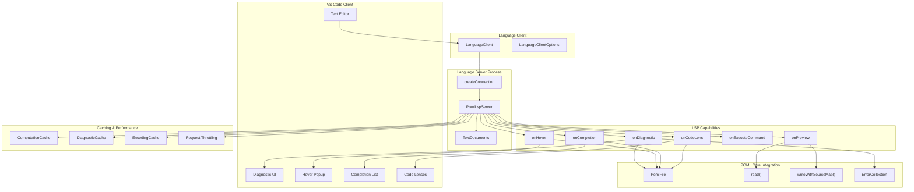
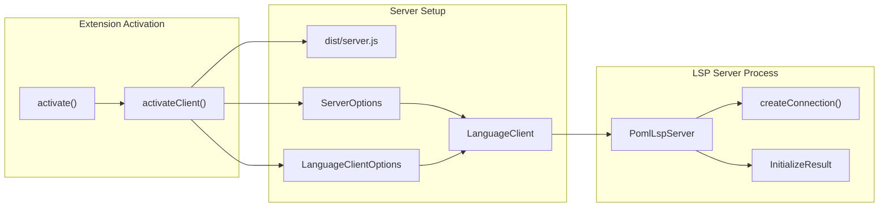
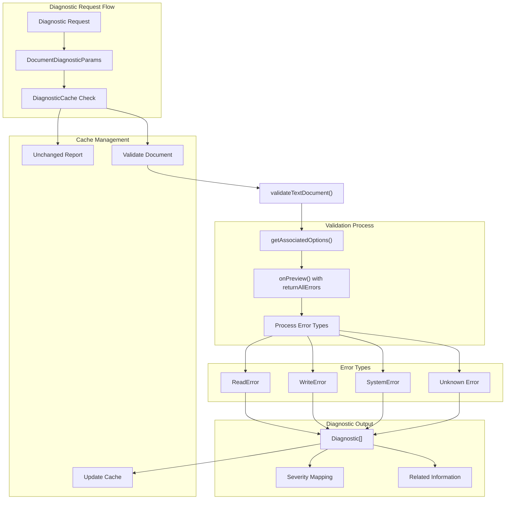
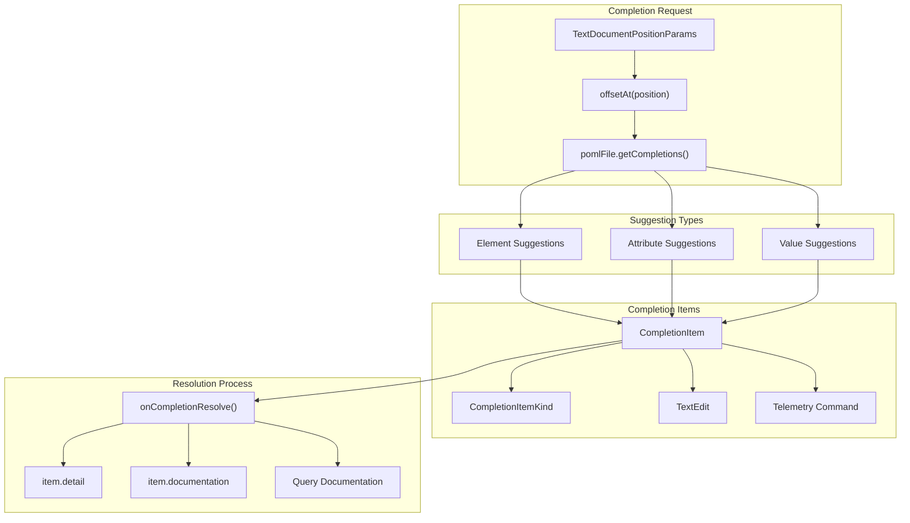
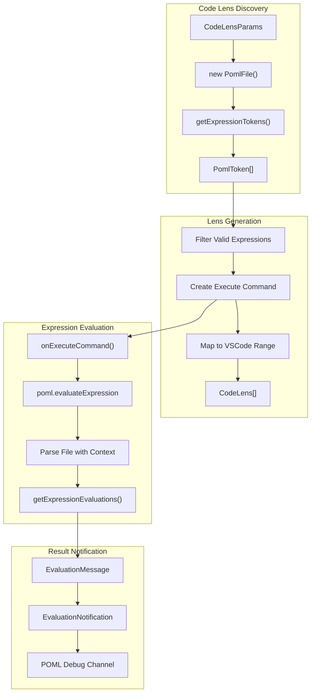
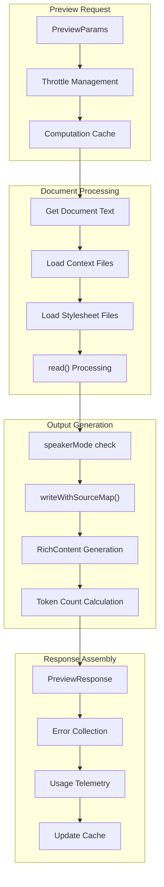
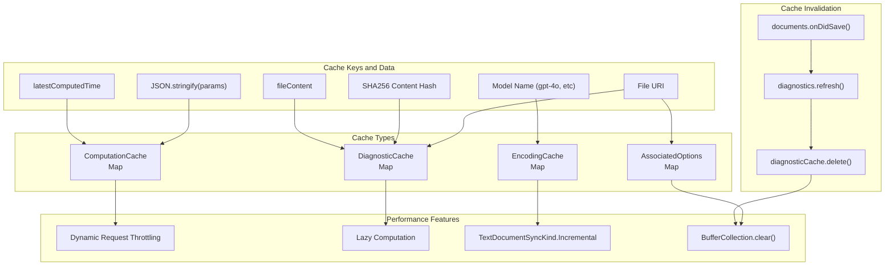
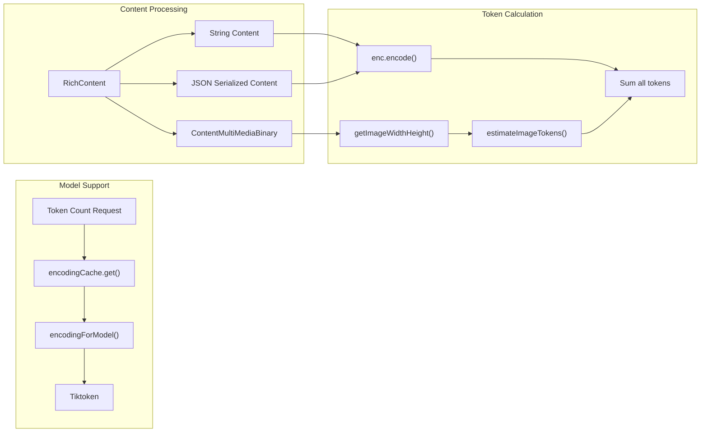

<!-- source: DeepWiki mcp.deepwiki.com · repo microsoft/poml · extra page Language Server Features · fetched 2026-10-26 -->

# Language Server Features

Relevant source files

The following files were used as context for generating this wiki page:

- [eslint.config.js](eslint.config.js)
- [packages/poml-vscode/lsp/server.ts](packages/poml-vscode/lsp/server.ts)
- [packages/poml-vscode/panel/content.tsx](packages/poml-vscode/panel/content.tsx)
- [packages/poml-vscode/panel/panel.ts](packages/poml-vscode/panel/panel.ts)
- [packages/poml-vscode/panel/types.ts](packages/poml-vscode/panel/types.ts)
- [packages/poml/util/xmlContentAssist.js](packages/poml/util/xmlContentAssist.js)

This document covers the Language Server Protocol (LSP) features provided by the POML VS Code extension, including diagnostics, code completion, hover documentation, and interactive debugging capabilities.

For information about the preview and testing interface, see [Preview and Testing](#5.3.2). For details about the prompt gallery and chat functionality, see [Prompt Gallery and Chat](#5.3.3).

## Overview

The POML Language Server provides comprehensive language support through the VS Code Language Server Protocol, enabling real-time error detection, intelligent code completion, contextual documentation, and interactive expression evaluation for `.poml` files.

## Architecture

The LSP implementation centers around the `PomlLspServer` class, which handles all language service requests and integrates with the core POML processing engine.

Sources: [packages/poml-vscode/lsp/server.ts:1-837](), [packages/poml-vscode/extension.ts:76-112]()

## Server Initialization

The LSP server is initialized through the VS Code extension activation process, creating a separate Node.js process for language services.

### Supported Capabilities

The server registers the following LSP capabilities during initialization:

| Capability | Feature | Implementation Method |
|------------|---------|---------------------|
| `textDocumentSync` | Incremental document sync | `TextDocumentSyncKind.Incremental` |
| `completionProvider` | Code completion with resolve | `onCompletion`, `onCompletionResolve` |
| `diagnosticProvider` | Pull-based diagnostics | `onDiagnostic` |
| `hoverProvider` | Hover documentation | `onHover` |
| `codeLensProvider` | Interactive code lenses | `onCodeLens` |
| `executeCommandProvider` | Command execution | `onExecuteCommand` |

Sources: [packages/poml-vscode/lsp/server.ts:151-165](), [packages/poml-vscode/extension.ts:84-104]()

## Diagnostic System

The diagnostic system provides real-time error detection and reporting for POML files through a pull-based diagnostic model with caching optimization.

### Error Type Mapping

The diagnostic system maps POML errors to LSP diagnostic severities:

| Error Type | LSP Severity | Source Label |
|------------|-------------|--------------|
| `ReadError` | Warning | "POML Reader" |
| `WriteError` | Warning | "POML Writer" | 
| `SystemError` | Error | "POML System (please report)" |
| Unknown/String | Error | "POML Unknown Error (please report)" |

Sources: [packages/poml-vscode/lsp/server.ts:497-687](), [packages/poml-vscode/lsp/server.ts:601-677]()

## Hover Documentation

The hover system provides contextual documentation for POML components and their parameters by analyzing the cursor position and querying the component registry.

### Hover Token Resolution

```mermaid
graph LR
    subgraph "Hover Request"
        HOVER_PARAMS["HoverParams"]
        CURSOR_POSITION["position"]
        TEXT_OFFSET["offsetAt()"]
    end
    
    subgraph "Token Analysis"
        POML_FILE["new PomlFile()"]
        GET_HOVER_TOKEN["getHoverToken()"]
        HOVER_TOKEN["PomlToken"]
    end
    
    subgraph "Documentation Query"
        TOKEN_TYPE_CHECK["token.type check"]
        COMPONENT_DOC["queryDocumentationForComponent()"]
        PARAMETER_DOC["queryDocumentationForParameter()"]
    end
    
    subgraph "Component Registry"
        FIND_COMPONENT["findComponentByAlias()"]
        COMPONENT_SPEC["component.spec()"]
        FORMAT_DOC["formatComponentDocumentation()"]
        FORMAT_PARAM["formatParameterDocumentation()"]
    end
    
    HOVER_PARAMS --> CURSOR_POSITION
    CURSOR_POSITION --> TEXT_OFFSET
    TEXT_OFFSET --> POML_FILE
    POML_FILE --> GET_HOVER_TOKEN
    GET_HOVER_TOKEN --> HOVER_TOKEN
    
    HOVER_TOKEN --> TOKEN_TYPE_CHECK
    TOKEN_TYPE_CHECK --> COMPONENT_DOC
    TOKEN_TYPE_CHECK --> PARAMETER_DOC
    
    COMPONENT_DOC --> FIND_COMPONENT
    PARAMETER_DOC --> FIND_COMPONENT
    FIND_COMPONENT --> COMPONENT_SPEC
    COMPONENT_SPEC --> FORMAT_DOC
    COMPONENT_SPEC --> FORMAT_PARAM
```

The hover response includes:
- Markdown-formatted documentation content
- Source range highlighting  
- Component or parameter-specific information

Sources: [packages/poml-vscode/lsp/server.ts:689-751](), [packages/poml-vscode/lsp/documentFormatter.ts]()

## Code Completion

The completion system provides intelligent suggestions for POML components, attributes, and values based on cursor context and component definitions.

### Completion Flow

### Completion Item Types

| Suggestion Type | VSCode Kind | Label Source | Documentation Source |
|----------------|-------------|--------------|---------------------|
| Element | `CompletionItemKind.Class` | `suggestion.element` | Component spec |
| Attribute | `CompletionItemKind.Property` | `suggestion.attribute` | Parameter spec |
| Attribute Value | `CompletionItemKind.Value` | `suggestion.value` | Parameter values |

Sources: [packages/poml-vscode/lsp/server.ts:753-832]()

## Code Lenses and Expression Evaluation

Code lenses provide interactive "Evaluate" buttons for expressions within POML files, enabling real-time expression evaluation without running the full pipeline. Results are displayed in a dedicated output channel.

### Code Lens Discovery and Execution Flow

### Expression Evaluation Details

The evaluation system handles multiple expressions and provides detailed feedback:

| Component | Purpose | Implementation |
|-----------|---------|----------------|
| Command Structure | `poml.evaluateExpression` | `[uri, text, rangeStart, rangeEnd]` |
| Expression Discovery | Token parsing | `pomlFile.getExpressionTokens()` |
| Context Integration | File context loading | `getAssociatedOptions()` context files |
| Result Processing | Multiple evaluations | Truncated at 1024 chars per result |
| Notification System | Real-time feedback | `EvaluationNotification` to client |

The evaluation message types include:
- **Info**: Successful evaluation results
- **Warning**: No evaluations found for expression
- **Error**: Parsing or evaluation errors

Sources: [packages/poml-vscode/lsp/server.ts:213-323](), [packages/poml-vscode/extension.ts:117-123](), [packages/poml-vscode/panel/types.ts:74-79]()

## Preview Integration

The LSP server provides a custom `poml/preview` method that integrates with the webview panel system for real-time document rendering and token counting.

### Preview Request Processing

### Preview Response Structure

| Field | Type | Description |
|-------|------|-------------|
| `rawText` | `string` | Original document content |
| `ir` | `string` | Intermediate representation |
| `content` | `RichContent \| Message[]` | Rendered output |
| `error` | `string \| any[]` | Error information |
| `sourceMap` | `SourceMapRichContent[] \| SourceMapMessage[]` | Source mapping data |
| `tokens` | `{perMessage?: number[]; total: number}` | Token counts |

Sources: [packages/poml-vscode/lsp/server.ts:331-495](), [packages/poml-vscode/panel/types.ts:53-71]()

## Performance Optimization

The LSP server implements several performance optimization strategies to ensure responsive language services, including multi-layer caching, dynamic request throttling, and telemetry-driven optimization.

### Caching Strategy

### Dynamic Throttling Algorithm

The server implements adaptive throttling based on real-time computation performance:

| Parameter | Initial Value | Update Formula | Constraints |
|-----------|---------------|----------------|-------------|
| `throttleTime` | 10ms | `throttleTime * 0.9 + allocatedTime * 0.1` | 10ms - 1000ms |
| `allocatedTime` | N/A | `elapsed * 2` | Double actual time |
| Cache check | N/A | `requestedTime < latestComputedTime` | Skip if newer exists |

### Token Counting Optimization

The encoding cache optimizes token counting for different language models:

Sources: [packages/poml-vscode/lsp/server.ts:78-113](), [packages/poml-vscode/lsp/server.ts:325-363](), [packages/poml-vscode/lsp/server.ts:486-534](), [packages/poml-vscode/lsp/server.ts:180-186]()

## Testing Infrastructure

The LSP server includes comprehensive testing through integration tests that verify all major language service features.

### Test Coverage

| Test Case | Verification | Method |
|-----------|--------------|--------|
| Diagnostics | Error detection for invalid files | `getDiagnostics()` |
| Clean Files | No diagnostics for valid files | Empty diagnostic array |
| Hover | Documentation display | `executeHoverProvider()` |
| Completion | Attribute suggestions | `executeCompletionItemProvider()` |
| Preview | Content generation | Custom LSP request |
| Expression Evaluation | Code lens execution | `executeCommand()` |

Sources: [packages/poml-vscode/tests/lsp.test.ts:1-131]()

---

