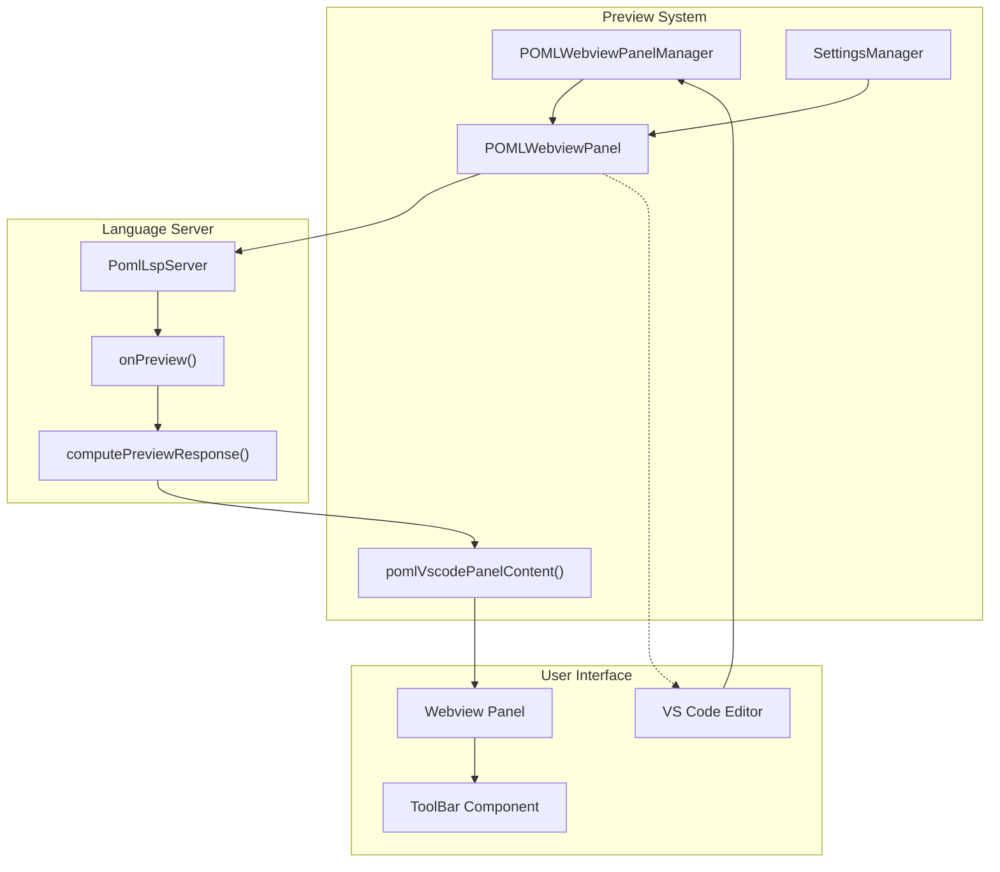
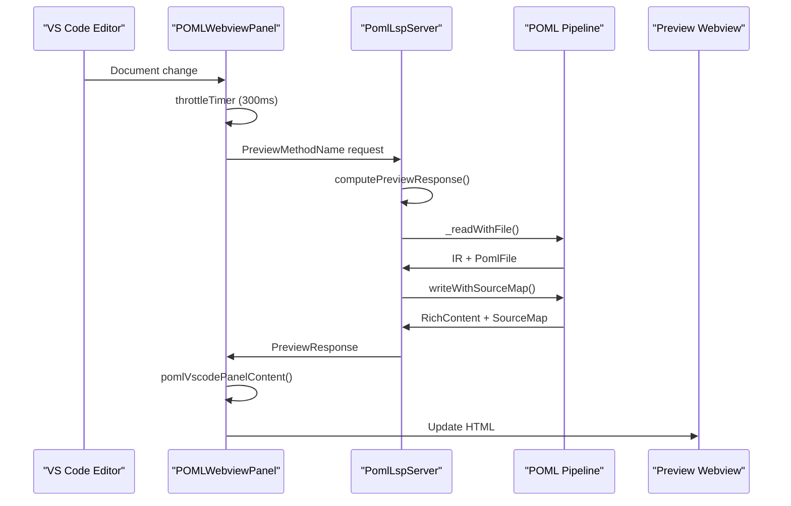
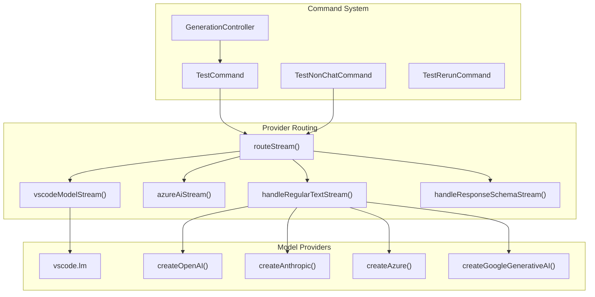
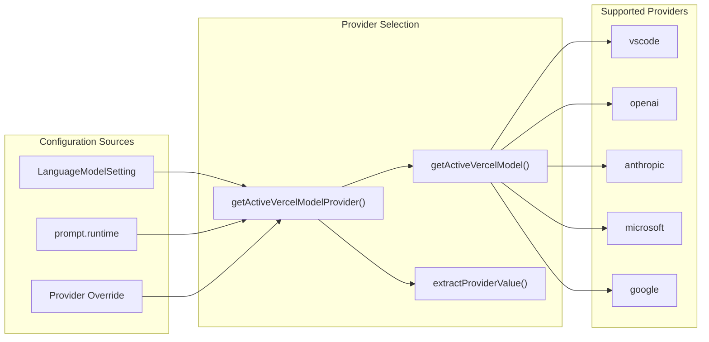
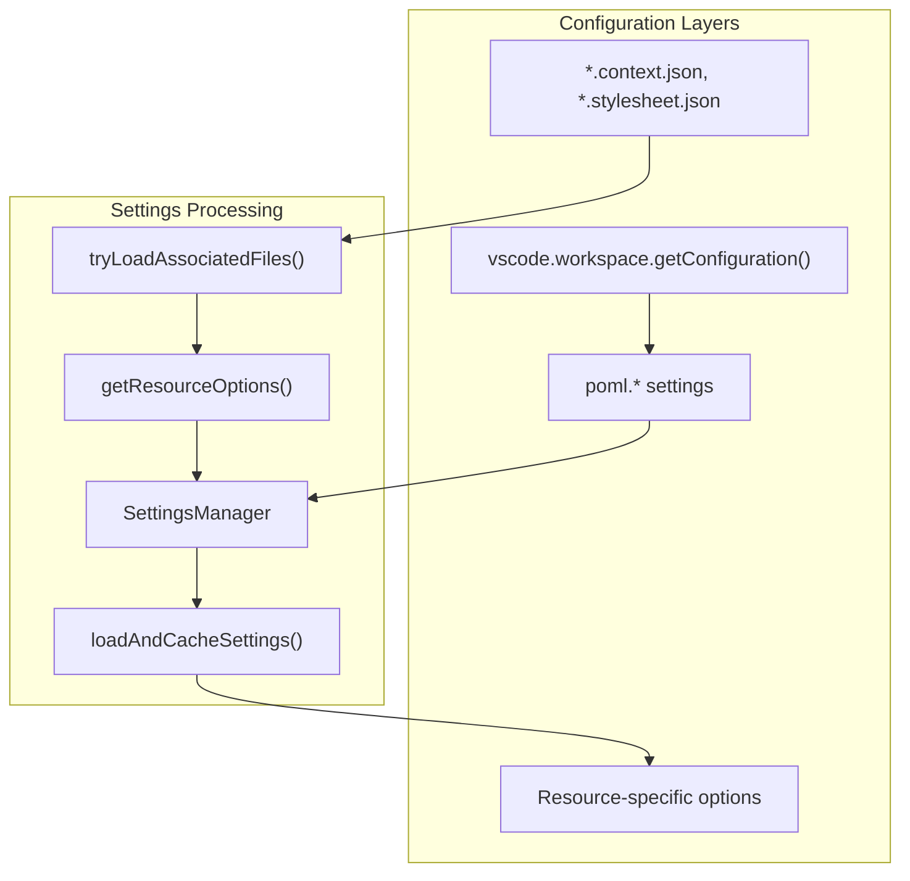
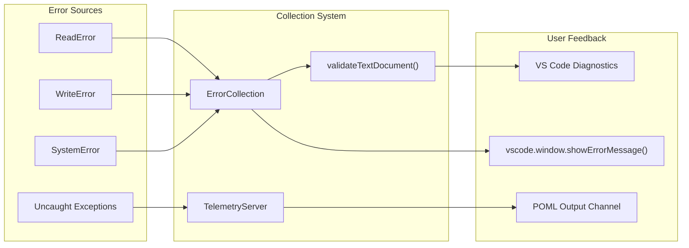

<!-- source: DeepWiki mcp.deepwiki.com · repo microsoft/poml · extra page Preview and Testing · fetched 2026-10-26 -->

# Preview and Testing

<details>
<summary>Relevant source files</summary>

The following files were used as context for generating this wiki page:

- [docs/vscode/configuration.md](docs/vscode/configuration.md)
- [examples/110_code_review.poml](examples/110_code_review.poml)
- [examples/assets/110_sample_code.py](examples/assets/110_sample_code.py)
- [examples/expects/110_code_review.txt](examples/expects/110_code_review.txt)
- [packages/poml-vscode/command/testCommand.ts](packages/poml-vscode/command/testCommand.ts)
- [packages/poml-vscode/lsp/server.ts](packages/poml-vscode/lsp/server.ts)
- [packages/poml-vscode/panel/content.tsx](packages/poml-vscode/panel/content.tsx)
- [packages/poml-vscode/panel/panel.ts](packages/poml-vscode/panel/panel.ts)
- [packages/poml-vscode/panel/types.ts](packages/poml-vscode/panel/types.ts)
- [packages/poml-vscode/settings.ts](packages/poml-vscode/settings.ts)

</details>


This section covers the VS Code extension's preview panel and prompt testing capabilities, which allow you to visualize POML documents and test them against language model providers directly within the editor. For language server features like diagnostics and hover information, see [Language Server Features](#5.4.1). For interactive prompt development features, see [Prompt Gallery and Chat](#5.4.3).

## Preview Panel System

The preview panel provides real-time visualization of POML documents with multiple display formats and configuration options. The system centers around the `POMLWebviewPanel` class which manages webview lifecycle and user interactions.

### Display Formats

The preview panel supports three primary display formats controlled by the `displayFormat` property:

| Format | Description | Use Case |
|--------|-------------|----------|
| `rendered` | Markdown-rendered output with rich formatting | Final output preview |
| `plain` | Raw text/JSON without rendering | Debugging content structure |
| `ir` | Intermediate representation (debug mode) | Development and troubleshooting |

### Panel Management Architecture



**Sources:** [packages/poml-vscode/panel/panel.ts:29-581](), [packages/poml-vscode/panel/content.tsx:1-395](), [packages/poml-vscode/lsp/server.ts:489-537]()

### Preview Request Flow

The preview system processes POML documents through a sophisticated pipeline that handles caching, throttling, and source mapping:



**Sources:** [packages/poml-vscode/panel/panel.ts:452-498](), [packages/poml-vscode/lsp/server.ts:368-487]()

## Testing System

The testing system enables direct execution of POML prompts against configured language model providers. The core functionality is implemented in the `TestCommand` class with support for both chat and completion models.

### Test Command Architecture



**Sources:** [packages/poml-vscode/command/testCommand.ts:92-883]()

### Provider Configuration and Routing

The system supports multiple language model providers through a unified configuration interface. Provider selection occurs at runtime based on document metadata and user settings:



**Sources:** [packages/poml-vscode/command/testCommand.ts:526-591](), [packages/poml-vscode/settings.ts:8-16]()

### Stream Processing Pipeline

The testing system processes streaming responses through a unified pipeline that handles different content types and provider-specific formats:

| Stream Type | Handler Method | Content Support |
|-------------|----------------|----------------|
| Regular Text | `handleRegularTextStream()` | Text, tools, experimental schemas |
| Response Schema | `handleResponseSchemaStream()` | Structured JSON output |
| VS Code API | `vscodeModelStream()` | GitHub Copilot integration |
| Azure AI | `azureAiStream()` | Azure-specific SSE format |

**Sources:** [packages/poml-vscode/command/testCommand.ts:259-273](), [packages/poml-vscode/command/testCommand.ts:326-370]()

## Configuration Integration

The preview and testing systems integrate with VS Code's configuration system through the `SettingsManager` class, which handles both global settings and resource-specific options.

### Settings Hierarchy



**Sources:** [packages/poml-vscode/settings.ts:110-183](), [packages/poml-vscode/panel/panel.ts:437-440]()

### Language Model Configuration

The system supports both simple string configurations and provider-specific object configurations for API keys and URLs:

```typescript
// Simple configuration
"poml.languageModel.apiKey": "sk-your-key"

// Provider-specific configuration  
"poml.languageModel.apiKey": {
  "openai": "sk-openai-key",
  "anthropic": "sk-ant-key"
}
```

The `extractProviderValue()` method handles both formats, selecting the appropriate value based on the active provider.

**Sources:** [packages/poml-vscode/command/testCommand.ts:844-856](), [packages/poml-vscode/settings.ts:6-16]()

## Error Handling and Telemetry

Both preview and testing systems include comprehensive error handling and telemetry reporting through the `TelemetryServer` infrastructure.

### Error Collection Flow



**Sources:** [packages/poml-vscode/lsp/server.ts:575-728](), [packages/poml-vscode/command/testCommand.ts:219-235]()

The system maintains detailed statistics and reports usage patterns through delayed telemetry reporters that batch events for privacy and performance.

**Sources:** [packages/poml-vscode/lsp/server.ts:113-117](), [packages/poml-vscode/command/testCommand.ts:115-127]()

---

