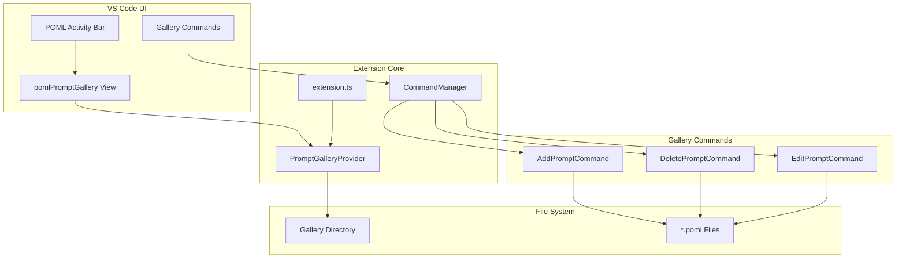
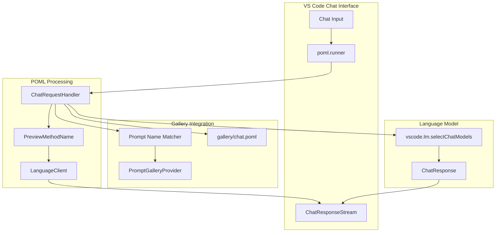
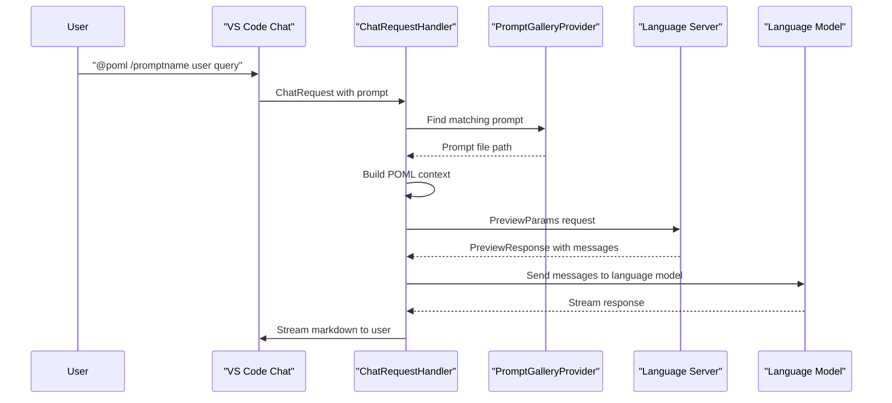

<!-- source: DeepWiki mcp.deepwiki.com · repo microsoft/poml · extra page Prompt Gallery and Chat · fetched 2026-10-26 -->

# Prompt Gallery and Chat

<details>
<summary>Relevant source files</summary>

The following files were used as context for generating this wiki page:

- [gallery/chat.poml](gallery/chat.poml)
- [package-lock.json](package-lock.json)
- [package.json](package.json)
- [packages/poml-vscode/chat/participant.ts](packages/poml-vscode/chat/participant.ts)
- [packages/poml-vscode/command/index.ts](packages/poml-vscode/command/index.ts)
- [packages/poml-vscode/extension.ts](packages/poml-vscode/extension.ts)
- [packages/poml-vscode/tests/lsp.test.ts](packages/poml-vscode/tests/lsp.test.ts)

</details>


This document covers the Prompt Gallery and Chat Participant features of the VS Code POML extension. These features enable interactive prompt development through a curated gallery of prompts and seamless integration with VS Code's built-in chat interface. For information about other VS Code extension features like language server capabilities, see [Language Server Features](#5.4.1), and for preview and testing functionality, see [Preview and Testing](#5.4.2).

## Overview

The VS Code POML extension provides two interconnected features for interactive prompt development:

1. **Prompt Gallery**: A dedicated view panel that allows users to manage, organize, and access their POML prompt templates
2. **Chat Participant**: A VS Code chat integration that enables running POML prompts directly within the chat interface using language models

Both features work together to provide a seamless workflow for developing, testing, and using POML prompts in an interactive environment.

## Prompt Gallery Architecture

The Prompt Gallery is implemented as a custom VS Code tree view that provides a centralized location for managing POML prompt files. Users can add, edit, delete, and organize their prompt templates through this interface.

### Prompt Gallery System Flow



**Sources:** [package.json:33-39](), [extension.ts:30-48](), [command/index.ts:11]()

### Gallery View Configuration

The gallery view is registered as part of the POML activity bar container and provides tree-based navigation for prompt files.

| Configuration Property | Value | Purpose |
|----------------------|-------|---------|
| `viewsContainers.activitybar` | `poml` | Creates POML section in activity bar |
| `views.poml` | `pomlPromptGallery` | Registers gallery view panel |
| `view/title` menu | `poml.gallery.addPrompt` | Add button in gallery header |
| `view/item/context` menu | Edit/Delete actions | Per-item context menu |

**Sources:** [package.json:24-40](), [package.json:198-216]()

## Chat Participant Integration

The Chat Participant feature integrates POML with VS Code's native chat interface, allowing users to execute POML prompts directly within chat conversations and receive responses from configured language models.

### Chat Participant Architecture



**Sources:** [chat/participant.ts:7-78](), [package.json:176-182]()

### Chat Request Processing Flow

The chat participant implements a sophisticated request processing pipeline that handles prompt selection, context injection, and language model interaction.



**Sources:** [chat/participant.ts:8-73]()

## Chat Participant Implementation Details

### Prompt Resolution Logic

The chat participant supports two modes of operation:

1. **Named Prompt Mode**: When the user input starts with `/{promptName}`, the system locates the corresponding prompt from the gallery
2. **Default Chat Mode**: When no specific prompt is named, the system uses the default chat template

```typescript
// Prompt matching logic from participant.ts
const matchedPrompt = gallery.prompts.find((p) => 
  promptText.match(new RegExp(`^/${p.name}\\b`))
);
```

**Sources:** [chat/participant.ts:24-31]()

### Context and File Reference Handling

The chat participant processes file references and builds context for POML execution:

| Context Property | Source | Purpose |
|-----------------|--------|---------|
| `prompt` | User chat input | Main query text |
| `files` | Chat references | Referenced file paths |
| `inlineContext` | Built dynamically | Context for POML variables |

**Sources:** [chat/participant.ts:33-45]()

### Default Chat Template

The system includes a default chat template that provides a basic structure for chat interactions:

```xml
<poml>
  <task>{{ prompt }}</task>
  <cp caption="References">
    <document src="{{ file }}" parser="txt" for="file in files" />
  </cp>
</poml>
```

This template accepts a `prompt` variable for the user query and processes any referenced files through document components.

**Sources:** [gallery/chat.poml:1-6]()

## Command Interface

The gallery and chat features are controlled through a set of VS Code commands that integrate with the command palette and UI elements.

### Gallery Management Commands

| Command ID | Title | Location | Function |
|-----------|-------|----------|----------|
| `poml.gallery.addPrompt` | "Add Prompt" | Gallery view header | Creates new prompt file |
| `poml.gallery.deletePrompt` | "Delete Prompt" | Item context menu | Removes existing prompt |
| `poml.gallery.editPrompt` | "Edit Prompt" | Item context menu | Opens prompt for editing |

**Sources:** [package.json:158-174](), [command/index.ts:11]()

### Chat Participant Registration

The chat participant is registered with the VS Code chat system using specific configuration:

```json
{
  "id": "poml.runner",
  "fullName": "POML", 
  "name": "poml",
  "description": "Run a POML chat"
}
```

Users invoke the chat participant by typing `@poml` in the VS Code chat interface.

**Sources:** [package.json:176-182](), [extension.ts:50]()

## Integration Points

### Gallery Provider Connection

The `PromptGalleryProvider` serves as the central integration point between the gallery UI and the chat participant, providing prompt discovery and file management capabilities.

**Sources:** [extension.ts:30](), [chat/participant.ts:5-7]()

### Language Server Protocol Integration

Both features leverage the existing LSP infrastructure for POML processing, using the `PreviewMethodName` request to render POML templates before sending them to language models.

**Sources:** [chat/participant.ts:46](), [extension.ts:117-119]()

### Extension Activation Events

The extension activates on specific events related to these features:

- `onWebviewPanel:poml.preview`: For preview panels
- `onChatParticipant:poml.runner`: For chat participant usage

**Sources:** [package.json:18-21]()

---

