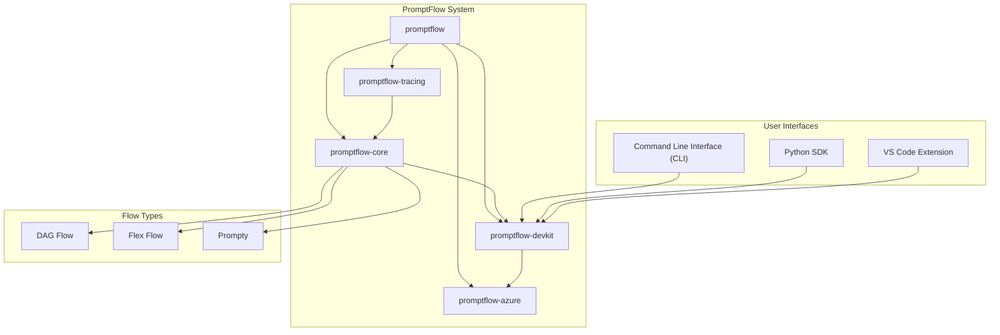
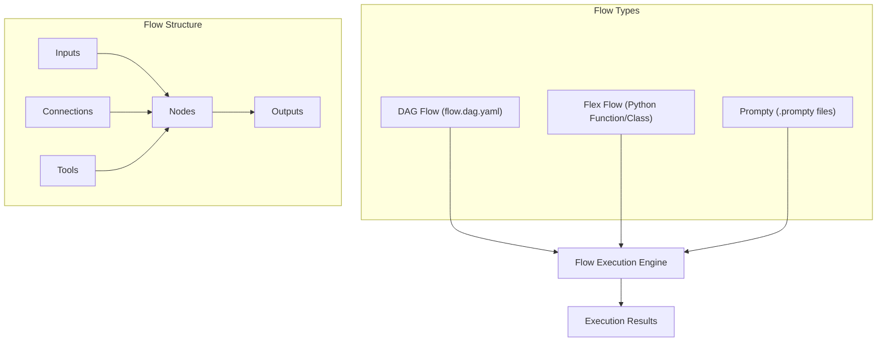
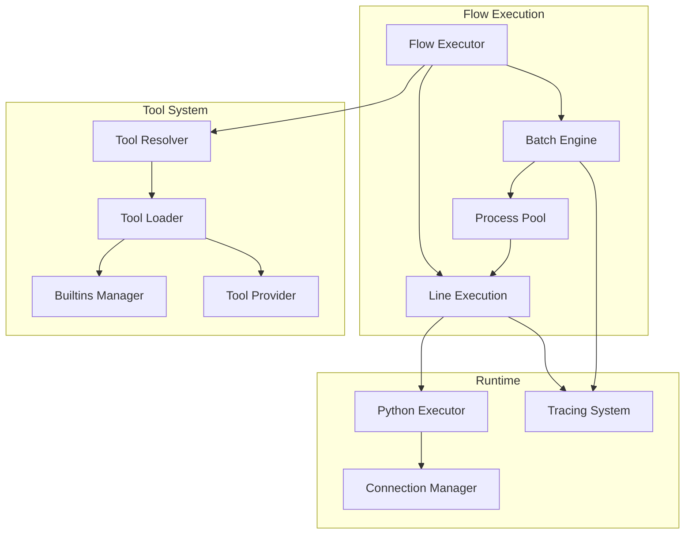
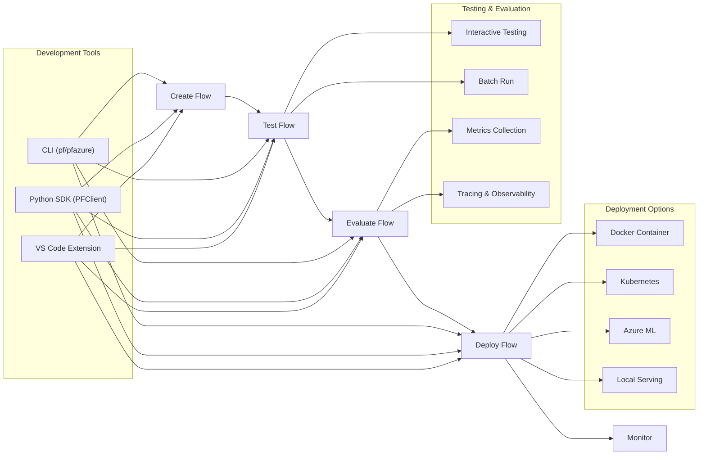

<!-- source: DeepWiki mcp.deepwiki.com · repo microsoft/promptflow · page 1 Overview · fetched 2026-10-26 -->

# Overview

Relevant source files

The following files were used as context for generating this wiki page:

- [README.md](README.md)
- [docs/how-to-guides/faq.md](docs/how-to-guides/faq.md)
- [docs/media/how-to-guides/upgrade-error.png](docs/media/how-to-guides/upgrade-error.png)
- [docs/media/how-to-guides/vscode-tool-list.png](docs/media/how-to-guides/vscode-tool-list.png)
- [scripts/docs/_static/custom.css](scripts/docs/_static/custom.css)
- [scripts/docs/conf.py](scripts/docs/conf.py)
- [src/promptflow-azure/CHANGELOG.md](src/promptflow-azure/CHANGELOG.md)
- [src/promptflow-azure/pyproject.toml](src/promptflow-azure/pyproject.toml)
- [src/promptflow-core/CHANGELOG.md](src/promptflow-core/CHANGELOG.md)
- [src/promptflow-core/pyproject.toml](src/promptflow-core/pyproject.toml)
- [src/promptflow-devkit/CHANGELOG.md](src/promptflow-devkit/CHANGELOG.md)
- [src/promptflow-devkit/pyproject.toml](src/promptflow-devkit/pyproject.toml)
- [src/promptflow-tracing/CHANGELOG.md](src/promptflow-tracing/CHANGELOG.md)
- [src/promptflow-tracing/pyproject.toml](src/promptflow-tracing/pyproject.toml)
- [src/promptflow/CHANGELOG.md](src/promptflow/CHANGELOG.md)
- [src/promptflow/README.md](src/promptflow/README.md)
- [src/promptflow/promptflow/__init__.py](src/promptflow/promptflow/__init__.py)
- [src/promptflow/promptflow/_version.py](src/promptflow/promptflow/_version.py)

PromptFlow is a comprehensive suite of development tools designed to streamline the end-to-end development cycle of LLM-based AI applications. It spans from ideation and prototyping through testing and evaluation to production deployment and monitoring. This document provides a high-level overview of the PromptFlow repository structure, its key components, and core functionality.

## Purpose and Goals

PromptFlow aims to make prompt engineering easier and enable users to build LLM applications with production quality by providing:

- Tools for creating executable flows that connect LLMs, prompts, and custom code
- Capabilities for testing, evaluating, and improving flow quality
- Mechanisms for deploying flows to various serving platforms
- Observability tools for monitoring flow execution and performance

PromptFlow supports the complete lifecycle of LLM application development, from interactive experimentation to scaled production deployment.

Sources: [README.md:20-33](), [src/promptflow/README.md:21-34]()

## System Architecture

The PromptFlow system consists of several core packages that work together to provide a comprehensive development experience:

### Core Packages

1. **promptflow-core**: Provides essential functionality for loading and running flows
   - Contains core abstractions for flow execution
   - Handles connection management
   - Implements the flow execution model

2. **promptflow-tracing**: Enables observability for flow execution
   - Tracks API calls and performance metrics
   - Provides token counting for LLM interactions
   - Integrates with OpenTelemetry for distributed tracing

3. **promptflow-devkit**: Offers development tools for building and testing flows
   - CLI tools for flow operations
   - Local testing capabilities
   - Run management and visualization

4. **promptflow-azure**: Provides Azure integration for cloud execution
   - Azure ML workspace integration
   - Cloud deployment capabilities
   - Azure resource management

Sources: [src/promptflow-core/pyproject.toml:1-47](), [src/promptflow-devkit/pyproject.toml:1-56](), [src/promptflow-azure/pyproject.toml:1-48](), [src/promptflow-tracing/pyproject.toml:1-46]()

## Key Concepts

### Flows

Flows represent the executable units in PromptFlow, defining how inputs are processed through a sequence of operations to produce outputs. PromptFlow supports multiple flow types:

1. **DAG Flow**: Traditional flow defined using YAML (flow.dag.yaml) with a directed acyclic graph structure
2. **Flex Flow**: Python function or class-based flow for more programmatic flexibility (introduced in v1.11.0)
3. **Prompty**: Specialized format for prompt template creation (introduced in v1.11.0)

For more detailed information on these flow types, see [Flow Types](#4).

Sources: [src/promptflow/CHANGELOG.md:76-78]()

### Tools

Tools are the building blocks that perform specific operations within a flow. PromptFlow provides various built-in tools and supports custom tool creation:

- **LLM Tools**: Integration with language models like OpenAI and Azure OpenAI
- **Python Tools**: Custom Python code execution
- **Prompt Tools**: Template-based prompt generation
- **Custom Tools**: User-defined specialized tools

For more information on tool management, see [Tool System](#2.3).

Sources: [README.md:20-33]()

### Connections

Connections manage authentication and configuration for external services like LLM providers. They abstract away the complexity of handling API keys and endpoints:

- OpenAI connections
- Azure OpenAI connections
- Custom connections for other services

For more details on connection management, see [Connection Management](#3.3).

Sources: [README.md:55-69](), [src/promptflow/README.md:56-68]()

## Execution Architecture

The execution of flows in PromptFlow is handled by a sophisticated system designed for flexibility and performance:

Key components of the execution architecture:

1. **Flow Executor**: Orchestrates the overall flow execution
2. **Line Execution**: Handles individual execution of flow nodes for a single input
3. **Batch Engine**: Manages batch processing for multiple inputs
4. **Process Pool**: Enables parallel execution for improved performance
5. **Tool Resolver**: Resolves tools referenced in flows
6. **Connection Manager**: Provides access to external service credentials

For more details on the execution model, see [Flow Execution Model](#2.2).

Sources: [src/promptflow/CHANGELOG.md:210-279]()

## Development Workflow

PromptFlow supports a comprehensive development workflow:

1. **Create Flow**: Design a flow using CLI, SDK, or VS Code Extension
2. **Test Flow**: Validate flow functionality with interactive and batch testing
3. **Evaluate Flow**: Assess quality and performance on larger datasets
4. **Deploy Flow**: Serve the flow as an API or integrate it into applications
5. **Monitor**: Track performance and usage in production

For more information on these development stages, see [CLI and SDK](#3) and [Advanced Features](#6).

Sources: [README.md:89-91](), [src/promptflow/CHANGELOG.md:285-313]()

## Integration and Deployment

PromptFlow can be deployed in various environments and integrated with other systems:

1. **Local Deployment**: Run flows locally for development and testing
2. **Docker Containers**: Package flows for containerized deployment
3. **Kubernetes**: Deploy at scale with Kubernetes orchestration
4. **Azure Integration**: Leverage Azure ML and other Azure services for cloud deployment
5. **CI/CD Integration**: Incorporate flow testing and evaluation into CI/CD pipelines

For more details on deployment options, see [Flow Serving](#6.3) and [Azure Integration](#7).

Sources: [src/promptflow/CHANGELOG.md:294-301]()

## Additional Features

### Tracing and Telemetry

PromptFlow includes robust tracing capabilities for monitoring flow execution:

- Track API calls and performance metrics
- Monitor token usage for LLM interactions
- Visualize flow execution
- Integrate with OpenTelemetry for distributed tracing

For more on this topic, see [Tracing and Telemetry](#2.4).

Sources: [src/promptflow/CHANGELOG.md:209-215](), [src/promptflow-tracing/CHANGELOG.md:3-15]()

### Batch Execution

For processing large datasets, PromptFlow provides batch execution capabilities:

- Parallel processing with configurable workers
- Progress tracking and performance estimation
- Resumable execution for long-running jobs

For details on batch processing, see [Batch Execution](#6.1).

Sources: [src/promptflow/CHANGELOG.md:335-340](), [docs/how-to-guides/faq.md:116-156]()

### Evaluation System

PromptFlow includes tools for evaluating flow quality and performance:

- Metrics collection and aggregation
- Custom evaluation criteria
- Quality testing framework

For more information on evaluation, see [Evaluation System](#6.2).

Sources: [src/promptflow/CHANGELOG.md:341-343]()

## Conclusion

PromptFlow provides a comprehensive ecosystem for developing, testing, deploying, and monitoring LLM-based applications. Its modular architecture and extensive feature set make it a powerful tool for the entire lifecycle of AI application development.

For detailed guides on using PromptFlow, refer to the specific sections in this wiki or explore the [official documentation](https://microsoft.github.io/promptflow/).

---

