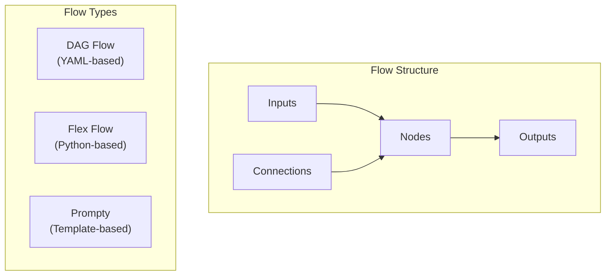
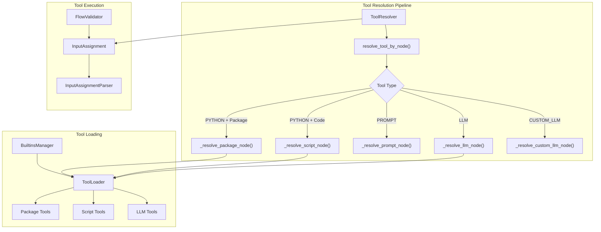
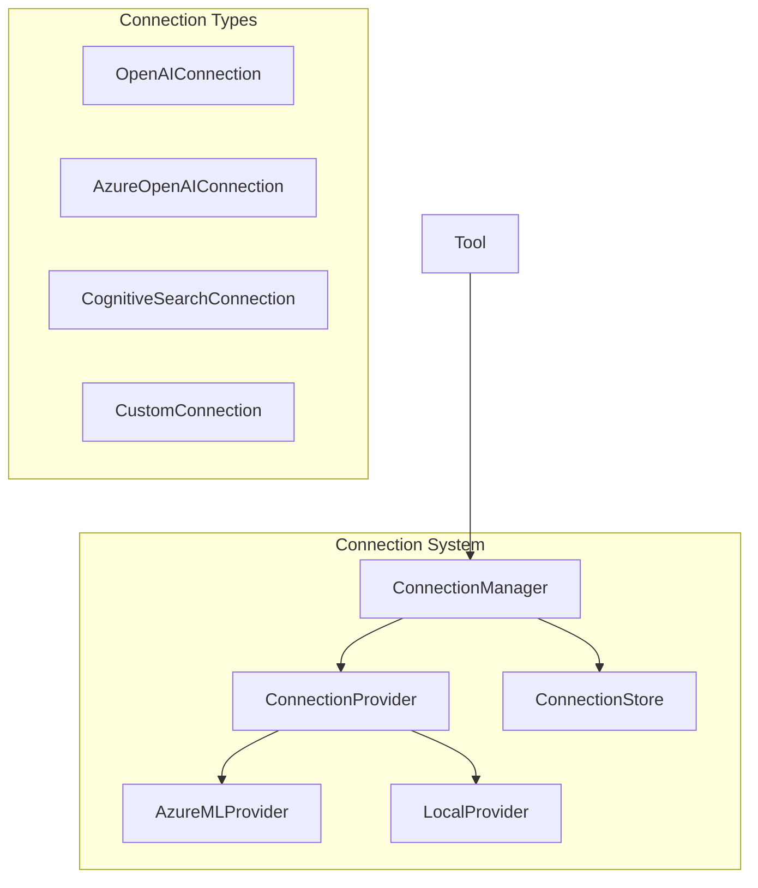
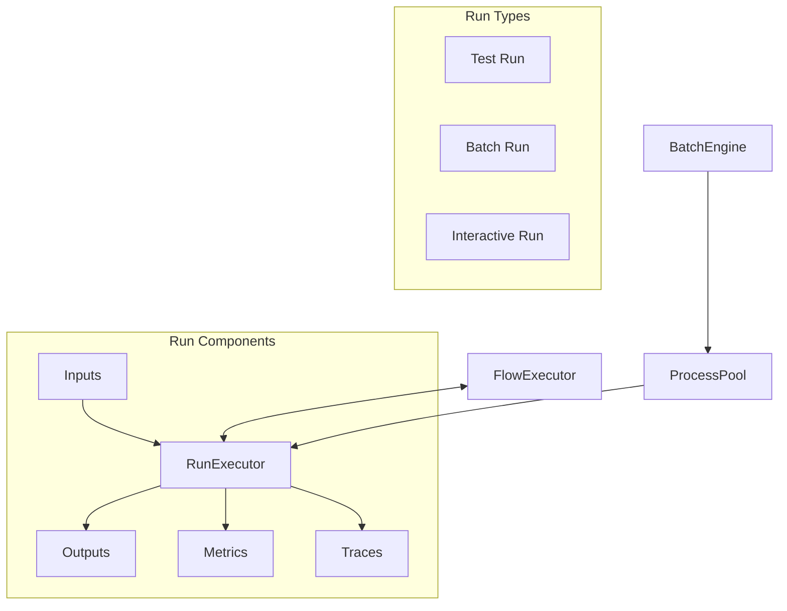
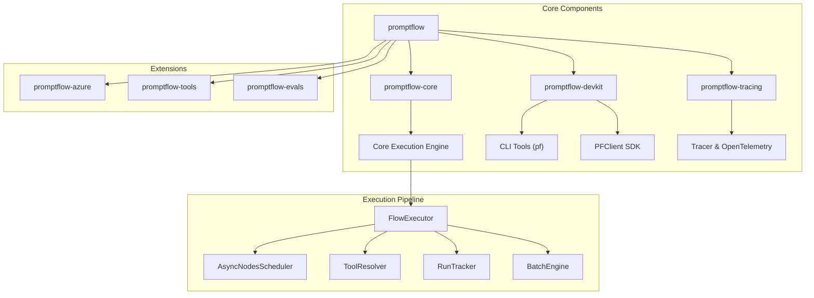
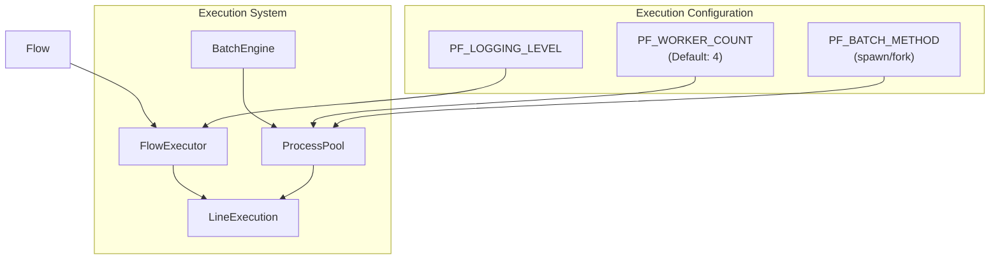

<!-- source: DeepWiki mcp.deepwiki.com · repo microsoft/promptflow · page 1.1 Key Concepts · fetched 2026-10-26 -->

# Key Concepts

<details>
<summary>Relevant source files</summary>

The following files were used as context for generating this wiki page:

- [docs/concepts/concept-flows.md](docs/concepts/concept-flows.md)
- [docs/how-to-guides/index.md](docs/how-to-guides/index.md)
- [docs/how-to-guides/manage-connections.md](docs/how-to-guides/manage-connections.md)
- [docs/how-to-guides/quick-start.md](docs/how-to-guides/quick-start.md)
- [docs/how-to-guides/run-and-evaluate-a-flow/index.md](docs/how-to-guides/run-and-evaluate-a-flow/index.md)
- [docs/how-to-guides/tune-prompts-with-variants.md](docs/how-to-guides/tune-prompts-with-variants.md)
- [docs/index.md](docs/index.md)
- [docs/media/how-to-guides/quick-start/flow-run-visualize-single-run.png](docs/media/how-to-guides/quick-start/flow-run-visualize-single-run.png)
- [docs/media/how-to-guides/run_visualize.png](docs/media/how-to-guides/run_visualize.png)
- [examples/flows/standard/customer-intent-extraction/intent.py](examples/flows/standard/customer-intent-extraction/intent.py)
- [src/promptflow-azure/CHANGELOG.md](src/promptflow-azure/CHANGELOG.md)
- [src/promptflow-azure/pyproject.toml](src/promptflow-azure/pyproject.toml)
- [src/promptflow-core/CHANGELOG.md](src/promptflow-core/CHANGELOG.md)
- [src/promptflow-core/pyproject.toml](src/promptflow-core/pyproject.toml)
- [src/promptflow-devkit/CHANGELOG.md](src/promptflow-devkit/CHANGELOG.md)
- [src/promptflow-devkit/pyproject.toml](src/promptflow-devkit/pyproject.toml)
- [src/promptflow-tracing/CHANGELOG.md](src/promptflow-tracing/CHANGELOG.md)
- [src/promptflow-tracing/pyproject.toml](src/promptflow-tracing/pyproject.toml)
- [src/promptflow/CHANGELOG.md](src/promptflow/CHANGELOG.md)
- [src/promptflow/promptflow/_version.py](src/promptflow/promptflow/_version.py)

</details>


## Purpose and Scope

This document explains the fundamental concepts in Prompt Flow, a framework for building, testing, and deploying AI applications powered by Large Language Models (LLMs). Understanding these core concepts is essential for effectively working with Prompt Flow. This page covers the basic building blocks of the system including flows, tools, connections, and runs. For more detailed information about system architecture, refer to [Architecture](#2), and for usage details, see [CLI and SDK](#3).

## Flows

Flows are the central concept in Prompt Flow. A flow is an executable workflow that connects LLMs, prompts, Python code, and other tools together to accomplish a specific task.



Sources:
- src/promptflow/CHANGELOG.md
- README.md

### Flow Types

| Type | Description | Definition Format | Introduced |
|------|-------------|-------------------|------------|
| DAG Flow | Directed Acyclic Graph-based flow | YAML (`flow.dag.yaml`) | Initial version |
| Flex Flow | Function or class-based flow | Python | v1.11.0 |
| Prompty | Streamlined prompt template creation | `.prompty` files | v1.11.0 (experimental) |

DAG Flows define each node and connection explicitly in YAML, while Flex Flows use Python functions or classes for more flexible control flow. Prompty is designed specifically for prompt engineering with streamlined syntax.

A typical DAG flow structure in YAML:

```yaml
inputs:
  url:
    type: string
outputs:
  category:
    reference: ${convert_to_dict.output.category}
  evidence:
    type: string
    reference: ${convert_to_dict.output.evidence}
nodes:
- name: fetch_text_content_from_url
  type: python
  source:
    type: code
    path: fetch_text_content_from_url.py
  inputs:
    url: ${inputs.url}
- name: classify_with_llm
  type: llm
  source:
    type: code
    path: ./classify_with_llm.jinja2
  inputs:
    deployment_name: gpt-35-turbo
    url: ${inputs.url}
    text_content: ${summarize_text_content.output}
  connection: azure_open_ai_connection
```

Sources:
- src/promptflow/tests/test_configs/flows/web_classification_invalid/flow.dag.yaml
- src/promptflow/CHANGELOG.md

## Tools

Tools are the building blocks of flows. Each node in a flow uses a specific tool to perform its task.

### Tool Resolution Architecture


### Tool Types and Implementation

| Type | Description | Implementation | Source Location |
|------|-------------|----------------|-----------------|
| Python Tools | Execute Python functions decorated with `@tool` | Function with type hints | Local `.py` files or packages |
| LLM Tools | Interface with language models using Jinja2 templates | Template + connection | `.jinja2` template files |
| Custom LLM Tools | Open-source LLM integrations | Custom implementations | Package tools |
| Prompt Tools | Reusable prompt templates | Template-based | Template files |

### Python Tool Definition
Python tools use the `@tool` decorator from `promptflow.core`:

[examples/flows/standard/customer-intent-extraction/intent.py:9-36]()

### Tool System Components

The tool resolution system consists of:
- **`ToolResolver`**: Main entry point that resolves tool references in flow nodes
- **`ToolLoader`**: Loads tools from different sources (built-in packages, script files)  
- **`BuiltinsManager`**: Manages built-in tools from the `promptflow-tools` package
- **`InputAssignmentParser`**: Parses and validates tool input mappings
- **`FlowValidator`**: Validates tool configurations and connections

Sources:
- [src/promptflow/CHANGELOG.md]()
- [examples/flows/standard/customer-intent-extraction/intent.py]()

## Connections

Connections store credentials and configuration for external services used by tools in a flow. They provide a secure way to manage access to services like OpenAI or Azure OpenAI.



Sources:
- src/promptflow-core/pyproject.toml
- docs/how-to-guides/faq.md

### Connection Types

| Type | Purpose | Configuration Parameters | Default API Version |
|------|---------|--------------------------|---------------------|
| OpenAI | Connect to OpenAI services | api_key, organization_id | - |
| AzureOpenAI | Connect to Azure OpenAI | api_key, api_base, deployment_name | 2024-02-01 |
| CognitiveSearch | Azure Cognitive Search | api_key, endpoint | 2023-11-01 |
| Custom | User-defined connections | Varies by connection type | - |

### Connection Management

Connections can be created and managed using:

- **CLI**: `pf connection create/update/show/list/delete`
- **SDK**: `PFClient().connection` methods
- **Environment Variables**: Load connections from environment variables using `AzureOpenAIConnection.from_env()` (added in v1.7.0)

Sources:
- src/promptflow/CHANGELOG.md
- src/promptflow-core/CHANGELOG.md
- README.md

## Runs

Runs represent executions of flows with specific inputs and configurations. They track the execution process, store inputs and outputs, and collect metrics.



Sources:
- src/promptflow/CHANGELOG.md
- src/promptflow-devkit/pyproject.toml

### Run Types

| Type | Description | Command |
|------|-------------|---------|
| Test Run | Single execution for testing | `pf flow test` |
| Interactive Run | Chat-based execution | `pf flow test --interactive` |
| Batch Run | Execution against a dataset | `pf run create` |

### Run Components

- **Inputs**: Data provided to the flow
- **Outputs**: Results produced by the flow
- **Metrics**: Performance measurements (e.g., token counts, latency)
- **Traces**: Detailed information about interactions with LLMs (added in v1.9.0)
- **Logs**: Flow and node execution logs stored under the `.promptflow` directory

Sources:
- src/promptflow/CHANGELOG.md
- src/promptflow-tracing/CHANGELOG.md
- README.md

## Modular Package Architecture

Prompt Flow is built as a modular system with separate packages for different concerns:

### Core Architecture Diagram


### Package Responsibilities

| Package | Description | Key Classes/Components |
|---------|-------------|------------------------|
| `promptflow-core` | Core flow execution engine | `FlowExecutor`, `AsyncNodesScheduler`, `ToolResolver` |
| `promptflow-tracing` | OpenTelemetry-based tracing | `Tracer`, OpenAI API injection, token counting |
| `promptflow-devkit` | Development tools and SDK | `pf` CLI, `PFClient`, run management, UI service |
| `promptflow-azure` | Azure AI integration | `pfazure` CLI, Azure ML workspace integration |
| `promptflow-tools` | Built-in tool implementations | LLM tools, Python tools, utility functions |
| `promptflow-evals` | Evaluation framework | Built-in evaluators, adversarial simulation |

The main `promptflow` package serves as an umbrella that pulls together `promptflow-core`, `promptflow-devkit`, and `promptflow-tracing` for a complete local development experience.

Sources:
- src/promptflow/CHANGELOG.md
- src/promptflow-core/pyproject.toml
- src/promptflow-devkit/pyproject.toml
- src/promptflow-azure/pyproject.toml
- src/promptflow-tracing/pyproject.toml

## User Interfaces

Prompt Flow provides multiple interfaces to interact with the system:

### CLI (Command-Line Interface)

The CLI (`pf` command) provides access to flow operations, run management, and connection management:

```
pf flow test --flow ./my_flow --inputs url="https://example.com"
pf run create --flow ./my_flow --data ./data.jsonl --column-mapping url='${data.url}'
pf connection create --file ./openai.yaml --set api_key=<your_api_key> --name open_ai_connection
```

### Python SDK

The Python SDK provides programmatic access through the `PFClient` class:

```python
from promptflow.client import PFClient

# Initialize client
pf = PFClient()

# Test a flow
result = pf.test(flow="./my_flow", inputs={"url": "https://example.com"})

# Create a run
run = pf.run(flow="./my_flow", data="./data.jsonl", 
             column_mapping={"url": "${data.url}"})
```

### VS Code Extension

The Visual Studio Code extension provides a graphical interface for developing and testing flows, with features such as:

- Visual flow editor
- Tool gallery
- Interactive testing
- Debug and trace visualization

Sources:
- README.md
- src/promptflow/promptflow/__init__.py
- src/promptflow-devkit/pyproject.toml

## Key Integration Features

### Tracing & Telemetry

Added in v1.9.0, tracing provides detailed insight into LLM interactions:

- Token usage tracking
- Prompt and completion capture
- OpenTelemetry integration
- Trace visualization in the UI

### Azure AI Integration

Prompt Flow integrates with Azure services through the `promptflow-azure` package:

- **Azure AI**: Cloud version of Prompt Flow
- **Azure OpenAI**: Integration with Azure's OpenAI service
- **Azure ML**: Integration with Azure Machine Learning
- **Cloud Execution**: Run flows in Azure with `pfazure run create`
- **Flow Deployment**: Deploy flows to Azure with `pfazure flow create`

Sources:
- src/promptflow/CHANGELOG.md
- src/promptflow-azure/CHANGELOG.md
- src/promptflow-tracing/CHANGELOG.md

## Execution Model

The execution system handles flow execution with different strategies:



- **Single Execution**: FlowExecutor processes the flow directly
- **Batch Execution**: BatchEngine uses a ProcessPool to parallelize execution
- **Configuration**:
  - `PF_WORKER_COUNT`: Number of parallel workers (default: 4, was 16 in versions <1.4.0)
  - `PF_BATCH_METHOD`: Processing method ('spawn' or 'fork')
  - `PF_LOGGING_LEVEL`: Controls logging verbosity

Sources:
- src/promptflow/CHANGELOG.md
- docs/how-to-guides/faq.md

---

