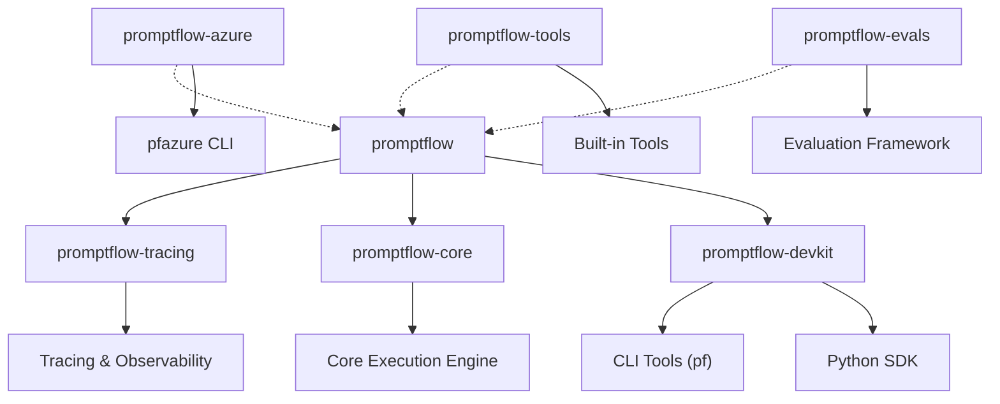
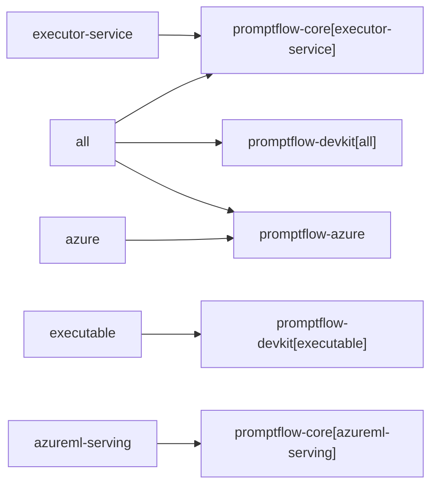
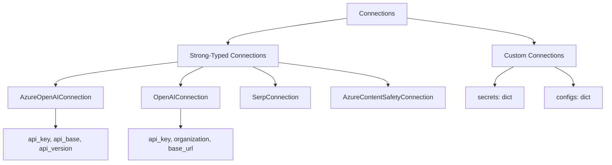
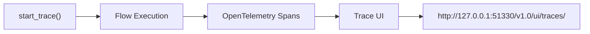
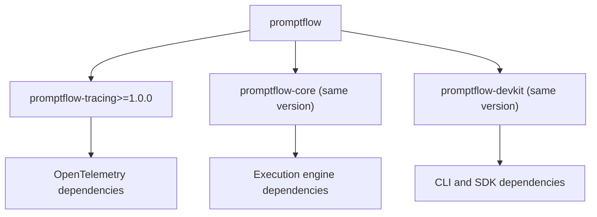

<!-- source: DeepWiki mcp.deepwiki.com · repo microsoft/promptflow · page 1.2 Installation and Setup · fetched 2026-10-26 -->

# Installation and Setup

<details>
<summary>Relevant source files</summary>

The following files were used as context for generating this wiki page:

- [docs/concepts/concept-flows.md](docs/concepts/concept-flows.md)
- [docs/how-to-guides/index.md](docs/how-to-guides/index.md)
- [docs/how-to-guides/manage-connections.md](docs/how-to-guides/manage-connections.md)
- [docs/how-to-guides/quick-start.md](docs/how-to-guides/quick-start.md)
- [docs/how-to-guides/run-and-evaluate-a-flow/index.md](docs/how-to-guides/run-and-evaluate-a-flow/index.md)
- [docs/how-to-guides/tune-prompts-with-variants.md](docs/how-to-guides/tune-prompts-with-variants.md)
- [docs/index.md](docs/index.md)
- [docs/media/how-to-guides/quick-start/flow-run-visualize-single-run.png](docs/media/how-to-guides/quick-start/flow-run-visualize-single-run.png)
- [docs/media/how-to-guides/run_visualize.png](docs/media/how-to-guides/run_visualize.png)
- [examples/flows/standard/customer-intent-extraction/intent.py](examples/flows/standard/customer-intent-extraction/intent.py)
- [src/promptflow-devkit/promptflow/_sdk/_utilities/tracing_utils.py](src/promptflow-devkit/promptflow/_sdk/_utilities/tracing_utils.py)
- [src/promptflow-recording/recordings/local/executor_node_cache.shelve.bak](src/promptflow-recording/recordings/local/executor_node_cache.shelve.bak)
- [src/promptflow-recording/recordings/local/executor_node_cache.shelve.dat](src/promptflow-recording/recordings/local/executor_node_cache.shelve.dat)
- [src/promptflow-recording/recordings/local/executor_node_cache.shelve.dir](src/promptflow-recording/recordings/local/executor_node_cache.shelve.dir)
- [src/promptflow/setup.py](src/promptflow/setup.py)
- [src/promptflow/tests/executor/e2etests/test_langchain.py](src/promptflow/tests/executor/e2etests/test_langchain.py)
- [src/promptflow/tests/executor/e2etests/test_telemetry.py](src/promptflow/tests/executor/e2etests/test_telemetry.py)
- [src/promptflow/tests/executor/e2etests/test_traces.py](src/promptflow/tests/executor/e2etests/test_traces.py)
- [src/promptflow/tests/test_configs/flows/openai_chat_api_flow/chat.py](src/promptflow/tests/test_configs/flows/openai_chat_api_flow/chat.py)
- [src/promptflow/tests/test_configs/flows/openai_chat_api_flow/flow.dag.yaml](src/promptflow/tests/test_configs/flows/openai_chat_api_flow/flow.dag.yaml)
- [src/promptflow/tests/test_configs/flows/openai_chat_api_flow/inputs.jsonl](src/promptflow/tests/test_configs/flows/openai_chat_api_flow/inputs.jsonl)
- [src/promptflow/tests/test_configs/flows/openai_completion_api_flow/completion.py](src/promptflow/tests/test_configs/flows/openai_completion_api_flow/completion.py)
- [src/promptflow/tests/test_configs/flows/openai_completion_api_flow/flow.dag.yaml](src/promptflow/tests/test_configs/flows/openai_completion_api_flow/flow.dag.yaml)
- [src/promptflow/tests/test_configs/flows/openai_completion_api_flow/inputs.jsonl](src/promptflow/tests/test_configs/flows/openai_completion_api_flow/inputs.jsonl)

</details>


This document covers the installation and initial setup of Microsoft Prompt Flow, including package dependencies, connection configuration, and verification steps. For information about developing flows after installation, see [Flow Types](#4). For Azure-specific deployment setup, see [Azure Integration](#7).

## Package Architecture Overview

Prompt Flow is structured as a modular system with multiple interconnected packages that provide different capabilities:

### Core Package Dependencies



The main `promptflow` package serves as the umbrella package that orchestrates three core components:

- **promptflow-core**: Contains the execution engine and core runtime capabilities
- **promptflow-devkit**: Provides CLI tools and SDK for local development  
- **promptflow-tracing**: Handles tracing, telemetry, and observability features

**Sources**: [src/promptflow/setup.py:23-27]()

### Installation Packages and Capabilities

| Package | Purpose | Key Components |
|---------|---------|----------------|
| `promptflow` | Main package with core functionality | FlowExecutor, CLI, SDK |
| `promptflow-azure` | Azure AI integration | Azure ML connectivity, cloud execution |
| `promptflow-tools` | Built-in tools collection | LLM tools, Python tools, custom connectors |
| `promptflow-evals` | Evaluation framework | Metrics computation, adversarial testing |

**Sources**: [src/promptflow/setup.py:51-65]()

## Installation Methods

### Basic Installation

Install the core Prompt Flow package:

```bash
pip install promptflow
```

This installs the essential components needed for local flow development and execution.

**Sources**: [docs/how-to-guides/quick-start.md:15-18]()

### Installation with Optional Features

Prompt Flow provides several installation extras for different use cases:

```bash
# Install with all optional features
pip install promptflow[all]

# Install with Azure integration
pip install promptflow[azure]

# Install with executable capabilities  
pip install promptflow[executable]

# Install with Azure ML serving support
pip install promptflow[azureml-serving]

# Install with executor service support
pip install promptflow[executor-service]
```

**Sources**: [src/promptflow/setup.py:51-65]()

### Package Extra Definitions



**Sources**: [src/promptflow/setup.py:51-65]()

### Development Installation

For contributors or advanced users who need the latest features:

```bash
# Clone the repository
git clone https://github.com/microsoft/promptflow
cd promptflow

# Install in development mode
pip install -e src/promptflow
```

**Sources**: [src/promptflow/setup.py:38]()

## Python Version Requirements

Prompt Flow requires Python 3.9 or higher:

```python
python_requires="<4.0,>=3.9"
```

Supported Python versions:
- Python 3.9
- Python 3.10  
- Python 3.11

**Sources**: [src/promptflow/setup.py:43-49]()

## Connection Configuration

### Connection Types and Setup

Prompt Flow uses connections to securely manage credentials for external services. The system supports both strong-typed connections and custom connections:



**Sources**: [docs/how-to-guides/manage-connections.md:9-12]()

### Creating Connections via CLI

Create an Azure OpenAI connection:

```bash
# Create from YAML file with override
pf connection create -f connection.yaml --set api_key=<your-api-key>

# Create custom connection
pf connection create -f custom.yaml --set configs.endpoint=<endpoint> secrets.my_key=<api-key>
```

Example Azure OpenAI connection YAML:
```yaml
$schema: https://azuremlschemas.azureedge.net/promptflow/latest/AzureOpenAIConnection.schema.json
name: azure_open_ai_connection
type: azure_open_ai
api_key: "<to-be-replaced>"
api_base: "https://<name>.openai.azure.com/"
api_type: "azure"
api_version: "2023-03-15-preview"
```

**Sources**: [docs/how-to-guides/manage-connections.md:23-50]()

### Environment Variable Loading

Prompt Flow supports automatic connection loading from environment variables:

| Connection Type | Environment Variables |
|-----------------|----------------------|
| OpenAIConnection | `OPENAI_API_KEY`, `OPENAI_ORG_ID`, `OPENAI_BASE_URL` |
| AzureOpenAIConnection | `AZURE_OPENAI_API_KEY`, `AZURE_OPENAI_ENDPOINT`, `OPENAI_API_VERSION` |

```python
from promptflow.entities import OpenAIConnection, AzureOpenAIConnection

# Load from environment variables
openai_conn = OpenAIConnection.from_env()
azure_conn = AzureOpenAIConnection.from_env()
```

**Sources**: [docs/how-to-guides/manage-connections.md:210-224]()

## Installation Verification

### Verify Core Installation

Check that the main package and CLI are working:

```bash
# Verify CLI installation
pf --version

# List available commands
pf --help

# Check connection capabilities
pf connection list
```

### Create and Test a Simple Flow

Verify the installation by creating a minimal flow:

```python
import os
from pathlib import Path
from promptflow.tracing import trace
from promptflow.core import Prompty

@trace
def chat(question: str = "What's the capital of France?") -> str:
    """Flow entry function."""
    
    if "OPENAI_API_KEY" not in os.environ and "AZURE_OPENAI_API_KEY" not in os.environ:
        from dotenv import load_dotenv
        load_dotenv()

    prompty = Prompty.load(source=Path(__file__).parent / "chat.prompty")
    output = prompty(question=question)
    return output
```

Test the flow:
```bash
pf flow test --flow flow:chat --inputs question="What's the capital of France?"
```

**Sources**: [docs/how-to-guides/quick-start.md:59-101]()

### Tracing Verification

The installation includes tracing capabilities that can be verified:



```python
from promptflow.tracing import start_trace

start_trace()
result = chat("What's the capital of France?")
print(result)
```

This should output a URL for the trace UI where you can inspect the execution details.

**Sources**: [docs/how-to-guides/quick-start.md:125-144]()

## Common Installation Issues

### Connection Storage Errors

If you encounter `StoreConnectionEncryptionKeyError` on WSL or systems without keyring:

```bash
# Install keyring backend
pip install keyrings.alt

# Or configure environment variable
export PROMPTFLOW_KEYRING_BACKEND="keyrings.alt.file.PlaintextKeyring"
```

**Sources**: [docs/how-to-guides/manage-connections.md:16-18]()

### Package Compatibility

Ensure compatible versions when installing multiple packages:



**Sources**: [src/promptflow/setup.py:23-27]()

## Next Steps

After successful installation and setup:

1. **Learn Core Concepts**: See [Key Concepts](#1.1) for understanding flows, tools, and connections
2. **Create Your First Flow**: Follow [Flow Operations](#3.1) to initialize and test flows
3. **Explore Flow Types**: Review [Flow Types](#4) for DAG flows, Flex flows, and Prompty
4. **Set Up Evaluation**: See [Evaluation System](#6.2) for testing and metrics
5. **Azure Integration**: Configure [Azure ML Integration](#7.1) for cloud capabilities

**Sources**: [docs/how-to-guides/quick-start.md:171-181](), [docs/index.md:32-46]()

---

