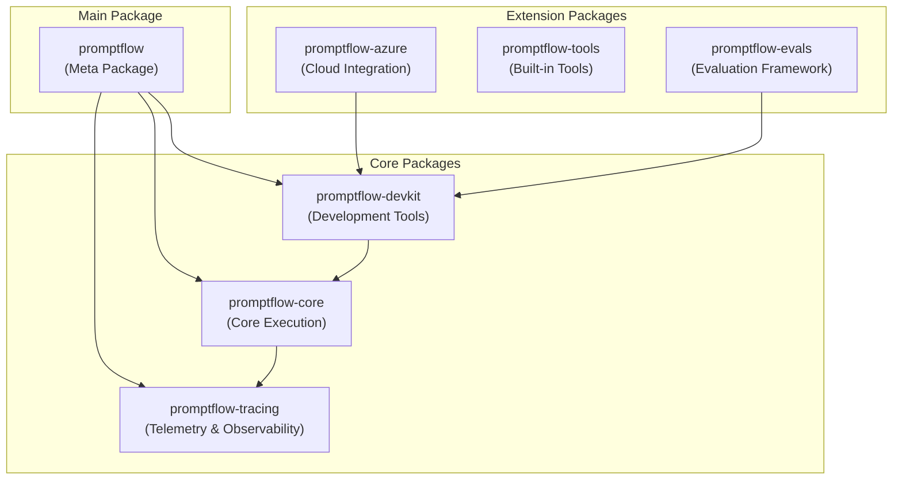
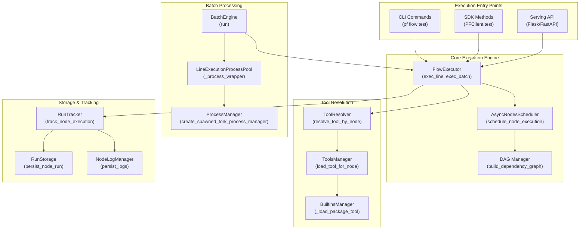
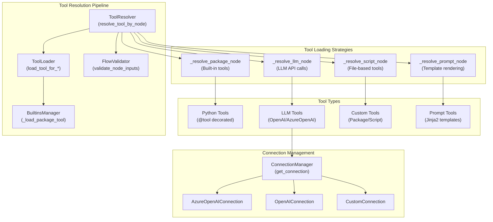
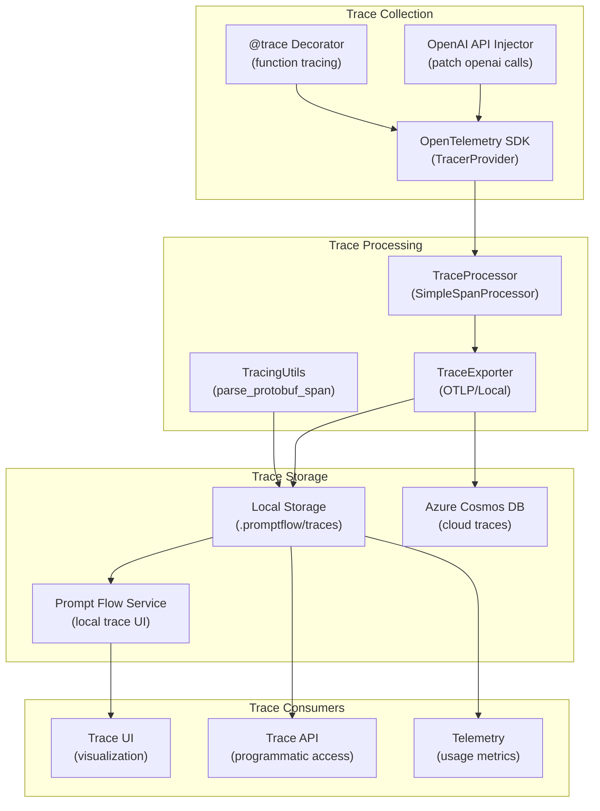
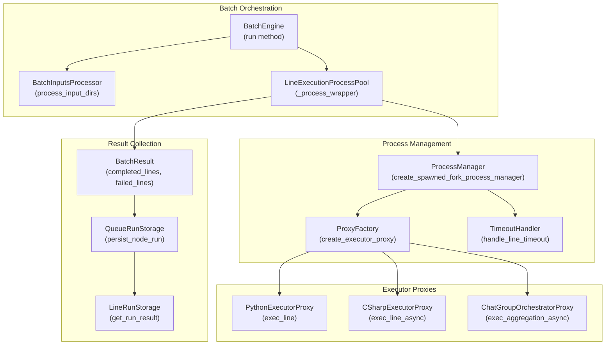
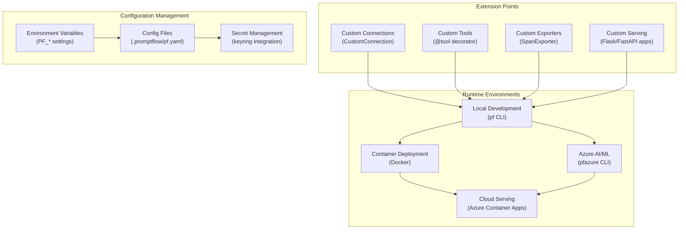

<!-- source: DeepWiki mcp.deepwiki.com · repo microsoft/promptflow · page 2 Architecture · fetched 2026-10-26 -->

# Architecture

Relevant source files

The following files were used as context for generating this wiki page:

- [src/promptflow-azure/CHANGELOG.md](src/promptflow-azure/CHANGELOG.md)
- [src/promptflow-azure/pyproject.toml](src/promptflow-azure/pyproject.toml)
- [src/promptflow-core/CHANGELOG.md](src/promptflow-core/CHANGELOG.md)
- [src/promptflow-core/pyproject.toml](src/promptflow-core/pyproject.toml)
- [src/promptflow-devkit/CHANGELOG.md](src/promptflow-devkit/CHANGELOG.md)
- [src/promptflow-devkit/promptflow/_sdk/_utilities/tracing_utils.py](src/promptflow-devkit/promptflow/_sdk/_utilities/tracing_utils.py)
- [src/promptflow-devkit/pyproject.toml](src/promptflow-devkit/pyproject.toml)
- [src/promptflow-recording/recordings/local/executor_node_cache.shelve.bak](src/promptflow-recording/recordings/local/executor_node_cache.shelve.bak)
- [src/promptflow-recording/recordings/local/executor_node_cache.shelve.dat](src/promptflow-recording/recordings/local/executor_node_cache.shelve.dat)
- [src/promptflow-recording/recordings/local/executor_node_cache.shelve.dir](src/promptflow-recording/recordings/local/executor_node_cache.shelve.dir)
- [src/promptflow-tracing/CHANGELOG.md](src/promptflow-tracing/CHANGELOG.md)
- [src/promptflow-tracing/pyproject.toml](src/promptflow-tracing/pyproject.toml)
- [src/promptflow/CHANGELOG.md](src/promptflow/CHANGELOG.md)
- [src/promptflow/promptflow/_version.py](src/promptflow/promptflow/_version.py)
- [src/promptflow/setup.py](src/promptflow/setup.py)
- [src/promptflow/tests/executor/e2etests/test_langchain.py](src/promptflow/tests/executor/e2etests/test_langchain.py)
- [src/promptflow/tests/executor/e2etests/test_telemetry.py](src/promptflow/tests/executor/e2etests/test_telemetry.py)
- [src/promptflow/tests/executor/e2etests/test_traces.py](src/promptflow/tests/executor/e2etests/test_traces.py)
- [src/promptflow/tests/test_configs/flows/openai_chat_api_flow/chat.py](src/promptflow/tests/test_configs/flows/openai_chat_api_flow/chat.py)
- [src/promptflow/tests/test_configs/flows/openai_chat_api_flow/flow.dag.yaml](src/promptflow/tests/test_configs/flows/openai_chat_api_flow/flow.dag.yaml)
- [src/promptflow/tests/test_configs/flows/openai_chat_api_flow/inputs.jsonl](src/promptflow/tests/test_configs/flows/openai_chat_api_flow/inputs.jsonl)
- [src/promptflow/tests/test_configs/flows/openai_completion_api_flow/completion.py](src/promptflow/tests/test_configs/flows/openai_completion_api_flow/completion.py)
- [src/promptflow/tests/test_configs/flows/openai_completion_api_flow/flow.dag.yaml](src/promptflow/tests/test_configs/flows/openai_completion_api_flow/flow.dag.yaml)
- [src/promptflow/tests/test_configs/flows/openai_completion_api_flow/inputs.jsonl](src/promptflow/tests/test_configs/flows/openai_completion_api_flow/inputs.jsonl)

This document provides a comprehensive overview of the Microsoft Prompt Flow system architecture, covering the core components, execution model, and integration patterns. It focuses on the technical implementation details including key classes, modules, and their interactions.

For information about specific flow types and their usage, see [Flow Types](#4). For CLI and SDK usage patterns, see [CLI and SDK](#3). For Azure-specific integration details, see [Azure Integration](#7).

## Package Structure

Prompt Flow follows a modular architecture with four core packages that provide distinct but interconnected capabilities.

**Package Dependencies**

| Package | Purpose | Key Dependencies |
|---------|---------|------------------|
| `promptflow-core` | Flow execution engine, tool system | `promptflow-tracing`, `ruamel.yaml`, `jsonschema` |
| `promptflow-devkit` | CLI, SDK, local services | `promptflow-core`, `httpx`, `sqlalchemy`, `pandas` |
| `promptflow-tracing` | OpenTelemetry integration, trace collection | `opentelemetry-sdk`, `tiktoken` |
| `promptflow-azure` | Azure AI/ML integration | `azure-ai-ml`, `azure-cosmos`, `promptflow-devkit` |

Sources: [src/promptflow/setup.py:23-27](), [src/promptflow-core/pyproject.toml:42-58](), [src/promptflow-devkit/pyproject.toml:42-70](), [src/promptflow-tracing/pyproject.toml:36-40](), [src/promptflow-azure/pyproject.toml:39-47]()

## Flow Execution Architecture

The flow execution system is built around the `FlowExecutor` class which coordinates tool resolution, node scheduling, and trace collection.

**Key Execution Components**

| Component | Responsibility | Location |
|-----------|---------------|----------|
| `FlowExecutor` | Main orchestrator for flow execution | `promptflow.executor.flow_executor` |
| `AsyncNodesScheduler` | Manages parallel node execution | `promptflow.executor._async_nodes_scheduler` |
| `ToolResolver` | Resolves node definitions to executable tools | `promptflow.executor._tool_resolver` |
| `BatchEngine` | Handles batch/bulk execution with multiprocessing | `promptflow.batch._batch_engine` |

Sources: [src/promptflow/tests/executor/e2etests/test_traces.py:19](), [src/promptflow/tests/executor/e2etests/test_telemetry.py:12](), [src/promptflow/tests/executor/e2etests/test_langchain.py:6]()

## Tool System Architecture

The tool system handles discovery, loading, and execution of various tool types including Python functions, LLM calls, and custom tools.

**Tool Resolution Flow**

1. **Node Analysis**: `ToolResolver.resolve_tool_by_node()` examines node type and source
2. **Type-Specific Loading**: Delegates to specialized resolvers based on tool type
3. **Input Validation**: `FlowValidator` ensures required inputs and connections are available
4. **Connection Injection**: Resolves connection references to actual connection objects
5. **Tool Instance Creation**: Returns executable tool with bound inputs and connections

Sources: Test flows showing tool usage patterns in [src/promptflow/tests/test_configs/flows/openai_chat_api_flow/chat.py:35-78](), [src/promptflow/tests/test_configs/flows/openai_completion_api_flow/completion.py:26-66]()

## Tracing and Observability

Prompt Flow integrates with OpenTelemetry to provide comprehensive tracing of flow execution, tool calls, and LLM interactions.

**Tracing Components**

| Component | Purpose | Key Methods |
|-----------|---------|-------------|
| `openai_injector` | Automatically traces OpenAI API calls | `inject()`, `recover()` |
| `@trace` decorator | Manual function tracing | Applied to user functions |
| `parse_protobuf_span` | Converts OTLP spans to internal format | `parse_protobuf_span()` |
| `TraceTelemetryHelper` | Aggregates usage metrics | `append()`, `log_telemetry()` |

Sources: [src/promptflow/tests/executor/e2etests/test_traces.py:143-151](), [src/promptflow-devkit/promptflow/_sdk/_utilities/tracing_utils.py:342-380]()

## Batch Processing System

The batch processing system enables scalable execution of flows across large datasets using multiprocessing.

**Batch Processing Configuration**

| Setting | Default | Environment Variable | Purpose |
|---------|---------|---------------------|---------|
| Worker Count | 4 | `PF_WORKER_COUNT` | Number of parallel processes |
| Line Timeout | 600s | `PF_LINE_TIMEOUT_SEC` | Per-line execution timeout |
| Batch Timeout | 3600s | `PF_BATCH_TIMEOUT_SEC` | Total batch timeout |

Sources: [src/promptflow/tests/executor/e2etests/test_telemetry.py:117-156](), [src/promptflow/tests/executor/e2etests/test_langchain.py:24-33]()

## Integration Points

The architecture provides multiple integration points for extending and customizing Prompt Flow behavior.

**Key Integration Patterns**

- **Tool Registration**: Custom tools via `@tool` decorator and package entry points
- **Connection Providers**: Extensible connection system supporting Azure ML, local files, environment variables
- **Trace Exporters**: OpenTelemetry-compatible exporters for various backends
- **Serving Frameworks**: Support for Flask and FastAPI with automatic endpoint generation

Sources: Configuration and integration patterns from [src/promptflow/CHANGELOG.md:88-98](), [src/promptflow-devkit/CHANGELOG.md:52-62]()

---

