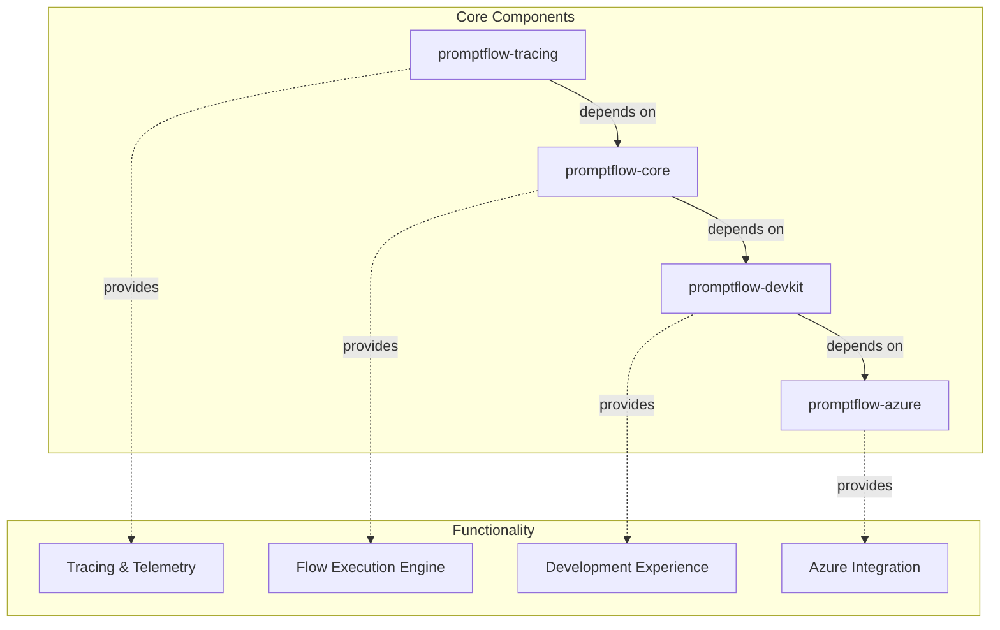
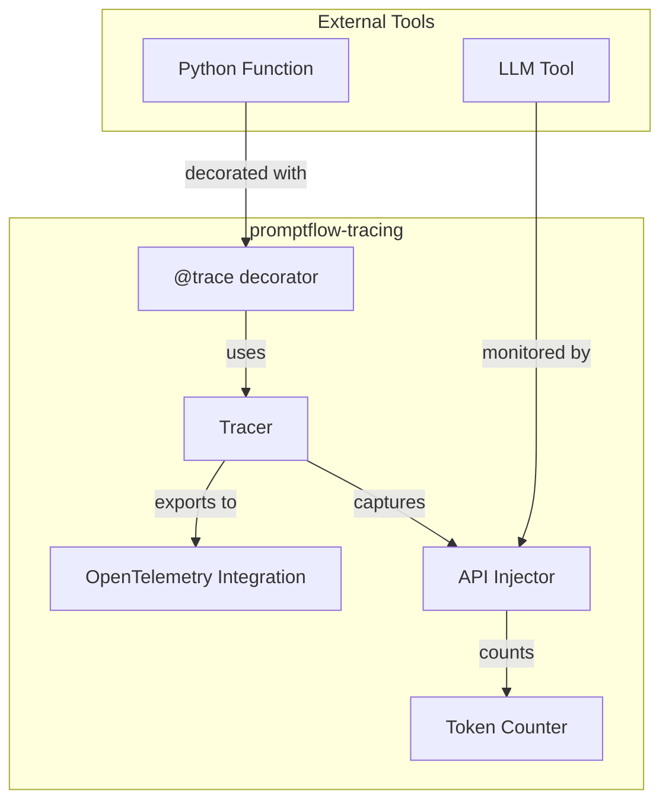
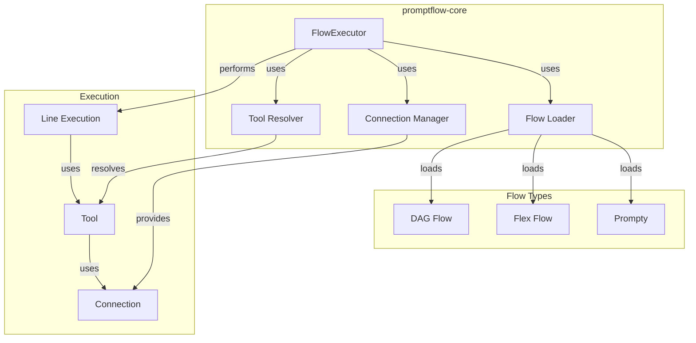
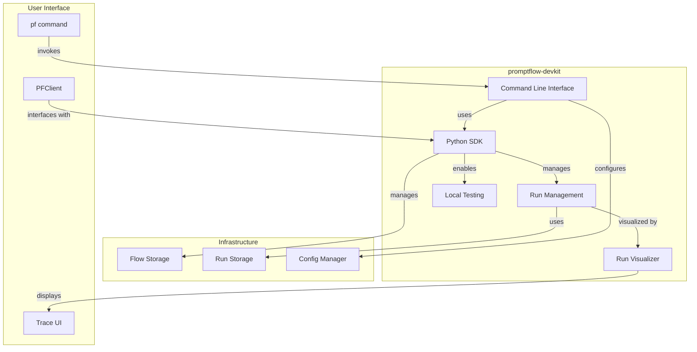
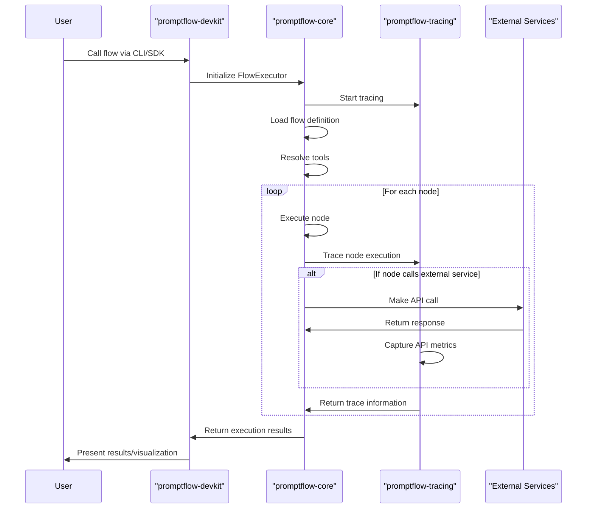
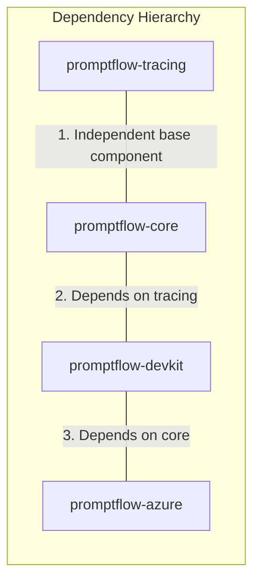
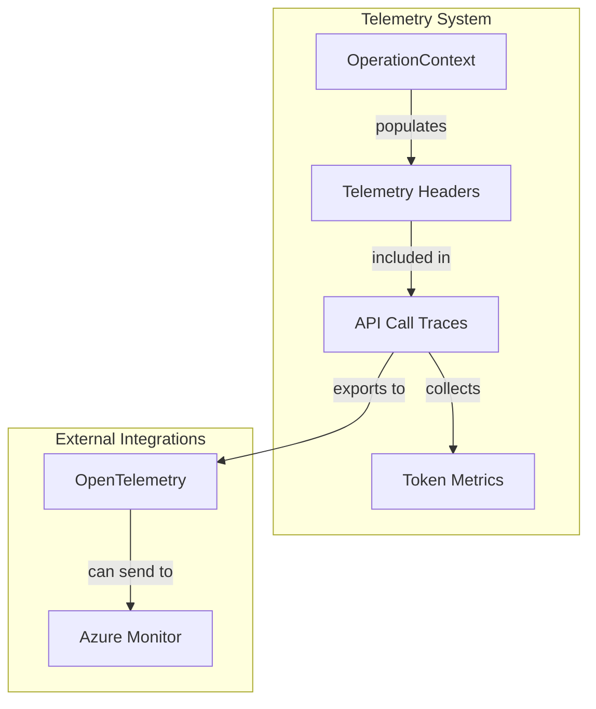

<!-- source: DeepWiki mcp.deepwiki.com · repo microsoft/promptflow · page 2.1 Core Components · fetched 2026-10-26 -->

# Core Components

<details>
<summary>Relevant source files</summary>

The following files were used as context for generating this wiki page:

- [src/promptflow-azure/CHANGELOG.md](src/promptflow-azure/CHANGELOG.md)
- [src/promptflow-azure/pyproject.toml](src/promptflow-azure/pyproject.toml)
- [src/promptflow-core/CHANGELOG.md](src/promptflow-core/CHANGELOG.md)
- [src/promptflow-core/pyproject.toml](src/promptflow-core/pyproject.toml)
- [src/promptflow-devkit/CHANGELOG.md](src/promptflow-devkit/CHANGELOG.md)
- [src/promptflow-devkit/promptflow/_sdk/_utilities/tracing_utils.py](src/promptflow-devkit/promptflow/_sdk/_utilities/tracing_utils.py)
- [src/promptflow-devkit/pyproject.toml](src/promptflow-devkit/pyproject.toml)
- [src/promptflow-recording/recordings/local/executor_node_cache.shelve.bak](src/promptflow-recording/recordings/local/executor_node_cache.shelve.bak)
- [src/promptflow-recording/recordings/local/executor_node_cache.shelve.dat](src/promptflow-recording/recordings/local/executor_node_cache.shelve.dat)
- [src/promptflow-recording/recordings/local/executor_node_cache.shelve.dir](src/promptflow-recording/recordings/local/executor_node_cache.shelve.dir)
- [src/promptflow-tracing/CHANGELOG.md](src/promptflow-tracing/CHANGELOG.md)
- [src/promptflow-tracing/pyproject.toml](src/promptflow-tracing/pyproject.toml)
- [src/promptflow/CHANGELOG.md](src/promptflow/CHANGELOG.md)
- [src/promptflow/promptflow/_version.py](src/promptflow/promptflow/_version.py)
- [src/promptflow/setup.py](src/promptflow/setup.py)
- [src/promptflow/tests/executor/e2etests/test_langchain.py](src/promptflow/tests/executor/e2etests/test_langchain.py)
- [src/promptflow/tests/executor/e2etests/test_telemetry.py](src/promptflow/tests/executor/e2etests/test_telemetry.py)
- [src/promptflow/tests/executor/e2etests/test_traces.py](src/promptflow/tests/executor/e2etests/test_traces.py)
- [src/promptflow/tests/test_configs/flows/openai_chat_api_flow/chat.py](src/promptflow/tests/test_configs/flows/openai_chat_api_flow/chat.py)
- [src/promptflow/tests/test_configs/flows/openai_chat_api_flow/flow.dag.yaml](src/promptflow/tests/test_configs/flows/openai_chat_api_flow/flow.dag.yaml)
- [src/promptflow/tests/test_configs/flows/openai_chat_api_flow/inputs.jsonl](src/promptflow/tests/test_configs/flows/openai_chat_api_flow/inputs.jsonl)
- [src/promptflow/tests/test_configs/flows/openai_completion_api_flow/completion.py](src/promptflow/tests/test_configs/flows/openai_completion_api_flow/completion.py)
- [src/promptflow/tests/test_configs/flows/openai_completion_api_flow/flow.dag.yaml](src/promptflow/tests/test_configs/flows/openai_completion_api_flow/flow.dag.yaml)
- [src/promptflow/tests/test_configs/flows/openai_completion_api_flow/inputs.jsonl](src/promptflow/tests/test_configs/flows/openai_completion_api_flow/inputs.jsonl)

</details>


This document details the main packages that form the foundation of the PromptFlow system, their responsibilities, and relationships. It serves as a technical reference for understanding the internal architecture of the PromptFlow codebase. For information about using these components, see [CLI and SDK](#3).

## Package Structure Overview

PromptFlow has a modular architecture consisting of four primary packages, each with distinct responsibilities:



The main `promptflow` package acts as an umbrella that includes these core components:

```
promptflow
├── promptflow-tracing     # Tracing capabilities
├── promptflow-core        # Core functionality to run flows
├── promptflow-devkit      # Development kit (CLI, SDK, etc.)
└── promptflow-azure       # Azure integration (optional)
```

Sources: [src/promptflow/setup.py:23-28](), [src/promptflow/CHANGELOG.md:127-133]()

## 1. promptflow-tracing

The `promptflow-tracing` package provides observability for flow execution through tracing capabilities. It's built on top of OpenTelemetry and provides mechanisms to track the execution of flows, tool calls, and their performance metrics.

### Key Features

- Tracing decorator (`@trace`) for functions and tools
- API injector for tracking LLM calls
- Token counting for LLM interactions
- Integration with OpenTelemetry

### Architecture



This component operates independently of other PromptFlow components and has minimal dependencies. It focuses on the tracing aspects of the system and exports trace data in OpenTelemetry format.

### Trace Types

- **Flow**: Traces for entire flow execution
- **Function**: Traces for individual function calls
- **LLM**: Specialized traces for LLM interactions with token metrics
- **Embedding**: Specialized traces for embedding operations

Sources: [src/promptflow-tracing/pyproject.toml:1-114](), [src/promptflow/tests/executor/e2etests/test_traces.py:21-27](), [src/promptflow/tests/executor/e2etests/test_traces.py:54-67](), [src/promptflow/tests/executor/unittests/_core/test_tracer.py:1-12]()

## 2. promptflow-core

The `promptflow-core` package contains the essential functionality for executing flows. It provides the foundation for defining, loading, and running flows of different types.

### Key Components

- **Flow Executor**: Central engine for executing flows
- **Connection Management**: Handles connections to external services
- **Tool Resolution**: Resolves and loads tools used in flows
- **Flow Types Support**: Supports DAG flows, Flex flows, and Prompty

### Architecture



### Serving Capabilities

The core package also includes basic serving capabilities for flows:

- Flask-based serving interface
- FastAPI-based serving interface (added in recent versions)
- Support for containerization

Sources: [src/promptflow-core/pyproject.toml:1-147](), [src/promptflow-core/CHANGELOG.md:1-62]()

## 3. promptflow-devkit

The `promptflow-devkit` package builds upon the core functionality, providing development tools, CLI commands, SDK interfaces, and local testing capabilities.

### Key Components

- **CLI**: Command-line interface for creating, testing, and managing flows
- **SDK**: Python SDK for programmatic interaction with flows
- **Local Testing**: Tools for testing flows locally
- **Run Management**: Tracking and managing flow runs
- **Visualization**: Visualizing flow execution results

### Architecture



### Key CLI Commands

- `pf flow`: Create, test, validate, and serve flows
- `pf run`: Create, manage, and analyze flow runs
- `pf connection`: Manage connections to external services

Sources: [src/promptflow-devkit/pyproject.toml:1-178](), [src/promptflow-devkit/CHANGELOG.md:1-89]()

## 4. promptflow-azure

While not a core focus of this document, the `promptflow-azure` package extends PromptFlow functionality to the Azure cloud environment. It integrates with Azure AI services and enables running flows in the Azure cloud.

### Key Components

- **Azure Client**: Client for Azure AI services
- **Cloud Execution**: Running flows in Azure
- **Azure Connections**: Specialized connections for Azure services

Sources: [src/promptflow-azure/pyproject.toml:1-137](), [src/promptflow-azure/CHANGELOG.md:1-40]()

## Component Integration and Data Flow

The following diagram illustrates how the components work together during flow execution:



## Dependency Structure

The components have a clear dependency hierarchy:



Important dependency notes:
- `promptflow-tracing` is independent of other components
- `promptflow-core` depends on `promptflow-tracing`
- `promptflow-devkit` depends on `promptflow-core`
- `promptflow-azure` depends on `promptflow-devkit`

This hierarchy ensures a clean separation of concerns and allows each component to focus on its specific responsibilities.

Sources: [src/promptflow/setup.py:23-72]()

## Telemetry and Monitoring

PromptFlow includes telemetry capabilities for monitoring flow execution and performance:



All components can contribute telemetry data, with `promptflow-tracing` responsible for collecting and exporting it. Flow execution metrics, token usage, and API calls are tracked and can be visualized through the devkit's capabilities.

Sources: [src/promptflow/tests/executor/e2etests/test_telemetry.py:1-156](), [src/promptflow/tests/executor/e2etests/test_traces.py:1-737]()

## Summary

The PromptFlow system consists of four modular core components:

| Component | Primary Responsibility | Key Features |
|-----------|------------------------|--------------|
| promptflow-tracing | Observability | Trace decoration, API monitoring, token counting |
| promptflow-core | Flow execution | Flow executor, connections, tool resolution |
| promptflow-devkit | Development tools | CLI, SDK, run management, visualization |
| promptflow-azure | Cloud integration | Azure AI integration, cloud execution |

These components work together to provide a comprehensive platform for building, testing, and deploying prompt-based applications with large language models. The modular design allows for flexibility and extensibility while maintaining a clean separation of concerns.

---

