<!-- source: DeepWiki mcp.deepwiki.com · repo microsoft/promptflow · page 2.2 Flow Execution Model · fetched 2026-10-26 -->

# Flow Execution Model

Relevant source files

The following files were used as context for generating this wiki page:

- [src/promptflow-core/promptflow/_core/run_tracker.py](src/promptflow-core/promptflow/_core/run_tracker.py)
- [src/promptflow-core/promptflow/_utils/async_utils.py](src/promptflow-core/promptflow/_utils/async_utils.py)
- [src/promptflow-core/promptflow/_utils/logger_utils.py](src/promptflow-core/promptflow/_utils/logger_utils.py)
- [src/promptflow-core/promptflow/_utils/process_utils.py](src/promptflow-core/promptflow/_utils/process_utils.py)
- [src/promptflow-core/promptflow/_utils/run_tracker_utils.py](src/promptflow-core/promptflow/_utils/run_tracker_utils.py)
- [src/promptflow-core/promptflow/executor/_async_nodes_scheduler.py](src/promptflow-core/promptflow/executor/_async_nodes_scheduler.py)
- [src/promptflow-core/promptflow/executor/flow_executor.py](src/promptflow-core/promptflow/executor/flow_executor.py)
- [src/promptflow-tracing/promptflow/tracing/_integrations/_openai_injector.py](src/promptflow-tracing/promptflow/tracing/_integrations/_openai_injector.py)
- [src/promptflow-tracing/promptflow/tracing/_span_enricher.py](src/promptflow-tracing/promptflow/tracing/_span_enricher.py)
- [src/promptflow-tracing/promptflow/tracing/_trace.py](src/promptflow-tracing/promptflow/tracing/_trace.py)
- [src/promptflow-tracing/promptflow/tracing/_tracer.py](src/promptflow-tracing/promptflow/tracing/_tracer.py)
- [src/promptflow-tracing/promptflow/tracing/contracts/trace.py](src/promptflow-tracing/promptflow/tracing/contracts/trace.py)
- [src/promptflow-tracing/tests/e2etests/simple_functions.py](src/promptflow-tracing/tests/e2etests/simple_functions.py)
- [src/promptflow-tracing/tests/e2etests/test_tracing.py](src/promptflow-tracing/tests/e2etests/test_tracing.py)
- [src/promptflow-tracing/tests/unittests/test_openai_injector.py](src/promptflow-tracing/tests/unittests/test_openai_injector.py)
- [src/promptflow-tracing/tests/unittests/test_trace.py](src/promptflow-tracing/tests/unittests/test_trace.py)
- [src/promptflow/tests/executor/e2etests/test_async.py](src/promptflow/tests/executor/e2etests/test_async.py)
- [src/promptflow/tests/executor/e2etests/test_executor_happypath.py](src/promptflow/tests/executor/e2etests/test_executor_happypath.py)
- [src/promptflow/tests/executor/e2etests/test_logs.py](src/promptflow/tests/executor/e2etests/test_logs.py)
- [src/promptflow/tests/executor/unittests/_utils/test_thread_utils.py](src/promptflow/tests/executor/unittests/_utils/test_thread_utils.py)
- [src/promptflow/tests/executor/unittests/executor/test_flow_nodes_scheduler.py](src/promptflow/tests/executor/unittests/executor/test_flow_nodes_scheduler.py)
- [src/promptflow/tests/test_configs/flows/async_tools_with_sync_tools/async_passthrough.py](src/promptflow/tests/test_configs/flows/async_tools_with_sync_tools/async_passthrough.py)
- [src/promptflow/tests/test_configs/flows/async_tools_with_sync_tools/flow.dag.yaml](src/promptflow/tests/test_configs/flows/async_tools_with_sync_tools/flow.dag.yaml)

This document explains the core execution model of PromptFlow, detailing how flows are loaded, validated, and executed within the system. It covers the components involved in executing both single inputs and batch processing, as well as the underlying mechanisms for resolving tools and managing the execution lifecycle.

For information about the tool system itself, see [Tool System](#2.3).

## Execution Architecture Overview

The Flow Execution Model is centered around a few key components that work together to execute flows reliably and efficiently:

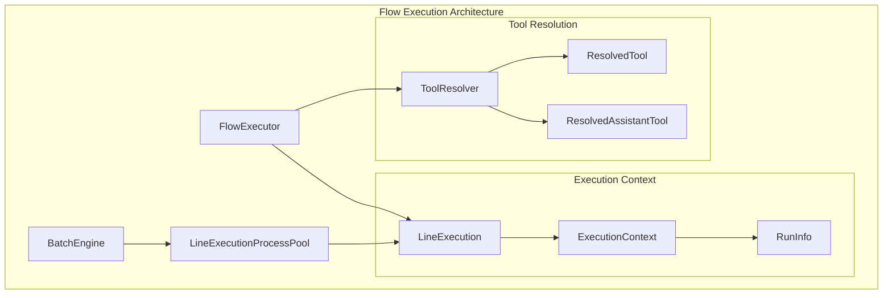

Sources: 
- [src/promptflow/tests/executor/unittests/executor/test_tool_resolver.py:1-144]()
- [src/promptflow/tests/executor/unittests/executor/test_flow_executor.py:1-25]()

## Flow Executor

The `FlowExecutor` is the main entry point for executing flows. It's responsible for:

1. Loading and validating the flow definition
2. Resolving tools referenced in nodes
3. Executing the flow with provided inputs
4. Handling execution results and errors

### Flow Loading and Creation

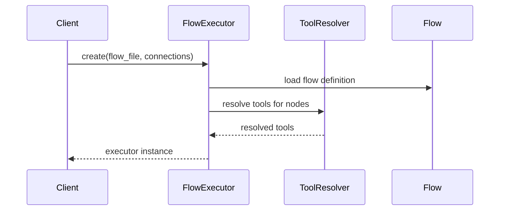

The `FlowExecutor.create()` method initializes the executor with a flow definition:

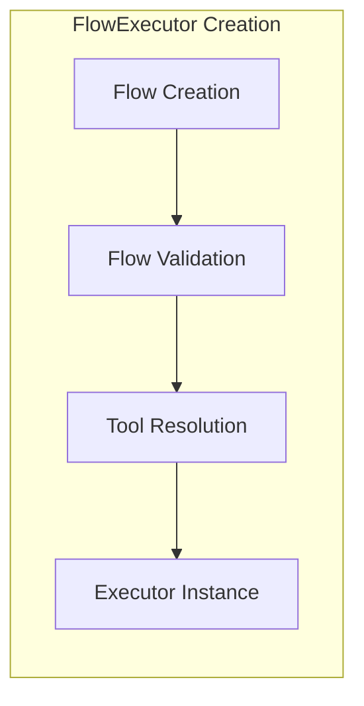

Sources:
- [src/promptflow/tests/executor/e2etests/test_executor_validation.py:142-150]()
- [src/promptflow/tests/executor/unittests/executor/test_flow_executor.py:1-25]()

### Single Line Execution

When executing a single input (or "line"), the flow executor:

1. Validates the input against the flow's input schema
2. Creates execution context for the run
3. Executes nodes in topological order (respecting dependencies)
4. Collects outputs and creates a `LineResult`

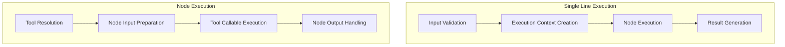

Sources:
- [src/promptflow/tests/executor/e2etests/test_executor_validation.py:192-205]()
- [src/promptflow/tests/executor/unittests/executor/test_flow_executor.py:52-88]()

## Tool Resolution System

The `ToolResolver` is responsible for loading and preparing tools referenced by nodes in the flow. It handles different types of tools:

- Python package tools
- Python script tools
- Prompt template tools
- LLM tools
- Custom LLM tools

### Resolution Process

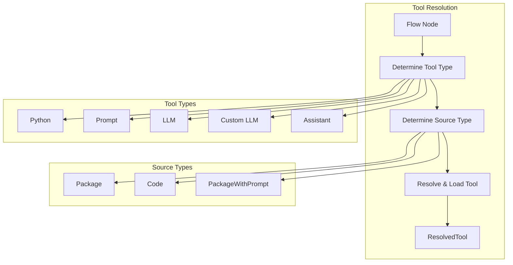

The resolver converts a node definition into a `ResolvedTool` that contains:
- The node reference
- The callable function
- Tool definition
- Initialization arguments

Sources:
- [src/promptflow/tests/executor/unittests/executor/test_tool_resolver.py:50-137]()
- [src/promptflow/tests/executor/unittests/_core/test_tools_manager.py:35-139]()

### Connection Handling

Tools often require connections to external services. The `ToolResolver` handles:

1. Resolving connection references from the connection provider
2. Validating connection types match tool requirements
3. Converting connection values to the appropriate types (e.g., `CustomStrongTypeConnection`)

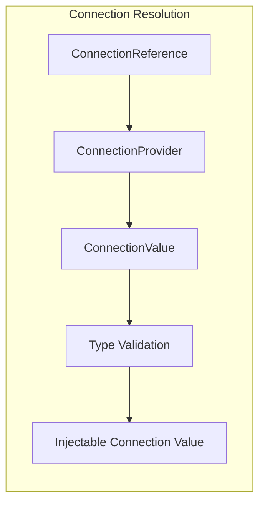

Sources:
- [src/promptflow/tests/executor/unittests/executor/test_tool_resolver.py:184-215]()
- [src/promptflow/tests/executor/unittests/executor/test_tool_resolver.py:261-311]()

## Execution Process

### Flow Execution Lifecycle

The complete flow execution lifecycle involves several stages:

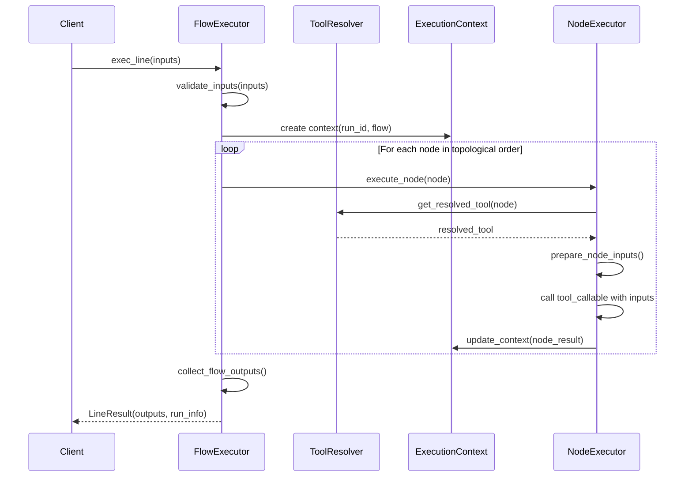

Sources:
- [src/promptflow/tests/executor/e2etests/test_executor_validation.py:337-354]()
- [src/promptflow/tests/executor/unittests/executor/test_flow_executor.py:1-25]()

### Node Execution

Node execution involves several steps:

1. Resolving the node's tool
2. Preparing inputs (handling references to other nodes' outputs)
3. Executing the tool callable
4. Processing and validating the output
5. Updating the execution context

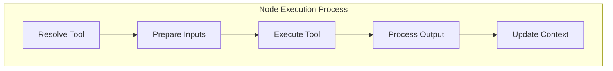

Sources:
- [src/promptflow/tests/executor/e2etests/test_executor_validation.py:277-336]()

## Batch Processing

For processing multiple inputs (batch processing), PromptFlow uses a process pool to execute lines in parallel:

### Batch Architecture

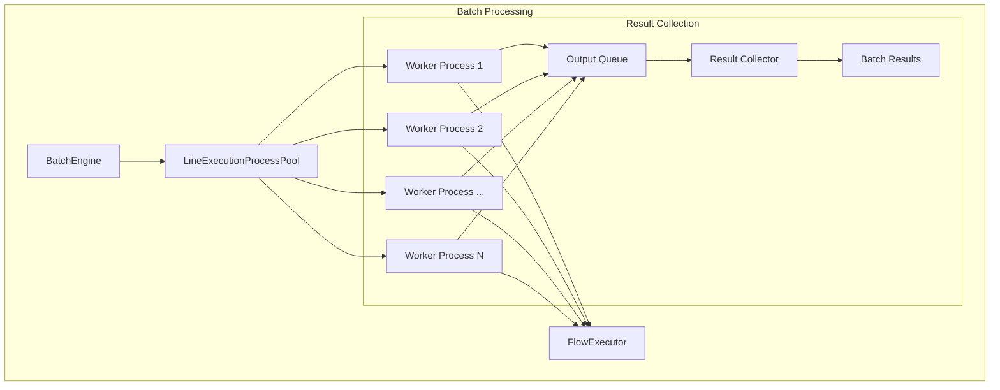

The `LineExecutionProcessPool` manages worker processes that execute individual lines:

- It determines the optimal number of processes based on available resources
- Each process executes a flow line with isolated execution contexts
- Results are collected through a queue system
- The pool handles timeouts and process management

Sources:
- [src/promptflow/tests/executor/unittests/executor/test_line_execution_process_pool.py:184-205]()
- [src/promptflow/tests/executor/e2etests/test_executor_validation.py:376-418]()

### Batch Execution Process

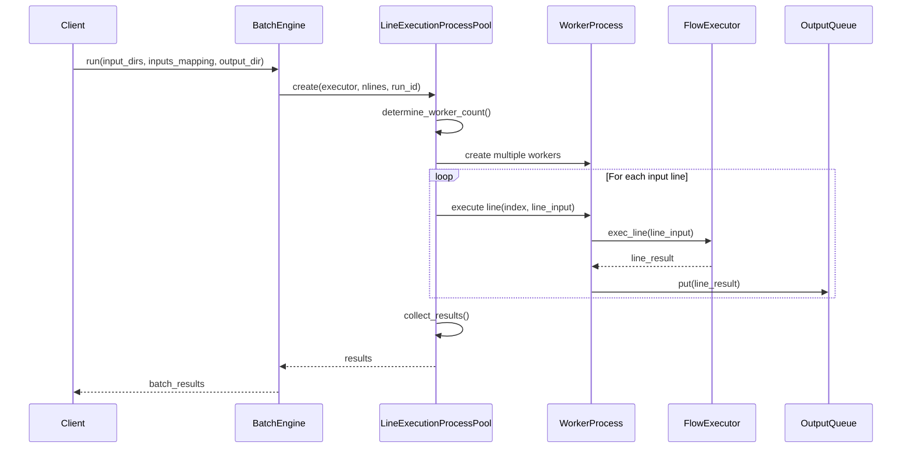

Sources:
- [src/promptflow/tests/executor/unittests/executor/test_line_execution_process_pool.py:225-245]()
- [src/promptflow/tests/executor/unittests/storage/test_queue_run_storage.py:1-60]()

### Process Management

The process pool can use different execution modes depending on the platform:

| Mode | Description | Platforms |
|------|-------------|-----------|
| `fork` | Creates processes by forking the current process | Linux primarily |
| `spawn` | Creates new Python interpreter processes | All platforms |

The process pool dynamically determines the optimal number of worker processes based on:
- Available system memory
- Current process memory usage
- Number of input rows
- Configured worker count limits

Sources:
- [src/promptflow/tests/executor/unittests/executor/test_line_execution_process_pool.py:326-394]()
- [src/promptflow/tests/executor/unittests/_utils/test_process_utils.py:1-38]()

## Streaming Support

PromptFlow provides support for streaming outputs from LLM tools:

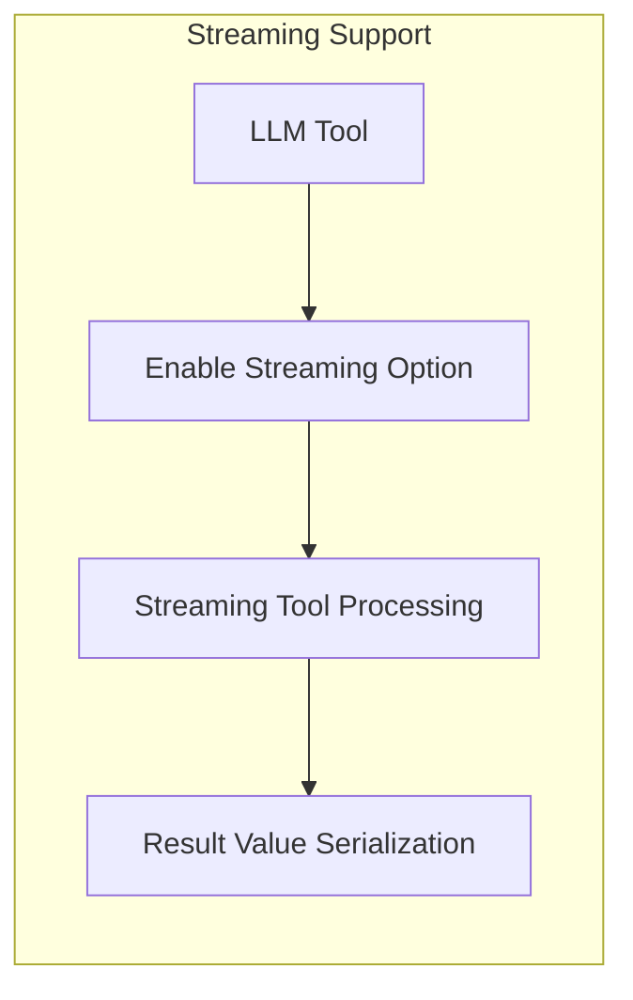

The framework automatically handles streaming capabilities by:
1. Identifying tools that support streaming
2. Enabling streaming parameters for applicable tools
3. Processing streamed outputs appropriately

Sources:
- [src/promptflow/tests/executor/unittests/executor/test_flow_executor.py:90-181]()

## Validation and Error Handling

PromptFlow extensively validates flows and inputs to provide clear error messages:

### Flow Validation

The flow validation system checks for:
- Duplicate node names
- Missing source files
- Node reference validity
- Circular dependencies
- Input and output reference validity

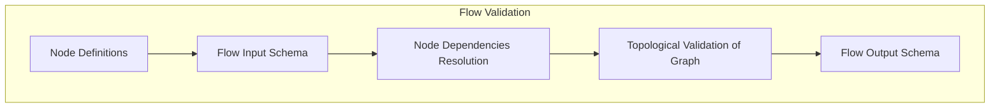

Sources:
- [src/promptflow/tests/executor/e2etests/test_executor_validation.py:36-140]()

### Input Validation

Input validation ensures that:
- Required inputs are provided
- Input values match expected types
- Input references are valid

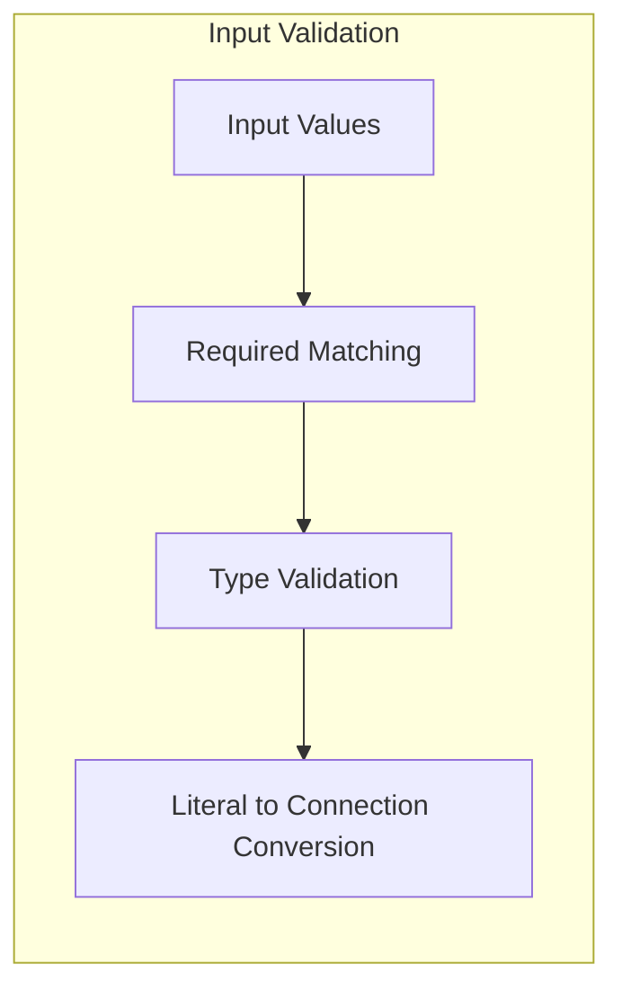

Sources:
- [src/promptflow/tests/executor/e2etests/test_executor_validation.py:192-273]()

### Error Handling

The error handling system:
- Captures and categorizes errors during execution
- Propagates appropriate error information to results
- Provides detailed error messages for debugging

| Error Type | Description | Example |
|------------|-------------|---------|
| `UserErrorException` | Errors in user-provided inputs or configurations | Invalid input type |
| `NodeInputValidationError` | Issues with node input validation | Missing required input |
| `ResolveToolError` | Problems resolving tools | Tool not found |
| `NodeReferenceNotFound` | Invalid node references | Reference to non-existent node |
| `InputTypeError` | Type mismatches in inputs | String provided for integer input |

Sources:
- [src/promptflow/tests/executor/e2etests/test_executor_validation.py:236-245]()
- [src/promptflow/tests/executor/e2etests/test_executor_validation.py:277-336]()

## Performance Optimization

The Flow Execution Model includes several optimization strategies:

1. **Parallelization**: Using process pools for batch processing
2. **Memory Management**: Monitoring system memory to determine optimal worker counts
3. **Timeout Handling**: Managing execution timeouts to prevent hanging processes
4. **Streaming Processing**: Efficiently handling streaming outputs from LLM tools

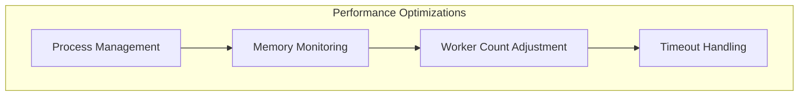

Sources:
- [src/promptflow/tests/executor/unittests/executor/test_line_execution_process_pool.py:331-394]()
- [src/promptflow/tests/executor/unittests/_utils/test_process_utils.py:1-38]()

## Summary

The Flow Execution Model in PromptFlow provides a robust framework for:
- Loading and validating flow definitions
- Resolving and executing tools in flow nodes
- Processing single inputs and batches efficiently
- Handling errors and managing execution state
- Optimizing performance for parallel execution

The model is designed to be flexible and extensible, supporting various tool types, connection mechanisms, and execution patterns while maintaining reliability and performance.

---

