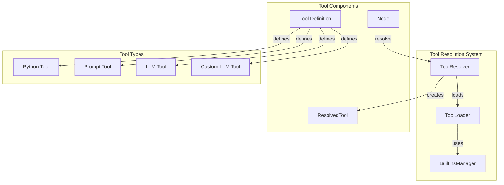
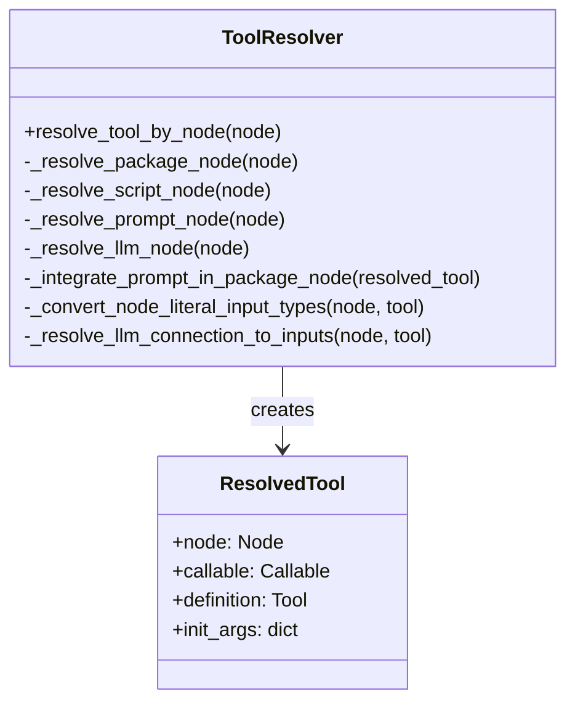
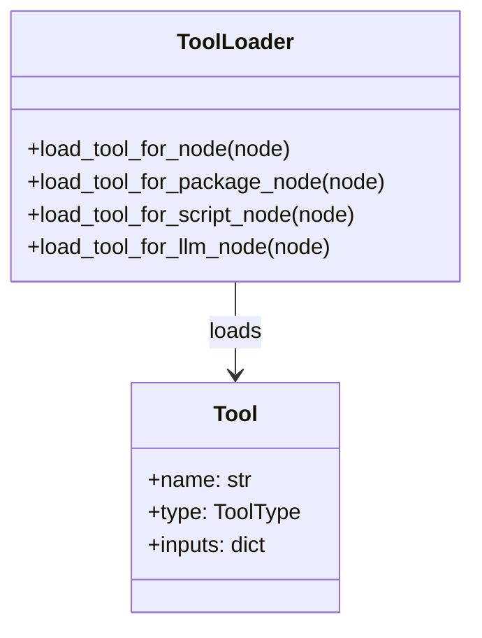
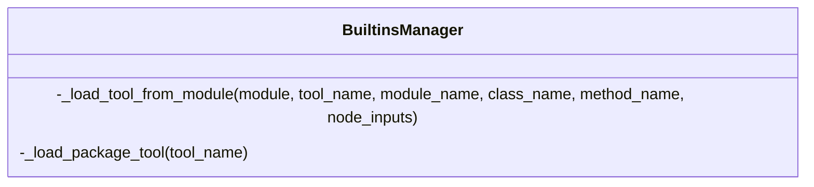
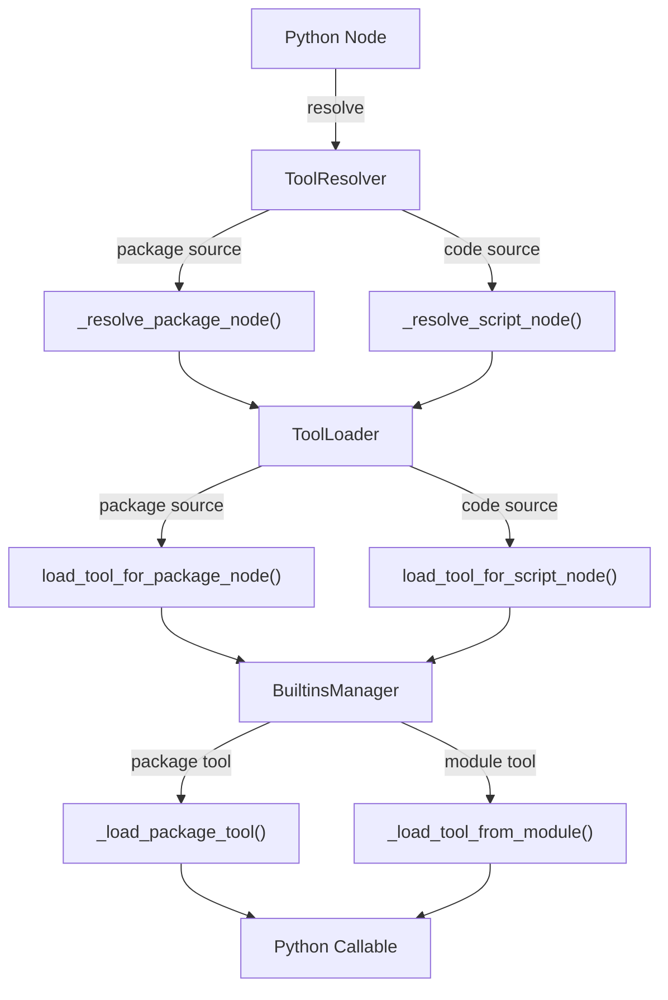
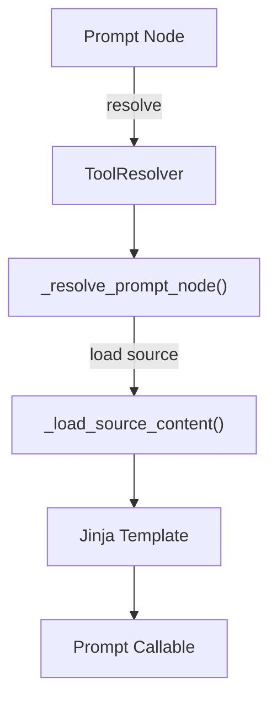
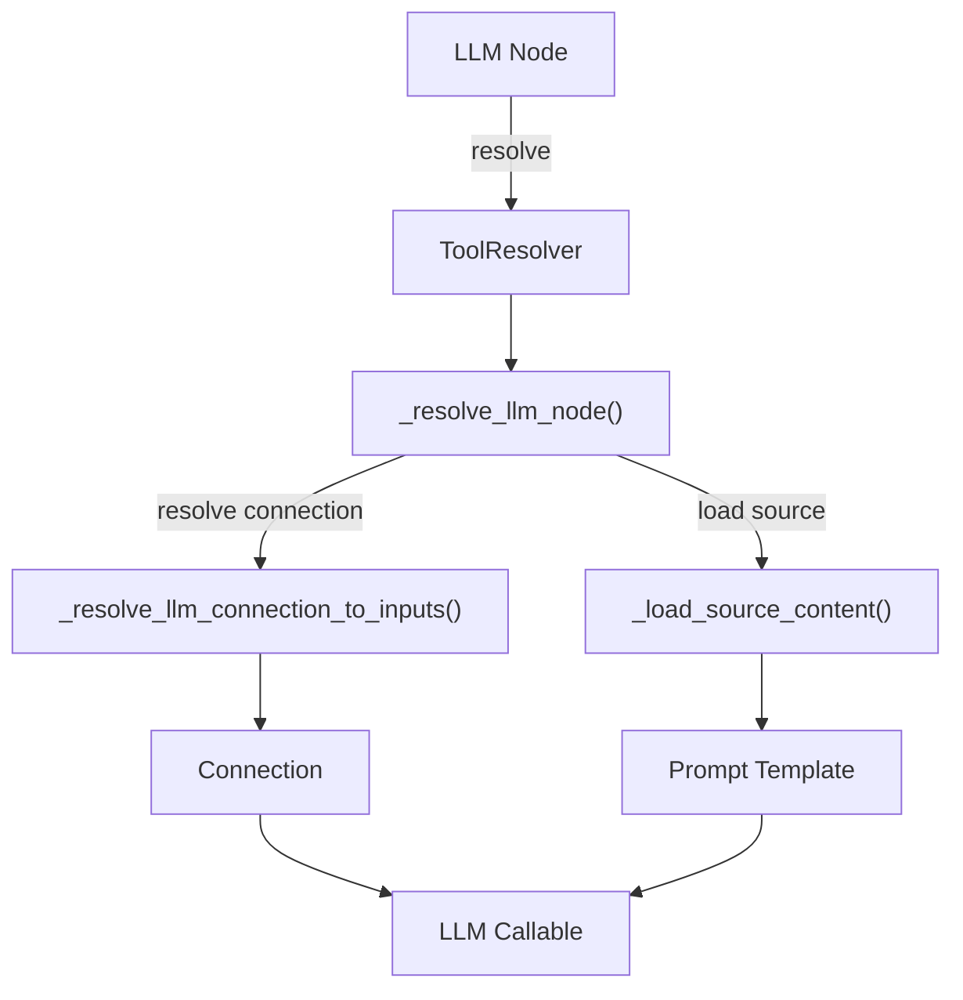
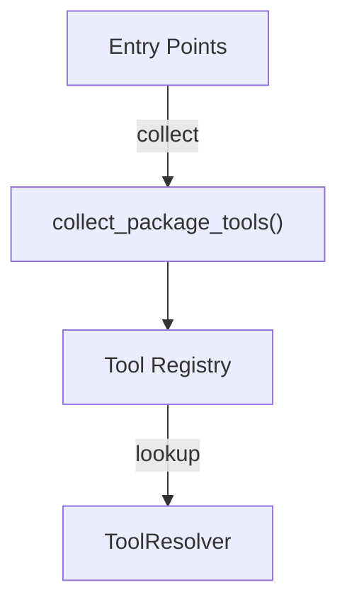
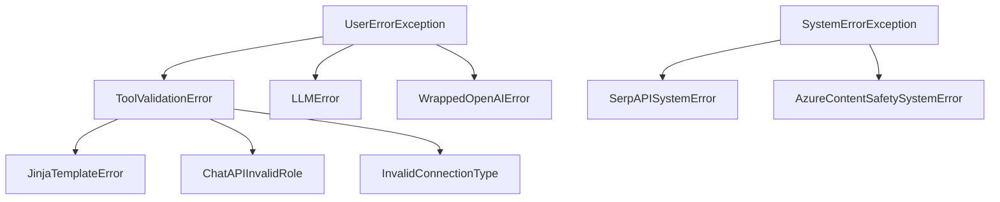
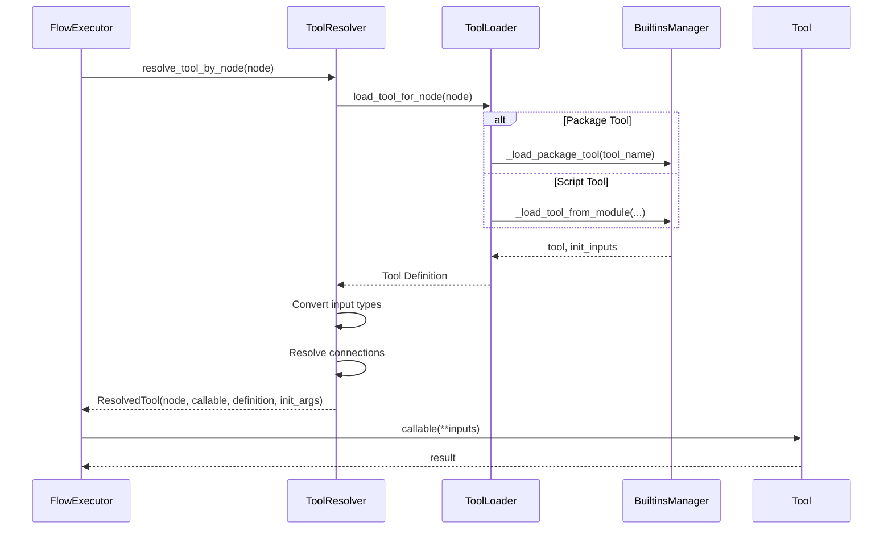

<!-- source: DeepWiki mcp.deepwiki.com · repo microsoft/promptflow · page 2.3 Tool System · fetched 2026-10-26 -->

# Tool System

<details>
<summary>Relevant source files</summary>

The following files were used as context for generating this wiki page:

- [docs/reference/tools-reference/aoai-gpt4-turbo-vision.md](docs/reference/tools-reference/aoai-gpt4-turbo-vision.md)
- [docs/reference/tools-reference/openai-gpt-4v-tool.md](docs/reference/tools-reference/openai-gpt-4v-tool.md)
- [src/promptflow-tools/promptflow/tools/aoai.py](src/promptflow-tools/promptflow/tools/aoai.py)
- [src/promptflow-tools/promptflow/tools/aoai_gpt4v.py](src/promptflow-tools/promptflow/tools/aoai_gpt4v.py)
- [src/promptflow-tools/promptflow/tools/common.py](src/promptflow-tools/promptflow/tools/common.py)
- [src/promptflow-tools/promptflow/tools/exception.py](src/promptflow-tools/promptflow/tools/exception.py)
- [src/promptflow-tools/promptflow/tools/openai.py](src/promptflow-tools/promptflow/tools/openai.py)
- [src/promptflow-tools/promptflow/tools/openai_gpt4v.py](src/promptflow-tools/promptflow/tools/openai_gpt4v.py)
- [src/promptflow-tools/promptflow/tools/yamls/aoai_gpt4v.yaml](src/promptflow-tools/promptflow/tools/yamls/aoai_gpt4v.yaml)
- [src/promptflow-tools/promptflow/tools/yamls/embedding.yaml](src/promptflow-tools/promptflow/tools/yamls/embedding.yaml)
- [src/promptflow-tools/promptflow/tools/yamls/openai_gpt4v.yaml](src/promptflow-tools/promptflow/tools/yamls/openai_gpt4v.yaml)
- [src/promptflow-tools/tests/pytest.ini](src/promptflow-tools/tests/pytest.ini)
- [src/promptflow-tools/tests/test_aoai.py](src/promptflow-tools/tests/test_aoai.py)
- [src/promptflow-tools/tests/test_aoai_gptv.py](src/promptflow-tools/tests/test_aoai_gptv.py)
- [src/promptflow-tools/tests/test_common.py](src/promptflow-tools/tests/test_common.py)
- [src/promptflow-tools/tests/test_embedding.py](src/promptflow-tools/tests/test_embedding.py)
- [src/promptflow-tools/tests/test_handle_openai_error.py](src/promptflow-tools/tests/test_handle_openai_error.py)
- [src/promptflow-tools/tests/test_openai.py](src/promptflow-tools/tests/test_openai.py)
- [src/promptflow-tools/tests/test_openai_gpt4v.py](src/promptflow-tools/tests/test_openai_gpt4v.py)
- [src/promptflow-tools/tests/test_serpapi.py](src/promptflow-tools/tests/test_serpapi.py)
- [src/promptflow/tests/executor/e2etests/test_executor_validation.py](src/promptflow/tests/executor/e2etests/test_executor_validation.py)
- [src/promptflow/tests/executor/e2etests/test_script_tool_generator.py](src/promptflow/tests/executor/e2etests/test_script_tool_generator.py)
- [src/promptflow/tests/executor/unittests/_core/test_tool_settings_parser.py](src/promptflow/tests/executor/unittests/_core/test_tool_settings_parser.py)
- [src/promptflow/tests/executor/unittests/_core/test_tools_manager.py](src/promptflow/tests/executor/unittests/_core/test_tools_manager.py)
- [src/promptflow/tests/executor/unittests/_utils/test_generate_tool_meta_utils.py](src/promptflow/tests/executor/unittests/_utils/test_generate_tool_meta_utils.py)
- [src/promptflow/tests/executor/unittests/_utils/test_tool_utils.py](src/promptflow/tests/executor/unittests/_utils/test_tool_utils.py)
- [src/promptflow/tests/executor/unittests/executor/test_flow_validator.py](src/promptflow/tests/executor/unittests/executor/test_flow_validator.py)
- [src/promptflow/tests/executor/unittests/executor/test_input_assignment_parser.py](src/promptflow/tests/executor/unittests/executor/test_input_assignment_parser.py)
- [src/promptflow/tests/executor/unittests/executor/test_tool_resolver.py](src/promptflow/tests/executor/unittests/executor/test_tool_resolver.py)
- [src/promptflow/tests/test_configs/eager_flows/flow_with_dataclass_output/flow_with_dataclass.meta.json](src/promptflow/tests/test_configs/eager_flows/flow_with_dataclass_output/flow_with_dataclass.meta.json)
- [src/promptflow/tests/test_configs/eager_flows/flow_with_dataclass_output/flow_with_dataclass.py](src/promptflow/tests/test_configs/eager_flows/flow_with_dataclass_output/flow_with_dataclass.py)
- [src/promptflow/tests/test_configs/wrong_flows/aggregation_activate_reference_non_aggregation/flow.dag.yaml](src/promptflow/tests/test_configs/wrong_flows/aggregation_activate_reference_non_aggregation/flow.dag.yaml)
- [src/promptflow/tests/test_configs/wrong_flows/flow_llm_with_wrong_conn/flow.dag.yaml](src/promptflow/tests/test_configs/wrong_flows/flow_llm_with_wrong_conn/flow.dag.yaml)
- [src/promptflow/tests/test_configs/wrong_flows/flow_llm_with_wrong_conn/wrong_llm.jinja2](src/promptflow/tests/test_configs/wrong_flows/flow_llm_with_wrong_conn/wrong_llm.jinja2)
- [src/promptflow/tests/test_configs/wrong_flows/non_aggregation_reference_aggregation/flow.dag.yaml](src/promptflow/tests/test_configs/wrong_flows/non_aggregation_reference_aggregation/flow.dag.yaml)

</details>


The Tool System is the core component of PromptFlow that manages the definition, resolution, loading, and execution of tools. Tools are the fundamental building blocks that enable flows to perform specific operations, such as calling AI models, processing inputs, or transforming data. This document explains how the Tool System works, its architecture, and the key components that allow tools to be discovered, loaded, and executed during flow runs.

For information about creating custom tools, see [Creating Custom Tools](#5.2).

## Tool System Architecture

The Tool System consists of several key components that work together to manage tools throughout the lifecycle of a flow execution.



Sources: 
- [src/promptflow/tests/executor/unittests/executor/test_tool_resolver.py]()
- [src/promptflow/tests/executor/unittests/_core/test_tools_manager.py]()

## Key Components

### ToolResolver

The `ToolResolver` is the central component that resolves node references to executable tools during flow execution. It's responsible for determining the appropriate resolution strategy based on the tool type and source.



When the flow executor processes a node, it uses the `ToolResolver` to turn the node's tool reference into an executable function. The resolver examines the node's type and source to determine how to resolve it:

- For `ToolType.PYTHON` with `ToolSourceType.Package`, it uses `_resolve_package_node`
- For `ToolType.PYTHON` with `ToolSourceType.Code`, it uses `_resolve_script_node`
- For `ToolType.PROMPT`, it uses `_resolve_prompt_node`
- For `ToolType.LLM`, it uses `_resolve_llm_node`
- For `ToolType.CUSTOM_LLM`, it first resolves the package node and then integrates the prompt

Sources:
- [src/promptflow/tests/executor/unittests/executor/test_tool_resolver.py:50-108]()

### ToolLoader

The `ToolLoader` is responsible for loading tool definitions from various sources. It works closely with the `ToolResolver` to provide the actual tool implementation.



The loader handles different sources of tools:

- **Package tools**: Tools provided by Python packages through entry points
- **Script tools**: Tools defined in Python script files
- **LLM tools**: Tools that interact with language models

Sources:
- [src/promptflow/tests/executor/unittests/_core/test_tools_manager.py:36-159]()

### BuiltinsManager

The `BuiltinsManager` manages built-in tools and provides utilities for loading tools from modules and packages.



It's responsible for:
- Loading tools from Python modules
- Handling tool function initialization
- Converting function parameters to tool input definitions

Sources:
- [src/promptflow/tests/executor/unittests/_core/test_tools_manager.py:388-434]()

## Tool Types and Resolution

PromptFlow supports several types of tools, each with its own resolution logic:

### Python Tools

Python tools are functions decorated with the `@tool` decorator. They can come from packages or script files.



The resolution process for Python tools involves:
1. Identifying the tool source (package or code)
2. Loading the tool definition
3. Creating a callable that wraps the tool function

Sources:
- [src/promptflow/tests/executor/unittests/executor/test_tool_resolver.py:368-467]()

### Prompt Tools

Prompt tools are Jinja2 templates that can be used to generate text. They're resolved by loading the template and creating a callable that renders it.



The resolution process for prompt tools involves:
1. Loading the template source
2. Creating a Jinja2 template
3. Creating a callable that renders the template with inputs

Sources:
- [src/promptflow-tools/promptflow/tools/common.py:632-653]()

### LLM Tools

LLM tools interact with language models like OpenAI's GPT models. They require connections to these services.



The resolution process for LLM tools involves:
1. Resolving the connection to the LLM service
2. Loading the prompt template
3. Creating a callable that uses the connection to call the LLM with the rendered prompt

Sources:
- [src/promptflow/tests/executor/unittests/executor/test_tool_resolver.py:331-367]()
- [src/promptflow-tools/promptflow/tools/aoai.py:102-173]()
- [src/promptflow-tools/promptflow/tools/openai.py:90-158]()

## Tool Registration and Discovery

Tools can be registered and discovered in several ways:

### Package Tools

Package tools are registered through entry points in the package's `setup.py`. PromptFlow discovers these tools using the entry point group `package_tools`.

```python
entry_points={
    "package_tools": ["builtins = promptflow.tools.list:list_package_tools"],
}
```

The `collect_package_tools` function gathers all registered tools:



Sources:
- [src/promptflow-tools/setup.py:61-65]()
- [src/promptflow/tests/executor/unittests/_core/test_tools_manager.py:176-216]()

### Script Tools

Script tools are discovered by scanning Python files for functions decorated with `@tool`. The `ToolLoader` loads these tools when a node references them.

Sources:
- [src/promptflow/tests/executor/unittests/_core/test_tools_manager.py:126-159]()

## Error Handling

The Tool System provides comprehensive error handling with specialized exceptions:



These specialized exceptions help provide clear error messages to users and facilitate debugging.

Sources:
- [src/promptflow-tools/promptflow/tools/exception.py:1-230]()

## Common Utilities

The Tool System provides several common utilities for working with tools:

### Jinja Template Rendering

```python
def render_jinja_template(template_content, trim_blocks=True, keep_trailing_newline=True, escape_dict={}, **kwargs):
    # Renders a Jinja2 template with the provided kwargs
```

Sources:
- [src/promptflow-tools/promptflow/tools/common.py:636-653]()

### OpenAI Error Handling

```python
@handle_openai_error()
def chat(self, prompt: PromptTemplate, ...):
    # Handles OpenAI API errors gracefully
```

Sources:
- [src/promptflow-tools/promptflow/tools/common.py:523-627]()
- [src/promptflow-tools/promptflow/tools/exception.py:8-107]()

### Chat Message Parsing

```python
def parse_chat(chat_str, images: List = None, valid_roles: List[str] = None, image_detail: str = "auto", escape_dict: dict = {}):
    # Parses chat strings into a structured format for LLM APIs
```

Sources:
- [src/promptflow-tools/promptflow/tools/common.py:274-340]()

## Tool System Flow: From Definition to Execution

The following diagram illustrates how a tool goes from definition to execution:



Sources:
- [src/promptflow/tests/executor/unittests/executor/test_tool_resolver.py:50-108]()
- [src/promptflow/tests/executor/e2etests/test_executor_validation.py:35-242]()

## Lifecycle of a Tool Call

When a tool is called during flow execution, it goes through the following lifecycle:

1. **Tool Resolution**: The `ToolResolver` resolves the node's tool reference
2. **Input Preparation**: Node inputs are converted to the appropriate types
3. **Connection Resolution**: Connections are resolved if required
4. **Tool Execution**: The tool callable is executed with the prepared inputs
5. **Output Processing**: The tool output is processed and returned
6. **Error Handling**: Any errors are caught and handled appropriately

For LLM tools, there's additional processing:
1. **Template Rendering**: The prompt template is rendered with the inputs
2. **LLM API Call**: The LLM API is called with the rendered prompt
3. **Response Parsing**: The LLM response is parsed into the expected format

Sources:
- [src/promptflow-tools/promptflow/tools/common.py:785-807]()
- [src/promptflow-tools/promptflow/tools/aoai.py:102-173]()
- [src/promptflow-tools/promptflow/tools/openai.py:90-158]()

## Conclusion

The Tool System is a central component of PromptFlow that enables the creation, discovery, and execution of tools. It provides a flexible and extensible architecture for working with different types of tools, from simple Python functions to complex LLM interactions. Understanding the Tool System is essential for effectively using and extending PromptFlow.

---

