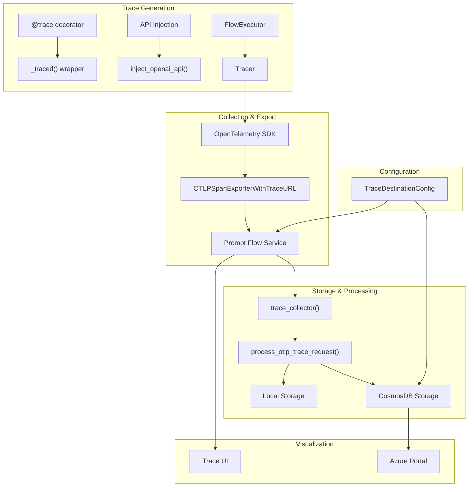
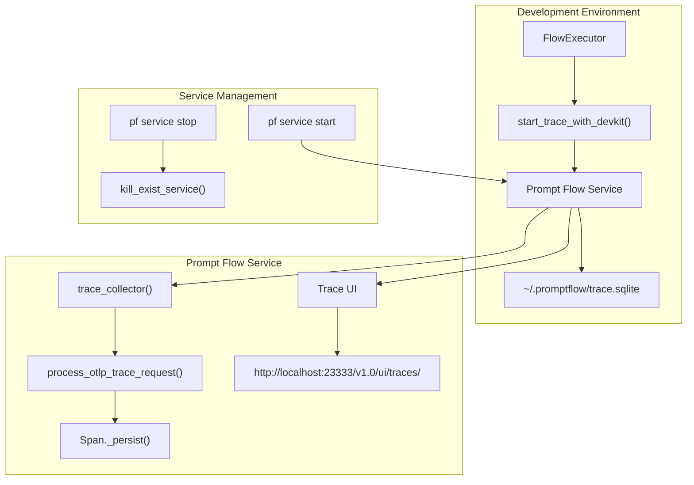
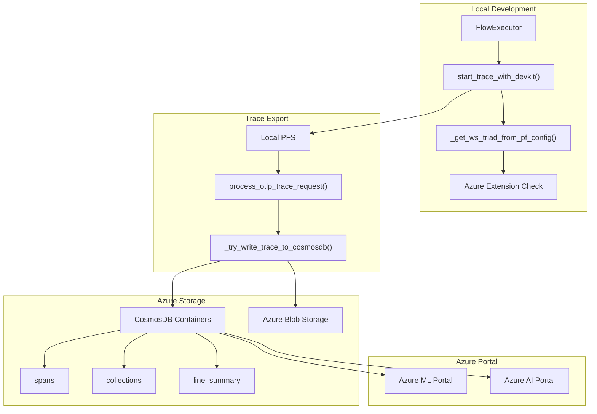
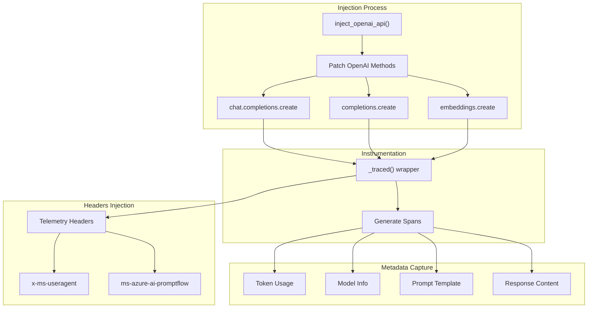
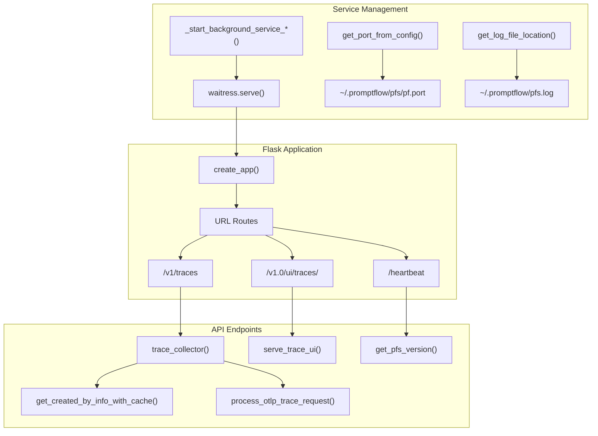

<!-- source: DeepWiki mcp.deepwiki.com · repo microsoft/promptflow · page 2.4 Tracing and Telemetry · fetched 2026-10-26 -->

# Tracing and Telemetry

<details>
<summary>Relevant source files</summary>

The following files were used as context for generating this wiki page:

- [src/promptflow-azure/promptflow/azure/_cli/entry.py](src/promptflow-azure/promptflow/azure/_cli/entry.py)
- [src/promptflow-devkit/promptflow/_cli/_pf/_service.py](src/promptflow-devkit/promptflow/_cli/_pf/_service.py)
- [src/promptflow-devkit/promptflow/_cli/_pf/_upgrade.py](src/promptflow-devkit/promptflow/_cli/_pf/_upgrade.py)
- [src/promptflow-devkit/promptflow/_cli/_pf/entry.py](src/promptflow-devkit/promptflow/_cli/_pf/entry.py)
- [src/promptflow-devkit/promptflow/_cli/_utils.py](src/promptflow-devkit/promptflow/_cli/_utils.py)
- [src/promptflow-devkit/promptflow/_sdk/_configuration.py](src/promptflow-devkit/promptflow/_sdk/_configuration.py)
- [src/promptflow-devkit/promptflow/_sdk/_constants.py](src/promptflow-devkit/promptflow/_sdk/_constants.py)
- [src/promptflow-devkit/promptflow/_sdk/_service/app.py](src/promptflow-devkit/promptflow/_sdk/_service/app.py)
- [src/promptflow-devkit/promptflow/_sdk/_service/utils/utils.py](src/promptflow-devkit/promptflow/_sdk/_service/utils/utils.py)
- [src/promptflow-devkit/promptflow/_sdk/_tracing.py](src/promptflow-devkit/promptflow/_sdk/_tracing.py)
- [src/promptflow-devkit/promptflow/_sdk/_utilities/tracing_utils.py](src/promptflow-devkit/promptflow/_sdk/_utilities/tracing_utils.py)
- [src/promptflow-devkit/tests/conftest.py](src/promptflow-devkit/tests/conftest.py)
- [src/promptflow-devkit/tests/sdk_cli_test/unittests/test_trace.py](src/promptflow-devkit/tests/sdk_cli_test/unittests/test_trace.py)
- [src/promptflow-devkit/tests/sdk_pfs_test/e2etests/test_cli.py](src/promptflow-devkit/tests/sdk_pfs_test/e2etests/test_cli.py)
- [src/promptflow-recording/promptflow/recording/local/__init__.py](src/promptflow-recording/promptflow/recording/local/__init__.py)
- [src/promptflow-recording/promptflow/recording/local/test_utils.py](src/promptflow-recording/promptflow/recording/local/test_utils.py)
- [src/promptflow-recording/recordings/local/executor_node_cache.shelve.bak](src/promptflow-recording/recordings/local/executor_node_cache.shelve.bak)
- [src/promptflow-recording/recordings/local/executor_node_cache.shelve.dat](src/promptflow-recording/recordings/local/executor_node_cache.shelve.dat)
- [src/promptflow-recording/recordings/local/executor_node_cache.shelve.dir](src/promptflow-recording/recordings/local/executor_node_cache.shelve.dir)
- [src/promptflow/setup.py](src/promptflow/setup.py)
- [src/promptflow/tests/executor/e2etests/test_langchain.py](src/promptflow/tests/executor/e2etests/test_langchain.py)
- [src/promptflow/tests/executor/e2etests/test_telemetry.py](src/promptflow/tests/executor/e2etests/test_telemetry.py)
- [src/promptflow/tests/executor/e2etests/test_traces.py](src/promptflow/tests/executor/e2etests/test_traces.py)
- [src/promptflow/tests/executor/unittests/_core/test_api_injector.py](src/promptflow/tests/executor/unittests/_core/test_api_injector.py)
- [src/promptflow/tests/executor/unittests/_core/test_tool.py](src/promptflow/tests/executor/unittests/_core/test_tool.py)
- [src/promptflow/tests/executor/unittests/_core/test_tracer.py](src/promptflow/tests/executor/unittests/_core/test_tracer.py)
- [src/promptflow/tests/test_configs/flows/flow_with_trace/greetings.py](src/promptflow/tests/test_configs/flows/flow_with_trace/greetings.py)
- [src/promptflow/tests/test_configs/flows/flow_with_trace_async/greetings.py](src/promptflow/tests/test_configs/flows/flow_with_trace_async/greetings.py)
- [src/promptflow/tests/test_configs/flows/openai_chat_api_flow/chat.py](src/promptflow/tests/test_configs/flows/openai_chat_api_flow/chat.py)
- [src/promptflow/tests/test_configs/flows/openai_chat_api_flow/flow.dag.yaml](src/promptflow/tests/test_configs/flows/openai_chat_api_flow/flow.dag.yaml)
- [src/promptflow/tests/test_configs/flows/openai_chat_api_flow/inputs.jsonl](src/promptflow/tests/test_configs/flows/openai_chat_api_flow/inputs.jsonl)
- [src/promptflow/tests/test_configs/flows/openai_completion_api_flow/completion.py](src/promptflow/tests/test_configs/flows/openai_completion_api_flow/completion.py)
- [src/promptflow/tests/test_configs/flows/openai_completion_api_flow/flow.dag.yaml](src/promptflow/tests/test_configs/flows/openai_completion_api_flow/flow.dag.yaml)
- [src/promptflow/tests/test_configs/flows/openai_completion_api_flow/inputs.jsonl](src/promptflow/tests/test_configs/flows/openai_completion_api_flow/inputs.jsonl)
- [src/promptflow/tests/test_configs/flows/openai_embedding_api_flow/embedding.py](src/promptflow/tests/test_configs/flows/openai_embedding_api_flow/embedding.py)
- [src/promptflow/tests/test_configs/flows/openai_embedding_api_flow/flow.dag.yaml](src/promptflow/tests/test_configs/flows/openai_embedding_api_flow/flow.dag.yaml)

</details>


This document covers the tracing and telemetry system in Prompt Flow, which provides observability for LLM application execution through distributed tracing, automatic instrumentation, and telemetry collection. The system enables developers to monitor, debug, and analyze flow execution across local development and cloud deployment scenarios.

For information about flow execution mechanics, see [Flow Execution Model](#2.2). For evaluation and testing capabilities, see [Evaluation System](#6.2).

## System Architecture

The tracing system is built on OpenTelemetry standards and consists of several interconnected components that handle trace generation, collection, processing, and visualization.

### Core Components Architecture



Sources: [src/promptflow-devkit/promptflow/_sdk/_tracing.py:71-112](), [src/promptflow/tests/executor/unittests/_core/test_tracer.py:8-15](), [src/promptflow-devkit/promptflow/_sdk/_service/app.py:54-55]()

### Trace Flow Pipeline

```mermaid
graph LR
    subgraph "Instrumentation"
        FE["FlowExecutor.exec_line()"] --> ST["start_trace_with_devkit()"]
        ST --> IPA["inject_openai_api()"]
        ST --> SEP["setup_exporter_to_pfs()"]
    end
    
    subgraph "Collection"
        SEP --> TP["TracerProvider"]
        TP --> BSP["BatchSpanProcessor"] 
        BSP --> OSE["OTLPSpanExporterWithTraceURL"]
    end
    
    subgraph "Transport"
        OSE --> HTTP["HTTP POST /v1/traces"]
        HTTP --> PFS["Prompt Flow Service"]
    end
    
    subgraph "Processing"
        PFS --> TC["trace_collector()"]
        TC --> POTR["process_otlp_trace_request()"]
        POTR --> PS["parse_protobuf_span()"]
        PS --> SP["Span._persist()"]
    end
    
    subgraph "Storage"
        SP --> SQLITE["trace.sqlite"]
        POTR --> COSMOS["Azure CosmosDB"]
    end
```



Sources: [src/promptflow-devkit/promptflow/_sdk/_tracing.py:383-489](), [src/promptflow-devkit/promptflow/_sdk/_tracing.py:514-583](), [src/promptflow-devkit/promptflow/_sdk/_tracing.py:622-676]()

## Core Tracing Components

### TraceDestinationConfig

The `TraceDestinationConfig` class manages trace destination configuration with three primary modes:

| Mode | Value | Description |
|------|--------|-------------|
| Disabled | `"none"` | Tracing completely disabled |
| Local | `"local"` | Traces stored locally via PFS |
| Azure | `"azureml"` | Traces exported to Azure ML/AI |

```python
# Key methods in TraceDestinationConfig
is_feature_disabled(value: str) -> bool
need_to_export_to_azure(value: str) -> bool  
need_to_resolve(value: str) -> bool
```

Sources: [src/promptflow-devkit/promptflow/_sdk/_tracing.py:71-112]()

### Start Trace with DevKit

The `start_trace_with_devkit()` function serves as the primary entry point for initializing tracing in development scenarios:

```python
def start_trace_with_devkit(collection: str, **kwargs) -> None
```

Key responsibilities:
- Validates trace configuration and Azure package availability
- Invokes Prompt Flow Service (`_invoke_pf_svc()`)
- Injects OpenAI API instrumentation (`inject_openai_api()`)
- Sets up OTLP exporter (`setup_exporter_to_pfs()`)
- Configures resource attributes and environment variables

Sources: [src/promptflow-devkit/promptflow/_sdk/_tracing.py:383-489]()

### OTLP Span Exporter

The `OTLPSpanExporterWithTraceURL` extends the standard OpenTelemetry OTLP exporter with trace URL printing capabilities:

```python
class OTLPSpanExporterWithTraceURL(OTLPSpanExporter):
    def export(self, spans: Sequence[trace.Span]) -> None:
        super().export(spans)
        # Print trace URLs after export
        for trace_id in trace_ids:
            self._print_trace_url(trace_id)
```

Sources: [src/promptflow-devkit/promptflow/_sdk/_tracing.py:586-620]()

## Local vs Cloud Tracing

### Local Tracing Architecture



Sources: [src/promptflow-devkit/promptflow/_cli/_pf/_service.py:169-206](), [src/promptflow-devkit/promptflow/_sdk/_service/app.py:56-59]()

### Cloud Tracing Architecture



Sources: [src/promptflow-devkit/promptflow/_sdk/_tracing.py:424-448](), [src/promptflow-devkit/promptflow/_sdk/_tracing.py:679-805]()

## OpenAI API Instrumentation

### Automatic Injection System

The tracing system automatically instruments OpenAI API calls through the `inject_openai_api()` function:



Key instrumented functions:
- `openai.resources.chat.completions.Completions.create`
- `openai.resources.completions.Completions.create` 
- `openai.resources.embeddings.Embeddings.create`

Sources: [src/promptflow/tests/executor/e2etests/test_telemetry.py:42-49](), [src/promptflow/tests/executor/unittests/_core/test_api_injector.py:23-66]()

### Token Metrics Collection

The system automatically captures and aggregates token usage metrics:

| Metric | Description |
|--------|-------------|
| `llm.usage.prompt_tokens` | Input tokens consumed |
| `llm.usage.completion_tokens` | Output tokens generated |
| `llm.usage.total_tokens` | Total tokens used |
| `__computed__.cumulative_token_count.*` | Aggregated counts |

Sources: [src/promptflow/tests/executor/e2etests/test_traces.py:50-72]()

## Service Architecture

### Prompt Flow Service Components



Sources: [src/promptflow-devkit/promptflow/_sdk/_service/app.py:43-148](), [src/promptflow-devkit/promptflow/_cli/_pf/_service.py:269-318]()

### Service Lifecycle Management

The service lifecycle is managed through CLI commands and utility functions:

| Command | Function | Purpose |
|---------|----------|---------|
| `pf service start` | `start_service()` | Launch PFS daemon |
| `pf service stop` | `stop_service()` | Terminate PFS process |
| `pf service status` | `show_service()` | Display service info |

Key utility functions:
- `is_pfs_service_healthy()` - Health check via `/heartbeat`
- `kill_exist_service()` - Process termination
- `get_started_service_info()` - Service metadata

Sources: [src/promptflow-devkit/promptflow/_cli/_pf/_service.py:169-352](), [src/promptflow-devkit/promptflow/_sdk/_service/utils/utils.py:208-251]()

## Configuration and Setup

### Environment Configuration

The tracing system uses several environment variables for configuration:

| Variable | Purpose |
|----------|---------|
| `PF_TRACE_CONTEXT` | Experiment context attributes |
| `OTEL_EXPORTER_OTLP_TRACES_ENDPOINT` | OTLP endpoint URL |
| `PF_TRACING_SKIP_EXPORTER_SETUP` | Skip exporter setup |
| `TRACE_DESTINATION` | Target destination config |

### Resource Attributes

Trace resources include metadata for identification and routing:

```python
# Core resource attributes
SpanResourceAttributesFieldName.COLLECTION = "collection"
SpanResourceAttributesFieldName.SERVICE_NAME = "promptflow" 
SpanResourceAttributesFieldName.EXPERIMENT_NAME = "experiment"
SpanResourceAttributesFieldName.SUBSCRIPTION_ID = "subscription_id"
SpanResourceAttributesFieldName.WORKSPACE_NAME = "workspace_name"
```

Sources: [src/promptflow-devkit/promptflow/_sdk/_tracing.py:333-380](), [src/promptflow-devkit/promptflow/_sdk/_tracing.py:514-583]()

### Workspace Integration

For Azure integration, the system resolves workspace configuration:

```python
def _get_ws_triad_from_pf_config(path: Path) -> AzureMLWorkspaceTriad:
    # Resolves workspace from config.json or pf.config
    # Returns subscription_id, resource_group_name, workspace_name
```

The `WorkspaceKindLocalCache` class provides caching for workspace metadata to optimize repeated lookups.

Sources: [src/promptflow-devkit/promptflow/_sdk/_tracing.py:209-217](), [src/promptflow-devkit/tests/sdk_cli_test/unittests/test_trace.py:290-343]()

---

