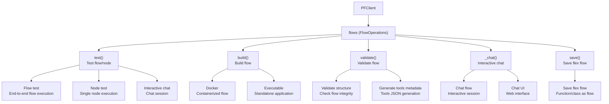
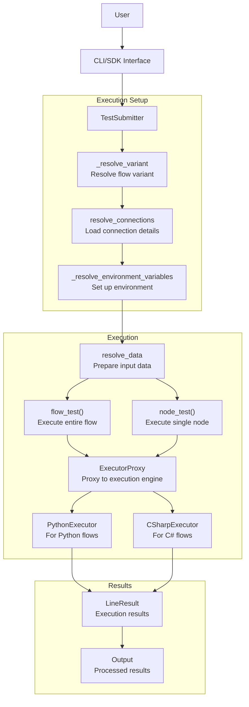
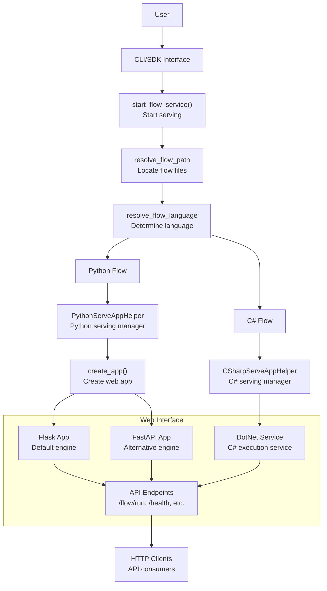
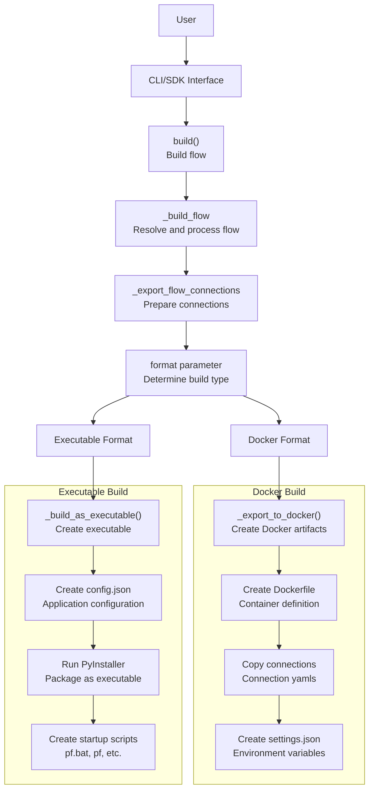
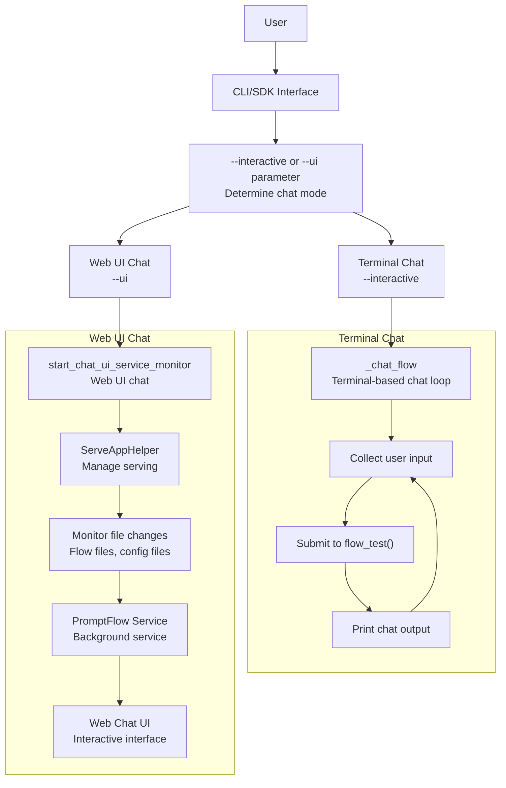

<!-- source: DeepWiki mcp.deepwiki.com · repo microsoft/promptflow · page 3 CLI and SDK · fetched 2026-10-26 -->

# CLI and SDK

<details>
<summary>Relevant source files</summary>

The following files were used as context for generating this wiki page:

- [docs/cloud/azureai/create-run-with-compute-session.md](docs/cloud/azureai/create-run-with-compute-session.md)
- [docs/cloud/azureai/manage-flows.md](docs/cloud/azureai/manage-flows.md)
- [docs/cloud/azureai/run-promptflow-in-azure-ai.md](docs/cloud/azureai/run-promptflow-in-azure-ai.md)
- [docs/cloud/azureai/runtime-change-log.md](docs/cloud/azureai/runtime-change-log.md)
- [docs/cloud/azureai/use-flow-in-azure-ml-pipeline.md](docs/cloud/azureai/use-flow-in-azure-ml-pipeline.md)
- [docs/cloud/index.md](docs/cloud/index.md)
- [docs/media/cloud/azureml/llmops_cloud_value.png](docs/media/cloud/azureml/llmops_cloud_value.png)
- [docs/media/cloud/manage-flows/flow_create_2.png](docs/media/cloud/manage-flows/flow_create_2.png)
- [docs/media/cloud/runtime-change-log/runtime-version.png](docs/media/cloud/runtime-change-log/runtime-version.png)
- [docs/media/trace/trace-ui-portal-demo.gif](docs/media/trace/trace-ui-portal-demo.gif)
- [docs/reference/pf-command-reference.md](docs/reference/pf-command-reference.md)
- [docs/reference/pfazure-command-reference.md](docs/reference/pfazure-command-reference.md)
- [examples/configuration.ipynb](examples/configuration.ipynb)
- [src/promptflow/tests/test_configs/flows/web_classification_invalid/convert_to_dict.py](src/promptflow/tests/test_configs/flows/web_classification_invalid/convert_to_dict.py)
- [src/promptflow/tests/test_configs/flows/web_classification_invalid/flow.dag.yaml](src/promptflow/tests/test_configs/flows/web_classification_invalid/flow.dag.yaml)

</details>


This page provides an overview of the command-line interface (CLI) and software development kit (SDK) in PromptFlow, which serve as the primary ways to interact with the framework. For details about specific flow types, see [Flow Types](#4).

## Overview

The PromptFlow CLI and SDK provide consistent interfaces for working with prompt flows. They enable you to:

- Create and initialize flows
- Test flows and individual nodes
- Build flows for deployment (Docker or executable)
- Serve flows as HTTP endpoints
- Validate flows
- Create interactive chat experiences

The CLI offers command-line access for scripting and direct use, while the SDK provides programmatic access through Python code.

## Command Line Interface Structure

The CLI is organized around the `pf` command with various subcommands.

```mermaid
graph TD
    PF["pf"] --> FLOW["flow"]
    FLOW --> INIT["init\nInitialize a flow"]
    FLOW --> TEST["test\nTest a flow or node"]
    FLOW --> SERVE["serve\nServe a flow as an API"]
    FLOW --> BUILD["build\nBuild flow as Docker/executable"]
    FLOW --> VALIDATE["validate\nValidate flow structure"]
    FLOW --> SAVE["save\nSave a flex flow"]
    
    INIT --> INIT_STANDARD["--type standard\nStandard flow"]
    INIT --> INIT_EVAL["--type evaluation\nEvaluation flow"]
    INIT --> INIT_CHAT["--type chat\nChat flow"]
    
    TEST --> TEST_FLOW["--flow <path>\nTest entire flow"]
    TEST --> TEST_NODE["--node <node_name>\nTest single node"]
    TEST --> TEST_VARIANT["--variant <node.variant>\nTest with variant"]
    TEST --> TEST_INTERACTIVE["--interactive\nInteractive chat"]
    TEST --> TEST_UI["--ui\nTest with UI"]
    
    SERVE --> SERVE_SOURCE["--source <path>\nFlow to serve"]
    SERVE --> SERVE_PORT["--port <port>\nPort number"]
    SERVE --> SERVE_HOST["--host <host>\nHost address"]
    SERVE --> SERVE_ENGINE["--engine <flask|fastapi>\nServing engine"]
    
    BUILD --> BUILD_SOURCE["--source <path>\nFlow to build"]
    BUILD --> BUILD_OUTPUT["--output <path>\nOutput location"]
    BUILD --> BUILD_FORMAT["--format <docker|executable>\nBuild format"]
    
    VALIDATE --> VALIDATE_SOURCE["--source <path>\nFlow to validate"]
    
    SAVE --> SAVE_ENTRY["--entry <entry>\nEntry function"]
    SAVE --> SAVE_CODE["--code <path>\nCode path"]
    SAVE --> SAVE_PATH["--path <path>\nOutput path"]
```



Sources: [src/promptflow-devkit/promptflow/_cli/_pf/_flow.py:55-96](), [src/promptflow-devkit/promptflow/_cli/_pf/_flow.py:97-133]()

## SDK Structure

The SDK provides a programmatic interface through the `PFClient` class, which has various properties and methods for working with flows.



Sources: [src/promptflow-devkit/promptflow/_sdk/operations/_flow_operations.py:71-182]()

## CLI and SDK Mapping

The following table shows how CLI commands map to SDK methods:

| CLI Command | SDK Method | Description |
|-------------|------------|-------------|
| `pf flow init` | N/A (CLI only) | Initialize a new flow |
| `pf flow test` | `pf.flows.test()` | Test a flow or node |
| `pf flow serve` | `start_flow_service()` (internal) | Serve a flow as an API |
| `pf flow build` | `pf.flows.build()` | Build a flow for deployment |
| `pf flow validate` | `pf.flows.validate()` | Validate a flow structure |
| `pf flow save` | `pf.flows.save()` | Save a flex flow |

Sources: [src/promptflow-devkit/promptflow/_cli/_pf/_flow.py:72-85](), [src/promptflow-devkit/promptflow/_sdk/operations/_flow_operations.py:71-782]()

## Key Features

### Flow Initialization

The CLI provides capabilities to initialize different types of flows:

```bash
# Create a standard flow
pf flow init --flow my-flow

# Create a chat flow
pf flow init --flow my-chat-flow --type chat

# Create an evaluation flow 
pf flow init --flow my-eval-flow --type evaluation
```

Sources: [src/promptflow-devkit/promptflow/_cli/_pf/_flow.py:337-349]()

### Flow Testing

Both the CLI and SDK enable testing entire flows or individual nodes:

```bash
# CLI: Test entire flow
pf flow test --flow my-flow

# CLI: Test specific node
pf flow test --flow my-flow --node node_name
```

```python
# SDK: Test entire flow
pf.flows.test(flow="path/to/flow")

# SDK: Test specific node
pf.flows.test(flow="path/to/flow", node="node_name")
```

Sources: [src/promptflow-devkit/promptflow/_cli/_pf/_flow.py:453-473](), [src/promptflow-devkit/promptflow/_sdk/operations/_flow_operations.py:78-166]()

### Flow Serving

Flows can be served as HTTP endpoints:

```bash
# Serve flow as an endpoint
pf flow serve --source my-flow

# Specify port and host
pf flow serve --source my-flow --port 8080 --host localhost

# Use FastAPI engine instead of default Flask
pf flow serve --source my-flow --engine fastapi
```

Sources: [src/promptflow-devkit/promptflow/_cli/_pf/_flow.py:595-610](), [src/promptflow-devkit/promptflow/_sdk/_utilities/serve_utils.py:243-297]()

### Flow Building

Flows can be built as Docker containers or executables:

```bash
# Build as Docker container
pf flow build --source my-flow --output ./output --format docker

# Build as executable
pf flow build --source my-flow --output ./output --format executable
```

Sources: [src/promptflow-devkit/promptflow/_cli/_pf/_flow.py:612-642](), [src/promptflow-devkit/promptflow/_sdk/operations/_flow_operations.py:702-781]()

## Flow Execution Architecture

When testing or running flows, PromptFlow uses a submitter architecture to handle the execution.



Sources: [src/promptflow-devkit/promptflow/_sdk/_orchestrator/test_submitter.py:47-166](), [src/promptflow-devkit/promptflow/_sdk/_orchestrator/test_submitter.py:401-474]()

## Flow Serving Architecture

The flow serving capability creates an API server for flows, supporting different engines and languages.



Sources: [src/promptflow-devkit/promptflow/_sdk/_utilities/serve_utils.py:243-352](), [src/promptflow-core/promptflow/core/_serving/app.py:1-55]()

## Flow Building Architecture

Flow building packages flows for deployment as Docker containers or executables.



Sources: [src/promptflow-devkit/promptflow/_sdk/operations/_flow_operations.py:702-781](), [src/promptflow-devkit/promptflow/_sdk/data/executable/main.py:1-223]()

## Interactive Chat Architecture

PromptFlow provides interactive chat capabilities for chat flows.



Sources: [src/promptflow-devkit/promptflow/_sdk/_orchestrator/test_submitter.py:500-571](), [src/promptflow-devkit/promptflow/_sdk/_utilities/chat_utils.py:134-238]()

## Example Usage

### CLI Examples

```bash
# Initialize a new flow
pf flow init --flow my-flow

# Test a flow
pf flow test --flow my-flow --inputs input1=value1 input2=value2

# Serve a flow
pf flow serve --source my-flow --port 8080

# Build a flow as Docker
pf flow build --source my-flow --output ./output --format docker

# Validate a flow
pf flow validate --source my-flow
```

### SDK Examples

```python
from promptflow import PFClient

# Create client
pf = PFClient()

# Test a flow
result = pf.flows.test(
    flow="path/to/flow",
    inputs={"input1": "value1", "input2": "value2"}
)

# Build a flow
pf.flows.build(
    flow="path/to/flow",
    output="./output",
    format="docker"
)

# Validate a flow
validation_result = pf.flows.validate(flow="path/to/flow")
```

## Implementation Details

### Key Components

1. **FlowOperations**: Core class that implements flow operations for the SDK
   - Located in `promptflow/_sdk/operations/_flow_operations.py`
   - Used by the PFClient

2. **TestSubmitter**: Handles flow testing and execution
   - Located in `promptflow/_sdk/_orchestrator/test_submitter.py`
   - Used by the flow test operation

3. **ServeAppHelper**: Base class for serving applications
   - Located in `promptflow/_sdk/_utilities/serve_utils.py`
   - Extended by `PythonServeAppHelper` and `CSharpServeAppHelper`

4. **CLI Command Dispatchers**: Functions that handle CLI commands
   - Located in `promptflow/_cli/_pf/_flow.py`
   - Map commands to SDK operations

Sources: [src/promptflow-devkit/promptflow/_sdk/operations/_flow_operations.py:71-782](), [src/promptflow-devkit/promptflow/_sdk/_orchestrator/test_submitter.py:47-571](), [src/promptflow-devkit/promptflow/_sdk/_utilities/serve_utils.py:29-352](), [src/promptflow-devkit/promptflow/_cli/_pf/_flow.py:337-667]()

## Summary

The PromptFlow CLI and SDK provide complementary interfaces for working with prompt flows. The CLI offers a command-line experience suitable for scripting and direct use, while the SDK enables programmatic access through Python code. Both interfaces share the same underlying implementation, ensuring consistent behavior.

The key capabilities include:
- Creating and initializing flows
- Testing flows and individual nodes
- Building flows for deployment
- Serving flows as HTTP endpoints
- Validating flows
- Interactive chat experiences

These tools enable efficient development, testing, and deployment of AI applications powered by promptflow.

---

